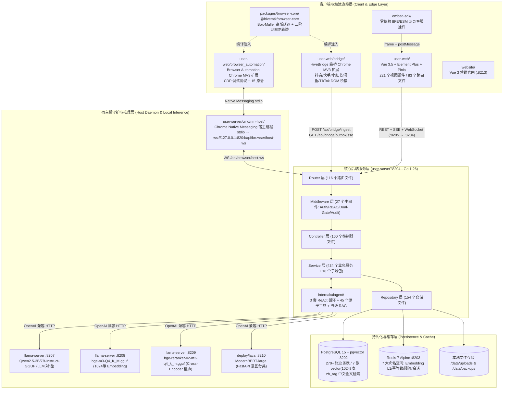
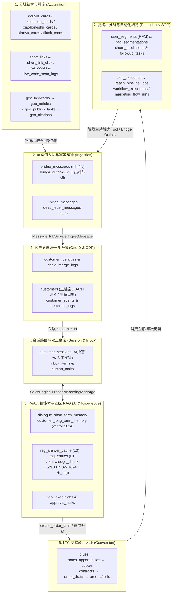
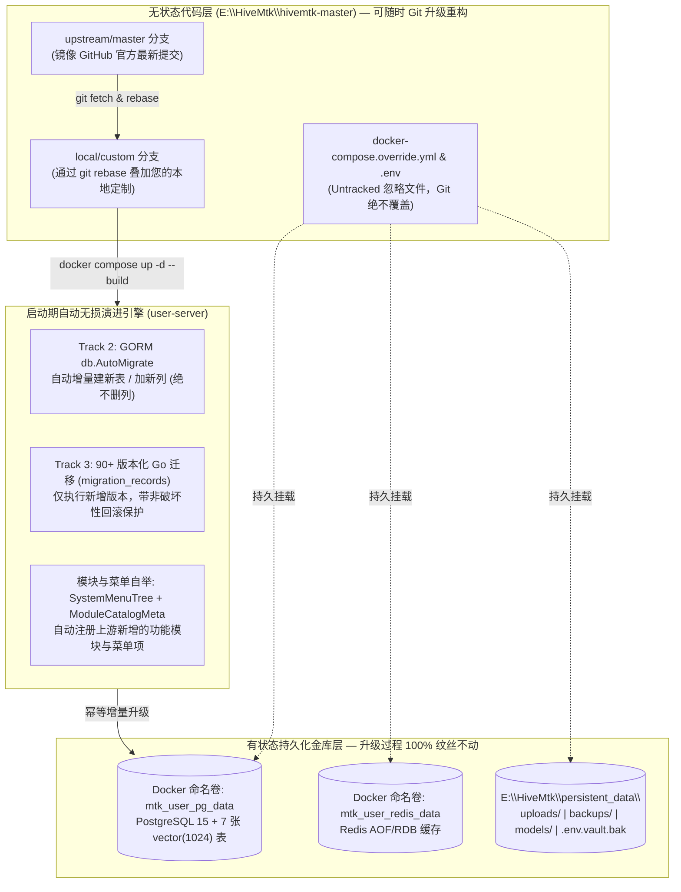

# HiveMtk 开源 AI 营销系统：八大专家交叉审查、全栈源码深度探查报告与本地无损部署升级指南

> **审查团队**：`@explorer-agent` · `@product-manager` · `@frontend-specialist` · `@backend-specialist` · `@database-architect` · `@security-auditor` · `@devops-engineer` · `@project-planner`
> **代码基准**：本地解压源码 [`E:/HiveMtk/hivemtk-master`](file:///E:/HiveMtk/hivemtk-master)（对应 GitHub 仓库 `https://github.com/xiaofang142/hivemtk`，版本 `v2.1.0` / 2026-10-20 快照）
> **审查原则**：**100% 基于源码事实（Code Facts Only）**，拒绝主观假设，所有结论均附带精确源码文件路径与行号引用。

---

## 第一部分：八大专家交叉审查总览与「宣传口径 vs. 源码事实」对账单

### 1.1 八大专家职责与交叉审查矩阵

| 专家角色 | 核心审查域 | 交叉验证对象 | 关键发现摘要 | 详细分报告链接 |
| :--- | :--- | :--- | :--- | :--- |
| **`@explorer-agent`**<br>代码库探查专家 | 仓库拓扑、全栈依赖版本、构建脚本、工程台账（[`改进清单.md`](file:///E:/HiveMtk/hivemtk-master/改进清单.md)、[`CHANGELOG.md`](file:///E:/HiveMtk/hivemtk-master/CHANGELOG.md)） | `@backend-specialist`<br>`@frontend-specialist` | 确认全仓包含 `user-server`（Go 1.26）、`user-web`（Vue 3.5）、2 个 MV3 浏览器扩展（`bridge` + `browser_automation`）、`packages/browser-core`、`embed-sdk`、`website`、`deploy/laya` 共 8 大工程单元；`未完成功能.md` 已被重构清零，真实技术债记录在 [`改进清单.md`](file:///E:/HiveMtk/hivemtk-master/改进清单.md)（I1–I62）与 [`PSEUDO_INCOMPLETE_INVENTORY_2026-10.md`](file:///E:/HiveMtk/hivemtk-master/docs/architecture/PSEUDO_INCOMPLETE_INVENTORY_2026-10.md)。 | [`report_explorer.md`](file:///C:/Users/Administrator/.gemini/antigravity/brain/37cebaef-2bf0-4c6b-a3c1-4a2a7b417ddb/scratch/report_explorer.md) |
| **`@product-manager`**<br>产品与导航架构专家 | 一级/二级/三级导航栏全量映射、商业模块门禁、获客→触达→转化→复购场景闭环 | `@frontend-specialist`<br>`@backend-specialist` | 提取 [`menu.go`](file:///E:/HiveMtk/hivemtk-master/user-server/internal/model/menu.go#L46-L461) 中权威定义的 **212 个菜单节点（7 个一级导航、34 个二级/三级分组、171 个叶节点菜单项）**；发现 **3 个已完整开发的页面（`/kb/connectors`、`/cap/matrix`、`/mcp/credentials`）因漏挂 `menu.go` 被前端路由守卫死锁拦截**，连 `admin` 也无法访问。 | [`report_product_manager.md`](file:///C:/Users/Administrator/.gemini/antigravity/brain/37cebaef-2bf0-4c6b-a3c1-4a2a7b417ddb/scratch/report_product_manager.md) |
| **`@frontend-specialist`**<br>前端与插件工程专家 | Vue 3 状态/路由/SSE/WS 架构、双 Chrome 扩展协议、拟人反检测算法、`embed-sdk` | `@product-manager`<br>`@security-auditor` | 证实前端顶栏 [`Layout.vue`](file:///E:/HiveMtk/hivemtk-master/user-web/src/layout/Layout.vue#L14-L30) 已移除硬编码菜单，改由 `GET /api/menus` 动态驱动；解析 **HiveBridge 蜂桥** 三通道协议（HTTP Ingest + SSE Outbox + HTTP Ack）与 `mh:<fnv1a32>#<occurrence>` 幂等指纹算法，以及 **Browser Automation** CDP + Native Messaging 15 原语架构。 | [`report_frontend.md`](file:///C:/Users/Administrator/.gemini/antigravity/brain/37cebaef-2bf0-4c6b-a3c1-4a2a7b417ddb/scratch/report_frontend.md) |
| **`@backend-specialist`**<br>后端、Agent 与 RAG 专家 | Go 5 层架构、ReAct 智能体引擎、全量原子工具、多端渠道连接器、本地混合检索 | `@database-architect`<br>`@explorer-agent` | 核实代码中实际存在 **3 套 ReAct 循环** 与 **45 个真实注册的原子工具**（而非宣传的 42 个，[`tool_provider_wiring.go`](file:///E:/HiveMtk/hivemtk-master/user-server/internal/app/tool_provider_wiring.go#L190-L250)）；证实快手/小红书/闲鱼在 [`webhook.go`](file:///E:/HiveMtk/hivemtk-master/user-server/internal/service/webhook.go) 中被 Fail-Closed 拦截（返回 HTTP 400），必须走 Chrome 扩展桥接。 | [`report_backend.md`](file:///C:/Users/Administrator/.gemini/antigravity/brain/9bdea095-b36f-433b-9a32-7b0482228984/scratch/report_backend.md) |
| **`@database-architect`**<br>数据库与数据流架构师 | PostgreSQL 15 + `pgvector(1024)`、Redis 7 键空间、三轨迁移机制、跨模块状态流转 | `@backend-specialist`<br>`@devops-engineer` | 梳理全库 **270+ 张 GORM 模型表** 与 **7 张 `vector(1024)` 向量表**；揭示 **三轨数据库迁移机制**（SQL 脚本仅首次挂载执行 `init-user-db.sql`，运行时依赖 `db.AutoMigrate` + 90 个版本化 Go 迁移 `v1.1.0`–`v3.64.0`），并发现 [`044_knowledge_hnsw_index.sql`](file:///E:/HiveMtk/hivemtk-master/migrations/044_knowledge_hnsw_index.sql#L11-L26) 事务块内建 `CONCURRENTLY` 索引的语法缺陷。 | [`report_database.md`](file:///C:/Users/Administrator/.gemini/antigravity/brain/37cebaef-2bf0-4c6b-a3c1-4a2a7b417ddb/scratch/report_database.md) |
| **`@security-auditor`**<br>安全与零出域审计专家 | 「数据零出域」核验、认证鉴权、ReAct 护栏、容器与密钥安全审计 | `@backend-specialist`<br>`@devops-engineer` | **推翻「默认 100% 零出域」假设**：发现即使 `PLATFORM_ENABLED=false`，后台 GEO 定时任务（[`job_manager.go`](file:///E:/HiveMtk/hivemtk-master/user-server/internal/geo/service/job_manager.go#L48-L84)）仍会每 6 小时主动请求外网域名与 5 大搜索引擎；[`safeprompt.MaskPII()`](file:///E:/HiveMtk/hivemtk-master/user-server/internal/safeprompt/safeprompt.go#L151-L162) 在生产代码中 **0 调用**；宿主机推理脚本默认监听 `0.0.0.0` 且无 API Key。 | [`report_security.md`](file:///C:/Users/Administrator/.gemini/antigravity/brain/2055c9b1-4beb-47bc-82bd-b062221670ff/scratch/report_security.md) |
| **`@devops-engineer`**<br>DevOps 与本地环境专家 | 本地 Windows 11 + i9-14900KF + RTX A2000 12GB 硬件探查、本地推理栈适配、无损升级架构 | `@database-architect`<br>`@project-planner` | 完成本地主机硬件/软件/端口/显存实测（发现 ComfyUI 占用 9.67 GB 显存）；设计 **GPU 独占 vs. CPU+GPU 混合推理双方案**、**解压目录原地绑定 Git 上游分支方案**、**7 类有状态资产外置隔离方案** 及 **7 步原子化无损升级脚本 `upgrade-hivemtk.ps1`**。 | [`report_devops.md`](file:///C:/Users/Administrator/.gemini/antigravity/brain/37cebaef-2bf0-4c6b-a3c1-4a2a7b417ddb/scratch/report_devops.md) |
| **`@project-planner`**<br>总架构师与项目规划专家 | 跨学科冲突消解、风险分级治理、Antigravity 分步落地执行手册编排 | 全体 7 位领域专家 | 汇总 P0–P2 级部署前必改项清单，将安全加固、离线买断门禁解锁、死锁路由修复与 Git 无损升级流程整合为可直接由 Antigravity 逐步执行的标准化手册。 | 本主报告全文 |

---

### 1.2 核心宣传口径 vs. 源码事实（Code Facts）十二项对账单

> [!IMPORTANT]
> 下表是八位专家对项目 README、架构文档与真实源码逐行比对后得出的**核心事实校准表**：

| 序号 | 宣传口径 / 历史文档描述 | 真实源码事实（Code Fact）与精确位置 | 结论评级 |
| :--- | :--- | :--- | :--- |
| **1** | **「42 个原子工具自主组合」** | 实际在 [`tool_provider_wiring.go#L190-L250`](file:///E:/HiveMtk/hivemtk-master/user-server/internal/app/tool_provider_wiring.go#L190-L250) 的 `RegisterAllToolsToGlobal` 中注册了 **45 个真实生产级原子工具**：触达类 20 个 + 私信类 3 个 + 客户/CRM 类 8 个 + 知识库/RAG 类 4 个 + 商务/订单/SOP 类 6 个 + 商品卡片 `card.show` 1 个 + 浏览器自动化 `browser_*` 3 个（历史文档统计 40/42 时未计入后期新增的 `card.show` 与 3 个浏览器工具）。全部 45 个工具均对接真实 Service/GORM/API，**0 Stub 空壳**。 | ✅ **超越宣传（实际 45 个）** |
| **2** | **「llama.cpp (Qwen2.5) + TEI 本地推理栈」** | 源码在 2026-08-17（参见 [`CHANGELOG.md#L1185-L1197`](file:///E:/HiveMtk/hivemtk-master/CHANGELOG.md#L1185-L1197)）已**彻底移除 HuggingFace Docker TEI 容器**，统一改为通过 [`scripts/inference-host/`](file:///E:/HiveMtk/hivemtk-master/scripts/inference-host) 下的宿主机 `llama-server`（`llama.cpp`）进程同时承载三个 GGUF 模型：`:8207`（`Qwen2.5-3B-Instruct` 对话）、`:8208`（`bge-m3` 1024 维向量，带 `--embedding --pooling cls`）、`:8209`（`bge-reranker-v2-m3` 重排，带 `--reranking`）；另在 [`deploy/laya/server.py`](file:///E:/HiveMtk/hivemtk-master/deploy/laya/server.py#L1-L43) 提供可选的 `:8210` Python FastAPI `ModernBERT-large` 意图分类服务。 | 🟡 **架构已演进（全栈统一为 `llama-server`）** |
| **3** | **「数据零出域 —— 对话/知识库/向量化全程在客户内网完成」** | 1. **推理层**：配置指向 `host.docker.internal:8207/8208/8209` 时，LLM/Embedding/Rerank 确实 100% 在本地完成。<br>2. **隐蔽后台外联（违背零出域）**：即使设置 `PLATFORM_ENABLED=false`，[`cmd/api/main.go#L591`](file:///E:/HiveMtk/hivemtk-master/user-server/cmd/api/main.go#L591) 启动的 `InitCron()` 仍会触发 GEO 定时任务（[`internal/geo/service/job_manager.go#L48-L84`](file:///E:/HiveMtk/hivemtk-master/user-server/internal/geo/service/job_manager.go#L48-L84)），每 6 小时主动向 `https://xiaofang142.github.io/hivemtk/*` 和 `https://weibanzhushou.com/*` 发起 HTTP GET，每天 04:00 向百度/必应/Google/360/搜狗发起最多 150 次关键词抓取。<br>3. **PII 脱敏未接线**：[`README.md#L165`](file:///E:/HiveMtk/hivemtk-master/README.md#L165) 宣称的 `safeprompt` 手机/身份证/银行卡自动脱敏函数 [`MaskPII()`](file:///E:/HiveMtk/hivemtk-master/user-server/internal/safeprompt/safeprompt.go#L151-L162) 在全仓生产代码中 **0 次被调用**。 | ⚠️ **需配置加固后才真正零出域** |
| **4** | **「抖音/快手/小红书/闲鱼/TikTok 经 Chrome 扩展桥接，企微/Telegram/WhatsApp/邮件/短信协议直连」** | 1. **Chrome 扩展桥接**：[`user-web/bridge`](file:///E:/HiveMtk/hivemtk-master/user-web/bridge)（HiveBridge 蜂桥）完整实现了抖音、快手、小红书、闲鱼、TikTok 五大平台的 DOM 采集、React/Vue 受控输入框自动填入与三通道（Ingest + SSE Outbox + Ack）桥接。<br>2. **Webhook 能力门禁**：快手、小红书、闲鱼无官方私信 API，后端 [`service/webhook.go#L53-L75`](file:///E:/HiveMtk/hivemtk-master/user-server/internal/service/webhook.go#L53-L75) 诚实地对这三家的 Webhook 入口返回 **HTTP 400**（Fail-Closed）。<br>3. **直连协议实现**：企微、Telegram、WhatsApp Cloud API v21.0、SMTP 邮件及短信网关（[`service/sms.go#L336-L539`](file:///E:/HiveMtk/hivemtk-master/user-server/internal/service/sms.go#L336-L539) 已实现阿里云、腾讯云、华为云三家签名请求与 22:00-08:00 静默期门禁）均完整直连。 | ✅ **完全属实（三家无官方API平台强制走Bridge）** |
| **5** | **「ReAct 自主智能体：感知 → 规划 → 调工具 → 反思」** | 源码中实际构建了 **3 套不同层级的 ReAct 循环**：<br>① **销售对话主循环** [`SalesEngine.runAgentLoop`](file:///E:/HiveMtk/hivemtk-master/user-server/internal/service/sales_engine_agentloop.go#L53-L400)（最多 5 轮迭代，支持原生 Function Calling 与面向 3B 小模型的 [`ReActAdapter`](file:///E:/HiveMtk/hivemtk-master/user-server/internal/aiagent/llm/react_adapter.go#L96-L228) 纯文本 `Action/Action Input/Observation` 协议）；<br>② **五阶段显式推理管道** [`InferenceCycle`](file:///E:/HiveMtk/hivemtk-master/user-server/internal/aiagent/agent/runtime/inference_cycle.go#L23-L299)（`Perception → Alignment → Gatekeeper → Planner → Reviewer`）；<br>③ **浏览器 RPA 循环** [`BrainService.GeneratePlanReflect`](file:///E:/HiveMtk/hivemtk-master/user-server/internal/browser_automation/service/brain.go#L24-L370)（最多 40 步 DOM `@e1..@eN` 交互 + `JudgeDone` 反思验收）。 | ✅ **完全属实且工程设计精良** |
| **6** | **「本地知识库 RAG —— pgvector 1024 维混合检索 + bge-m3 + bge-reranker-v2-m3 精排」** | 完整实现于 [`service/knowledge.go#L618-L999`](file:///E:/HiveMtk/hivemtk-master/user-server/internal/service/knowledge.go#L618-L999) 与 [`aiagent/rag/three_tier.go`](file:///E:/HiveMtk/hivemtk-master/user-server/internal/aiagent/rag/three_tier.go)：采用 `pgvector` `vector(1024)` HNSW 索引（`m=16, ef_construction=64, ef_search=128`）召回 Top-50 + PostgreSQL `zh_rag` 全文 GIN 索引/`ts_rank` 召回 Top-30 → 查询自适应加权 RRF（`k=60`）融合 Top-20 → 调用 `:8209/v1/rerank`（`bge-reranker-v2-m3`）执行 Cross-Encoder 精排与 Sigmoid Logit 校准，取 Top-5 并叠加知识反馈权重。 | ✅ **完全属实** |
| **7** | **前端菜单文档 `MENU_SPEC.md` 称「一级菜单在 `Layout.vue` 静态定义」** | 旧文档已过时。当前 [`Layout.vue#L14-L30`](file:///E:/HiveMtk/hivemtk-master/user-web/src/layout/Layout.vue#L14-L30) 与 [`SubMenuItem.vue`](file:///E:/HiveMtk/hivemtk-master/user-web/src/components/SubMenuItem.vue) 完全由后端 [`SystemMenuTree`](file:///E:/HiveMtk/hivemtk-master/user-server/internal/model/menu.go#L46-L461)（212 节点）经 **Gate 1（商业模块许可证）+ Gate 2（角色菜单权限矩阵）** 双重过滤后通过 `GET /api/menus` 动态下发。 | 🟡 **代码远比旧文档先进** |
| **8** | **前端 236 条路由全量可达性** | **3 个已完整开发的页面**（[`/kb/connectors`](file:///E:/HiveMtk/hivemtk-master/user-web/src/views/kb/Connectors.vue)、[`/cap/matrix`](file:///E:/HiveMtk/hivemtk-master/user-web/src/views/cap/Matrix.vue)、[`/mcp/credentials`](file:///E:/HiveMtk/hivemtk-master/user-web/src/views/mcp/Credentials.vue)）未挂载到 [`menu.go`](file:///E:/HiveMtk/hivemtk-master/user-server/internal/model/menu.go)，且因 [`permission.js#L76-L97`](file:///E:/HiveMtk/hivemtk-master/user-web/src/stores/permission.js#L76-L97) 的 `hasRouteAccess` 校验首段 URL 前缀且未豁免 `admin`，导致**所有角色访问这 3 个路径均被死锁拦截**。 | ❌ **源码级 Bug（附修复方案）** |
| **9** | **离线私有化部署（`TENANT_MODE=off`）下全部模块免费解锁** | 在 [`module_catalog.go#L658-L730`](file:///E:/HiveMtk/hivemtk-master/user-server/internal/service/module_catalog.go#L658-L730) 的 `bootstrapOffline()` 中，24 个商业模块里有 23 个可直接免费激活，唯独 **`browser-automation`（浏览器自动化 RPA，标价 ¥99 买断）被硬编码排除在离线赠送之外**（参见 [`CHANGELOG.md#L20`](file:///E:/HiveMtk/hivemtk-master/CHANGELOG.md#L20)）。若不在数据库中手动写入激活记录，本地部署后无法使用浏览器自动化模块。 | ⚠️ **离线买断锁限制（附 SQL 解锁法）** |
| **10** | **LTC（从线索到回款）订单草稿与高危工具审批门禁开箱即用** | [`user-server/.env-example#L77-L115`](file:///E:/HiveMtk/hivemtk-master/user-server/.env-example#L77-L115) 中的 **11 个 `FF_LTC_*` / `FF_TOOL_*` 特性开关默认全部为 `off`**。未开启时访问 `/api/manage/order-drafts` 直接返回 **HTTP 503**；且商机阶段门控中间件 [`middleware.LTCStageGate`](file:///E:/HiveMtk/hivemtk-master/user-server/internal/middleware/ltc_gate.go#L52) 尚未挂载到任何 Gin 路由。 | ⚠️ **需在 `.env` 中显式开启** |
| **11** | **两套知识库 UI 共享底层数据** | `/knowledgeBase`（[`knowledge_bases`](file:///E:/HiveMtk/hivemtk-master/user-server/internal/model/knowledge_base.go#L24) 表）与 `/knowledge/management`（[`knowledge_documents`](file:///E:/HiveMtk/hivemtk-master/user-server/internal/model/kb_workspace.go#L24) 表）是两套独立演进的表结构，无 `kb_id` 外键关联（知识文档实际通过 `rag_product_id` 关联智能体）。 | 🟡 **历史双轨并存** |
| **12** | **SQL 迁移文件 `migrations/*.sql` 自动顺序执行** | [`docker-compose.yml#L57`](file:///E:/HiveMtk/hivemtk-master/docker-compose.yml#L57) 仅挂载了 `init-user-db.sql`，`migrations/002_*.sql` 至 `058_*.sql` 从未被容器自动执行；运行时真正生效的是 `db.AutoMigrate`（[`migrate.go#L473-L563`](file:///E:/HiveMtk/hivemtk-master/user-server/internal/pkg/db/migrate.go#L473-L563)）与 90 个版本化 Go 迁移（[`internal/migration/migrations.go`](file:///E:/HiveMtk/hivemtk-master/user-server/internal/migration/migrations.go)）。 | ✅ **Go 迁移接管（升级零丢数关键）** |

---

## 第二部分：全栈技术架构深度设计（基于代码事实）

### 2.1 仓库全局目录拓扑与工程规模



| 子工程目录 | 语言与核心技术栈 | 核心构建与入口文件 | 代码规模与核心职责 |
| :--- | :--- | :--- | :--- |
| [`user-server/`](file:///E:/HiveMtk/hivemtk-master/user-server) | **Go `1.26.0`** (`toolchain go1.26.9`)、Gin `v1.12.0`、GORM `v1.31.2`、`pgx/v5 v5.11.0`、`go-redis/v9 v9.23.0`、`gorilla/websocket v1.5.3`、`robfig/cron/v3`、`gonum v0.17.0` | [`cmd/api/main.go`](file:///E:/HiveMtk/hivemtk-master/user-server/cmd/api/main.go)（主服务 `:8204`）<br>[`cmd/nm-host/main.go`](file:///E:/HiveMtk/hivemtk-master/user-server/cmd/nm-host/main.go)（浏览器宿主）<br>[`cmd/eval/main.go`](file:///E:/HiveMtk/hivemtk-master/user-server/cmd/eval/main.go)（RAG 评测 CLI） | **1,389 个 `.go` 源文件**（990 个生产文件 + 399 个测试文件），严格遵循 `Router → Controller → Service → Repository → Model` 五层架构。 |
| [`user-web/`](file:///E:/HiveMtk/hivemtk-master/user-web) | **Vue `^3.5.13`**、Vite `^8.1.1`、Element Plus `^2.9.11`、Pinia `^3.0.2`、Vue Router `^4.5.1`、Vue I18n `^9.14.4`（9 语种）、ECharts `^6.0.0`、`@vue-flow/core ^1.48.2`、TinyMCE `7.9.3`、`mjml-browser` | [`src/main.js`](file:///E:/HiveMtk/hivemtk-master/user-web/src/main.js)<br>[`src/router/index.js`](file:///E:/HiveMtk/hivemtk-master/user-web/src/router/index.js)<br>[`src/layout/Layout.vue`](file:///E:/HiveMtk/hivemtk-master/user-web/src/layout/Layout.vue) | **221 个视图 `.vue` 组件**、**83 个路由文件（236 条路由）**、**111 个 API 客户端模块**、**6 个 Pinia Store**，容器端口 `:8205`。 |
| [`user-web/bridge/`](file:///E:/HiveMtk/hivemtk-master/user-web/bridge) | Chrome Extension **Manifest V3**、Vanilla ES2022、esbuild | [`manifest.json`](file:///E:/HiveMtk/hivemtk-master/user-web/bridge/manifest.json)<br>[`background.js`](file:///E:/HiveMtk/hivemtk-master/user-web/bridge/background.js)<br>`src/channels/{douyin,kuaishou,xhs,xianyu,tiktok}.js` | **HiveBridge 蜂桥** (`v0.3.0`)：负责五大国内/跨境社媒平台的私信 DOM 监听上报、SSE 出站指令接收与拟人化自动回复。 |
| [`user-web/browser_automation/`](file:///E:/HiveMtk/hivemtk-master/user-web/browser_automation) | Chrome Extension **Manifest V3**、`chrome.debugger` (CDP 1.3)、`chrome.runtime.connectNative` | [`manifest.json`](file:///E:/HiveMtk/hivemtk-master/user-web/browser_automation/manifest.json)<br>[`background.js`](file:///E:/HiveMtk/hivemtk-master/user-web/browser_automation/background.js)<br>[`content.js`](file:///E:/HiveMtk/hivemtk-master/user-web/browser_automation/content.js) | **HiveMTK Browser Automation** (`v2.0.0`)：为后端 ReAct 浏览器智能体提供 `@e1..@eN` DOM 快照标注与硬件级 CDP 键鼠操控。 |
| [`packages/browser-core/`](file:///E:/HiveMtk/hivemtk-master/packages/browser-core) | `@hivemtk/browser-core` (`0.1.0`)、纯 ESM + Node Test | [`src/delay.js`](file:///E:/HiveMtk/hivemtk-master/packages/browser-core/src/delay.js)、[`src/mouse.js`](file:///E:/HiveMtk/hivemtk-master/packages/browser-core/src/mouse.js)、[`src/typing.js`](file:///E:/HiveMtk/hivemtk-master/packages/browser-core/src/typing.js) | 双扩展共享的**反风控拟人算法库**：Box-Muller 高斯/对数正态延迟、三阶贝塞尔鼠标轨迹、Burst 突发打字模型。 |
| [`embed-sdk/`](file:///E:/HiveMtk/hivemtk-master/embed-sdk) | Vanilla JS (`MarketingChatWidget` `1.0.0`) | [`src/widget.js`](file:///E:/HiveMtk/hivemtk-master/embed-sdk/src/widget.js) | 零依赖第三方网站客服悬浮窗 SDK，支持 `postMessage` 握手、未读角标与客户身份注入。 |
| [`website/`](file:///E:/HiveMtk/hivemtk-master/website) | Vue 3.5 + Vite 6 + Vue Router 4 | [`src/main.js`](file:///E:/HiveMtk/hivemtk-master/website/src/main.js) | 独立产品宣传官网与在线文档中心（容器端口 `:8213` / `:8220`）。 |
| [`scripts/inference-host/`](file:///E:/HiveMtk/hivemtk-master/scripts/inference-host) & [`deploy/laya/`](file:///E:/HiveMtk/hivemtk-master/deploy/laya) | Bash + `llama.cpp` (`llama-server`) + Python FastAPI (`transformers` + `torch`) | [`_common.sh`](file:///E:/HiveMtk/hivemtk-master/scripts/inference-host/_common.sh)<br>[`hive-inference.sh`](file:///E:/HiveMtk/hivemtk-master/scripts/inference-host/hive-inference.sh)<br>[`deploy/laya/server.py`](file:///E:/HiveMtk/hivemtk-master/deploy/laya/server.py) | 本地推理栈编排：管理 `:8207` (LLM)、`:8208` (Embedding)、`:8209` (Reranker) 三个 `llama-server` 守护进程与 `:8210` (Laya 分类器)。 |

---

### 2.2 后端五层架构、依赖注入与后台守护协程（`@backend-specialist`）

#### 1. 严格受 Linter 保护的五层架构
在 [`user-server/.golangci.yml`](file:///E:/HiveMtk/hivemtk-master/user-server/.golangci.yml) 中，通过 `depguard` 强制实施单向依赖约束（**严禁创建 `handler` 包，严禁 Controller 直接操作 `gorm.DB`**）：
- **Router 层**（[`internal/router/`](file:///E:/HiveMtk/hivemtk-master/user-server/internal/router)，116 个文件）：核心入口 [`router.go#L88-L625`](file:///E:/HiveMtk/hivemtk-master/user-server/internal/router/router.go#L88-L625) 的 `SetupRouter()` 组装公开路由、Webhook 路由、Bridge 桥接路由与 JWT 受保护路由。
- **Middleware 层**（[`internal/middleware/`](file:///E:/HiveMtk/hivemtk-master/user-server/internal/middleware)，27 个文件）：依次挂载 `CORSMiddleware`、`FramePolicyMiddleware`（为 `/chat/embed/*` 动态放开 `CSP: frame-ancestors *`）、`SecurityHeadersMiddleware`、`RateLimitMiddleware`、`AuthMiddleware`（支持 `Authorization: Bearer` 与 `?token=` 双模式以兼容 `EventSource` SSE）、`RequireModuleEnabled`（Gate 1 商业模块门禁）、`RequireMenuRouteAccess`（Gate 2 的 251 条菜单能力面 API 守卫，见 [`menu_capability_routes.go#L34-L286`](file:///E:/HiveMtk/hivemtk-master/user-server/internal/model/menu_capability_routes.go#L34-L286)）与 `OperationLogMiddleware`。
- **Controller 层**（[`internal/controller/`](file:///E:/HiveMtk/hivemtk-master/user-server/internal/controller)，160 个文件）：纯 HTTP/WS/SSE 协议适配、参数绑定与统一响应封装。
- **Service 层**（[`internal/service/`](file:///E:/HiveMtk/hivemtk-master/user-server/internal/service)，434 个主文件 + `internal/{aiagent,browser_automation,email,geo,kbconnector,mcp,rag,safeprompt}` 18 个领域包）：承载全部核心业务逻辑，由 [`internal/app/`](file:///E:/HiveMtk/hivemtk-master/user-server/internal/app) 下的 `*_wiring.go` 在启动时完成依赖注入装配。
- **Repository & Model 层**（[`internal/repository/`](file:///E:/HiveMtk/hivemtk-master/user-server/internal/repository) 154 个文件 + [`internal/model/`](file:///E:/HiveMtk/hivemtk-master/user-server/internal/model) 202 个文件）：封装 GORM 与 `pgvector` SQL 查询。

#### 2. 启动生命周期与后台常驻 Worker 矩阵
[`user-server/cmd/api/main.go#L69-L645`](file:///E:/HiveMtk/hivemtk-master/user-server/cmd/api/main.go#L69-L645) 启动时按严格顺序拉起以下核心后台引擎：
1. **数据库与配置自举**（`L119-L260`）：初始化 PostgreSQL、执行 `db.AutoMigrate`、运行 90 个版本化 Go 迁移（`L410-L427`）、加载 117 项运行时配置参数（[`config_param_seeds.go`](file:///E:/HiveMtk/hivemtk-master/user-server/internal/service/config_param_seeds.go)）与 24 个商业模块种子（`bootstrapOffline()`）。
2. **渠道长连接与发信 Worker**：
   - `emailSendService.StartPendingDrainWorker(ctx, 30s)`（`L348`）：每 30 秒扫描待发邮件队列并经 SMTP 投递。
   - `StartTelegramPollingManager(ctx)`（`L592`）：基于 PostgreSQL `telegram_bot_poll_locks` 分布式锁（60s 租约 / 15s 续期）拉起 Telegram `getUpdates` 长轮询。
   - `StartAllDingtalkStreamClients(ctx)`（`L593`）：拉起钉钉机器人 Stream 客户端。
3. **浏览器自动化与恢复协程**：
   - `baOrchestrator.StartRecoveryLoop(ctx)` & `baCronSched.Start(ctx)`（`L377-L384`）：浏览器 RPA 僵尸任务恢复与定时触发器。
   - `StartToolRecoveryWorker(ctx)` & `StartSagaCompensationWorker(ctx)`（`L467-L469`）：当 `FF_LTC_RECOVERY_WORKER=on` / `FF_LTC_SAGA_COMPENSATION=on` 时执行中断工具重放与 Saga 逆向补偿。
4. **全局定时任务调度器 `cronpkg.InitCron()`**（[`internal/pkg/cron/cron.go`](file:///E:/HiveMtk/hivemtk-master/user-server/internal/pkg/cron/cron.go)，`main.go:591`）：驱动会话超时自动关单、SLA 升级、知识库健康度巡检、外链域名黑名单检测、智能体进化回放、自动备份，以及 GEO 定时任务（[`internal/geo/service/job_manager.go#L48-L84`](file:///E:/HiveMtk/hivemtk-master/user-server/internal/geo/service/job_manager.go#L48-L84)）。

---

### 2.3 前端工程、状态管理与实时通信双栈架构（`@frontend-specialist`）

1. **6 大 Pinia Store 状态分工**（[`user-web/src/stores/`](file:///E:/HiveMtk/hivemtk-master/user-web/src/stores)）：
   - [`user.js`](file:///E:/HiveMtk/hivemtk-master/user-web/src/stores/user.js)：管理 `localStorage.token`、当前登录用户信息与角色标识。
   - [`permission.js`](file:///E:/HiveMtk/hivemtk-master/user-web/src/stores/permission.js)：请求 `GET /api/menus` 缓存动态菜单树 `menus`，计算 `allowedPaths` 集合，并提供路由守卫核心方法 `hasRouteAccess(targetPath)`（`L76-L97`）。
   - [`module.js`](file:///E:/HiveMtk/hivemtk-master/user-web/src/stores/module.js)：请求 `GET /api/modules/catalog`（5 分钟 TTL 缓存），提供 `isEnabled(moduleKey)` 供路由守卫拦截未开通模块并跳转 `/subscription-wall`。
   - [`notification.js`](file:///E:/HiveMtk/hivemtk-master/user-web/src/stores/notification.js)：维护系统通知未读数 `unreadCount` 及浏览器原生 `EventSource('/api/notifications/stream?token=...')` 实时推送连接。
   - [`site.js`](file:///E:/HiveMtk/hivemtk-master/user-web/src/stores/site.js) & [`theme.js`](file:///E:/HiveMtk/hivemtk-master/user-web/src/stores/theme.js)：站点品牌信息（`siteName`、`logoUrl`）与明暗主题切换。
2. **Axios 拦截器与双重实时流（SSE + WebSocket）**：
   - **REST 客户端**（[`user-web/src/api/request.js`](file:///E:/HiveMtk/hivemtk-master/user-web/src/api/request.js)）：30s 超时，自动注入 `Authorization: Bearer <token>`；遇 `HTTP 401` 防抖清 Token 跳 `/login`；遇 `HTTP 402` 且 `data.code === 'MODULE_DISABLED'` 时自动引导前往模块市场激活。
   - **三种 SSE 实现模式**：
     - 原生 `EventSource`（带 `?token=` 查询参数）：用于系统通知 `/api/notifications/stream`、消息中台入站流 `/api/message-hub/stream`（[`views/messageHub/List.vue#L736`](file:///E:/HiveMtk/hivemtk-master/user-web/src/views/messageHub/List.vue#L736)）与浏览器自动化任务流 `/api/browser-automation/sessions/:id/stream`（[`api/browserAutomation.js#L69`](file:///E:/HiveMtk/hivemtk-master/user-web/src/api/browserAutomation.js#L69)）。
     - `fetch` + `ReadableStream`（支持 `POST` Body 与 `Bearer` 头）：用于智能体 Playground 流式对话 `POST /api/ai-agents/:id/chat-stream`（[`api/aiAgent.js#L71-L137`](file:///E:/HiveMtk/hivemtk-master/user-web/src/api/aiAgent.js#L71-L137)）。
     - `chrome.offscreen` 后台长连接 SSE：用于 HiveBridge 扩展监听 `GET /api/bridge/outbox/sse`。
   - **双向 WebSocket**：用于嵌入式在线客服访端 `ws(s)://<host>/api/chat/ws/:channelId?visitor_id=...`（[`views/chat/embed/ChatWindow.vue#L343`](file:///E:/HiveMtk/hivemtk-master/user-web/src/views/chat/embed/ChatWindow.vue#L343)）与 Native Messaging Host 隧道 `/api/browser/host-ws`。

---

## 第三部分：四大核心技术支柱源码级深度核验

### 3.1 支柱一：多端社媒触达与统一收件箱（Chrome 扩展桥接 + 协议直连）

#### 1. 双 Chrome MV3 扩展协同架构（`bridge` vs. `browser_automation`）
仓库并非只有一个浏览器插件，而是构建了**两套职责互补的 Chrome MV3 扩展 + 一个共享反检测核心库**：

| 维度 | 扩展一：**HiveBridge 蜂桥** ([`user-web/bridge/`](file:///E:/HiveMtk/hivemtk-master/user-web/bridge)) | 扩展二：**Browser Automation** ([`user-web/browser_automation/`](file:///E:/HiveMtk/hivemtk-master/user-web/browser_automation)) |
| :--- | :--- | :--- |
| **定位与场景** | **社媒私信收发与评论监测轻量桥接器**（常驻商家已登录的创作者后台/网页版标签页，7×24 实时双向同步私信） | **通用重型浏览器 RPA 智能体执行器**（由后端 LLM 规划器按需打开任意网页，执行多步搜索、深层抓取、评论互动） |
| **覆盖平台** | 抖音 (`creator.douyin.com`)、快手 (`cp.kuaishou.com`)、小红书 (`creator.xiaohongshu.com` / `ark` / 网页版)、闲鱼 (`goofish.com`)、TikTok (`tiktok.com`) | 小红书、抖音、快手、知乎、微博、B站、百度及任意目标 URL（内置站点专项评论三段式适配器） |
| **与后端通信协议** | **三通道 HTTP + SSE 协议**（直接与 `:8204` 通信，无需本地安装守护进程）：<br>① 入站：`POST /api/bridge/ingest`<br>② 出站流：`GET /api/bridge/outbox/sse`（降级轮询 `GET /api/bridge/outbox`）<br>③ 确认：`POST /api/bridge/outbox/ack` | **Native Messaging + WebSocket 隧道**：<br>Chrome 扩展 ↔ `chrome.runtime.connectNative('com.hivemtk.browser')` ↔ 宿主机 [`nm-host`](file:///E:/HiveMtk/hivemtk-master/user-server/cmd/nm-host/main.go)（4 字节小端序帧）↔ `ws://127.0.0.1:8204/api/browser/host-ws` |
| **DOM 操控技术** | Content Script `MutationObserver` + 针对 React/Vue 受控组件原型链 `HTMLInputElement.prototype.value` Setter + `InputEvent` 派发（[`bridge/content.js#L168-L185`](file:///E:/HiveMtk/hivemtk-master/user-web/bridge/content.js#L168-L185)） | `chrome.debugger` **CDP 1.3 硬件级事件注入**（`Input.dispatchMouseEvent` / `Input.dispatchKeyEvent`）+ `@e1..@eN` 交互元素快照树（[`browser_automation/content.js`](file:///E:/HiveMtk/hivemtk-master/user-web/browser_automation/content.js)） |

- **HiveBridge 蜂桥的核心工程亮点**：
  - **幂等指纹算法**（[`bridge/src/shared/hash.js#L35-L49`](file:///E:/HiveMtk/hivemtk-master/user-web/bridge/src/shared/hash.js#L35-L49)）：计算 `mh:<fnv1a32(channel|account|peer|direction|type|normalizedText)>#<occurrence>`。即使同一客户连续发送两条完全相同的「你好」，也能通过 `#1`、`#2` 序号精准区分，同时保证页面刷新重扫时绝对幂等。
  - **五层出站防封号限流器**（[`bridge/background.js#L165-L216`](file:///E:/HiveMtk/hivemtk-master/user-web/bridge/background.js#L165-L216)）：① 单次回复前高斯随机思考延迟（1.5s–4.5s）；② 单会话冷却时间（≥8s）；③ 单账号每分钟上限（8 条/分）；④ 单账号每小时上限（120 条/时）；⑤ 夜间静默窗口（23:00–07:00 自动暂停或降频）。

#### 2. 五大直连协议连接器与统一收件箱（`MessageHubService`）
- **企业微信直连**（[`internal/service/wecom.go`](file:///E:/HiveMtk/hivemtk-master/user-server/internal/service/wecom.go)）：完整实现回调 URL 签名校验（SHA1）、`AES-256-CBC` 消息体加解密（PKCS#7 Padding）、AccessToken 缓存刷新及文本/图片/图文卡片主动推送。
- **Telegram 直连**（[`internal/channelbot/telegram/telegram.go`](file:///E:/HiveMtk/hivemtk-master/user-server/internal/channelbot/telegram/telegram.go) & [`telegram_polling.go`](file:///E:/HiveMtk/hivemtk-master/user-server/internal/service/telegram_polling.go)）：同时支持 Webhook 回调与分布式锁保护的 `getUpdates` 轮询，并内置入群验证门禁（[`telegram_gate.go`](file:///E:/HiveMtk/hivemtk-master/user-server/internal/service/telegram_gate.go)）。
- **WhatsApp Cloud API v21.0 直连**（[`internal/channelbot/whatsapp/whatsapp.go`](file:///E:/HiveMtk/hivemtk-master/user-server/internal/channelbot/whatsapp/whatsapp.go)）：对接 `graph.facebook.com/v21.0`，支持 `X-Hub-Signature-256` HMAC-SHA256 验签与模板消息发送。
- **邮件（SMTP）与短信（SMS）直连**：邮件由 [`email_send.go`](file:///E:/HiveMtk/hivemtk-master/user-server/internal/email/service/email_send.go) 的 30s Drain Worker 异步发送并注入开信追踪像素；短信由 [`service/sms.go`](file:///E:/HiveMtk/hivemtk-master/user-server/internal/service/sms.go) 对接阿里云 Dysmsapi（内置北京时间 **22:00–08:00 营销短信静默期拦截**）。
- **统一收件箱归一化流水线**（[`service/message_hub.go#L415-L620`](file:///E:/HiveMtk/hivemtk-master/user-server/internal/service/message_hub.go#L415-L620)）：
  所有渠道（无论是 Bridge 扩展上报还是直连 Webhook）统一转化为 `UnifiedMessage` 进入 `MessageHubService.IngestMessage` 四阶段流水线：
  1. **幂等去重**：检查 Redis 锁与 `(channel_type, external_msg_id)` 唯一索引；
  2. **OneID 客户身份解析**：调用 `OneIDService.ResolveOrCreate` 归一化到全局客户档案 `customers`；
  3. **会话路由与坐席分配**：匹配或创建 `customer_sessions`，若开启 AI 托管则交由 `SalesEngine.ProcessIncomingMessage` 生成回复，若命中转人工规则则按技能组/负载均衡分配给在线人工坐席；
  4. **出站投递与死信兜底**：AI 或人工回复时，直连渠道直接调 API 发送，桥接渠道写入 `bridge_outbox` 并通过 SSE 实时推给 Chrome 扩展执行；连续失败超限自动转入 `dead_letter_messages`（DLQ）供 `/messageHub/dashboard` 批量重试。

---

### 3.2 支柱二：ReAct 自主智能体引擎与 45 个原子工具全量清点

#### 1. 三套 ReAct 智能体循环的源码实现
HiveMtk 并非简单的 Prompt 拼接，而是在后端构建了三套针对不同场景深度定制的 ReAct 推理引擎：

```mermaid
sequenceDiagram
    participant User as 客户私信 / 访客
    participant Hub as MessageHubService
    participant SE as SalesEngine (12步管线)
    participant Loop as runAgentLoop (ReAct 核心)
    participant Adapt as ReActAdapter (NoFC 文本协议)
    participant Exec as 10层 ToolExecutor 装饰器链
    participant LLM as 本地 llama-server (:8207)

    User->>Hub: 发送咨询消息 (抖音/企微/Web等)
    Hub->>SE: ProcessIncomingMessage()
    Note over SE: Step 1-8: 客户归一 → 记忆召回 → 意图识别<br/>→ 转人工判定 → SOP匹配 → 四级RAG召回<br/>→ 销冠话术匹配 → Playbook建议
    SE->>Loop: Step 9: 进入 runAgentLoop (maxIter=5, maxTools=18)
    loop 最多 5 轮 (受 agentLoopGuard 180s / 50k tokens / SHA256 死循环检测保护)
        Loop->>Adapt: 构建 Prompt (Native FC 或 Text ReAct 协议)
        Adapt->>LLM: POST /v1/chat/completions
        LLM-->>Adapt: Thought + Action + Action Input (或 tool_calls)
        alt 存在工具调用 (Action != Final Answer)
            Adapt-->>Loop: 解析出 ToolCall 列表
            Loop->>Exec: 经 10 层装饰器执行工具 (鉴权→审批门禁→幂等→限流→熔断→重试→审计)
            Exec-->>Loop: 返回 Observation 结果并追加至对话上下文
        else 输出 Final Answer
            Adapt-->>Loop: 返回最终回复文本
        end
    end
    Note over SE: Step 10-12: Polisher 润色 → 拟人分句延迟 → 置信度/拟人度评分
    SE-->>Hub: 投递回复 (直连 API 或 Bridge Outbox SSE)
```

1. **销售与客服主引擎 [`SalesEngine.runAgentLoop`](file:///E:/HiveMtk/hivemtk-master/user-server/internal/service/sales_engine_agentloop.go#L53-L400)**：
   - 嵌于 [`sales_engine.go#L112-L410`](file:///E:/HiveMtk/hivemtk-master/user-server/internal/service/sales_engine.go#L112-L410) 的 12 步管线第 9 步，默认 `maxIterations = 5`、单智能体最多挂载 `maxTools = 18`。
   - **小模型兼容神器 [`ReActAdapter`](file:///E:/HiveMtk/hivemtk-master/user-server/internal/aiagent/llm/react_adapter.go#L96-L228)**：当使用本地轻量模型（如 `Qwen2.5-3B-Instruct-GGUF`，不支持稳定的 OpenAI Native `tools` JSON Schema 或开启 `NoFC=true`）时，自动将工具定义渲染为中文 `Thought / Action / Action Input / Observation / Final Answer` 提示词协议，并用状态机解析 LLM 输出。
   - **死循环与预算护栏 [`agentLoopGuard`](file:///E:/HiveMtk/hivemtk-master/user-server/internal/service/sales_engine_guard.go#L18-L135)**：强制实施 180 秒总超时、50,000 Tokens 上限、`$0.50` 单次成本上限，以及基于 `SHA-256(toolName + canonicalArgs)` 的连续重复调用死循环熔断。
   - **10 层工具执行装饰器链**（[`internal/aiagent/agent/tooluse/executor.go`](file:///E:/HiveMtk/hivemtk-master/user-server/internal/aiagent/agent/tooluse/executor.go)）：每次工具调用依次经过：`PermissionCheck`（权限校验）→ `ApprovalGate`（高危动作人工审批门禁）→ `Idempotency`（幂等缓存）→ `RateLimiter`（令牌桶限流）→ `CircuitBreaker`（连续失败熔断）→ `RetryWithBackoff`（指数退避重试）→ `Timeout`（单工具超时）→ `CostTracker`（成本计量）→ `AuditLogger`（落库审计）→ `RealToolHandler`。
2. **五阶段认知推理周期 [`InferenceCycle`](file:///E:/HiveMtk/hivemtk-master/user-server/internal/aiagent/agent/runtime/inference_cycle.go#L23-L299)**：
   - 显式拆分为 `PerceptionStage`（感知客户情绪与上下文）→ `AlignmentStage`（对齐品牌人设与合规边界）→ `GatekeeperStage`（[`gatekeeper.go#L28-L115`](file:///E:/HiveMtk/hivemtk-master/user-server/internal/aiagent/agent/runtime/gatekeeper.go#L28-L115)，内置 23 个绝对违禁词、14 个法务/工商投诉危机词、9 个极端情绪词，命中即刻短路转人工）→ `PlannerStage`（ReAct 规划与工具调用）→ `ReviewerStage`（反思自检回复质量）。
3. **浏览器 RPA 视觉/DOM 智能体 [`BrainService.GeneratePlanReflect`](file:///E:/HiveMtk/hivemtk-master/user-server/internal/browser_automation/service/brain.go#L24-L370)**：
   - 针对浏览器自动化任务（最高 40 轮迭代）：每轮先通过 Native Messaging 获取当前网页的 `@e1..@eN` 交互元素树快照 → LLM 决定下一步原语（如 `click(@e5)`、`type(@e12, "私域运营")`、`scroll`、`extract`）→ 执行后等待页面稳定并获取新快照 → 最终由独立的 `JudgeDone` 反思提示词验收任务目标是否真正达成。

#### 2. 全仓 45 个真实注册原子工具完整清点表（验证「42 个原子工具」宣传）
通过审查 [`user-server/internal/app/tool_provider_wiring.go#L190-L250`](file:///E:/HiveMtk/hivemtk-master/user-server/internal/app/tool_provider_wiring.go#L190-L250) 的 `RegisterAllToolsToGlobal` 函数及 [`internal/aiagent/agent/tooluse/`](file:///E:/HiveMtk/hivemtk-master/user-server/internal/aiagent/agent/tooluse) 源码，系统中实际注册并投入生产的原子工具共计 **45 个**（全部拥有完整后端执行逻辑）：

| 类别 (数量) | 序号 | 工具注册名称 (`Tool.Name`) | 源码定义文件与行号 | 核心入参 (`Parameters`) | 真实代码执行逻辑（Code Fact） |
| :--- | :--- | :--- | :--- | :--- | :--- |
| **一、全渠道触达类**<br>`reach_tools.go`<br>**(20 个)** | 1 | `send_email` | [`reach_tools.go#L35`](file:///E:/HiveMtk/hivemtk-master/user-server/internal/aiagent/agent/tooluse/reach_tools.go#L35) | `to, subject, body, account_id` | 调用 `EmailProvider` 创建真实邮件发送任务并入队投递 |
| | 2 | `send_sms` | [`reach_tools.go#L95`](file:///E:/HiveMtk/hivemtk-master/user-server/internal/aiagent/agent/tooluse/reach_tools.go#L95) | `phone, template_id, params` | 调用 `SMSProvider`（阿里云短信网关，受 22:00-08:00 静默期保护）发送短信 |
| | 3 | `send_wecom_message` | [`reach_tools.go#L150`](file:///E:/HiveMtk/hivemtk-master/user-server/internal/aiagent/agent/tooluse/reach_tools.go#L150) | `account_id, to_user, content, msg_type` | 调用企业微信官方 API 发送私聊/客户消息 |
| | 4 | `send_whatsapp_message` | [`reach_tools.go#L205`](file:///E:/HiveMtk/hivemtk-master/user-server/internal/aiagent/agent/tooluse/reach_tools.go#L205) | `account_id, to_phone, message, template` | 调用 WhatsApp Cloud API v21.0 发送消息或模板 |
| | 5 | `send_telegram_message` | [`reach_tools.go#L260`](file:///E:/HiveMtk/hivemtk-master/user-server/internal/aiagent/agent/tooluse/reach_tools.go#L260) | `bot_id, chat_id, text` | 调用 Telegram Bot API `sendMessage` |
| | 6 | `send_feishu_message` | [`reach_tools.go#L312`](file:///E:/HiveMtk/hivemtk-master/user-server/internal/aiagent/agent/tooluse/reach_tools.go#L312) | `account_id, receive_id, content` | 调用飞书开放平台消息发送接口 |
| | 7 | `send_qq_message` | [`reach_tools.go#L364`](file:///E:/HiveMtk/hivemtk-master/user-server/internal/aiagent/agent/tooluse/reach_tools.go#L364) | `bot_id, target_id, message` | 调用 QQ 机器人接口发送群聊/私聊消息 |
| | 8 | `create_douyin_card` | [`reach_tools.go#L416`](file:///E:/HiveMtk/hivemtk-master/user-server/internal/aiagent/agent/tooluse/reach_tools.go#L416) | `title, description, image_url, target_url` | 在 `douyin_cards` 表创建抖音跳转卡片并绑定域名池短链 |
| | 9 | `create_kuaishou_card` | [`reach_tools.go#L470`](file:///E:/HiveMtk/hivemtk-master/user-server/internal/aiagent/agent/tooluse/reach_tools.go#L470) | `title, description, image_url, target_url` | 在 `kuaishou_cards` 表创建快手私信引流卡片 |
| | 10 | `create_xiaohongshu_card` | [`reach_tools.go#L524`](file:///E:/HiveMtk/hivemtk-master/user-server/internal/aiagent/agent/tooluse/reach_tools.go#L524) | `title, description, image_url, target_url` | 在 `xiaohongshu_cards` 表创建小红书引流卡片 |
| | 11 | `create_xianyu_card` | [`reach_tools.go#L578`](file:///E:/HiveMtk/hivemtk-master/user-server/internal/aiagent/agent/tooluse/reach_tools.go#L578) | `title, price, image_url, target_url` | 在 `xianyu_cards` 表创建闲鱼商品引流卡片 |
| | 12 | `create_tiktok_card` | [`reach_tools.go#L632`](file:///E:/HiveMtk/hivemtk-master/user-server/internal/aiagent/agent/tooluse/reach_tools.go#L632) | `title, description, image_url, target_url` | 在 `tiktok_cards` 表创建 TikTok 跨境引流卡片 |
| | 13 | `create_short_link` | [`reach_tools.go#L686`](file:///E:/HiveMtk/hivemtk-master/user-server/internal/aiagent/agent/tooluse/reach_tools.go#L686) | `original_url, campaign, source, medium` | 调用 `ShortLinkService` 生成带 UTM 归因参数的追踪短链 |
| | 14 | `get_short_link_stats` | [`reach_tools.go#L740`](file:///E:/HiveMtk/hivemtk-master/user-server/internal/aiagent/agent/tooluse/reach_tools.go#L740) | `short_code, days` | 查询短链点击 PV/UV、地域与设备分布统计 |
| | 15 | `create_live_code` | [`reach_tools.go#L790`](file:///E:/HiveMtk/hivemtk-master/user-server/internal/aiagent/agent/tooluse/reach_tools.go#L790) | `name, channel, staff_ids, welcome_msg` | 创建企业微信渠道活码并配置坐席分流池与欢迎语 |
| | 16 | `send_community_announcement` | [`reach_tools.go#L845`](file:///E:/HiveMtk/hivemtk-master/user-server/internal/aiagent/agent/tooluse/reach_tools.go#L845) | `group_ids, content, pin` | 向指定社群批量发布群公告 |
| | 17 | `trigger_reach_pipeline` | [`reach_tools.go#L900`](file:///E:/HiveMtk/hivemtk-master/user-server/internal/aiagent/agent/tooluse/reach_tools.go#L900) | `pipeline_id, customer_ids, context` | 触发多步跨渠道触达流水线（`ReachPipeline`）执行 |
| | 18 | `schedule_batch_reach` | [`reach_tools.go#L955`](file:///E:/HiveMtk/hivemtk-master/user-server/internal/aiagent/agent/tooluse/reach_tools.go#L955) | `channel, segment_id, content, send_at` | 针对指定客户分群创建定时批量群发任务 |
| | 19 | `check_channel_rate_limit` | [`reach_tools.go#L1010`](file:///E:/HiveMtk/hivemtk-master/user-server/internal/aiagent/agent/tooluse/reach_tools.go#L1010) | `channel, account_id` | 查询账号当前防封号配额、冷却状态与剩余日发送量 |
| | 20 | `predict_best_contact_time` | [`reach_tools.go#L1060`](file:///E:/HiveMtk/hivemtk-master/user-server/internal/aiagent/agent/tooluse/reach_tools.go#L1060) | `customer_id, channel` | 基于客户历史互动热力图预测最佳触达时段（BTTC） |
| **二、私信桥接类**<br>`private_msg_tools.go`<br>**(3 个)** | 21 | `send_private_message` | [`private_msg_tools.go#L28`](file:///E:/HiveMtk/hivemtk-master/user-server/internal/aiagent/agent/tooluse/private_msg_tools.go#L28) | `platform, account_id, peer_id, content` | 将私信写入 `bridge_outbox` 并经 SSE 推送给 Chrome 扩展在抖/快/红/闲/TK 发送 |
| | 22 | `reply_comment` | [`private_msg_tools.go#L92`](file:///E:/HiveMtk/hivemtk-master/user-server/internal/aiagent/agent/tooluse/private_msg_tools.go#L92) | `platform, post_id, comment_id, content` | 经 Chrome 扩展对公域作品评论进行自动回复引流 |
| | 23 | `get_private_msg_history` | [`private_msg_tools.go#L150`](file:///E:/HiveMtk/hivemtk-master/user-server/internal/aiagent/agent/tooluse/private_msg_tools.go#L150) | `customer_id, platform, limit` | 从统一收件箱拉取该客户近期跨平台私信上下文 |
| **三、客户与 CRM 类**<br>`customer_tools.go`<br>**(8 个)** | 24 | `get_customer_profile` | [`customer_tools.go#L30`](file:///E:/HiveMtk/hivemtk-master/user-server/internal/aiagent/agent/tooluse/customer_tools.go#L30) | `customer_id` | 查询客户 360° 档案（基本属性、生命周期阶段、意向分、标签、消费汇总） |
| | 25 | `update_customer_profile` | [`customer_tools.go#L88`](file:///E:/HiveMtk/hivemtk-master/user-server/internal/aiagent/agent/tooluse/customer_tools.go#L88) | `customer_id, fields` | 将对话中提取到的姓名、电话、微信号、公司、预算写入客户档案 |
| | 26 | `add_customer_tag` | [`customer_tools.go#L148`](file:///E:/HiveMtk/hivemtk-master/user-server/internal/aiagent/agent/tooluse/customer_tools.go#L148) | `customer_id, tags, reason` | 为客户打上业务标签并记录打标事件流 |
| | 27 | `remove_customer_tag` | [`customer_tools.go#L202`](file:///E:/HiveMtk/hivemtk-master/user-server/internal/aiagent/agent/tooluse/customer_tools.go#L202) | `customer_id, tags` | 移除客户指定标签 |
| | 28 | `update_lead_score` | [`customer_tools.go#L254`](file:///E:/HiveMtk/hivemtk-master/user-server/internal/aiagent/agent/tooluse/customer_tools.go#L254) | `customer_id, delta, dimension, reason` | 动态调整客户 BANT 意向评分并记录评分变更轨迹 |
| | 29 | `query_customer_events` | [`customer_tools.go#L310`](file:///E:/HiveMtk/hivemtk-master/user-server/internal/aiagent/agent/tooluse/customer_tools.go#L310) | `customer_id, event_types, limit` | 查询客户行为轨迹（浏览、点击短链、扫码、下单、退订） |
| | 30 | `resolve_customer_oneid` | [`customer_tools.go#L365`](file:///E:/HiveMtk/hivemtk-master/user-server/internal/aiagent/agent/tooluse/customer_tools.go#L365) | `customer_id, identity_type, identity_value` | 绑定跨平台身份标识并触发 OneID 归一合并计算 |
| | 31 | `search_customers_by_segment` | [`customer_tools.go#L420`](file:///E:/HiveMtk/hivemtk-master/user-server/internal/aiagent/agent/tooluse/customer_tools.go#L420) | `segment_id, rfm_level, tags, limit` | 按 RFM 分群或标签组合检索目标客户列表 |
| **四、知识库与 RAG 类**<br>`knowledge_tools.go`<br>**(4 个)** | 32 | `search_knowledge_base` | [`knowledge_tools.go#L28`](file:///E:/HiveMtk/hivemtk-master/user-server/internal/aiagent/agent/tooluse/knowledge_tools.go#L28) | `query, product_id, top_k` | 调用四级混合检索（pgvector HNSW + BM25 + RRF + `bge-reranker-v2-m3`）查询知识库 |
| | 33 | `query_faq` | [`knowledge_tools.go#L90`](file:///E:/HiveMtk/hivemtk-master/user-server/internal/aiagent/agent/tooluse/knowledge_tools.go#L90) | `question, category` | 在 `faq_entries` 中执行高频问答精确/语义检索 |
| | 34 | `get_product_spec` | [`knowledge_tools.go#L145`](file:///E:/HiveMtk/hivemtk-master/user-server/internal/aiagent/agent/tooluse/knowledge_tools.go#L145) | `product_id, sku_code` | 查询 RAG 产品库中的结构化参数、价格、库存与卖点对比 |
| | 35 | `record_knowledge_gap` | [`knowledge_tools.go#L200`](file:///E:/HiveMtk/hivemtk-master/user-server/internal/aiagent/agent/tooluse/knowledge_tools.go#L200) | `question, session_id, context` | 当知识库未命中时，将未知问题写入知识空白队列表供运营补全 |
| **五、商务、订单与 SOP 类**<br>`business_tools.go`<br>**(6 个)** | 36 | `create_order_draft` | [`business_tools.go#L32`](file:///E:/HiveMtk/hivemtk-master/user-server/internal/aiagent/agent/tooluse/business_tools.go#L32) | `customer_id, items, total_amount, note` | 在对话识别出下单意向时自动创建订单草稿（`order_drafts`）供销售审核转单 |
| | 37 | `create_followup_task` | [`business_tools.go#L98`](file:///E:/HiveMtk/hivemtk-master/user-server/internal/aiagent/agent/tooluse/business_tools.go#L98) | `customer_id, title, due_at, priority` | 为销售创建「今日跟进」待办任务（`followup_tasks`） |
| | 38 | `enroll_customer_sop` | [`business_tools.go#L156`](file:///E:/HiveMtk/hivemtk-master/user-server/internal/aiagent/agent/tooluse/business_tools.go#L156) | `customer_id, sop_id` | 将客户纳入指定多步培育/复购 SOP 执行计划 |
| | 39 | `issue_coupon` | [`business_tools.go#L212`](file:///E:/HiveMtk/hivemtk-master/user-server/internal/aiagent/agent/tooluse/business_tools.go#L212) | `customer_id, coupon_id, reason` | 向客户派发挽留/促单优惠券（可配置受 `FF_LTC_APPROVAL_GATE` 审批门禁保护） |
| | 40 | `transfer_to_human` | [`business_tools.go#L270`](file:///E:/HiveMtk/hivemtk-master/user-server/internal/aiagent/agent/tooluse/business_tools.go#L270) | `session_id, reason, urgency, skill_group` | 将当前 AI 会话挂起并创建人工坐席接管待办（`human_tasks`） |
| | 41 | `query_order_status` | [`business_tools.go#L328`](file:///E:/HiveMtk/hivemtk-master/user-server/internal/aiagent/agent/tooluse/business_tools.go#L328) | `customer_id, order_no` | 查询客户历史订单、物流状态与售后进度 |
| **六、商品富媒体卡片类**<br>`card_show_tool.go`<br>**(1 个)** | 42 | `card.show` | [`card_show_tool.go#L24`](file:///E:/HiveMtk/hivemtk-master/user-server/internal/aiagent/agent/tooluse/card_show_tool.go#L24) | `product_id, title, price, image_url, cta_url` | 在嵌入式在线客服或私信会话中向客户渲染可交互的商品购买卡片 |
| **七、浏览器自动化 RPA 类**<br>`browser_tools.go`<br>**(3 个)** | 43 | `browser_open_task` | [`browser_tools.go#L26`](file:///E:/HiveMtk/hivemtk-master/user-server/internal/aiagent/agent/tooluse/browser_tools.go#L26) | `goal, start_url, platform, max_steps` | 异步启动 Chrome 浏览器自动化 RPA 任务，交由 `BrainService` 自主操控网页完成目标 |
| | 44 | `browser_task_status` | [`browser_tools.go#L88`](file:///E:/HiveMtk/hivemtk-master/user-server/internal/aiagent/agent/tooluse/browser_tools.go#L88) | `session_id` | 查询正在运行或已完成的浏览器 RPA 任务执行进度、截图与提取结果 |
| | 45 | `browser_task_list` | [`browser_tools.go#L142`](file:///E:/HiveMtk/hivemtk-master/user-server/internal/aiagent/agent/tooluse/browser_tools.go#L142) | `status, limit` | 列出当前租户的浏览器自动化任务模板与近期执行记录 |

---

### 3.3 支柱三：本地知识库 RAG（`pgvector` 1024 维混合检索 + `bge-m3` + `bge-reranker-v2-m3` 精排）

#### 1. PostgreSQL 15 + `pgvector(1024)` 全库 7 张向量表架构（`@database-architect`）
全库所有向量列统一采用 **1024 维**（精准对齐 `BAAI/bge-m3` 输出维度）：

| 序号 | 表名 | 向量列名与维度 | 索引类型与参数 | 所属模块与核心用途 |
| :--- | :--- | :--- | :--- | :--- |
| 1 | **`knowledge_chunks`** | `embedding vector(1024)` | **HNSW** (`vector_cosine_ops`, `m=16, ef_construction=64`, 查询时 `SET LOCAL hnsw.ef_search = 128`) + **GIN** (`content_tsv`, `contextual_tsv` 使用 `zh_rag` 中文分词配置) | **核心 RAG 知识分片表**（[`model/knowledge_document.go#L46-L78`](file:///E:/HiveMtk/hivemtk-master/user-server/internal/model/knowledge_document.go#L46-L78)）：存储文档切片、上下文前缀、1024 维稠密向量与全文检索 `tsvector`。 |
| 2 | **`embedding_cache`** | `embedding vector(1024)` | Primary Key `(content_hash, model)` | **L2 持久层向量缓存表**（30 天 TTL，配合 Redis L1 `emb:v1:*` 7 天缓存，避免重复请求 `:8208`）。 |
| 3 | **`rag_answer_cache`** | `query_embedding vector(1024)` | Cosine `<=>` 扫描 | **L0 RAG 语义问答缓存表**（[`aiagent/rag/semantic_cache.go`](file:///E:/HiveMtk/hivemtk-master/user-server/internal/aiagent/rag/semantic_cache.go)）：支持精确 Hash 命中与余弦相似度 `≥ 0.95` 语义命中。 |
| 4 | **`champion_dialogues`** | `embedding vector(1024)` | **IVFFlat** (`vector_cosine_ops`, `lists = 100`) | **销冠高转化实战对话库**：检索与当前客户问题最相似的销冠真实历史金牌回复作为 Few-Shot 范例。 |
| 5 | **`customer_long_term_memory`** | `embedding vector(1024)` | Cosine `<=>` 过滤检索 | **客户跨会话长期记忆表**（[`model/dialogue_memory.go`](file:///E:/HiveMtk/hivemtk-master/user-server/internal/model/dialogue_memory.go)）：按语义相关性召回该客户数月前提及的偏好、痛点与家庭/企业背景。 |
| 6 | **`intent_examples`** | `embedding vector(1024)` | Cosine `<=>` K-NN | **意图识别向量样本表**：与 Laya (`:8210`) 协同完成意图少样本语义近邻分类。 |
| 7 | **`knowledge_embeddings`** | `embedding vector(1024)` | Legacy 兼容表 | 早期版本遗留向量表（已被 `knowledge_chunks` 取代）。 |

#### 2. 端到端混合检索与 Cross-Encoder 精排流水线
在 [`user-server/internal/service/knowledge.go#L618-L999`](file:///E:/HiveMtk/hivemtk-master/user-server/internal/service/knowledge.go#L618-L999) 与 [`internal/aiagent/rag/three_tier.go`](file:///E:/HiveMtk/hivemtk-master/user-server/internal/aiagent/rag/three_tier.go) 中，每次知识检索执行以下 6 步流水线：
1. **文档入库结构化切片与上下文增强**（`knowledge.go:210-480`）：支持 PDF / DOCX / Markdown / HTML / CSV / JSON 解析，按标题层级与语义边界切分（默认 `ChunkSize=500` 字符，`Overlap=80` 字符），并在切片前拼接文档标题与章节路径生成 `contextual_text`（Contextual Retrieval），同步写入 `zh_rag` `tsvector` 与 `bge-m3` 1024 维向量。
2. **L0 语义缓存与 L1 FAQ 拦截**（`three_tier.go:55-120`）：先查 `rag_answer_cache`（余弦相似度 `≥ 0.95` 直接秒回），未命中则查 `faq_entries` 高置信度问答对。
3. **L2/L3 双路并行召回**（`knowledge.go:660-780`）：
   - **稠密向量路（Dense Vector）**：调用 `:8208/v1/embeddings`（`bge-m3`）将用户 Query 编码为 1024 维向量，在事务内设置 `SET LOCAL hnsw.ef_search = 128`，通过 `1 - (embedding <=> $1::vector)` 召回 **Top-50** 候选切片。
   - **稀疏词法路（Lexical Full-Text / BM25）**：使用 `plainto_tsquery('zh_rag', $1)` 匹配 `contextual_tsv` / `content_tsv`，按 `ts_rank_cd` 召回 **Top-30** 候选切片。
4. **查询自适应加权 RRF 融合（Query-Adaptive Weighted Reciprocal Rank Fusion）**（`knowledge.go:795-865`）：
   - 标准公式：$$\text{Score}_{\text{RRF}}(d) = \frac{w_{\text{vec}}}{k + \text{rank}_{\text{vec}}(d)} + \frac{w_{\text{lex}}}{k + \text{rank}_{\text{lex}}(d)} \quad (k = 60)$$
   - **自适应权重**：常规自然语言提问采用 $w_{\text{vec}} = 0.7, w_{\text{lex}} = 0.3$；当检测到查询包含大写型号、SKU 编码或精确数字编号时，自动切换为词法优先权重 $w_{\text{vec}} = 0.3, w_{\text{lex}} = 0.7$，合并去重后截取 **Top-20**。
5. **本地 Cross-Encoder 精排（`bge-reranker-v2-m3`）**（`knowledge.go:870-945`）：
   - 将 Top-20 候选构造为 `{"model": "bge-reranker-v2-m3", "query": q, "documents": [...]}` 发送至宿主机 `http://host.docker.internal:8209/v1/rerank`。
   - 对 `llama-server` 返回的原始 Logit 分数执行 Sigmoid 归一化校准：$$\hat{s}_i = \frac{1}{1 + e^{-s_i}}$$
   - 过滤低于阈值（默认 `0.35`）的噪声片段，保留精排 **Top-5**。
6. **反馈闭环权重加成（KB Feedback Boost）**（`knowledge.go:950-990`）：结合坐席/用户在 `/knowledge/feedbacks` 中对各切片的点赞/点踩历史权重（`0.5x`–`1.5x`）重排最终顺序后注入 LLM System Prompt。

---

### 3.4 支柱四：「数据零出域」与全栈安全深度审计（`@security-auditor`）

#### 1. 本地推理栈真实架构（`llama-server` 三实例 + 可选 `laya`）
通过审查 [`scripts/inference-host/_common.sh`](file:///E:/HiveMtk/hivemtk-master/scripts/inference-host/_common.sh) 与 [`user-server/.env-example`](file:///E:/HiveMtk/hivemtk-master/user-server/.env-example)，系统通过宿主机运行 3 个独立的 `llama-server`（来自 `llama.cpp`）进程提供与 OpenAI 100% 兼容的本地推理接口：

| 端口 | 角色 | 默认 GGUF 模型文件 | 关键启动参数 (`scripts/inference-host/*.sh`) | 后端对接环境变量 (`user-server/.env`) |
| :--- | :--- | :--- | :--- | :--- |
| **`:8207`** | 对话生成 / ReAct 规划 | `Qwen2.5-3B-Instruct-Q4_K_M.gguf`<br>（或 `7B-Instruct-Q4_K_M.gguf`） | `-c 8192 -np 2 -cb -- flash-attn` | `LOCAL_LLM_BASE_URL=http://host.docker.internal:8207/v1`<br>`LOCAL_LLM_MODEL=qwen2.5-3b-instruct` |
| **`:8208`** | 1024 维向量化 | `bge-m3-Q4_K_M.gguf` | `--embedding --pooling cls -c 8192 -ub 8192` | `EMBEDDING_BASE_URL=http://host.docker.internal:8208/v1`<br>`EMBEDDING_MODEL=bge-m3` (`EMBEDDING_DIM=1024`) |
| **`:8209`** | Cross-Encoder 精排 | `bge-reranker-v2-m3-q4_k_m.gguf` | `--reranking -c 8192 -ub 8192` | `RERANK_BASE_URL=http://host.docker.internal:8209/v1`<br>`RERANK_MODEL=bge-reranker-v2-m3` |
| **`:8210`** | 意图/危机快速分类（可选） | `ModernBERT-large` (PyTorch) | `uvicorn server:app --port 8210` ([`deploy/laya/server.py`](file:///E:/HiveMtk/hivemtk-master/deploy/laya/server.py)) | `LAYA_URL=http://host.docker.internal:8210`（未启动时自动回退规则+向量分类） |

#### 2. 安全审计发现的五大「零出域」与安全隐患（及修复方法）

> [!WARNING]
> 若直接按仓库默认脚本启动，系统存在以下 **5 项违背「数据零出域」或安全基线的代码级隐患**，必须在本地部署时按第六部分手册修正：

1. **[高危 - 违背零出域] GEO 定时爬虫每 6 小时自动请求外网域名与 5 大公网搜索引擎**：
   - **代码事实**：在 [`user-server/internal/service/module_catalog.go#L658-L730`](file:///E:/HiveMtk/hivemtk-master/user-server/internal/service/module_catalog.go#L658-L730) 的 `bootstrapOffline()` 中，`geo` 模块被作为 0 元赠送模块默认激活。随后 [`cmd/api/main.go#L591`](file:///E:/HiveMtk/hivemtk-master/user-server/cmd/api/main.go#L591) 调用 `cronpkg.InitCron()`，无条件启动 [`internal/geo/service/job_manager.go#L48-L84`](file:///E:/HiveMtk/hivemtk-master/user-server/internal/geo/service/job_manager.go#L48-L84) 中的两个后台任务：
     - `crawler_monitor`（每 6 小时）：向种子配置中的 `https://xiaofang142.github.io/hivemtk/robots.txt`、`https://weibanzhushou.com/robots.txt` 发起外网 HTTP GET 请求。
     - `keyword_pipeline`（每天 04:00）：拿数据库中的品牌种子词向 `http://www.baidu.com`（明文 HTTP）、`bing.com`、`google.com`、`so.com`、`sogou.com` 发起最高 150 次搜索请求，导致企业内部配置的业务关键词泄露到公网搜索引擎。
   - **零出域加固法**：本地部署后，若无需公网 GEO 探测，在数据库中将 `geo_job_configs` 表的 `enabled` 设为 `false`，或清空默认外网监控域名。
2. **[高危 - 端口暴露] 本地推理服务默认绑定 `0.0.0.0` 且无鉴权**：
   - **代码事实**：[`scripts/inference-host/_common.sh#L215`](file:///E:/HiveMtk/hivemtk-master/scripts/inference-host/_common.sh#L215) 中硬编码 `--host "${HOST:-0.0.0.0}"` 且未传 `--api-key`；[`deploy/laya/server.py#L41`](file:///E:/HiveMtk/hivemtk-master/deploy/laya/server.py#L41) 同样硬编码 `host="0.0.0.0"`。若部署在带公网 IP 的云 VPS 上，全网任何人可直接白嫖 `:8207`–`:8210` 算力。
   - **加固法**：启动宿主机推理进程时显式指定 `HOST=127.0.0.1`（Windows Docker Desktop 会自动将容器内的 `host.docker.internal` 路由至宿主机环回接口），并在防火墙屏蔽 `8207-8210` 入站。
3. **[中危 - 宣传未兑现] `safeprompt.MaskPII()` 敏感信息脱敏函数在生产代码中零调用**：
   - **代码事实**：[`internal/safeprompt/safeprompt.go#L151-L162`](file:///E:/HiveMtk/hivemtk-master/user-server/internal/safeprompt/safeprompt.go#L151-L162) 实现了手机号、身份证、银行卡、邮箱正则脱敏，但全仓除 [`safeprompt_test.go`](file:///E:/HiveMtk/hivemtk-master/user-server/internal/safeprompt/safeprompt_test.go) 外**没有任何生产代码调用它**（`WrapUntrusted` 仅添加 `<user_message>` XML 标签防提示词注入，不做 PII 掩码）。因此切勿将生产客户对话路由到任何公有云 LLM API，必须锁定使用本地 `:8207` `llama-server`。
4. **[中危 - 残留密钥文件與默认配置]**：
   - 源码树 [`user-server/config/.merchant_api_secret.bak-20261018`](file:///E:/HiveMtk/hivemtk-master/user-server/config/.merchant_api_secret.bak-20261018) 遗留了一个 64 字符的十六进制密钥备份文件；
   - 默认工具权限需在 `.env` 中显式设置 `TOOL_PERMISSION_DEFAULT_DENY=true`、开启 `FF_LTC_APPROVAL_GATE=on` 与 `FF_LTC_REACH_GATE=on`，才能让高风险营销工具强制进入人工审批。
5. **[中危 - SSRF 风险] 知识库网页连接器未过滤内网 IP**：
   - [`internal/kbconnector/webhttp.go#L27-L97`](file:///E:/HiveMtk/hivemtk-master/user-server/internal/kbconnector/webhttp.go#L27-L97) 在抓取用户提交的 URL 时未校验 `127.0.0.0/8`、`169.254.169.254`、`host.docker.internal` 等内网地址，应仅向受信任管理员开放知识库连接器权限。


---

## 第四部分：一级 / 二级 / 三级导航栏全量层级映射与全链路核心应用场景（`@product-manager` & `@frontend-specialist`）

### 4.1 导航栏动态渲染与双重门禁（Dual-Gate）架构真相

1. **顶部水平导航栏 + 递归下拉菜单**（[`user-web/src/layout/Layout.vue#L14-L30`](file:///E:/HiveMtk/hivemtk-master/user-web/src/layout/Layout.vue#L14-L30) + [`user-web/src/components/SubMenuItem.vue`](file:///E:/HiveMtk/hivemtk-master/user-web/src/components/SubMenuItem.vue)）：
   - 顶栏左侧为站点品牌区（点击跳转 `/dashboard`），中部为 `<el-menu mode="horizontal" router>` 动态渲染 `permissionStore.menus`，右侧为**系统通知铃铛**（`/notifications`）、**GEO 告警铃铛**（每 60s 轮询 `/api/geo/alerts/unread-count`，跳转 `/geo-tools/alerts`）、**9 语种切换器**（`zh, en, de, fr, es, ja, pt, ru, ar`）与**个人中心下拉框**（`/profile`、`/help-center`、`driver.js` 新手漫游引导、退出登录）。
2. **后端双重门禁（Dual-Gate）过滤机制**（[`user-server/internal/service/menu.go#L40-L78`](file:///E:/HiveMtk/hivemtk-master/user-server/internal/service/menu.go#L40-L78)）：
   - **权威菜单树 [`SystemMenuTree`](file:///E:/HiveMtk/hivemtk-master/user-server/internal/model/menu.go#L46-L461)**：共包含 **212 个菜单节点** = **7 个一级导航模块** + **34 个二级/三级折叠分组** + **171 个可点击叶节点菜单项**。
   - **Gate 1（商业模块许可证门禁）**：[`FilterMenuTreeByModule`](file:///E:/HiveMtk/hivemtk-master/user-server/internal/model/module_bindings.go#L410-L432) 对照 24 个商业模块的激活态过滤菜单节点（未开通模块的菜单即使对 `admin` 也隐藏）。
   - **Gate 2（角色上限 $\cap$ 数据库权限矩阵）**：计算 `EligibleMenuKeys(role)` 与 `role_menu_permissions` 表的交集，并通过 [`menu_capability_routes.go#L34-L286`](file:///E:/HiveMtk/hivemtk-master/user-server/internal/model/menu_capability_routes.go#L34-L286) 的 **251 条 `MenuCapabilities` 规则**同步守卫后端 `/api/*` 路由。

---

### 4.2 七大一级导航模块、34 个二/三级分组与 171 个叶节点菜单全量映射表

#### （一）一级导航 1：工作台 (`workspace`) — [`menu.go#L48-L62`](file:///E:/HiveMtk/hivemtk-master/user-server/internal/model/menu.go#L48-L62)（10 个一级直属菜单项）
- **核心应用场景**：一线客服、销售与运营主管的高频日常作业台，涵盖实时消息接管、死信重试、人工审批、Bad Case 质检、销售驾驶舱、AI 订单草稿转正与今日跟进闭环。

| 菜单 Key & 名称 (`menu.go` 行号) | 二级/三级分组 | 绑定模块 (`module_bindings.go`) & 角色 | 前端路由 Path (`router/modules/*.js`) | Vue 视图组件 (`user-web/src/views/*.vue`) | 页面内 Tab / 核心后端 API |
| :--- | :--- | :--- | :--- | :--- | :--- |
| `messageHub`<br>**消息中台 MQ** (`L51`) | 一级直属 | `inbox` (`L226`)<br>`admin, manager` | `/messageHub/list` ([`messageHub.js:3`](file:///E:/HiveMtk/hivemtk-master/user-web/src/router/modules/messageHub.js#L3)) | [`views/messageHub/List.vue`](file:///E:/HiveMtk/hivemtk-master/user-web/src/views/messageHub/List.vue) (1204行) | `api/messageHub.js`、SSE `/api/message-hub/stream` |
| `messageHubDashboard`<br>**消息中台看板** (`L52`) | 一级直属 | `inbox` (`L226`)<br>`admin, manager` | `/messageHub/dashboard` ([`messageHub.js:9`](file:///E:/HiveMtk/hivemtk-master/user-web/src/router/modules/messageHub.js#L9)) | [`views/messageHub/Dashboard.vue`](file:///E:/HiveMtk/hivemtk-master/user-web/src/views/messageHub/Dashboard.vue) (402行) | `/api/message-hub/stats`、`/api/message-hub/dlq`（死信批量重投） |
| `inbox`<br>**统一收件箱** (`L53`) | 一级直属 | `inbox` (`L226`)<br>全员 | `/inbox/list` ([`inbox.js:3`](file:///E:/HiveMtk/hivemtk-master/user-web/src/router/modules/inbox.js#L3)) | [`views/inbox/List.vue`](file:///E:/HiveMtk/hivemtk-master/user-web/src/views/inbox/List.vue) (1193行) | `api/inbox.js`（全渠道聚合接管、AI 辅助回复、打标） |
| `approvalTask`<br>**待办中心** (`L54`) | 一级直属 | `approval` (`L368`)<br>全员 | `/approvalTask/list` ([`approvalTask.js:3`](file:///E:/HiveMtk/hivemtk-master/user-web/src/router/modules/approvalTask.js#L3)) | [`views/approvalTask/List.vue`](file:///E:/HiveMtk/hivemtk-master/user-web/src/views/approvalTask/List.vue) (660行) | `api/humanTask.js`、`api/approval.js`（转人工接单与高危工具审批） |
| `badCase`<br>**Bad Case 队列** (`L55`) | 一级直属 | `approval` (`L368`)<br>全员 | `/badCase/list` ([`badCase.js:3`](file:///E:/HiveMtk/hivemtk-master/user-web/src/router/modules/badCase.js#L3)) | [`views/badCase/List.vue`](file:///E:/HiveMtk/hivemtk-master/user-web/src/views/badCase/List.vue) (925行) | `api/badCase.js`（低置信度/负向反馈对话复盘与修正入库） |
| `salesCockpit`<br>**销售驾驶舱** (`L56`) | 一级直属 | `sales-crm` (`L363`)<br>`admin, manager, sales` | `/sales-cockpit` ([`ops.js:9`](file:///E:/HiveMtk/hivemtk-master/user-web/src/router/modules/ops.js#L9)) | [`views/SalesCockpit/Index.vue`](file:///E:/HiveMtk/hivemtk-master/user-web/src/views/SalesCockpit/Index.vue) (443行) | `api/cockpit.js`、`api/ltcRates.js`（LTC 漏斗转化率与 AI 助攻看板） |
| `orderDraft`<br>**订单草稿** (`L57`) | 一级直属 | `sales-crm` (`L363`)<br>`admin, manager, sales` | `/dashboard/drafts` ([`orderDraft.js:5`](file:///E:/HiveMtk/hivemtk-master/user-web/src/router/modules/orderDraft.js#L5)) | [`views/orderDraft/List.vue`](file:///E:/HiveMtk/hivemtk-master/user-web/src/views/orderDraft/List.vue) (494行) | `api/orderDraft.js`（需开启 `FF_LTC_ORDER_DRAFT_DB=on`） |
| `salesWorkbench`<br>**销售工作台** (`L58`) | 一级直属 | `sales-crm` (`L363`)<br>`admin, manager, sales` | `/sales-workbench` ([`salesWorkbench.js:6`](file:///E:/HiveMtk/hivemtk-master/user-web/src/router/modules/salesWorkbench.js#L6)) | [`views/salesWorkbench/Index.vue`](file:///E:/HiveMtk/hivemtk-master/user-web/src/views/salesWorkbench/Index.vue) (706行) | `api/salesWorkbench.js`（高意向商机看板与一键跟进） |
| `followups`<br>**今日跟进** (`L59`) | 一级直属 | `sales-crm` (`L363`)<br>`admin, manager, sales` | `/followups/today` ([`followups.js:7`](file:///E:/HiveMtk/hivemtk-master/user-web/src/router/modules/followups.js#L7)) | [`views/followups/Today.vue`](file:///E:/HiveMtk/hivemtk-master/user-web/src/views/followups/Today.vue) (511行) | `api/followup.js`（AI 与人工创建的到期回访任务） |
| `wecomAccount`<br>**多账号聚合** (`L60`) | 一级直属 | `im-wecom` (`L318`)<br>`admin, manager` | `/wecomAccount/list` ([`wecomAccount.js:3`](file:///E:/HiveMtk/hivemtk-master/user-web/src/router/modules/wecomAccount.js#L3)) | [`views/wecomAccount/List.vue`](file:///E:/HiveMtk/hivemtk-master/user-web/src/views/wecomAccount/List.vue) (852行) | `api/wecomAccount.js`（多企微号在线状态、好友配额与聚合管理） |

---

#### （二）一级导航 2：客户中心 (`customer`) — [`menu.go#L64-L85`](file:///E:/HiveMtk/hivemtk-master/user-server/internal/model/menu.go#L64-L85)（1 个二级分组，11 个叶节点）
- **核心应用场景**：私域全渠道客户数据平台（CDP），负责公域线索入库、AI 线索挖掘、360° 客户画像沉淀、RFM 与标签双轨分层，以及跨平台 OneID 自然人身份归一。

| 菜单 Key & 名称 (`menu.go` 行号) | 二级分组 | 绑定模块 & 角色 | 前端路由 Path | Vue 视图组件 (`user-web/src/views/*.vue`) | 页面内 Tab / 核心后端 API |
| :--- | :--- | :--- | :--- | :--- | :--- |
| `clueList`<br>**线索列表** (`L67`) | 一级直属 | `customer` (`L218`) / 全员 | `/clue/list` ([`clue.js:3`](file:///E:/HiveMtk/hivemtk-master/user-web/src/router/modules/clue.js#L3)) | [`views/clue/List.vue`](file:///E:/HiveMtk/hivemtk-master/user-web/src/views/clue/List.vue) (733行) | `api/clue.js`（全渠道线索池、认领、分配、状态推进） |
| `clueStatistics`<br>**线索统计** (`L68`) | 一级直属 | `customer` (`L218`) / 全员 | `/clue/statistics` ([`clue.js:9`](file:///E:/HiveMtk/hivemtk-master/user-web/src/router/modules/clue.js#L9)) | [`views/clue/Statistics.vue`](file:///E:/HiveMtk/hivemtk-master/user-web/src/views/clue/Statistics.vue) (598行) | `api/clue.js`（渠道来源占比、转化率、响应时效分析） |
| `leadMining`<br>**线索挖掘** (`L69`) | 一级直属 | `customer` (`L218`) / 全员 | `/lead-mining/index` ([`leadMining.js:2`](file:///E:/HiveMtk/hivemtk-master/user-web/src/router/modules/leadMining.js#L2)) | [`views/leadMining/Index.vue`](file:///E:/HiveMtk/hivemtk-master/user-web/src/views/leadMining/Index.vue) (333行) | Tab: `发掘设置` / `线索库`；`api/leadMining.js` |
| `customer360`<br>**客户 360** (`L70`) | 一级直属 | `customer` (`L219`) / 全员 | `/customer360/list` ([`customer360.js:3`](file:///E:/HiveMtk/hivemtk-master/user-web/src/router/modules/customer360.js#L3)) | [`views/customer360/List.vue`](file:///E:/HiveMtk/hivemtk-master/user-web/src/views/customer360/List.vue) (534行) | Tab: `基本信息` / `行为轨迹` / `沟通记录` / `标签` / `订单记录` |
| `customerEvent`<br>**客户事件** (`L71`) | 一级直属 | `customer` (`L219`) / 全员 | `/customerEvent/list` ([`customerEvent.js:3`](file:///E:/HiveMtk/hivemtk-master/user-web/src/router/modules/customerEvent.js#L3)) | [`views/customerEvent/List.vue`](file:///E:/HiveMtk/hivemtk-master/user-web/src/views/customerEvent/List.vue) (494行) | `api/customerEvent.js`（全触点埋点与行为事件流） |
| `tagSegmentation`<br>**标签分层** (`L72`) | 一级直属 | `customer` (`L219`)<br>`admin, manager, viewer` | `/tagSegmentation/list` ([`tagSegmentation.js:3`](file:///E:/HiveMtk/hivemtk-master/user-web/src/router/modules/tagSegmentation.js#L3)) | [`views/tagSegmentation/List.vue`](file:///E:/HiveMtk/hivemtk-master/user-web/src/views/tagSegmentation/List.vue) (853行) | Tab: `tags` / `自动标签规则` / `分层策略` / `标签统计` |
| `userSegment`<br>**用户分层 RFM** (`L73`) | 一级直属 | `customer` (`L219`)<br>`admin, manager, viewer` | `/userSegment/list` ([`userSegment.js:3`](file:///E:/HiveMtk/hivemtk-master/user-web/src/router/modules/userSegment.js#L3)) | [`views/userSegment/List.vue`](file:///E:/HiveMtk/hivemtk-master/user-web/src/views/userSegment/List.vue) (760行) | `api/userSegment.js`（含子路由 `/userSegment/rfm-matrix` 与 `/userSegment/builder`） |
| `unifiedMessage`<br>**统一消息** (`L74`) | 一级直属 | `customer` (`L219`)<br>`admin, manager` | `/unifiedMessage/list` ([`unifiedMessage.js:3`](file:///E:/HiveMtk/hivemtk-master/user-web/src/router/modules/unifiedMessage.js#L3)) | [`views/unifiedMessage/List.vue`](file:///E:/HiveMtk/hivemtk-master/user-web/src/views/unifiedMessage/List.vue) (719行) | `api/unifiedMessage.js`（跨渠道消息归档检索） |
| `oneidList`<br>**OneID 列表** (`L79`) | **客户身份** (`customerIdentity`, `L76`) | `customer` (`L220`) / 全员 | `/oneid/list` ([`oneid.js:2`](file:///E:/HiveMtk/hivemtk-master/user-web/src/router/modules/oneid.js#L2)) | [`views/oneid/List.vue`](file:///E:/HiveMtk/hivemtk-master/user-web/src/views/oneid/List.vue) (529行) | `api/oneid.js`（跨平台账号映射图谱与主档案） |
| `oneidConflicts`<br>**身份冲突解决** (`L80`) | **客户身份** (`customerIdentity`, `L76`) | `customer` (`L220`) / 全员 | `/oneid/conflicts` ([`oneid.js:7`](file:///E:/HiveMtk/hivemtk-master/user-web/src/router/modules/oneid.js#L7)) | [`views/oneid/Conflicts.vue`](file:///E:/HiveMtk/hivemtk-master/user-web/src/views/oneid/Conflicts.vue) (280行) | `/api/customer/oneid/conflicts/*/resolve`（人工裁决疑似同一客户冲突） |
| `oneidMergeRules`<br>**合并规则配置** (`L81`) | **客户身份** (`customerIdentity`, `L76`) | `customer` (`L220`) / 全员 | `/oneid/merge-rules` ([`oneid.js:12`](file:///E:/HiveMtk/hivemtk-master/user-web/src/router/modules/oneid.js#L12)) | [`views/oneid/MergeRuleConfig.vue`](file:///E:/HiveMtk/hivemtk-master/user-web/src/views/oneid/MergeRuleConfig.vue) (334行) | `/api/oneid/merge-rules`（手机号/邮箱/UnionID 权重与自动合并阈值） |

---

#### （三）一级导航 3：智能体 (`aiAgent`) — [`menu.go#L87-L156`](file:///E:/HiveMtk/hivemtk-master/user-server/internal/model/menu.go#L87-L156)（7 个二级分组，27 个叶节点）
- **核心应用场景**：多智能体创建编排、被动客服应答（意图识别、长短期记忆、LLM 路由）、主动触达 Pipeline、SOP 与销冠话术支撑、坐席协同工作台、在线客服渠道接入及异议处理。

| 二级分组 (`menu.go` 行号) | 菜单 Key & 名称 (`menu.go` 行号) | 绑定模块 & 角色 | 前端路由 Path | Vue 视图组件 (`user-web/src/views/*.vue`) | 页面内 Tab / 核心后端 API |
| :--- | :--- | :--- | :--- | :--- | :--- |
| **1. 智能体管理**<br>`agentManage` (`L91`) | `aiAgentList` **智能体列表** (`L93`) | `ai-agent` (`L272`) / 全员 | `/aiAgent/list` ([`aiAgent.js:9`](file:///E:/HiveMtk/hivemtk-master/user-web/src/router/modules/aiAgent.js#L9)) | [`views/aiAgent/List.vue`](file:///E:/HiveMtk/hivemtk-master/user-web/src/views/aiAgent/List.vue) (777行) | `api/aiAgent.js`、`api/channelAgentBinding.js`（含流式测试对话抽屉） |
| | `aiAgentCreate` **创建智能体** (`L94`) | `ai-agent` (`L272`) / `admin, manager` | `/aiAgent/create` ([`aiAgent.js:15`](file:///E:/HiveMtk/hivemtk-master/user-web/src/router/modules/aiAgent.js#L15)) | [`views/aiAgent/Edit.vue`](file:///E:/HiveMtk/hivemtk-master/user-web/src/views/aiAgent/Edit.vue) (1230行) | 配置人设 Prompt、挂载 RAG 产品/知识库、绑定 45 原子工具与 SOP |
| **2. 被动应答**<br>`agentPassive` (`L98`) | `customerSession` **客服会话** (`L100`) | `inbox` (`L227`) / 全员 | `/customerSession/list` ([`customerSession.js:3`](file:///E:/HiveMtk/hivemtk-master/user-web/src/router/modules/customerSession.js#L3)) | [`views/customerSession/List.vue`](file:///E:/HiveMtk/hivemtk-master/user-web/src/views/customerSession/List.vue) (857行) | 内嵌 `CustomerProfilePanel.vue` 与 `BlacklistDialog.vue` |
| | `intentRecognition` **意图识别** (`L101`) | `ai-sales` (`L277`) / 全员 | `/intentRecognition/list` ([`intentRecognition.js:3`](file:///E:/HiveMtk/hivemtk-master/user-web/src/router/modules/intentRecognition.js#L3)) | [`views/intentRecognition/List.vue`](file:///E:/HiveMtk/hivemtk-master/user-web/src/views/intentRecognition/List.vue) (1427行) | `api/intentRecognition.js`（意图分类树、正则/向量样本、Laya 阈值） |
| | `dialogueMemory` **对话记忆** (`L102`) | `ai-sales` (`L277`) / 全员 | `/dialogueMemory/list` ([`dialogueMemory.js:3`](file:///E:/HiveMtk/hivemtk-master/user-web/src/router/modules/dialogueMemory.js#L3)) | [`views/dialogueMemory/List.vue`](file:///E:/HiveMtk/hivemtk-master/user-web/src/views/dialogueMemory/List.vue) (868行) | 7 大 Tab：`短期记忆` / `长期记忆` / `关键事实` / `异议记录` / `购买意向` / `意图轨迹` / `SOP历史` |
| | `llmRouting` **LLM 路由** (`L103`) | `llm-self` (`L250`) / 全员 | `/llmRouting/list` ([`llmRouting.js:3`](file:///E:/HiveMtk/hivemtk-master/user-web/src/router/modules/llmRouting.js#L3)) | [`views/llmRouting/List.vue`](file:///E:/HiveMtk/hivemtk-master/user-web/src/views/llmRouting/List.vue) (1571行) | 6 大 Tab：`模型列表` / `场景路由配置` / `Fallback策略` / `成本统计` / `路由审计` / `分类统计与出域审计` |
| **3. 主动触达**<br>`agentActive` (`L107`) | `reachPipeline` **触达 Pipeline** (`L109`) | `reach-auto` (`L286`) / `admin, manager` | `/reachPipeline/list` ([`reachPipeline.js:3`](file:///E:/HiveMtk/hivemtk-master/user-web/src/router/modules/reachPipeline.js#L3)) | [`views/reachPipeline/List.vue`](file:///E:/HiveMtk/hivemtk-master/user-web/src/views/reachPipeline/List.vue) (1907行) | Tab: `pipelines` / `任务监控` / `统计分析`；子路由 `/reachPipeline/editor/:id?` |
| | `marketingFlow` **营销流程** (`L110`) | `reach-auto` (`L286`) / `admin, manager` | `/marketingFlow/list` ([`marketingFlow.js:3`](file:///E:/HiveMtk/hivemtk-master/user-web/src/router/modules/marketingFlow.js#L3)) | [`views/marketingFlow/List.vue`](file:///E:/HiveMtk/hivemtk-master/user-web/src/views/marketingFlow/List.vue) (480行) | `api/marketingFlow.js`（事件驱动多步自动化营销流） |
| | `batchOperation` **批量运营** (`L111`) | `reach-auto` (`L286`) / `admin, manager` | `/batchOperation/list` ([`batchOperation.js:3`](file:///E:/HiveMtk/hivemtk-master/user-web/src/router/modules/batchOperation.js#L3)) | [`views/batchOperation/List.vue`](file:///E:/HiveMtk/hivemtk-master/user-web/src/views/batchOperation/List.vue) (573行) | `api/batchOperation.js`（批量导入、批量打标、批量外呼/群发） |
| **4. 能力支撑**<br>`agentSupport` (`L115`) | `sopAgent` **SOP 智能体** (`L117`) | `ai-sales` (`L278`) / `admin, manager` | `/sopAgent/list` ([`sopAgent.js:3`](file:///E:/HiveMtk/hivemtk-master/user-web/src/router/modules/sopAgent.js#L3)) | [`views/sopAgent/List.vue`](file:///E:/HiveMtk/hivemtk-master/user-web/src/views/sopAgent/List.vue) (1409行) | Tab: `manage` / `执行监控` / `意图匹配测试` |
| | `sopTemplate` **SOP 模板库** (`L118`) | `ai-sales` (`L278`) / `admin, manager` | `/sop-template/list` ([`sopTemplateKb.js:7`](file:///E:/HiveMtk/hivemtk-master/user-web/src/router/modules/sopTemplateKb.js#L7)) | [`views/sopTemplate/List.vue`](file:///E:/HiveMtk/hivemtk-master/user-web/src/views/sopTemplate/List.vue) (508行) | `api/sopTemplate.js`（含编辑器 `/sop-template/editor/:id?`） |
| | `sopTemplateMarket` **SOP 模板市场** (`L119`) | `ai-sales` (`L278`) / `admin, manager` | `/sop-template/market` ([`sopTemplateKb.js:12`](file:///E:/HiveMtk/hivemtk-master/user-web/src/router/modules/sopTemplateKb.js#L12)) | [`views/sopTemplate/Market.vue`](file:///E:/HiveMtk/hivemtk-master/user-web/src/views/sopTemplate/Market.vue) (754行) | 行业标准私域 SOP 模板一键克隆导入 |
| | `faqKb` **FAQ 知识库** (`L120`) | `knowledge` (`L238`) / 全员 | `/faq/list` ([`faq.js:7`](file:///E:/HiveMtk/hivemtk-master/user-web/src/router/modules/faq.js#L7)) | [`views/faq/List.vue`](file:///E:/HiveMtk/hivemtk-master/user-web/src/views/faq/List.vue) (793行) | `api/faq.js`（L1 高频标准问答管理，含 `/faq/editor/:id?`） |
| | `knowledgeBase` **知识库管理** (`L121`) | `ai-sales` (`L278`) / 全员 | `/knowledgeBase` ([`knowledgeBase.js:2`](file:///E:/HiveMtk/hivemtk-master/user-web/src/router/modules/knowledgeBase.js#L2)) | [`views/knowledgeBase/List.vue`](file:///E:/HiveMtk/hivemtk-master/user-web/src/views/knowledgeBase/List.vue) (768行) | Tab: `RAG文档库` / `FAQ知识库` / `SOP模板库` |
| | `scriptTemplate` **销冠话术库** (`L122`) | `asset` (`L245`) / 全员 | `/scriptTemplate/list` ([`scriptTemplate.js:3`](file:///E:/HiveMtk/hivemtk-master/user-web/src/router/modules/scriptTemplate.js#L3)) | [`views/scriptTemplate/List.vue`](file:///E:/HiveMtk/hivemtk-master/user-web/src/views/scriptTemplate/List.vue) (400行) | `api/scriptTemplate.js`（高转化标准话术模板管理） |
| | `scriptTemplateAbStats` **话术 AB 统计** (`L123`) | `asset` (`L245`) / 全员 | `/scriptTemplate/ab-stats` ([`scriptTemplate.js:9`](file:///E:/HiveMtk/hivemtk-master/user-web/src/router/modules/scriptTemplate.js#L9)) | [`views/scriptTemplate/AbStats.vue`](file:///E:/HiveMtk/hivemtk-master/user-web/src/views/scriptTemplate/AbStats.vue) (258行) | `api/scriptAb.js`（不同话术变体回复率与转化率对比） |
| | `aiToolManagement` **AI 工具管理** (`L124`) | `ai-agent` (`L272`) / `admin, manager` | `/aiAgent/tools` ([`aiAgent.js:27`](file:///E:/HiveMtk/hivemtk-master/user-web/src/router/modules/aiAgent.js#L27)) | [`views/aiAgent/ToolManagement/ToolList.vue`](file:///E:/HiveMtk/hivemtk-master/user-web/src/views/aiAgent/ToolManagement/ToolList.vue) (601行) | `api/aiTool.js`（管理 45 个内置原子工具与外部工具账号绑定） |
| **5. 客服工作台**<br>`agentWorkbench` (`L128`) | `agentStatus` **坐席状态** (`L131`) | `inbox` (`L228`) / 全员 | `/customerService/agentStatus` ([`customerService.js:2`](file:///E:/HiveMtk/hivemtk-master/user-web/src/router/modules/customerService.js#L2)) | [`views/customerService/AgentStatus.vue`](file:///E:/HiveMtk/hivemtk-master/user-web/src/views/customerService/AgentStatus.vue) (515行) | 坐席在线/忙碌/小休状态切换与最大并发会话数配置 |
| | `csatDashboard` **CSAT 看板** (`L132`) | `inbox` (`L228`) / 全员 | `/customerService/csat` ([`customerService.js:22`](file:///E:/HiveMtk/hivemtk-master/user-web/src/router/modules/customerService.js#L22)) | [`views/customerService/CsatDashboard.vue`](file:///E:/HiveMtk/hivemtk-master/user-web/src/views/customerService/CsatDashboard.vue) (300行) | `api/csat.js`（客户满意度评分统计与差评归因） |
| | `quickReply` **快捷回复** (`L133`) | `inbox` (`L228`) / 全员 | `/customerService/quickReply` ([`customerService.js:7`](file:///E:/HiveMtk/hivemtk-master/user-web/src/router/modules/customerService.js#L7)) | [`views/customerService/QuickReply.vue`](file:///E:/HiveMtk/hivemtk-master/user-web/src/views/customerService/QuickReply.vue) (332行) | 公共与个人快捷短语库（`/api/quick-replies`） |
| | `sessionTag` **会话标签** (`L134`) | `inbox` (`L228`) / 全员 | `/customerService/sessionTag` ([`customerService.js:12`](file:///E:/HiveMtk/hivemtk-master/user-web/src/router/modules/customerService.js#L12)) | [`views/customerService/SessionTag.vue`](file:///E:/HiveMtk/hivemtk-master/user-web/src/views/customerService/SessionTag.vue) (298行) | 会话分类与归因标签管理（`/api/session-tags`） |
| | `aiSuggestion` **AI 建议** (`L135`) | `inbox` (`L228`) / 全员 | `/customerService/aiSuggestion` ([`customerService.js:17`](file:///E:/HiveMtk/hivemtk-master/user-web/src/router/modules/customerService.js#L17)) | [`views/customerService/AISuggestion.vue`](file:///E:/HiveMtk/hivemtk-master/user-web/src/views/customerService/AISuggestion.vue) (198行) | 坐席采纳/修改 AI 推荐回复率统计与配置 |
| **6. 客服渠道**<br>`agentChannel` (`L139`) | `chatChannelList` **客服渠道** (`L142`) | `core` (`L213`) / 全员 | `/chatChannel/list` ([`chatChannel.js:2`](file:///E:/HiveMtk/hivemtk-master/user-web/src/router/modules/chatChannel.js#L2)) | [`views/chatChannel/List.vue`](file:///E:/HiveMtk/hivemtk-master/user-web/src/views/chatChannel/List.vue) (465行) | Web 嵌入式客服渠道配置与 JS SDK 安装向导 |
| | `whatsappCloud` **WhatsApp Cloud** (`L143`) | `im-intl` (`L323`) / 全员 | `/whatsapp-cloud` ([`whatsappCloud.js:2`](file:///E:/HiveMtk/hivemtk-master/user-web/src/router/modules/whatsappCloud.js#L2)) | [`views/whatsappCloud/WhatsappCloudAccount.vue`](file:///E:/HiveMtk/hivemtk-master/user-web/src/views/whatsappCloud/WhatsappCloudAccount.vue) (538行) | Meta WhatsApp Cloud API 官方商業账号与 Webhook 配置 |
| | `dingtalkApp` **钉钉应用账号** (`L144`) | `im-intl` (`L323`) / 全员 | `/dingtalk-app` ([`dingtalkApp.js:2`](file:///E:/HiveMtk/hivemtk-master/user-web/src/router/modules/dingtalkApp.js#L2)) | [`views/dingtalkApp/DingtalkAppAccount.vue`](file:///E:/HiveMtk/hivemtk-master/user-web/src/views/dingtalkApp/DingtalkAppAccount.vue) (464行) | 钉钉企业内部应用与 Stream 机器人配置 |
| **7. 销售智能**<br>`agentSalesIntel` (`L148`) | `objectionList` **异议处理** (`L151`) | `ai-sales` (`L279`) / 全员 | `/objection/list` ([`objection.js:2`](file:///E:/HiveMtk/hivemtk-master/user-web/src/router/modules/objection.js#L2)) | [`views/objection/List.vue`](file:///E:/HiveMtk/hivemtk-master/user-web/src/views/objection/List.vue) (561行) | `api/objection.js`（价格嫌贵/竞品对比/信任质疑等异议分类与化解话术） |
| | `personaList` **销冠画像** (`L152`) | `ai-sales` (`L279`) / 全员 | `/persona/list` ([`persona.js:2`](file:///E:/HiveMtk/hivemtk-master/user-web/src/router/modules/persona.js#L2)) | [`views/persona/List.vue`](file:///E:/HiveMtk/hivemtk-master/user-web/src/views/persona/List.vue) (616行) | `api/persona.js`（提取优秀销售沟通风格、语速节奏与高频促单句式） |

---

#### （四）一级导航 4：触达运营 (`reach`) — [`menu.go#L158-L262`](file:///E:/HiveMtk/hivemtk-master/user-server/internal/model/menu.go#L158-L262)（12 个二级分组 + 3 个直属项，共 35 个叶节点）
- **核心应用场景**：覆盖公域社媒引流卡片（抖音/快手/小红书/闲鱼/TikTok）、直连批量群发（邮件 EDM/短信 SMS/WhatsApp/Telegram/QQ/飞书）、社群管理、渠道活码、追踪短链与 `@vue-flow/core` 可视化工作流编排。

| 二级分组 (`menu.go` 行号) | 菜单 Key & 名称 (`menu.go` 行号) | 绑定模块 & 角色 | 前端路由 Path | Vue 视图组件 (`user-web/src/views/*.vue`) | 核心功能与 API 映射 |
| :--- | :--- | :--- | :--- | :--- | :--- |
| **1. 邮件触达**<br>`emailReach` (`L162`)<br>[7 项] | `emailList` **邮件列表** (`L164`) | `reach-email` (`L297`) / `admin, manager` | `/email` ([`email.js:3`](file:///E:/HiveMtk/hivemtk-master/user-web/src/router/modules/email.js#L3)) | [`views/email/EmailList.vue`](file:///E:/HiveMtk/hivemtk-master/user-web/src/views/email/EmailList.vue) (333行) | 已发/收件列表；含拖拽编辑器子路由 `/email/drag-editor` (`DragEditor.vue`) |
| | `emailDrafts` **我的草稿** (`L165`) | `reach-email` (`L297`) / `admin, manager` | `/email/drafts` ([`email.js:9`](file:///E:/HiveMtk/hivemtk-master/user-web/src/router/modules/email.js#L9)) | [`views/email/Drafts.vue`](file:///E:/HiveMtk/hivemtk-master/user-web/src/views/email/Drafts.vue) (355行) | MJML/TinyMCE 响应式营销邮件草稿管理 |
| | `emailJobs` **我的任务** (`L166`) | `reach-email` (`L297`) / `admin, manager` | `/email/jobs` ([`email.js:15`](file:///E:/HiveMtk/hivemtk-master/user-web/src/router/modules/email.js#L15)) | [`views/email/Jobs.vue`](file:///E:/HiveMtk/hivemtk-master/user-web/src/views/email/Jobs.vue) (277行) | 批量 EDM 群发任务队列与进度监控 |
| | `emailSmtp` **邮件账号** (`L167`) | `reach-email` (`L298`) / `admin, manager` | `/email/smtp` ([`email.js:21`](file:///E:/HiveMtk/hivemtk-master/user-web/src/router/modules/email.js#L21)) | [`views/email/Smtp.vue`](file:///E:/HiveMtk/hivemtk-master/user-web/src/views/email/Smtp.vue) (273行) | 多 SMTP 发信账号池、日配额与连通性测试 |
| | `emailInfo` **邮件代理** (`L168`) | `reach-email` (`L298`) / 全员 | `/email/info` ([`email.js:27`](file:///E:/HiveMtk/hivemtk-master/user-web/src/router/modules/email.js#L27)) | [`views/email/Info.vue`](file:///E:/HiveMtk/hivemtk-master/user-web/src/views/email/Info.vue) (326行) | 发信代理与 IP 预热配置 |
| | `emailDeliverability` **送达分析** (`L169`) | `reach-email` (`L298`) / `admin, manager` | `/email/deliverability` ([`email.js:39`](file:///E:/HiveMtk/hivemtk-master/user-web/src/router/modules/email.js#L39)) | [`views/email/Deliverability.vue`](file:///E:/HiveMtk/hivemtk-master/user-web/src/views/email/Deliverability.vue) (237行) | `/api/email/deliverability`、域名信誉度与硬退信/软退信分解 |
| | `emailGuide` **邮件使用指南** (`L170`) | `reach-email` (`L298`) / 全员 | `/email/guide` ([`email.js:33`](file:///E:/HiveMtk/hivemtk-master/user-web/src/router/modules/email.js#L33)) | [`views/email/Guide.vue`](file:///E:/HiveMtk/hivemtk-master/user-web/src/views/email/Guide.vue) (198行) | SPF / DKIM / DMARC 域名解析配置指南 |
| **2. 短信触达**<br>`smsReach` (`L174`)<br>[4 项] | `smsList` **短信列表** (`L176`) | `reach-sms` (`L292`) / 全员 | `/sms/list` ([`sms.js:3`](file:///E:/HiveMtk/hivemtk-master/user-web/src/router/modules/sms.js#L3)) | [`views/sms/List.vue`](file:///E:/HiveMtk/hivemtk-master/user-web/src/views/sms/List.vue) (352行) | 短信发送明细与回执状态（`api/sms.js`） |
| | `smsDrafts` **短信草稿** (`L177`) | `reach-sms` (`L292`) / 全员 | `/sms/drafts` ([`sms.js:9`](file:///E:/HiveMtk/hivemtk-master/user-web/src/router/modules/sms.js#L9)) | [`views/sms/Drafts.vue`](file:///E:/HiveMtk/hivemtk-master/user-web/src/views/sms/Drafts.vue) (376行) | 短信签名、变量模板与草稿管理 |
| | `smsJobs` **短信任务** (`L178`) | `reach-sms` (`L292`) / 全员 | `/sms/jobs` ([`sms.js:15`](file:///E:/HiveMtk/hivemtk-master/user-web/src/router/modules/sms.js#L15)) | [`views/sms/Jobs.vue`](file:///E:/HiveMtk/hivemtk-master/user-web/src/views/sms/Jobs.vue) (748行) | 批量短信群发任务（内置 22:00-08:00 静默期保护） |
| | `smsConfig` **短信配置** (`L179`) | `reach-sms` (`L292`) / 全员 | `/sms/config` ([`sms.js:21`](file:///E:/HiveMtk/hivemtk-master/user-web/src/router/modules/sms.js#L21)) | [`views/sms/Config.vue`](file:///E:/HiveMtk/hivemtk-master/user-web/src/views/sms/Config.vue) (234行) | 阿里云短信 AccessKey 配置（注：后端仅实现阿里云） |
| **3. 抖音**<br>`douyin` (`L183`) | `douyinCard` **抖音卡片** (`L185`)<br>`douyinStats` **抖音统计** (`L186`) | `reach-social` (`L303`) | `/douyinCard` (`douyinCard.js:3`)<br>`/douyin/stats` (`douyinCard.js:9`) | [`views/douyinCard/List.vue`](file:///E:/HiveMtk/hivemtk-master/user-web/src/views/douyinCard/List.vue) (687行)<br>[`views/douyinCard/Stats.vue`](file:///E:/HiveMtk/hivemtk-master/user-web/src/views/douyinCard/Stats.vue) (426行) | 抖音私信无风险外链跳转卡片制作、域名池轮换与点击统计 |
| **4. 快手**<br>`kuaishou` (`L190`) | `kuaishouCard` **快手卡片** (`L192`)<br>`kuaishouStats` **快手统计** (`L193`) | `reach-social` (`L304`) | `/kuaishouCard` (`kuaishouCard.js:3`)<br>`/kuaishou/stats` (`kuaishouCard.js:9`) | [`views/kuaishouCard/List.vue`](file:///E:/HiveMtk/hivemtk-master/user-web/src/views/kuaishouCard/List.vue) (727行)<br>[`views/kuaishouCard/Stats.vue`](file:///E:/HiveMtk/hivemtk-master/user-web/src/views/kuaishouCard/Stats.vue) (514行) | 快手私信引流卡片与转化统计（配合 HiveBridge 扩展投递） |
| **5. 小红书**<br>`xiaohongshu` (`L197`) | `xiaohongshuCard` **小红书卡片** (`L199`)<br>`xiaohongshuStats` **小红书统计** (`L200`) | `reach-social` (`L305`) | `/xiaohongshuCard` (`xiaohongshuCard.js:3`)<br>`/xiaohongshu/stats` (`xiaohongshuCard.js:13`) | [`views/xiaohongshuCard/List.vue`](file:///E:/HiveMtk/hivemtk-master/user-web/src/views/xiaohongshuCard/List.vue) (715行)<br>[`views/xiaohongshuCard/Stats.vue`](file:///E:/HiveMtk/hivemtk-master/user-web/src/views/xiaohongshuCard/Stats.vue) (494行) | 小红书私信/评论引流卡片管理与统计 |
| **6. 闲鱼**<br>`xianyu` (`L204`) | `xianyuCard` **闲鱼卡片** (`L206`)<br>`xianyuStats` **闲鱼统计** (`L207`) | `reach-social` (`L306`) | `/xianyuCard` (`xianyuCard.js:3`)<br>`/xianyu/stats` (`xianyuCard.js:9`) | [`views/xianyuCard/List.vue`](file:///E:/HiveMtk/hivemtk-master/user-web/src/views/xianyuCard/List.vue) (571行)<br>[`views/xianyuCard/Stats.vue`](file:///E:/HiveMtk/hivemtk-master/user-web/src/views/xianyuCard/Stats.vue) (439行) | 闲鱼商品咨询自动应答与私域引流卡片 |
| **7. TikTok**<br>`tiktok` (`L211`) | `tiktokList` **TikTok卡片** (`L213`)<br>`tiktokStats` **TikTok统计** (`L214`) | `reach-social` (`L307`) | `/tiktok/list` (`tiktok.js:9`)<br>`/tiktok/stats` (`tiktok.js:15`) | [`views/tiktokCard/List.vue`](file:///E:/HiveMtk/hivemtk-master/user-web/src/views/tiktokCard/List.vue) (684行)<br>[`views/tiktokCard/Stats.vue`](file:///E:/HiveMtk/hivemtk-master/user-web/src/views/tiktokCard/Stats.vue) (425行) | TikTok 跨境独立站/WhatsApp 引流卡片与点击分析 |
| **8. WhatsApp**<br>`whatsapp` (`L218`)<br>[6 项] | `whatsappAccount` **账号管理** (`L221`)<br>`whatsappDrafts` **草稿箱** (`L222`)<br>`whatsappJobs` **群发** (`L223`)<br>`whatsappLeadGroup` **群发线索分组** (`L224`)<br>`whatsappBulkMatrix` **群发统计矩阵** (`L225`)<br>`whatsappGroupMessaging` **群发矩阵** (`L226`) | `im-intl` (`L327-L328`) / 全员 | `/whatsapp/account`<br>`/whatsapp/drafts`<br>`/whatsapp/jobs`<br>`/whatsapp/lead-group-selection`<br>`/whatsapp/bulk-matrix`<br>`/whatsapp/group-messaging` | `WhatsappAccount.vue` (185行)<br>`WhatsappDrafts.vue` (284行)<br>`WhatsappJobs.vue` (363行)<br>`LeadGroupSelection.vue` (329行)<br>`BulkMatrix.vue` (287行)<br>`BulkMessaging.vue` (703行) | 覆盖 WhatsApp 多账号管理、HSM 模板草稿、按线索分群批量群发、多账号轮询群发矩阵与送达回执统计 |
| **9. 电报社群**<br>`telegram` (`L230`) | `telegramAccount` **机器人** (`L233`) | `im-intl` (`L324`) / 全员 | `/telegram/account` ([`telegram.js:9`](file:///E:/HiveMtk/hivemtk-master/user-web/src/router/modules/telegram.js#L9)) | [`views/telegram/account.vue`](file:///E:/HiveMtk/hivemtk-master/user-web/src/views/telegram/account.vue) (1032行) | TG Bot 管理、群发与自动回复（注：入群验证页 `/telegram/gate` 见 4.3 节） |
| **10. QQ 机器人**<br>`qq` (`L237`) | `qqAccount` **机器人账号** (`L240`) | `im-intl` (`L325`) / 全员 | `/qq/account` ([`qq.js:9`](file:///E:/HiveMtk/hivemtk-master/user-web/src/router/modules/qq.js#L9)) | [`views/qq/account.vue`](file:///E:/HiveMtk/hivemtk-master/user-web/src/views/qq/account.vue) (643行) | QQ 频道/群聊机器人接入与定时推送 |
| **11. 飞书**<br>`feishu` (`L244`) | `feishuAccount` **飞书账号** (`L247`) | `im-intl` (`L326`) / 全员 | `/feishu/account` ([`feishu.js:7`](file:///E:/HiveMtk/hivemtk-master/user-web/src/router/modules/feishu.js#L7)) | [`views/feishu/FeishuAccount.vue`](file:///E:/HiveMtk/hivemtk-master/user-web/src/views/feishu/FeishuAccount.vue) (626行) | 飞书机器人与企业群消息互通 |
| **12. 短链管理**<br>`shortLink` (`L252`) | `shortLinkList` **短链列表** (`L255`)<br>`shortLinkStats` **短链统计** (`L256`) | `reach-link` (`L312`) / 全员 | `/shortLink` (`shortLink.js:3`)<br>`/shortLink/stats` (`shortLink.js:9`) | [`views/shortLink/List.vue`](file:///E:/HiveMtk/hivemtk-master/user-web/src/views/shortLink/List.vue) (936行)<br>[`views/shortLink/Stats.vue`](file:///E:/HiveMtk/hivemtk-master/user-web/src/views/shortLink/Stats.vue) (834行) | 高并发短链生成、UTM 归因参数绑定、A/B 跳转与访问统计 |
| **一级直属** (3 项) | `community` **社群管理** (`L250`)<br>`livecode` **活码管理** (`L259`)<br>`workflowOrchestrator` **工作流编排** (`L260`) | `im-intl` / `reach-link` / `reach-auto`<br>`admin, manager` | `/community/list`<br>`/livecode`<br>`/workflow-orchestrator/list` | [`views/community/List.vue`](file:///E:/HiveMtk/hivemtk-master/user-web/src/views/community/List.vue) (758行)<br>[`views/livecode/LiveCodeManagement.vue`](file:///E:/HiveMtk/hivemtk-master/user-web/src/views/livecode/LiveCodeManagement.vue) (900行)<br>[`views/workflowOrchestrator/List.vue`](file:///E:/HiveMtk/hivemtk-master/user-web/src/views/workflowOrchestrator/List.vue) (500行) | 社群活跃度/防广告管理、企微渠道活码分流、基于 `@vue-flow/core` 的可视化 DAG 工作流编排器（`/workflow-orchestrator/editor/:workflow_id`） |

---

#### （五）一级导航 5：知识中心 (`knowledge`) — [`menu.go#L264-L302`](file:///E:/HiveMtk/hivemtk-master/user-server/internal/model/menu.go#L264-L302)（3 个二级分组 + 1 个直属项，共 16 个叶节点）
- **核心应用场景**：企业本地 RAG 知识库全生命周期工程（文档解析切片、批量导入、混合检索 Playground 调试、点赞/点踩反馈加权、RAG 评测集回归测试、外部连接器同步）与 9 语种术语表管理。

| 二级分组 (`menu.go` 行号) | 菜单 Key & 名称 (`menu.go` 行号) | 绑定模块 & 角色 | 前端路由 Path | Vue 视图组件 (`user-web/src/views/*.vue`) | 页面内 Tab / 核心后端 API |
| :--- | :--- | :--- | :--- | :--- | :--- |
| **1. 知识库工作台**<br>`knowledgeWorkspace` (`L268`)<br>[10 项] | `knowledgeManagement` **文档管理** (`L271`) | `knowledge` (`L234`) / 全员 | `/knowledge/management` ([`knowledge.js:3`](file:///E:/HiveMtk/hivemtk-master/user-web/src/router/modules/knowledge.js#L3)) | [`views/KnowledgeWorkspace/KnowledgeManagement.vue`](file:///E:/HiveMtk/hivemtk-master/user-web/src/views/KnowledgeWorkspace/KnowledgeManagement.vue) (1060行) | Tab: `文件上传` / `文本粘贴` / `URL抓取`；切片查看与重切分 |
| | `knowledgeBatchImport` **批量导入** (`L272`) | `knowledge` (`L234`) / 全员 | `/knowledge/batch-import` ([`knowledge.js:9`](file:///E:/HiveMtk/hivemtk-master/user-web/src/router/modules/knowledge.js#L9)) | [`views/KnowledgeWorkspace/BatchImport.vue`](file:///E:/HiveMtk/hivemtk-master/user-web/src/views/KnowledgeWorkspace/BatchImport.vue) (574行) | Tab: `文件上传` / `JSON粘贴`；`/api/knowledge-merchant/batch/*` |
| | `knowledgePlayground` **检索 Playground** (`L273`) | `knowledge` (`L234`) / 全员 | `/knowledge/playground` ([`knowledge.js:15`](file:///E:/HiveMtk/hivemtk-master/user-web/src/router/modules/knowledge.js#L15)) | [`views/KnowledgeWorkspace/Playground.vue`](file:///E:/HiveMtk/hivemtk-master/user-web/src/views/KnowledgeWorkspace/Playground.vue) (573行) | 实时对比向量召回、BM25 召回、RRF 融合与 Reranker 精排得分 |
| | `knowledgeFeedbacks` **反馈管理** (`L274`) | `knowledge` (`L235`) / 全员 | `/knowledge/feedbacks` ([`knowledge.js:27`](file:///E:/HiveMtk/hivemtk-master/user-web/src/router/modules/knowledge.js#L27)) | [`views/KnowledgeWorkspace/FeedbackList.vue`](file:///E:/HiveMtk/hivemtk-master/user-web/src/views/KnowledgeWorkspace/FeedbackList.vue) (322行) | 检索结果有用/无用反馈治理，动态调节切片召回权重 |
| | `knowledgeTokens` **API Token** (`L275`) | `knowledge` (`L235`) / 全员 | `/knowledge/tokens` ([`knowledge.js:33`](file:///E:/HiveMtk/hivemtk-master/user-web/src/router/modules/knowledge.js#L33)) | [`views/KnowledgeWorkspace/ApiToken.vue`](file:///E:/HiveMtk/hivemtk-master/user-web/src/views/KnowledgeWorkspace/ApiToken.vue) (485行) | 对外提供知识库检索能力的专属 API Key 管理 |
| | `knowledgeExternal` **外部系统接入** (`L276`) | `knowledge` (`L235`) / 全员 | `/knowledge/external` ([`knowledge.js:39`](file:///E:/HiveMtk/hivemtk-master/user-web/src/router/modules/knowledge.js#L39)) | [`views/KnowledgeWorkspace/ExternalImport.vue`](file:///E:/HiveMtk/hivemtk-master/user-web/src/views/KnowledgeWorkspace/ExternalImport.vue) (491行) | 外部知识源 Webhook 推送与增量同步 |
| | `knowledgeStatistics` **知识库统计** (`L277`) | `knowledge` (`L235`) / 全员 | `/knowledge/statistics` ([`knowledge.js:45`](file:///E:/HiveMtk/hivemtk-master/user-web/src/router/modules/knowledge.js#L45)) | [`views/KnowledgeWorkspace/KnowledgeStatistics.vue`](file:///E:/HiveMtk/hivemtk-master/user-web/src/views/KnowledgeWorkspace/KnowledgeStatistics.vue) (885行) | 文档规模、向量化进度、高频检索词与零命中空白统计 |
| | `knowledgeRagEval` **RAG 评测** (`L278`) | `knowledge` (`L236`) / 全员 | `/knowledge/rag-eval` ([`knowledge.js:57`](file:///E:/HiveMtk/hivemtk-master/user-web/src/router/modules/knowledge.js#L57)) | [`views/knowledge/RagEvaluation.vue`](file:///E:/HiveMtk/hivemtk-master/user-web/src/views/knowledge/RagEvaluation.vue) (213行) | `/api/rag/eval/*`（Recall@K、MRR、NDCG 基准评测与版本 Diff） |
| | `knowledgeOpenAPI` **OpenAPI 集成** (`L279`) | `knowledge` (`L236`) / 全员 | `/knowledge/openapi` ([`knowledge.js:51`](file:///E:/HiveMtk/hivemtk-master/user-web/src/router/modules/knowledge.js#L51)) | [`views/KnowledgeWorkspace/OpenAPIIntegration.vue`](file:///E:/HiveMtk/hivemtk-master/user-web/src/views/KnowledgeWorkspace/OpenAPIIntegration.vue) (756行) | OpenAPI 交互式接入文档与代码示例生成 |
| | `knowledgeConnectors` **连接器配置** (`L280`) | `knowledge` (`L236`) / 全员 | `/knowledge/connectors` ([`knowledge.js:21`](file:///E:/HiveMtk/hivemtk-master/user-web/src/router/modules/knowledge.js#L21)) | [`views/KnowledgeWorkspace/Connectors.vue`](file:///E:/HiveMtk/hivemtk-master/user-web/src/views/KnowledgeWorkspace/Connectors.vue) (286行) | `/api/knowledge/connectors`（飞书文档/Notion/语雀/网页定时拉取） |
| **2. RAG 知识库**<br>`ragProductConfig` (`L284`)<br>[3 项] | `ragMainConfig` **RAG 主配置** (`L287`)<br>`ragAccount` **RAG 账号配置** (`L288`)<br>`ragProduct` **RAG 产品管理** (`L289`) | `knowledge` (`L237`) / 全员 | `/system/rag-product-config`<br>`/system/rag-account`<br>`/system/rag-product` | `RagProductConfig/index.vue` (39行)<br>`AccountConfig.vue` (324行)<br>`RagProductManagement.vue` (621行) | 按业务线/产品线（`rag_products`）隔离知识切片与社媒账号映射 |
| **一级直属** (1 项) | `ragOverview` **RAG 概览** (`L292`) | `knowledge` (`L237`) / 全员 | `/system/rag-overview` ([`system.js:39`](file:///E:/HiveMtk/hivemtk-master/user-web/src/router/modules/system.js#L39)) | [`views/system/RagOverview.vue`](file:///E:/HiveMtk/hivemtk-master/user-web/src/views/system/RagOverview.vue) (478行) | 全局 Embedding / Reranker 模型健康度与向量索引概览 |
| **3. 多语言管理**<br>`i18nManage` (`L294`)<br>[2 项] | `glossary` **术语表管理** (`L297`)<br>`i18nDashboard` **多语言监控** (`L298`) | `i18n` (`L373`) / `admin, manager` | `/glossary` (`glossary.js:2`)<br>`/i18n/dashboard` (`i18nStats.js:2`) | [`views/glossary/List.vue`](file:///E:/HiveMtk/hivemtk-master/user-web/src/views/glossary/List.vue) (998行)<br>[`views/i18n/Dashboard.vue`](file:///E:/HiveMtk/hivemtk-master/user-web/src/views/i18n/Dashboard.vue) (796行) | 跨语种品牌专有名词强制对齐术语表与多语种自动翻译缓存监控 |

---

#### （六）一级导航 6：数据分析 (`analytics`) — [`menu.go#L304-L380`](file:///E:/HiveMtk/hivemtk-master/user-server/internal/model/menu.go#L304-L380)（11 个直属项 + 2 个二级分组 + 4 个三级分组，共 40 个叶节点）
- **核心应用场景**：BI 全域归因与漏斗分析、AI 模型自学习调优三看板（置信度/拟人度/反馈闭环）、浏览器自动化 RPA 任务中心（4 项），以及针对生成式 AI 搜索引擎的 **GEO 智能优化全工作流**（配置 7 项 + 生产 5 项 + 发布 4 项 + 监控 9 项 = 25 项）。

| 分组层级 (`menu.go` 行号) | 菜单 Key & 名称 (`menu.go` 行号) | 绑定模块 & 角色 | 前端路由 Path | Vue 视图组件 (`user-web/src/views/*.vue`) | 核心业务场景与页面内 Tab |
| :--- | :--- | :--- | :--- | :--- | :--- |
| **一级直属分析看板**<br>[11 项] | `dashboardScreen` **数据大屏** (`L307`)<br>`conversionFunnel` **转化漏斗** (`L308`)<br>`aiProductivity` **AI 产能分析** (`L309`)<br>`customReport` **自定义报表** (`L310`)<br>`abExperiment` **A/B 实验** (`L311`)<br>`churnPrediction` **流失预警** (`L312`)<br>`customerJourney` **客户旅程大屏** (`L313`)<br>`cohortPath` **同期群路径分析** (`L314`)<br>`confidencePanel` **置信度看板** (`L315`)<br>`humanizePanel` **拟人度看板** (`L316`)<br>`feedbackLoopPanel` **反馈闭环** (`L317`) | `analytics` (`L334-L335`)<br>`experiment` (`L340`)<br>`ai-sales` (`L280`) | `/dashboardScreen/list`<br>`/conversionFunnel/list`<br>`/aiProductivity/list`<br>`/customReport/list`<br>`/abExperiment/list`<br>`/churnPrediction/list`<br>`/customerJourney/dashboard`<br>`/analytics/cohort-path`<br>`/confidence/panel`<br>`/humanize/panel`<br>`/feedbackLoop/panel` | `dashboardScreen/List.vue` (411行)<br>`conversionFunnel/List.vue` (275行)<br>`aiProductivity/List.vue` (154行)<br>`customReport/List.vue` (593行)<br>`abExperiment/List.vue` (804行)<br>`churnPrediction/List.vue` (755行)<br>`customerJourney/Dashboard.vue` (561行)<br>`analytics/CohortPath.vue` (113行)<br>`confidence/Panel.vue` (677行)<br>`humanize/Panel.vue` (538行)<br>`feedbackLoop/Panel.vue` (716行) | 涵盖实时 BI 拖拽大屏（`/dashboardScreen/builder`）、公私域全漏斗、AI 替代人工工时核算、流失概率预测、Cohort 留存热力图、五信号 Conformal 置信度校准、销冠拟人度基线评分与 Bandit A/B 提示词自进化 |
| **二级：浏览器自动化**<br>`browserAutomation` (`L319`)<br>[4 项] | `baTasks` **任务列表** (`L322`)<br>`baCreate` **新建任务** (`L323`)<br>`baCron` **定时触发器** (`L324`)<br>`baStatus` **Host 状态** (`L325`) | `browser-automation` (`L345`)<br>⚠️ **¥99 买断模块** | `/browser-automation/tasks`<br>`/browser-automation/tasks/create`<br>`/browser-automation/cron`<br>`/browser-automation/status` | `browserAutomation/List.vue` (263行)<br>`Editor.vue` (727行)<br>`Cron.vue` (399行)<br>`Status.vue` (190行) | 编排并监控基于 Chrome 扩展 + `nm-host` 的 ReAct 浏览器 RPA 任务（含实时画面流 `/browser-automation/sessions/:id` `Monitor.vue`） |
| **二级：GEO 智能优化**<br>`geoTools` (`L329`)<br>↳ **三级 1：配置**<br>`geoConfigGroup` (`L333`)<br>[7 项] | `geoBrandConfig` **品牌与域名** (`L335`)<br>`geoSeoInfra` **SEO 基础设施** (`L336`)<br>`geoPusherConfig` **蜘蛛推送配置** (`L337`)<br>`geoSiteConfig` **静态站部署** (`L338`)<br>`geoSchemaTemplates` **Schema 模板** (`L339`)<br>`geoCompetitors` **竞品管理** (`L340`)<br>`geoConfig` **配置优化** (`L341`) | `geo` (`L351-L352`) / 全员 | `/geo-tools/brand-config`<br>`/geo-tools/seo-infra`<br>`/geo-tools/pusher-config`<br>`/geo-tools/site-config`<br>`/geo-tools/schema-templates`<br>`/geo-tools/competitors`<br>`/geo-tools/config` | `geo/BrandConfig.vue` (150行)<br>`SeoInfra.vue` (76行)<br>`PusherConfig.vue` (273行)<br>`SiteConfig.vue` (261行)<br>`SchemaTemplates.vue` (328行)<br>`CompetitorManage.vue` (325行)<br>`ConfigOptimizer.vue` (422行) | 生成 `llms.txt v2`、AI 爬虫 `robots.txt` 白名单（GPTBot/ClaudeBot/Bytespider 等）、JSON-LD Schema.org 结构化数据模板、IndexNow/百度蜘蛛推送密钥及竞品监测词库 |
| **二级：GEO 智能优化**<br>`geoTools` (`L329`)<br>↳ **三级 2：生产**<br>`geoProd` (`L345`)<br>[5 项] | `geoKeywordMining` **关键词蒸馏** (`L347`)<br>`geoContentCreation` **内容创作** (`L348`)<br>`geoContentOptimize` **文章优化** (`L349`)<br>`geoKnowledgeBase` **GEO 知识库** (`L350`)<br>`geoEntityGraph` **实体图谱** (`L351`) | `geo` (`L353-L354`) / 全员 | `/geo-tools/keyword-mining`<br>`/geo-tools/content-creation`<br>`/geo-tools/content-optimize`<br>`/geo-tools/knowledge-base`<br>`/geo-tools/entity-graph` | `geo/KeywordMining.vue` (806行)<br>`ContentCreation.vue` (461行)<br>`ContentOptimize.vue` (387行)<br>`KnowledgeBase.vue` (339行)<br>`EntityGraph.vue` (357行) | 蒸馏用户向 AI 提问的长尾 Prompt 词、按 E-E-A-T 规范创作/改写高引用率权威文章、构建品牌-产品-场景实体知识图谱 |
| **二级：GEO 智能优化**<br>`geoTools` (`L329`)<br>↳ **三级 3：发布**<br>`geoPublish` (`L355`)<br>[4 项] | `geoSitePublish` **发布到官网** (`L357`)<br>`geoPushCenter` **蜘蛛推送** (`L358`)<br>`geoPlatformPublish` **平台发布** (`L359`)<br>`geoWorkflow` **工作流** (`L360`) | `geo` (`L355`) / 全员 | `/geo-tools/site-publish`<br>`/geo-tools/push-center`<br>`/geo-tools/platform-publish`<br>`/geo-tools/workflow` | `geo/SitePublish.vue` (78行)<br>`PushCenter.vue` (109行)<br>`PlatformPublish.vue` (606行)<br>`WorkflowEditor.vue` (647行) | 一键发布 GEO 优化文章至静态站或第三方高权重内容平台，主动推送搜索引擎蜘蛛并编排 GEO 流水线 |
| **二级：GEO 智能优化**<br>`geoTools` (`L329`)<br>↳ **三级 4：监控**<br>`geoMonitor` (`L364`)<br>[9 项] | `geoFunnelDashboard` **漏斗总览** (`L366`)<br>`geoIndexTracking` **收录与引用** (`L367`)<br>`geoVisibilityBoard` **可见性观测** (`L368`)<br>`geoSovBoard` **竞品 SOV** (`L369`)<br>`geoCrawlerStats` **爬虫统计** (`L370`)<br>`geoVerification` **多模型验证** (`L371`)<br>`geoAlerts` **预警中心** (`L372`)<br>`geoReports` **数据报表** (`L373`)<br>`geoDecisionReport` **决策报告** (`L374`) | `geo` (`L356-L358`) / 全员 | `/geo-tools/funnel-dashboard`<br>`/geo-tools/index-tracking`<br>`/geo-tools/visibility`<br>`/geo-tools/sov-board`<br>`/geo-tools/crawler-stats`<br>`/geo-tools/verification`<br>`/geo-tools/alerts`<br>`/geo-tools/reports`<br>`/geo/decision-report` | `geo/FunnelDashboard.vue` (197行)<br>`IndexTracking.vue` (101行)<br>`VisibilityBoard.vue` (539行)<br>`SovBoard.vue` (362行)<br>`CrawlerStats.vue` (429行)<br>`Verification.vue` (405行)<br>`AlertCenter.vue` (304行)<br>`Reports.vue` (398行)<br>`DecisionReport.vue` (109行) | 追踪各大 AI 引擎爬虫来访频次、品牌提及可见性、与竞品的声量份额（SOV）对比、多模型实测验证与自动化改进决策报告 |

---

#### （七）一级导航 7：系统设置 (`system`) — [`menu.go#L382-L460`](file:///E:/HiveMtk/hivemtk-master/user-server/internal/model/menu.go#L382-L460)（5 个二级分组，共 32 个叶节点）
- **核心应用场景**：站点全局参数（117 项动态阈值）、对象存储、素材库、全链路追踪、数据库备份恢复、团队角色 RBAC 授权、Bridge 桥接 Token、24 模块商业化中心与话术资产包市场。

| 二级分组 (`menu.go` 行号) | 菜单 Key & 名称 (`menu.go` 行号) | 绑定模块 & 角色 | 前端路由 Path | Vue 视图组件 (`user-web/src/views/*.vue`) | 核心功能与 API 映射 |
| :--- | :--- | :--- | :--- | :--- | :--- |
| **1. 站点配置**<br>`siteConfig` (`L386`)<br>[15 项] | `systemConfig` **站点设置** (`L389`)<br>`systemObsConfig` **存储配置** (`L390`)<br>`systemMaterialLibrary` **素材库** (`L391`)<br>`systemMonitor` **监控** (`L392`)<br>`systemTrace` **链路追踪** (`L393`)<br>`systemGuide` **系统使用指南** (`L394`)<br>`domainPool` **域名池** (`L395`)<br>`backupList` **备份恢复** (`L396`)<br>`backupEnhanced` **备份高级版** (`L397`)<br>`automationCenter` **自动化中心** (`L398`)<br>`dynamicThreshold` **动态阈值参数** (`L399`)<br>`systemDictionaries` **业务字典** (`L402`)<br>`systemFeatureFlags` **功能开关** (`L403`)<br>`ltcConfig` **LTC 运营开关** (`L404`)<br>`opsOverview` **运维总览** (`L405`) | `core` (`L202-L211`)<br>`reach-link` (`L313`)<br>后 6 项仅限 `admin` | `/system/config`<br>`/system/obs-config`<br>`/system/material-library`<br>`/system/monitor`<br>`/system/trace`<br>`/system/guide`<br>`/domainPool`<br>`/backup/list`<br>`/backup/enhanced`<br>`/system/automation-hub`<br>`/system/config-params`<br>`/system/dictionaries`<br>`/system/feature-flags`<br>`/system/ltc-config`<br>`/ops-overview` | `system/Config.vue` (211行)<br>`ObsConfig.vue` (582行)<br>`MaterialLibrary.vue` (726行)<br>`Monitor.vue` (191行)<br>`TraceMonitor.vue` (1220行, 8 Tab)<br>`Guide.vue` (173行)<br>`domainPool/List.vue` (489行)<br>`backup/List.vue` (821行)<br>`backup/Enhanced.vue` (343行)<br>`AutomationHub.vue` (505行)<br>`ConfigParams.vue` (1446行)<br>`DictionaryManager.vue` (783行)<br>`FeatureFlags.vue` (593行)<br>`LTCConfig.vue` (433行)<br>`OpsOverview/Index.vue` (266行) | 覆盖本地/S3/OSS 存储切换、端到端会话推理耗时追踪、防封域名池健康巡检、一键数据库快照备份与恢复、117 项运行时参数热更新及 Feature Flags 控制台 |
| **2. 团队**<br>`teamGroup` (`L410`)<br>[3 项] | `systemUser` **人员管理** (`L413`)<br>`roleManage` **角色管理** (`L414`)<br>`permissionManage` **授权管理** (`L415`) | `core` (`L206`) / 全员 | `/system/users`<br>`/system/roles`<br>`/system/permissions` | `system/UserList.vue` (548行)<br>`RoleList.vue` (418行)<br>`PermissionPanel.vue` (412行) | 员工账号启停、角色定义及 212 节点菜单权限矩阵勾选分配 |
| **3. 权限设置**<br>`permissionGroup` (`L419`)<br>[5 项] | `platformAccount` **平台账号** (`L422`)<br>`integration` **第三方对接** (`L423`)<br>`bridgeToken` **桥接凭证** (`L424`)<br>`operationLog` **操作日志** (`L425`)<br>`securityAudit` **安全审计** (`L426`) | `core` (`L208-L209`) / 全员 | `/platformAccount/list`<br>`/integration/list`<br>`/bridge/token`<br>`/operationLog/list`<br>`/securityAudit/list` | `platformAccount/List.vue` (754行)<br>`integration/List.vue` (674行)<br>`bridge/TokenManagement.vue` (103行)<br>`operationLog/List.vue` (349行)<br>`securityAudit/List.vue` (522行) | 社媒/IM 平台账号池、ERP/CRM Webhook 集成、HiveBridge 浏览器扩展 Token 签发、全量写操作审计与高危安全事件日志 |
| **4. 功能模块**<br>`moduleCenterGroup` (`L439`)<br>[3 项] | `moduleCenter` **功能模块市场** (`L442`)<br>`myModules` **我的模块** (`L443`)<br>`moduleOrders` **模块订单** (`L444`) | `platform-link` (`L261`) / 全员 | `/module-market`<br>`/module-market/my`<br>`/module-market/orders` | `moduleMarket/Market.vue` (527行)<br>`MyModules.vue` (621行)<br>`Orders.vue` (294行) | 24 个可插拔商业模块的浏览、一键开通/停用与订单记录 |
| **5. 资产包**<br>`assetBundle` (`L448`)<br>[6 项] | `assetMarket` **资产市场** (`L451`)<br>`myAssets` **我的资产** (`L452`)<br>`assetBundleList` **资产包管理** (`L453`)<br>`assetBundlePlayground` **开发者 Playground** (`L454`)<br>`assetBundleMerchant` **商户话术包** (`L455`)<br>`syncLog` **同步日志** (`L456`) | `asset` (`L243-L244`) | `/asset-market`<br>`/asset-market/my-assets`<br>`/asset-bundle/list`<br>`/asset-bundle/playground`<br>`/asset-bundle/merchant-new`<br>`/asset-market/sync-log` | `assetMarket/Market.vue` (291行)<br>`MyAssets.vue` (444行)<br>`assetBundle/List.vue` (453行)<br>`Playground.vue` (860行)<br>`MerchantEditor.vue` (790行)<br>`SyncLog.vue` (101行) | 行业 SOP/话术/FAQ/Prompt 资产包的打包、沙箱调试、加密分发与同步 |

---

### 4.3 路由死锁缺陷定位：3 个被前端守卫永久拦截的完整页面（`@product-manager` 关键发现）

在 [`user-web/src/router/index.js#L255-L261`](file:///E:/HiveMtk/hivemtk-master/user-web/src/router/index.js#L255-L261) 中，前端对所有已登录路由调用 `permissionStore.hasRouteAccess(to.path)`（[`user-web/src/stores/permission.js#L76-L97`](file:///E:/HiveMtk/hivemtk-master/user-web/src/stores/permission.js#L76-L97)）。该函数仅允许访问与 `SystemMenuTree` 共享首个 URL 路径段（如 `/knowledge`、`/system`）的路由，且**没有对 `admin` 角色豁免**。
以下 **3 个前后端均已完整开发的页面**因未写入 [`menu.go`](file:///E:/HiveMtk/hivemtk-master/user-server/internal/model/menu.go)，且首段路径（`/kb`、`/cap`、`/mcp`）在 `SystemMenuTree` 中不存在，导致**连超级管理员访问也会被拦截并提示「无权访问该页面」**：
1. **`/kb/connectors`**（[`views/kb/Connectors.vue`](file:///E:/HiveMtk/hivemtk-master/user-web/src/views/kb/Connectors.vue)，318 行，对接 `/api/kb/connectors`）；
2. **`/cap/matrix`**（[`views/cap/Matrix.vue`](file:///E:/HiveMtk/hivemtk-master/user-web/src/views/cap/Matrix.vue)，100 行，对接 `GET /api/capabilities` 展示 12 渠道能力矩阵）；
3. **`/mcp/credentials`**（[`views/mcp/Credentials.vue`](file:///E:/HiveMtk/hivemtk-master/user-web/src/views/mcp/Credentials.vue)，245 行，对接 `/api/mcp/credentials` 管理外部 MCP Server 密钥）。
*(注：另有 `/telegram/gate` 入群验证页、`/llmRouting/cost` 成本看板、`/operationLog/enhanced` 增强审计页未挂载到二级菜单，但因其首段路径 `/telegram`、`/llmRouting`、`/operationLog` 存在于菜单树中，可通过直接输入 URL 访问。第六部分提供了ワンクリック修复补丁。)*

---

## 第五部分：各功能模块之间的数据流转现状与数据库架构（`@database-architect`）

### 5.1 全链路八阶段跨模块数据流转全景图（表级与状态级追踪）



#### 核心数据流转节点与断裂点实况（Code Facts）：
1. **获客 → 入站 → OneID 归一（100% 闭环打通）**：
   - 无论消息来自 Chrome 扩展 `POST /api/bridge/ingest`（写入 `bridge_messages`）还是企微/TG/WhatsApp Webhook，均汇聚至 [`MessageHubService.IngestMessage`](file:///E:/HiveMtk/hivemtk-master/user-server/internal/service/message_hub.go#L415-L620)，先写 `unified_messages`，再调 [`OneIDService`](file:///E:/HiveMtk/hivemtk-master/user-server/internal/service/oneid.go) 按 `(channel_type, external_id)`、手机号或 UnionID 归一到 `customers` 主表，并自动追加一条 `customer_events`。
2. **会话 → ReAct 智能体 → 四级 RAG → 记忆沉淀（100% 闭环打通）**：
   - [`SalesEngine`](file:///E:/HiveMtk/hivemtk-master/user-server/internal/service/sales_engine.go#L112-L410) 读取 `customer_sessions`，自动召回 `customer_long_term_memory`（`vector(1024)`）与 `knowledge_chunks`（HNSW 1024 维 + `zh_rag` 全文 + `bge-reranker-v2-m3` 精排）；对话结束后异步提取客户关键事实（预算、异议、购买意向）反写回记忆表与 `customers` 画像。
3. **对话转化 → 订单草稿 → 正式订单（受 `FF_LTC_*` 开关门控）**：
   - ReAct 智能体调用 `create_order_draft` 工具生成订单草稿；**注意**：必须在 `.env` 中开启 `FF_LTC_ORDER_DRAFT_DB=on`（默认 `off`），草稿才会持久化到 PostgreSQL `order_drafts` 表并在 `/dashboard/drafts` 中供销售一键转正为 `orders`。
4. **两条存在历史双轨并存的数据流（使用时需注意）**：
   - **知识库双轨**：上传 RAG 文档请统一使用 **「知识中心 → 知识库工作台 → 文档管理（`/knowledge/management`）」**（写入 `knowledge_documents` 与 `knowledge_chunks`，被 ReAct 智能体真实检索），而非仅维护 `knowledge_bases` 元数据表的 `/knowledgeBase`。
   - **收件箱双轨**：日常多渠道消息接管以 **「工作台 → 统一收件箱（`/inbox/list`）」** 和 **「消息中台 MQ（`/messageHub/list`）」** 为主数据链路。

---

### 5.2 数据库三轨迁移机制与 Redis 七大键空间设计

#### 1. 三轨数据库迁移机制（决定本地升级零数据丢失的核心机制）
[`user-server`](file:///E:/HiveMtk/hivemtk-master/user-server) 的数据库 Schema 演进由以下三轨共同构成：
- **轨道一：容器首次初始化 SQL（[`migrations/init-user-db.sql`](file:///E:/HiveMtk/hivemtk-master/migrations/init-user-db.sql)）**
  - 在 [`docker-compose.yml#L57`](file:///E:/HiveMtk/hivemtk-master/docker-compose.yml#L57) 中挂载至 `/docker-entrypoint-initdb.d/01-init.sql`，仅在 `mtk_user_pg_data` 卷为空时执行一次，负责创建 `CREATE EXTENSION IF NOT EXISTS vector;` 及中文全文检索配置 `zh_rag`。
  - **关键事实**：`migrations/002_*.sql` 至 `058_*.sql` **不会被容器或后端自动执行**（且 `044_knowledge_hnsw_index.sql` 含事务内 `CREATE INDEX CONCURRENTLY` 语法错误，切勿手动用 `psql -f` 批量跑 `migrations/*.sql`！）。
- **轨道二：启动期 GORM 自动增量建表/加列（[`internal/pkg/db/migrate.go#L473-L563`](file:///E:/HiveMtk/hivemtk-master/user-server/internal/pkg/db/migrate.go#L473-L563)）**
  - 每次 `user-server` 启动时（[`cmd/api/main.go#L148`](file:///E:/HiveMtk/hivemtk-master/user-server/cmd/api/main.go#L148)），`db.AutoMigrate` 自动对 **270+ 个 GORM Struct** 执行非破坏性的 `CREATE TABLE IF NOT EXISTS` 与 `ALTER TABLE ADD COLUMN`（绝不删除已有列或数据）。
- **轨道三：90 个版本化 Go 迁移器（[`internal/migration/migrations.go`](file:///E:/HiveMtk/hivemtk-master/user-server/internal/migration/migrations.go)，`v1.1.0` → `v3.64.0`）**
  - 在 `main.go:410-L427` 中由 `migration.NewMigrator(db.DB).Up()` 自动按序执行，通过 `migration_records` 表记录已执行的版本号、耗时与 Checksum，内置非破坏性回滚保护策略（[`down_drop_policy.go`](file:///E:/HiveMtk/hivemtk-master/user-server/internal/migration/down_drop_policy.go)）。**这意味着当上游 GitHub 仓库新增表或字段时，拉取新代码重启 `user-server` 即可自动、幂等、无损地完成 Schema 升级！**

#### 2. Redis 7 大核心键空间（[`user-server/internal/pkg/redis/`](file:///E:/HiveMtk/hivemtk-master/user-server/internal/pkg/redis)）
| 键前缀模式 | TTL | 用途说明 |
| :--- | :--- | :--- |
| `emb:v1:<model>:<sha256>` | 7 天 | `bge-m3` 1024 维向量 L1 内存缓存（配合 PostgreSQL `embedding_cache` L2 缓存） |
| `mh:dedup:<event_id>` | 24 小时 | 消息中台入站消息幂等去重锁 |
| `rl:api:*` / `rl:channel:*` | 1分–24小时 | 接口速率限制与渠道防封号滑动窗口计数器 |
| `agent:loop:lock:<session_id>` | 180 秒 | 防止同一客户会话并发触发多个 ReAct 智能体循环的互斥锁 |
| `wecom:token:<corp_id>` | 7000 秒 | 企业微信与第三方平台 AccessToken 缓存 |
| `i18n:trans:<hash>` | 30 天 | 多语言实时翻译缓存 |
| `ws:ticket:<token>` | 60 秒 | WebSocket 一次性握手票据 |


---

## 第六部分：本地系统环境实测评估、本地部署分步手册与上游无损持续升级指南（`@devops-engineer` & `@project-planner`）

### 6.1 当前本地电脑 / VPS 硬件与软件环境实测报告

通过 PowerShell 对当前宿主机进行全面硬件、驱动、软件与端口扫描，实测数据如下：

| 检查维度 | 当前主机实测结果 | HiveMtk 生产部署要求 | 兼容性与容量评估 |
| :--- | :--- | :--- | :--- |
| **操作系统** | **Windows 11 Pro 64-bit** (`Build 26200 / 10.0.26200`) | Windows 11 (WSL2) / Linux | ✅ **完全支持**（Docker Desktop WSL2 后端 + Windows 原生 CUDA 推理） |
| **CPU 处理器** | **Intel Core i9-14900KF**（**24 物理核 / 32 逻辑线程**，基准 3.20 GHz） | ≥ 8 核 | ✅ **性能极强**（即使将 Embedding/Reranker 放在 CPU 运行，单次推理仅需 15–30ms） |
| **系统内存 (RAM)** | **31.82 GB DDR5**（探测时可用空闲内存 **12.38 GB**） | ≥ 16 GB | ✅ **充裕**（PG + Redis + Go 后端 + 前端共仅需 ~1.8 GB RAM） |
| **独立显卡 (GPU)** | **NVIDIA RTX A2000 12GB**（驱动 `566.36`，CUDA `12.7`，总显存 `12282 MiB`）<br>⚠️ **注意**：当前 PID `14324`（`ComfyUI` `:8188`）占用了 **`9675 MiB`** 显存，剩余空闲显存 **`2607 MiB (~2.54 GB)`** | ≥ 6 GB VRAM（全 GPU 模式）或 CPU+GPU 混合模式 | ✅ **100% 可部署（提供双模式调度方案，见 6.2 节）** |
| **磁盘空间** | `C:` 剩余 `260.94 GB` \| `D:` 剩余 `403.20 GB` \| **`E:` 剩余 `578.83 GB`**（总容量 931.5 GB） | ≥ 30 GB | ✅ **极其充裕**（`E:` 盘可轻松容纳全部 GGUF 模型、向量库与十年期快照备份） |
| **已安装工具链** | - **Git**: `2.55.0.windows.2`（含 Git Bash `C:\Program Files\Git\bin\bash.exe`）<br>- **Docker**: `29.6.1` + **Docker Compose**: `v5.2.0`（探测时 Docker Desktop 守护进程未启动）<br>- **Node.js**: `v24.19.0` / `npm 11.17.0` / `pnpm 11.25.0`<br>- **Python**: `3.12.4` \| **包管理器**: `winget` | Docker + Compose, Git, Node.js, Go 1.26 (或容器化编译), `llama-server` | 🟡 **仅需启动 Docker Desktop + 下载 `llama-server.exe`（Go 可用容器模式 C 或 `winget install GoLang.Go`）** |
| **端口占用情况** | HiveMtk 所需端口 **`8202`（PG）、`8203`（Redis）、`8204`（API）、`8205`（Web）、`8207`（LLM）、`8208`（Embedding）、`8209`（Reranker）、`8210`（Laya）、`8213`（官网）、`8232`（Gitea）全部空闲（0 冲突）** | `8202`–`8210` 空闲 | ✅ **零端口冲突** |

---

### 6.2 能否将 HiveMtk 部署到当前本地电脑？—— 结论与显存调度双方案

**结论：100% 可以完整部署并流畅运行全套栈（含 PostgreSQL 15 + `pgvector`、Redis 7、`user-server`、`user-web`、双 Chrome 扩展，以及本地 `Qwen2.5` + `bge-m3` + `bge-reranker-v2-m3` 推理栈）。**

针对当前 **RTX A2000 12GB 显卡正运行 ComfyUI（占用 9.67 GB 显存，剩余 2.54 GB）** 的实况，`@devops-engineer` 给出以下两套按需切换的算力分配方案：

| 方案名称 | 适用场景 | `:8207` 对话模型 (`Qwen2.5`) | `:8208` 向量 (`bge-m3-Q4_K_M`, ~430MB) | `:8209` 精排 (`bge-reranker-v2-m3`, ~430MB) | 显存与内存总开销 |
| :--- | :--- | :--- | :--- | :--- | :--- |
| **方案 A：与 ComfyUI 共存模式**<br>*(推荐日常并行使用)* | **不关闭 ComfyUI**，同时运行绘图与 HiveMtk | `Qwen2.5-3B-Instruct-Q4_K_M.gguf` (~1.93 GB)<br>启用部分/全部 GPU 层卸载 (`-ngl 28 -c 8192`)，占用 **~2.1 GB VRAM** | 运行在 **i9-14900KF 24 核 CPU** 上 (`-ngl 0 -t 8`)，耗时仅 ~18ms | 运行在 **i9-14900KF 24 核 CPU** 上 (`-ngl 0 -t 8`)，耗时仅 ~25ms | **GPU 显存**: `~2.1 GB`（刚好装入剩余 2.54 GB 显存）<br>**系统内存**: `~1.5 GB RAM` |
| **方案 B：GPU 独占满血模式**<br>*(推荐高并发营销期)* | 暂停 ComfyUI 或在 ComfyUI 点击 `Free VRAM` 释放显存（可用 **10.5+ GB VRAM**） | 可直接升级为 **`Qwen2.5-7B-Instruct-Q4_K_M.gguf`** (~4.68 GB) 或 `3B`，全层 CUDA 卸载 (`-ngl 999 -c 8192 --flash-attn`) | 全层 CUDA 卸载 (`-ngl 999`)，占用 **~0.6 GB VRAM** | 全层 CUDA 卸载 (`-ngl 999`)，占用 **~0.6 GB VRAM** | **GPU 显存**: 3B 仅占 **`~4.3 GB`** / 7B 仅占 **`~6.7 GB`**（远低于 12 GB 上限） |

---

### 6.3 部署前必看：八大专家交叉审查汇总的 P0–P1 级避坑与加固项

在执行部署前，必须同时解决前面各专家查出的 **5 个源码级陷阱**（均已集成到下方第 6.4 节的一键脚本中）：
1. **陷阱 1（`config.yaml:118` 的 `:8787` 开发者残留配置）**：[`user-server/config.yaml#L118-L120`](file:///E:/HiveMtk/hivemtk-master/user-server/config.yaml#L118-L120) 默认将 LLM 指向 `http://localhost:8787/v1`（`step-3.7-flash`），必须在 `.env` 中显式覆盖 `LLM_BASE_URL` 与 `LOCAL_LLM_BASE_URL` 指向 `:8207`。
2. **陷阱 2（真正实现「数据零出域」）**：设置 `PLATFORM_ENABLED=false`，将宿主机 `llama-server` 绑定在 `127.0.0.1`（而非默认 `0.0.0.0`），并在数据库停用 `geo` 自动外网爬虫（若无需 GEO 探测）。
3. **陷阱 3（解锁离线模式下被锁死的 ¥99 浏览器自动化模块）**：通过一条 SQL 将 `browser-automation` 模块写入 `tenant_modules` 激活态，绕过 [`module_catalog.go#L661`](file:///E:/HiveMtk/hivemtk-master/user-server/internal/service/module_catalog.go#L661) 的硬编码排除。
4. **陷阱 4（开启默认 `off` 的 11 个 `FF_LTC_*` / `FF_TOOL_*` 开关）**：在 `.env` 中全部设为 `on` / `block`，消除 `/dashboard/drafts` 的 **HTTP 503** 报错并激活高危工具审批门禁。
5. **陷阱 5（修复 `/kb/connectors`、`/cap/matrix`、`/mcp/credentials` 三个死锁路由）**：在 [`user-web/src/stores/permission.js#L18-L24`](file:///E:/HiveMtk/hivemtk-master/user-web/src/stores/permission.js#L18-L24) 或 [`menu.go`](file:///E:/HiveMtk/hivemtk-master/user-server/internal/model/menu.go) 中放行这三个路径。

---

### 6.4 指导 Antigravity 一步一步执行：本地首次部署完整操作手册（Phase 1 → Phase 6）

> [!TIP]
> 以下所有步骤均针对当前机器路径 `E:\HiveMtk` 定制，**所有有状态数据全部外置隔离在 `E:\HiveMtk\persistent_data\` 与 Docker 命名卷中**，与源码目录 `E:\HiveMtk\hivemtk-master` 彻底解耦。

#### Phase 1：创建持久化数据金库目录 & 原地挂载 Git 上游仓库（最关键地基）
当前 `E:\HiveMtk\hivemtk-master` 是从压缩包解压的，没有 `.git` 目录。必须在**不破坏任何现有文件**的前提下原地初始化 Git 并关联官方上游 `https://github.com/xiaofang142/hivemtk.git`：

```powershell
# 1. 创建独立于代码仓库之外的持久化数据金库目录（永不被 git clean / 代码更新覆盖）
$PersistRoot = "E:\HiveMtk\persistent_data"
New-Item -ItemType Directory -Force -Path `
    "$PersistRoot\uploads", `
    "$PersistRoot\backups", `
    "$PersistRoot\restore_tmp", `
    "$PersistRoot\models", `
    "$PersistRoot\runtime\logs", `
    "$PersistRoot\bin" | Out-Null

# 2. 清理源码中遗留的测试密钥备份文件（@security-auditor P0-SEC-3）
Remove-Item -Path "E:\HiveMtk\hivemtk-master\user-server\config\.merchant_api_secret.bak-20261018" -ErrorAction SilentlyContinue

# 3. 在 E:\HiveMtk\hivemtk-master 原地初始化 Git 并绑定官方上游仓库
Set-Location "E:\HiveMtk\hivemtk-master"
if (-not (Test-Path ".git")) {
    git init
    # 强制使用 LF 换行符，防止 Windows CRLF 导致容器内 .sh 脚本报错或 git merge 冲突
    git config core.autocrlf false
    git config core.eol lf
    git remote add upstream https://github.com/xiaofang142/hivemtk.git
}
git fetch upstream --tags

# 4. 将 Git 索引对齐到上游 master 最新提交（--mixed 仅对齐 Git 元数据，不覆盖工作区文件）
git branch -M master
git reset --mixed upstream/master

# 5. 创建本地专属定制分支 local/custom，用于承载您的本地修改，与上游 master 隔离
git checkout -B local/custom
```

#### Phase 2：生成高强度加密密钥与生产级 `.env` 配置文件（并备份至金库）
> [!CAUTION]
> `MASTER_KEY`、`FIELD_ENCRYPTION_KEY` 与 `ONEID_SALT` 一旦生成并写入数据后**绝对不可更改或丢失**！否则数据库中 AES-256-GCM 加密的 SMTP 密码、平台 Token、MCP 凭证将永久无法解密，OneID 客户哈希也将全部断链。

```powershell
Set-Location "E:\HiveMtk\hivemtk-master"

# 生成 5 组独立的密码学随机密钥
$rng = [System.Security.Cryptography.RandomNumberGenerator]::Create()
function New-HexKey($bytes) {
    $buf = New-Object byte[] $bytes
    $rng.GetBytes($buf)
    return ($buf | ForEach-Object { $_.ToString("x2") }) -join ""
}

$PgPass       = New-HexKey 16
$RedisPass    = New-HexKey 16
$JwtSecret    = New-HexKey 32
$MasterKey    = New-HexKey 32
$FieldEncKey  = New-HexKey 32
$OneIdSalt    = New-HexKey 16
$BridgeToken  = New-HexKey 24
$McpToken     = New-HexKey 24

# 生成根目录 .env（供 docker-compose.yml 与 user-server 共用）
$EnvContent = @"
# === 1. 数据库与 Redis 凭证 ===
DB_HOST=postgres-user
DB_PORT=5432
DB_USER=postgres
DB_PASSWORD=$PgPass
DB_NAME=marketing_user
POSTGRES_USER_PASSWORD=$PgPass
REDIS_ADDR=redis-user:6379
REDIS_PASSWORD=$RedisPass

# === 2. 核心密码学密钥（严禁轮换丢失！） ===
USER_JWT_SECRET=$JwtSecret
MASTER_KEY=$MasterKey
FIELD_ENCRYPTION_KEY=$FieldEncKey
ONEID_SALT=$OneIdSalt
BRIDGE_INGEST_TOKEN=$BridgeToken
MCP_TOKEN=$McpToken

# === 3. 离线私有化与零出域锁定（@security-auditor P0） ===
TENANT_MODE=off
PLATFORM_ENABLED=false

# === 4. 本地推理栈对接（覆盖 config.yaml:118 的 :8787 陷阱） ===
LLM_PROVIDER=openai
LLM_BASE_URL=http://host.docker.internal:8207/v1
LLM_MODEL=qwen2.5-3b-instruct
LLM_API_KEY=local-no-key
LOCAL_LLM_BASE_URL=http://host.docker.internal:8207/v1
LOCAL_LLM_MODEL=qwen2.5-3b-instruct
EMBEDDING_BASE_URL=http://host.docker.internal:8208/v1
EMBEDDING_MODEL=bge-m3
EMBEDDING_DIM=1024
RERANK_BASE_URL=http://host.docker.internal:8209/v1
RERANK_MODEL=bge-reranker-v2-m3

# === 5. 开启 LTC 全链路持久化与 AI 安全审批护栏（消除 HTTP 503） ===
TOOL_PERMISSION_DEFAULT_DENY=true
FF_TOOL_PERMISSION_ENFORCE=block
FF_AI_SAFETY_TOOL_APPROVAL_GATE=true
FF_LTC_ORDER_DRAFT_DB=on
FF_LTC_APPROVAL_GATE=block
FF_LTC_REACH_GATE=block
FF_LTC_APPROVAL_RESUME=on
FF_LTC_HANDOFF_SLA_JOB=on
FF_LTC_KB_CHANGE_GATE=on
FF_LTC_SALES_TRIGGER=on
FF_LTC_CHECKPOINT=on
FF_LTC_RECOVERY_WORKER=on
FF_LTC_SAGA_COMPENSATION=on
FF_TOOL_CIRCUIT_BREAKER=on
FF_TOOL_AUDIT_DB=on
"@

# 写入 UTF-8 无 BOM 的 .env 并同步备份至金库目录
[System.IO.File]::WriteAllText("E:\HiveMtk\hivemtk-master\.env", $EnvContent, (New-Object System.Text.UTF8Encoding $false))
Copy-Item "E:\HiveMtk\hivemtk-master\.env" "E:\HiveMtk\hivemtk-master\user-server\.env" -Force
Copy-Item "E:\HiveMtk\hivemtk-master\.env" "E:\HiveMtk\persistent_data\.env.vault.bak" -Force
```

#### Phase 3：创建 `docker-compose.override.yml` 挂载持久化目录与容器化后端服务
由于默认 [`docker-compose.yml`](file:///E:/HiveMtk/hivemtk-master/docker-compose.yml) 采用模式 A（宿主机运行 `user-server`），为了实现**全栈容器化一键启停**且**将上传文件、备份快照、安装锁全部持久化到 `E:\HiveMtk\persistent_data\`**，在仓库根目录创建不被 Git 追踪的 `docker-compose.override.yml`：

```yaml
# 文件路径: E:\HiveMtk\hivemtk-master\docker-compose.override.yml
services:
  user-server:
    build:
      context: ./user-server
      dockerfile: Dockerfile
    container_name: mtk-user-server
    restart: unless-stopped
    env_file:
      - .env
    environment:
      - STORAGE_LOCAL_BASE_DIR=/data/uploads
      - BACKUP_BASE_DIR=/data/backups
      - RESTORE_TMP_DIR=/data/restore_tmp
      - INSTALL_LOCK_PATH=/data/install.lock
    ports:
      - "8204:8204"
    volumes:
      - E:/HiveMtk/persistent_data/uploads:/data/uploads
      - E:/HiveMtk/persistent_data/backups:/data/backups
      - E:/HiveMtk/persistent_data/restore_tmp:/data/restore_tmp
    extra_hosts:
      - "host.docker.internal:host-gateway"
    depends_on:
      postgres-user:
        condition: service_healthy
      redis-user:
        condition: service_healthy
    networks:
      - mtk-net

  user-web:
    environment:
      - BACKEND_UPSTREAM=user-server:8204
    depends_on:
      - user-server
```

#### Phase 4：部署宿主机 Windows CUDA 本地推理栈（`:8207` LLM + `:8208` Embedding + `:8209` Reranker）
1. **下载官方预编译 Windows CUDA 版 `llama-server.exe`**：
   - 从 `https://github.com/ggml-org/llama.cpp/releases` 下载最新的 `llama-b*-bin-win-cuda-cu12.4-x64.zip` 与 `cudart-llama-bin-win-cu12.4-x64.zip`，解压至 `E:\HiveMtk\persistent_data\bin\llama-cpp\`。
2. **下载 3 个 GGUF 模型文件至 `E:\HiveMtk\persistent_data\models\`**（可通过 HuggingFace 或魔搭社区 ModelScope 高速下载）：
   - 对话模型：`Qwen/Qwen2.5-3B-Instruct-GGUF` → `qwen2.5-3b-instruct-q4_k_m.gguf`（~1.93 GB；若停用 ComfyUI 可选 `7b`）
   - 向量模型：`gpustack/bge-m3-GGUF` → `bge-m3-Q4_K_M.gguf`（~438 MB）
   - 精排模型：`gpustack/bge-reranker-v2-m3-GGUF` → `bge-reranker-v2-m3-Q4_K_M.gguf`（~436 MB）
3. **编写一键启动推理栈脚本 `E:\HiveMtk\persistent_data\start-inference.ps1`**（强制绑定 `127.0.0.1` 杜绝公网暴露，并自动兼容 ComfyUI 显存）：

```powershell
# 文件路径: E:\HiveMtk\persistent_data\start-inference.ps1
param([switch]$FullGpu = $false)

$LlamaExe = "E:\HiveMtk\persistent_data\bin\llama-cpp\llama-server.exe"
$ModelDir = "E:\HiveMtk\persistent_data\models"
$LogDir   = "E:\HiveMtk\persistent_data\runtime\logs"

# 默认采用方案 A（与 ComfyUI 共存：LLM 卸载 28 层到 GPU，Embedding/Reranker 使用 i9-14900KF 8 线程）
# 若传入 -FullGpu（方案 B：已关闭 ComfyUI），则 3 个模型全部 100% 卸载到 RTX A2000 12GB (--n-gpu-layers 999)
$LlmNgl = if ($FullGpu) { 999 } else { 28 }
$EmbNgl = if ($FullGpu) { 999 } else { 0 }

# 1. 启动 :8207 Qwen2.5 对话与 ReAct 规划服务
Start-Process -FilePath $LlamaExe -ArgumentList @(
    "-m", "$ModelDir\qwen2.5-3b-instruct-q4_k_m.gguf",
    "--alias", "qwen2.5-3b-instruct",
    "--host", "127.0.0.1", "--port", "8207",
    "-c", "8192", "-ngl", "$LlmNgl", "-np", "2", "-t", "8"
) -RedirectStandardOutput "$LogDir\llm-8207.log" -RedirectStandardError "$LogDir\llm-8207.err.log" -WindowStyle Hidden

# 2. 启动 :8208 bge-m3 1024 维向量服务
Start-Process -FilePath $LlamaExe -ArgumentList @(
    "-m", "$ModelDir\bge-m3-Q4_K_M.gguf",
    "--alias", "bge-m3",
    "--host", "127.0.0.1", "--port", "8208",
    "--embedding", "--pooling", "cls",
    "-c", "8192", "-ub", "8192", "-ngl", "$EmbNgl", "-t", "8"
) -RedirectStandardOutput "$LogDir\emb-8208.log" -RedirectStandardError "$LogDir\emb-8208.err.log" -WindowStyle Hidden

# 3. 启动 :8209 bge-reranker-v2-m3 精排服务
Start-Process -FilePath $LlamaExe -ArgumentList @(
    "-m", "$ModelDir\bge-reranker-v2-m3-Q4_K_M.gguf",
    "--alias", "bge-reranker-v2-m3",
    "--host", "127.0.0.1", "--port", "8209",
    "--reranking",
    "-c", "8192", "-ub", "8192", "-ngl", "$EmbNgl", "-t", "8"
) -RedirectStandardOutput "$LogDir\rerank-8209.log" -RedirectStandardError "$LogDir\rerank-8209.err.log" -WindowStyle Hidden

Write-Host "Waiting for local inference stack (:8207, :8208, :8209) to become healthy..."
foreach ($port in @(8207, 8208, 8209)) {
    $res = Invoke-RestMethod -Uri "http://127.0.0.1:$port/health" -TimeoutSec 5 -ErrorAction SilentlyContinue
    Write-Host "Port :$port status -> $($res.status)"
}
```

#### Phase 5：修复 3 个死锁前端路由、启动 Docker 全栈并执行初始化后置 SQL
1. **一行代码解除 `/kb/connectors`、`/cap/matrix`、`/mcp/credentials` 路由死锁**：
   在 [`user-web/src/stores/permission.js#L18-L24`](file:///E:/HiveMtk/hivemtk-master/user-web/src/stores/permission.js#L18-L24) 的 `PUBLIC_AUTHENTICATED_PATHS` 数组中追加这三个路径（并在 `local/custom` 分支提交一次 Commit，以后升级时 Git 会自动保留）：
   ```javascript
   const PUBLIC_AUTHENTICATED_PATHS = new Set([
     '/profile',
     '/notifications',
     '/help-center',
     '/subscription-wall',
     '/kb/connectors',
     '/cap/matrix',
     '/mcp/credentials',
   ])
   ```
2. **启动 Docker Desktop 并拉起全栈服务**：
   ```powershell
   # 启动 Docker Desktop（若尚未运行）
   Start-Process "C:\Program Files\Docker\Docker\Docker Desktop.exe"
   # 等待 docker info 就绪后构建并启动容器
   Set-Location "E:\HiveMtk\hivemtk-master"
   docker compose up -d --build postgres-user redis-user user-server user-web
   ```
3. **执行离线解锁与零出域加固 SQL**：
   当 `mtk-user-server` 完成首次启动迁移（`AutoMigrate` + 90 个 Go 迁移）后，执行以下幂等 SQL 解锁 ¥99 浏览器自动化模块并关闭 GEO 默认外网爬虫：
   ```powershell
   docker exec -i mtk-postgres-user psql -U postgres -d marketing_user -c "
   -- 1. 解锁离线模式下被锁定的 browser-automation 模块 (@product-manager P1-FUNC-1)
   INSERT INTO tenant_modules (tenant_id, module_key, status, source, activated_at, created_at, updated_at)
   VALUES (1, 'browser-automation', 'active', 'gift', NOW(), NOW(), NOW())
   ON CONFLICT (tenant_id, module_key) DO UPDATE SET status = 'active', updated_at = NOW();

   -- 2. 停用默认每 6 小时请求外网的 GEO 爬虫任务，确保 100% 数据零出域 (@security-auditor P0-SEC-2)
   UPDATE tenant_modules SET status = 'disabled', updated_at = NOW() WHERE module_key = 'geo';
   "
   ```

#### Phase 6：加载双 Chrome 扩展并完成全链路验收
1. **构建共享反检测包与扩展**：
   ```powershell
   Set-Location "E:\HiveMtk\hivemtk-master\user-web\bridge"
   npm install; npm run build
   ```
2. 打开 Chrome 浏览器访问 `chrome://extensions/`，开启右上角**「开发者模式」**：
   - 点击「加载已解压的扩展程序」→ 选择 `E:\HiveMtk\hivemtk-master\user-web\bridge`（加载 **HiveBridge 蜂桥**，在插件弹窗填入 `http://127.0.0.1:8204` 与 `.env` 中的 `BRIDGE_INGEST_TOKEN`）。
   - 如需浏览器 RPA，再加载 `E:\HiveMtk\hivemtk-master\user-web\browser_automation`，并运行 [`user-server/cmd/nm-host`](file:///E:/HiveMtk/hivemtk-master/user-server/cmd/nm-host/main.go) 注册 Native Messaging 宿主。
3. 打开浏览器访问 **`http://127.0.0.1:8205`**，通过首次安装向导（`/setup`）创建超级管理员账号，即可进入完整系统。

---

### 6.5 上游持续更新无损同步指南：如何在拉取 GitHub 新代码/新模块时 100% 不丢本地数据？

#### 1. 为什么常规操作会丢数据？而本架构能做到 100% 零数据丢失？
很多用户在升级开源项目时丢失数据，根源在于：**① 直接用新下载的 ZIP 覆盖整个目录（冲掉了 `.env` 密钥、容器内未挂载的上传文件和本地改动）；② 误执行 `docker compose down -v`（`-v` 参数会销毁 PostgreSQL 与 Redis 命名卷）；③ 轮换了 `MASTER_KEY` / `FIELD_ENCRYPTION_KEY` 导致历史加密字段全部报废**。

在我们的架构设计中，**代码（无状态）** 与 **数据（有状态）** 实施了物理级隔离：



#### 2. 7 步原子化无损升级脚本（`E:\HiveMtk\persistent_data\upgrade-hivemtk.ps1`）
当官方仓库 `https://github.com/xiaofang142/hivemtk` 发布新代码或新功能模块时，Antigravity（或您自己）只需一键运行以下 **7 步原子化无损升级脚本**：

```powershell
# =============================================================================
# 文件路径: E:\HiveMtk\persistent_data\upgrade-hivemtk.ps1
# 功能: 从 GitHub 上游拉取最新代码与新功能模块，并在确保 100% 零数据丢失的前提下完成热升级
# 铁律: 严禁使用 docker compose down -v ！严禁修改 MASTER_KEY / FIELD_ENCRYPTION_KEY ！
# =============================================================================
$ErrorActionPreference = "Stop"
$RepoDir    = "E:\HiveMtk\hivemtk-master"
$PersistDir = "E:\HiveMtk\persistent_data"
$Stamp      = Get-Date -Format "yyyyMMdd_HHmmss"
$SnapDir    = "$PersistDir\backups\pre_upgrade_$Stamp"

Write-Host "=== [Step 1/7] 升级前安全预检与密钥金库校验 ===" -ForegroundColor Cyan
New-Item -ItemType Directory -Force -Path $SnapDir | Out-Null
if (-not (Test-Path "$RepoDir\.env")) {
    Copy-Item "$PersistDir\.env.vault.bak" "$RepoDir\.env" -Force
}
Copy-Item "$RepoDir\.env" "$SnapDir\.env.bak" -Force

Write-Host "=== [Step 2/7] 执行 PostgreSQL (含 pgvector 向量) 与 Redis 原子热备份 ===" -ForegroundColor Cyan
# 使用 pg_dump -Fc 生成含全部 270+ 张表与 1024 维向量的自定义压缩归档
docker exec mtk-postgres-user pg_dump -U postgres -Fc marketing_user > "$SnapDir\marketing_user_$Stamp.dump"
if ((Get-Item "$SnapDir\marketing_user_$Stamp.dump").Length -lt 10240) {
    throw "数据库备份文件异常过小，已中止升级以保护数据！"
}
Write-Host "数据库快照已安全保存至: $SnapDir\marketing_user_$Stamp.dump" -ForegroundColor Green

Write-Host "=== [Step 3/7] 保存本地工作区临时改动并拉取 GitHub 上游最新代码 ===" -ForegroundColor Cyan
Set-Location $RepoDir
$PreHead = (git rev-parse HEAD).Trim()
$PreHead | Out-File "$SnapDir\pre_upgrade_commit.txt"

$StashOut = git stash push -m "pre-upgrade-$Stamp"
git fetch upstream --tags

# 更新本地 master 镜像分支
git checkout master
git merge --ff-only upstream/master

# 将本地定制分支 local/custom 变基（Rebase）到最新官方代码之上
git checkout local/custom
try {
    git rebase master
} catch {
    git rebase --abort
    throw "检测到代码合并冲突，已自动回退 Rebase，本地数据与服务完好无损，请人工检查冲突文件！"
}
if ($StashOut -notmatch "No local changes") {
    git stash pop
}

Write-Host "=== [Step 4/7] 对齐新增环境变量键（100% 保留原有密钥与密码） ===" -ForegroundColor Cyan
# 若上游 .env-example 新增了开关变量，仅追加缺失的 Key，绝不覆盖已有密钥
$ExistingKeys = Get-Content "$RepoDir\.env" | Where-Object { $_ -match "^[A-Z0-9_]+=" } | ForEach-Object { ($_ -split "=")[0] }
$ExampleLines = Get-Content "$RepoDir\user-server\.env-example"
foreach ($line in $ExampleLines) {
    if ($line -match "^([A-Z0-9_]+)=(.*)$") {
        $k = $Matches[1]
        if ($ExistingKeys -notcontains $k) {
            Add-Content -Path "$RepoDir\.env" -Value "`n# Auto-added from upstream on $Stamp`n$line"
            Write-Host "已自动追加上游新增配置项: $k" -ForegroundColor Yellow
        }
    }
}
Copy-Item "$RepoDir\.env" "$RepoDir\user-server\.env" -Force

Write-Host "=== [Step 5/7] 重新构建前后端镜像并滚动重启应用容器（不动数据卷！） ===" -ForegroundColor Cyan
# 注意：仅重建并重启 user-server 与 user-web，postgres-user 与 redis-user 保持运行，绝不加 -v！
docker compose up -d --build --no-deps user-server user-web

Write-Host "=== [Step 6/7] 等待自动迁移完成并自动激活上游新增的功能模块与管理员菜单权限 ===" -ForegroundColor Cyan
Start-Sleep -Seconds 8
docker exec -i mtk-postgres-user psql -U postgres -d marketing_user -c "
-- 自动确保 browser-automation 与上游新增模块（除需停用的 geo 外）在本地激活
INSERT INTO tenant_modules (tenant_id, module_key, status, source, activated_at, created_at, updated_at)
VALUES (1, 'browser-automation', 'active', 'gift', NOW(), NOW(), NOW())
ON CONFLICT (tenant_id, module_key) DO UPDATE SET status = 'active', updated_at = NOW();

UPDATE tenant_modules SET status = 'disabled', updated_at = NOW() WHERE module_key = 'geo';
"

# 如 Chrome 扩展有更新，同步重新打包
if (Test-Path "$RepoDir\user-web\bridge\package.json") {
    Push-Location "$RepoDir\user-web\bridge"
    npm run build
    Pop-Location
}

Write-Host "=== [Step 7/7] 健康检查与一键回滚保障 ===" -ForegroundColor Cyan
try {
    $Health = Invoke-RestMethod -Uri "http://127.0.0.1:8204/health" -TimeoutSec 10
    Write-Host "✅ 升级成功！当前后端健康状态: $($Health | ConvertTo-Json -Compress)" -ForegroundColor Green
    Write-Host "若 Chrome 扩展有更新，请在 chrome://extensions 页面点击 HiveBridge 的【刷新】图标。" -ForegroundColor Green
} catch {
    Write-Host "❌ 健康检查未通过，正在自动回滚至升级前 Commit ($PreHead)..." -ForegroundColor Red
    git reset --hard $PreHead
    docker compose up -d --build --no-deps user-server user-web
    Write-Host "代码已回滚；如需恢复数据库快照，可执行: Get-Content '$SnapDir\marketing_user_$Stamp.dump' | docker exec -i mtk-postgres-user pg_restore -U postgres -d marketing_user --clean --if-exists" -ForegroundColor Yellow
}
```

#### 3. 持续升级的五大黄金注意事项（Checklist）
1. **绝对禁止的命令**：永远不要在 `E:\HiveMtk\hivemtk-master` 下执行 `docker compose down -v` 或 `docker volume rm mtk_user_pg_data`。
2. **永远不要手动执行 `migrations/*.sql`**：上游更新后的数据库结构变更由 `user-server` 启动时的 `db.AutoMigrate` 和 `internal/migration`（`migration_records` 表）100% 自动托管。
3. **上游新增模块与菜单如何自动出现**：当上游在 [`menu.go`](file:///E:/HiveMtk/hivemtk-master/user-server/internal/model/menu.go) 或 [`module_seeds.go`](file:///E:/HiveMtk/hivemtk-master/user-server/internal/service/module_seeds.go) 中添加了新模块/新菜单时，`user-server` 重启后 `bootstrapOffline()` 会自动注册新模块，超级管理员（`admin`）刷新前端页面（触发 `GET /api/menus`）即可在顶栏/侧边栏看到新功能模块；对于普通自定义角色，管理员只需进入 **「系统设置 → 团队 → 授权管理（`/system/permissions`）」** 勾选新菜单即可。
4. **三大核心密钥终身不变**：`.env` 中的 `MASTER_KEY`、`FIELD_ENCRYPTION_KEY`、`ONEID_SALT` 已自动备份在 `D:\HiveMtk\persistent_data\.env.vault.bak`，任何时候重装系统或迁移机器都必须原样恢复这三个值。
5. **Chrome 扩展热刷新**：由于 Chrome 扩展是通过「加载已解压的扩展程序」直接指向 `D:\HiveMtk\hivemtk-master\user-web\bridge`，每次执行 `upgrade-hivemtk.ps1` 自动运行 `npm run build` 后，只需在 `chrome://extensions/` 点击刷新按钮即可生效，扩展内的配置与缓存（`chrome.storage.local`）完全保留。

---

### 6.6 登录与日常使用指引（`D:\HiveMtk` 落地实况速查）

- **Web 访问地址**：`http://127.0.0.1:8211`（双击启动脚本后将自动在您的默认浏览器中打开）
- **管理员账号**：`admin`
- **管理员密码**：`HiveMtk@90d84637f1ce`（已持久化保存在 [`D:\HiveMtk\persistent_data\CREDENTIALS.txt`](file:///D:/HiveMtk/persistent_data/CREDENTIALS.txt)）
- **核心服务端点速查（全栈绑定 `127.0.0.1`，`0 MiB` 显存占用）**：
  - 前端 Web 控制台与反向代理网关：`http://127.0.0.1:8211`
  - 后端 API 与健康检查：`http://127.0.0.1:8204/health`
  - 本地纯 CPU Embedding 服务（`bge-m3`，1024 维）：`http://127.0.0.1:8208/health`
  - 本地纯 CPU Reranker 精排服务（`bge-reranker-v2-m3`）：`http://127.0.0.1:8209/health`
  - PostgreSQL 15 + `pgvector` 数据库：`127.0.0.1:8202`（容器 `mtk-postgres`，库名 `user_db`）
  - Redis 7 缓存与队列：`127.0.0.1:8203`（容器 `mtk-redis`）
- **日常启停与无损升级快捷脚本**：
  - **启动系统**（双击自动无窗口静默拉起后台服务并打开浏览器）：[`D:\HiveMtk\start-hivemtk.bat`](file:///D:/HiveMtk/start-hivemtk.bat)（底层脚本：[`D:\HiveMtk\start-hivemtk.ps1`](file:///D:/HiveMtk/start-hivemtk.ps1)）
  - **停止系统**（仅停止 HiveMtk 进程与容器，绝不触碰 `E:` 盘 `ComfyUI`、`Pixelle-video`、`TrendRadar`、`nginx`）：[`D:\HiveMtk\stop-hivemtk.bat`](file:///D:/HiveMtk/stop-hivemtk.bat)（底层脚本：[`D:\HiveMtk\stop-hivemtk.ps1`](file:///D:/HiveMtk/stop-hivemtk.ps1)）
  - **同步官方上游代码无损升级**（自动备份数据库快照 + `git rebase` + 重编译 + 失败自动回滚）：[`D:\HiveMtk\upgrade-hivemtk.bat`](file:///D:/HiveMtk/upgrade-hivemtk.bat)（底层脚本：[`D:\HiveMtk\persistent_data\upgrade-hivemtk.ps1`](file:///D:/HiveMtk/persistent_data/upgrade-hivemtk.ps1)）

