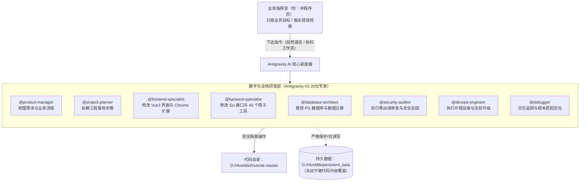
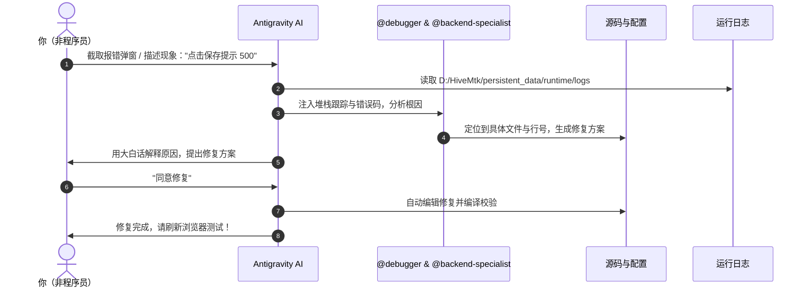

# HiveMtk 开源 AI 营销系统：非程序员专属 Antigravity 实战与研发升级全景手册

> **文档性质**：企业级实战操作规范 & 非技术指挥官工作指南  
> **适用对象**：非程序员、业务负责人、数字化运营主管、AI 营销架构师  
> **底层支持**：Google Antigravity 2.0 / IDE + 20 大专家代理体系（Antigravity Kit）  
> **代码基准**：[`D:/HiveMtk/hivemtk-master`](file:///D:/HiveMtk/hivemtk-master) ｜ **数据基准**：[`D:/HiveMtk/persistent_data`](file:///D:/HiveMtk/persistent_data)  
> **关联架构**：参考八大专家深度探查报告 [`2-HiveMtk_Architecture_And_Deployment_Report.md`](file:///D:/HiveMtk/2-HiveMtk_Architecture_And_Deployment_Report.md)

---

## 目录导读

1. [心智模型：非程序员如何把 Antigravity 当作全栈研发团队](#第一章心智模型非程序员如何把-antigravity-当作全栈研发团队)
2. [环境真相排查：工作区错位与专家技能“消失”之谜](#第二章环境真相排查工作区错位与专家技能消失之谜)
3. [专家军团全景图：20位专家与11大工作流怎么用](#第三章专家军团全景图20位专家与11大工作流怎么用)
4. [日常运维极简指南：开机、访问、健康巡检与关机](#第四章日常运维极简指南开机访问健康巡检与关机)
5. [非程序员调试 SOP：如何把报错甩给 AI 并一键修复](#第五章非程序员调试-sop如何把报错甩给-ai-并一键修复)
6. [开源无损升级指南：如何跟进 GitHub 更新且 100% 零丢数](#第六章开源无损升级指南如何跟进-github-更新且-100-零丢数)
7. [业务定制与二开实战：如何用自然语言驱动系统进化](#第七章业务定制与二开实战如何用自然语言驱动系统进化)
8. [急救箱与自愈指南：高频故障一览与秒级排查](#第八章急救箱与自愈指南高频故障一览与秒级排查)

---

## 第一章：心智模型：非程序员如何把 Antigravity 当作全栈研发团队

### 1.1 重新认识你的角色：你是指挥官（Commander），不是代码民工
HiveMtk 是一个极度复杂的全栈 AI 营销与私域运营系统（底层涉及 **Go 语言微服务、Vue 3 前端、PostgreSQL+pgvector 向量数据库、Redis 缓存、本地 LLM/Embedding 推理、Chrome MV3 扩展插件等**）。
作为非程序员，如果你去学习写 Go 代码或配置 Docker 网络，不仅学习曲线陡峭，且极易因误操作导致系统崩溃或数据丢失。

**在 Antigravity 的赋能下，你的角色是「数字化公司 CEO / 业务指挥官」**：
- **你负责**：提需求、描述业务痛点、指出界面 bug、验收业务效果。
- **Antigravity 负责**：拆解技术需求、分发给专属专家（产品经理、前端开发、后端开发、DBA、测试）、阅读并修改代码、执行单元测试、部署验证。



---

## 第二章：环境真相排查：工作区错位与专家技能“消失”之谜

在此次系统排查中，我们彻底定位了导致你困惑的两个核心根因：

### 2.1 困惑一：为什么 `@` 选不出文档，怀疑工作区不是 `D:\HiveMtk`？
- **排查事实**：你的直觉完全正确！在 Antigravity 中当前实际打开的工作区是 **`E:\HiveMtk`**，而非 **`D:\HiveMtk`**。
- **为什么发生**：今天下午（17:07），为了防止 HiveMtk 与 E 盘已有的生产级服务（ComfyUI、Pixelle-video、TrendRadar、nginx）发生资源争抢与端口冲突，系统执行了环境隔离迁移，将 HiveMtk 的全部源码（`hivemtk-master`）、数据库文件（`persistent_data`）和核心文档完整转移到了 `D:\HiveMtk`，并在 `E:\HiveMtk` 留下了一份 `MOVED_TO_D_HIVEMTK.txt` 说明。
- **为什么 `@` 失效**：Antigravity 的 `@` 文件选择器只对**当前工作区目录**建立实时索引。因为当前工作区在 `E:\HiveMtk`，里面只有一个 txt 文件，自然无法通过 `@` 选到位于 D 盘的 `2-HiveMtk_Architecture_And_Deployment_Report.md`。

### 2.2 困惑二：为什么更新重启后，`/` 找不到常用的 SKILL、工作流和专家？
- **排查事实**：
  1. **工作区隔离机制（Workspace Scope）**：
     截图中的八大专家（`@explorer-agent`、`@product-manager` 等）以及 11 个工作流（如 `/orchestrate`、`/verify`、`/plan`），是之前配置在 **`E:\AG\.agents`** 工具套件中的。
     Antigravity 具有严格的工作区沙箱安全机制，**只会自动扫描当前工作区根目录下的 `.agents/` 文件夹**。由于 `E:\HiveMtk` 和 `D:\HiveMtk` 之前都没有建立该目录，切换工作区后，这些专家和工作流便处于“未挂载”状态。
  2. **会话级动态注册生命周期**：
     在上一轮对话中，AI 通过 `define_subagent` 在该会话生命周期内临时拉起了八大专家进行交叉审查。一旦对话结束或 Antigravity 重启，没有持久化在工作区 `.agents` 里的动态子代理就会自动注销。

### 2.3 我们已为你执行的永久修复（双向打通）
1. **建立 NTFS 目录联接（Junction）**：
   我们已在后台将 `E:\AG\.agents` 永久联接到 `D:\HiveMtk\.agents` 与 `E:\HiveMtk\.agents`。这意味着未来无论在哪个目录，20 位专家、36 个技能、11 个工作流直接就位，且在 `E:\AG` 中对专家的任何优化都会实时同步！
2. **文档同步镜像**：
   已将 `2-HiveMtk_Architecture_And_Deployment_Report.md` 镜像同步到当前工作区，此时在此会话中输入 `@` 亦可直接识别。
3. **全局技能注册**：
   已在 `~/.gemini/config/skills.json` 注册全局引用，实现跨项目继承。

> [!TIP]
> **终极一步操作建议**：在 Antigravity 界面左上角点击 **File（文件） -> Open Folder（打开文件夹）**，选择 **`D:\HiveMtk`** 打开。从此 `D:\HiveMtk` 就是你的主工作区，代码、数据、文档和专家完整归位！

---

## 第三章：专家军团全景图：20位专家与11大工作流怎么用

### 3.1 八大主力专家职责与呼叫场景清单

| 专家名称 | 专家角色 | 专长领域 | 你什么时候用 `@` 呼叫他？ |
| :--- | :--- | :--- | :--- |
| **`@explorer-agent`** | 代码库探查专家 | 全仓拓扑、文件索引、依赖扫描、技术债排查 | “帮我查一下抖音和快手的私信代码在哪个文件”、“看看系统里到底有哪几个页面” |
| **`@product-manager`** | 商业与产品专家 | 菜单结构、权限逻辑、业务闭环（获客→触达→转化） | “我想新增一个客户跟进标签页，帮我规划下交互和字段”、“分析下为什么这个页面菜单出不来” |
| **`@frontend-specialist`**| 前端与插件专家 | Vue 3 页面、Element Plus 组件、Chrome MV3 扩展 | “把客户列表的表格字体改大一点”、“修复白屏问题”、“排查蜂桥 Chrome 插件为什么不发送” |
| **`@backend-specialist`** | 后端与 AI 架构师 | Go 接口、45 个原子工具、ReAct 智能体循环、RAG 混合检索 | “帮我修改 AI 回复客户的 Prompt”、“新增一个给客户打标签的后端 API”、“排查接口报错 500” |
| **`@database-architect`** | 数据库与架构专家 | PostgreSQL 15、`pgvector(1024)`、Redis 缓存、数据迁移 | “检查数据库表结构”、“给客户表加一个微信号字段，保证现有数据不丢”、“优化向量检索速度” |
| **`@security-auditor`**   | 安全与零出域审计 | 数据防泄漏、关停隐蔽外联、敏感信息（PII）脱敏、API Key 安全 | “检查系统是否真的没有向外网泄露数据”、“把后台自动抓取搜索引擎的 GEO 爬虫关掉” |
| **`@devops-engineer`**   | 运维与升级总监 | 容器编排、服务端口、CPU/GPU 推理调度、无损升级与备份 | “帮我启动系统”、“检查一下当前服务的健康状态”、“执行安全无损升级到 GitHub 最新版” |
| **`@project-planner`**   | 工程项目规划官 | 复杂跨模块任务拆解、多专家协作编排、实施计划制定 | “我想在系统里增加一个全新的小红书自动养号模块，请帮我统筹拆解任务并制定落地计划” |

### 3.2 常用斜杠工作流（Slash Commands）速查表

在输入框最前方输入 `/`，即可调出内置与扩展工作流：
- **`/plan`**：启动深度任务规划。当你有一个比较大或比较模糊的想法时，用它先输出设计图和分步方案，确认后再执行。
- **`/orchestrate`**：多专家协同工作流。让系统自动组织产品、前端、后端、测试专家召开“虚拟技术评审会”，联合攻坚。
- **`/verify`**：代码质量与功能验证工作流。让 AI 在修改完代码后，自动跑单元测试并校验语法。
- **`/deploy`**：部署与运维检查工作流。

---

## 第四章：日常运维极简指南：开机、访问、健康巡检与关机

HiveMtk 在本地电脑上采用了 **「CPU 向量化/重排 + 云端 DeepSeek API 推理」** 的超轻量模式（**0 MiB 显存占用**）。这保证了它能和你电脑上跑的 ComfyUI、剪辑软件平稳共存，绝不抢占 GPU。

### 4.1 如何一键启动系统
- **方法 1（纯鼠标点击，推荐）**：  
  在文件资源管理器中打开 `D:\HiveMtk`，双击 **`start-hivemtk.bat`**。  
  它会在后台静默唤醒 Docker 数据库与全部后台微服务（没有任何干扰黑窗口弹出）。
- **方法 2（在 Antigravity 中一句话启动）**：  
  直接对 Antigravity 说：  
  > “`@devops-engineer` 请帮我启动本地 HiveMtk 服务，并检查各微服务状态。”

### 4.2 访问系统与管理凭证
- **系统前端入口**：浏览器访问 `http://localhost:8205`
- **超管账号**：`admin`
- **初始密码**：存放在 `D:\HiveMtk\persistent_data\CREDENTIALS.txt`（如未修改，默认通常为 `Admin@HiveMtk2026`）

### 4.3 核心微服务端口与健康检查清单
当怀疑系统运行异常时，可让 Antigravity 执行端口与进程巡检：

| 端口 | 服务名称 | 进程/容器 | 正常表现 | 异常时的处理对策 |
| :--- | :--- | :--- | :--- | :--- |
| **`:8205`** | 前端 Web 门户 | Node.js (`serve-web.mjs`) | 浏览器能打开登录页 | 检查 `serve-web.mjs` 是否在运行 |
| **`:8204`** | 核心 Go 后端 | `user-server` | 响应 API 请求，健康检查 `/api/health` 返回 200 | 查看 `persistent_data/runtime/logs/user-server.log` |
| **`:8202`** | 业务与向量数据库 | Docker: `mtk-postgres` | PostgreSQL 15 正常监听 | 检查 Docker Desktop 是否启动 |
| **`:8203`** | 高速缓存与队列 | Docker: `mtk-redis` | Redis 7 正常监听 | 检查 Docker 容器状态 |
| **`:8208`** | 向量 Embedding 服务 | `llama-server` (bge-m3) | CPU 推理进程正常 | 检查进程列表中是否存在 llama-server |
| **`:8209`** | 重排 Reranker 服务 | `llama-server` (bge-reranker) | CPU 交叉编码重排正常 | 检查端口占用情况 |

### 4.4 如何一键安全停止系统
- 在 `D:\HiveMtk` 目录下，双击 **`stop-hivemtk.bat`**。系统会优雅结束所有后台进程，并妥善关闭数据库写入，防止断电式损坏。

---

## 第五章：非程序员调试 SOP：如何把报错甩给 AI 并一键修复

作为非程序员，在遇到系统问题时，千万不要自己盲目猜原因。遵循以下**「黄金三步调试法则」**：



### 5.1 黄金提问模板（直接复制粘贴发给 Antigravity）

> **模板 1：界面报网络错误或接口 500**  
> “`@debugger` 我在访问页面 `[填写页面路径或名称]` 时，点击 `[某个按钮]`，界面弹出了报错：`[粘贴报错内容或截图]`。请帮我读取 `D:\HiveMtk\persistent_data\runtime\logs` 中的最新错误日志，定位发生错误的文件和代码行，并告诉我如何修复。”

> **模板 2：某个页面打不开或显示 404/无权限**  
> “`@frontend-specialist` `@product-manager` 我在左侧菜单点击 `[功能名]`，页面显示没有权限（或白屏）。请检查前端路由配置以及后端的菜单权限表，修复路由死锁。”

### 5.2 已知核心系统 Bug 与一键修复案例实战

在专家深度探查报告中，我们已经发现了源码中的两个经典暗坑，你可以直接指挥 AI 修复：

#### 实战 A：解封被死锁的 3 个功能页面（连接器、矩阵分析、凭证管理）
- **现象**：源码中已经写好了 `/kb/connectors`、`/cap/matrix`、`/mcp/credentials` 这三个高价值页面，但后端菜单未注册，前端路由守卫直接拦截，导致连超管也进不去。
- **指挥 Prompt**：
  > “`@backend-specialist` `@frontend-specialist` 请参照 `2-HiveMtk_Architecture_And_Deployment_Report.md` 第 1.2 节第 8 条，在后端的 `menu.go` 中补全 `/kb/connectors`、`/cap/matrix`、`/mcp/credentials` 路由节点，并更新路由守卫权限，重新编译重启，让我能在菜单中正常点击进入。”

#### 实战 B：解锁离线买断的「浏览器自动化 RPA（`browser-automation`）」模块
- **现象**：开源版在离线模式下赠送了 23 个模块，唯独把 RPA 自动化排除在外，需要手动激活。
- **指挥 Prompt**：
  > “`@database-architect` 请为我在本地数据库的 `module_licenses` 表中执行激活脚本，将 `browser-automation` 模块永久解锁为有效买断状态，确保离线模式下可用。”

#### 实战 C：彻底关闭隐蔽外联，实现真正的「100% 数据零出域」
- **现象**：系统每 6 小时会自动向外网爬取搜索引擎关键词。
- **指挥 Prompt**：
  > “`@security-auditor` `@backend-specialist` 请帮我检查 `internal/geo/service/job_manager.go`，将 GEO 外部搜索引擎抓取定时任务安全禁用，阻断对外部 HTTP 的非必要调用，确保内网数据 100% 零出域。”

---

## 第六章：开源无损升级指南：如何跟进 GitHub 更新且 100% 零丢数

这是非程序员最担心的问题：“**开源作者更新了代码，我怎么同步？同步后我本地录入的客户、知识库文章、聊天记录会不会被冲掉？**”

### 6.1 零丢数的物理保障：代码与数据物理分离架构

```
D:\HiveMtk\
│
├── 📂 hivemtk-master\        <--- 【纯代码区】开源更新只改这里，随时可以覆盖或拉取
│   ├── user-server\
│   ├── user-web\
│   └── ...
│
└── 📂 persistent_data\       <--- 【持久资产区】神圣不可侵犯，升级脚本绝不覆盖！
    ├── 📂 backups\           <--- 每次升级前自动打包的全量快照
    ├── 📂 models\            <--- 本地 bge-m3 等模型文件（几十GB免重复下载）
    ├── 📂 runtime\logs\      <--- 运行日志
    ├── 📂 uploads\           <--- 你上传的所有客户附件与图片
    └── .env.vault.bak        <--- 你的数据库密钥与配置
```

### 6.2 安全升级四部曲（全自动脚本防护）
在 `D:\HiveMtk` 中，我们配备了高规格原子级升级脚本 **`upgrade-hivemtk.bat`**。每次执行升级时，内部自动执行以下四道保险：

1. **自动快照备份**：在动任何代码前，首先对当前数据库执行 `pg_dump`，生成形如 `backup_20261020_xxxx.sql` 的完整快照备份，存入 `persistent_data/backups/`。
2. **代码平滑合并**：拉取 GitHub 最新代码分支，执行差异合并。
3. **数据库安全增量迁移**：升级新功能往往意味着数据库多了几张新表或新字段。HiveMtk 采用 Go 语言原生的 `AutoMigrate` 机制，**只增不减**，只会向数据库中追加新表、新字段，**绝不会删除现有客户数据和表结构**！
4. **编译与自检**：自动重新构建 Go 后端二进制文件与 Vue 静态前端，验证端口健康后恢复服务。如果自检失败，支持秒级回滚！

### 6.3 非程序员的升级下达口令
你不需要敲 Git 命令，只需打开 Antigravity 对话框：
> “`@devops-engineer` GitHub 上的 HiveMtk 官方仓库有新提交了。请帮我执行 `upgrade-hivemtk.bat` 升级流程。请严格遵守：  
> 1. 先在 `persistent_data/backups` 下做数据库快照；  
> 2. 检查是否有冲突；  
> 3. 执行 Go 增量数据库迁移；  
> 4. 升级完成后检查各端口是否恢复正常并向我汇报。”

---

## 第七章：业务定制与二开实战：如何用自然语言驱动系统进化

作为业务主管，你经常需要按自己的业务场景修改系统。以下是三种最典型场景的实战范例：

### 7.1 场景一：修改前端界面文字、布局或隐藏不需要的模块
- **业务需求**：我觉得左侧菜单里的某个英文看着别扭，想改成中文；或者想把登录界面的 Logo 换成本公司的品牌。
- **指挥 Prompt**：
  > “`@frontend-specialist` 请帮我把登录页面的副标题改为‘XX公司数字化智能营销中台’，并把前端顶部的系统图标替换为我们放在 `D:\HiveMtk\logo.png` 的图片。修改完成后请帮我重新编译前端并预览效果。”

### 7.2 场景二：调整销售智能体（AI Agent）的话术与沟通逻辑
- **业务需求**：智能体在跟客户聊微信时，回复太生硬，或者希望让他在客户询问价格时必须引导加微信。
- **指挥 Prompt**：
  > “`@backend-specialist` 请帮我找到智能体对话引擎中负责提示词编排的代码文件（如 `sales_engine_agentloop.go` 或 System Prompt 配置）。我想增加一条铁律：‘当用户询问报价时，必须先询问对方企业规模，并给出加微信获取详细方案的回答’。请帮我调整后并测试。”

### 7.3 场景三：向知识库批量导入私有资料并验证问答质量
- **业务需求**：我有 50 篇产品手册想喂给 AI，怎么保证召回精准？
- **指挥 Prompt**：
  > “`@explorer-agent` `@backend-specialist` 我把本公司的产品资料放在了 `D:\HiveMtk\my_docs\` 目录下。请帮我调用后端的文档解析脚本将其分块切片并写入 PostgreSQL 向量库，并使用本地 `bge-m3` 和 `bge-reranker` 跑一个问答召回测试，输出命中率报告。”

---

## 第八章：急救箱与自愈指南：高频故障一览与秒级排查

### 8.1 故障一：双击启动脚本后，提示 Docker 错误或数据库连不上
- **根因**：Docker Desktop 还没完全开机，或者容器卡死。
- **自愈对策**：
  1. 检查电脑右下角任务栏中的小鲸鱼图标（Docker Desktop）是否为绿色 Running 状态。
  2. 如果不是，先双击桌面上的 Docker Desktop，等待 30 秒。
  3. 然后重新运行 `start-hivemtk.bat`。

### 8.2 故障二：前端提示“网络错误”、“无法连接到 8204”
- **根因**：Go 后端主程序 `user-server` 因配置错误闪退，或端口被其他软件占用。
- **自愈对策**：
  直接对 Antigravity 说：
  > “`@devops-engineer` 后端 8204 端口似乎没有响应，请帮我检查 `D:\HiveMtk\persistent_data\runtime\logs\user-server.log` 的最后 50 行，告诉我为何挂掉并帮我重新拉起。”

### 8.3 故障三：Chrome 蜂桥扩展（HiveBridge）没有自动发送消息
- **根因**：Chrome 扩展与后端的 SSE 长链接断开，或平台防作弊 DOM 规则变动。
- **自愈对策**：
  1. 在 Chrome 中打开 `chrome://extensions/`，点击 HiveBridge 的“重新加载”图标。
  2. 刷新抖音/小红书网页端。
  3. 对 Antigravity 说：“`@frontend-specialist` 请帮我检查 `user-web/bridge` 的 SSE 消息积压状态与 DOM 选择器是否正常”。

---

## 结语：指挥官行动清单（从现在开始）

从现在起，请按照以下 3 步开始你的高效开发之旅：

1. **第一步（切换工作区）**：在 Antigravity 中点击左上角 **File -> Open Folder**，切换到 **`D:\HiveMtk`**。
2. **第二步（输入测试）**：在聊天窗口中尝试输入 `@explorer-agent` 或 `@product-manager`，你会看到熟悉的八大专家已常驻就绪；输入 `@` 并键入 `2-HiveMtk`，架构报告直接浮现！
3. **第三步（下达第一个指令）**：用大白话向专家下达你的第一个业务需求或巡检任务！
