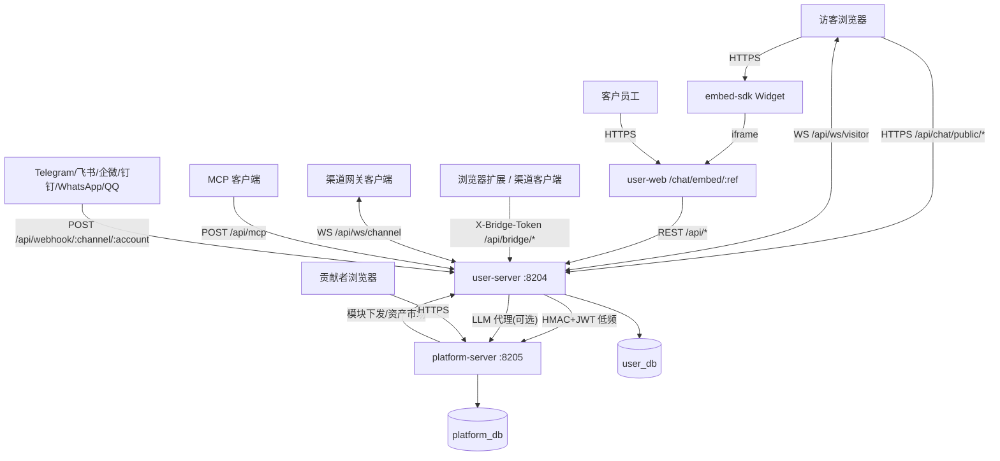

# HiveMtk 全端能力分析报告（代码端视角）

> **版本**：v1.0（2026-10-18）
> **范围**：`hivemtk/` 工作区内全部子项目（端）
> **方法**：直接读源码（五层目录、路由表、模型、前端工程、跨端客户端）+ 命令现测计数，不依赖二手文档
> **口径**：本文所有数字均为 2026-10-18 在本机 `现测` 读数；与既有文档冲突处见 §5
> **路径基准**：本文以**工作区根**为基准（`hivemtk/`、`hivemtk-platform/`、`assetdpo/`、`cold-start/` 均为工作区一级目录）；本副本落在 `hivemtk/docs/architecture/` 下，仓内路径请去掉 `hivemtk/` 前缀。

---

## 0. 结论摘要

1. **端清单共 9 个**：用户端 4 个（user-server / user-web / embed-sdk / website）+ 平台端 3 个（platform-server / platform-web / platform-contributor）+ 支撑端 2 个（assetdpo / cold-start）。**移动端（uniapp）不在本工作区**，只存在于外部仓（`docs/OPEN_ITEMS.md（历史台账已归档）` 亦已登记）。
2. **主战场是 user-server**：Go 1.26 + Gin + GORM + pgvector，**3243 个 `.go` 文件**、**183 个 Controller**、**374 个 Service**、**195 个 Repository**、**168 个 Model**、**1137 条路由注册**。五层架构（Router→Controller→Service→Repository→Model）在目录与命名上基本落地，`handler` 包零命中（与仓库 `CLAUDE.md` 一致）。
3. **端间通信共 7 条主通道**：访客聊天（chat/public + WS）、渠道扩展桥（bridge）、渠道网关 WS（channelgw）、外部渠道 Webhook、平台心跳/安装/模块/资产市场/LLM 代理、MCP 工具入口、前端静态托管。详见 §4。
4. **主要问题不是"缺能力"，而是"文档漂移"**：多处既有架构文档与代码现状不一致（WS 是否弃用、推理栈端口/模型、Go 版本、模块计数）。这些漂移会让后来者按错的图施工，已在 §5 逐条论证、并在 §6 修复。
5. **原判"真实能力缺口 2 处"，现只剩 1 处**（2026-10-18 读数，2026-10-26 订正）：
   - `/ws/chat` 路由**从未注册**（死代码，`internal/router/ws.go` 自认）—— 仍开放，本轮只做**只读论证 + 文档如实标注**。
   - ~~平台撤回（Recall）在 `integration_reach_adapter.go` 仍是恒错 stub~~ ⇒ **这条说法本身是错的，且现状已闭环**。
     如实订正：撤回的**渠道分派从来不是 stub**（TG `deleteMessage` / 飞书 `DELETE messages` / 企微 `recall`，
     各带窗口；WA 与桥接渠道是**有意**报 `ErrRecallNotSupported`，因为没有平台通道），
     当时真正缺的是三样东西——**本地回执**（撤完行上看不出）、**幂等**（重复请求会重复出网）、
     **HTTP 入口**。B2 已在 2026-10-26 补齐：`message_hub.recalled_at/recall_error`（迁移 `v3.86.0`）+
     `POST /api/message-hub/:id/recall` + user-web 撤回入口，合同见
     `user-server/docs/contracts/message-hub-recall.md`。


---

## 1. 端全景

| # | 端 | 路径 | 技术栈 | 角色 | 对外端口 |
|---|----|------|--------|------|---------|
| 1 | **user-server** | `hivemtk/user-server` | Go 1.26 + Gin + GORM + pgvector | 私域业务核心（单租户） | 8204 |
| 2 | **user-web** | `hivemtk/user-web` | Vue 3.5 + Element Plus + Pinia | B 端工作台（唯一业务 Web 工程） | 静态托管于 8204 |
| 3 | **embed-sdk** | `hivemtk/embed-sdk` | 原生 JS + Vite（IIFE/ESM） | 官网客服 Widget（iframe 嵌 user-web） | 无（构建产物） |
| 4 | **website** | `hivemtk/website` | Vite + 原生前端 | 官网 / 文档站 | 独立静态站 |
| 5 | **platform-server** | `hivemtk-platform/platform-server` | Go + Gin + GORM | 平台控制面（云） | 8205 |
| 6 | **platform-web** | `hivemtk-platform/platform-web` | Vue 3 + Element Plus | 平台运营后台 | 平台静态托管 |
| 7 | **platform-contributor** | `hivemtk-platform/platform-contributor` | Vue 3 | 贡献者门户 | 平台 `/contributor` |
| 8 | **assetdpo** | `assetdpo` | Python（CLI 流水线） | 垂直行业资产工厂 | 无（批处理） |
| 9 | **cold-start** | `cold-start` | Python | 冷启动运营/发布流水线 | 无（批处理） |

> 基础设施：PostgreSQL（user_db `8202`、platform_db `8201`）、Redis `8203`、本地推理栈（`8207/8208/8209`，或本机回环网关 `8787`）。

---

## 2. 逐端能力盘点

### 2.1 user-server（业务核心）

**规模现测**：183 Controller / 374 Service / 195 Repository / 168 Model / 45 DTO / 34 Middleware / 83 个 router 文件 / 1137 条路由注册 / 55 个 migration（另有 `init-user-db.sql`）。

**五层架构**：`internal/{router,controller,service,repository,model}` 目录即层名；DI 装配集中在 `cmd/api/main.go` 与 `internal/app/*_wiring.go`（111 个 wiring 文件）；Router 层按域拆 `*_routes.go`，`router.go:165 Setup()` 统一装配。

**功能域（按 Controller 归并，183 个控制器覆盖）**：

| 域 | 代表能力 | 代表文件 |
|----|---------|---------|
| 认证与用户 | JWT 鉴权、注册、密码重置、MFA、SSO、租户 | `auth.go` `auth_register.go` `sso.go` `tenant.go` `password_reset.go` |
| 多渠道卡片 | 抖音/快手/小红书/闲鱼/TikTok 自动生卡 + 统计 | `douyin_card*.go` `kuaishou_card*.go` `xiaohongshu_card*.go` `xianyu_card*.go` `tiktok_card.go` |
| 统一消息/收件箱 | 会话聚合、消息中心、SSE、平台账号 | `inbox.go` `message_hub.go` `unified_message.go` `platform.go` |
| AI 智能体 | ReAct 循环、41+ 工具、知识库 RAG、双模式（被动/主动） | `ai_agent.go` `cs_agent`、`internal/aiagent/{agent,llm,rag,embedding,vector,mcp,knowledge,eval}` |
| 客服增强 | 坐席接管、会话路由、排队、黑名单、CSAT、转人工 | `customer_session*.go` `csat.go` `handoff_chain.go` `customer_queue.go` |
| 线索与客户 | 线索、客户 360、OneID、标签、事件、RFM、旅程 | `clue*.go` `customer*.go` `customer_rfm.go` `customer_journey.go` |
| 营销自动化 | SOP、A/B 测试、转化漏斗、自定义报表、看板、流失预测 | `sop*.go` `ab_*` `conversionFunnel` `custom_report.go` `churn` `dashboard_sse.go` |
| 邮件/短信 | 列表/草稿/任务/发送/退订、SMTP、投递追踪 | `email_*.go` `sms*.go` |
| 社群与主动触达 | 企微/WhatsApp 群发、短信/邮件/TG/飞书触达管线 | `proactive_reach.go` `reach_pipeline.go` `whatsapp_group_messaging.go` |
| 短链/活码/域名池 | 短链统计、活码二维码、域名池 | `short_link*.go` `live_code.go` `domain_pool.go` |
| LTC 全链路 | 商机→报价→审批→账单→回款 | `opportunity.go` `quote.go` `bill.go` `approval.go` `order_draft.go` |
| 内容创作 | AI 内容、脚本库、模板、素材 | `ai_content` `script_library.go` `template` `asset_market.go` |
| 系统管理 | 配置参数、字典、菜单权限、可观测、升级、备份、迁移 | `config_param*.go` `dictionary.go` `menu.go` `system_*.go` `backup.go` `migration.go` |
| GEO/浏览器自动化 | GEO 爬虫统计、浏览器触发链 | `internal/geo` `browser_automation.go` |

**中间件链（`router.go` 现测顺序，安全关键）**：
`BodyLimit → Locale → Context → RateLimit(1000RPS) → Trace → APIInteractionLogger → Audit → JWT → Tenant → RoutePolicyGuard(能力面) → DataScopeGuard(行级) → GuardModulePath(模块闸)`。
> 顺序有强约束：模块闸必须在 JWT 之后、RoutePolicyGuard 之前（否则超管成付费后门）；监控路由必须在 `auth.Use(JWTAuth...)` 之后注册（历史缺陷见 `router.go:437`）。

### 2.2 user-web（B 端工作台）

**规模现测**：**220 个 `.vue` 视图**、**111 个 API 模块**（`src/api/{module}.js`，统一 `import { http } from '@/utils/request'`）、**88 个路由模块**（`src/router/modules/`）、10 个 Pinia store、9 语言 i18n。

**能力**：覆盖 §2.1 全部业务域的前端入口（inbox / customer360 / knowledge / sop / reach / ltc / dashboard 等），Playwright + vitest 测试基建齐备（`deep-test-*.json`、`interact-batch*.json` 为历史真人模拟报告）。

### 2.3 embed-sdk（官网客服 Widget，ADR-011）

**规模现测**：`src/{index? ,widget,iframe-panel,floating-button,config}.js`，Vite 双产物（IIFE + ESM），运行时零依赖。

**能力**：悬浮按钮 + iframe 面板；**不直连业务 API**，iframe 嵌 user-web 的 `/chat/embed/:channel_ref`（`embed_static_routes.go`）。测试：`test/{unit,boundary,ws}.test.mjs`。

### 2.4 website

独立官网/文档站（Vite），含 i18n 检查脚本（`check_i18n.mjs`）、`TERMINOLOGY.md`（术语对齐）。

### 2.5 platform-server（平台控制面）

**路由分组（`internal/router/router.go` 现测）**：

| 分组 | 鉴权 | 能力 |
|------|------|------|
| `/merchant-api` | `MerchantAuth`（HMAC） | 商户注册、日志上报、租户开户、模块下发/市场/订单、LLM 套餐/钱包、资产市场 |
| `/contributor-api` | 公开(登录) + `ContributorJWTAuth` | 贡献者注册/登录、资产 CRUD/版本/提交审核、收益/提现、Playground |
| `/public` | 无 | 站点联系方式 |
| `/api/platform` | 无（公开统计） | 心跳接收、安装上报 |
| `/llm-api/v1` | 无（商户 Bearer=merchant key） | **零出域唯一例外**：LLM 代理转发（向平台厂商，key 不下发） |
| `/platform` | `JWT + RequirePlatformAdmin + Audit` | 看板/统计、商户管理、监控、消息、安装/心跳列表、资产市场审核、模块目录/授权、订单、支付回调、租户、LLM 套餐/钱包 |
| `/api/*` | `JWT + AdminAccountAuth` | 管理端登录、资料、改密 |

**Model（11）**：admin / api_log / asset_market / audit_log / install / llm_billing / merchant / message / module_catalog / order / site_contact。

### 2.6 platform-web + 2.7 platform-contributor

- platform-web：**20 个视图**（dashboard / monitoring / merchant / module / order / tenant / assetMarket 审核 / llm 套餐）。
- platform-contributor：**12 个视图**（资产列表/编辑/上传/版本、Playground、收益、提现、资料）。

### 2.8 assetdpo（资产工厂）

Python CLI 流水线：`collectors → formatters → enhancers → synthesizers → trainers → scorers → evaluators → exporters`；支持 SFT/DPO/ORPO；SQLite/PostgreSQL 存储；`studio/` 交互；产出于 `data/{raw,processed,trained,evaluated,covers,studio,calibration}`。

### 2.9 cold-start（冷启动运营）

Python：账号管理、内容生成（`generators/`：封面/图表）、多平台发布（`publish/`：GitHub/知乎/掘金/视频/图文）、集成分发（`integrations/`：RSS/SEO/PostHog/Umami/LangBot/Listmonk 等）。

---

## 3. 数据层分析

### 3.1 user-server 数据模型（168 Model）

| 分组 | 代表模型（表） |
|------|---------------|
| 客户与身份 | customer / customer_360 / customer_channel / customer_tag / customer_segment / customer_rfm / customer_session / oneid(customer_oneid) / user / user_blacklist / user_mfa / role / menu / permission |
| 会话与消息 | customer_session / session_message / message / message_event / message_trace / unified_message / chat_channel / session_tag / msg_hourly_summary |
| 渠道 | douyin_card(_activity) / kuaishou_card(_activity) / xiaohongshu_card(_activity) / xianyu_card(_activity) / tiktok_card / wechat_account / wecom / whatsapp_account / telegram_gate / feishu / qq / dingtalk_app_account / platform_account_config |
| AI/知识库 | ai_agent / ai_sales_champion / ai_suggestion / ai_tool_config / knowledge_base / kb_document / kb_workspace / kb_release / kb_merchant / kb_connector / faq_entry / glossary / dialogue_eval_run / rag_* / llm_provider / llm_routing_rule / llm_routing_log / mcp_credential |
| 营销 | live_code(_qr/_stat) / short_link(_access) / domain_pool / email_* / sms* / sm_list / sop_template / sop_executor / ab_test / custom_report / user_segment / marketing_flow |
| LTC/交易 | clue / clue_score / opportunity / quote / approval_request / bill / order / order_draft / payment / sales_event |
| 治理 | config_param / config_param_group / feature_flag / module_bindings / module_tables / data_scope / security_audit / security_rules / security_alert / operation_log / backup / upgrade |
| 触达合规 | reach_compliance_log / reach_delayed_outbound / customer_do_not_contact / sms_unsubscribe / email_unsubscribe |
| 可观测 | web_vital / stats / support_metrics / rag_metrics / trace_eval / humanize_score / learning_insight |

> 向量库：`knowledge_embeddings`，pgvector **1024 维**（`config.yaml` 与 `migrations/044_knowledge_hnsw_index.sql` 一致）。

### 3.2 platform-server 数据模型（11 Model）

`merchant` / `install` / `module_catalog` / `order` / `llm_billing` / `asset_market` / `message` / `site_contact` / `admin` / `api_log` / `audit_log`。
> **数据隔离铁律**：平台端仅存元数据（商户/版本/统计），**不落任何业务对话**（`zero_egress_test.go` 守着 user-server 侧不外发；详见 §4）。

### 3.3 迁移

user-server：55 个 SQL migration + `init-user-db.sql`，编号 002–058（001 隐含在 init）。platform-server：`migrations/` 目录。

---

## 4. 端间通信与交互触达

### 4.1 通信总图



### 4.2 通道明细

| # | 通道 | 端点/协议 | 鉴权 | 触达方向 |
|---|------|----------|------|---------|
| C1 | 访客聊天 | `/api/chat/public/*` + `WS /api/ws/visitor` | AppKeyResolve + visitor_token(HMAC) + 访客限流 | 访客 ↔ user-server |
| C2 | 渠道桥 | `/api/bridge/{ingest,outbox,outbox/ack,outbox/sse,capabilities}` | `X-Bridge-Token` | 浏览器扩展/渠道客户端 → user-server（长轮询/SSE） |
| C3 | 渠道网关 | `WS /api/ws/channel` + `POST /api/bridge/ingest` | `BridgeIngressGuard` / `channelgw` 协议 v2 | 渠道客户端 ↔ user-server |
| C4 | 外部渠道回调 | `/api/webhook/:channel[/:account_id]` + `GET .../wecom|feishu|whatsapp|dingtalk` | 渠道签名（msg_signature 等） | 渠道平台 → user-server |
| C5 | 平台上报 | `POST /merchant-api/merchant/register`、`/api/platform/{install,heartbeat}`、`/merchant-api/{modules/sync,module-market,orders,llm/*,asset-market/*}` | HMAC(X-Merchant-Key/-Timestamp/-Signature) 或 JWT | user-server → platform-server |
| C6 | LLM 代理 | `POST /llm-api/v1/{:provider}/chat/completions` | Bearer = merchant key | user-server → platform-server → 厂商 |
| C7 | MCP | `POST /api/mcp` | `MCPGuard` | MCP 客户端 → user-server |

### 4.3 关键契约

- **统一线路协议**：`channelgw/protocol.go` 定义 v1/v2 帧（register/inbound_message/history/ack/ping/pong/outbound_reply/config_push）；HTTP 与 WS 共用同一套语义，字段与 `user-web/bridge/types.js` 严格兼容。
- **消息去重**：`ContentHashMsgID`（FNV-1a，`mh:` 前缀）在桥接与 SSE 两侧同源，扩展端复合去重键 `msg_id|conversation_id`。
- **平台签名**：`method + "\n" + pathNoQuery + "\n" + timestamp + "\n" + body` 的 HMAC-SHA256；path 带 `/platform/` 前缀时改走 JWT。
- **零出域**：所有 conversation/知识库/向量检索在客户内网完成；平台端只收心跳/安装统计；LLM 代理是"唯一显式例外"，且需商户显式开通模块+套餐（`router.go:170` 注释）。

---

## 5. 逻辑一致性论证（代码 vs 文档）

> 本节为"论证"环节：把既有文档的声明逐条与当前代码对账，**差异即缺陷**（按仓库 `CLAUDE.md` 规则2，发现即当轮处理）。

| # | 既有声明（文档） | 代码现测 | 判定 |
|---|-----------------|---------|------|
| D1 | `ARCHITECTURE_DIAGRAM.md:219`「实时通道：HTTP 长轮询（`/api/v1/ai/chat/poll`），**WebSocket 已弃用**」 | 实际注册了 **`WS /api/ws/visitor`**（`setupChatPublicWebSocket`，`chat_routes.go:55`）与 **`WS /api/ws/channel`**（`router.go:645`）；**未发现** `/api/v1/ai/chat/poll` | ❌ 文档过时且方向相反 → 修正 |
| D2 | `ARCHITECTURE_DIAGRAM.md:61`「llama-server :8207 Qwen2.5-**3B**-Instruct」 | `config.yaml` LLM 为 `step-3.7-flash`@`8787`；README 为 Qwen2.5-1.5B；无 3B 档 | ❌ 文档过时 → 修正 |
| D3 | 工作区根 `README.md:15` 徽章「Go **1.25**」 | `hivemtk/user-server/go.mod` = `go 1.26.0`；`hivemtk/README.md` 徽章已为 1.26 | ⚠️ **工作区根 README** 徽章滞后（1.26 正确） |
| D4 | `ARCHITECTURE_DIAGRAM.md` 推理栈「llama.cpp 统一二进制」 | README 与 `.env-example`：LLM=llama.cpp，Embedding/Rerank=TEI | ⚠️ 混述 → 厘清 |
| D5 | README「**62 个核心业务模块**」 | 控制器 183 个、视图 220 个、迁移 55 个 | ⚠️ "62" 为营销口径，非代码口径 |
| D6 | README「ReAct **41 工具**」 | 工具以 Provider 自注册（`auto_register.go`），无集中清单可数 | ⚠️ 需以 `/api/agent/tools/list` 运行时为准 |
| D7 | `internal/router/ws.go:11` 自述「`RegisterWSRoutes` **全树零调用方**，`/ws/chat` 从未注册」 | grep 确认零调用方 | ✅ **真缺陷**：死代码，已如实登记 |
| D8 | `docs/OPEN_ITEMS.md（历史台账已归档）` §1「Recall 恒返回错误 stub」 | `integration_reach_adapter.go` Recall 仍为 stub | ✅ **真缺口**：跨渠道撤回未实现 |
| D9 | 架构门 `scripts/check-architecture.sh` 为 CI 阻断步骤（`.github/workflows/user-server-ci.yml:194`） | 干净 HEAD 复跑报 **11 个错误**（含 7 个在已提交的干净文件上）：`llm_platform_usage.go` 直接 `db.GetDB()`、`tenant.go`/`tenant_module.go` 有非 Hook 方法、7 个 `_controller.go`/`_service.go` 冗余后缀 | ✅ **真缺陷**（阻断门在 master 常红）→ 本轮修复 |

### 5.1 端能力完整性核验

- **用户端闭环** ✅：访客 → chat/public → 智能体 → 渠道桥/网关 → 出站，全链路端点齐备。
- **平台端闭环** ✅：注册 → 心跳/安装 → 模块下发 → 订单/计费 → 资产市场，端点齐备；且 `/api/platform/*` 为公开统计口、无签名要求（与"仅统计"定位一致）。
- **贡献者端闭环** ✅：注册/登录 → 资产上传/版本 → 提交审核 → 收益/提现。
- **支撑端闭环** ✅：assetdpo 产出资产 → 平台资产市场 → 商户 user-server 同步。
- **移动端** ❌：本仓无 uniapp；`docs/OPEN_ITEMS.md（历史台账已归档）` 已登记"user 桶 419 死路由无法仓内验证"（外部仓依赖）。

---

## 6. 能力缺口与补全清单

| # | 缺口 | 证据 | 处置 |
|---|------|------|------|
| G1 | `ARCHITECTURE_DIAGRAM.md` 与代码事实相反的陈述（D1/D2/D4） | §5 | **本轮修复文档**（见 §7 变更记录） |
| G2 | README/api 徽章与 go.mod 版本、模块/工具计数口径不一（D3/D5/D6） | §5 | 文档加"口径说明"，不改营销数字 |
| G3 | `/ws/chat` 死代码（D7） | `internal/router/ws.go` | 已在文件头如实标注；接线需先补鉴权（否则烧 LLM 配额），登记为待开发 |
| G4 | 渠道撤回 Recall 未实现（D8） | `integration_reach_adapter.go` | 跨渠道新功能（TG/飞书/企微有 API，WA 无），登记为待开发（SDD 新功能车道） |
| G5 | 移动端（uniapp）不在仓内 | §5.1 | 越出本仓范围，如实登记 |
| G6 | 架构门在 master 常红（11 违规） | D9 | **本轮已修复**：改文件后缀命名 7 处、Model 方法改包级函数 2 处、`llm_platform_usage.go` 句柄口径对齐 + 基线补登 1 处；门已复绿（见 §7） |

> 处置原则：**能就地验证的低风险缺陷当轮修（G1/G2/G6）**；需动源码新功能/跨仓的（G3/G4/G5）按仓库规则登记为明确待办，不硬造。

### 6.1 本轮变更清单（已随测试验证）

**文档（工作区 `docs/` + `hivemtk/docs/`）**
- 新增本报告 `docs/HIVE_MTK_ALL_ENDS_CAPABILITY_ANALYSIS.md`（该外层副本已于 2026-10-25 清理删除，以本文件为准）
- `hivemtk/docs/architecture/ARCHITECTURE_DIAGRAM.md`：实时通道（WS 取代"长轮询已弃用"）、推理栈（TEI 承载 Embedding/Rerank）、端口表、平台端职责（去 License）逐条对齐代码
- 工作区根 `README.md`：Go 版本徽章 1.25 → 1.26

**代码（`hivemtk/user-server`）**
- 命名：7 个冗余后缀文件改名（`module_llm_controller.go`→`module_llm.go`、`module_market_controller.go`→`module_market.go`、`module_regulatory_service.go`→`module_regulatory.go`、`module_catalog_service.go`→`module_catalog.go`、`llm_wallet_service.go`→`llm_wallet.go`、`module_market_service.go`→`module_market.go`、`module_gate_service_test.go`→`module_gate_test.go`）
- Model：`Tenant.IsActive()`→`model.TenantIsActive(*Tenant)`、`TenantModule.IsUsable(now)`→`model.TenantModuleUsable(*TenantModule, time)`（与同文件既有 `IsValidTenantStatus` 同形态），同步改 4 处调用点
- L4：`service/llm_platform_usage.go` 句柄口径对齐兄弟文件（`db.GetDB()`→`dbUtil.GetDB()`），并补登 `scripts/arch-l4-getdb.baseline`
- 注释：`controller/module_llm.go` 内对兄弟文件的引用同步新名

---

## 7. 测试验证

### 7.1 本轮已执行（全部现测 rc=0）

| 检查 | 命令 | 结果 |
|------|------|------|
| 后端编译 | `cd hivemtk/user-server && go build ./...` | ✅ rc=0 |
| 架构门（修复前） | `bash scripts/check-architecture.sh`（干净 HEAD worktree 复跑） | ❌ 11 个错误 |
| 架构门（修复后） | `bash scripts/check-architecture.sh` | ✅ rc=0（存量 44 处/25 文件，Model/命名全绿） |
| Go vet | `go vet ./internal/{model,repository,service,controller}/...` | ✅ rc=0 |
| gofmt | `gofmt -l internal cmd` | ✅ 空 |
| Go 单测 | `go test ./internal/model/... ./internal/repository/...` | ✅ ok（1.6s / 110.5s） |
| Go 单测（改动域） | `go test ./internal/service/ -run 'TestTenant\|TestModule\|TestLLMWallet\|TestPlatformLLM'` | ✅ ok 4.7s |
| Go 单测（路由） | `go test ./internal/router/...` | ✅ ok 22.0s |
| 前端单测 | `cd hivemtk/user-web && npm run test`（vitest） | ✅ 58 文件 / 632 用例全过 |
| Widget 单测 | `cd hivemtk/embed-sdk && npm run build && npm run test` | ✅ 89/89 |
| 文档断链 | `python3 scripts/check-md-links-offline.py .` | ✅ 断链 0 处 |
| 平台端存活 | `curl http://127.0.0.1:8205/health` `.../api/health` | ✅ `alive` / `ready` |
| 基础设施 | `docker ps` / `lsof` | ✅ mtk-postgres:8202、mtk-redis:8203 up |

### 7.2 待补（需起服务 / 装依赖）

| 检查 | 命令 | 前置 |
|------|------|------|
| Go 单测 | `export POSTGRES_TEST_HOST=127.0.0.1 POSTGRES_TEST_PORT=8202 POSTGRES_TEST_PASSWORD=$(grep ^POSTGRES_PASSWORD= hivemtk/.env\|cut -d= -f2); cd user-server && go test ./internal/<pkg>/...` | 测试库可达（8202 ✅） |
| 三端 API 验收 | `HIVEMTK_DB_PASSWORD=... HIVEMTK_ADMIN_PASS=... python3 scripts/api_verify_full.py api` | user-server 起于 8204 |
| 前端单测 | `cd user-web && npm run test` | node_modules ✅ |
| embed-sdk 单测 | `cd embed-sdk && npm run test` | node_modules ✅ |

---

## 附录 A：证据命令（可复现）

```bash
# 规模
ls hivemtk/user-server/internal/controller | grep -v _test | wc -l   # 183
ls hivemtk/user-server/internal/service    | grep -v _test | wc -l   # 374
ls hivemtk/user-server/internal/repository | grep -v _test | wc -l   # 195
ls hivemtk/user-server/internal/model      | grep -v _test | wc -l   # 168
find hivemtk/user-server -name '*.go' | wc -l                         # 3243
grep -rEo '\.(GET|POST|PUT|DELETE|PATCH|Any)\("' hivemtk/user-server/internal/router | wc -l  # 1137
find hivemtk/user-web/src/views -name '*.vue' | wc -l                 # 220
ls hivemtk/user-web/src/api | wc -l                                   # 111

# 一致性
grep -n 'WebSocket 已弃用' hivemtk/docs/architecture/ARCHITECTURE_DIAGRAM.md
grep -rn 'RegisterWSRoutes' hivemtk/user-server/internal/   # 仅 ws.go 自身
```

## 附录 B：修订历史

| 版本 | 日期 | 内容 |
|------|------|------|
| v1.0 | 2026-10-18 | 初版：9 端盘点 + 数据/逻辑/通信分析 + 一致性论证 + 缺口清单 |
