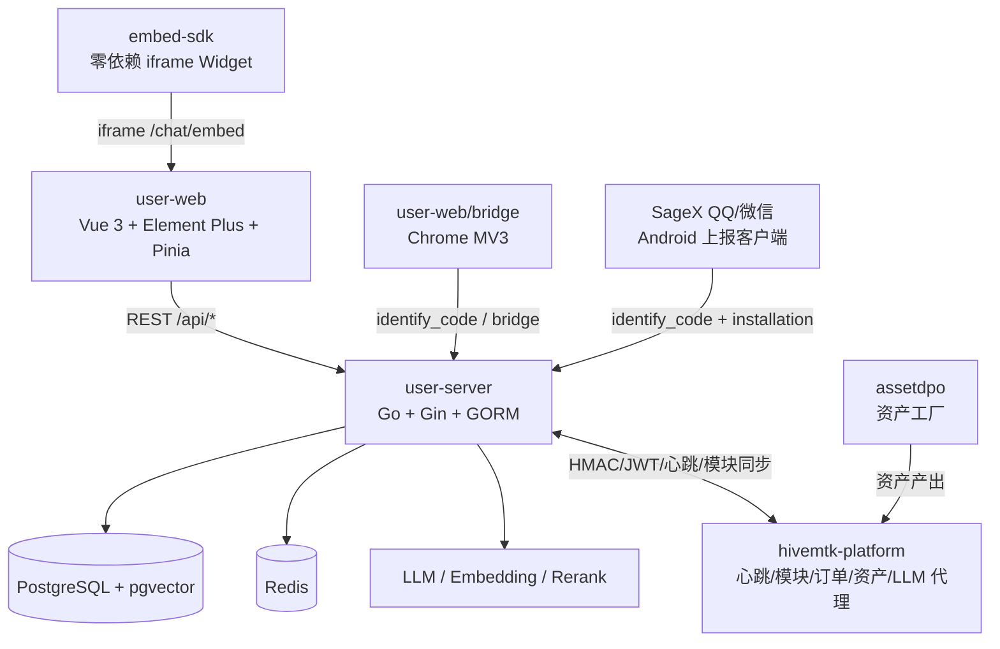

# HiveMtk 全功能与架构清单（FULL_FEATURE_INVENTORY）

> 快照时间：2026-11-25 17:30 +08:00（UTC `2026-11-25T09:30:49Z`）
>
> 范围：`hivemtk-user` 当前工作树，包含已提交代码与并行会话未提交改动；不是发布基线，也不是项目进度台账。
>
> 用途：需求 #17 的正式功能/架构清单。每个业务域追踪前端、后端、数据、逻辑、代码入口与已知问题；产品缺陷另走 bug lane，本文件不把“已记录”写成“已修复”。
>
> 权威入口：`AGENTS.md` → `docs/standards/AI-EDITOR-CONTRACT.md` → 本文件。既有专题文档仍保留其专业细节，本文件负责跨域导航与当前计数。

---

## 1. 快照口径与四仓 HEAD

| 仓库 | HEAD | 本清单范围 |
|---|---|---|
| `hivemtk-user` | `2c5c53e3ded742ac0c6ebb1944529aaed18973fd` | 用户端产品主体 |
| `hivemtk-platform` | `13016b7178e51c729d315f68d88595aa95348d82` | 仅列平台依赖边界，不代替平台仓清单 |
| `assetdpo` | `f6b07837cbe01820c3287fafc7da80eadf9b8b4d` | 仅列资产工厂边界 |
| `sagex` | `10ccdb70291a5c7225363068683c497bbce9da3c` | 仅列 Android 上报/授权边界 |

当前工作树有大量并行会话改动，因此本文件中的所有数量都是**静态源码快照**，不是 `HEAD` 干净树读数，也不宣称运行态验收完成。

本项只执行只读统计与文档写入；未运行 build/test/UI/浏览器/真实渠道/设备，未 commit/push/deploy/真实外发。

### 1.1 统计证据

- `full-feature-inventory-stats-20261125.txt`：五层文件/类型、Controller、Router、前端/bridge/SDK、迁移计数。
- `full-feature-inventory-frontend-20261125.txt`：前端包脚本、视图目录、API 模块、bridge 渠道文件。
- `full-feature-inventory-routes-20261125.txt`：Router 文件、注册函数、Group 前缀与字面路由数。
- 以上文件位于既有 temp 审计目录：
  `/private/var/folders/xw/pd_rr_z54w38gq41yfm8h7sm0000gn/T/opencode/recent-task-audit-20261125/`。

---

## 2. 系统架构清单

### 2.1 容器与依赖



| 组件 | 职责 | 关键约束 |
|---|---|---|
| `user-server` | 业务核心、AI 编排、渠道接入、数据访问 | 五层架构；租户 fail-closed；GORM-only；统一响应出口 |
| `user-web` | 唯一业务 Web 工作台 | API 统一走 `src/api/*`；菜单/路由/能力面一致 |
| `user-web/bridge` | 浏览器扩展渠道适配与桥接 | 只认 identify_code；MV3；无厂商域名字面量 |
| `embed-sdk` | 官网客服 Widget | iframe 嵌 `user-web`；运行时零依赖；不直连业务 API |
| `sagex` | QQ/微信通知监听、Room outbox、上报、授权 | 独立仓；identify_code-only；设备/真机边界单列 |
| `hivemtk-platform` | 平台控制面 | 只收元数据/计量，不收业务对话；真实网关仍待外部验收 |
| `assetdpo` | 行业资产工厂 | 安全 HTTP 客户端；真实 Trainer/GPU 不在本清单验收范围 |

### 2.2 请求链与中间件顺序

生产 `auth` 组当前顺序（`user-server/internal/router/router.go`）：

```text
BodyLimit / Locale / Context / RateLimit / Trace / APIInteractionLogger / Audit
  → JWTAuthMiddleware
  → TenantMiddleware
  → GuardSubscriptionPath（仅多租户模式）
  → GuardModulePath
  → RoutePolicyGuard
  → DataScopeGuard
  → Controller → Service → Repository → Model
```

独立桥接/集成组不继承 `auth` 组链，必须按自身凭证语义显式装配守卫。SageX upload/bootstrap 与 `/api/mcp` 的独立组契约是当前已归因基线缺陷，见 INV-04。

### 2.3 装配与数据

- 进程入口：`user-server/cmd/api/main.go`。
- 依赖装配：`user-server/internal/app/*_wiring.go`，当前 69 个生产文件。
- 路由总装：`user-server/internal/router/router.go` 与 60 个其他顶层生产路由文件。
- 数据模型：`user-server/internal/model/`；域内模型还包括 `internal/geo/model/`、`internal/browser_automation/model/` 等。
- 迁移：顶层 `migrations/*.sql` 95 个；Go 注册文件 `internal/migration/migrations/*.go` 211 个。
- 模块/菜单/表归属事实源：
  - `internal/model/module_bindings.go`
  - `internal/model/module_tables.go`
  - `internal/model/menu.go`
  - `internal/model/menu_capability_routes.go`
  - `internal/model/menu_capability_supplement.go`

---

## 3. 五层与代码规模清单

| ID | 层/区域 | 生产文件 | 测试文件 | 类型/接口读数 | 说明 |
|---|---|---:|---:|---|---|
| I-01 | Router | 62 | 68 | 17 个命名 struct/interface | 含 `router/cmd/dump_routes/main.go`；顶层业务路由文件为 61 个 |
| I-02 | Controller | 241 | 126 | 344 个命名 struct/interface | 其中 `XxxController` struct **231**，`XxxHandler` struct **0** |
| I-03 | Service | 595 | 772 | 1495 个命名类型；32 个导出 `XxxService` interface | 含 `internal/service/` 下嵌套 AI/子域包 |
| I-04 | Repository | 277 | 205 | 626 个命名类型；133 个导出 `XxxRepository` interface | 唯一允许持有 `*gorm.DB` 的业务层 |
| I-05 | Model | 234 | 57 | 423 个命名 struct/interface | 全 `internal/` 共 446 个唯一 `TableName()` 字面量 |
| I-06 | DTO | 54 | 2 | 332 个命名类型 | 辅助层，不是第六层 |
| I-07 | Middleware | 46 | 47 | 49 个命名类型 | 鉴权、租户、能力面、数据范围、模块/订阅闸 |
| I-08 | App wiring | 69 | 83 | 55 个命名类型 | 启动期依赖装配 |
| I-09 | GEO 子模块 | 161 | 91 | 35 Controller / 39 Service / 35 Repository / 37 Model（既有专题口径） | `internal/geo/` 独立成域，避免只按顶层目录漏算 |
| I-10 | 模块注册表 | — | — | **24 模块**；**250 个唯一菜单 key 归属**；**397 个唯一表归属** | 旧文档中的 208/270/304 已过期，以当前注册表静态解析为准 |

### 3.1 Router 路由读数

- 顶层生产路由文件：**61**。
- 字面路由注册调用：**1406**。
- 字面 `(method, path)` 去重：**1337**。
- 这不是 Gin 运行态展开后的 live route 数：Group 前缀、参数路由、兼容别名与中间件链会影响最终集合。
- 运行态导出命令（本项未运行，避免与外部 DB 测试竞争）：
  `cd user-server && go run ./internal/router/cmd/dump_routes`。

路由文件按注册量前列：

| 文件 | 字面注册数 | 主要域 |
|---|---:|---|
| `service_routes.go` | 308 | 客服、消息、SOP、触达、LLM、分析、质量、安全 |
| `business_routes.go` | 186 | 内容、分群、营销流、报表、AB、社群、订单回调 |
| `geo_routes.go` | 147 | GEO 全链路 |
| `auth_routes.go` | 92 | 认证、用户、告警、短链、活码、邮件、短信 |
| `card_routes.go` | 71 | 五平台卡片与统计 |
| `system_routes.go` | 58 | 系统、RAG、知识库、备份、迁移、i18n、工具配置 |
| `chat_routes.go` | 39 | 公开聊天、WS、客服渠道、企微 |
| `router.go` | 37 | 总装、桥接、SageX、MCP、ReAct/线索装配 |
| `browser_automation_routes.go` | 33 | 浏览器自动化 |
| `module_routes.go` | 33 | 模块市场/订单/监管 |

完整逐文件读数见 `full-feature-inventory-routes-20261125.txt`。

---

## 4. 功能清单（24 个产品模块）

> 数据列引用 `module_tables.go` 的数组名并列出代表表；完整表清单以源码注册表为准。
>
> 问题列使用 §8 的 INV 编号。`外部待验`表示代码存在但本清单未做真实渠道/设备/生产验证，不代表工程完成。

### 4.1 基础模块（7）

| 模块 | 前端入口 | 后端代码 | 数据 | 核心逻辑 | 已知问题 |
|---|---|---|---|---|---|
| `core` 系统基座 | `system/*`、`backup`、`securityAudit`、`operationLog`、`channels/*`、`bridge/extension`、`chatChannel` | `auth_routes.go`、`system_routes.go`、`system_user_routes.go`、`channel_routes.go`、`router.go` | `coreOwnedTables`：`system_users`、`role_menu_permissions`、`feature_flags`、`operation_logs`、`backups`、`channels`、`channel_accounts`、`channel_identify_codes` 等 | JWT/租户/角色/菜单/数据范围/模块/订阅闸；配置、审计、备份、渠道地基 | INV-04 路由守卫基线；INV-10 商业闸顺序已 assessment、未修 |
| `customer` 客户中心 | `clue`、`customer360`、`customerEvent`、`oneid`、`crm`、`leads`、`leadMining`、`userSegment`、`crossAccountSearch`、`customerImportJob` | `crm_routes.go`、`content_routes.go`、`lead_routes.go`、`service_routes.go` | `customerOwnedTables`：`customers`、`clues`、`customer_merges`、`contacts`、`suppliers`、`lead_mining_*` 等 | 客户主数据、权限过滤、去重合并、OneID、360、线索发掘/归档 | INV-03 T066/T070/SC-001 缺证据；INV-06 CRM/ReAct 由主智能体审计，本清单未复验 |
| `inbox` 会话工作台 | `inbox`、`messageHub`、`customerSession`、`customerService`、`chatChannel` | `service_routes.go`、`chat_routes.go`、`router.go`、`internal/bridge/`、`internal/channelgw/` | `inboxOwnedTables` + core 消息表：`inbox_conversations`、`customer_sessions`、`session_messages`、`message_hub`、`quick_replies`、`csat_surveys` | 三路入站、统一收件箱、坐席/分配/标签/CSAT、SSE/WS、转人工 | INV-07 全包基线失败；INV-08 真实渠道/UI 未验 |
| `knowledge` 知识库 | `KnowledgeWorkspace/*`、`faq/*`、`knowledgeBase/*`、`RagProductConfig/*` | `system_routes.go`、`r39_panel_routes.go`、`kb_release_routes.go`、`service_routes.go` | `knowledgeOwnedTables`：`knowledge_bases`、`knowledge_documents`、`knowledge_chunks`、`kb_releases`、`kb_change_requests`、`faq_entries`、`rag_*` | 文档入库/分块/embedding、Hybrid/BM25/向量检索、发布治理、反馈、QA、爬取、评测 | INV-09 历史 AI 短板需按当前代码重验；真实模型/外部连接器未验 |
| `asset` 资产与话术 | `assetMarket/*`、`assetBundle/*`、`scriptTemplate/*`、`system/material-library` | `asset_bundle_routes.go`、`business_routes.go` | `assetOwnedTables`：`asset_bundles`、`asset_listings`、`asset_versions`、`script_library`、`script_versions`、`prompt_ab_tests` | 资产市场、版本/评分/举报、Playground、话术版本与 AB | INV-08 平台同步/真实发布未验 |
| `llm-self` 自有模型接入 | `llmRouting/*`、`reports/llm` | `service_routes.go`、`system_routes.go` | core LLM 表：`llm_providers`、`llm_routing_rules`、`llm_routing_logs`、`llm_usage_daily` | 场景路由、fallback、熔断、成本/用量可观测 | INV-09 历史 `MultiModelVote`/fallback 短板需重验 |
| `platform-link` 平台对接 | `moduleMarket/*`、`templateMarket/*`、`subscription`、`register` | `module_routes.go`、`platform_routes.go`、`merchant_connection_routes.go` | core 平台/模块表：`tenant_modules`、`module_sync_logs`、`module_orders`、`market_catalog_entries`、`market_entry_orders` | 心跳/安装、模块目录/依赖闭包、订单/订阅镜像、模板市场 | INV-08 真实平台回调/支付/发布未验 |

### 4.2 增值模块（17）

| 模块 | 前端入口 | 后端代码 | 数据 | 核心逻辑 | 已知问题 |
|---|---|---|---|---|---|
| `ai-agent` AI 智能体 | `aiAgent/*`、`mcp/credentials` | `agent_runtime_routes.go`、`service_routes.go`、`router.go`、`internal/aiagent/` | `aiAgentOwnedTables`：`ai_agents`、`channel_agent_bindings`、`agent_kb_bindings`、`ai_tool_configs`、`custom_tools`、`mcp_servers` | Agent Runtime、工具装饰器、RAG、ReAct、MCP、双模式 | INV-04 `/api/mcp` 缺 RoutePolicyGuard；Agent persona/provider/model 注入另 lane |
| `ai-sales` AI 销冠 | `intentRecognition/*`、`dialogueMemory`、`sopAgent`、`sopTemplate/*`、`confidence`、`humanize`、`feedbackLoop`、`objection`、`persona`、`scriptTemplate` | `service_routes.go`、`business_routes.go`、`internal/service/sop*`、`internal/service/confidence/` | `aiSalesOwnedTables`：`intent_*`、`sop_*`、`confidence_*`、`humanize_*`、`feedback_*`、`bandit_*`、`dialogue_eval_*` | 意图三级、异议、SOP DAG/调度/补偿、置信度/转人工、拟人化、反馈学习 | INV-09 历史短板需重验；真实 LLM/UI 未验 |
| `llm-cloud` 平台模型算力 | `llmRouting/cost`、余额/套餐入口 | `service_routes.go`、`module_routes.go`、平台 LLM 代理 | `llmCloudOwnedTables`：`llm_wallets`、`llm_wallet_txns`、`platform_llm_usage_records` | token 钱包、输入/输出计量、平台代理 | INV-08 真实平台计量/扣费未验 |
| `reach-auto` 营销自动化 | `marketingFlow`、`reachPipeline/*`、`workflowOrchestrator/*`、`batchOperation`、延迟出站 | `service_routes.go`、`business_routes.go`、`workflow_orchestrator_routes.go`、`reach_deferred_routes.go` | `reachAutoOwnedTables`：`reach_pipelines`、`reach_jobs`、`reach_delayed_outbound`、`reach_deferred_outbound`、`workflow_*`、`automation_rules` | Pipeline/工作流、quiet hours、DNC、延迟出站、配额、同意账 | INV-08 真实外发未验；INV-07 基线失败 |
| `reach-sms` 短信触达 | `sms/*` | `auth_routes.go`、`service_routes.go` | `reachSmsOwnedTables`：`sms`、`sms_unsubscribes`、`sms_tracking`、`sms_delivery_statuses` | 发送/重试/任务/退订/夜间守卫 | INV-08 真实短信厂商未验 |
| `reach-email` 邮件触达 | `email/*` | `auth_routes.go`、`service_routes.go` | `reachEmailOwnedTables` + core `email_accounts` | SMTP、草稿/任务、MJML 编辑、追踪、退订、送达分析 | INV-08 真实 SMTP/送达未验 |
| `reach-social` 社媒引流卡片 | `douyinCard`、`kuaishouCard`、`xiaohongshuCard`、`xianyuCard`、`tiktokCard`、`commerce/operations` | `card_routes.go`、`commerce_routes.go`、`browser_automation_routes.go` | `reachSocialOwnedTables` + `salesCRMOwnedTables` 电商表 | 卡片生成/统计、浏览器自动私信、电商操作证据 | INV-08 真实平台/浏览器未验 |
| `reach-link` 短链活码 | `shortLink/*`、`livecode`、`domainPool` | `auth_routes.go`、`card_routes.go` | `reachLinkOwnedTables`：`short_links`、`live_codes`、`live_code_qrs`、`domain_pool` | 短链跳转、活码轮转、二维码统计、域名健康 | INV-08 真实投放/UI 未验 |
| `im-wecom` 企业微信 | `wecomAccount/*`、客服会话 | `chat_routes.go`、`service_routes.go` | `imWecomOwnedTables`：`wecom_accounts`、`wecom_groups`、`wecom_messages`、`wecom_customers` | 回调验签、账号/群/客户同步、健康度 | INV-08 真实企微未验 |
| `im-intl` 海外与协作 IM | `telegram/*`、`qq/*`、`feishu/*`、`dingtalkApp`、`whatsapp/*`、`community` | `platform_routes.go`、`chat_routes.go`、`service_routes.go` | `imIntlOwnedTables`：各渠道账号/消息/群/模板表 | 渠道适配、webhook/轮询、自他识别、群发/草稿/任务 | INV-08 真实渠道未验 |
| `analytics` 数据分析 | `analytics/*`、`dashboardScreen/*`、`customReport`、`customerJourney`、`aiProductivity` | `service_routes.go`、`business_routes.go`、`report_routes.go` | `analyticsOwnedTables`：`daily_stats`、`customer_journey`、`report_subscriptions`、`support_metrics` | 漏斗、留存/路径、报表、大屏、AI 产能 | INV-09 历史漏斗吞错/非单调口径需重验 |
| `experiment` 实验与预测 | `abExperiment`、`churnPrediction` | `business_routes.go`、`service_routes.go` | `experimentOwnedTables`：`churn_scores`、`bandit_arms`、`recovery_queue` | AB/多臂老虎机、流失分层、挽回队列 | INV-08 真实转化/挽回结果未验 |
| `browser-automation` 浏览器自动化 | `browserAutomation/*` | `browser_automation_routes.go`、`egolite_routes.go`、`internal/browser_automation/`、`internal/egolite/` | `browserAutomationOwnedTables` + `egoLiteOwnedTables` | 任务/会话/步骤/cron、Host、ego flow/runner/资产/遥测 | INV-08 真实浏览器/设备未验；本清单未启动浏览器 |
| `geo` GEO 智能优化 | `geo/*`（30 个 Vue） | `geo_routes.go`、`internal/geo/` | `geoOwnedTables`：`geo_brands`、`geo_keywords`、`geo_contents`、`geo_verifications`、`geo_sov_snapshots` 等 | 关键词/内容/审计/探针/发布/收录/SOV/告警/决策链 | INV-08 真实探针/发布未验；专题计数与本文件 I-09 对齐 |
| `sales-crm` 销售工作台 | `salesWorkbench`、`SalesCockpit`、`orderDraft/*`、`followups`、`commerce/operations` | `ltc_routes.go`、`opportunity_routes.go`、`quote_routes.go`、`bill_routes.go`、`order_draft_routes.go`、`commerce_routes.go`、`service_routes.go` | `salesCRMOwnedTables`：`opportunities`、`quotes`、`bills`、`payments`、`order_drafts`、`sales_events`、`commerce_*` | 商机→报价→审批→账单→回款→赢单/复购；跟进/驾驶舱 | INV-08 真实支付网关/外发未验；历史事件流接线需按当前代码重验 |
| `approval` 审批与待办 | `approvalTask`、`badCase`、human-task 动作 | `approval_routes.go`、`human_task_routes.go`、`bad_case_routes.go`、`service_routes.go` | `approvalOwnedTables`：`approval_requests`、`human_tasks`、`bad_cases`、`handoff_decisions` | 审批状态机、统一人工待办、SLA、Bad Case | INV-09 历史“仅 conversation_handoff 有生产写入”需重验 |
| `i18n` 多语言管理 | `glossary`、`i18n/dashboard` | `system_routes.go`、`dictionary_routes.go` | `i18nOwnedTables`：`glossaries`、`dictionary_transitions` | 术语、翻译过渡、覆盖率/监控 | INV-08 真实运营/UI 未验 |

---

## 5. 跨功能链路清单

| 链路 | 前端/客户端 | 后端入口 | 数据 | 逻辑/契约 | 已知问题 |
|---|---|---|---|---|---|
| 三路消息统一 | bridge 扩展、channelgw 客户端、外部 webhook、SageX | `router.go`、`internal/bridge/`、`internal/channelgw/`、`internal/service/webhook*.go` | `message_hub`、`inbox_conversations`、`session_messages`、`channel_accounts`、`channel_identify_codes` | identify_code 解析租户/账号；自动分派；hook 死信 CAS/lease；统一收件箱 | INV-08 真实渠道/生产重启未验；INV-07 全包基线失败 |
| 访客聊天与 Widget | `embed-sdk`、`user-web/views/chat` | `chat_routes.go`、`embed_static_routes.go` | `chat_channels`、`customer_sessions`、`session_messages` | AppKey/visitor token、WS `/api/ws/visitor`、iframe/postMessage | INV-08 真实 UI/跨站未验 |
| SageX 通知上报 | SageX QQ/微信 Android | `router.go:762-773`、`controller/sagex_upload.go`、`service/sagex_upload.go`、`repository/sagex_upload.go` | `sagex_installations`、SageX event receipts、`message_hub` | identify_code-only；installation 租户/账号边界；事件幂等；持久化后 ACK | INV-04a/b 独立组身份/策略守卫缺口；真机 A01–A06 未验 |
| MCP 工具入口 | `mcp/credentials`、MCP 客户端 | `router.go:778-784`、`middleware/mcp_guard.go`、`controller/mcp.go` | `mcp_credentials`、`mcp_servers` | JSON-RPC 2.0；MCPGuard 凭证对/单值密钥+tenant_code | INV-04c `/api/mcp` 有能力面归属但缺 RoutePolicyGuard |
| Edition 渠道门 | `channels/*` 及渠道选择器 | `repository/channel_account.go`、`service/channel_account.go`、`internal/pkg/edition/` | `channels`、`channel_accounts` | custom 国内+国外；opensource/unknown 仅国外；服务端 fail-closed | INV-04d `channel_account.go:76` 子查询缺 `tenant_id` |
| 平台心跳/模块/订单 | `moduleMarket`、`templateMarket`、`subscription` | `platform_routes.go`、`module_routes.go`、`merchant_connection_routes.go` | `tenant_modules`、`module_orders`、`platform_installs`、`platform_heartbeats` | HMAC/JWT、版本漂移、依赖闭包、离线 gift 策略 | INV-08 真实平台/支付窗口未验 |
| 内容安全 | 内容创作/客服消息 | `content_guard_routes.go`、`internal/service/content_guard*` | 审核/事件表 | 离线词库 + 异步流水线 + 双主体处置（ADR-017） | 真实外部内容/运营未验 |
| 数据权限与安全审计 | CRM/线索/导入/跟进/渠道上下文 | `middleware/data_scope.go`、`service/customer_permission*.go`、`service/*_scope*.go` | 权限/授权/审计表 | 账号/员工/行业/负责人过滤；空交集拒绝；越权 0 泄漏 | INV-06 主智能体正在审计 CRM/ReAct；本清单不宣称独立复验 |

---

## 6. 前端、Bridge 与 SDK 包清单

| 包 | 版本 | 当前文件读数 | 主要目录 | 门禁命令 |
|---|---|---|---|---|
| `user-web` | `0.0.0` | 271 Vue、139 API JS、93 路由模块、9 store 文件、141 unit test 文件 | `src/views/**`、`src/api/**`、`src/router/modules/**`、`src/stores/**` | `npm run test`、`npm run lint:check`、`npm run build` |
| `user-web/bridge` | `1.3.10` | 67 src 文件、109 test 文件；15 渠道文件、23 core 文件 | `src/channels/**`、`src/core/**`、`src/background/**`、`src/popup/**` | `npm test`、`npm run lint`、`npm run build` |
| `embed-sdk` | `1.0.0` | 7 src 文件、4 test 文件 | `src/widget/**`、iframe panel、floating button | `npm run test:all`、`npm run build` |
| `packages` | workspace | 10 文件 | `browser-core`、`http-core` | 随消费方 `user-web` / `embed-sdk` 门禁 |

Bridge 当前渠道文件：`bilibili`、`douyin`、`douyin_identity`、`douyin_shop`、`jd`、`kuaishou`、`kuaishou_shop`、`pdd`、`shopee`、`taobao`、`tiktok`、`walmart_us`、`weibo`、`xhs`、`xianyu`。

前端业务域按视图目录计数，完整列表见 `full-feature-inventory-frontend-20261125.txt`。较大的域包括：GEO 30、KnowledgeWorkspace 11、browserAutomation 16、system 16、CRM 6、leads 6、customerService 5、email 8、userSegment 4、templateMarket 4。

---

## 7. 架构门与验证入口

| 门/命令 | 目的 | 本清单是否执行 | 最近记录（时间限定，非本项新鲜读数） |
|---|---|---|---|
| `python3 scripts/check-layer-boundary.py` | 五层 import 边界 | 否 | acceptance-progress 记录 rc=0、1758 files/0 new violations |
| `bash scripts/check-architecture.sh` | 10 组架构检查 | 否 | rc=0；仅既有 `wecomCSService` interface warning |
| `bash user-server/scripts/check-gorm-only.sh` | 禁止业务包 `.Exec/.Raw` | 否 | rc=0 |
| `bash user-server/scripts/check_naked_goroutine.sh` | 裸 goroutine 门 | 否 | rc=1；既有 62 个 HEAD-identical 命中，scope hits=0 |
| `cd user-server && go build ./...` | 全量编译 | 否 | ReAct monitor126 记录 rc=0；之后外部 CRM 文件继续漂移，需重新验证 |
| `cd user-server && go vet ./...` | 静态检查 | 否 | 同上，时间限定 rc=0 |
| `go test ./internal/...` | 后端全量 | 否 | repository PASS；router 4 failures；service 20 failures，全部位于既有 26-failure 基线，current-only=0 |
| `cd user-web && npm run test` | 管理端单测 | 否 | 既有记录 100+ files 全绿；当前工作树未重跑 |
| `cd user-web && npm run lint:check` | 管理端 lint | 否 | 既有记录唯一 error 为未改动 `customerImportJob/List.vue:376` |
| `cd user-web/bridge && npm test` | 扩展单测 | 否 | 既有记录 108/108 files、1328 passed/7 skipped |
| `cd embed-sdk && npm run test:all` | Widget 单测/边界 | 否 | 既有记录通过；当前未重跑 |
| Mimosa 全量扫描 | 提交前安全/质量门 | 否 | 仓内存在 `.mimosa/`、`user-server/.mimosa/`、`user-web/.mimosa/` 产物目录；最终全量复扫仍缺，见 INV-05 |

> 这些命令的完整口径见 `docs/standards/TESTING-STANDARDS.md` 与 `CLAUDE.md` §3.5。本项不把历史通过读数冒充当前工作树新鲜通过。

---

## 8. 已知缺口与问题索引

| ID | 级别 | 问题 | 证据/落点 | 处置边界 |
|---|---|---|---|---|
| INV-01 | 文档 | `FULL_FEATURE_INVENTORY.md` 缺失 | 本文件创建前实测 `ABSENT` | 本项补齐；不代表产品缺陷已修 |
| INV-02 | 文档漂移 | 旧架构文档仍写 208 菜单/270 表/183 Controller/374 Service 等历史计数 | `MODULAR_MODULES.md`、`ALL_ENDS_CAPABILITY_ANALYSIS.md`、`DATABASE_SCHEMA_DEEP_DIVE.md` | 当前计数以本文件 §3 与源码注册表为准；旧文档保留历史语境，后续专项勘误 |
| INV-03 | 验收缺口 | T066 `api_verify_full.py`、T070 quickstart、SC-001 人工去重 ≥95% 缺新鲜证据 | `.specify/custom-task-crm-lead-channel-20261124/tasks.md:148,152` | 下一项只验收；不改 CRM/ReAct 生产实现 |
| INV-04a | 高 | SageX upload/bootstrap 独立组无身份守卫且未登记匿名 | `router.go:770-773`；非 ReAct 副本复现 | 下一项 assess→fix→test；保持 identify_code-only |
| INV-04b | 高 | 上述两路由命中 `/api/integrations/**` 超管表但无超管守卫 | `middleware/route_policy.go:108` | 与 INV-04a 同批修复，不能简单加 JWT 破坏上传凭据 |
| INV-04c | 高 | `/api/mcp` 在能力表中但独立组无 `RoutePolicyGuard` | `menu_capability_routes.go:303`、`router.go:778-784` | 保留 MCPGuard 凭证语义，补能力面守卫 |
| INV-04d | 高 | `channel_account.go:76` SQL 子查询缺 `tenant_id` | `repository/channel_account.go:76`；tenant scan 失败 | 下一项最小修复+GREEN，保持 edition 门 |
| INV-05 | 安全门 | Mimosa 最终全量复扫未完成 | `.mimosa/` 产物目录；需求 §13/§18 | 最后一项执行；高危未修项先走 bug lane |
| INV-06 | 外部审计中 | CRM/ReAct 生产实现正由主智能体独立审计 | 需求 §5/§6；工作树大量在途文件 | 本子任务不碰、不重复、不宣称主验结论 |
| INV-07 | 既有基线 | repository 全包 PASS；router 4 failures；service 20 failures（current-only=0） | `check-lead-react-released-full-final.log` 与基线比较文件 | 不把基线失败当新回归；INV-04 的 router 四项单独修复 |
| INV-08 | 外部边界 | 真实渠道/设备/UI/支付/SMTP/LLM/生产回调未验 | requirements §3/§5/§7/§10/§13/§16 | 单列外部待验，不用合成数据冒充 |
| INV-09 | 历史短板 | AI 核心清单中的 MultiModelVote、greeting、confidence 割裂、RAG 短路、fallback 模板、active lifecycle 等 | `AI_CORE_FEATURE_INVENTORY.md`（2026-08-25 快照） | 需按当前代码逐条重验，不能直接当当前缺陷或已修 |
| INV-10 | 已评估未修 | 商业闸顺序在 RoutePolicy/DataScope 之后 | `.specify/bugs/commercial-gate-order-20261125/assessment.md` | 已有 assessment；本清单不越权修复，待主线裁决 |

---

## 9. 可复跑统计命令

以下命令在产品根 `/Users/xiaofang/Documents/www/go/hivemtk/hivemtk-user` 执行，均为只读：

```bash
# HEAD 与工作树
git rev-parse HEAD
git status --short

# 五层文件/测试文件
for layer in router controller service repository model dto middleware app; do
  printf '%s prod=' "$layer"
  find "user-server/internal/$layer" -name '*.go' ! -name '*_test.go' | wc -l
  printf '%s test=' "$layer"
  find "user-server/internal/$layer" -name '*_test.go' | wc -l
done

# Controller 命名口径
grep -RhE '^type [A-Za-z0-9_]+Controller struct' user-server/internal/controller --include='*.go' \
  | grep -v '_test.go' | wc -l
grep -RhE '^type [A-Za-z0-9_]+Handler struct' user-server/internal/controller --include='*.go' \
  | grep -v '_test.go' | wc -l

# Router 字面注册（不是运行态 live route 数）
grep -RoE '\.(GET|POST|PUT|DELETE|PATCH|Any|HEAD|OPTIONS)\("[^"]+"' \
  user-server/internal/router --include='*.go' | grep -v '_test.go' | wc -l

# 前端/bridge/SDK
find user-web/src/views -name '*.vue' | wc -l
find user-web/src/api -maxdepth 1 -name '*.js' | wc -l
find user-web/src/router/modules -maxdepth 1 -name '*.js' | wc -l
find user-web/bridge/src -type f | wc -l
find user-web/bridge/test -type f | wc -l
find embed-sdk/src -type f | wc -l
find embed-sdk/test -type f | wc -l

# 迁移
find migrations -maxdepth 1 -name '*.sql' | wc -l
find user-server/internal/migration/migrations -maxdepth 1 -name '*.go' | wc -l
```

类型/接口、唯一菜单 key、唯一表归属与逐路由文件计数使用本文件证据目录中的 Python 只读解析输出；命令脚本内容保存在本次审计证据中，避免在仓库新增第二套统计工具。

---

## 10. 权威专题索引

| 主题 | 文档 |
|---|---|
| 五层架构 | `docs/architecture/GO_FIVE_LAYER_ARCHITECTURE.md` |
| 系统架构图 | `docs/architecture/ARCHITECTURE_DIAGRAM.md` |
| 模块/菜单/表归属 | `docs/architecture/MODULAR_MODULES.md` + 本节列出的源码注册表 |
| 前端全路由 | `docs/architecture/USERWEB_ROUTE_INVENTORY_2026-11-24.md` |
| 菜单决策 | `docs/architecture/USERWEB_MENU_DECISIONS_2026-11-24.md` |
| AI 核心链路 | `docs/architecture/AI_CORE_FEATURE_INVENTORY.md` |
| GEO | `docs/architecture/GEO_FEATURE_INVENTORY.md` |
| 数据库 | `docs/architecture/DATABASE_SCHEMA_DEEP_DIVE.md` |
| ADR | `docs/architecture/adr/README.md` |
| 需求/基线/验收 | temp 审计目录 `requirements.md`、`test-baseline.md`、`acceptance-progress.md`、`monitor-log.md` |
