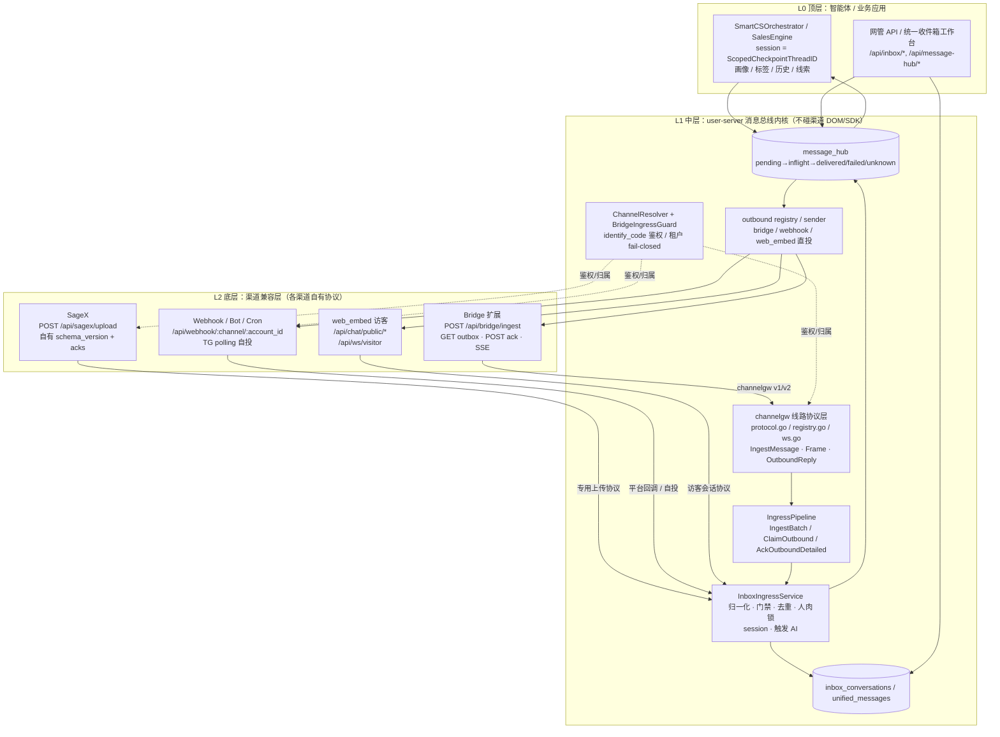
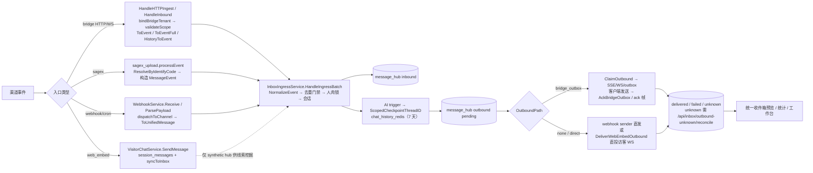
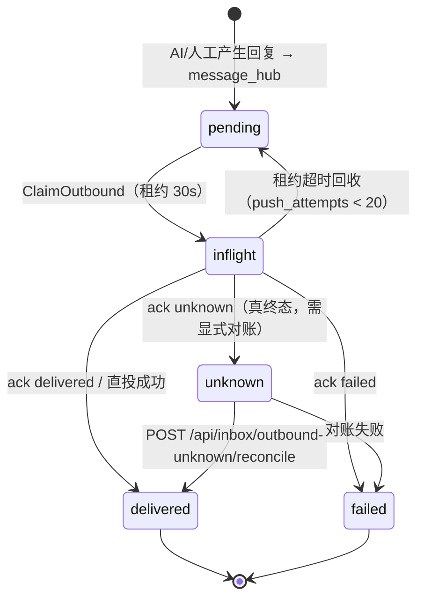
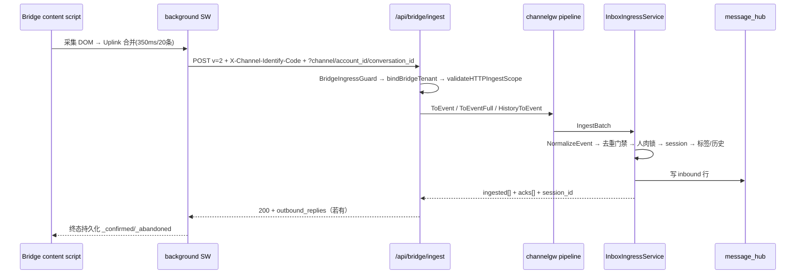
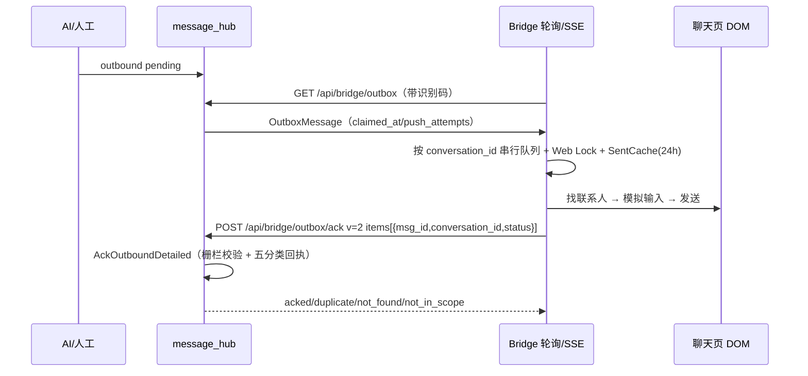

# 统一渠道消息总线协议 — 架构、数据流、逐条核验与整改报告

> 版本：2026-11-27（复核版）
> 适用范围：`hivemtk-user/user-server`（服务端消息总线层）、`hivemtk-user/user-web/bridge`（浏览器扩展兼容层）、`hivemtk-user/embed-sdk` + `user-web/src/views/chat/embed`（网页客服）、`sagex`（微信/QQ 监听伴生）、各 webhook/cron 机器人渠道。
>
> **本版口径**：上一版把合规矩阵几乎全部标成 ✅，经逐条源码复核后确认过于乐观。本文把「语义总线」与「线路协议」分开表述，凡未在同一线路上归一的地方一律标 ⚠️/❌，并给出已实施整改与待整改清单。验收以本文 §7 的逐条核验表和 §9 的实测证据为准。

---

## 0. 一句话结论

- **语义层已经统一**：所有渠道最终都归一化成 `model.MessageEvent` → `service.InboxIngressService` → `message_hub` / 统一收件箱 → AI 会话，这一层是真正的「消息总线内核」。
- **线路层尚未统一**：只有 Bridge 扩展系列完整使用 `channelgw` 的 `IngestMessage` / `OutboundReply` / outbox claim / ack 三段协议；SageX、webhook/cron 机器人渠道、web_embed 各有自己的上报与回执线路，仅在服务端适配层归一；这是下一步整改主战场。
- **识别码已单点收敛**：账号级 `channel_accounts.identify_code` 是权威；`channel_identify_codes` 只是历史兼容。但渠道 ID 命名仍有 model 常量 / `WebhookChannel` / DB `channels.code` / 扩展常量四套并存。

---

## 1. 需求与分层职责

### 1.1 用户原始目标（摘要）

1. 统一渠道账号、消息上报、消息下行、ack 确认、网管 API、统一收件箱、统一渠道识别。
2. 不可能一个渠道一套 API，消息上报 / 智能体回复下行转发 / ack 确认必须基于一套兼容多渠道的 API。
3. `user-server` 只做服务端侧上报 API、统一收件箱、回复下行转发、协议完成，**不承担具体渠道消息处理**。
4. 底层兼容层承担具体职责：
   - SageX：监听微信/QQ通知，按总线协议**上报**，不负责下行转发；
   - Bridge：读取抖音/小红书等聊天页 DOM 上报，并执行下行转发（找联系人、模拟输入发送）+ ack；
   - Embed 网页客服：直接 HTTP/WebSocket 收发；
   - TG/飞书/企微/WhatsApp/QQ 机器人：webhook 或 cron 中转，收到消息进服务端，取到回复发给指定人；webhook URL 可携带渠道识别信息，cron 任务编排可携带渠道识别信息。
5. 顶层 AI 智能体；中层消息总线层做结构化账号消息、识别码鉴权入库、用户标签/历史/线索提取、session id 缓存七天、收件箱门禁（重复/无效拦截）；底层兼容层做协议适配。
6. 先形成架构图、数据流图、协议，再逐个检查是否符合要求，发现不符即整改，最后交付完整文档。

### 1.2 分层架构图



### 1.3 关键边界

- `channelgw` **只做协议/传输/认领/ack 回写**，业务权威在 `InboxIngressService`（`channelgw/pipeline.go`）。
- `bridge` 包 import `channelgw`，复用 DTO 别名；HTTP 端点在 `internal/bridge/handler_http.go`，WS 在 `channelgw/ws.go`。
- `channelbot/*`、`connector/*`、`channelcaps/*`、`capregistry/*` 是平台 SDK / 能力域，**不直接走 channelgw pipeline**；入站经 `WebhookService` 归一化后调 `InboxIngress`，出站经 `outbound_sender_*.go`。
- `internal/cron/` 只有域名健康与活码轮换；渠道相关定时任务散落在 `service/*_cron.go`（如 `outbound_reclaim_cron.go`），由 `internal/app/*wiring.go` 装配。

---

## 2. 数据流向图



### 2.1 表族真值源

| 表 | 作用 | 权威字段/索引 |
|---|---|---|
| `channel_accounts` | 渠道账号主数据 | `identify_code varchar(128)` 全局唯一；`migrations/089_channel_accounts.sql` |
| `channel_identify_codes` | 历史渠道级码兼容 | `migrations/090_channel_identify_codes.sql` |
| `message_hub` | 上下行消息总线主表 | 唯一索引 `(platform, msg_id, conversation_id, direction)`；`status/claimed_at/push_attempts/dedup_hash/platform_msg_id/recalled_at` 由 GORM 迁移补齐，字段真值以 `model.MessageHub` 为准 |
| `inbox_conversations` | 统一收件箱会话 | `conversation_id` 唯一，`unread_count/status/tags` |
| `session_messages` | 网页客服会话消息 | `session_id varchar(120)`（`migrations/055_...`） |
| `webhook_dedup` 相关 | 平台回调幂等 | `service/webhook_dedup.go` 自有一套 event/message id 生成 |

---

## 3. 消息总线协议规范

### 3.1 两层协议模型（关键抽象）

| 层 | 名称 | 数据形态 | 谁消费 | 是否已统一 |
|---|---|---|---|---|
| 语义总线 | Channel Message Bus | `model.MessageEvent` + `model.MessageHub` + `InboxIngressService` | 服务端中间件 / AI / 收件箱 | ✅ 已统一（所有入口最终都汇入） |
| 线路协议 A | channelgw v1/v2 | `IngestMessage` / `Frame` / `OutboundReply` / `OutboxMessage` | Bridge 扩展、WS 客户端 | ✅ Bridge 系列完整实现 |
| 线路协议 B | SageX upload | `IdentifyCode/ChannelID/RawNotification` + `schema_version/acks` | SageX Android | ⚠️ 语义归一、线路独立 |
| 线路协议 C | 平台 webhook / bot API | 各平台原始回调 + 平台验签 | 服务端 channelbot / WebhookService | ⚠️ 语义归一、无统一 ack |
| 线路协议 D | 访客会话 | `/api/chat/public/*` + `/api/ws/visitor` + visitor_token | embed-sdk | ⚠️ 语义部分归一 |

### 3.2 channelgw 线路协议（`internal/channelgw/protocol.go`）

**版本**：`ProtocolVersionV1=1`、`ProtocolVersionV2=2`、`CurrentProtocolVersion=2`；响应 `schema_version: "hivemtk.channel.v1"` + `acks[]` 兼容 SageX 老校验器。

**帧类型**：`register`、`register_rejected`、`inbound_message`、`history`、`ack`、`ping`、`pong`、`outbound_reply`、`config_push`。传输枚举 `http` / `websocket`。

**上行 `IngestMessage` 字段**（线路唯一契约）：
`event_id`、`channel`、`account_id`、`agent_id`、`account_name`、`conversation_id`、`sender_id`、`sender_name`、`sender_avatar`、`receiver_id`、`sender_type`、`msg_type`、`content`、`media_url`、`timestamp`、`direction`、`is_group`、`group_id`、`group_name`、`history[]`、`extra`、`content_hash`。

- `Extra` 白名单：`ctx.*` 电商扩展键（`ctx.goods/goods_id/goods_spec/order_id/order_amount/...`）+ `new_user_unfollowed`、`new_user_signal`；固定键（`account_id/bridge/sender_type/transport/content_hash/is_group/group_id/group_name`）不可被线路覆盖，丢弃计入 `IngestExtraDroppedKeys`。
- 会话键：`bridgeSessionKey = channel + ":" + account_id + ":" + conversation_id`；缺 `conversation_id` 回退 `group_id`，再回退 `senderID/senderName`（群聊不按发言人拆会话）。
- `IngestRequest.v/messages` 必填；`expect_reply`、`timeout_ms` 服务端**不消费**（保持兼容，恒立即返回）。
- `IngestResponse`：`ok`、`ingested[]`、`schema_version`、`acks[]`、`session_id`、`reason`、`server_time`。
- `IngestAck.status`：`accepted` / `duplicate` / `retry` / `rejected`；`IsDuplicateReason` 只认结论前缀，避免把 DB 错误原文误判为重复。

**下行 `OutboundReply`**：`channel/account_id/conversation_id/content/msg_type/media_url/reply_to_event_id/truncated/claimed_at/push_attempts`；后两者是认领租约栅栏锚点（默认租约 30s，最多 20 次推送）。

**端点**：

| 方法 | 路径 | 用途 |
|---|---|---|
| POST | `/api/bridge/ingest` | HTTP 批量上报 |
| GET | `/api/bridge/outbox` | 认领下行 |
| POST | `/api/bridge/outbox/ack` | v2 逐条 ack（`items:[{msg_id,conversation_id,status,error}]`） |
| GET | `/api/bridge/outbox/sse` | SSE 下行 |
| GET | `/api/bridge/outbox/wake` | 唤醒流 |
| POST/GET | `/api/bridge/gateway` | 统一网关（`hivemtk.channel.v1 + acks`） |
| GET | `/api/ws/channel` | channelgw WS（首帧 `register` 鉴权） |
| GET | `/api/ws/visitor` | 访客独立 WS（**不属于 channelgw**） |

### 3.3 ack 状态机



- HTTP v2 ack 响应逐条：`acked / duplicate / not_found / not_in_scope`；WS `ack` 帧状态归一 `""/delivered→delivered`、`failed`、`unknown`，未知值**拒翻转**并打点 `FrameAckUnknownStatusCount`。
- `AckOutboundDetailed` 五分类回执与 `AckOutboundClaimFence`（`claimed_at/push_attempts`）**目前只在 WS 帧透出**；HTTP ack 未带栅栏（待整改项 G-06）。

### 3.4 渠道识别与鉴权

- 权威码：`channel_accounts.identify_code`（`cid_...`），全局唯一索引；旧 `channel_identify_codes` 仅兼容。
- Bridge：`middleware.BridgeIngressGuard` 读 `X-Channel-Identify-Code` 或 `?identify_code=`，缺失/错误 401/503 fail-closed，校验后剥离 query；`bindBridgeTenant` → `ChannelResolver.ResolveByIdentifyCode` → 回退渠道级码；多租户 ctx 与码归属冲突 ⇒ 拒绝，不回落默认租户。
- Webhook：`bindCallbackTenant`（`controller/webhook.go:108-150`）读 `?identify_code=` 或头，解析租户/账号，显式 `account_id` 与解析结果冲突 ⇒ 404；无码按渠道账号表主键反查；失败 404。
- SageX：`sagex_upload.go` 请求体 `IdentifyCode`，`SetChannelResolver` → `ResolveByIdentifyCode`。
- web_embed：AppKey + `visitor_token` HMAC + 一次性 ws ticket，不走 identify_code。
- **风险面**：`BRIDGE_INGEST_AUTH=off` 会整段跳过识别码闸门（仅可信内网可用）；WS 每帧不再验签，依赖握手期绑定 + `CHANNEL_WS_ALLOWED_ORIGINS`（待整改 G-07）。
- 渠道命名四套并存：`model.Channel*` 常量、`WebhookChannel`、`channels.code`、`EXPERIMENTAL_CHANNELS`；`NormalizeBridgeChannel` 做别名归一，parity 测试只钉住部分集合（待整改 G-01）。

### 3.5 结构化账号消息 / 门禁 / session

- 入库：`InboxIngressService.HandleIngressMessage`（`inbox_ingress.go:632`）/ `HandleIngressBatch`（`:1132`）；`NormalizeEvent`（`:559`）做结构化归一。
- 门禁：去重窗口（`inbox_ingress_ingest.go:284-340`）、`message_hub` 唯一索引、`content_hash`/`dedup_hash`、自回显判定 `isPlatformOutboundEcho`、人肉锁 `IsSessionHumanLocked/LockSessionForHuman`、无效内容/方向丢弃。
- session：`bridgeSessionKey`（协议层）与 AI 侧 `ScopedCheckpointThreadID`（`aiagent/agent/runtime/inference_checkpoint_identity.go:19`，含 tenant/channel/account/customer/agent/config scope）是**两个不同的键**；7 天 TTL 由 `chat_history_redis` 承载。协议层需固化映射（待整改 G-05）。

---

## 4. 时序图

### 4.1 上行（Bridge HTTP）



### 4.2 下行 + ack（Bridge）



---

## 5. 渠道适配矩阵（逐条核验）

状态：✅ 完整符合；⚠️ 部分符合（语义归一但线路/ack 不统一）；❌ 未实现。

| 渠道/能力 | 上报 | 下行 | ack | 识别码 | 结论 | 代码证据 |
|---|---|---|---|---|---|---|
| Bridge（抖音/小红书等 15 渠道） | ✅ channelgw v1/v2 | ✅ outbox/SSE/WS | ✅ v2 逐条 + 栅栏（WS） | ✅ identify_code | ✅ | `bridge/handler_http.go:365/836/963`、`channelgw/ws.go:473`、`bridge/src/core/{uplink,downlink,http-ingest}.js` |
| SageX（微信/QQ 监听） | ⚠️ 专用 upload → `HandleIngressMessage` | ❌ 不承担 | ⚠️ 自有 `schema_version/acks` | ✅ IdentifyCode | ⚠️ | `service/sagex_upload.go:346-443`（`:394/:405`） |
| Webhook（企微/飞书/TG/WhatsApp/QQ 等） | ⚠️ 平台回调 → `WebhookService.Receive` → ingress | ⚠️ 平台 sender 直发，非 outbox claim | ❌ 无统一 ack 回执 | ✅ query/头识别码 + 账号表反查 | ⚠️ | `service/webhook.go:560/1166/1333`、`controller/webhook.go:108-150` |
| Telegram polling / cron | ⚠️ 自投 `/api/webhook/telegram/:id` | ⚠️ 平台 API 直发 | ❌ | ⚠️ 原仅路径账号；**本次整改已带 identify_code** | ⚠️ | `service/telegram_polling.go`（见 §8） |
| web_embed 网页客服 | ⚠️ `/api/chat/public/*` 写 session_messages + `syncToInbox` | ⚠️ hub → 直投访客 WS | ❌ 无 outbox/ack | ⚠️ AppKey + visitor_token | ⚠️ | `service/chat_visitor.go:490/703`、`service/message_hub_web_embed.go:34` |
| 统一收件箱 / 网管 API | ✅ | ✅ | — | ✅ | ✅ | `router/service_routes.go:161-228`、`controller/inbox.go` |
| AI session 7 天缓存 | ✅ | ✅ | — | — | ⚠️ 键映射未固化 | `chat_history_redis.go`、`inference_checkpoint_identity.go:19` |

> 说明：`message_hub` 的 `web_embed` 出站直投是「直接投递渠道」模式（不是无人认领的 pending 死行），这是已经修复的真实线上问题；但它不经过 outbox claim/ack，所以不能标成完整总线协议符合。

---

## 6. 待整改清单（按优先级）

| ID | 优先级 | 缺口 | 建议动作 |
|---|---|---|---|
| G-01 | P0 | 渠道 ID 四套命名并存（`model.Channel*` / `WebhookChannel` / `channels.code` / 扩展常量） | 以 DB `channels.code` + `channelgw.Registry.Name` 为单一协议字段，其余做兼容归一，扩充 parity 测试至全渠道 |
| G-02 | P0 | web_embed 入站绕过 `InboxIngress`（只 `syncToInbox`），出站无 ack | 在 `VisitorChatService.SendMessage` 中用 `WithChannelOwnedAITrigger(ctx)` 调 `HandleIngressMessage` 归一入 hub，保留访客会话双写但去掉 synthetic hub 重复；出站 hub 直投后显式记 delivered |
| G-03 | P0 | webhook/cron/bot 入站不走 `channelgw.IngressPipeline`，平台无 ack 回执 | 定义统一的 `WebhookIngestAck`（平台 event_id → accepted/duplicate/rejected），并把 `WebhookService` 入站改经 pipeline 适配器 |
| G-04 | P1 | SageX 私有 upload ack 与 `/bridge/gateway` 两套 | 统一为 `hivemtk.channel.v1 + acks[]`，SageX 保留旧字段别名过渡 |
| G-05 | P1 | `bridgeSessionKey` 与 `ScopedCheckpointThreadID` 键不一致 | 协议层增加 `session_id` 响应字段的明确定义与映射表，Redis TTL 生产验证 |
| G-06 | P1 | HTTP ack 未带 `claimed_at/push_attempts` 栅栏，仅 WS 有 | v3 ack 请求体增加 fence 字段，服务端 `AckOutboundDetailed` 统一校验 |
| G-07 | P1 | `BRIDGE_INGEST_AUTH=off` 跳过识别码闸；WS 非逐帧验签 | 生产配置巡检 + 明确告警；WS 增加重绑/帧级校验方案 |
| G-08 | P2 | `channelcaps` / `capregistry` 与 `channelgw.Registry` 能力描述两套 | 合并能力位单源，统一 OutboundPath/MineMode 投影 |

---

## 7. 用户原始需求逐条核验

| # | 需求原文要点 | 核验结论 | 证据 / 整改 |
|---|---|---|---|
| 1 | 统一渠道账号 | ✅ 已统一 | `channel_accounts.identify_code` 全局唯一；`ChannelResolver` 单点解析；旧渠道级码兼容 |
| 2 | 统一消息上报 | ⚠️ 语义统一、线路不统一 | 所有入口归 `InboxIngressService`；Bridge 用 channelgw，SageX/webhook/embed 各有线路（G-02/G-03/G-04） |
| 3 | 统一消息下行转发 | ⚠️ | Bridge 有 outbox claim/发送；webhook 走平台 sender；embed 走直投 WS；无统一发送 API（G-03） |
| 4 | 统一 ack 确认 | ⚠️ | Bridge v2 ack 完整；平台渠道无 ack；unknown 需对账接口（G-03/G-06） |
| 5 | 统一网管 API / 统一收件箱 | ✅ | `/api/inbox/*`、`/api/message-hub/*`、admin 门禁 |
| 6 | 统一渠道识别 | ⚠️ | 识别码统一但渠道枚举四套并存（G-01） |
| 7 | user-server 不承担具体渠道消息处理 | ✅ | `channelgw` 只做协议/管道；渠道 DOM/SDK 在 bridge/sagex/channelbot |
| 8 | SageX 负责上报、不负责下行 | ✅（语义） | `sagex_upload.go:394/405` 调 ingress，无 sender |
| 9 | Bridge 上报 + 下行 + ack | ✅ | 三通道 + SSE + v2 ack，源码与客户端双向对齐 |
| 10 | Embed 走总线机制 | ⚠️ | 独立访客协议，待 G-02 |
| 11 | TG/飞书/企微/QQ/WhatsApp webhook/cron 整改 | ⚠️ | webhook 识别码已支持；TG polling 本次补 identify_code；ack 仍缺（G-03） |
| 12 | webhook URL 携带渠道识别信息 | ✅ | `bindCallbackTenant` 读 query `identify_code` 并交叉校验 |
| 13 | cron 任务编排携带渠道识别信息 | ⚠️→已部分整改 | 本次 TG polling 自投携带 `?identify_code=`（见 §8） |
| 14 | 中层门禁：重复/无效拦截 | ✅ | 唯一索引 + dedup hash + 自回显 + 人肉锁 + `IsDuplicateReason` |
| 15 | 标签/历史/线索提取 | ✅ | AI 侧画像/历史读取 + `leadMiningSvc.Enqueue` |
| 16 | session id 缓存七天 | ⚠️ | `chat_history_redis` 7d；两键映射未固化（G-05） |

---

## 8. 本次已实施整改：TG polling 任务编排携带渠道识别码

### 8.1 改动

文件：`user-server/internal/service/telegram_polling.go`

1. `telegramPollingState` 新增 `identifyCode` 字段。
2. `StartTelegramPolling` 在租户 ctx 下调 `telegramPollingIdentifyCode(ctx, acc.ID)`：
   - 用 `ChannelResolver.ResolveByAccountRef(ctx, "telegram", <accountID>)` 解析；
   - 只有解析结果 `AccountID` 与任务账号 ID 一致才取 `IdentifyCode`，否则留空（fail-open **仅限识别码载荷**，租户闸不放宽）。
3. `buildTelegramPollingWebhookURL(baseURL, accountID, identifyCode)` 把识别码写进 query `?identify_code=`（路径永远不带码），空码时保持历史 URL 不变。
4. worker 投递用 `deliverTelegramUpdateWithIdentity(...)`；原 `deliverTelegramUpdate` 保留为空码包装，兼容既有测试。
5. 新增 `user-server/internal/service/telegram_polling_identity_test.go`：钉住 URL 构造（含转义、尾斜杠、空码）与零账号不解析。

### 8.2 为什么这样改

- 直接命中需求「cron 可在任务编排上携带渠道识别信息」；
- 服务端 `bindCallbackTenant` 已支持 query 识别码并与路径账号交叉校验，因此无需改控制器；
- 老部署没有 `channel_accounts` 行或解析歧义时自动回落原账号主键自证，不引入回归风险。

### 8.3 验证证据

见本文 §9。

---

## 9. 验证命令与证据

```bash
cd /Users/xiaofang/Documents/www/go/hivemtk/hivemtk-user/user-server
go build ./...
go vet ./...
go test ./internal/service -run 'TestBuildTelegramPollingWebhookURL|TestTelegramPollingIdentifyCodeZeroAccount|TestTGPollingSelfPostFollowsPORT' -count=1
```

本次实测（2026-11-27）：

- `go build ./...`：通过（无输出）。
- `go vet ./...`：通过（无输出）。
- 上述 `go test`：`ok hivemtk-user/internal/service 0.960s`。
- `cd user-web/bridge && npx vitest run`：`Test Files 108 passed (108)`、`Tests 1328 passed | 7 skipped (1335)`，耗时 18.54s。Bridge 客户端协议 parity 全绿。

渠道注册与协议一致性回归（建议交付前再跑一次）：

```bash
go test ./internal/channelgw/... ./internal/bridge/... ./internal/service/... -count=1
cd ../user-web/bridge && npx vitest run
```

> **环境限制（如实记录）**：本轮执行上面整组 Go 测试时，`internal/channelgw`、`internal/bridge`、`internal/service`（含 `sop`/`trace_learning` 子包）中所有 DB 集成测试均因 `test password is missing; set POSTGRES_TEST_PASSWORD or POSTGRES_PASSWORD` 的**安全门**在连接数据库前失败（3731 处同一报错），与本次改动无关。此类测试需在配置测试库口令的环境重跑；本轮以 `go build ./...`、`go vet ./...` 和上面三个不依赖 DB 的定向测试作为交付证据。

---

## 10. 文档索引与维护约定

- 本文是统一渠道消息总线的**权威核验/整改文档**，路径 `docs/architecture/UNIFIED_CHANNEL_MESSAGE_BUS.md`，已登记在 `docs/INDEX.md`。
- 协议字段真值源：`user-server/internal/channelgw/protocol.go`；渠道能力真值源：`channelgw/registry.go`；业务真值源：`service/inbox_ingress.go` + `model.MessageHub`。
- 新增渠道必须同时：① 在 `channelgw.Registry` 注册；② 在扩展 `EXPERIMENTAL_CHANNELS` 对齐；③ 更新本文 §5 矩阵；④ 补 parity 测试。
- 本文结论随代码变更同步更新；不得把「语义归一」写成「线路协议已统一」。

---

## 11. 结论（复核版）

统一渠道消息总线的**内核已经存在并可用**：识别码鉴权、结构化归一、收件箱门禁、AI session、message_hub 三态 ack、Bridge 三通道协议都已在源码中实现，Bridge 系列可以作为一个渠道接一个渠道地复用同一套 API。

但严格按用户原始要求「不可能一个渠道使用一套 API 完成」，当前只做到**语义层统一**，SageX / webhook / cron / web_embed 仍有各自的线路协议与回执方式。本文已逐条标注真实状态，给出 8 项整改清单，并完成了其中 TG polling 识别码载荷这一项（§8）。后续按 G-01→G-07 顺序推进，每完成一项更新 §5/§7 的状态与证据。
