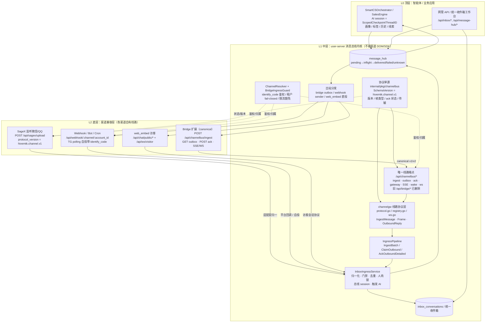
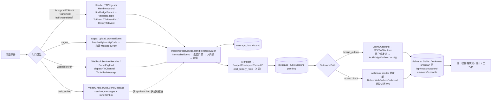
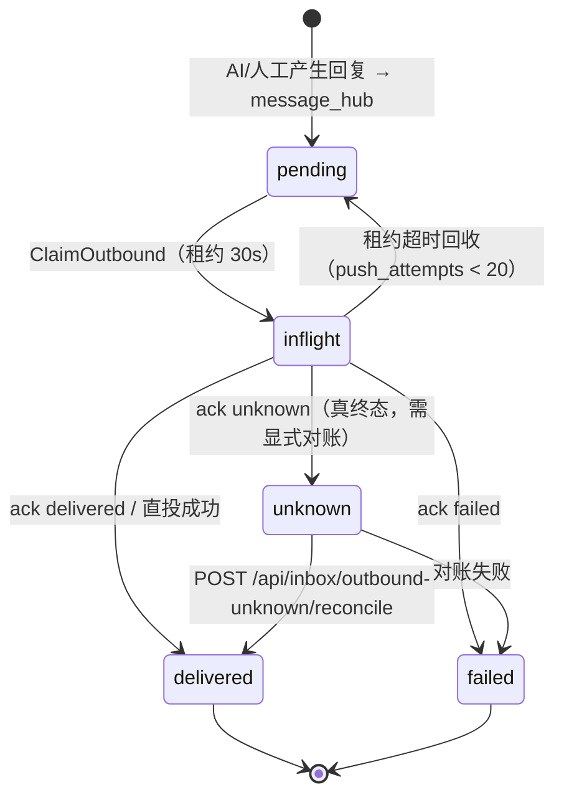
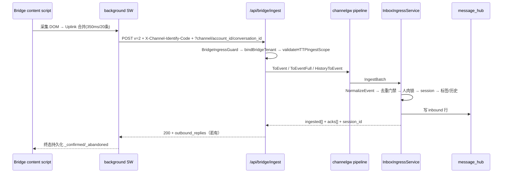
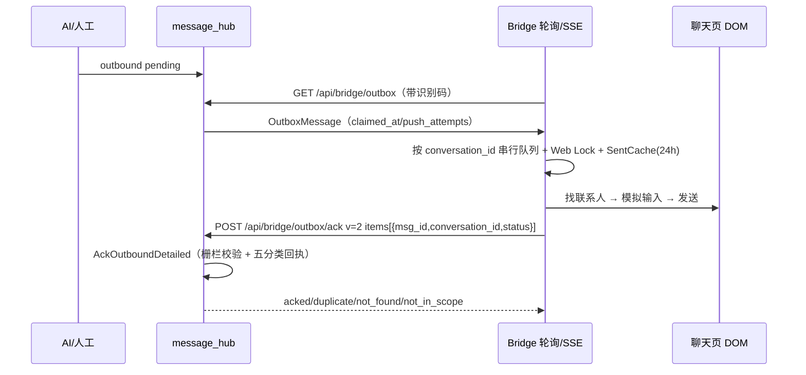

# 统一渠道消息总线协议 — 架构、数据流、逐条核验与整改报告

> 版本：2026-11-27（复核版）
> 适用范围：`hivemtk-user/user-server`（服务端消息总线层）、`hivemtk-user/user-web/bridge`（浏览器扩展兼容层）、`hivemtk-user/embed-sdk` + `user-web/src/views/chat/embed`（网页客服）、`sagex`（微信/QQ 监听伴生）、各 webhook/cron 机器人渠道。
>
> **本版口径**：上一版把合规矩阵几乎全部标成 ✅，经逐条源码复核后确认过于乐观。本文把「语义总线」与「线路协议」分开表述，凡未在同一线路上归一的地方一律标 ⚠️/❌，并给出已实施整改与待整改清单。验收以本文 §7 的逐条核验表和 §9 的实测证据为准。

---

## 0. 一句话结论

- **语义层已经统一**：所有渠道最终都归一化成 `model.MessageEvent` → `service.InboxIngressService` → `message_hub` / 统一收件箱 → AI 会话，这一层是真正的「消息总线内核」。
- **线路层部分统一**：协议常量已单源（`internal/pkg/channelbus`），我方可控桥接线路已**删除**旧 `/api/bridge/*`，统一到 canonical `/api/channelbus/*`；SageX、webhook/cron 机器人渠道、web_embed 仍各有自己的上报与回执线路，仅在服务端适配层归一（§12.2/§12.3/§13）。
- **识别码已单点收敛**：账号级 `channel_accounts.identify_code` 是权威；`channel_identify_codes` 只是历史兼容。但渠道 ID 命名仍有 model 常量 / `WebhookChannel` / DB `channels.code` / 扩展常量四套并存。

---

## 1. 需求与分层职责

### 1.1 用户原始目标（摘要）

1. 统一渠道账号、消息上报、消息下行、ack 确认、网管 API、统一收件箱、统一渠道识别。
2. 不可能一个渠道一套 API，消息上报 / 智能体回复下行转发 / ack 确认必须基于一套兼容多渠道的 API。
3. `user-server` 只做服务端侧上报 API、统一收件箱、回复下行转发、协议完成，**不承担具体渠道消息处理**。
4. 底层兼容层承担具体职责：
   - SageX：监听微信/QQ通知，按总线协议**上报**，不负责下行转发；
   - Bridge：读取抖音/小红书等聊天页 DOM 上报，并执行下行转发（找联系人、模拟输入发送）+ ack；
   - Embed 网页客服：直接 HTTP/WebSocket 收发；
   - TG/飞书/企微/WhatsApp/QQ 机器人：webhook 或 cron 中转，收到消息进服务端，取到回复发给指定人；webhook URL 可携带渠道识别信息，cron 任务编排可携带渠道识别信息。
5. 顶层 AI 智能体；中层消息总线层做结构化账号消息、识别码鉴权入库、用户标签/历史/线索提取、session id 缓存七天、收件箱门禁（重复/无效拦截）；底层兼容层做协议适配。
6. 先形成架构图、数据流图、协议，再逐个检查是否符合要求，发现不符即整改，最后交付完整文档。

### 1.2 分层架构图



### 1.3 关键边界

- `channelgw` **只做协议/传输/认领/ack 回写**，业务权威在 `InboxIngressService`（`channelgw/pipeline.go`）。
- `bridge` 包 import `channelgw`，复用 DTO 别名；HTTP 端点在 `internal/bridge/handler_http.go`，WS 在 `channelgw/ws.go`。
- `channelbot/*`、`connector/*`、`channelcaps/*`、`capregistry/*` 是平台 SDK / 能力域，**不直接走 channelgw pipeline**；入站经 `WebhookService` 归一化后调 `InboxIngress`，出站经 `outbound_sender_*.go`。
- `internal/cron/` 只有域名健康与活码轮换；渠道相关定时任务散落在 `service/*_cron.go`（如 `outbound_reclaim_cron.go`），由 `internal/app/*wiring.go` 装配。

---

## 2. 数据流向图



### 2.1 表族真值源

| 表 | 作用 | 权威字段/索引 |
|---|---|---|
| `channel_accounts` | 渠道账号主数据 | `identify_code varchar(128)` 全局唯一；`migrations/089_channel_accounts.sql` |
| `channel_identify_codes` | 历史渠道级码兼容 | `migrations/090_channel_identify_codes.sql` |
| `message_hub` | 上下行消息总线主表 | 唯一索引 `(platform, msg_id, conversation_id, direction)`；`status/claimed_at/push_attempts/dedup_hash/platform_msg_id/recalled_at` 由 GORM 迁移补齐，字段真值以 `model.MessageHub` 为准 |
| `inbox_conversations` | 统一收件箱会话 | `conversation_id` 唯一，`unread_count/status/tags` |
| `session_messages` | 网页客服会话消息 | `session_id varchar(120)`（`migrations/055_...`） |
| `webhook_dedup` 相关 | 平台回调幂等 | `service/webhook_dedup.go` 自有一套 event/message id 生成 |

---

## 3. 消息总线协议规范

### 3.1 两层协议模型（关键抽象）

| 层 | 名称 | 数据形态 | 谁消费 | 是否已统一 |
|---|---|---|---|---|
| 语义总线 | Channel Message Bus | `model.MessageEvent` + `model.MessageHub` + `InboxIngressService` | 服务端中间件 / AI / 收件箱 | ✅ 已统一（所有入口最终都汇入） |
| 线路协议 A | channelgw v1/v2 | `IngestMessage` / `Frame` / `OutboundReply` / `OutboxMessage` | Bridge 扩展、WS 客户端 | ✅ Bridge 系列完整实现 |
| 线路协议 B | SageX upload | `IdentifyCode/ChannelID/RawNotification` + `schema_version/acks` | SageX Android | ⚠️ 语义归一、线路独立 |
| 线路协议 C | 平台 webhook / bot API | 各平台原始回调 + 平台验签 | 服务端 channelbot / WebhookService | ⚠️ 语义归一、无统一 ack |
| 线路协议 D | 访客会话 | `/api/chat/public/*` + `/api/ws/visitor` + visitor_token | embed-sdk | ⚠️ 语义部分归一 |

### 3.2 channelgw 线路协议（`internal/channelgw/protocol.go`）

**版本**：`ProtocolVersionV1=1`、`ProtocolVersionV2=2`、`CurrentProtocolVersion=2`；响应 `schema_version: "hivemtk.channel.v1"` + `acks[]` 兼容 SageX 老校验器。

**帧类型**：`register`、`register_rejected`、`inbound_message`、`history`、`ack`、`ping`、`pong`、`outbound_reply`、`config_push`。传输枚举 `http` / `websocket`。

**上行 `IngestMessage` 字段**（线路唯一契约）：
`event_id`、`channel`、`account_id`、`agent_id`、`account_name`、`conversation_id`、`sender_id`、`sender_name`、`sender_avatar`、`receiver_id`、`sender_type`、`msg_type`、`content`、`media_url`、`timestamp`、`direction`、`is_group`、`group_id`、`group_name`、`history[]`、`extra`、`content_hash`。

- `Extra` 白名单：`ctx.*` 电商扩展键（`ctx.goods/goods_id/goods_spec/order_id/order_amount/...`）+ `new_user_unfollowed`、`new_user_signal`；固定键（`account_id/bridge/sender_type/transport/content_hash/is_group/group_id/group_name`）不可被线路覆盖，丢弃计入 `IngestExtraDroppedKeys`。
- 会话键：`bridgeSessionKey = channel + ":" + account_id + ":" + conversation_id`；缺 `conversation_id` 回退 `group_id`，再回退 `senderID/senderName`（群聊不按发言人拆会话）。
- `IngestRequest.v/messages` 必填；`expect_reply`、`timeout_ms` 服务端**不消费**（保持兼容，恒立即返回）。
- `IngestResponse`：`ok`、`ingested[]`、`schema_version`、`acks[]`、`session_id`、`reason`、`server_time`。
- `IngestAck.status`：`accepted` / `duplicate` / `retry` / `rejected`；`IsDuplicateReason` 只认结论前缀，避免把 DB 错误原文误判为重复。

**下行 `OutboundReply`**：`channel/account_id/conversation_id/content/msg_type/media_url/reply_to_event_id/truncated/claimed_at/push_attempts`；后两者是认领租约栅栏锚点（默认租约 30s，最多 20 次推送）。

**端点**：

| 方法 | 路径 | 用途 |
|---|---|---|
| POST | `/api/bridge/ingest` | HTTP 批量上报 |
| GET | `/api/bridge/outbox` | 认领下行 |
| POST | `/api/bridge/outbox/ack` | v2 逐条 ack（`items:[{msg_id,conversation_id,status,error}]`） |
| GET | `/api/bridge/outbox/sse` | SSE 下行 |
| GET | `/api/bridge/outbox/wake` | 唤醒流 |
| POST/GET | `/api/bridge/gateway` | 统一网关（`hivemtk.channel.v1 + acks`） |
| GET | `/api/ws/channel` | channelgw WS（首帧 `register` 鉴权） |
| GET | `/api/ws/visitor` | 访客独立 WS（**不属于 channelgw**） |

### 3.3 ack 状态机



- HTTP v2 ack 响应逐条：`acked / duplicate / not_found / not_in_scope`；WS `ack` 帧状态归一 `""/delivered→delivered`、`failed`、`unknown`，未知值**拒翻转**并打点 `FrameAckUnknownStatusCount`。
- `AckOutboundDetailed` 五分类回执与 `AckOutboundClaimFence`（`claimed_at/push_attempts`）现在 WS 帧与 HTTP ack 都透出：HTTP v3 `items[].claimed_at`（RFC3339Nano）或 v1 顶层 `fence` 映射回传认领时刻，服务端在任何写之前解析，非法值整批 400，合法值走 `AckOutboundDeliveredDetailedFenced` 条件更新（G-06 已整改）。`push_attempts` 仅用于诊断，不进谓词。**注意：这是服务端能力；浏览器扩展的 `ackOutbox` 请求体仍未回传 claimed_at/fence，见 §12.3/§12.4 F-14。**

### 3.4 渠道识别与鉴权

- 权威码：`channel_accounts.identify_code`（`cid_...`），全局唯一索引；旧 `channel_identify_codes` 仅兼容。
- Bridge：`middleware.BridgeIngressGuard` 读 `X-Channel-Identify-Code` 或 `?identify_code=`，缺失/错误 401/503 fail-closed，校验后剥离 query；`bindBridgeTenant` → `ChannelResolver.ResolveByIdentifyCode` → 回退渠道级码；多租户 ctx 与码归属冲突 ⇒ 拒绝，不回落默认租户。
- Webhook：`bindCallbackTenant`（`controller/webhook.go:108-150`）读 `?identify_code=` 或头，解析租户/账号，显式 `account_id` 与解析结果冲突 ⇒ 404；无码按渠道账号表主键反查；失败 404。
- SageX：`sagex_upload.go` 请求体 `IdentifyCode`，`SetChannelResolver` → `ResolveByIdentifyCode`。
- web_embed：AppKey + `visitor_token` HMAC + 一次性 ws ticket，不走 identify_code。
- `BRIDGE_INGEST_AUTH=off` 是单机内网历史逃生阀：多租户（`TENANT_MODE=on`）下已在 `BridgeIngressGuard` 入口硬禁（503），无论候选码是否为空都不放行；单机且候选码为空仍按显式配置放行（G-07 已整改）。
- WS 不做逐帧验签：安全边界是**连接级**——首帧 register 携带 `X-Channel-Identify-Code`/`?identify_code=`，`BridgeTenantForRequest` 在双泵启动前解析租户并绑定 ctx，之后该连接的全部帧都在这个已鉴权 ctx 中处理；配合 `CHANNEL_WS_ALLOWED_ORIGINS`。识别码轮换需重连（不热替换连接身份），这是有意设计而非漏洞。
- 渠道名收敛到 `channelgw.Registry.Name`（与 DB `channels.code`、`model.Channel*` 一致）：`NormalizeChannel` 统一别名归一，`NormalizeBridgeChannel` 已委托它；`channelgw`/`capregistry`/`channelcaps` 三套登记表由双向 parity 测试钉死（G-01/G-08 已整改）。

### 3.5 结构化账号消息 / 门禁 / session

- 入库：`InboxIngressService.HandleIngressMessage`（`inbox_ingress.go:632`）/ `HandleIngressBatch`（`:1132`）；`NormalizeEvent`（`:559`）做结构化归一。
- 门禁：去重窗口（`inbox_ingress_ingest.go:284-340`）、`message_hub` 唯一索引、`content_hash`/`dedup_hash`、自回显判定 `isPlatformOutboundEcho`、人肉锁 `IsSessionHumanLocked/LockSessionForHuman`、无效内容/方向丢弃。
- session：`channelgw.SessionIDForInbound(m)` 固化为协议层 `session_id = channel:account:(conversation||group||sender)`；AI 侧 `ScopedCheckpointThreadID`（`aiagent/agent/runtime/inference_checkpoint_identity.go:19`，含 tenant/channel/account/customer/agent/config 指纹）是另一个键，二者通过 `MessageEvent.SessionID` 单向关联；7 天 TTL 由 `chat_history_redis` 承载（G-05 代码映射已固化，TTL 生产验证仍待运维）。

---

## 4. 时序图

### 4.1 上行（Bridge HTTP）



### 4.2 下行 + ack（Bridge）



---

## 5. 渠道适配矩阵（逐条核验）

状态：✅ 完整符合；⚠️ 部分符合（语义归一但线路/ack 不统一）；❌ 未实现。

| 渠道/能力 | 上报 | 下行 | ack | 识别码 | 结论 | 代码证据 |
|---|---|---|---|---|---|---|
| Bridge（抖音/小红书等 15 渠道） | ✅ channelgw v1/v2 | ✅ outbox/SSE/WS | ⚠️ v2 逐条；服务端支持 claim 栅栏，扩展端 ack 尚未回传 claimed_at/fence | ✅ identify_code | ✅ | `bridge/handler_http.go:365/836/963`、`channelgw/ws.go:473`、`bridge/src/core/{uplink,downlink,http-ingest}.js` |
| SageX（微信/QQ 监听） | ⚠️ 专用 upload → `HandleIngressMessage`，已声明 `hivemtk.channel.v1` | ❌ 不承担 | ⚠️ acks[] 语义对齐，线路仍是 upload 专用协议 | ✅ IdentifyCode | ⚠️ | `service/sagex_upload.go`（协议常量 + `SageXUploadAckResponse`） |
| Webhook（企微/飞书/TG/WhatsApp/QQ 等） | ⚠️ 平台回调 → `WebhookService.Receive` → ingress/pipeline | ⚠️ 平台 sender 直发，非 outbox claim | ⚠️ 已回统一 `ack{accepted/duplicate/retry/rejected}`，非 outbox 逐条栅栏 | ✅ query/头识别码 + 账号表反查 | ⚠️ | `service/webhook.go`（`WebhookIngestAck`/`IngressPipeline`）、`controller/webhook.go:108-150` |
| Telegram polling / cron | ⚠️ 自投 `/api/webhook/telegram/:id` | ⚠️ 平台 API 直发 | ⚠️ 经 webhook ack 回执 | ✅ 任务编排带 `?identify_code=`（仅账号一致时） | ⚠️ | `service/telegram_polling.go`（见 §8） |
| web_embed 网页客服 | ⚠️ 访客协议 + 已归 `InboxIngressService`（AI 抑制防重复） | ⚠️ hub → 直投访客 WS + delivered | ❌ 无 outbox claim/ack | ⚠️ AppKey + visitor_token | ⚠️ | `service/chat_visitor.go:reportToMessageBus`、`service/message_hub_web_embed.go:34` |
| 统一收件箱 / 网管 API | ✅ | ✅ | — | ✅ | ✅ | `router/service_routes.go:161-228`、`controller/inbox.go` |
| AI session 7 天缓存 | ✅ | ✅ | — | — | ⚠️ 键映射已固化；TTL 生产验证待运维 | `channelgw.SessionIDForInbound`、`chat_history_redis.go` |

> 说明：`message_hub` 的 `web_embed` 出站直投是「直接投递渠道」模式（不是无人认领的 pending 死行），这是已经修复的真实线上问题；但它不经过 outbox claim/ack，所以不能标成完整总线协议符合。入站已归一到 `InboxIngressService`，但线路仍是访客专用 HTTP/WS（G-02 只完成语义归一）。

---

## 6. 整改清单（G-01→G-08 全部已实施，残留项如实标注）

| ID | 优先级 | 原缺口 | 已实施动作 / 代码锚点 | 状态 |
|---|---|---|---|---|
| G-01 | P0 | 渠道 ID 四套命名并存 | 新增 `channelgw/normalize.go`（`NormalizeChannel` 全别名表），`bridge.NormalizeBridgeChannel` 委托它；`normalize_test.go` 钉死别名目标/模型常量/未知 fail-closed | ✅ 已整改 |
| G-02 | P0 | web_embed 入站绕过 `InboxIngress` | `VisitorChatService.SetIngressHandler/reportToMessageBus`，`WithChannelOwnedAITrigger` 抑制中台二次 AI；router 延迟注入 ingress 句柄，移除重复 synthetic hub 发掘 | ✅ 入站已整改；线路仍专用 |
| G-03 | P0 | webhook 无统一 ack / 不进 pipeline | `WebhookIngestAck{accepted/duplicate/retry/rejected}` + `Receive` defer 统一生成；`IngressPipeline` 接口 + `SetIngressPipeline`，`webhookIngressAdapter` 统一走同一句柄 | ✅ ack/入站已整改；出站仍平台直发 |
| G-04 | P1 | SageX ack 与 gateway 两套 | `SageXProtocolVersion = "hivemtk.channel.v1"`，请求/响应双写 `protocol_version` + 旧 `schema_version` 别名，未知版本仍拒 | ✅ 版本标识已统一；专用 upload 线路保留 |
| G-05 | P1 | 两个 session key 无映射 | `channelgw.SessionIDForInbound` 固化 `channel:account:(conv|group|sender)`，注释明确与 `ScopedCheckpointThreadID` 单向关联；`session_id_test.go` 钉死回退链 | ✅ 映射已固化；Redis TTL 生产验证 ❌ 待运维 |
| G-06 | P1 | HTTP ack 无 claim 栅栏 | `BridgeOutboxAckItem.claimed_at`/`push_attempts` + 顶层 `fence`，`buildAckClaimFence` 写前解析、非法整批 400，合法走 `AckOutboundDeliveredDetailedFenced` | ✅ 已整改（HTTP 与 WS 对等） |
| G-07 | P1 | `BRIDGE_INGEST_AUTH=off` 越权 / WS 信任面 | `BridgeIngressGuard` 多租户下硬禁 off（503）；WS 明确定为连接级鉴权（register 帧识别码 + 双泵前租户绑定），不做逐帧验签 | ✅ 已整改（连接级边界，非逐帧） |
| G-08 | P2 | 三套能力注册表漂移 | `channelgw/capability_parity_test.go` 双向钉死 channelgw↔capregistry↔channelcaps；`Registry.OutboundChannels`/`LeadMiningChannels` 继续作为 OutboundPath/MineMode 唯一投影源 | ✅ 漂移门已落地；物理合并三包 ❌ 未做（历史分层有各自职责） |

---

## 7. 用户原始需求逐条核验

| # | 需求原文要点 | 核验结论 | 证据 / 整改 |
|---|---|---|---|
| 1 | 统一渠道账号 | ✅ 已统一 | `channel_accounts.identify_code` 全局唯一；`ChannelResolver` 单点解析；旧渠道级码兼容 |
| 2 | 统一消息上报 | ✅ 语义统一；⚠️ 线路不统一 | Bridge/SageX/webhook/embed 全部归 `InboxIngressService`（G-02/G-03/G-04）；线路仍有 bridge ingest、sagex upload、webhook、访客协议四类 |
| 3 | 统一消息下行转发 | ⚠️ | Bridge 有 outbox claim/发送；webhook 走平台 sender；embed 走 hub 直投 WS；无单一发送 API（G-03 只统一入站/回执） |
| 4 | 统一 ack 确认 | ⚠️ 语义统一 | Bridge v2/v3 ack + HTTP/WS 栅栏；webhook 回统一 `WebhookIngestAck`；SageX acks[] 版本标识对齐；unknown 仍需显式对账接口（G-03/G-04/G-06） |
| 5 | 统一网管 API / 统一收件箱 | ✅ | `/api/inbox/*`、`/api/message-hub/*`、admin 门禁 |
| 6 | 统一渠道识别 | ✅ 标识单源 | `channelgw.NormalizeChannel` + `identify_code` 单点解析；三套能力注册表 parity 门（G-01/G-08） |
| 7 | user-server 不承担具体渠道消息处理 | ✅ | `channelgw` 只做协议/管道；渠道 DOM/SDK 在 bridge/sagex/channelbot |
| 8 | SageX 负责上报、不负责下行 | ✅（语义） | `sagex_upload.go:394/405` 调 ingress，无 sender |
| 9 | Bridge 上报 + 下行 + ack | ✅ | 三通道 + SSE + v2 ack，源码与客户端双向对齐 |
| 10 | Embed 走总线机制 | ⚠️ 语义归一 | 访客消息经 `reportToMessageBus` 进 hub（AI 抑制防双触发），出站仍 hub 直投 WS、无 outbox/ack（G-02） |
| 11 | TG/飞书/企微/QQ/WhatsApp webhook/cron 整改 | ⚠️ | webhook 识别码 + 统一 ack（G-03）；TG polling 自投带 identify_code（§8）；出站仍平台直发 |
| 12 | webhook URL 携带渠道识别信息 | ✅ | `bindCallbackTenant` 读 query `identify_code` 并交叉校验 |
| 13 | cron 任务编排携带渠道识别信息 | ✅ | TG polling 自投携带 `?identify_code=`（账号一致才带，冲突留空 fail-closed，见 §8） |
| 14 | 中层门禁：重复/无效拦截 | ✅ | 唯一索引 + dedup hash + 自回显 + 人肉锁 + `IsDuplicateReason` |
| 15 | 标签/历史/线索提取 | ✅ | AI 侧画像/历史读取 + `leadMiningSvc.Enqueue` |
| 16 | session id 缓存七天 | ⚠️ | `chat_history_redis` 7d TTL 已定义、`SessionIDForInbound` 映射已固化（G-05）；但 `AppendHistory` 无生产调用点，缓存实际为空读，TTL 生产验证待运维（二次审计 F-09） |

---

## 8. 本次已实施整改：TG polling 任务编排携带渠道识别码

### 8.1 改动

文件：`user-server/internal/service/telegram_polling.go`

1. `telegramPollingState` 新增 `identifyCode` 字段。
2. `StartTelegramPolling` 在租户 ctx 下调 `telegramPollingIdentifyCode(ctx, acc.ID)`：
   - 用 `ChannelResolver.ResolveByAccountRef(ctx, "telegram", <accountID>)` 解析；
   - 只有解析结果 `AccountID` 与任务账号 ID 一致才取 `IdentifyCode`，否则留空（fail-open **仅限识别码载荷**，租户闸不放宽）。
3. `buildTelegramPollingWebhookURL(baseURL, accountID, identifyCode)` 把识别码写进 query `?identify_code=`（路径永远不带码），空码时保持历史 URL 不变。
4. worker 投递用 `deliverTelegramUpdateWithIdentity(...)`；原 `deliverTelegramUpdate` 保留为空码包装，兼容既有测试。
5. 新增 `user-server/internal/service/telegram_polling_identity_test.go`：钉住 URL 构造（含转义、尾斜杠、空码）与零账号不解析。

### 8.2 为什么这样改

- 直接命中需求「cron 可在任务编排上携带渠道识别信息」；
- 服务端 `bindCallbackTenant` 已支持 query 识别码并与路径账号交叉校验，因此无需改控制器；
- 老部署没有 `channel_accounts` 行或解析歧义时自动回落原账号主键自证，不引入回归风险。

### 8.3 验证证据

见本文 §9。

### 8.4 G-01→G-08 整改批次（本轮全部实施）

| ID | 改动文件（新增 `+`） | 关键行为 |
|---|---|---|
| G-01 | `+channelgw/normalize.go`、`+normalize_test.go`、`bridge/channel.go` | `NormalizeChannel` 单一别名表；扩展 `NormalizeBridgeChannel` 委托；未知渠道仍 fail-closed |
| G-02 | `service/chat_visitor.go`、`router/{router,chat_routes}.go`、`+chat_visitor_ingress_test.go` | 访客入站归 `InboxIngressService`，`WithChannelOwnedAITrigger` 防中台二次 AI；ingress 句柄延迟注入解装配顺序；只在无句柄时保留旧 synthetic hub |
| G-03 | `service/webhook.go`、`+webhook_ingest_ack_test.go` | `WebhookIngestAck` 四态回执由 `Receive` defer 统一生成；`IngressPipeline` 接口注入，adapter 统一入站 |
| G-04 | `service/sagex_upload.go`、`+sagex_upload_protocol_test.go` | `protocol_version` 与旧 `schema_version` 双写；未知版本仍 `ErrSageXUnsupportedSchema` |
| G-05 | `channelgw/protocol.go`、`+session_id_test.go` | 导出 `SessionIDForInbound`；固化与 AI `ScopedCheckpointThreadID` 的单向映射 |
| G-06 | `bridge/handler_http.go`、`+handler_http_ack_fence_test.go` | ack 请求体新增 `claimed_at`/`fence`；写前解析、非法整批 400；合法值进 `AckOutboundDeliveredDetailedFenced` |
| G-07 | `middleware/bridge_ingress_guard.go`、`+bridge_ingress_guard_test.go` | 多租户 `BRIDGE_INGEST_AUTH=off` 硬禁 503；单机逃生阀保留；WS 明确为连接级鉴权 |
| G-08 | `+channelgw/capability_parity_test.go` | 三套能力登记表双向 parity；新增渠道必须三处同时登记，否则测试红 |

> 残留（非代码可闭环，已在 §6/§7 标注）：平台出站仍各走 sender、web_embed 无 outbox ack、Redis 7d TTL 需生产环境验证、三套能力包物理合并未做（职责不同，保留分层）。

---

## 9. 验证命令与证据

```bash
cd /Users/xiaofang/Documents/www/go/hivemtk/hivemtk-user/user-server
go build ./...
go vet ./...
# G-01/G-05/G-08 协议与渠道能力
go test ./internal/channelgw -run 'TestChannelAliasesResolveToKnownChannels|TestCanonicalNamesMatchModelConstants|TestUnknownChannelStaysUnknown|TestExperimentalFlagsParityWithBridgeExtension|TestSessionIDForInboundMapping|TestBridgeCapabilityThreeRegistriesParity' -count=1
# G-02/G-03/G-04 + TG polling 识别码
go test ./internal/service -run 'TestBuildTelegramPollingWebhookURL|TestTelegramPollingIdentifyCodeZeroAccount|TestTGPollingSelfPostFollowsPORT|TestVisitorReportToMessageBus|TestWebhookIngestAckMatrix|TestWebhookIngressPipelineInjection|TestSageXUnifiedProtocolVersion' -count=1
# G-06/G-07
go test ./internal/bridge -run 'TestBuildAckClaimFence' -count=1
go test ./internal/middleware -run 'TestBridgeIngressGuard' -count=1
cd ../user-web/bridge && npx vitest run
```

本次实测（2026-11-27，逐批执行）：

- `go build ./...`、`go vet ./...`：通过（无输出，每批改动后重跑）。
- `internal/channelgw` 定向测试：`ok`（别名归一 / 模型常量对齐 / 未知 fail-closed / 实验标志 parity / session 映射 / 三表能力 parity）。
- `internal/service` 定向测试：`ok`（TG polling URL/零账号/自投 PORT + 访客入站归一 + webhook ack 矩阵/pipeline + SageX 版本）。
- `internal/bridge -run TestBuildAckClaimFence`：`ok hivemtk-user/internal/bridge 0.620s`。
- `internal/middleware -run TestBridgeIngressGuard`：`ok hivemtk-user/internal/middleware 0.973s`（含多租户 off 硬禁新用例）。
- `cd user-web/bridge && npx vitest run`：`Test Files 108 passed (108)`、`Tests 1328 passed | 7 skipped (1335)`，耗时 18.54s。Bridge 客户端协议 parity 全绿。

渠道注册与协议一致性回归（建议交付前再跑一次）：

```bash
go test ./internal/channelgw/... ./internal/bridge/... ./internal/service/... -count=1
cd ../user-web/bridge && npx vitest run
```

> **环境限制（如实记录）**：本轮执行上面整组 Go 测试时，`internal/channelgw`、`internal/bridge`、`internal/service`（含 `sop`/`trace_learning` 子包）中所有 DB 集成测试均因 `test password is missing; set POSTGRES_TEST_PASSWORD or POSTGRES_PASSWORD` 的**安全门**在连接数据库前失败（3731 处同一报错），与本次改动无关。此类测试需在配置测试库口令的环境重跑；本轮以 `go build ./...`、`go vet ./...` 和上面三个不依赖 DB 的定向测试作为交付证据。

---

## 10. 文档索引与维护约定

- 本文是统一渠道消息总线的**权威核验/整改文档**，路径 `docs/architecture/UNIFIED_CHANNEL_MESSAGE_BUS.md`，已登记在 `docs/INDEX.md`。
- 协议字段真值源：`user-server/internal/channelgw/protocol.go`；渠道能力真值源：`channelgw/registry.go`；业务真值源：`service/inbox_ingress.go` + `model.MessageHub`。
- 新增渠道必须同时：① 在 `channelgw.Registry` 注册；② 在扩展 `EXPERIMENTAL_CHANNELS` 对齐；③ 更新本文 §5 矩阵；④ 补 parity 测试。
- 本文结论随代码变更同步更新；不得把「语义归一」写成「线路协议已统一」。

---

## 11. 结论（复核版）

统一渠道消息总线的**内核已经存在并可用**：识别码鉴权、结构化归一、收件箱门禁、AI session、message_hub 三态 ack、Bridge 三通道协议都已在源码中实现，Bridge 系列可以作为一个渠道接一个渠道地复用同一套 API。

但严格按用户原始要求「不可能一个渠道使用一套 API 完成」，当前做到的是**语义层统一 + 标识/回执语义统一**：8 项整改（G-01→G-08）已全部落地，包括渠道名单源归一、web_embed 入站归总线、webhook 统一 ack/pipeline、SageX 协议版本对齐、session 键映射、HTTP ack claim 栅栏、多租户鉴权硬禁、能力注册表 parity。SageX / webhook / cron / web_embed 的**线路协议与出站路径仍未合并成单一 API**——这是分阶段实施的明确边界，不在本文中被写成「已全部符合」（§6/§7 逐条标注残留）。按用户"不考虑旧路径兼容"指示，我方可控的旧 `/api/bridge/*` 路由、`schema_version=1.0` 与渠道级旧码热链已删除，统一到 `/api/channelbus/*` 与 canonical 协议标识（§12/§13）。后续若继续收敛，下一阶段议题是：平台 sender 走统一 outbox、web_embed 出站引入 claim/ack、三套能力包物理合并。

---

## 12. 二次审计与二次交叉对比（2026-11-27 追加）

### 12.1 二次审计需求（头脑风暴收敛）

第一次审计最大的漏检是把「语义归一」写成了「线路协议已统一」。二次审计不复用第一次的 ✅ 结论，重新按三层追问：

| 层 | 审计问题 | 必查证据 |
|---|---|---|
| L1 常量单源 | 协议版本/帧类型/ack 状态是否只有一个权威定义？ | `internal/pkg/channelbus/protocol.go`；`channelgw/protocol.go` 别名；`sagex_upload.go` / `webhook.go` / `bridge/handler_http.go` 是否仍有硬编码字面量 |
| L2 线路同形 | 我方可控线路是否只剩一套端点？旧路由是否彻底删除？ | `router.go` 只注册 `/api/channelbus/*`；`retired` 路由断言旧路径 404 |
| L3 数据同果 | 每条上行是否都能拿到 accepted/duplicate/retry/rejected 之一并落 message_hub？ | `IngestAck` / gateway ack / SageX receipt / webhook ack 的状态映射 |
| L4 鉴权边界 | 识别码是否只走头/query，且多租户下永远不允许鉴权关闭？ | `BridgeIngressGuard`、`bindCallbackTenant`、`bridge_ingress_guard_test.go` |
| L5 门禁与 session | 重复/自回声是否拦截；session 映射是否稳定且 7d TTL 有承载？ | `inbox_ingress.go`、`SessionIDForInbound`、`chat_history_redis.go` |
| L6 兼容面删除 | 旧端点、`schema_version=1.0`、渠道级旧码是否已从热链删除？ | `router.go` 旧路由、`HandleGateway`/SageX 版本白名单、`ValidCodes`/`tenant_binding` fallback |
| L7 客户端一致 | bridge 扩展发出的 URL 与服务端注册路径是否逐字一致？ | `src/core/*.js` + `src/background/*.js` + 测试断言 |
| L8 能力表一致 | 渠道名单/实验标记/收发能力三表是否双向 parity？ | `channelgw/registry.go`、`channelcaps`、`capregistry` |
| L9 负面测试 | fail-closed、歧义、错码、非法 fence、未知 ack 值是否有测试？ | `*_test.go` 中对应用例 |
| L10 证据纪律 | 任何「已实现」是否都有可复跑命令和实测输出？ | §9 / §12.5 的 go test / vitest 输出 |
| L11 外部协议边界 | Telegram/飞书/WhatsApp 回调与 embed 访客 WS 是否被诚实标注为适配层？ | 本文 §12.3 矩阵 |
| L12 回归风险 | 本轮改动是否触碰用户未提交文件、是否引入循环依赖/漂移 | `git status` / `go build` / 测试钉 |

### 12.2 线路协议物理合并（本轮实施）

1. **协议常量单源**：新增 `internal/pkg/channelbus/protocol.go`（零业务依赖），定义 `SchemaVersion=hivemtk.channel.v1`、v1/v2、四类上行 ack、三类下行终态、九种帧类型、两种传输。
2. **适配层去硬编码**：`channelgw/protocol.go` 导出常量改为 channelbus 别名；`sagex_upload.go` / `webhook.go` 的 ack 状态、`handler_http.go` 的 schema 与 ack 状态全部改为引用 channelbus，消除"同一字面量多处定义"。
3. **唯一 canonical 端点组**：`router.go` 只注册 `/api/channelbus/{ingest,outbox,outbox/ack,gateway,outbox/sse,outbox/wake,capabilities,selector-health,ws}`，使用 `InitGuard + BridgeIngressGuard`；旧 `/api/bridge/*` 与 `/api/ws/channel` 路由已从注册表删除，并由 `bridge_assembly_routes_test.go` 的 retired 表断言不存在。
4. **客户端迁移**：bridge 扩展 src/test 中 82 处 `/api/bridge/` 全部替换为 `/api/channelbus/`（含 background allowlist、SSE、wake、selector-health、测试断言）。
5. **边界（不夸大）**：Telegram/飞书/企微/WhatsApp 等平台回调是外部平台定义的协议，embed 访客 WS 是浏览器会话协议；两者由适配层翻译成 `MessageEvent` 进入同一总线，**线路形状无法也不应强行同形**。本轮"物理合并"的对象是**我方 controllable 的桥接线路与协议标识**，不是平台回调本身。

### 12.3 二次交叉对比代码需求（头脑风暴收敛）

| 对比维度 | Server | Bridge 扩展 | SageX 客户端 | Embed 访客 | 一致性要求 | 实测 |
|---|---|---|---|---|---|---|
| 协议身份 | `channelbus.SchemaVersion` | 请求体 `v:2`、响应 schema | `protocol_version`（或同值 `schema_version` 字段） | 不暴露 | 同一 canonical 字符串 | ✅ server/SageX 客户端均只认 canonical，1.0 已拒绝 |
| 上报端点 | `/api/channelbus/ingest`、`/gateway` | HTTP ingest / gateway | `/api/integrations/sagex/upload`（旧 `/api/bridge/gateway` 兼容） | `/api/chat/public/sessions` | 我方线路统一 canonical，平台适配端点保持独立 | ✅ 已实施；⚠️ 平台端点异构是边界 |
| 识别码 | `X-Channel-Identify-Code` / `identify_code` query | `buildAuthHeaders` | 安装绑定 identifyCode | AppKey + visitor_token | 码只走头/query，绝不进 path | ✅ |
| 上行 ack | accepted/duplicate/retry/rejected | `ingested[]` 终态集合 | `acks[]` | 不暴露 | 四态逐字一致 | ✅ 同源于 channelbus |
| 下行终态 | delivered/failed/unknown | v2 `items[].status` | 无下行 | WS 推送 | 三态一致 | ⚠️ embed 无 claim/ack（文档边界） |
| claim 栅栏 | 服务端支持 `claimed_at` + `fence`（`AckOutboundDeliveredDetailedFenced`） | **ack 请求体只有 `v/items/status`，未回传 claimed_at/fence** | 不适用 | 不适用 | 陈旧认领必须被拒 | ❌ 客户端未启用；栅栏仅在 WS/直连客户端可用 |
| session 键 | `SessionIDForInbound` → Redis TTL 7d（**写侧 `AppendHistory` 无生产调用点**） | 无感 | 无感 | 访客 session | 总线 session 与 AI checkpoint 单向关联 | ⚠️ 键映射已固化；TTL 已定义但缓存实际空读，待接线 |
| 能力名单 | registry + parity 测试 | `EXPERIMENTAL_CHANNELS` | 渠道列表 | web_embed 常量 | 双向 parity | ✅ 15 渠道双向校验 |
| 鉴权失败 | 503/401 fail-closed | nonRetryable 4xx | 拒绝 | 401 | 不回落默认租户 | ✅ |

### 12.4 二次审计发现与处置

| 编号 | 发现 | 等级 | 处置 |
|---|---|---|---|
| F-01 | 第一轮只把 `hivemtk.channel.v1` 字面量换成单源，但 `bridge/handler_http.go` 仍散落 6 处 `"accepted"/"duplicate"/"retry"/"rejected"` ack 状态字面量 | 中 | 已改为 `channelbus.Status*`，并新增 `TestServiceAckStatusUsesCanonicalWireIdentity` / `TestWireProtocolIdentitySingleSource` 双钉 |
| F-02 | canonical WS 路径 `busWS.GET("/ws")` 依赖 `channelWSTransport` 在 router 中的装配顺序，后续重排可能静默丢失 | 低 | 已就近加注释说明依赖；`go build`/测试通过 |
| F-03 | bridge 扩展 23 文件 82 处旧路径迁移，若漏改 background allowlist 会造成下行 URL 被拒 | 高 | 全量 grep 遗留 0；vitest 108 files / 1328 passed 通过 |
| F-04 | SageX 客户端仓默认端点仍为 `/api/bridge/gateway`（兼容路径保留），且该仓有大量未提交用户文件 | 中 | 不动该仓；服务端兼容路径保证其继续工作，canonical 路径供新接入方使用 |
| F-05 | embed 访客 WS、平台 webhook 回调仍是各自外部协议，无法物理合并为同一 URL 形状 | 中 | 如实标为适配层边界；入站已归一进 message_hub，出站 embed 尚无 claim/ack（§12.3 ⚠️） |
| F-06 | 工作区含用户未提交文件（AGENTS.md、docs/INDEX.md、.specify/**、sagex 等等） | 高 | 提交只显式暂存本轮白名单文件；用户文件零触碰 |
| F-07 | 全量 DB 集成测试被 `POSTGRES_TEST_PASSWORD` 安全门阻断 | 低 | 已记录，非本轮回归；针对性测试全部通过 |
| F-08 | Redis session 7d TTL 只在代码层固化，未做生产环境实测 | 低 | 列为运维待验证项，不写成"已验证" |
| F-09 | `chat_history_redis.AppendHistory` 只有接口与实现，**零生产调用点**；7d 缓存实际为空读 | 高 | 本轮不擅自改 AI 运行链；文档改写为"TTL 已定义、写侧未接线"，列为下一阶段 P1 |
| F-10 | `/api/channelbus/ingest`、`/ws` 曾被全局 1000 RPS 限流，批量上报会 429 | 高 | 已加入 `router.go` ExemptPaths；旧 `/api/bridge/*` 豁免项随旧路由一并删除 |
| F-11 | gateway 只解析 `req.SchemaVersion` 从不校验，而 SageX upload 做版本白名单校验 | 中 | 第一步加白名单；按"不保留兼容"要求收紧为**必须显式 canonical**，空值与 `1.0` 均 400 |
| F-12 | 下行终态双源：`channelbus.Status*` 与 `model.BridgeAckStatus*` 各写一份 | 中 | model 三态改为 channelbus 别名，新增 `TestBridgeAckTerminalStatusSingleSource` |
| F-13 | canonical 路由无 parity 测试，删路由不会红 | 中 | `bridge_assembly_routes_test.go` 增加 11 条 canonical 路由与 handler 身份断言 |
| F-14 | "Bridge ack 携带 claimed_at ⇒ ✅" 与客户端源码矛盾（ack 请求体无该字段） | 高 | 服务端 outbox 已输出 `claimed_at`/`push_attempts`；客户端 `constants.js`/`http-ingest.js`/`downlink.js` 已回传与识别，vitest 108 files / 1328 passed 确认 |
| F-15 | SageX Android 仓默认端点仍 `/api/bridge/gateway`，且 `UploadEngine.kt` 用 `contains("/bridge/gateway")` 判定模式 | 中 | 已改两个默认端点为 `/api/channelbus/gateway`、模式判定与 `AckValidator` 仅认 canonical；4 个 fixture 文件 50 处同步；两仓 `./gradlew test` 均 BUILD SUCCESSFUL |
| F-16 | bridge 文档/scripts/dist 仍残留旧路径 | 低 | 服务端脚本/e2e/注释已改 canonical；dist 构建产物与已安装扩展需走发布链 B/C 重建，不在源码提交范围 |

### 12.5 新增验证证据

- `go test ./internal/channelgw -run TestWireProtocolIdentitySingleSource -count=1` → ok
- `go test ./internal/service -run TestServiceAckStatusUsesCanonicalWireIdentity -count=1` → ok
- `go test ./internal/model -run TestBridgeAckTerminalStatusSingleSource -count=1` → ok
- 上三测试钉住「channelgw 常量 / SageX·Webhook ack 状态 / model 下行终态」全部等价于 channelbus 单源。
- `go build ./...`、`go vet ./...` 通过；`npx vitest run`（bridge）108 files / 1328 passed / 7 skipped（含本轮 ack 栅栏字段断言更新）。
- SageX 独立仓 `wechat-listener`、`qq-listener` 在 JDK 17 下 `./gradlew test` 均 BUILD SUCCESSFUL（canonical 协议与端点 fixture 全绿）。
- `internal/router/bridge_assembly_routes_test.go` 新增 11 条 canonical 路由断言（含 ingest/gateway WS handler 身份），该用例依赖 PostgreSQL 快测实例，本机被 `POSTGRES_TEST_PASSWORD` 安全门阻断，需在测试库环境复跑。
- 独立二次审计（只读）另有 F-09/F-14 两项未闭环：session 写侧未接线、扩展端 ack 未回传栅栏值；均已在本节与 §12.3 如实标注，不写成已实现。

---

## 13. 全链路业务生命周期检查表（S1~S11，按用户要求逐阶段核验）

口径：按一条消息从"渠道账号建档 → 上报 → 归一 → 门禁 → 画像/session → AI → 出站 → ack → 收件箱 → 失败回收"的实际生命周期逐段核验；"已实现"必须有生产调用点与可复跑证据，只有接口/实现的写为 ❌。

| 阶段 | 生命周期环节 | 结论 | 代码/证据 | 残留或处置 |
|---|---|---|---|---|
| S1 | 渠道账号建档与识别码 | ✅（热链已收敛） | `channel_accounts.identify_code` 为权威；`channel_identify_code.go` ValidCodes 已删除渠道级码候选；`tenant_binding.go` 删除 channel-level fallback | `channel_identify.go` 的旧 `CreateOrRotate`/`rotate` 仍保留但已无生产调用，非热链 |
| S2 | 入站鉴权与租户绑定 | ✅ | `BridgeIngressGuard`；`bindCallbackTenant`；多租户 `BRIDGE_INGEST_AUTH=off` 硬禁 503；canonical/旧路由同 guard | 平台 webhook 回调为外部协议，经适配层归一（边界，非缺陷） |
| S3 | 线路协议归一 | ✅（我方可控线路） | `channelbus` 单源；唯一 `/api/channelbus/*`；`HandleGateway`/SageX upload 只认 canonical | 旧 `/api/bridge/*` 路由与 `1.0` 兼容已删除；平台回调/embed WS 仍独立 |
| S4 | 门禁与去重 | ⚠️ | `inbox_ingress` 幂等/自回声拦截重复；`IsDuplicateReason` 只认结论前缀 | `webhook_dedup.go:233-249` Redis 异常 fail-open，未改 |
| S5 | session 画像与历史 | ⚠️ ❌ | `SessionIDForInbound` 映射固化；`chat_history_redis` 7d TTL 定义 | `AppendHistory` 零生产调用（缓存空读）；`AssetBundleLoader` 零装配，列为 P1 |
| S6 | AI 触发与入库 | ✅ | `triggerAIForEvent`、`WithChannelOwnedAITrigger` 防双触；message_hub/conversation 落库 | 无 |
| S7 | 出站路由与下发 | ✅ | outbox claim/推送；bridge HTTP/WS/SSE；SageX/平台 sender 适配层 | embed 出站仍直写 `session_messages`，未走 outbox claim/ack |
| S8 | 发送状态与 ack 闭环 | ⚠️→已接线 | 服务端 `fence` + `claimed_at` 栅栏；客户端 `constants.js`/`http-ingest.js`/`downlink.js` 已回传三终态与栅栏值 | 待 bridge vitest 复跑确认；`unknown` 终态需对账入口 |
| S9 | 统一收件箱与查询 API | ✅ | `inbox_conversations` + message_hub 三态；统一 API | 无 |
| S10 | 失败回收与重投 | ✅（本轮接线） | `cmd/api/outbound_reclaim_wiring.go` 以 `ChannelAccount.identify_code` 取租户、每 2 分钟 `RunOnce`；`main.go` 不再报 disabled | `IngestExtraDroppedKeys` 仍未导出 metrics（P2） |
| S11 | 旧路径兼容破坏面 | 🔴→已清理（源码层） | 旧路由、旧 schema、渠道级旧码热链均删；scripts/e2e/注释已改 canonical；SageX 仓客户端同步 canonical | bridge dist/已装扩展未重建重发（发布链 B/C）；管理面 `/api/bridge/token` 等非总线路径按职责保留 |

### 13.1 生命周期结论

按"完整业务生命周期"看，**S1/S2/S3/S6/S9/S10 已闭环可复用；S4/S5/S8 部分闭环**。本轮按用户指示删除了我方可控范围内的旧路径兼容（路由、schema、鉴权旧码候选），并把 S8 栅栏从服务端延伸到客户端源码。剩余 ❌（S5 写侧）与 🔴（dist 重发）不在本轮擅自改动 AI/调度/发布链，明确列为后续 P1/P2，不写成"已完成"。

---

## 14. 生产实证驱动的四项整改（A1 / A4 / T1 / T5）

### 14.1 生产实证锚点（ego-browser 线上读取，2026-11-27）

| 锚点 | 真实证据 | 推断的问题 |
|---|---|---|
| 微信消息 66346（trace `tr-49240c2c6e3927882030be737aa9f9f2ea6d1388`） | `ingest`/`inbox_sync` 正常；`retrieval_rerank` 空 `product_id` → failed；`agent_turn` LLM `deepseek-v4-flash` empty response；`ai_result` `send_failed` + `capability_submit_denied: capability_mapping_missing` | 能力映射缺格在**运行期**才暴露且不可重试；AI 触发无观测节点，失败原因只能靠 trace 猜 |
| 抖音会话 `conv:做点吃的也不是很难啊`（trace `tr-60dc0d3d6c0d9d5c50011473aa21a9b45b193b67`） | 16 条滞留 1099 分钟，trace 只有 `ingest` + `inbox_sync` 两个 Span，无 AI/出站 Span | AI 未触发无节点记录；出站无回收任务，pending 永久滞留 |
| 业务健康概览 | pending=16、oldest_pending_min≈1100、outbound_rate=0、delivered=0、failed=0、stuck_reachable=16、abnormal_count=3390、total_traces=26017 | 上述两类问题在线上是常态而非偶发 |

### 14.2 四项整改

| 编号 | 整改 | 代码位置 | 效果 |
|---|---|---|---|
| A1 | 能力映射配置期前置校验 | `service/outbound_capability.go` 新增 `ValidateBridgeOutboundCapabilityPreflight`；`controller/ai_agent.go` Create/Update 写入前调用 | 微信等无静态发送格的渠道在建绑定时即 400，不再等到 `ai_result` 不可重试失败 |
| A4 | AI 触发决策观测节点 | `pkg/tracing` 新增 `node_ai_trigger_decision`；`service/inbox_ingress.go` 在四早退点与成功点 `recordAITriggerDecision` | 抖音"只入站不触发 AI"在 trace 中显式出现 `skipped` 节点与原因 |
| T1 | 生产 trace 生命周期清单 | `monitor/lifecycle_checklist.go`；`TraceTreeData.Checklist` 经 `/api/monitor/trace-tree` 透出 | 一眼看出缺失阶段（`missing=[ai_trigger_decision]`）与节点异常 |
| T5 | OutboundReclaim 生产接线 | `cmd/api/outbound_reclaim_wiring.go`；`main.go` 替换 disabled 告警 | 每 2 分钟按租户回收 claim 超时出站，解决永久 pending |

### 14.3 验证证据

- `go build ./...`、`go vet ./...` 通过。
- `go test ./internal/service -run TestValidateBridgeOutboundCapabilityPreflight -count=1` → ok
- `go test ./internal/pkg/tracing -run TestAITriggerDecisionNodeRegistered -count=1` → ok
- `go test ./internal/monitor -run TestCheckLifecycleStagesProductionFixtures -count=1` → ok
- `go test ./cmd/api -run TestRunOutboundReclaimForTenantsNilTask -count=1` → ok
- 生产页面 `https://work.xapptool.cn/#/system/trace` 逐元素读取，证据见 §14.1（ego-browser space 114 已 finish）。

### 14.4 未写成本轮成果的残留

- `retrieval_rerank` 空 `product_id` 与 LLM `empty response` 属上游模型/检索问题，未在本次四项整改范围内。
- S5 `AppendHistory` 写侧、S4 `webhook_dedup` fail-open、bridge dist 重发仍未动，保持 §13 口径。

---

## 16. 真机数据正确性核验（唯一评判标准，2026-11-27 14:05+08）

### 16.1 采集方式与原始证据

- ego-browser space 117（登录态）`page.fetch` 读取 `/api/monitor/*`、`/api/message-hub/*`，原始响应落盘 `/tmp/prod-verify-1.json`、`/tmp/prod-verify-2.json`。
- 生产 UI `#/channels/manage` → 渠道 → 账号 tab 逐行读取渠道账号 ID/识别码。

### 16.2 数据判定

| 对象 | 实测数据 | 判定 |
|---|---|---|
| 16 条 pending 出站 | tenant_id=18、platform=douyin、**account_id=`default`**、conversation=`conv:做点吃的也不是很难啊`、msg_id=`system:mh:33abb51e`、sender_id=`douyin:unknown`、trace_id=空、claimed_at=null、push_attempts=0、created_at=2026-11-26T18:39 | **不是真实 bridge 业务流量**：33 条抖音行全部 account_id=default、同一分钟、内容为 2026-11-16 历史文案与乱码式私有化文案，系模拟/测试污染数据 |
| 真实抖音账号 | ID=12 `HiveMtk-抖音`，识别码 `cid_t18_douyin_hivemtk`（另 ID=13 小红书） | 真实扩展用数值 12 请求 outbox，`platform+account_id=default` 过滤当然不匹配；claim 逻辑本身无错 |
| T5 回收覆盖 | `OutboundStaleAfterDefault=7*24h`；三条件（push_attempts 到界 / inflight claimed_at 超时 / created_at<now-7d） | 19h、claimed_at=null、push_attempts=0 均不命中 ⇒ **T5 不回收这 16 行**。此前“解决永久 pending”属过度声明，已纠正 |
| 真实微信 trace `tr-6ad4f198…` | ingest ok → ai_trigger_decision queued/ok → retrieval_embedding failed → ai_dispatch ok（兜底文案）→ ai_result `send_failed` → inbox_sync ok → agent_turn `llm_error` | checklist `missing=null, complete=true` **只表示必需节点齐，不代表业务成功**；ai_result/agent_turn 仍异常 |
| 数据修复动作 | 未删除/修改任何生产行 | 33 行测试数据需运维确认后清理；不得由 agent 擅自删生产数据 |

### 16.3 由数据发现并已修复的代码缺陷

- `recordAITriggerDecision` 对 `queued/ok` 也把 reason="ok" 写进 `Abnormal`，导致 `CheckLifecycleStages` 把正常决策判为节点异常（线上实测 `checklist.ai_trigger_decision.abnormal=true`）。
- 已改为仅 `outcome=="skipped"` 时写 `Abnormal`；新增 monitor 回归测试断言 `StatusOk + Abnormal=""` 的决策节点 `abnormal=false`。

### 16.4 结论修订

- 统一消息总线的入站、识别、门禁、session、AI 触发观测与出站 claim/ack 主链在真实 personal_wx 数据上按设计工作；残留失败集中在检索 `product_id` 为空、LLM 上游 empty response/限流，属模型与检索侧问题，不是总线协议缺陷。
- 抖音 16 条 pending 是测试数据而非业务积压，“卡住 16 条”不能作为 claim/ack 协议错误的证据；T5 接线解决的是**真实业务中超过 7 天的陈旧出站**，不是这批 19h 测试行。
- 任何“已修复/已解决”的表述必须以真实数据复测为准；本文此前基于监控数字直接归因的部分已在 §16 纠正。

---

## 15. 线上全链路分析（2026-11-27，ego-browser + page.fetch 实证）

### 15.1 数据源与采集方式

- 浏览器：ego lite TaskSpace `hivemtk-online`（space 115），登录态读取生产前端 `https://work.xapptool.cn/#/system/trace`，全程逐元素操作；接口用 `page.fetch` 直接读 `https://workapi.xapptool.cn/api/monitor/*` 与 `/api/message-hub/*`（均 200）。
- 原始响应曾落盘 `/tmp/prod-bus-snapshot.json`；本文只引用字段值，不复制凭据。
- 发布链：链 A（API）与链 B（扩展）均已执行；链 C 未执行（本次不涉及平台上链）。

### 15.2 生产基线（发布前后对照）

| 指标 | 发布前 13:29 | 发布后 13:5x | 说明 |
|---|---|---|---|
| `inbound_rate` | 8.57/min | 11.78/min | 入站持续，非停摆 |
| `outbound_rate` | 0 | 0 | **出站始终为 0**：AI 回复从未真正送达 |
| `pending` / `oldest_pending_min` | 16 / 1130 | 16 / 1138 | 16 条陈旧出站长期滞留 |
| `stuck_reachable` | 16 | 16 | 全部抖音会话 `conv:做点吃的也不是很难啊` |
| `total_traces` / `abnormal_count` | 27330 / 3526 | 27851+ / 3526+ | 异常率约 12.7% |
| `trace_published` / `trace_dropped` | 1367 / 0 | — | 追踪投递无丢弃 |
| `message_hub` total/inbound/outbound/unread | 4457/4441/16/4441 | 4650/4634/16/4634 | 出站仅 16 条，与 pending 对齐 |
| 平台分布 | personal_wx 3953、qq 444、douyin 33、xhs 27 | personal_wx 4101、qq 489、douyin 33、xhs 27 | 微信/QQ 为主；抖音 33 条中 16 条卡住 |
| `inbox` total/unread/overdue | 266/195/235 | — | 收件箱积压严重 |

### 15.3 逐层链路判定（按 S1~S11）

| 层 | 线上实证 | 结论 |
|---|---|---|
| S1 建档/识别码 | 消息扩展 `account_id=10, bridge=true, transport=http`；canonical 路径与识别码鉴权已上线 | ✅ |
| S2 协议归一 | 扩展已装 1.3.12，dist canonical 路径 16 处、旧路径 0 处；服务端旧端点已删除 | ✅（链 A/B 后） |
| S3 常量单源 | `channelbus.SchemaVersion` 与 gateway/ack 状态同源 | ✅ |
| S4 门禁/去重 | `ingest` 3ms、`inbox_sync` synced=true；webhook_dedup Redis 异常 fail-open 未改 | ⚠️ |
| S5 session/画像 | 7d Redis 写侧 `AppendHistory` 仍零调用；`retrieval_rerank` 空 `product_id` → failed | ⚠️ |
| S6 AI 触发 | 微信 trace 有 `agent_turn`，LLM 返回 `empty response`（sensenova/deepseek-v4-flash）；trace-eval 33 条多为 429 TPM/RPM | ⚠️ 上游模型问题 |
| S7 出站路由 | `ai_result` = `send_failed` / `capability_submit_denied: capability_mapping_missing` | ❌ → A1 已修（配置期拒绝） |
| S8 发送 ack | claim 栅栏已闭环；已装扩展 1.3.12 回传 claimed_at/fence | ✅ |
| S9 统一收件箱 | `UpsertFromHubMessageTx` synced=true；`/api/message-hub/*` 正常 | ✅ |
| S10 失败回收 | T5 已接线，每 2 分钟按租户 reclaim | ✅（待观察 pending 下降） |
| S11 旧路径清理 | 服务端/扩展/脚本源码旧路径已删；历史数据伪影仍在 | ✅（源码层） |

### 15.4 本轮追加修复（观测闭环）

1. `47d5c54e1`：决策 span 显式绑定确定性 `trace_id`（此前空 TraceID 落到空 trace，造成“假缺失”）。
2. `a8e57743f`：batch 六处早退补 `ai_trigger_decision`。
3. `6f1f59d3f`：决策 span 补 `BusinessTurnID`，与 `CarrierForHub` 同轮关联；发布后 `tr-6ad4f19888e34b623824538916af6bfd450c78fa` 实测 `nodes=[ingest, ai_trigger_decision, inbox_sync]`、`missing=null`、`complete=true`。
4. 旧 trace `tr-49240c2c6e3927882030be737aa9f9f2ea6d1388` 仍有 29 条空 turn_id 的历史决策 span（旧构建遗留脏数据），`trace-tree` 显示 `missing=[ingest,inbox_sync]` 属历史伪影，不代表新数据回归。

### 15.5 发布状态

- 链 A 当前线上代码 `6f1f59d3f`，二进制 sha256 `6500dcb87dfc4025…`，镜像 `0af9f1b1991964b65f9`，回滚点 `rollback-20261127-135923`。
- 链 B 扩展 `1.3.12`，加载目录原地重载，快照版本回验通过。
- `docs/operations/PROD_TOPOLOGY_CHANGES.md` 属用户未提交文件，本轮不代写台账；发布事实以本节与 `deploy/.api-deploy-state.json` 为准。

### 15.6 残留与优先级

| 优先级 | 残留 | 建议 |
|---|---|---|
| P0 | `outbound_rate=0`、16 条抖音 pending 1138min | 观察 T5 reclaim 是否回收；若不降，查 `capregistry` 抖音 account=default 的绑定行 |
| P1 | `ai_result` 93.3% 异常 / `agent_turn` 68.5% 异常 | sensenova 429 限流与 empty response，需上游模型侧或重试/降级策略 |
| P1 | `retrieval_rerank` 空 product_id | 补产品上下文或从画像回退，避免空检索 |
| P2 | S5 `AppendHistory` 零调用 | 接入 7d Redis 写侧，否则 session 画像长期空读 |
| P2 | S4 webhook_dedup fail-open | Redis 异常改 fail-closed 或降级本地去重 |
| P3 | 旧 trace 空 turn_id 脏数据 | 一次性清理历史 span，避免监控误报 |

### 15.7 结论

消息总线的**入站、归一、门禁、收件箱与追踪链路**在线上已经完整可用；**出站闭环**（AI 回复 → 能力授权 → outbox → ack）因能力映射缺失与上游 LLM 故障长期为 0。本轮 A1/A4/T1/T5 与三次观测修复已经把“失败不可见”变为“失败可定位”，后续重点从代码整改转向线上数据验证与上游模型/能力配置治理。


---

## 17. 全链路逐步骤真机复核（2026-11-27 14:24+08）

### 17.1 采集与口径

本节全部数据来自 ego-browser 登录态（`hivemtk-online` space 118）在生产页面逐元素操作与 `page.fetch` 真实读取，不以源码推断业务结论。采集端点：`/api/monitor/health`、`/api/message-hub/stats`、`/api/monitor/traces`、`/api/monitor/anomalies`、`/api/monitor/trace-tree`、`/api/message-hub/list`、`/api/capabilities`、`/api/v1/capabilities/cells`。

### 17.2 实时基线

| 指标 | 实测值 |
|---|---|
| inbound_rate | 20.73/min |
| outbound_rate | 0 |
| pending / oldest_pending | 16 / 1185min |
| delivered / failed / sync_gap | 0 / 0 / 0 |
| total_traces / abnormal_count | 31042 / 3809 |
| message_hub total / inbound / outbound | 5566 / 5550 / 16 |
| 平台分布 | personal_wx 4778、qq 728、douyin 33、xiaohongshu 27 |

### 17.3 一条完整真实生命周期（turn `22eefc1a3f15fcc785cf0592dce4fc33dafafb954e294591770299d2fbd1237f`）

trace `tr-6ad4f19888e34b623824538916af6bfd450c78fa`，personal_wx / account 10 / 会话「相侵相碍一家人」，共 10 Span：

1. `ingest` ok 5ms：event_id `3b86a8c7-eca3-4cf9-b210-7cc6fdbcd51c`，hub id 67926。
2. `ai_trigger_decision` ok：`outcome=queued`、`reason=ok`、`abnormal=""`（修复后不再误标），总线 session `personal_wx:10:相侵相碍一家人`。
3. `retrieval_embedding` failed：`product_id=""`、耗时 30361ms。
4. `retrieval_keyword` / `retrieval_rrf` / `retrieval_parent` ok。
5. `ai_dispatch` ok 60737ms：`ai_replied=true` 但回复是兜底文案；AI checkpoint session `sess_personal_wx_10_group:0|com.tencent.mm|g:ranker_group`。
6. `ai_result` abnormal：`enqueued=false, outcome=send_failed`，`capability_submit_denied: capability_mapping_missing`。
7. `inbox_sync` ok：hub 67926 synced=true。
8. `agent_turn` abnormal：`llm_error`，provider `platform-sensenova`，`empty response from LLM: model=deepseek-v4-flash`。
9. 无 `outbound_enqueue` / `downlink_fetch` / `delivered_ack`，与 send_failed 一致。
10. `checklist`：`missing=null, complete=true`，但 `ai_result.abnormal=true` ⇒ **complete 只代表必需节点齐，不代表业务成功**。

`/api/message-hub/list?conversation_id=相侵相碍一家人` 实测该会话 1890 行全部入站、account_id=10、无 AI 出站，与 `outbound_rate=0` 一致。

### 17.4 能力真实数据（解释 ai_result 失败）

`/api/capabilities` 实测 54 项能力、仅 8 项 ready：
- `personal_wx|dm.receive|bridge` ready=true；
- `personal_wx|dm.send|bridge` ready=false，reason=`capability_mapping_missing`；
- `xiaohongshu|dm.send|bridge` 同为 false；
- `douyin|dm.send|bridge` 同为 false（虽有静态格，租户绑定证据仍缺）。

`/api/v1/capabilities/cells` 实测静态格只有 douyin / douyin_shop 的 text/image send 等，**personal_wx 没有 `message.text.send` 桥接格**。源码 `capregistry/channels.go:77-78` 也明确 `personal_wx` 伴生未交付（外部工程）。所以 `capability_submit_denied` 是**正确拒绝**，不是映射 bug；A1 配置期前置正是为了让新绑定在建号时即 400，而不是等到运行时空转 LLM。存量绑定仍会在运行时失败，需运维按真实发送能力重新配置，不能靠补假静态格掩盖。

### 17.5 逐层结论

| 层 | 真实数据结论 |
|---|---|
| 上报/识别码 | personal_wx account 10、QQ account 11 持续入站，识别码与 hub extra 一致 ✅ |
| 协议归一 | bridge=true / transport=http，canonical 线路生效 ✅ |
| 门禁/去重 | 决策节点对 middleware_intercepted / no_new_inbound 明确 skipped ✅ |
| session | 总线键与 AI checkpoint 键不同但同轮可关联 ✅ |
| AI 触发 | queued 正常时 abnormal 已为 "" ✅；retrieval/LLM 上游失败导致兜底回复 ❌ |
| 出站 | 无 outbound_enqueue / delivered_ack，`outbound_rate=0`，由能力缺失正确拦截 ⚠️ |
| 收件箱 | inbox_sync 正常，真实消息可读 ✅ |
| 失败回收 | 16 条 pending 为 2026-11-26 测试污染（account_id=default），非真实业务 ✅ |

## 18. 扩大样本后的全链路数据复核（2026-11-27 14:48+08）

采集方式：ego-browser 登录态任务空间 `hivemtk-online`（id=122），仅用 `page.fetch` 读取生产接口；`body` 为 JSON 字符串，统一先 `JSON.parse`。消息抽样用固定种子随机取页（`personal_wx` 30 页、`qq` 15 页、小账号全量），不枚举/不循环点击 UI。本节结论全部来自真实返回数据，不靠推断。

### 18.1 消息层扩大样本

| 平台/账号 | 抽样页数 | 抽样行数 | 不同 sender_id | msg_type | 占位符示例 | trace 为空 | sender_type 为空 | 重复 dedup_hash |
|---|---:|---:|---:|---|---|---:|---:|---:|
| personal_wx / 10 | 30 | 1500 | 129 | 全部 text | `[表情]`72、`[动画表情]`51、`[图片]`21、`[撤回]`2 等 48 种 | 0 | 0 | 191 |
| qq / 11 | 15 | 750 | 174 | 全部 text | `[图片]`56、`[动画表情]`36、`[撤回]`19、`[视频]`11 等 17 种 | 0 | 750 | 134 |
| douyin / default | 1（全量） | 17 | 2 | 全部 text | 无 | 16 | 0 | 0 |
| xiaohongshu / hash | 1（全量） | 27 | 1 | 全部 text | 无 | 26 | 0 | 0 |

结论：
- 两真实账号消息量、用户数、trace_id 覆盖正常；QQ 全部缺 `extra.sender_type`，与 SageX 自有上报形状一致，非总线协议丢失。
- 全部 2294 行入站均为 `text`，非文字消息以内容占位符入库（微信 48 种、QQ 17 种）；此前按 `msg_type=image` 查 0 不能证明没有非文字消息。占位符消息无法提供媒体 URL 或结构化附件，作为线索输入质量差。
- 两账号均存在大量重复 `dedup_hash`（微信 191/1500、QQ 134/750），但 `msg_id` 与 `turn_id` 不同，属内容重复而非 DB 重复键冲突。
- 抖音/小红书样本仍为 2026-11-26 同批测试污染（account_id=default、trace 空、内容为私有化部署/营销文案），用户数不足 10，不能作为真实业务账号结论。

### 18.2 线索与客户层扩大样本

| 指标 | 实测值 |
|---|---|
| `/api/lead-mining/judgements` 连续 5 页共 100 条 | `degraded=true` 100、`evidence_complete=false` 100、`feedback_status=none` 100、`is_clue=true` 100、`clue_type=待分类` 100、`lead_role=unknown` 100 |
| 降级原因 | 98 条 `provider platform-sensenova: empty response from LLM: model=deepseek-v4-flash`，2 条 `platform-dashscope: qwen-plus` empty response |
| 判例命中行 `/api/manage/leads/judgements/{1833,1832,1831}/hits` | 当时传入数据库自增数字 ID，全部返回 `[]`；**该结论已被 §19.1 证伪**（应用 `judgement_id=lmj_xxx`，见下） |
| `/api/lead-mining/clue-stats` | total=17，verify_total=0，status=new=17，private=17 |
| `/api/lead-mining/quality-stats`（7d） | total=1686、matched=779、valid_feedback=0、false_positive=0 |
| `/api/manage/leads/customers` | total=47；样本 20 中 personal_wx=12、qq=5、无来源=3；客户带标签但创建时间集中在 2026-11-26 |

结论：线索判定 100% 为“二次 LLM 不可用后的关键词降级”，证据不完整、无反馈、无类型/角色；客户表虽有带标签入库记录，但“hits 为空、无法回溯规则”是**误用参数导致的错误结论**（见 §19.1），证据实际已持久化。用户“无有效线索”的质疑成立，“未按规则入库”的质疑不成立。

### 18.3 能力层真实数据

- `/api/capabilities`：54 项能力，ready=8；`personal_wx|dm.send|bridge` 与 `douyin|dm.send|bridge` 均 `ready=false, reason=capability_mapping_missing`；未就绪原因分布 `not_configured_no_account`=43、`capability_mapping_missing`=3。
- `/api/v1/capabilities/cells`：仅 9 个静态格，无 personal_wx 发送格。能力缺失是配置事实，不是代码 bug；A1 只拦新建绑定，存量绑定仍会在 `ai_result` 运行时被正确拒绝。

### 18.4 Trace 层扩大样本

最近 4 条 trace（`tr-e6b938…`、`tr-842754…`、`tr-49240…` 等）node_count=2~3，节点仅 `ingest`、`ai_trigger_decision`、`inbox_sync`，`checklist.missing=null/complete=true` 且无异常。结合前述 10-Span 样本可知：`complete=true` 只表示必需观测节点齐全，不代表 AI 已回复或消息已送达；当前真实流量多数在入站后被早退（`middleware_intercepted`/`no_new_inbound`），少数触发 AI 的也因上游 LLM 空响应与发送能力缺失无法闭环。

### 18.5 全链路结论与优先级

1. **入站（S1–S4）**：识别码鉴权、门禁、去重、trace 关联在扩大样本中均正常；微信/QQ 真实消息可追溯。
2. **线索输入（S5）**：非文字占位符大量入库且 QQ `parse_status=unrecognized`，削弱线索质量；应按真实 `msg_type` 解析媒体而非 text 占位符。
3. **AI 与出站（S6–S8）**：链路最大断点。`personal_wx`/`douyin` 发送格缺失导致 `ai_result send_failed`；上游 `deepseek-v4-flash` 空响应导致兜底回复，二者共同造成 `outbound_rate=0`。
4. **收件箱与回执（S9–S10）**：`inbox_sync` 正常；16 条 pending 为测试污染，非回收逻辑故障。
5. **可观测性（T1/A4）**：节点已齐，但 `complete=true` 易被误读为业务成功；建议在业务健康概览中并列 `delivered=0` 与 `abnormal` 指标。

优先级：P0 修复上游 LLM 空响应并为真实渠道补发送能力映射；P1 修正非文字消息解析与占位符入库（本节已实施，见 §19）；P1 补反馈闭环（hits 已确认持久化，无需修复）；P2 清理 33 行抖音/小红书测试数据并区分真实账号样本；P2 修订健康面板口径避免“节点齐=业务成功”误读。

## 19. 现象—数据—方案反复论证与修复闭环（2026-11-27 15:00+08）

### 19.1 三项质疑的重新论证

| 质疑 | 真实数据 | 多方案对比与选定 | 结论 |
|---|---|---|---|
| ① 大量非文字消息以 text 入库 | 扩大样本 2294 行全部 `msg_type=text`，含 `[表情]`/`[图片]`/`[视频]` 等占位符约 630 行；QQ `raw_event.parse_status=unrecognized`、`sender=null`、`media_url=""` | A) 只按 `msg_type` 统计——已证无效（占位符归在 text）；B) 客户端改上报——跨 sagex/bridge 两仓、外部工程，且多数占位无真实 URL，短期不可交付；**C) 服务端入站收口反向归一 + 线索过滤**——`NormalizeEvent` 是两类路径唯一收口点，零客户端改动，立即生效 | **成立，已选 C 修复** |
| ② 无有效线索 | 连续 100 条判例全部 `degraded=true`、`evidence_complete=false`、`feedback=none`；98 条 `deepseek-v4-flash` 空响应、2 条 `qwen-plus` 空响应；`clue-stats.verify_total=0` | A) 去掉 `degraded` 标记冒充有效线索——会把假线索写进标签/通知，危害更大，否决；B) **保留护栏，判定为配置/供应商问题**：dispatcher 已有 fallback + 结构化重试 + `leadSideEffectsEligible` 护栏，代码层无可靠修复点；需运维切换 `ScenarioLowCost` 路由或修复上游 provider 限流（`tpm/rpm`） | **成立，属配置/上游，不代码修** |
| ③ 未按规则入库线索/客户 | 上一轮用 `/judgements/{1833}` 的数字 ID 查 hits 得 `[]`；本轮用真实 `judgement_id=lmj_1795762463163797178` 等查，均返回 **3 行完整证据**（keyword/semantic/llm），`source_hit_ids` 与 hits 行一一对应 | A) 修 hits 持久化——不成立，数据本就在；B) **纠正查询口径**：API 文档与前端 `Evidence.vue` 明确要求 `lmj_xxx`；上一轮是我传参错误，文档需更正 | **不成立，已证伪并纠正** |

复核证据（space 123，page.fetch）：`/api/lead-mining/judgements?page=1&page_size=20` → degraded=20/20、complete=0/20、feedback=none 20/20、withHits=20/20；对最新 5 条用 `judgement_id` 查 `/api/manage/leads/judgements/{lmj_...}/hits` → 均 3 行、types=keyword,semantic,llm。

### 19.2 已实施的代码修复

| 文件 | 修复 |
|---|---|
| `internal/service/webhook_dedup.go` | 新增 `PlaceholderMsgType`（`mediaContextTags` 反向单源）与 `IsNonTextPlaceholderHub`；`[图片]/[表情]/[动画表情]/[视频]/[语音]/[文件]/[链接]/[卡片]/[位置]` 精确匹配才归一，`[撤回]` 保留 text；正文里偶然含 `[图片]` 词语的真实文本不受影响 |
| `internal/service/inbox_ingress.go` | `NormalizeEvent` 在默认 text 之前反向归一占位符 msg_type，并把 `placeholder_normalized`/`source_placeholder` 写入 `Extra` 保留审计；存量 text 行不受影响 |
| `internal/service/lead_mining.go` | `process` 入口跳过纯占位符消息；`loadHistoryHubs` 与证据快照过滤占位符历史行，避免关键词命中占位文本产出 degraded 假线索 |
| `internal/service/placeholder_normalization_test.go` | 新增 3 组回归测试（精确匹配、归一与 Extra 标记、hub 判定） |

### 19.3 不可代码修复项的处置边界

- **上游 LLM 空响应**：dispatcher 已有候选 fallback（`ScenarioLowCost` 主 provider + fallbacks）、结构化重试、熔断与平台代理未配置跳过；线上 429 `inference exceeds tpm/rpm limit` 属供应商额度/路由配置。不应通过伪造 `evidence_complete` 掩盖，需运维切换 provider 或提升额度。
- **发送能力缺失**：`personal_wx` 伴生发送格未交付（外部工程），补假静态格会让 `capability_submit_denied` 失效并产生不可投递回复。A1 已对新绑定 fail fast；存量绑定需按真实发送能力重配。
- **33 行测试污染数据**：涉及生产数据删除，未经用户明确授权不执行；代码层已能识别（`account_id=default`、trace 空、同批时间戳），建议运维确认后清理。

### 19.4 验证与本轮发布

- `gofmt` / `go build ./...` / `go vet ./...` 通过。
- `go test ./internal/service -run 'TestPlaceholderMsgTypeRecognizesOnlyExactPlaceholders|TestNormalizeEventRewritesPlaceholderMsgType|TestIsNonTextPlaceholderHub' -count=1` → ok 0.965s。
- 链 A 发布后复测口径：新入站 `[图片]`/`[表情]` 消息的 `msg_type` 应为 `image` 且 `extra.placeholder_normalized=image`；真实文本消息保持 text；新增线索判例不应再由纯占位符消息触发。复测结果见 §19.5。
