# work.xapptool.cn 用户端菜单与功能模块审计

- 审计时间：2026-11-27 14:55–15:15（CST）
- 审计对象：`https://work.xapptool.cn`（HiveMtk 用户端 / 商户工作台，Vue hash 路由）
- 登录账号：`admin`（id=18，real_name=四川同咨科技有限公司，role=admin）
- 所属租户：`tenant_id = 18`，`tenant_code = tz3rmdj`（多租户模式开启，非默认租户）
- 浏览器：ego-browser（TaskSpace 119 / 页面 p1），复用已登录会话；未新建 profile、未重新登录
- 方式：`goto` 导航 + 只读 DOM/文本采集 + 页面内 `fetch` 校验接口；**全程只读**，未下单、未购买、未启用模块、未改任何配置
- 证据：`/tmp/hivemtk-audit/` 下 10 份原始响应与采集快照（清单见文末）

> **结论先行**：线上实际渲染 **9 个一级分组 / 37 个二级分组 / 246 个菜单节点 / 199 个页面叶子**，24 个功能模块全部显示「已开通」。但模块注册表共 **258 个菜单键**，线上少 **12 个**，且缺失的 12 个 **全部属于付费模块「浏览器自动化」**。
>
> 根因不是「没买」——`/api/modules/my` 明确显示该模块 `owned=true / source=purchase / status=active`，接口闸也放行（`/api/browser-automation/tasks` 返回 200）。根因是**菜单的模块闸读的是默认租户 1 的进程级快照**，而当前租户是 18：买到的模块菜单被裁掉，但直接访问 URL 页面完全可用。这是一条**全局性的多租户菜单口径缺陷**，不止影响这一个模块。

---

## 1. 审计口径与数据源

| 数据源 | 用途 | 本次结果 |
| --- | --- | --- |
| `GET /api/menus` | 当前用户**可见**菜单树（`data.tree`）+ 是否全量标志 | 200，23,070 字符，246 节点 |
| `GET /api/auth/current-user` | 当前账号与角色 | 200，admin / id=18 |
| `GET /api/tenant/info` | 当前租户 | 200，tenant_id=18 |
| `GET /api/modules/my` | 本租户已开通模块 + 每模块 `menu_keys` | 200，24 模块 / 258 键（唯一） |
| `GET /api/module-market/list` | 模块目录、价格、依赖、`menu_count`、`owned` | 200，24 条 |
| `GET /api/subscription/status` | 平台软件订阅 | 200，active，2026-12-04 到期 |
| `GET /api/llm/wallet` | 平台模型 token 钱包 | 200，输入 14 / 输出 433,534，`low=true` |
| `GET /api/browser-automation/tasks` | 验证付费模块接口闸 | 200，`{list:[],total:0}` |
| `user-server/internal/model/menu.go` | 菜单静态权威注册表 | 258 个 `Key` |
| `user-server/internal/model/module_bindings.go` | 模块→菜单键绑定、菜单裁剪实现 | 24 模块 / 258 键 |
| `user-server/internal/service/menu.go` | `GetUserMenuTree` 两道闸顺序 | 先模块闸、后角色闸 |
| `user-server/internal/service/module_catalog.go` | 模块闸判定与快照来源 | 进程级快照，读默认租户 |
| `user-web/src/router/**` | 前端路由是否存在 | 280 个 path 声明 |

**口径声明**：`246` 是 **admin 角色**在当前租户下的可见上限（admin 直接返回模块裁剪后的全树，不再走角色授权）。非 admin 角色还要再经 `role_menu_permissions` 过滤，数量只会更少；246 个节点中有 111 个带 `roles` 白名单（全部包含 `admin`），其余节点不带角色限制。

---

## 2. 菜单思维导图

### 2.1 Mermaid 版

```mermaid
mindmap
  root((work.xapptool.cn 用户端))
    工作台 3 页
      统一收件箱
      待办中心
      Bad Case 队列
    客户与销售 19 页
      客户 360 / 同意与偏好
      标签分层 / RFM 分层
      销售驾驶舱 / 销售工作台 / 订单草稿
      今日跟进 / 销售智能
      电商操作台 / 客户身份 OneID
    线索智能体 9 页
      线索挖掘
      线索配置
      判定与线索
    客服智能体 23 页
      智能体管理 2
      被动应答 9
      工具与 SOP 6
      客服工作台 6
    触达运营 41 页
      主动触达 4
      素材库
      邮件 7 / 短信 4
      抖音 2 / 快手 2 / 小红书 2 / 闲鱼 2 / TikTok 2
      WhatsApp 6 / 电报 2 / QQ 1 / 飞书 1
      社群 / 短链 2 / 活码 / 工作流编排
    知识中心 22 页
      FAQ / 知识库管理
      SOP 模板库 / 模板市场
      知识库工作台 13
      RAG 账号 / 产品 / 概览
      多语言管理 2
    GEO 增长 29 页
      诊断 1
      配置 7
      生产 7
      发布 4
      承接 1
      监控 9
    数据分析 9 页
      数据大屏 / 转化漏斗
      LLM 用量 / AI 产能 / 自定义报表
      A/B 实验 / 流失预警
      客户旅程 / 同期群路径
    系统管理 44 页
      渠道 3
      系统配置与运维 18
      团队与权限 4
      渠道与集成 6
      能力运行诊断
      功能模块 3
      模板/技能 3
      资产包 6
```



### 2.2 完整菜单树（246 节点，线上实测）

> 格式：`- 标题 \`key\` 路径 [角色白名单]`；未标角色即不限角色（仍需模块开通）。缩进即层级。

```
- 工作台  `workspace`
  - 统一收件箱  `inbox`  /inbox/list
  - 待办中心  `approvalTask`  /approvalTask/list
  - Bad Case 队列  `badCase`  /badCase/list
- 客户与销售  `customer`
  - 客户 360  `customer360`  /customer360/list
  - 客户同意与偏好  `customerConsents`  /customer360/consents
  - 客户导入任务  `customerImportJob`  /customerImportJob/list  [admin]
  - AI洞察草稿  `aiInsightDraft`  /aiInsightDraft/list  [admin]
  - 跨账号客户检索  `crossAccountSearch`  /crossAccountSearch/list  [admin]
  - 客户事件  `customerEvent`  /customerEvent/list
  - 标签分层  `tagSegmentation`  /tagSegmentation/list  [admin|viewer]
  - 用户分层 RFM  `userSegment`  /userSegment/list  [admin|viewer]
  - 客户主数据  `crmMaster`  /crm/list  [admin]
  - 销售驾驶舱  `salesCockpit`  /sales-cockpit  [admin]
  - 订单草稿  `orderDraft`  /dashboard/drafts  [admin]
  - 销售工作台  `salesWorkbench`  /sales-workbench  [admin]
  - 今日跟进  `followups`  /followups/today  [admin]
  - 销售智能  `agentSalesIntel`  [admin]
    - 异议处理  `objectionList`  /objection/list
    - 销冠画像  `personaList`  /persona/list
  - 电商操作台  `commerceOperations`  /commerce/operations  [admin]
  - 客户身份  `customerIdentity`  [admin]
    - OneID 列表  `oneidList`  /oneid/list
    - 身份冲突解决  `oneidConflicts`  /oneid/conflicts
    - 合并规则配置  `oneidMergeRules`  /oneid/merge-rules
- 线索智能体  `leadDiscovery`
  - 线索挖掘  `leadMining`  /lead-mining/index
  - 线索配置  `leadConfigGroup`  [admin]
    - 线索发现智能体  `leadMiningAgents`  /leads/mining-agents  [admin]
    - 线索治理  `leadGovernance`  /leads/rules  [admin]
    - 线索通知路由  `leadNotifyRoutes`  /leads/notify-routes  [admin]
  - 判定与线索  `leadEvidenceGroup`  [admin|viewer|staff]
    - 判定与证据  `leadEvidence`  /leads/evidence  [admin]
    - 线索列表  `clueList`  /clue/list
    - 线索统计  `clueStatistics`  /clue/statistics
    - 线索归档  `leadArchive`  /leads/archive  [admin]
    - 权限内客户与消息  `leadScopedList`  /leads/scoped-list  [admin]
- 客服智能体  `aiAgent`
  - 智能体管理  `agentManage`
    - 智能体列表  `aiAgentList`  /aiAgent/list
    - 创建智能体  `aiAgentCreate`  /aiAgent/create  [admin]
  - 被动应答  `agentPassive`
    - 客服会话  `customerSession`  /customerSession/list
    - 意图识别  `intentRecognition`  /intentRecognition/list
    - 意图工具流  `intentToolFlow`  /intentRecognition/tool-flow  [admin]
    - 对话记忆  `dialogueMemory`  /dialogueMemory/list
    - LLM 路由  `llmRouting`  /llmRouting/list
    - 未知问题运营  `unknownQuestions`  /unknown-questions  [admin]
    - 置信度看板  `confidencePanel`  /confidence/panel  [admin|viewer]
    - 拟人度看板  `humanizePanel`  /humanize/panel  [admin|viewer]
    - 反馈闭环  `feedbackLoopPanel`  /feedbackLoop/panel  [admin|viewer]
  - 工具与 SOP  `agentSupport`
    - SOP 智能体  `sopAgent`  /sopAgent/list  [admin]
    - 销冠话术库  `scriptTemplate`  /scriptTemplate/list
    - 话术 AB 统计  `scriptTemplateAbStats`  /scriptTemplate/ab-stats
    - AI 工具管理  `aiToolManagement`  /aiAgent/tools  [admin]
    - 工具接入  `aiCustomIntegration`  /aiAgent/integrations  [admin]
    - MCP 凭证  `mcpCredentials`  /mcp/credentials  [admin]
  - 客服工作台  `agentWorkbench`  [admin|customer_service]
    - 坐席状态  `agentStatus`  /customerService/agentStatus
    - CSAT 看板  `csatDashboard`  /customerService/csat
    - 快捷回复  `quickReply`  /customerService/quickReply
    - 会话标签  `sessionTag`  /customerService/sessionTag
    - AI 建议  `aiSuggestion`  /customerService/aiSuggestion
    - 客服自动化  `automationCenter`  /system/automation-hub  [admin]
- 触达运营  `reach`
  - 主动触达  `agentActive`
    - 触达 Pipeline  `reachPipeline`  /reachPipeline/list  [admin]
    - 延迟出站管理  `reachDeferredOutbound`  /reachPipeline/deferred-outbound  [admin]
    - 营销流程  `marketingFlow`  /marketingFlow/list  [admin]
    - 批量运营  `batchOperation`  /batchOperation/list  [admin]
  - 素材库  `systemMaterialLibrary`  /system/material-library  [admin]
  - 邮件触达  `emailReach`
    - 邮件列表  `emailList`  /email  [admin]
    - 我的草稿  `emailDrafts`  /email/drafts  [admin]
    - 我的任务  `emailJobs`  /email/jobs  [admin]
    - 发件账号  `emailSmtp`  /email/smtp  [admin]
    - 邮箱服务商参考  `emailInfo`  /email/info
    - 送达分析  `emailDeliverability`  /email/deliverability  [admin]
    - 邮件使用指南  `emailGuide`  /email/guide
  - 短信触达  `smsReach`
    - 短信列表  `smsList`  /sms/list
    - 短信草稿  `smsDrafts`  /sms/drafts
    - 短信任务  `smsJobs`  /sms/jobs
    - 短信配置  `smsConfig`  /sms/config  [admin]
  - 抖音  `douyin`
    - 抖音卡片  `douyinCard`  /douyinCard  [admin]
    - 抖音统计  `douyinStats`  /douyin/stats
  - 快手  `kuaishou`
    - 快手卡片  `kuaishouCard`  /kuaishouCard  [admin]
    - 快手统计  `kuaishouStats`  /kuaishou/stats
  - 小红书  `xiaohongshu`
    - 小红书卡片  `xiaohongshuCard`  /xiaohongshuCard  [admin]
    - 小红书统计  `xiaohongshuStats`  /xiaohongshu/stats
  - 闲鱼  `xianyu`
    - 闲鱼卡片  `xianyuCard`  /xianyuCard  [admin]
    - 闲鱼统计  `xianyuStats`  /xianyu/stats
  - TikTok  `tiktok`
    - TikTok卡片  `tiktokList`  /tiktok/list  [admin]
    - TikTok统计  `tiktokStats`  /tiktok/stats
  - WhatsApp  `whatsapp`  [admin]
    - 账号管理  `whatsappAccount`  /whatsapp/account
    - 草稿箱  `whatsappDrafts`  /whatsapp/drafts
    - 群发任务  `whatsappJobs`  /whatsapp/jobs
    - 群发线索分组  `whatsappLeadGroup`  /whatsapp/lead-group-selection
    - 模板群发  `whatsappBulkMatrix`  /whatsapp/bulk-matrix
    - 群组发送  `whatsappGroupMessaging`  /whatsapp/group-messaging
  - 电报社群  `telegram`  [admin]
    - 机器人  `telegramAccount`  /telegram/account
    - 入群管控  `telegramGate`  /telegram/gate
  - QQ 机器人  `qq`  /qq/account  [admin]
    - 机器人账号  `qqAccount`  /qq/account
  - 飞书  `feishu`  /feishu/account  [admin]
    - 飞书账号  `feishuAccount`  /feishu/account
  - 社群管理  `community`  /community/list  [admin]
  - 短链管理  `shortLink`  [admin]
    - 短链列表  `shortLinkList`  /shortLink
    - 短链统计  `shortLinkStats`  /shortLink/stats
  - 活码管理  `livecode`  /livecode  [admin]
  - 工作流编排  `workflowOrchestrator`  /workflow-orchestrator/list  [admin]
- 知识中心  `knowledge`
  - FAQ 知识库  `faqKb`  /faq/list  [admin|customer_service|staff]
  - 知识库管理  `knowledgeBase`  /knowledgeBase  [admin|customer_service|staff]
  - SOP 模板库  `sopTemplate`  /sop-template/list  [admin]
  - SOP 模板市场  `sopTemplateMarket`  /sop-template/market  [admin]
  - 知识库工作台  `knowledgeWorkspace`  [admin]
    - 文档管理  `knowledgeManagement`  /knowledge/management
    - 批量导入  `knowledgeBatchImport`  /knowledge/batch-import
    - 检索 Playground  `knowledgePlayground`  /knowledge/playground
    - 反馈管理  `knowledgeFeedbacks`  /knowledge/feedbacks
    - API Token  `knowledgeTokens`  /knowledge/tokens
    - 外部系统接入  `knowledgeExternal`  /knowledge/external
    - 知识库统计  `knowledgeStatistics`  /knowledge/statistics
    - RAG 评测  `knowledgeRagEval`  /knowledge/rag-eval
    - OpenAPI 集成  `knowledgeOpenAPI`  /knowledge/openapi
    - 连接器配置  `knowledgeConnectors`  /knowledge/connectors
    - 网站爬取  `knowledgeCrawlerSources`  /knowledge/crawler-sources  [admin]
    - QA 审核队列  `knowledgeQaCandidates`  /knowledge/qa-candidates  [admin]
    - 第三方知识库导入  `kbImportConnectors`  /kb/connectors  [admin]
  - RAG 知识库  `ragProductConfig`  [admin]
    - RAG 账号配置  `ragAccount`  /system/rag-account
    - RAG 产品管理  `ragProduct`  /system/rag-product
  - RAG 概览  `ragOverview`  /system/rag-overview
  - 多语言管理  `i18nManage`  [admin]
    - 术语表管理  `glossary`  /glossary  [admin]
    - 多语言监控  `i18nDashboard`  /i18n/dashboard  [admin]
- GEO 增长  `geoTools`  /geo-tools/keyword-mining
  - 诊断  `geoDiagnose`  /geo-tools/audit-center
    - 审计中心  `geoAuditCenter`  /geo-tools/audit-center
  - 配置  `geoConfigGroup`
    - AI 爬虫访问文件  `geoBrandConfig`  /geo-tools/brand-config
    - SEO 基础设施  `geoSeoInfra`  /geo-tools/seo-infra
    - 蜘蛛推送配置  `geoPusherConfig`  /geo-tools/pusher-config
    - 静态站部署  `geoSiteConfig`  /geo-tools/site-config
    - Schema 模板  `geoSchemaTemplates`  /geo-tools/schema-templates
    - 竞品管理  `geoCompetitors`  /geo-tools/competitors
    - 品牌与站点资料  `geoConfig`  /geo-tools/config
  - 生产  `geoProd`
    - 一键自动驾驶  `geoAutopilot`  /geo-tools/autopilot
    - 关键词蒸馏  `geoKeywordMining`  /geo-tools/keyword-mining
    - 内容创作  `geoContentCreation`  /geo-tools/content-creation
    - 文章优化  `geoContentOptimize`  /geo-tools/content-optimize
    - GEO 知识库  `geoKnowledgeBase`  /geo-tools/knowledge-base
    - 实体图谱  `geoEntityGraph`  /geo-tools/entity-graph
    - 信源补位任务  `geoDecisionReport`  /geo/decision-report
  - 发布  `geoPublish`
    - 发布到官网  `geoSitePublish`  /geo-tools/site-publish
    - 蜘蛛推送  `geoPushCenter`  /geo-tools/push-center
    - 平台发布  `geoPlatformPublish`  /geo-tools/platform-publish
    - 工作流  `geoWorkflow`  /geo-tools/workflow
  - 承接  `geoCapture`  /geo-tools/capture-links
    - 承接链接  `geoCaptureLinks`  /geo-tools/capture-links
  - 监控  `geoMonitor`
    - 漏斗总览  `geoFunnelDashboard`  /geo-tools/funnel-dashboard
    - 收录与引用  `geoIndexTracking`  /geo-tools/index-tracking
    - 可见性观测  `geoVisibilityBoard`  /geo-tools/visibility
    - 竞品 SOV  `geoSovBoard`  /geo-tools/sov-board
    - UA 探测记录  `geoCrawlerStats`  /geo-tools/crawler-stats
    - 多模型验证  `geoVerification`  /geo-tools/verification
    - 预警中心  `geoAlerts`  /geo-tools/alerts
    - 数据报表  `geoReports`  /geo-tools/reports
    - 双端监测  `geoDualEngine`  /geo-tools/dual-engine
- 数据分析  `analytics`
  - 数据大屏  `dashboardScreen`  /dashboardScreen/list
  - 转化漏斗  `conversionFunnel`  /conversionFunnel/list
  - LLM 用量报表  `llmUsageReport`  /reports/llm  [admin|viewer]
  - AI 产能分析  `aiProductivity`  /aiProductivity/list  [admin|viewer]
  - 自定义报表  `customReport`  /customReport/list
  - A/B 实验  `abExperiment`  /abExperiment/list  [admin|viewer]
  - 流失预警  `churnPrediction`  /churnPrediction/list  [admin|viewer]
  - 客户旅程大屏  `customerJourney`  /customerJourney/dashboard  [admin|viewer]
  - 同期群路径分析  `cohortPath`  /analytics/cohort-path  [admin|viewer]
- 系统管理  `system`
  - 渠道  `channels`  [admin]
    - 渠道  `channelManage`  /channels/manage  [admin]
    - 渠道账号  `channelAccount`  /channels/accounts  [admin]
    - 账号识别码  `channelIdentifyCode`  /channels/identify-codes  [admin]
  - 系统配置与运维  `siteConfig`  [admin]
    - 站点设置  `systemConfig`  /system/config
    - 存储配置  `systemObsConfig`  /system/obs-config
    - 监控  `systemMonitor`  /system/monitor
    - 链路追踪  `systemTrace`  /system/trace
    - 系统使用指南  `systemGuide`  /system/guide
    - 域名池  `domainPool`  /domainPool
    - 备份恢复  `backupList`  /backup/list
    - 动态阈值参数  `dynamicThreshold`  /system/config-params  [admin]
    - 业务字典  `systemDictionaries`  /system/dictionaries  [admin]
    - 功能开关  `systemFeatureFlags`  /system/feature-flags  [admin]
    - LTC 运营开关  `ltcConfig`  /system/ltc-config  [admin]
    - 运维总览  `opsOverview`  /ops-overview  [admin]
    - AI 观测与渠道健康  `observabilityDashboard`  /observability-dashboard  [admin]
    - 能力矩阵  `capabilityMatrix`  /cap/matrix  [admin]
    - 消息中台 MQ  `messageHub`  /messageHub/list  [admin]
    - 消息中台看板  `messageHubDashboard`  /messageHub/dashboard  [admin]
    - 操作日志  `operationLog`  /operationLog/list
    - 安全审计  `securityAudit`  /securityAudit/list
  - 团队与权限  `teamGroup`  [admin]
    - 人员管理  `systemUser`  /system/users
    - 角色管理  `roleManage`  /system/roles
    - 授权管理  `permissionManage`  /system/permissions
    - 业务账号授权  `businessAccountAuth`  /businessAccountAuth/list  [admin]
  - 渠道与集成  `permissionGroup`  [admin]
    - 第三方对接  `integration`  /integration/list
    - 扩展安装包  `bridgeExtension`  /bridge/extension
    - 多账号聚合  `wecomAccount`  /wecomAccount/list  [admin]
    - 客服渠道  `agentChannel`  [admin]
      - 网页客服渠道  `chatChannelList`  /chatChannel/list
      - WhatsApp Cloud  `whatsappCloud`  /whatsapp-cloud
      - 钉钉应用账号  `dingtalkApp`  /dingtalk-app
  - 能力运行诊断  `capabilityDiagnostics`  /cap/diagnostics  [admin]
  - 功能模块  `moduleCenterGroup`  [admin]
    - 功能模块市场  `moduleCenter`  /module-market
    - 我的模块  `myModules`  /module-market/my
    - 模块订单  `moduleOrders`  /module-market/orders
  - 模板/技能  `templateMarketGroup`  [admin]
    - 模板/技能市场  `templateMarket`  /template-market
    - 我的发布/订单  `templateMarketMy`  /template-market/my
    - 发布审核  `templateMarketReview`  /template-market/review  [admin]
  - 资产包  `assetBundle`  [admin|viewer|staff]
    - 资产市场  `assetMarket`  /asset-market
    - 我的资产  `myAssets`  /asset-market/my-assets
    - 资产包管理  `assetBundleList`  /asset-bundle/list  [admin]
    - 开发者 Playground  `assetBundlePlayground`  /asset-bundle/playground  [admin]
    - 商户话术包  `assetBundleMerchant`  /asset-bundle/merchant-new  [admin]
    - 同步日志  `syncLog`  /asset-market/sync-log
```

> 说明：静态注册表中「浏览器自动化」是 `system` 组下的一个子组（12 个节点，位于 `permissionGroup` 与 `capabilityDiagnostics` 之间），本次线上**整枝缺失**，故以上树中没有它。它的完整 12 个页面路径与缺失原因见第 5 节。

### 2.3 分组结构统计

| 一级分组 | key | 直接子项 | 其中二级分组 | 页面叶子 |
| --- | --- | ---: | ---: | ---: |
| 工作台 | `workspace` | 3 | 0 | 3 |
| 客户与销售 | `customer` | 16 | 2 | 19 |
| 线索智能体 | `leadDiscovery` | 3 | 2 | 9 |
| 客服智能体 | `aiAgent` | 4 | 4 | 23 |
| 触达运营 | `reach` | 17 | 13 | 41 |
| 知识中心 | `knowledge` | 8 | 3 | 22 |
| GEO 增长 | `geoTools` | 6 | 6 | 29 |
| 数据分析 | `analytics` | 9 | 0 | 9 |
| 系统管理 | `system` | 8 | 7 | 44 |
| **合计** | — | **74** | **37** | **199** |

节点总数校验：9 个一级 + 74 个直接子项 + 37 个二级分组自身 + 被计入子项的更深层分组（`agentChannel` 1 个）+ 199 个叶子 = **246**（其中非叶子 47 个）。

---

## 3. 功能模块矩阵（24 个）

`菜单键` = 该模块在 `ModuleMenuBindings` 中绑定的节点数；`线上可见` = 其中实际出现在 `/api/menus` 的节点数；`页面叶子` = 其中带 `path` 的页面数。

| # | 模块 | key | 分类 | 来源 | 价格口径 | 依赖 | 菜单键 | 线上可见 | 页面叶子 |
| ---: | --- | --- | --- | --- | --- | --- | ---: | ---: | ---: |
| 1 | 系统基座 | `core` | 基础 | default_base | 免费 | — | 32 | 32 | 27 |
| 2 | 客户中心 | `customer` | 基础 | default_base | 免费 | core | 27 | 27 | 22 |
| 3 | 会话工作台 | `inbox` | 基础 | default_base | 免费 | core、customer | 11 | 11 | 9 |
| 4 | 知识库 | `knowledge` | 基础 | default_base | 免费 | core | 20 | 20 | 17 |
| 5 | 资产与话术 | `asset` | 基础 | default_base | 免费 | core、knowledge | 9 | 9 | 8 |
| 6 | 自有模型接入 | `llm-self` | 基础 | default_base | 免费 | core | 2 | 2 | 2 |
| 7 | 平台对接 | `platform-link` | 基础 | default_base | 免费 | core | 8 | 8 | 6 |
| 8 | AI 智能体 | `ai-agent` | 收费 | **gift** | 0 元 / 年 | core、customer、inbox、knowledge、llm-self | 7 | 7 | 5 |
| 9 | AI 销冠 | `ai-sales` | 收费 | **gift** | 0 元 / 年 | core、customer、inbox、llm-self、ai-agent | 16 | 16 | 13 |
| 10 | 平台模型算力 | `llm-cloud` | 收费 | **gift** | 0 元 / 计量 | core、llm-self | **0** | 0 | **0** |
| 11 | 营销自动化 | `reach-auto` | 收费 | **gift** | 0 元 / 年 | core、customer | 7 | 7 | 5 |
| 12 | 短信触达 | `reach-sms` | 收费 | **gift** | 0 元 / 年 | core、customer、reach-auto | 5 | 5 | 4 |
| 13 | 邮件触达 | `reach-email` | 收费 | **gift** | 0 元 / 年 | core、customer、reach-auto | 8 | 8 | 7 |
| 14 | 社媒引流卡片 | `reach-social` | 收费 | **gift** | 0 元 / 年 | core、customer、reach-auto | 16 | 16 | 11 |
| 15 | 短链活码 | `reach-link` | 收费 | **gift** | 0 元 / 年 | core | 5 | 5 | 4 |
| 16 | 企业微信 | `im-wecom` | 收费 | **gift** | 0 元 / 年 | core、customer、inbox | 1 | 1 | 1 |
| 17 | 海外与协作 IM | `im-intl` | 收费 | **gift** | 0 元 / 年 | core、customer、inbox | 18 | 18 | 13 |
| 18 | 数据分析 | `analytics` | 收费 | **gift** | 0 元 / 年 | core、customer、inbox | 7 | 7 | 6 |
| 19 | 实验与预测 | `experiment` | 收费 | **gift** | 0 元 / 年 | core、customer、analytics | 2 | 2 | 2 |
| 20 | **浏览器自动化** | `browser-automation` | 收费 | **purchase** | **¥1.00 买断** | core、customer | **12** | **0** | **0** |
| 21 | GEO 智能优化 | `geo` | 收费 | **gift** | 0 元 / 年 | core、knowledge | 36 | 36 | 29 |
| 22 | 销售工作台 | `sales-crm` | 收费 | **gift** | 0 元 / 年 | core、customer、ai-sales | 4 | 4 | 4 |
| 23 | 审批与待办 | `approval` | 收费 | **gift** | 0 元 / 年 | core | 2 | 2 | 2 |
| 24 | 多语言管理 | `i18n` | 收费 | **gift** | 0 元 / 年 | core | 3 | 3 | 2 |
| — | **合计** | — | 7 基础 + 17 收费 | 7 + 16 + 1 | — | — | **258** | **246** | **199** |

要点：

- **24/24 全部「已开通」**，但只有 1 个是真实付费购买（`browser-automation`），16 个是平台赠送（`gift`），7 个是基础能力（`default_base`）。
- `gift` 与 `default_base` 在界面上都显示为「免费开通 / 基础能力」，用户看不出「赠送」与「基础」的区别，也无到期时间（`expires_at` 均为 `null`）。
- `llm-cloud` 的 `menu_keys` 为 **0**：这个模块没有任何菜单节点，唯一入口是「我的模块」页内的「平台模型余额」卡片。

---

## 4. 数字口径对齐：258 / 246 / 199 / 55

| 数字 | 含义 | 来源 |
| ---: | --- | --- |
| **258** | 菜单静态注册表节点数 = 24 个模块 `menu_keys` 之和（去重后仍 258，无重复绑定） | `menu.go` 的 258 个 `Key`；`/api/modules/my` |
| **246** | 线上 `/api/menus` 实际下发的节点数（admin、租户 18） | `/api/menus` → `data.tree` |
| **199** | 线上菜单中的页面叶子（带 `path` 的可点击页） | `/api/menus` |
| **199** | 这 199 个叶子路径 **全部**能在前端路由表中找到对应声明，**0 死链** | `user-web/src/router/index.js` + `modules/*.js` |
| **55** | 前端有路由但不在任何菜单叶子中的页面路径（登录/初始化/公开页/详情页/子页 + 浏览器自动化 12 页） | 路由表 − 菜单叶子 |
| **12** | 258 − 246 的差额，全部为 `browser-automation` 的菜单键 | 集合差 |
| **0** | 静态注册表有、模块绑定没有；或线上有、静态注册表没有的节点数 | 双向差集均为空 |

双向差集实测结果：`静态 258 − 线上 246 = 12`（全属 browser-automation）；`线上 − 静态 = 0`；标题差异 0；路径差异 0；顺序差异 0。**菜单本身没有写错，只是被模块闸整枝剪掉了。**

---

## 5. 核心发现：付费模块「浏览器自动化」菜单整枝消失

### 5.1 现象与证据

| # | 证据 | 结果 |
| ---: | --- | --- |
| 1 | `/api/modules/my` 中 `browser-automation` | `owned=true`、`source=purchase`、`status=active`、`expires_at=null`、`menu_keys` 12 个 |
| 2 | `/api/menus`（246 节点） | 上述 12 个 key **一个都没有**；`system` 组下无「浏览器自动化」子组 |
| 3 | `/api/browser-automation/tasks?page=1&page_size=10` | **200**，`{"list":[],"total":0}` —— 接口闸**放行** |
| 4 | 直接访问 `/#/browser-automation/tasks` | 页面正常渲染，表头「状态/ID/名称/类型/状态/模式/上次执行/操作」，提示「暂无数据 共 0 条」 |
| 5 | 前端路由 `modules/browserAutomation.js` | 父路由 `/browser-automation` + 14 个子路由（含任务详情/编辑/执行监控 3 个页内下级页），守卫仅 `requiresAuth: true`，**无模块守卫** |
| 6 | 模块市场 / 我的模块页面 | 卡片显示「浏览器自动化 已开通 `browser-automation` ¥1.00 买断 含 12 个页面 依赖 core,customer」 |

被裁掉的 12 个节点（静态注册表定义，本次线上一个都没下发）：

| # | 菜单 | key | 路径 |
| ---: | --- | --- | --- |
| 1 | 浏览器自动化（分组） | `browserAutomation` | `/browser-automation/tasks` |
| 2 | 任务列表 | `baTasks` | `/browser-automation/tasks` |
| 3 | 新建任务 | `baCreate` | `/browser-automation/tasks/create` |
| 4 | 定时触发器 | `baCron` | `/browser-automation/cron` |
| 5 | Host 状态 | `baStatus` | `/browser-automation/status` |
| 6 | 我的流程 | `egoFlows` | `/browser-automation/ego/flows` |
| 7 | 通用会话 | `egoSessions` | `/browser-automation/ego/sessions` |
| 8 | 执行监控 | `egoExecutions` | `/browser-automation/ego/executions` |
| 9 | Runner 状态 | `egoRunner` | `/browser-automation/ego/runner` |
| 10 | 资产中心 | `egoAssets` | `/browser-automation/ego/assets` |
| 11 | 资产发布台 | `egoAssetAdmin` | `/browser-automation/ego/assets/admin` |
| 12 | 遥测看板 | `egoTelemetry` | `/browser-automation/ego/telemetry` |

即：**权益已开通、接口可用、页面可达、市场页承认含 12 个页面 —— 唯独左侧菜单没有入口。**

### 5.2 代码链路（为什么会被剪掉）

1. `service/menu.go:60`
   ```go
   moduleTree := model.FilterMenuTreeByModule(model.SystemMenuTree, model.GetModuleEnabledFilter())
   ```
   菜单第一步就是按「已开通模块」整枝剪枝。

2. `model/module_bindings.go`
   ```go
   ModuleBrowserAutomation: {
       "browserAutomation", "baTasks", "baCreate", "baCron", "baStatus",
       "egoFlows", "egoSessions", "egoExecutions", "egoRunner", "egoAssets", "egoAssetAdmin",
       "egoTelemetry",
   },
   ```
   12 个键全部绑定到 `browser-automation`。该模块判定为 false，则整组消失。

3. `service/module_catalog.go:287` `ModuleEnabledFunc()`
   ```go
   keys := s.EnabledKeys(tenant.WithSystemScope(context.Background()))
   return func(moduleKey string) bool { ... }   // 闭包固化快照
   ```

4. `gateTenantOf(ctx)`
   ```go
   if tenant.IsSystemScope(ctx) { return tenant.DefaultTenantID }
   ```
   系统作用域固定解析到 `DefaultTenantID = 1`（`pkg/tenant/tenant.go:40`）。

5. 当前租户实测 `/api/tenant/info` → **`tenant_id = 18`**。

6. 更关键的是**写入侧与读取侧不对称**。`ModuleCatalogService.Sync` 已经专门为收费模块做了租户分流，注释原文：

   > **唯一例外是收费模块的落点** —— 有本地下单记录的按下单租户分流（见落点归并/purchaseTenants），否则租户 2 买的东西会激活到租户 1。

   也就是说，`browser-automation` 的激活行**正确地**落在租户 18；但菜单读取侧（`ModuleEnabledFunc`）仍固定读租户 1。**写路径修了，读路径没修**，于是「我的模块」和接口闸都认为已开通，唯独菜单看不到。

结论：**菜单按租户 1 的开通集渲染，而购买发生在租户 18。** 租户 1 没有这笔 `purchase` 行，于是 `browser-automation = false`，12 个节点被整枝剪掉。接口闸走的是**逐请求按租户**判定，租户 18 判定为 true，所以 API 与页面都正常。

代码注释也承认这是既定设计：

> on 模式下菜单按默认租户的开通集渲染是有意为之（进程级共享）……菜单与接口短暂不一致时以接口 4301 为准。

但实测表明它不是「短暂不一致」，而是**只要购买方不是默认租户，就永久不一致**：`refreshProcessGate` 在同步/下单后会重灌菜单闭包，但 `ModuleEnabledFunc()` 取的仍是 `EnabledKeys(WithSystemScope)`，即默认租户视图 —— 重灌多少次都不会把租户 18 的购买算进来。

### 5.3 影响面（不止一个模块）

| 场景 | 菜单 | 接口 | 用户体验 |
| --- | --- | --- | --- |
| 非默认租户购买付费模块（本例） | **不显示** | 200 可用 | 买到了但找不到入口 |
| 默认租户购买、其他租户未购买 | **所有租户都显示** | 4301 拦截 | 看得见、点进去被拦（半开状态） |
| 默认租户与非默认租户都购买 | 显示 | 200 | 正常 |

因此这是**多租户菜单口径的全局缺陷**，`browser-automation` 只是当前唯一一个「非默认租户真实购买」的样本（其余 16 个收费模块都是平台赠送）。任何商户自助购买的付费模块都会复现。

### 5.4 定级

- 严重级别：**高**（付费能力可发现性缺陷 / 计费权益与界面不一致）
- 不是「功能不可用」：接口与页面均正常，属于**入口缺失**。
- 不是前端 bug：前端路由与页面无模块守卫，问题在服务端菜单裁剪。

---

## 6. 其它发现

### 6.1 `llm-cloud` 模块有开通、无任何菜单入口（中）

`平台模型算力` 的 `menu_keys` 为 0，`menu_count=0`，市场卡片显示「含 0 个页面」。用户要充值/查看余额，只能进「系统管理 → 功能模块 → 我的模块」页内的钱包卡片。侧栏没有「模型算力 / 钱包」入口，可发现性差。

### 6.2 钱包输入 token 仅剩 14（高，运营风险）

`/api/llm/wallet`：`input_tokens_remaining=14`、`output_tokens_remaining=433534`、`low=true`、`platform_enabled=true`。页面同时显示「尚未购买平台模型套餐」。

- 「模块已开通」与「套餐未购买」并不矛盾（模块是 gift，套餐是预付费），但两句话同屏容易让用户误判。
- 输入侧只剩 14 token，任何依赖平台模型的能力都会立即失败。侧栏/顶栏徽标也显示 `14`，与输入余额数值一致，**疑似**是低余额提示（未核实其数据源，仅记录现象）。
- 建议：钱包低余额在侧栏/工作台给出明确行动入口（一键购买套餐），而不是只显示数字。

### 6.3 浏览器自动化定价：现价 ¥1.00，历史订单 ¥99.00（需确认）

- 模块市场现价：`price_cents=100`、`billing_cycle=once`，UI「¥1.00 买断」。
- 模块订单共 8 条，其中 2 条浏览器自动化均为 **¥99.00**（2026-10-20、2026-10-21，均已开通）。
- 属于上线后的定价调整。若为有意促销，建议在文档/公告留痕；若非有意，是**资损风险**（任何人现在可用 ¥1 买断原价 ¥99 的能力）。
- 注意：不要把它误报为「扣款金额不一致」——历史订单金额与当前挂牌价本就是两件事。

### 6.4 订阅状态（信息）

`/api/subscription/status`：`status=active`、`current_period_end=2026-12-04 14:09`、`price_cents=900`（¥9/月）、`trial_expires_at=2026-11-04`（试用已结束）、`locked=false`、`stale=false`。即当前处于正常付费周期内。

### 6.5 「全部已开通」的构成需要向用户解释（中）

24 个模块全部显示「已开通」，其中 16 个是 `gift`。界面统一用「免费开通」表述，用户无法区分「基础能力」「平台赠送」「自己买的」。建议在「我的模块」中把 `source` 明确展示为「基础能力 / 平台赠送 / 用户购买 / 依赖开通」，避免续费/降级争议。

### 6.6 菜单与路由健康度良好（正向）

- 199 个菜单叶子路径 **100%** 命中前端路由，**0 死链**。
- 标题/路径/顺序与静态注册表 **完全一致**，无错别字、无过期路径。
- 55 条「有路由无菜单」的路径均为合理存在：`/login`、`/setup`、`/register`、`/profile`、`/notifications`、`/help-center`、`/chat/embed/*`、`/subscription-wall`，以及各列表页的详情/编辑子页（如 `/crm/contacts`、`/faq/editor`、`/dashboardScreen/builder`）和 **browser-automation 的 12 页**。

### 6.7 一次瞬时 502（不计缺陷）

首次探测时 `/api/modules/my`、`/api/module-market/list` 曾同时 502，页面出现「服务返回了非预期的响应，可能是后端未启动或网关配置异常」横幅，模块市场显示 0 个模块。随后连续 3 轮复测（间隔 4s）三个接口均 200、页面恢复、菜单与模块数据一致，定性为**瞬时后端/网关故障**，不计入产品缺陷；但建议排查该时段网关 5xx 日志。

---

## 7. 建议清单

| 优先级 | 建议 | 说明 |
| --- | --- | --- |
| P0 | 菜单模块闸改为**按当前请求租户**判定 | 去掉 `ModuleEnabledFunc` 的进程级固化快照，或改成每请求读 60s 缓存（与接口闸同源）。这是 5.3 三种错配的总开关 |
| P0 | 灰度期兜底：菜单保留节点，前端按 4301 显示「未开通」引导 | 保证「买到了至少看得见」，避免入口凭空消失 |
| P1 | 修复后回归：租户 18 应出现「系统管理 → 浏览器自动化」12 个菜单 | 用本审计证据作为验收基线 |
| P1 | 确认 browser-automation ¥1.00 定价是否有意 | 历史 2 笔 ¥99，现价 ¥1 买断 |
| P1 | 为 `llm-cloud` 增加侧栏入口（钱包/套餐） | 目前 `menu_keys=0`，只能从「我的模块」进 |
| P2 | 「我的模块」区分 `default_base / gift / purchase / dependency` 来源 | 避免「全部免费开通」的误解 |
| P2 | 钱包低余额做主动提示与一键购买 | 输入仅 14 token，随时中断 |
| P2 | 排查 2026-11-27 15:0x 网关 502 | 已自愈，但需确认非发布抖动 |

---

## 8. 证据文件清单

| 文件 | 内容 |
| --- | --- |
| `/tmp/hivemtk-audit/work-menus-raw.json` | `/api/menus`、current-user、module-market、modules/my、subscription、wallet 六份原始响应 |
| `/tmp/hivemtk-audit/work-tree.txt` | 246 节点完整缩进菜单树（含 roles） |
| `/tmp/hivemtk-audit/work-modules.txt` | 24 模块 key/名称/分类/价格/依赖/菜单数/状态 |
| `/tmp/hivemtk-audit/work-my-modules.json` | 本租户 24 模块 + 258 个 `menu_keys` 明细 |
| `/tmp/hivemtk-audit/menu-go-parsed.json` | `menu.go` 解析出的 258 条 key/title/path |
| `/tmp/hivemtk-audit/work-tenant-probe.json` | `tenant_id=18`、监管提示、订阅状态 |
| `/tmp/hivemtk-audit/work-gate-probe.json` | `/api/browser-automation/tasks` 200、sync-logs 空、myModules |
| `/tmp/hivemtk-audit/work-page-probes.json` | 首次三页探测（含 502 现场） |
| `/tmp/hivemtk-audit/work-page-probes2.json` | 我的模块、模块订单、浏览器自动化、能力矩阵页面文本 |
| `/tmp/hivemtk-audit/work-recheck.json` | 三轮接口复测 + 模块市场全量卡片文本 |
| `/tmp/hivemtk-audit/web-routes.json` | 前端 280 条路由 path |
| `/tmp/hivemtk-audit/web-orphan-routes.txt` | 55 条有路由无菜单的路径 |

**复现步骤（只读）**

1. 以租户 18 的 admin 登录 `https://work.xapptool.cn`。
2. `GET /api/tenant/info` → 确认 `tenant_id=18`。
3. `GET /api/modules/my` → 确认 `browser-automation.owned=true, source=purchase, status=active`。
4. `GET /api/menus` → 搜索 `browserAutomation`，无结果。
5. `GET /api/browser-automation/tasks` → 200。
6. 直接访问 `/#/browser-automation/tasks` → 页面渲染，列表空。
