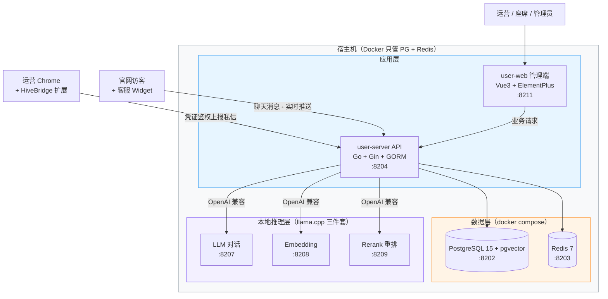
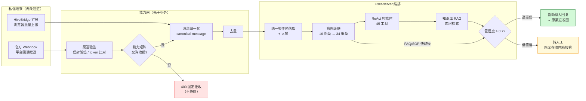
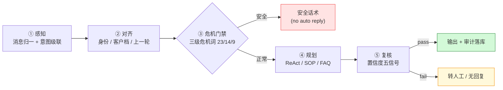
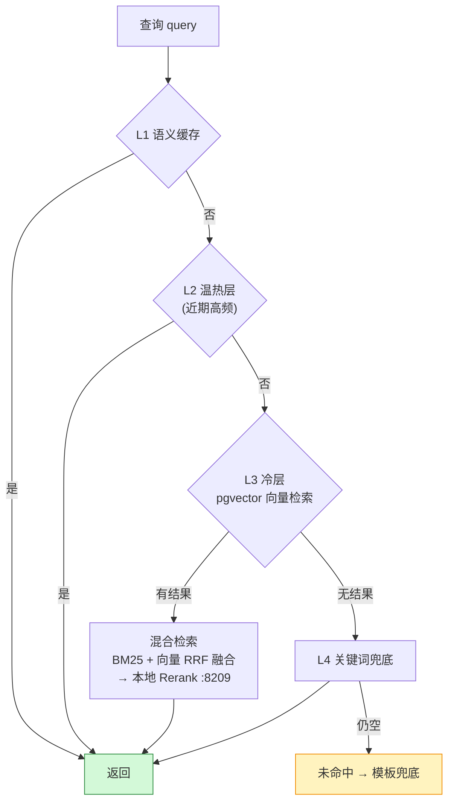
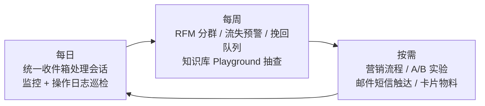

# 快速上手与使用手册（人读版 · 交接级）

> 本文件是 **HiveMtk 用户端的交接级使用手册**：新接手的人从"这是什么"到"每个模块怎么用"，
> 一条路径走完。第 3 章对每个功能模块给出四要素：**作用**（干什么）、**解决什么问题**、
> **如何配置**、**如何使用**（日常操作路径），并附页面路径。
> 深度细节**挂靠**既有文档，不重复抄。
>
> **读者**：新接手的运营 / 实施 / 交接人。
> **代码基线**：`hivemtk/` 仓库 main 分支，成文日期 2026-11-17。
> **权威口径来源**：菜单树逐项对齐 `user-server/internal/model/menu.go` 的 `SystemMenuTree`
> （后端驱动 RBAC）；智能体表单字段对齐 `user-web/src/views/aiAgent/Edit.vue`。
> **本手册不写接口调用**——接口/数据结构是开发者视角，需要时查
> [功能文档（AI 读版）](./FEATURES-FOR-AI.md)与 [`user-server/docs/dev/FEATURES.md`](../../user-server/docs/dev/FEATURES.md)（94 子模块）。
>
> | 想做什么 | 看哪份 |
> |---|---|
> | 查功能全集与已知限制 | [功能文档（人读版）](./FEATURES-FOR-HUMANS.md) |
> | 查部署 / 配置 / 备份细节 | [操作手册（人读版）](./OPERATIONS-FOR-HUMANS.md) |
> | 查接口、目录、数据结构 | [功能文档（AI 读版）](./FEATURES-FOR-AI.md) |

---

## 目录

1. [系统是什么（先建立全局认知）](#1-系统是什么先建立全局认知)
2. [功能架构](#2-功能架构)
3. [功能模块详解（逐模块：作用/问题/配置/使用）](#3-功能模块详解逐模块作用问题配置使用)
4. [快速上手：从零到第一条 AI 自动回复](#4-快速上手从零到第一条-ai-自动回复)
5. [HiveBridge 浏览器扩展详细指南](#5-hivebridge-浏览器扩展详细指南)
6. [客服 Widget 详细嵌入指南](#6-客服-widget-详细嵌入指南)
7. [角色与权限](#7-角色与权限)
8. [排障速查表](#8-排障速查表)
9. [新手避坑清单](#9-新手避坑清单)
10. [文档地图](#10-文档地图)

---

## 1. 系统是什么（先建立全局认知）

**HiveMtk 用户端**是一套**单商户本地部署的开源私域营销 AI 系统**（AGPL-3.0）：
把抖音、快手、小红书、闲鱼、TikTok 的网页端私信，与微信、企业微信、飞书、钉钉、Telegram、WhatsApp、短信、邮件统一接进来，
由 ReAct 智能体 + 本地知识库（RAG）自动拟人回复，并把线索 → 成交 → 回款（LTC）全流程跑通。

三条硬边界，先说清楚：

| 边界 | 说明 | 交接时怎么理解 |
|------|------|---------------|
| **单商户单租户** | 开源版默认形态是单租户私域部署（`TENANT_MODE=off`） | 它是"一家公司自己的系统"，不是 SaaS；扩容承载第二个商户需改架构 |
| **数据零出域** | LLM / Embedding / Rerank 全跑宿主机 llama.cpp，无外部模型厂商依赖 | 断网可用；但推理质量受本地模型规格限制，回复慢先查推理栈 |
| **有闸门的自动化** | 主动触达（短信/邮件/私信）有不可关闭的 `[COMPLIANCE]` 合规日志 | 合规责任由部署方承担，见 [`DISCLAIMER.md`](../../DISCLAIMER.md) |

### 1.1 五大件（交接时先认清各部件在哪、干什么）

| 部件 | 代码位置 | 技术栈 | 端口 | 职责 | 谁在用 |
|------|---------|--------|------|------|--------|
| **管理端 Web** | `user-web/src/` | Vue3 + ElementPlus，9 语言（ar/de/en/es/fr/ja/pt/ru/zh） | **8211** | 全部功能的操作入口；菜单树由后端按角色下发，前端不静态过滤 | 运营 / 座席 / 管理员 |
| **API 服务** | `user-server/` | Go + Gin + GORM，五层架构，HTTP + WebSocket 同端口 | **8204** | 所有业务逻辑：入站编排、AI 引擎、渠道对接、RAG、LTC | 管理端、扩展、Widget 的后端 |
| **HiveBridge 扩展** | `user-web/bridge/` | Chrome MV3 + 纯 JS，esbuild 逐入口 IIFE | —（装浏览器） | 把无开放私信 API 的社媒网页消息桥接进 user-server | 装在运营自己的 Chrome 里 |
| **客服 Widget** | `embed-sdk/` | 独立前端工程，一行 script 嵌入 | 随 user-server `/embed/` | 企业官网右下角客服浮标，访客直连 AI / 转人工 | 企业官网访客 |
| **本地推理栈** | llama.cpp 三件套 | LLM :8207 / Embedding :8208 / Rerank :8209，OpenAI 兼容 | 8207–8209 | 对话推理 / 向量化（bge-m3 1024 维）/ 重排 | 被 user-server 调用 |

数据层：PostgreSQL 15 + pgvector（:8202，主存储）与 Redis 7（:8203，缓存/限流/SSO 会话），
**Docker 只管这两个**——user-server、推理栈、前端全部跑宿主机，没有"一键起全栈的 compose"。

---

## 2. 功能架构

### 2.1 部署拓扑与端口



| 组件 | 端口 | 说明 |
|------|------|------|
| user-web 管理端 | **8211** | 日常操作入口，浏览器访问它 |
| user-server API | **8204** | HTTP + WebSocket 同端口；`/health` 健康检查 |
| PostgreSQL 15 + pgvector | 8202 | 主存储；向量 1024 维（bge-m3） |
| Redis 7 | 8203 | 缓存 / 限流 / SSO 会话 |
| llama.cpp LLM / Embedding / Rerank | 8207 / 8208 / 8209 | 本地推理三件套，**回复质量的上限** |
| Laya 决策服务（可选） | 8210 | 模型决策增强，不启用则不配 |
| platform-server（可选） | 8205 | 仅 `PLATFORM_ENABLED=true`，开源版默认关 |
| Chromium CDP | 8206 | Bridge 调试端口 |

端口权威清单见 [`docs/PORT_REGISTRY.md`](../PORT_REGISTRY.md)。

### 2.2 后端五层架构（改代码前必懂）

`user-server/internal/{router,controller,service,repository,model}/`，**禁跨层**，
CI 有静态门（`scripts/check-layer-boundary.py`）强制：

| 层 | 职责 | 禁止 |
|---|---|---|
| Router | URL→Controller 映射 + 依赖装配 | 写业务逻辑、内联闭包 |
| Controller | 解析入参、调 Service、组响应 | 直接碰 DB / 调 Repository |
| Service | 业务编排、事务边界 | 写 SQL / 碰 `*gin.Context` 细节 |
| Repository | 数据访问（SQL/GORM） | 写业务规则 |
| Model | 数据结构与表映射 | 带行为逻辑 |

- 本仓**无 `handler` 包**：新域一律 `XxxController`。
- API 路径规范 `/api/{domain}/{resource}`；多租户 fail-closed：任何表访问必须带租户上下文。

### 2.3 一条私信的旅程（理解系统的最小模型）



逐步说明：

1. **入站**：Bridge 渠道由扩展在浏览器里批量上报（单批有条数与大小上限）；
   API/Webhook 渠道由各平台按回调地址推送。
2. **能力闸先于业务**：通配路由里存在但能力矩阵未开放的渠道（快手/小红书/闲鱼的 webhook）**固定返回 400**，
   让配置错误在对接期就暴露，而不是静默丢消息。
3. **归一化 + 去重**：统一为 canonical message，按 scope 去重（含近期回显防回环）。
4. **意图识别**：16 类粗意图 → 34 类细意图级联（`internal/service/intent_recognition_fine.go`）。
5. **决策**：FAQ/SOP 快路径命中直接走置信度；未命中走 ReAct 智能体（45 工具 + RAG 四层检索）。
6. **置信度四档**（动态阈值 [0.40, 0.95]，五信号 + 校准链 + 六否决链）：
   高=直接发送；中=降级发送/附人工待办；低=转人工不自动回复；命中否决链=一律转人工。

### 2.4 智能体五阶段闭环



### 2.5 RAG 四层检索



### 2.6 AI 引擎能力速览（F1–F15 明细见功能文档 §7）

| 能力 | 说明 | 交接要点 |
|------|------|---------|
| LLM 多模型路由 | 多厂商多场景，四级降级，熔断 5 次/60s，多数投票 | [LLM 路由] 页看降级链与健康状态 |
| ReAct 智能体 | 感知→规划→调工具→反思，45 原子工具（触达 20 / 客户 8 / 知识 4 / 业务 6 / 浏览器 3 / 卡片 1 / 私信 3）+ 15 装饰器 + MCP | 工具带权限/重试/超时/限流/审计保护链 |
| SOP 智能体 | DAG 编排，15 种节点类型（开始/发消息/分支/等待/动作/结束/AI 决策/发报价/打招呼/询问/介绍/处理/成交/邀请/跟进），失败自动补偿与重投 | AB 权重和**必须 = 100** |
| 置信度决策 | 五信号 + 校准链 + 六否决链，动态阈值 [0.40, 0.95] 四档 | [置信度看板] 观察；阈值在 [动态阈值参数] 调 |
| 拟人三层 | 润色（默认开，<1ms）/ 五维门禁（0.85）/ 行为模拟（**默认关**，G7） | 开行为模拟需观察误杀率，门禁过严会大量转人工 |
| 自学习 | 反馈回流、销冠聚类、Prompt 迭代、SOP 自动优化、Bandit 分流（Thompson）、Trace 学习（每小时 200 条） | 坏答案经 [反馈管理] 回流 |

---

## 3. 功能模块详解（逐模块：作用/问题/配置/使用）

> 菜单树由后端按角色实时下发（权威注册表在 `user-server/internal/model/menu.go`）。
> **菜单不可见时先检查角色权限、模块启用状态和当前登录会话**（详见第 7 节）；这些正常后仍不可见，再检查路由、接口与前端渲染，不能仅凭菜单缺失排除前端问题。
> 每个模块按四要素写：**作用** / **解决什么问题** / **如何配置** / **如何使用**；
> 表里"可见角色"列：**全员** = admin/viewer/staff/customer_service 默认可见；**admin** = 仅管理员。

### 3.1 工作台

#### 3.1.1 统一收件箱（`/inbox/list`，全员）——日常主战场

- **作用**：跨渠道统一会话处理中心。所有渠道（私信/邮件/短信/Widget/企微…）的入站消息落成会话，
  三栏看板呈现（会话列表 / 客户档案 / 工单关联），座席在这里回复、打标、转接。
- **解决什么问题**：各平台后台各自一个私信入口，运营来回切换还容易漏回。收件箱把"回消息"这一件事收敛到一个页面。
- **如何配置**：无需专门配置——渠道接入（4.6 节）后消息自动进来；座席需要分配角色（第 7 节）；页面实时刷新。
- **如何使用**：顶部按渠道/未读/待处理过滤；点开会话看客户 360 侧栏 → 采纳 [AI 建议] 或用 [快捷回复] 直接回
  → AI 回复由智能体自动发；需要人工处理时认领会话（人锁，防止 AI 与人同时回）；结束后打会话标签。

#### 3.1.2 消息中台 MQ + 消息中台看板（`/messageHub/list`、`/messageHub/dashboard`，admin）

- **作用**：七大渠道接入总览与消息量/健康度看板。
- **解决什么问题**：渠道接多了以后，"哪个渠道有没有数据、是否健康"不可见；中台给一个总闸口视图。
- **如何配置**：跟随各渠道接入自动汇聚，无独立配置。
- **如何使用**：每日巡检看各渠道消息量曲线与健康状态，异常渠道回到对应接入页排查。

#### 3.1.3 待办中心（`/approvalTask/list`，全员）

- **作用**：人工任务的集中处理台——AI 置信度"中档"降级附的人工待办、审批任务（领取·释放·完成·取消）。
- **解决什么问题**：AI 不确定的事要有人兜底，兜底事项不能散落在聊天记录里，必须有统一队列。
- **如何配置**：审批操作仅 admin 可做；LTC 审批需先开 LTC 开关（3.7 站点配置）。
- **如何使用**：按队列领取任务 → 处理（联系客户/内部确认）→ 完成或取消；超时任务有 SLA 提醒。

#### 3.1.4 Bad Case 队列（`/badCase/list`，全员）

- **作用**：AI 回复差案例的归档与改进闭环：坏案例 → 生成知识库变更 → 审核 → 知识库发布生效。
- **解决什么问题**：AI 说错话不能只删了事——要把错误系统性吸收成知识库修正，否则同类错误反复发生。
- **如何配置**：依赖知识库工作台可用（3.5.1）；无需额外配置。
- **如何使用**：从收件箱/会话发现坏答案 → 归档进 Bad Case → 队列里生成知识库变更 → 审核后发布生效。

#### 3.1.5 LTC 一组：销售驾驶舱 / 订单草稿 / 销售工作台 / 今日跟进
（`/sales-cockpit`、`/dashboard/drafts`、`/sales-workbench`、`/followups/today`，admin）

- **作用**：LTC（线索到回款）链路的四个操作面——商机/报价/账单阶段总览、AI 生成订单草稿的人工确认、
  销售日常跟进工作台、今日待跟进清单。
- **解决什么问题**：客户聊完之后的商机推进、报价、回款没有工具就散在 Excel 和个人备忘里；LTC 把"聊单到收钱"搬进系统。
- **如何配置**：**LTC 装配开关默认关**——未开启时相关端点回 **503**（不是接口坏了）；
  管理员在 [站点配置 → LTC 运营开关]（`/system/ltc-config`）开启。
- **如何使用**：线索转商机 → 推进阶段 → 生成报价 → 审批（admin）→ 账单 → 回款；
  AI 生成的订单草稿在 [订单草稿] 页人工确认后才生效；每天看 [今日跟进] 清单跟进。

#### 3.1.6 多账号聚合（`/wecomAccount/list`，admin）

- **作用**：企微账号聚合管理（含健康度）。
- **解决什么问题**：企业同时运营多个企微号，需要一眼看到每个号的活没活、健康度如何。
- **如何配置**：先在企微开放平台建应用拿凭证，再到 [平台账号] 绑定（见 4.6）。
- **如何使用**：巡检健康度，异常账号（掉线/风控）先处理再继续用它触达。

### 3.2 客户中心

#### 3.2.1 线索列表 + 线索统计（`/clue/list`、`/clue/statistics`，全员）

- **作用**：线索的统一管理与漏斗统计；每条线索带自动评分（线索分）。
- **解决什么问题**：意向客户从各渠道涌进来，人力有限——评分让销售"先跟分高的"。
- **如何配置**：评分模型开箱即用，无需配置。
- **如何使用**：列表按线索分排序从高到低跟进；[线索统计] 看来源/阶段转化；
  跟进动作沉淀为商机进入 LTC（3.1.5）。

#### 3.2.2 线索挖掘（`/lead-mining/index`，全员）

- **作用**：从社媒评论区/公开互动中挖掘意向线索，**LLM 复核**过滤噪音。
- **解决什么问题**：大量意向藏在评论和互动里（"怎么买""多少钱"），人工翻帖效率极低。
- **如何配置**：依赖 Bridge/渠道数据已经在收（没有数据源就无帖可挖）。
- **如何使用**：建挖掘任务 → 系统抓取候选评论 → LLM 复核判真 → 确认后进入线索库，走线索跟进流程。

#### 3.2.3 客户 360（`/customer360/list`，全员）

- **作用**：单客户全貌：基础信息 + 全渠道会话历史 + 事件 + 订单/工单 + 标签。
- **解决什么问题**：同一客户在抖音问过、邮件发过、Widget 聊过——不拼起来每次都要重新问一遍需求。
- **如何配置**：无独立配置；数据随会话/事件/订单自动累积。
- **如何使用**：从收件箱、线索列表点开客户进入 360 视图；触达前先看一眼，避免重复打扰。

#### 3.2.4 客户同意与偏好（`/customer360/consents`，全员）

- **作用**：同意事实账（grant/revoke **追加式**，不改历史）与触达偏好（暂停/时区）的管理面。
- **解决什么问题**："这个客户现在能不能联系"——合规触达必须可举证；每次主动触达都有 `[COMPLIANCE]` 日志，同意账是它的前置事实。
- **如何配置**：无独立配置；合规责任由部署方承担（`DISCLAIMER.md`）。
- **如何使用**：客户授同意时记 grant、撤回时记 revoke；发主动触达任务前按偏好（暂停/时区）过滤。

#### 3.2.5 客户事件（`/customerEvent/list`，全员）——CDP

- **作用**：客户行为事件流：浏览/点击/下单/注册/登录/加购等，支持批量上报。
- **解决什么问题**：分层、旅程、流失预警都要行为数据喂；没有 CDP 这些分析模块就是空转。
- **如何配置**：官网/Widget 侧接入埋点上报（开发对接项，事件类型见页面；对接细节查开发者文档）。
- **如何使用**：接好埋点 → 事件流入库 → 供客户 360、旅程大屏、RFM、流失预警消费。

#### 3.2.6 标签分层 + 用户分层 RFM（`/tagSegmentation/list`、`/userSegment/list`，admin+viewer）

- **作用**：客户标签体系管理；RFM 模型计算（最近一次消费/频率/金额）+ 用户分群。
- **解决什么问题**：群发和运营不能"一刀切"——新客、复购客、沉睡客要不同话术。
- **如何配置**：先建标签体系；RFM 规则可在页面调整。
- **如何使用**：[用户分层 RFM] 跑计算（**建议每周一次**）→ 得分分群 → 分群结果供营销流程/群发消费；
  [流失预警]（数据分析菜单）预测流失 → [挽回队列] 安排挽回动作。

#### 3.2.7 客户身份 OneID（admin 组）：列表 / 冲突解决 / 合并规则（`/oneid/*`）

- **作用**：跨渠道身份统一——把"微信上的张三"和"抖音上的张三"合并成一个人。
- **解决什么问题**：身份不合一，客户 360 就拼不全，触达会重复打扰。
- **如何配置**：[合并规则配置] 设自动合并条件（同手机号/同邮箱等）；拿不准的走人工。
- **如何使用**：[OneID 列表] 看身份映射 → [身份冲突解决] 处理冲突 → 支持手动合并。

### 3.3 智能体

#### 3.3.1 智能体管理（`/aiAgent/list`、`/aiAgent/create`，创建仅 admin）

- **作用**：创建与管理多个独立 AI 智能体，三角色：**sales**（销售转化，带触达工具）/ **cs**（客服应答）/ **hybrid**（混合）。
- **解决什么问题**：一个店铺既要售前转化又要售后应答，一个"万能 bot"两头都做不好；分角色智能体各司其职。
- **如何配置**（创建表单逐项怎么填）：

  | 表单项 | 怎么填 |
  |------|------|
  | 编码 / 名称 | 唯一编码与显示名，如 `cs-main` / "主客服" |
  | 角色 | **sales**（销售转化，带触达工具）/ **cs**（客服应答）/ **hybrid**（混合） |
  | 运行模式 | 按业务场景选择 |
  | 人设 / 描述 | 决定口吻与人设一致性，写清楚"你是谁、什么语气" |
  | 系统提示词 | 核心行为约束（注意安全红线：越狱类提示词需自行审计封堵） |
  | 欢迎语 | 会话开场白 |
  | 内部语言 / 目标语言 | 多语言场景才需要 |
  | 挂载知识库 | **回复质量的来源**（3.5.1），必挂 |
  | SOP 列表 / 话术模板 | 流程与话术挂载 |
  | LLM 模型 / 最大 Token | 推理规格 |
  | 资产包 | 话术/能力打包挂载（3.7 资产包） |

- **如何使用**：创建后 → **绑渠道**：把智能体挂到具体渠道账号（同一渠道不同账号可挂不同智能体；绑定操作 admin）
  → 列表页的「测试」功能自测，看上下文装载是否正确 → 上线观察 [置信度看板]。

#### 3.3.2 被动应答组——客户来消息时的自动应答链路

| 模块（路径） | 作用 / 解决什么问题 | 如何配置 | 如何使用 |
|------|------------------|---------|---------|
| 客服会话（`/customerSession/list`） | 会话列表与详情管理 / 座席侧的会话底账 | 无 | 查会话、查状态 |
| 意图识别（`/intentRecognition/list`） | 意图分类观测：16 粗类 → 34 细类级联 / 自动回复的第一步是"听懂客户在问什么" | 无（级联内置） | 观察意图分布；页内输入一句话测识别结果 |
| 意图工具流（`/intentRecognition/tool-flow`，admin） | 意图→工具调用流编排 / "识别到退货意图后自动调哪些工具"这类确定性动作 | 编排链路（admin） | 为高频意图配确定性工具链，减轻 LLM 负担 |
| 对话记忆（`/dialogueMemory/list`） | 短期/长期/RAG 三层记忆中心 / 客户上周说过的话这周还得重说就是体验事故 | 无 | 查某客户的记忆上下文是否正确 |
| LLM 路由（`/llmRouting/list`） | 多厂商/多场景路由、四级降级、熔断 5 次/60s / 单一模型故障时回复全停 | 路由策略 admin 可调 | 页内看降级链与各家健康；熔断可页内一键复位 |
| 未知问题运营（`/unknown-questions`，admin） | 低置信度回流问题 → FAQ 提交审核 / AI 回答不了的问题要变成明天的 FAQ | 无 | 定期处理回流问题，合格的提交 FAQ 审核 |

#### 3.3.3 主动触达组

| 模块（路径） | 作用 / 解决什么问题 | 如何配置 | 如何使用 |
|------|------------------|---------|---------|
| 触达 Pipeline（`/reachPipeline/list`，admin） | 9 步触达管线编排与推进 / 主动营销要有节奏和阶段，不能想到哪发到哪 | 建管线，选触达工具 | 建管线 → 推进 9 步 → 每步打 `[COMPLIANCE]` 合规日志 |
| 延迟出站管理（`/reachPipeline/deferred-outbound`，admin） | 静默时段/合规窗口内暂缓的触达，可查可取消 / 深夜发消息既扰民又伤号 | 无（合规窗口内置） | 巡检暂存队列；仅 pending 可取消 |
| 营销流程（`/marketingFlow/list`，admin） | 营销自动化流程编排 / "新客 3 天后发欢迎邮件"这类规则自动化 | 建流程，编排节点 | 建流程 → 启用 → 由数据面自动驱动 |
| 批量运营（`/batchOperation/list`，admin） | 批量操作：预览→执行→历史 / 上千客户逐个改标签不现实 | 无 | 批量预览影响面 → 执行 → [历史] 审计 |

> ⚠️ 主动外联"四格"全自动编排是骨架未接线（G11）；能用的主动外联是短信/邮件/群发这类显式发送任务 + 触达 Pipeline。

#### 3.3.4 能力支撑组

| 模块（路径） | 作用 / 解决什么问题 | 如何配置 | 如何使用 |
|------|------------------|---------|---------|
| SOP 智能体（`/sopAgent/list`，admin） | DAG 流程编排，15 种节点类型，失败自动补偿重投 / 高频业务流程（打招呼→询问→处理→成交）要可复现、可实验 | 编排 DAG；**AB 权重和必须 = 100** | 建流程 → 挂到智能体 → AB 实验看转化 |
| SOP 模板库 / 市场（`/sop-template/list`、`/sop-template/market`，admin） | 模板沉淀与复用 / 好流程不该每个商户重写一遍 | 下载市场模板 | 模板→实例化→改细节 |
| FAQ 知识库（`/faq/list`） | 问答对管理；完整问题与上下文符合资格时可走快路径，减少模型调用，但不保证平台秒回或全链路零成本 | 录问答对 | 高频问题录 FAQ → 核对命中准确性 → 未知问题运营持续补充 |
| 知识库管理（`/knowledgeBase`） | 知识库快捷入口 | 见 3.5.1 | 同左 |
| 销冠话术库（`/scriptTemplate/list`） | 话术模板 + 版本管理 / 把销冠的话沉淀给普通人用 | 录话术 | 话术挂智能体 → [话术 AB 统计]（`/scriptTemplate/ab-stats`）对比效果 |
| AI 工具管理（`/aiAgent/tools`，admin） | 智能体可用工具的启停（45 工具注册表）/ 工具给多了有风险，给少了没能力 | 按智能体启停工具 | 收紧不必要工具（如批量发送）降低风险 |
| 工具接入（`/aiAgent/integrations`，admin） | 自定义工具/外部系统接入 / 自有 ERP 接口也要能被 AI 调 | 录入外部系统描述与凭证（开发对接项） | 接入后智能体可自主调用 |
| MCP 凭证（`/mcp/credentials`，admin） | 外部工具生态（MCP）接入凭证 / 标准化的外部能力接入 | 录入凭证 | 外部工具通过 MCP 接入后智能体可用 |

#### 3.3.5 客服工作台组（admin / customer_service）

| 模块（路径） | 作用 / 解决什么问题 | 如何配置 | 如何使用 |
|------|------------------|---------|---------|
| 坐席状态（`/customerService/agentStatus`） | 坐席在线/忙碌实时看板 / 转人工要分给活着的坐席 | 坐席账号由人员管理建 | 排班时看状态，页面实时刷新 |
| CSAT 看板（`/customerService/csat`） | 客户满意度统计 / 服务质量要量化 | 无 | 周会看 CSAT 趋势与差评明细 |
| 快捷回复（`/customerService/quickReply`） | 座席快捷话术 / 高频回复手打太慢 | 录快捷语（可分组） | 收件箱里一键发送 |
| 会话标签（`/customerService/sessionTag`） | 会话打标体系 / 会话要能被统计和检索 | 建标签 | 会话结束打标 |
| AI 建议（`/customerService/aiSuggestion`） | AI 给座席的回复建议，可采纳 / 座席也想有 AI 帮忙 | 无 | 收件箱采纳建议；采纳动作回喂自学习 |

#### 3.3.6 客服渠道组（admin）

| 模块（路径） | 作用 / 解决什么问题 | 如何配置 | 如何使用 |
|------|------------------|---------|---------|
| 网页客服渠道（`/chatChannel/list`） | 客服 Widget 渠道管理：AppKey + 域名白名单 / 每个官网站点一个渠道，白名单防盗刷 | 新建渠道 → 拿 AppKey → 按第 6 节嵌入 | 官网发一条测试消息 → 收件箱出现会话 |
| WhatsApp Cloud（`/whatsapp-cloud`） | Meta WhatsApp 官方通道账号接入 / 国际客户的主渠道 | Meta 后台建应用 → 绑定账号 → 回调地址填 `…/api/webhook/whatsapp/<账号ID>`（Meta 校验） | 群发任务发一条测试 |
| 钉钉应用账号（`/dingtalk-app`） | 钉钉企业应用账号 / 组织内通知与服务 | 开放平台建应用 → 页内绑定 | 发一条应用消息验证 |

#### 3.3.7 销售智能组（admin）

| 模块（路径） | 作用 / 解决什么问题 | 如何配置 | 如何使用 |
|------|------------------|---------|---------|
| 异议处理（`/objection/list`） | 价格/售后等异议的应对策略 / "太贵了"是成交最后一公里，AI 必须接得住 | 录异议类型与策略话术 | 智能体命中异议时按策略应对 |
| 销冠画像（`/persona/list`） | 优秀销售对话聚类画像 / 自学习的目标模版——AI 向销冠收敛 | 无（自动聚类） | 看画像结论 → 反哺系统提示词/话术 |

### 3.4 触达运营

#### 3.4.1 邮件触达组（7 页）

- **作用**：邮件列表 → 草稿 → 任务 → 发送 → 追踪（打开/点击像素 + Webhook）→ 送达分析 → 退订管理，完整邮件营销链。
- **解决什么问题**：私信要人在场，邮件可以批量异步触达长周期客户；打开/点击数据让效果可量化。
- **如何配置**（顺序）：
  1. [邮件账号]（`/email/smtp`）配 SMTP 凭证；
  2. [邮件列表]（`/email`）建收件人列表；
  3. （可选）[邮件代理]（`/email/info`）。
- **如何使用**：[我的草稿] 写邮件 → [我的任务] 建发送任务并执行 → [送达分析] 看打开/点击与退订情况；
  收件人退订后系统自动停发。新手先看页面内置的 [邮件使用指南]（`/email/guide`）。

#### 3.4.2 短信触达组（4 页）

- **作用**：短信列表/草稿/任务/配置——国内强触达通道。
- **解决什么问题**：验证类、通知类、促销类的即时到达。
- **如何配置**：[短信配置]（`/sms/config`）配**阿里云** AccessKey/签名/模板（腾讯云/华为云为配置位，未实接）。
- **如何使用**：[短信列表] 建接收人 → [短信草稿] 写文案 → [短信任务] 发送并看进度。

#### 3.4.3 五平台卡片组（抖音/快手/小红书/闲鱼/TikTok，各两页：卡片 + 统计）

- **作用**：AI 生成各平台风格的**内容卡片物料**（营销文案/商品卡片）。
- **解决什么问题**：五个平台内容规格各异，逐个手写物料效率低；一套输入出五平台物料。
- **如何配置**：无前置配置；推理栈要健康（生成走本地 LLM）。
- **如何使用**：各平台 [卡片页] 生成 → 复制到平台发布 → [统计页] 看生成量与使用情况。

#### 3.4.4 WhatsApp 组（6 页，admin）

- **作用**：账号管理 → 草稿箱 → 群发任务链（草稿→任务→进度）→ 群发线索分组 → 模板群发（发对象=全部 WhatsApp 线索）→ 群组发送（群组+模板管理）。
- **解决什么问题**：海外客户主渠道；线索级/群组级两种触达形态都要有。
- **如何配置**：[客服渠道 → WhatsApp Cloud] 绑 Meta 账号（或 `/whatsapp/account` 管理账号）。
- **如何使用**：建草稿 → [群发任务] 建任务看进度 → 对全部线索用 [模板群发]，对分组线索用 [群发线索分组] → 群组场景走 [群组发送]。

#### 3.4.5 电报社群（Telegram）/ QQ 机器人 / 飞书 / 社群管理

| 模块（路径） | 作用 / 解决什么问题 | 如何配置 | 如何使用 |
|------|------------------|---------|---------|
| 机器人（`/telegram/account`）+ 入群管控（`/telegram/gate`） | Telegram Bot 账号管理 + AI 自动化 + 入群审批管控 / 海外社群运营与防灌水 | @BotFather 建 Bot → 页内绑 Token | Bot 收发一条验证；入群管控在管控页配规则 |
| QQ 机器人账号（`/qq/account`） | QQ 官方机器人接入 / QQ 生态触达 | QQ 开放平台建 Bot → 绑定 → 回调地址填 `…/api/webhook/qq/<账号ID>` | Bot 收发一条 |
| 飞书账号（`/feishu/account`） | 飞书应用接入 / 组织内通知 | 开放平台建应用 → 绑定 → 事件订阅回调指向本系统（信封验签自动校验） | 发一条应用消息验证 |
| 社群管理（`/community/list`） | 通用社群管理面 / 各社群统一登记 | 无 | 登记社群、看状态 |

#### 3.4.6 短链管理 / 活码管理 / 工作流编排

| 模块（路径） | 作用 / 解决什么问题 | 如何配置 | 如何使用 |
|------|------------------|---------|---------|
| 短链列表 + 统计（`/shortLink`、`/shortLink/stats`，admin） | 短链生成与点击统计 / 长链接丑且无法统计点击 | 可选配 [域名池]（`/domainPool`，多域名轮换防封） | 建短链 → 投放 → [短链统计] 看点击 |
| 活码管理（`/livecode`，admin） | 轮询二维码 / 引流入口固定但背后的二维码要能轮换分流防频控 | 建活码，配轮询二维码组 | 一个活码 URL 对外投放，后台轮换二维码 |
| 工作流编排（`/workflow-orchestrator/list`，admin） | 跨模块工作流编排 / 复杂自动化要串多个模块动作 | 编排 | 建工作流 → 触发条件 → 自动执行 |

### 3.5 知识中心

#### 3.5.1 知识库工作台（admin，11 页）——**决定回复质量，新部署优先做**

- **作用**：知识库全生命周期：文档管理、批量导入、检索验证、反馈回流、统计与评测、外部接入。
- **解决什么问题**：AI 自动回复的质量上限 = 知识库质量；产品参数、政策、话术不进知识库，AI 只能瞎编。
- **如何配置 / 使用**（按工作流顺序）：

  | 步 | 页面（路径） | 操作 |
  |----|------------|------|
  | 1 | 文档管理（`/knowledge/management`） | 新建知识库；上传文档、编辑分段 |
  | 2 | 批量导入（`/knowledge/batch-import`） | 批量灌文档；URL 抓取带 SSRF 校验 |
  | 3 | —— | **按导入任务状态确认完成**（分块 → bge-m3 1024 维向量化）；耗时取决于内容量、队列和模型。未完成时检索可能为空，失败时须检查任务错误，不能仅等待固定15分钟 |
  | 4 | 检索 Playground（`/knowledge/playground`） | 输真实客户问题验证召回；不好 → 修分块 → 回到 4 |
  | 5 | 反馈管理（`/knowledge/feedbacks`） | 线上坏答案回流自学习层 |
  | 6 | 知识库统计 / RAG 评测（`/knowledge/statistics`、`/knowledge/rag-eval`） | 量化质量（ChrF + LLM Judge，覆盖面薄 G12） |
  | 7 | API Token / 外部系统接入 / OpenAPI 集成（`/knowledge/tokens`、`/external`、`/openapi`） | 给外部系统发知识库 API 凭证 |
  | 8 | 连接器配置（`/knowledge/connectors`） | Notion/飞书/钉钉凭据连通 |
  | 9 | 第三方知识库导入（`/kb/connectors`，admin） | 把 IMA 等第三方知识库**文档**拉进本地 RAG（与连接器同组不同职：那个管凭据，这个管导入） |

- ⚠️ Embedding 服务挂掉时 `EMBEDDING_ALLOW_FALLBACK=true` 会用 Hash 降级继续跑——业务不断但检索质量明显下降，先修服务再谈降级。

#### 3.5.2 RAG 知识库组 + RAG 概览

| 模块（路径） | 作用 / 解决什么问题 | 如何配置 | 如何使用 |
|------|------------------|---------|---------|
| RAG 账号配置（`/system/rag-account`，admin） | RAG 服务账号连接参数 / 推理三件套地址变更时要改 | 填账号连接配置 | 配好即可 |
| RAG 产品管理（`/system/rag-product`，admin） | RAG 产品维度配置 / 不同产品线用不同知识库策略 | 建产品配置 | 不同产品线各配各的策略 |
| RAG 概览（`/system/rag-overview`，全员） | RAG 全局健康总览 / 检索质量是否有问题一眼可见 | 无 | 日常巡检 |

#### 3.5.3 多语言管理（admin）：术语表 + 监控

- **作用**：术语表管理（`/glossary`）+ 多语言监控（`/i18n/dashboard`）。
- **解决什么问题**：系统 9 语言；术语不统一，翻译出来外行话连篇。
- **如何配置 / 使用**：录术语 → 监控看翻译覆盖缺口。

### 3.6 数据分析

| 模块（路径） | 作用 / 解决什么问题 | 如何配置 | 如何使用 |
|------|------------------|---------|---------|
| 数据大屏（`/dashboardScreen/list`） | 实时驾驶舱 / 管理层要一屏看清全局 | 无 | 投屏轮播 |
| 转化漏斗（`/conversionFunnel/list`） | 漏斗分析 / 哪一步流失最多就修哪一步 | 无 | 周复盘 |
| LLM 用量报表（`/reports/llm`，admin+viewer） | 每日用量聚合 + 当日明细 / 本地推理也要看成本与负载 | 无 | 看趋势，异常调用量查安全审计 |
| AI 产能分析（`/aiProductivity/list`，admin+viewer） | 智能体产能 / AI 到底替人干了多少活 | 无 | 日常/周复盘 |
| 自定义报表（`/customReport/list`） | 自建报表 / 固定看板覆盖不了的长尾问题 | 建报表 | 配维度指标 → 保存复用 |
| A/B 实验（`/abExperiment/list`，admin+viewer） | 实验管理/结果/转化事件/CUPED/诊断 / 改话术凭感觉就是赌博 | 建实验 | 结果页看显著性与转化 |
| 流失预警 + 挽回队列（`/churnPrediction/list`，admin+viewer） | 流失预测 + 挽回安排 / 等客户走了才知道就晚了 | 无 | 每周跑预测 → 挽回队列派任务 |
| 客户旅程大屏（`/customerJourney/dashboard`，admin+viewer） | 9 阶段旅程监控 / 客户卡在哪个阶段一目了然 | 无 | 看各阶段转化与卡点 |
| 同期群路径分析（`/analytics/cohort-path`，admin+viewer） | Cohort 路径 / 不同批次客户行为差异 | 无 | 按群组对比 |
| 置信度看板（`/confidence/panel`，admin+viewer） | 自动回复置信度分布 / 全转人工还是全直发，看分布就知道阈值合不合理 | 阈值在 [站点配置 → 动态阈值参数] 调（admin） | 日常观察 |
| 拟人度看板（`/humanize/panel`，admin+viewer） | 拟人五维门禁分数 / 开了行为拟人要看误杀率 | 同上 | 同上 |
| 反馈闭环（`/feedbackLoop/panel`，admin+viewer） | 反馈学习效果 / 自学习是否真的在变好 | 无 | 对比前后指标 |

#### 3.6.1 浏览器自动化（admin，双腿）

- **作用**：让系统驱动浏览器干活，两条执行腿：
  **chromedp 腿**——任务列表 / 新建任务 / 定时触发器 / Host 状态；
  **ego-lite 腿**——我的流程 / 通用会话 / 执行监控 / Runner 状态 / 资产中心 / 资产发布台 / 遥测看板（S-9 只回聚合桶）。
- **解决什么问题**：智能体的 `browser` 工具组（open-task / task-status / task-list）需要有人工侧的任务台；
  定时巡检、批量操作类动作要可编排可观测。
- **如何配置**：chromedp 腿需本机浏览器环境（CDP :8206）；ego-lite 腿装 Runner。
- **如何使用**：[新建任务] 下任务 → [任务列表] 看执行 → [定时触发器] 设周期；
  ego-lite 流程在 [我的流程] 发布为资产 → [资产中心] 橱窗。

#### 3.6.2 GEO 智能优化（admin，六组 25+ 页）

- **作用**：**GEO（Generative Engine Optimization，生成式引擎优化）**——让品牌在 AI 搜索引擎
  （ChatGPT Search / Perplexity / Google SGE 等）的回答里被提及。全流程工具化：
  审计体检 → 品牌六问 → 关键词蒸馏 → 内容创作 → 多模型验证/双端监测 → 承接 → 平台发布 → 月度复查。
- **解决什么问题**：用户开始问 AI 而不是搜百度——SEO 之外必须有人管"AI 提没提到你"。
- **如何配置**（按组）：
  - **诊断**：[审计中心]（`/geo-tools/audit-center`）先做体检；
  - **配置**：[品牌与域名] 录品牌与产品六问 → [SEO 基础设施] / [蜘蛛推送配置] / [静态站部署] / [Schema 模板] / [竞品管理] / [配置优化]；
  - **生产**：[关键词蒸馏]（种子词 → LLM 生成 20+ 高价值关键词 → 语义扩展 → 话题聚类）→
    [内容创作]（品牌声音/字数/风格控制，四维百分制评分：结构完整性/品牌自然度/权威性/数据支撑；
    E-E-A-T 增强 / Schema JSON-LD 生成 / 独特性检测）→ [文章优化] → [GEO 知识库] / [实体图谱] / [一键自动驾驶]；
  - **发布**：[发布到官网] / [蜘蛛推送] / [平台发布] / [工作流]；
  - **承接**：[承接链接]（FAQ/留资/首响承接页）；
  - **监控**：[漏斗总览] / [收录与引用] / [可见性观测] / [竞品 SOV] / [爬虫统计] / [多模型验证]
    （模拟 ChatGPT/Perplexity/SGE 回答检测品牌提及 + 负面监控）等 10 页。
- **如何使用**：按 工作流 闭环跑，月度复查对比；明细见 [`user-server/docs/geo-module-guide.md`](../../user-server/docs/geo-module-guide.md)。

### 3.7 系统设置

#### 3.7.1 站点配置组（admin，15 页）

| 模块（路径） | 作用 / 解决什么问题 | 如何使用 |
|------|------------------|---------|
| 站点设置（`/system/config`） | 全局站点参数 | 按需改，改前记下原值 |
| 存储配置（`/system/obs-config`） | 对象存储 / 上传文件放哪 | 配 bucket |
| 素材库（`/system/material-library`） | 素材统一管理 | 上传/引用素材 |
| 监控 + 链路追踪（`/system/monitor`、`/system/trace`） | 系统指标 + 业务链路追踪 / 排障第一入口 | 每日巡检 |
| 系统使用指南（`/system/guide`） | 页面内置使用指南 | 新人入口 |
| 域名池（`/domainPool`） | 短链域名池 / 域名被封轮换 | 加域名 |
| 备份恢复（`/backup/list`） | 应用层备份/恢复（含备份策略编辑与恢复影响预览） | 页面操作；系统级用 `make db-backup` |
| 自动化中心（`/system/automation-hub`） | 系统自动化任务集中管理 | 巡检 |
| 动态阈值参数 / 业务字典 / 功能开关（`/system/config-params`、`/system/dictionaries`、`/system/feature-flags`） | 配置治理三件套：「这个系统有哪些可配置的东西」 | 调置信度阈值/拟人度参数在这里 |
| LTC 运营开关（`/system/ltc-config`） | LTC 装配开关 / 默认关 ⇒ 端点 503 | 需要商机/报价/账单时开启 |
| 运维总览（`/ops-overview`） | 运维一屏总览 | 巡检 |
| AI 观测与渠道健康（`/observability-dashboard`） | AI 全链路可观测 + 渠道健康只读聚合看板 | 巡检 |

#### 3.7.2 团队组（admin）：人员 / 角色 / 授权

- **作用**：账号与权限三步走——[人员管理]（`/system/users`）建人、[角色管理]（`/system/roles`）建角色、
  [授权管理]（`/system/permissions`）勾菜单树。
- **解决什么问题**：最小权限——日常运营不该用超管；坐席只该看到自己该看的。
- **如何配置 / 使用**：见第 7 节（角色体系 + 行级数据隔离 + fail-closed）。

#### 3.7.3 权限设置组（admin，6 页）

| 模块（路径） | 作用 / 解决什么问题 | 如何使用 |
|------|------------------|---------|
| 平台账号（`/platformAccount/list`） | 各渠道平台账号绑定总入口（企微/飞书/钉钉/Telegram…） | 新建/编辑绑定，配好凭证后测试连通 |
| 第三方对接（`/integration/list`） | 集成账号 + 同步日志 / 外部系统对接要可追踪 | 配对接 → 同步日志看失败原因 |
| **桥接凭证**（`/bridge/token`） | Bridge Token 生成与轮换 / 扩展连接服务的唯一凭证 | [生成新凭证(轮换)]，明文可在页面再次查看并复制；轮换后旧凭据灰度窗口仍可用（详见 5.3） |
| **扩展安装包**（`/bridge/extension`） | 浏览器扩展安装包下载（不上架商店，平台上传、租户下载） | 下载 → `chrome://extensions` 加载（详见 5.2） |
| 操作日志（`/operationLog/list`） | 全量操作审计 | 排障与审计 |
| 安全审计（`/securityAudit/list`） | 安全事件审计 | unlock 越狱风险定期看这里 |

#### 3.7.4 能力运行诊断（`/cap/diagnostics`，admin）

- **作用**：能力三层诊断——**implemented / configured / ready**。
- **解决什么问题**：注册表声明 ≠ 实现 ≠ 配好 ≠ 可用；开店前先看"这台机器到底能干什么"，避免对着 503 猜。
- **如何使用**：部署完先跑一遍诊断，再按 4.6 接渠道。

#### 3.7.5 功能模块 / 模板技能 / 资产包（市场族，admin）

- **作用**：
  - **功能模块**（`/module-market`、`/module-market/my`、`/module-market/orders`）：付费能力的购买入口（市场页展示价格与计费周期，下单后看"我的模块"与订单）；
  - **模板/技能**（`/template-market`、`/template-market/my`、`/template-market/review`）：现成模板/技能橱窗 + 发布-审核-购买闭环（发布审核台 admin-only）；
  - **资产包**（`/asset-market`、`/asset-market/my-assets`、`/asset-bundle/list`、`/asset-bundle/playground`、`/asset-bundle/merchant-new`、`/asset-market/sync-log`）：话术/能力打包分发，同步日志看失败原因。
- **解决什么问题**：现成能力不复造轮子；资产可打包给智能体挂载。
- **如何配置 / 使用**：依赖平台对接——**仅 `PLATFORM_ENABLED=true` 时可用**；关态市场读面为空、购买/发布操作会被拒，
  本地功能与资产运行**不受影响**。开启需配 `MERCHANT_API_SECRET`。

---

## 4. 快速上手：从零到第一条 AI 自动回复

### 4.1 环境要求

| 项 | 最低（试用） | 推荐（生产，含 14B 模型） |
|----|------|------|
| CPU / 内存 / 磁盘 | 4 核 / 8 GB / 50 GB | 8 核 / 16 GB / 模型另 +15 GB |
| 软件 | Git · Go 1.26+ · Node · Docker + Compose（仅 PG/Redis）· llama.cpp 运行时 | 同左 |

### 4.2 部署启动（详细命令序列）

```bash
cd hivemtk

# ① 装依赖（go mod / node_modules / 本地工具）
make install

# ② 配环境变量 —— 推荐用部署向导（代替手工编辑 .env）
python3 scripts/deploy-wizard.py        # 交互：占位密钥回车自动替换为强随机值
# 或手工：cp .env-example .env 后至少改这三项（默认密钥 = 裸奔）：
#   POSTGRES_PASSWORD / REDIS_PASSWORD / JWT_SECRET（openssl rand -base64 48）
# 自检（只读，不写文件）：python3 scripts/deploy-wizard.py --check

# ③ 起数据库
make db-up && make db-ps                # PostgreSQL 8202 + Redis 8203

# ④ 起推理栈（回复质量的上限）
make inference-host-install             # 装 llama.cpp 运行时
make inference-host-models              # 下载默认模型集（生产用 make inference-host-models-prod）
make inference-host-up
make inference-host-warmup              # 预热！跳过会首请求超时
make inference-host-test                # 自检

# ⑤ 起服务
make dev                                # 开发模式（air 热重启，增量约 1.5s）
# 或 make dev-all 一键起数据库+推理+服务；生产模式 make user-build 后按 DEPLOYMENT_GUIDE 运行

# ⑥ 验证
curl http://localhost:8204/health       # 检查依赖探针；通过后仍需验证登录、检索和指定测试对象的收发链路
```

前端构建（生产/嵌入式需要，开发期 `make dev` 可直接跑）：
`make web-build`（管理端产物，nginx 伺服 user-web-dist）· `make sdk-build`（Widget 产物）。

### 4.3 初始化管理员与首次登录

**账号从哪来**（两条路径，二选一）：

| 路径 | 操作 | 结果 |
|------|------|------|
| **安装向导（首次部署推荐）** | 浏览器打开管理端，按向导创建第一个管理员 | 得到自定义超管账号 |
| **bootstrap + seed（演示/联调）** | `bash scripts/bootstrap.sh`（可先 `SEED_PASSWORD='强口令'` 注入；会种入演示数据全模块，含 11 个智能体 + 10 条绑定） | `admin` 超管 + `cs01`–`cs03` 坐席 + `staff01`–`staff05` 员工，统一口令 = `SEED_PASSWORD` > `ADMIN_PASSWORD` > 公开默认值 `Seed@123456` |

> ⚠️ `Seed@123456` 随开源仓公开：**装到别人连得上的机器就必须显式设**。
> 换掉"已经装好的那台"的超管口令**不能靠重跑 bootstrap**（存量实例重跑无效），
> 用 `SEED_PASSWORD='<新口令>' bash scripts/rotate-admin-password.sh --with-env`，
> 它同时把新口令写进 `.env` 的 `SEED_PASSWORD`（不写这笔，下次 seed 又会种回默认值）。

**首次登录后立刻做三件事**：

1. **改默认超管密码**（登录页 → 个人设置 → 修改密码）；
2. **开启 MFA 多因素**（同面板可看登录风控异常：暴力破解、异地登录）；
3. **建自己的角色与账号**（[团队 → 人员管理/角色管理/授权管理]），日常别用超管，详见第 7 节。

### 4.4 建知识库（决定回复质量，优先做）

工作流详见 3.5.1。最短路径：
[知识中心 → 知识库工作台 → 文档管理] 新建知识库 → 灌文档（批量导入 / URL 抓取）→
**确认导入、分块和索引任务完成** → [检索 Playground] 验证 → 修分块迭代 → [反馈管理] 持续回流；不要用固定等待时长代替任务状态与错误检查。

### 4.5 配智能体

工作流详见 3.3.1。最短路径：
[智能体 → 创建智能体]（sales/cs/hybrid + 系统提示词 + 挂知识库）→ 绑渠道账号 → 列表页「测试」自测 →
[FAQ 知识库] 录高频问答对（快路径）→ 上线观察 [置信度看板]。

> ⚠️ 行为拟人默认关（G7）：实际只有润色层生效。要更自然需手动开启（[站点配置 → 动态阈值参数]），并观察五维门禁（0.85）误杀率——门禁过严会大量转人工。

### 4.6 接渠道（分渠道详细步骤）

接入方式四类；**权威能力矩阵以 [`docs/capabilities.md`](../capabilities.md) 为准**（capregistry 自动生成，勿手改）：

| 渠道 | 方式 | 接入步骤（页面路径） | 验证 |
|------|------|---------------------|------|
| **抖音** | Bridge | 第 5 节装扩展 → 登录抖音网页版 → [权限设置 → 平台账号] 确认账号注册 → 用另一账号给自己发私信 | 收件箱出现会话；popup 健康灯绿 |
| **小红书 / 闲鱼 / 快手** | Bridge | 同上（**这三家的 webhook 通道被能力闸固定拒收，不是故障**；私信只能走 Bridge） | 同上 |
| **TikTok** | Bridge | 同上 | 同上 |
| **企业微信** | 官方 API | 企微开放平台建应用拿 AppID/Secret → [平台账号]（`/platformAccount/list`）绑定 → 回调 URL 填 `https://<你的域名>/api/webhook/wecom/<账号ID>`（加解密由系统处理） | 发一条应用消息，收件箱可见即通 |
| **微信公众号/小程序** | Webhook | 公众平台配服务器 URL `https://<你的域名>/api/webhook/wechat/<账号ID>` + Token 验签（缺 secret 时系统拒收） | 公众号发消息 → 收件箱 |
| **飞书** | Webhook | 开放平台事件订阅回调填 `…/api/webhook/feishu/<账号ID>`（信封验签自动校验） | 同上 |
| **钉钉** | Webhook（专用通道） | 开放平台应用 → [客服渠道 → 钉钉应用账号]（`/dingtalk-app`）绑定 → 回调地址填 `…/api/webhook/dingtalk/<账号ID>` | 同上 |
| **Telegram** | 官方 Bot API | @BotFather 建 Bot 拿 Token → [触达运营 → 电报社群 → 机器人]（`/telegram/account`）绑定；入群管控另配（`/telegram/gate`） | Bot 收发一条 |
| **WhatsApp** | Webhook（官方通道） | Meta 后台配回调 URL `…/api/webhook/whatsapp/<账号ID>`（Meta 自动校验）→ [客服渠道 → WhatsApp Cloud] 或 [触达运营 → WhatsApp] 绑定账号 | 群发任务发一条测试 |
| **QQ** | Webhook | QQ 开放平台机器人 → [QQ 机器人账号]（`/qq/account`）绑定 → 回调地址填 `…/api/webhook/qq/<账号ID>` | Bot 收发一条 |
| **短信** | 官方 API | [短信触达 → 短信配置]（`/sms/config`）配阿里云凭证 → 建列表 → 建草稿 → 发任务 | 测试号码收短信 |
| **邮件** | 官方 API | [邮件触达 → 邮件账号]（`/email/smtp`）配 SMTP → 建列表 → 建草稿 → 发任务 → [送达分析] 看打开/点击追踪 | 测试邮箱收信，追踪数据回传 |

补充：

- Bridge 扩展与服务端之间：上行（私信上报）有单批条数与大小上限；下行（AI 回复拉取）支持长连接推送；
  凭证用 [桥接凭证] 页生成（支持轮换灰度，详见 5.3）。
- 服务端两个安全开关：`CORS_ALLOWED_EXTENSIONS` 扩展白名单（不配=拒绝）；
  `BRIDGE_INGRESS_AUTH` 保持默认（勿设 off，等于裸奔）。

### 4.7 验证闭环（不依赖真实客户的最短路径）

1. `curl http://localhost:8204/health` —— 核对LLM/Embedding/Rerank依赖探针；探针通过不等于回答质量或平台交付已通过；
2. **Widget 路径（几分钟）**：按第 6 节嵌一个测试页 → 访客发"你好" → 管理端 [统一收件箱] 出现会话 → AI 自动回复出现；
   在聊天窗说"转人工" → 触发转人工（关键词：人工/真人/转人工/human/operator/客服/agent/找人）→ 坐席在收件箱接管；
3. **Bridge 路径**：扩展已连接 → 在已登录的社媒网页用另一账号给自己发一条私信 → 收件箱出现 → AI 回复回写网页发送。

### 4.8 日常运营动线（接手后每天做什么）



- **每日**：[统一收件箱] 处理跨渠道会话（三栏看板；AI 建议 + 快捷回复提效）；
  [系统设置 → 监控/链路追踪] + [操作日志] + [安全审计] 扫一眼异常。
- **每周**：[用户分层 RFM] 跑计算、[流失预警] + [挽回队列] 处理、[AI 产能] / [转化漏斗] / [数据大屏] 复盘、
  [检索 Playground] 抽查知识库质量、[LLM 用量报表] 看成本。
- **按需**：[营销流程] 建自动化、[A/B 实验] 跑对照、[邮件/短信] 发任务、[五平台卡片] 出物料、
  [短链统计] 看点击、[线索挖掘] 找新线索、[LTC] 商机推进（需先开 LTC 开关）。
- **备份**：`make db-backup`（恢复 `make db-restore FILE=<路径>`）；应用层备份/恢复在 [备份恢复] 页操作。
  ⚠️ 进程内存态的能力重启即丢，数据库备份不覆盖，设计备份方案前先确认目标能力是否持久化。

---

## 5. HiveBridge 浏览器扩展详细指南

架构与协议全文见 [`user-web/bridge/bridge.md`](../../user-web/bridge/bridge.md)（HTTP 三通道 + 统一消息）。

### 5.1 它解决什么问题

抖音 / 小红书 / TikTok / 闲鱼 / 快手（京东 / B站 / 微博为 2026-11 新增**实验渠道**，选择器未真机校准）
**官方私信能力取决于渠道开放范围、账号资格与授权**。当前蜂桥网页适配器通过 Chrome 扩展在用户自己登录的网页里
监听新消息、往输入框填字、点发送——"客户发私信 → 智能体自动回复 → 回复回写网页发送"闭环。

### 5.2 安装步骤（一次性）

```bash
cd user-web/bridge
npm install
npm run build        # 产物在 dist/（esbuild 逐入口 IIFE）
```

1. Chrome 打开 `chrome://extensions` → 右上角开**开发者模式**；
2. [加载未打包的扩展程序] → 选 `user-web/bridge/dist` 目录；
3. 备选路径：不本地构建时，从管理端 [权限设置 → 扩展安装包]（`/bridge/extension`）下载平台上传的安装包
   （浏览器扩展不上架商店，平台上传、租户下载）。

### 5.3 配置（popup 三字段 + 服务端 token）

**扩展 popup**（点扩展图标）：

| 字段 | 填什么 | 默认 |
|------|--------|------|
| `serverUrl` | user-server 地址，如 `http://<host>:8204` | `http://localhost:8204` |
| `token` | Bridge Token（见下），扩展凭它与服务器鉴权，自动随请求携带 | — |
| `autoConnect` | 自动连接开关 | 开 |

**Bridge Token 从哪来**（两种方式）：

- **管理端页面（推荐）**：[权限设置 → 桥接凭证]（`/bridge/token`）→ [生成新凭证(轮换)] →
  **明文可在页面再次查看并复制**，复制进扩展 popup；轮换后旧凭据进入**灰度窗口仍可用**
  （页面会提示"请尽快更新各浏览器扩展后再次轮换以移除 PREV"）。
- **服务端 `.env`**：`BRIDGE_INGEST_TOKEN`（生成 `openssl rand -hex 32`；轮换期旧值放
  `BRIDGE_INGEST_TOKEN_PREV`，同文件读点）。

**验证**：popup 健康检查变绿即通；也可在 [能力运行诊断]（`/cap/diagnostics`）看各渠道 ready 状态。

### 5.4 三条硬约束

| 约束 | 原因 |
|------|------|
| **加载目录路径绝不能变、不能删除重装** | 路径变 ⇒ 扩展 ID 变 ⇒ `chrome.storage` 全丢 ⇒ 服务器地址配置与已发送缓存丢失 ⇒ **可能重复发送历史消息** |
| `CORS_ALLOWED_EXTENSIONS` 白名单**不要留空** | 扩展 ID 不在白名单 = fail-closed 拒绝；`.env` 里逐 ID 列 |
| `BRIDGE_INGRESS_AUTH` 保持默认（勿设 off） | off会移除入站鉴权，可能接收伪造消息；排障应核对凭证、租户和响应，不以关闭生产鉴权作为解决办法 |

### 5.5 扩展侧行为速览

| 行为 | 机制 |
|------|------|
| 实时上行 | 在社媒网页监听新私信 → 合并窗口批量上报服务器 → 触发 AI |
| 历史回填 | 会话切换/页面刷新时把存量消息落库（**不触发 AI**，防回环） |
| 下行回写 | AI 回复 → 扩展定时拉取（或长连接推送）→ 回写网页输入框自动发送 → 回执确认 |
| 拟人限速风控 | 拟人节奏 + 令牌桶 + 会话冷却 + 按账号、会话和消息身份去重；客户独立发送的相同文案不能仅因文本相同被吞掉 |
| 多用户多会话 | 按 `(channel, account_id, conversation_id)` 三维隔离 |
| 安全阀 | popup 含账号管理、紧急停止（emergency-stop）、配置导入导出（config-io） |

---

## 6. 客服 Widget 详细嵌入指南

完整指南见 [`docs/operations/CHAT_WIDGET_EMBED.md`](../operations/CHAT_WIDGET_EMBED.md)（ADR-011）；字段权威以 `embed-sdk/README.md` 为准。

### 6.1 构建与服务

```bash
make sdk-build     # 等价 cd embed-sdk && npm install && npm run build；产物 embed-sdk/dist/（不入库）
```

user-server 在 `/embed/` 路径伺服：`r.Static("/embed", embedDist)`，默认候选目录 `../embed-sdk/dist`
（相对二进制工作目录），可用环境变量 `EMBED_SDK_DIST` 覆盖。

### 6.2 嵌入企业官网

```html
<!-- 在企业官网 </body> 前加入 -->
<script src="https://chat.example.com/embed/marketing-chat-widget.iife.js"
        data-app-key="optional-channel-id"
        data-position="bottom-right"
        data-color="#1989fa">
</script>
```

### 6.3 全部参数（只有 `src` 必填）

| 参数 | 说明 | 默认值 |
|------|------|--------|
| `src` | 浮标脚本 URL | 必填 |
| `data-app-key` | 渠道 ID（缺失时走 `default` 渠道，软解析跳过鉴权） | `default` |
| `data-channel-id` | 直接指定 channel_id（与 appKey 二选一） | - |
| `data-api-base-url` | API 基础 URL | 同源 |
| `data-position` | 浮标位置 | `bottom-right` |
| `data-color` | 主色 | `#1989fa` |
| `data-title` | 聊天窗标题 | `在线客服` |
| `data-z-index` | 浮标层级 | `9999` |
| `data-offset-x` / `data-offset-y` | 边距 px | `24` / `24` |

### 6.4 域名与行为要求

- 浮标脚本 URL 域名**必须与 user-server 部署域名同源**；实时消息走 WebSocket `/api/ws/visitor`
  （本仓**没有**长轮询实现，`/api/v1/ai/chat/poll` 从未存在）；
- 外部反代需透传 `/api/chat/public/*`，并对 `/api/ws/visitor` 放行 WebSocket Upgrade
  （透传 `Upgrade`/`Connection` 头、放宽空闲超时）；
- iframe 聊天窗由 `/chat/embed/:channel_ref` 提供（channel_ref 优先 channelId → appKey → default），
  父子页面 `postMessage` 通信（带 origin 校验），访客身份由 localStorage UUID 跟踪；
- 附件：访客浏览器**直传七牛**（后端仅下发凭证），白名单 image/file/audio/video，单文件 ≤ 20MB，Token 1 小时；
- **转人工**：前端不暴露按钮（永远显示"在线客服"），后端关键词自动触发
  （人工/真人/转人工/human/operator/客服/agent/找人），命中跳过 AI 直接自动分配座席。

---

## 7. 角色与权限

### 7.1 角色体系

菜单树由后端按角色实时下发（**后端驱动 RBAC**），前端不静态过滤。
注册表里出现的角色：`admin`（超管）/ `viewer`（查看）/ `staff`（员工）/ `customer_service`（客服坐席）。

| 角色 | 典型可见面 | data_scope |
|------|-----------|-----------|
| admin | 全部菜单（含系统设置、智能体管理写操作、触达运营） | all |
| viewer | 工作台/客户中心/知识中心/数据分析的查看面（标签分层、RFM、A/B、看板等标注 admin+viewer 的页面） | all（只读倾向） |
| staff | 工作台/客户中心/知识中心/触达运营的基础操作面 | self |
| customer_service | 智能体菜单下的客服工作台（坐席状态/CSAT/快捷回复/会话标签/AI 建议） | self |

### 7.2 行级数据隔离

- `data_scope` 由 JWT 中间件写进 context（`middleware/jwt.go`），行级隔离 fail-closed（无策略即拒绝）；
- 另有 `RoutePolicyGuard` 能力面守卫；
- **分配路径**：[团队 → 角色管理] 建角色 → [授权管理] 勾菜单树 → [人员管理] 把角色赋给人。
  某人看不到某菜单，先查这三步；权限、模块和登录会话正常后，再核对路由、接口与前端渲染。

---

## 8. 排障速查表

健康探针：`curl http://localhost:8204/health`（全量，含推理依赖）/ `/healthz`（存活）/ `/readyz`（就绪）。
运维看板：[站点配置 → AI 观测与渠道健康]（`/observability-dashboard`）+ [监控] / [链路追踪]。
**没有** Prometheus 监控端点、**Swagger 未注册**；指标排查走看板与运维总览页。

| 现象 | 先查哪里 |
|------|---------|
| 回复慢 / 超时 | `/health` 的 LLM/Embedding 段；`make inference-host-ps` / `logs`；首请求超时多半是没 warmup |
| 检索不到内容 | 导入、分块与索引任务是否完成或报错？分块质量？Embedding 服务活吗（降级开关 `EMBEDDING_ALLOW_FALLBACK` 是否在用 Hash 顶替） |
| 渠道收不到报文 | 各平台后台的回调地址/验签配置是否与本系统一致；[AI 观测与渠道健康] 看板；能力闸（快手/小红书/闲鱼 webhook 恒拒收） |
| Bridge 连不上 | popup 的 serverUrl/token；服务端 `BRIDGE_INGEST_TOKEN`；`CORS_ALLOWED_EXTENSIONS` 是否含扩展 ID |
| AI 不自动回复 | `smart_cs.enable_auto_reply` 配置（缺省开）；智能体-渠道绑定存在吗；置信度看板是不是全转人工了 |
| 502 / 起不来 | `.env` 密钥（`JWT_SECRET`/`FIELD_ENCRYPTION_KEY` 缺失会启动失败）；`make db-ps`；后端日志 |
| 某个菜单看不到 | 先核对角色菜单权限、模块启用和登录会话；正常后继续检查路由、接口与前端渲染 |
| LTC 接口 503 | 装配开关未开，[站点配置 → LTC 运营开关]（`/system/ltc-config`） |
| 主动外联不自动跑 | 设计如此（G11 骨架），改用显式发送任务（邮件/短信/群发） |
| 平台资产市场为空 | `PLATFORM_ENABLED` 关态恒为空，属正常；开启需配 `MERCHANT_API_SECRET` |
| 换了机器扩展配置全丢 | 扩展 ID 变了（目录路径变了）——见 5.4 硬约束，**绝不能移除重装** |

更全的排查见 [`docs/TROUBLESHOOTING.md`](../TROUBLESHOOTING.md)。

---

## 9. 新手避坑清单

| # | 坑 | 正确认知 |
|---|----|---------|
| 1 | 灌完知识库立刻检索是空的 | 检查F5导入、分块与索引任务状态；未完成等待，失败处理错误，不保证固定15分钟完成 |
| 2 | 快手/小红书/闲鱼 webhook 固定 400 | **能力闸在拒收**，不是故障；这三平台私信只能走 Bridge |
| 3 | 菜单看不到 | 先查角色权限（角色管理→授权管理→人员管理）、模块与会话；再排查路由、接口和前端渲染 |
| 4 | LTC 全部 503 | 装配开关默认关，[站点配置 → LTC 运营开关] 开启 |
| 5 | 以为回复会"像真人操作" | 行为拟人默认关（G7），只有润色层生效 |
| 6 | 以为有全自动主动外联 | 主动外联四格是骨架（G11），能用的是显式发送任务 + 触达 Pipeline；每次主动触达有不可关闭的 `[COMPLIANCE]` 日志 |
| 7 | 找 Prometheus 监控 / Swagger | **没有**，别找了；可观测靠 [监控] / [链路追踪] / [AI 观测与渠道健康] 看板 |
| 8 | 把 Docker 当全栈 | Docker 只管 PG + Redis，其余跑宿主机 |
| 9 | 重启后部分状态丢了 | 进程内存态实现重启即丢、多副本会状态分裂；生产前确认目标能力是否持久化 |
| 10 | 两套收件箱 / 两套 RFM / 两套话术 / 两套记忆并存 | 双体系并行是已知欠债，数据可能不一致；接入时先确认自己用的是哪一套 |
| 11 | 换扩展目录想"重装干净点" | **绝不能**：扩展 ID 变 ⇒ chrome.storage 全丢 ⇒ 可能重复发送历史消息 |
| 12 | 密钥留默认值上线 | `Seed@123456` 随开源仓公开；三密钥必须改；已装好的机器用 rotate-admin-password.sh 轮换，重跑 bootstrap 无效 |
| 13 | `EMBEDDING_ALLOW_FALLBACK=true` 当"修复" | 那是 Hash 降级保业务不断，检索质量明显下降——先修 Embedding 服务 |
| 14 | 置信度阈值怎么调都不对 | 存在两套置信度体系未打通（G4），阈值语义需人工确认，调参前先看 [置信度看板] 实际用哪套 |
| 15 | 主动触达绕过同意账 | 客户同意与偏好（`/customer360/consents`）是触达前置事实账；合规责任由部署方承担 |

已知限制全集（G4/G7/G9/G10/G11/G12 + 跨域欠债）见[功能文档 §11](./FEATURES-FOR-HUMANS.md#11-已知限制与缺陷)。

---

## 10. 文档地图

| 想查什么 | 去哪 |
|---------|------|
| 功能全集 · 渠道矩阵 · AI 引擎 · 已知限制 | [功能文档（人读版）](./FEATURES-FOR-HUMANS.md) |
| 部署 · 配置 · 备份恢复 · 安全红线 | [操作手册（人读版）](./OPERATIONS-FOR-HUMANS.md) |
| 故障排查 | [`../TROUBLESHOOTING.md`](../TROUBLESHOOTING.md) |
| 部署详细指南（端口/环境变量/密钥轮换/生产模式） | [`../DEPLOYMENT_GUIDE.md`](../DEPLOYMENT_GUIDE.md) |
| 94 个业务子模块明细（含 API 路由） | [`../../user-server/docs/dev/FEATURES.md`](../../user-server/docs/dev/FEATURES.md) |
| GEO 模块使用指南 | [`../../user-server/docs/geo-module-guide.md`](../../user-server/docs/geo-module-guide.md) |
| Bridge 架构 · 协议 · 风控 · 默认值 | [`../../user-web/bridge/bridge.md`](../../user-web/bridge/bridge.md) + [`../operations/Bridge_Runbook.md`](../operations/Bridge_Runbook.md) |
| Widget 嵌入指南 | [`../operations/CHAT_WIDGET_EMBED.md`](../operations/CHAT_WIDGET_EMBED.md) |
| 渠道能力权威矩阵 | [`../capabilities.md`](../capabilities.md)（自动生成，勿手改） |
| 端口注册表 | [`../PORT_REGISTRY.md`](../PORT_REGISTRY.md) |
| AI Agent 工具注册表 | [`../../user-server/docs/AGENT_TOOLS.md`](../../user-server/docs/AGENT_TOOLS.md) |
| 全仓文档索引 | [`../INDEX.md`](../INDEX.md) |
