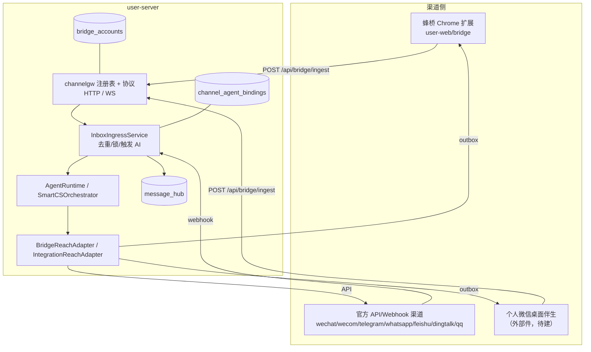
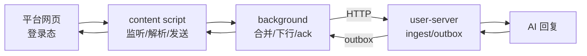

# 六渠道接入缺口评估与总方案（2026-11）

> 范围：微信、小红书、京东、抖音、B站、微博的**统一接待**（私信/客服消息的收与发），不含内容发布、
> 评论运营、订单履约。评估基线：hivemtk `master`（2026-11-05）+ ChatGPT-On-CS v1.4.5 架构分析。
> 配套：[ChatGPT-On-CS 架构分析](../research/CHATGPT-ON-CS-ARCHITECTURE-2026-11.md)
> · [统一接待原理](../research/CHATGPT-ON-CS-UNIFIED-RECEPTION-2026-11.md)

---

## 1. 结论

| 渠道 | 入站 | 出站 | 统一中台 | 缺口性质 |
|---|---|---|---|---|
| 微信（公众号） | ✅ webhook `wechat` | ✅ `weixin`（客服消息） | ✅ | **只需标签归一**：`wechat` 未在前端渠道表，显示为裸码 |
| 微信（企微） | ✅ webhook `wecom` | ✅ 应用消息 | ✅ | 无 |
| 微信（个人） | ❌ | ❌ | 词表有 `personal_wx` | **协议/账号/路由缺失**；桌面伴生属外部工程 |
| 小红书 | ✅ 蜂桥 | ✅ 蜂桥 | ✅ | 无（保持 + 补文档/测试） |
| 京东 | ❌ | ❌ | ❌ | **整条链路缺失** |
| 抖音 | ✅ 蜂桥 | ✅ 蜂桥 | ✅ | 抖店飞鸽入口未覆盖（后续） |
| B站 | ❌ | ❌ | ❌ | **整条链路缺失** |
| 微博 | ❌ | ❌ | ❌ | **整条链路缺失** |

**本轮可本机完成的**：微信标签归一 + 个人微信服务端协议 + 京东/B站/微博三条蜂桥渠道
（扩展适配器、后端注册、前端展示、测试、文档）。**外部腿**：个人微信桌面伴生、
京东/B站/微博真机选择器校准、真实账号联调。

---

## 2. hivemtk 现有统一接待架构（必须沿用的部分）

**铁律**

1. 新渠道只允许加在**渠道注册表**（`internal/channelgw/registry.go`）与**适配器**（扩展/伴生）两处；
   不得绕开 `InboxIngressService` 直接写库。
2. 渠道码使用平台全名：`jd`、`bilibili`、`weibo`、`personal_wx`；历史别名在
   `bridge.NormalizeBridgeChannel` 收敛。
3. 所有桥接渠道共用同一套 outbox/ack/限速/回环判定；不得为单渠道另造投递状态机。
4. 选择器未真机校准的渠道必须 `Experimental: true`，前端可见"实验"标记。

---

## 3. 缺口一：渠道词表不同源（跨渠道共性问题）

当前同一个渠道要在至少 6 处登记：

| # | 位置 | 作用 | 漏登记后果 |
|---|---|---|---|
| 1 | `internal/model/message_event.go` | 消息中台渠道常量 | 入库/查询不认识 |
| 2 | `internal/model/ai_agent.go` | 智能体绑定渠道类型 | 绑定失败 |
| 3 | `internal/channelgw/registry.go` | 桥接白名单/传输能力/成熟度 | ingest 400 unsupported |
| 4 | `internal/bridge/channel.go` | 别名归一 + 常量 | 别名不生效 |
| 5 | `internal/bridge/reach_adapter.go` + `tooluse/reach_tools.go` | 出站分派 | AI 回复发不出去 |
| 6 | `user-web/src/constants/channel.js` + 扩展 `constants.js`/`manifest`/`injector` | 展示与注入 | 页面看不到/扩展不注入 |

**治理方案**：本轮新增渠道后，补一条 Go 测试，断言
`channelgw.Default.Names()` ⊆ `model` 渠道常量集合 ⊆ `messageHubPlatforms`，
并断言前端 `CHANNEL_OPTIONS` 覆盖所有 bridge 渠道（用脚本/测试对账）。
这样下一次加渠道不会再"只加一半"。

---

## 4. 缺口二：个人微信只有词表

- `message_hub.go` 已允许 `personal_wx`，前端已有"个人微信"标签，但：
  - `channelgw` 未注册 → `/api/bridge/ingest` 会 400；
  - `bridge/channel.go` 未归一 → 出站不可能；
  - 无账号/扫码/伴生协议。
- **本轮方案**：把 `personal_wx` 注册为 bridge 渠道（Experimental），复用蜂桥 ingest/outbox；
  桌面伴生独立立项（Windows UI 自动化），本轮只交付服务端契约与文档。
- **不采用**：网页版微信（多数账号不可用）、Hook/协议库（违规且不可维护）。

---

## 5. 缺口三：京东/B站/微博无任何链路

三条都走**蜂桥网页私信**路线，与小红书/抖音同构：

每条渠道的交付物：

| 层 | 文件 | 说明 |
|---|---|---|
| 扩展 content | `user-web/bridge/src/content/{jd,bilibili,weibo}.js` | 启动适配器 |
| 扩展 adapter | `user-web/bridge/src/channels/{jd,bilibili,weibo}.js` | 选择器/账号/会话/解析/发送 |
| 扩展路由 | `src/background/injector.js`、`manifest.json`、`scripts/build.mjs` | host 匹配/注入/打包 |
| 扩展常量 | `src/core/constants.js` | `CHANNELS`、`CHANNEL_DISPLAY`、入口 URL、实验标记 |
| 扩展 UI | `src/popup/index.{js,html}`、`src/popup/accounts.js`、`health.js` | 入口按钮/顺序/选择器面板 |
| 后端常量 | `model/message_event.go`、`model/ai_agent.go` | 渠道码 |
| 后端注册 | `channelgw/registry.go`、`bridge/channel.go` | 白名单/别名/实验 |
| 后端出站 | `bridge/reach_adapter.go`、`app/integration_reach_adapter.go`、`tooluse/reach_tools.go` | `SendJD/SendBilibili/SendWeibo` |
| 后端能力 | `capregistry/channels.go`、`capability_runtime.go` | 能力矩阵/已配置判定 |
| 前端展示 | `user-web/src/constants/channel.js` | 标签/分组 |
| 测试 | Go 单测 + bridge vitest + 前端常量测试 | 见各渠道文档 §7 |

---

## 6. 数据库影响

**结论：本轮不需要新增表/字段。**

| 数据 | 现状 | 新渠道如何落 |
|---|---|---|
| `message_hub.platform` | varchar，无枚举约束 | 直接写 `jd/bilibili/weibo/personal_wx` |
| `message_hub.extra` | JSONB | 放 `ctx.*` 电商上下文 |
| `bridge_accounts.channel` | varchar + 唯一键 | 新渠道账号行自动 Upsert |
| `channel_agent_bindings.channel_type` | varchar | 新渠道绑定 |
| `customer_sessions.platform` | varchar | 新渠道会话 |
| `inbox_conversations.platform` | varchar | 新渠道会话 |

需要补的只是**代码层校验词表**（见 §3），不是 DDL。若后续要做"渠道能力表/成熟度表"，
再单独评估迁移；本轮用 `ChannelSpec.Experimental` 承载成熟度。

---

## 7. API 影响

| 端点 | 变化 |
|---|---|
| `POST /api/bridge/ingest` | 接受新 channel（注册表驱动，无代码分支） |
| `GET /api/bridge/outbox` | 同上 |
| `POST /api/bridge/outbox/ack` | 同上 |
| `GET /api/bridge/accounts` | 返回新渠道账号（仓储按 channel 过滤） |
| `POST /api/bridge/send` | 接受新 channel（`IsBridgeChannel`） |
| `POST /api/message-hub/...` | 平台词表补齐后可写/查 |
| `GET /api/capabilities` | 能力矩阵新增 DMReceive/DMSend 行 |

**契约不变**：请求/响应字段不变，只是 `channel` 的枚举扩充。旧客户端不受影响。

---

## 8. 前端影响

| 页面 | 变化 |
|---|---|
| 渠道标签（`channel.js`） | 新增京东/B站/微博；`wechat` 归一到"微信公众号" |
| 桥接扩展包页 | 文案从"抖音/小红书/TikTok/闲鱼/快手"扩为含新渠道 |
| 扩展 popup | 新增三个入口按钮、账号启停顺序、选择器配置 tab |
| 会话/消息列表 | 自动显示新渠道标签（后端返回 channel） |
| 线索/统计 | 本轮不新增线索类型；新渠道线索先落"自定义"或后续单独评估 |

---

## 9. 验收总口径

### 9.1 本机可验（必须全绿）

1. `go build ./...`、`go test ./internal/...`（至少渠道相关包）；
2. `user-web/bridge` `npm run test` + `npm run build`；
3. `user-web` 前端构建/单测（渠道常量）；
4. curl 打通：`ingest → 消息入库 → AI/或人工回复 → outbox → ack`（新渠道各一条）；
5. 扩展在本地 fixture 页面上完成"解析→上行→下行→发送"（jsdom/ego browser）；
6. 能力矩阵 `docs/capabilities.md` 与注册表一致；
7. 文档链接离线检查通过。

### 9.2 外部腿（登记，不谎报）

- 个人微信桌面伴生（Windows 真机 + 微信客户端）；
- 京东/B站/微博真实账号登录 + 选择器校准 + 平台风控观察；
- 京东 iframe 结构、微博虚拟列表、B站私信 tab 的真实 DOM 确认。

### 9.3 不通过判据

- 任一渠道 `Experimental` 未标注却宣称生产可用；
- 选择器只在 fixture 通过、真机未校准却写"已支持"；
- 出站绕过 outbox 或没有 ack；
- 新渠道无法在 `message_hub` 落库/查询。

---

## 10. 分渠道文档

- [微信](./channels/CHANNEL-WECHAT.md)
- [小红书](./channels/CHANNEL-XIAOHONGSHU.md)
- [京东](./channels/CHANNEL-JD.md)
- [抖音](./channels/CHANNEL-DOUYIN.md)
- [B站](./channels/CHANNEL-BILIBILI.md)
- [微博](./channels/CHANNEL-WEIBO.md)

---

## 11. 渠道×载体支持矩阵（2026-11-07，CS-07 收口）

> 本章是 CS-07 交付的**当前事实矩阵**（2026-11-07 快照）。与 §1 结论表（2026-11-05
> 评估基线）冲突之处**以本章为准**——§1 保留作评估时点记录，不回写（例如 §1 中
> "京东/B站/微博整条链路缺失"已被 2026-11-05 交付更新为"实验性接入"）。
>
> 总口径：
> - 三级：**正式支持 / 实验性 / 未交付**。fixture/协议/本机 curl 成功**不等于**生产转正；
>   实现子项完成（如 personal_wx 的服务端协议）只能关闭实现侧，正式支持必须有真实载体收/发证据。
> - 证据分级：**P**=平台官方第一手；**V**=厂商声明/教程；**X**=第三方开源实现源码实证
>   （ChatGPT-On-CS v1.4.5 sourcemap 还原，外部工程证据，**不等于本方真机**）；**F**=本机
>   fixture/jsdom/ego browser；**C**=本机 curl 协议链路（真实 PG/Redis）；**R**=本方真机历史记录。
>   **F/C ≠ 真实账号收发；DOM 动作与 legacy `delivered` 状态 ≠ 买家可见。**
> - 「真实证据」列只登记**可溯源的本方证据**（日期+类型+适用账号）；无则如实写
>   **未验证**——不捏造成功，也不因缺证据一律降级（既有正式渠道按 §11.5 逐项核对结论处理）。
> - **注册项 ≠ 全渠道全集**：`channelgw.Default` 注册表只覆盖蜂桥桥接渠道（9 项）；
>   公众号/企微/Telegram/WhatsApp/飞书/钉钉/QQ 走各自 webhook/API 链路，不经 channelgw
>   注册表；webhook 渠道**没有**整体迁入 channelgw（MD-03/MD-04 在途的是接缝收窄与装配
>   归位，非全量迁移）。
> - 出站统一走 outbox/ack；扩展侧发送为**拟人键入文本**（`insertText`/Enter），**出站媒体
>   （图片/文件）未实现**；入站支持 text/image/voice/video/link 等多类型解析。只通文本即
>   如实标"出站仅文本"，不宣称全媒体。

### 11.1 等级定义

| 等级 | 判据 | 展示约束 |
|---|---|---|
| 正式支持 | 实现完整；桥接渠道选择器经真机校准/有本方真机历史记录；API 渠道官方协议适配完整、契约测试绿 | 可宣称可用；真实验收缺登记的按 §11.5 如实补"未验证"标注 |
| 实验性 | 已注册、链路可跑通（F/C 级验证），但选择器未真机校准，或收发载体未交付（B8 语义：能力如实降级，链路保留） | 必须带"实验"**文字**标注（不得仅靠颜色）；不宣称生产可用 |
| 未交付 | 无适配器实现（仅研究登记/词表占位/载体门未过） | 不写"支持"；引用对应 CH 项 |

### 11.2 桥接渠道矩阵（渠道×载体逐行）

| 渠道×载体 | canonical/alias | 传输 | adapter/协议实现 | 收/发/媒体限制 | 等级 | fixture/协议证据 | 真实证据（日期+类型） | 外部前置 |
|---|---|---|---|---|---|---|---|---|
| 抖音网页私信（www.douyin.com/chat） | `douyin`；alias `douyin_web` | 蜂桥 HTTP 三通道（ingest/outbox/ack）+ SSE；WS `/api/ws/channel` | 扩展 `channels/douyin.js` ✓；后端注册/别名/出站分派/能力矩阵 ✓ | 收✓（text/image/voice/video/link 解析）；发=拟人键入**仅文本**；媒体出站未实现 | **正式** | F：jsdom 适配器用例 + ego fixture 解析/发送（2026-11-05）；C：ingest→outbox→ack 全 delivered（2026-11-05） | R：2026-07-28 私信页校准提交；2026-08-14 真机巡检风控实测（节奏重设记录在 PATROL_DEFAULTS 注释与桥架构文档）。正式双向验收专项登记缺 | 无（平台改版靠选择器健康监控 B1-a） |
| 小红书网页私信（www.xiaohongshu.com/chat） | `xiaohongshu`；alias `xhs`/`xhs_web`（后端 NormalizeBridgeChannel + 前端 LEGACY 表归一） | 同上 | 扩展 `channels/xhs.js` ✓（文件名历史差异，parity 测试登记映射）；后端 ✓ | 同上（发仅文本） | **正式** | F：jsdom + ego（2026-11-05）；C：delivered（2026-11-05） | R：2026-07-28 校准提交；2026-08-14 真机风控实测。双向验收专项登记缺 | 无（千帆桌面另列 CH-20，不得混格） |
| 闲鱼网页私信（goofish.com/im） | `xianyu`；alias `xianyu_web` | 同上 | 扩展 `channels/xianyu.js` ✓（goofish/xianyu 双域）；后端 ✓；闲鱼卡片 ✓ | 同上（发仅文本） | **正式** | F：jsdom + ego（2026-11-05）；C：delivered（2026-11-05） | R：2026-07-28 校准轮；2026-08-04 闲鱼卡片实现；渲染延迟实测注释。双向验收专项登记缺 | 无 |
| TikTok 社交网页私信（tiktok.com/messages） | `tiktok`；alias `tiktok_web` | 同上 | 扩展 `channels/tiktok.js` ✓；后端 ✓ | 同上（发仅文本）；海外链路延迟敏感 | **正式** | F：jsdom + ego（2026-11-05）；C：delivered（2026-11-05） | R：2026-07-28 校准轮；渲染延迟实测注释（6s 重 SPA）。双向验收专项登记缺 | TikTok Shop API 是独立渠道（CH-27），社交私信≠Shop，不得互相充数 |
| 快手网页私信（kuaishou IM） | `kuaishou`；alias `kuaishou_web`/`ks` | 同上 | 扩展 `channels/kuaishou.js` ✓；后端 ✓（Experimental） | 收/发链路可跑；选择器为模式猜测 | **实验性**（B8 2026-09-19：纯 `[class*=…]` 模式猜测、零真机校准） | F：jsdom getAccountId/适配器用例（batch3-b8）；C 未覆盖（六渠道 curl 不含 kuaishou） | **未验证**（B8 明文零真机） | 快手网页 IM 真机校准；快手小店"快语"独立（CH-19） |
| 京东网页咚咚/京麦商城 Web（jdm.jd.com / dongdong.jd.com 等 4 host） | `jd`；alias `jd_web`/`jingdong`/`jd_chat` | 蜂桥 HTTP（all_frames） | 扩展 `channels/jd.js` ✓；后端 ✓（Experimental）；CH-12 R4 官方页面论证 Web 版存在 | 收/发链路可跑（发仅文本）；L25 候选选择器未校准；京东 iframe 结构待真机确认 | **实验性**（2026-11-05 接入） | F：channel-jd.test.js + ego fixture 解析/发送（2026-11-05）；C：delivered（2026-11-05） | **未验证**（无真实京东商家账号收发） | CH-11②/CH-17：真机选择器校准与风控观察；京麦桌面独立成格（下行） |
| 京麦桌面（win_jinmai 桌面伴生） | 无渠道码（未注册） | 桌面伴生路线（Windows，外部工程） | 无 | — | **未交付** | 无 | 未验证（ChatGPT-On-CS 载体为京麦桌面——X 级外部证据，非本实现） | CH-17（与 CH-11①伴生基础共享、支持分开计） |
| B站网页私信（message.bilibili.com） | `bilibili`；alias `bili`/`bilibili_web` | 蜂桥 HTTP | 扩展 `channels/bilibili.js` ✓；后端 ✓（Experimental）；CH-12 R2 实证选择器全套落地（`.list-item`/`.msg-item not-me`/`#editor`/`btn-box send-btn`） | 收/发链路可跑（发仅文本）；私信 tab 真实 DOM 待真机确认 | **实验性**（2026-11-05 接入） | F：channel-bilibili.test.js + ego fixture（2026-11-05）；C：delivered（2026-11-05） | **未验证**（选择器为 X 级外部实证，本方真机未校准） | CH-11②：真实账号登录 + 校准 + 风控观察 |
| 微博网页私信（weibo.com/chat） | `weibo`；alias `wb`/`weibo_web` | 蜂桥 HTTP | 扩展 `channels/weibo.js` ✓（Enter 发送）；CH-13/14 实证修订：`api.weibo.com/chat` 历史驱动 + 气泡 left/right 方向 | 收（含历史回填）/发链路可跑（发仅文本）；虚拟列表等真实 DOM 待真机确认 | **实验性**（2026-11-05 接入） | F：channel-weibo.test.js + ego（含微博 Enter 发送，2026-11-05/06）；C：delivered（2026-11-05） | **未验证**（同上 X 级实证） | CH-11②：真机校准 |
| 个人微信（桌面伴生载体） | `personal_wx`；alias `wx_personal`/`wechat_personal`/`personal_wechat` | 服务端=蜂桥 HTTP 协议（已通）；载体=Windows 桌面伴生（外部，未交付） | 服务端注册/别名/出站分派/词表 ✓；**扩展内刻意无适配器**（parity 测试钉住分格） | 协议级可跑（发仅文本）；真实载体不可用 | **实验性**（实现子项=服务端协议；正式支持必须等伴生交付+真实验收） | C：六渠道 curl 含 personal_wx 全 delivered（2026-11-05） | **未验证**（无伴生、无真实账号） | CH-11①：桌面伴生（Windows+微信客户端）。**与公众号是两个渠道**：`wechat`/`weixin`/`personal_wx` 三词分离有测试钉死，展示归一仅在显示层 |

### 11.3 官方 API / 通知渠道（补充对照，不经 channelgw 注册表）

| 渠道 | canonical/alias | 传输 | 实现 | 等级 | 真实证据 | 备注/前置 |
|---|---|---|---|---|---|---|
| 微信公众号 | 入站 `wechat` / 出站 `weixin`（双写法并存，词表+前端归一） | 官方 webhook（XML 加密+验签 `/api/webhook/wechat/:account_id`）+ 客服消息 API 出站 | controller/service 验签解密、媒体转存、`SendWeixin` ✓ | **正式**（交付基线 2026-08-17 13 渠道全链路；契约/全链路测试绿） | **未验证**（仓库内无账号级真实回调/客服消息收发验收登记；如生产已配置，需账号持有人确认后补记） | 无；真实验收可并入 CS-R1 真实渠道贯通 |
| 企业微信 | `wecom` | 官方 webhook（XML 信封 msg_signature 恒时比较+时间窗）+ 应用消息 | ✓ | **正式** | **未验证**（同上，无账号级验收登记） | 社群群发模块已实现；朋友圈无实现（不宣称） |
| Telegram | `telegram` | Bot API：webhook（PUBLIC_BASE_URL 配置时）/polling 单实例降级 | ✓（含群线索/DM 工具） | **正式**（实现完整） | **未验证**（X-1 2026-11-07：全工作区无落盘凭证） | 真实收发需持有人配置凭证后验收 |
| WhatsApp | `whatsapp` | Meta Cloud API + 模板消息 | webhook 能力已注册 ✓ | **正式**（实现完整） | **未验证**（P-5 阻塞：2026-10-30 登记生产 `.env` 无任何 `WHATSAPP_*` 键） | P-5：需 Meta token + phone_number_id 持有人注入后真发信验证 |
| 短信 | `sms` | 阿里云 SMS | ✓ | 正式（实现） | 未验证（无账号级验收登记） | 需后台配置 AccessKey/签名/模板 |
| 邮件 | `email` | SMTP | ✓ | 正式（实现） | 未验证（无账号级验收登记） | 需后台配置 SMTP 授权码 |
| 飞书/钉钉/QQ | `feishu`/`dingtalk`/`qq` | 各自 webhook/机器人 | ✓（钉钉有真实入站路径 dingtalk_app） | 正式（实现） | 未验证（无账号级验收登记） | — |
| Web Widget | `web`/`web_embed` | 自有访客 Widget（非第三方平台） | ✓ | 正式 | 未验证（账号级口径不适用，以 chat 链路测试为准） | — |

### 11.4 未交付渠道（CH-15～36 逐行，一律不写"支持"）

| 项 | 渠道×载体 | 载体形态（研究证据） | 区域/首发能力 | 采集覆盖（可见/已分配/未分配） | 主动 sender/回执 | 等级 | 前置 |
|---|---|---|---|---|---|---|---|
| CH-15 | 淘宝/天猫·千牛 | 桌面客户端为主（官方下载页 P）；商家 Web IM 未证 | 未实现 | 未实现 | 无 | **未交付** | 千牛载体门未过；CH-37a 契约批准 |
| CH-16 | 拼多多·商家网页聊天 | 网页（mms.pinduoduo.com/chat-merchant，P/A；本轮 ego 只读跳登录） | 未实现 | 未实现 | 无 | **未交付** | CH-37a；登录态与授权另核 |
| CH-17a | 京东·咚咚网页（校准） | 网页（官方 `im.jd.com/seller/download` 明确 Web 版 `dongdong.jd.com`，P） | 未实现（jd 已注册实验性，校准未做） | 未实现 | 无 | **未交付**（校准子项） | CH-11② |
| CH-17b | 京东·京麦桌面 | 桌面（ChatGPT-On-CS 载体，X） | 未实现 | 未实现 | 无 | **未交付** | 与 CH-11①伴生基础共享、分开计支持 |
| CH-18 | 抖店·飞鸽 | 网页（im.jinritemai.com 官方飞鸽，P；ChatGPT-On-CS 有 696 行 jinritemai 驱动=X） | 未实现（douyin.js 不匹配该域，不得称"现 DOM 覆盖飞鸽"） | 未实现 | 无 | **未交付** | CH-37a；商家账号真机 |
| CH-19 | 快手小店·快语 | 网页（im.kwaixiaodian.com，P/V） | 未实现（kuaishou 社交≠小店，不得充数） | 未实现 | 无 | **未交付** | CH-37a；商家后台授权 |
| CH-20 | 小红书·千帆桌面 | 桌面（千帆 CDP，V/A；暂无独立浏览器 IM 证据 U） | 未实现（xhs 社交≠千帆） | 未实现 | 无 | **未交付** | CH-37a |
| CH-21 | 微信小店·commkf | 官方 API（developers.weixin.qq.com P） | 未实现 | 未实现 | 无 | **未交付** | CH-37a；工作台/API 互斥、48h 窗口限制 |
| CH-22 | 得物 | Electron 桌面（历史 Web 已迁，V） | 未实现 | 未实现 | 无 | **未交付** | CH-37a；店铺持有人确认 |
| CH-23 | 有赞微商城/小程序 | 市场订购/扫码授权（七鱼，P/V） | 未实现 | 未实现 | 无 | **未交付** | CH-37a |
| CH-24 | 美团（分业态） | 网页客服（买药/外卖/闪购分别定，V） | 未实现 | 未实现 | 无 | **未交付** | CH-37a；按业态分子项 |
| CH-25 | 饿了么/淘宝闪购 | 官方 IM WS（open.shop.ele.me，P） | 未实现 | 未实现 | 无 | **未交付** | CH-37a；接入资格先审 |
| CH-26 | 1688·千牛共享伴生 | 桌面共享（官方仅客户端下载，P）+独立业务接缝 | 未实现 | 未实现 | 无 | **未交付** | CH-15a 载体决策；B2B 能力按实际 |
| CH-27 | TikTok Shop·CS API | API（partner.tiktokshop.com，P；US Seller Center） | 未实现（tiktok 社交≠Shop） | 未实现 | 无 | **未交付** | CH-37a；区域以 Seller 为准；TB-07 协议取证已备（docs/research/API-CHANNEL-PUBLIC-PROTOCOLS-2026-11.md：OAuth2+仅 Shop 会话+窗口过期拒发+webhook 收件；V 级） |
| CH-28 | Shopee | Webchat/API（各区，P） | 未实现（API 需审批） | 未实现 | 无 | **未交付** | CH-37a |
| CH-29 | Lazada | 官方 IM API（P） | 未实现 | 未实现 | 无 | **未交付** | CH-37a |
| CH-30 | Amazon | 邮件+订单授权（V/P；**非通用全双向 IM**） | 未实现 | 未实现 | 无 | **未交付** | CH-37a；Messaging Permissions/OAuth；TB-07 取证（docs/research/API-CHANNEL-PUBLIC-PROTOCOLS-2026-11.md：Messaging API 仅发送腿+getMessagingActionsForOrder 前置+24h=响应 SLA 非 API 窗口；收件仍走 M 包邮箱；V 级） |
| CH-31 | eBay | Message API（P，现行 getConversations/sendMessage） | 未实现 | 未实现 | 无 | **未交付** | CH-37a；TB-07 取证（docs/research/API-CHANNEL-PUBLIC-PROTOCOLS-2026-11.md：Message API v1 会话读+sendMessage+conversation_type 必填；旧 Post-Order 非唯一；V 级） |
| CH-32 | Shopify | 原生 Inbox / 自有 widget 二选一（P） | 未实现 | 未实现 | 无 | **未交付** | CH-37a |
| CH-33 | AliExpress | 商家 PC 会话（商品 message 与 M-site 转 App，P；完整 IM 权限 U） | 未实现 | 未实现 | 无 | **未交付** | CH-37a |
| CH-34 | Etsy | 网页 Messages 桥（P：Shop Manager→Messages） | 未实现 | 未实现 | 无 | **未交付** | CH-37a |
| CH-35 | Walmart US | 邮件/正式消息权限（V eDesk） | 未实现 | 未实现 | 无 | **未交付** | CH-37a |
| CH-36a/b | 唯品会 / 苏宁 | 门未过（晓多应用名不能确证商家 Web，U） | 未实现 | 未实现 | 无 | **未交付** | 各为独立子项，不"一页后台算聊天" |
| CH-37 | 新电商共同身份/接缝门 | —（37a 词表批准条件 AV-06 已具备） | 未动工 | 未动工 | 无 | **未交付**（门） | 37a 批准 → 37b 首切片接缝 → 37c 按 CS-07 口径登记 |

### 11.5 既有「正式」标签证据核对结论（CS-07 诚实标注清单）

| 渠道 | 核对结论 | 依据 |
|---|---|---|
| 抖音/小红书/闲鱼/TikTok 网页私信 | **保持正式**（不降级）：有 2026-07/08 本方真机校准与风控实测记录；2026-11-05 协议链路回归绿 | git 7673057c（校准私信页）、PATROL_DEFAULTS/HISTORY_GRACE_MS 注释、676b4a1d curl 读数；"正式双向验收专项记录未单独登记"如实保留在矩阵 |
| 快手 | **维持实验性**（B8 零真机），前端提示面补"实验"文字标注 | registry `Experimental:true`、EXPERIMENTAL_CHANNELS、batch3-b8 用例 |
| 京东/B站/微博/个人微信 | **维持实验性**（2026-11 接入，F/C 级证据） | registry、channel-jd/bilibili/weibo 用例、六渠道 curl 读数 |
| 公众号/企微/Telegram/WhatsApp/短信/邮件/飞书/钉钉/QQ/Web | **保持正式（实现完整）+ 补"未验证"标注**：不捏造成功，也不一律降级——官方协议适配与契约测试在案，但仓库内无账号级真实验收登记（WhatsApp 另有 P-5 凭证阻塞、Telegram 另有 X-1 无凭证登记）；生产可用性以账号持有人确认为准 | capabilities.md（测试钉死）、webhook 全链路用例、P-5/X-1 登记 |
| README 旧超覆盖表述 | **收窄**：抖音/快手"含直播"→直播接待未实现；微信"含社群/朋友圈"→社群群发已实现、朋友圈未实现；快手与四正式渠道拆行标注 | 全仓 grep：直播/朋友圈无对应实现；community.go 存在 |
| 旧别名 | `xhs`/`xhs_web`/`douyin_web`/`jd_web`/`jingdong`/`bili`/`wb`/`wx_personal` 等**全部保留**（D-8/J-7 口径：显式豁免不删） | `bridge.NormalizeBridgeChannel` + 前端 `CHANNEL_LEGACY_WEB_TO_CANONICAL` 有测试钉住 |

> 防过度宣传的三道夹具（2026-11-07 新增）：`channelgw/registry_parity_test.go` ——
> ①Go/扩展 Experimental 集合双向一致（personal_wx 为 Go 单侧合法例外）；
> ②Default 每个注册渠道必须有扩展适配器（personal_wx 除外，出现即违规）；
> ③合成注册的 Experimental 语义必须经 `IsExperimental` 如实暴露。前端提示面以
> `tests/unit/channel_options_new_channels.test.js` 钉住"实验必须文字标注、不得仅靠颜色"。
