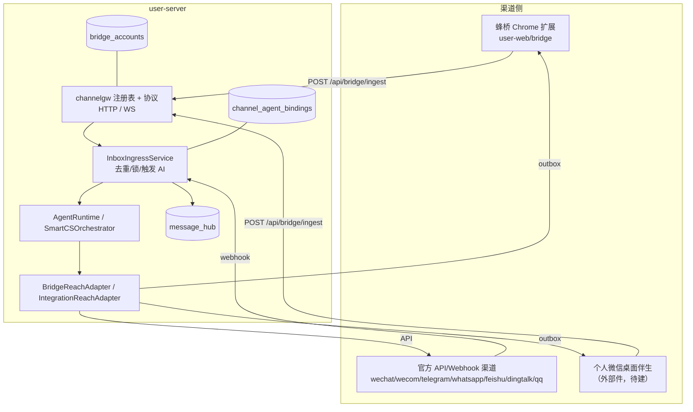
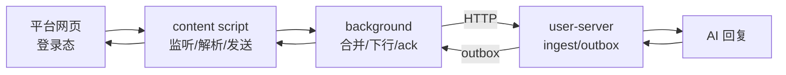

# 六渠道接入缺口评估与总方案（2026-11）

> 范围：微信、小红书、京东、抖音、B站、微博的**统一接待**（私信/客服消息的收与发），不含内容发布、
> 评论运营、订单履约。评估基线：hivemtk `master`（2026-11-05）+ ChatGPT-On-CS v1.4.5 架构分析。
> 配套：[ChatGPT-On-CS 架构分析](../research/CHATGPT-ON-CS-ARCHITECTURE-2026-11.md)
> · [统一接待原理](../research/CHATGPT-ON-CS-UNIFIED-RECEPTION-2026-11.md)

---

## 1. 结论

| 渠道 | 入站 | 出站 | 统一中台 | 缺口性质 |
|---|---|---|---|---|
| 微信（公众号） | ✅ webhook `wechat` | ✅ `weixin`（客服消息） | ✅ | **只需标签归一**：`wechat` 未在前端渠道表，显示为裸码 |
| 微信（企微） | ✅ webhook `wecom` | ✅ 应用消息 | ✅ | 无 |
| 微信（个人） | ❌ | ❌ | 词表有 `personal_wx` | **协议/账号/路由缺失**；桌面伴生属外部工程 |
| 小红书 | ✅ 蜂桥 | ✅ 蜂桥 | ✅ | 无（保持 + 补文档/测试） |
| 京东 | ❌ | ❌ | ❌ | **整条链路缺失** |
| 抖音 | ✅ 蜂桥 | ✅ 蜂桥 | ✅ | 抖店飞鸽入口未覆盖（后续） |
| B站 | ❌ | ❌ | ❌ | **整条链路缺失** |
| 微博 | ❌ | ❌ | ❌ | **整条链路缺失** |

**本轮可本机完成的**：微信标签归一 + 个人微信服务端协议 + 京东/B站/微博三条蜂桥渠道
（扩展适配器、后端注册、前端展示、测试、文档）。**外部腿**：个人微信桌面伴生、
京东/B站/微博真机选择器校准、真实账号联调。

---

## 2. hivemtk 现有统一接待架构（必须沿用的部分）

**铁律**

1. 新渠道只允许加在**渠道注册表**（`internal/channelgw/registry.go`）与**适配器**（扩展/伴生）两处；
   不得绕开 `InboxIngressService` 直接写库。
2. 渠道码使用平台全名：`jd`、`bilibili`、`weibo`、`personal_wx`；历史别名在
   `bridge.NormalizeBridgeChannel` 收敛。
3. 所有桥接渠道共用同一套 outbox/ack/限速/回环判定；不得为单渠道另造投递状态机。
4. 选择器未真机校准的渠道必须 `Experimental: true`，前端可见"实验"标记。

---

## 3. 缺口一：渠道词表不同源（跨渠道共性问题）

当前同一个渠道要在至少 6 处登记：

| # | 位置 | 作用 | 漏登记后果 |
|---|---|---|---|
| 1 | `internal/model/message_event.go` | 消息中台渠道常量 | 入库/查询不认识 |
| 2 | `internal/model/ai_agent.go` | 智能体绑定渠道类型 | 绑定失败 |
| 3 | `internal/channelgw/registry.go` | 桥接白名单/传输能力/成熟度 | ingest 400 unsupported |
| 4 | `internal/bridge/channel.go` | 别名归一 + 常量 | 别名不生效 |
| 5 | `internal/bridge/reach_adapter.go` + `tooluse/reach_tools.go` | 出站分派 | AI 回复发不出去 |
| 6 | `user-web/src/constants/channel.js` + 扩展 `constants.js`/`manifest`/`injector` | 展示与注入 | 页面看不到/扩展不注入 |

**治理方案**：本轮新增渠道后，补一条 Go 测试，断言
`channelgw.Default.Names()` ⊆ `model` 渠道常量集合 ⊆ `messageHubPlatforms`，
并断言前端 `CHANNEL_OPTIONS` 覆盖所有 bridge 渠道（用脚本/测试对账）。
这样下一次加渠道不会再"只加一半"。

---

## 4. 缺口二：个人微信只有词表

- `message_hub.go` 已允许 `personal_wx`，前端已有"个人微信"标签，但：
  - `channelgw` 未注册 → `/api/bridge/ingest` 会 400；
  - `bridge/channel.go` 未归一 → 出站不可能；
  - 无账号/扫码/伴生协议。
- **本轮方案**：把 `personal_wx` 注册为 bridge 渠道（Experimental），复用蜂桥 ingest/outbox；
  桌面伴生独立立项（Windows UI 自动化），本轮只交付服务端契约与文档。
- **不采用**：网页版微信（多数账号不可用）、Hook/协议库（违规且不可维护）。

---

## 5. 缺口三：京东/B站/微博无任何链路

三条都走**蜂桥网页私信**路线，与小红书/抖音同构：

每条渠道的交付物：

| 层 | 文件 | 说明 |
|---|---|---|
| 扩展 content | `user-web/bridge/src/content/{jd,bilibili,weibo}.js` | 启动适配器 |
| 扩展 adapter | `user-web/bridge/src/channels/{jd,bilibili,weibo}.js` | 选择器/账号/会话/解析/发送 |
| 扩展路由 | `src/background/injector.js`、`manifest.json`、`scripts/build.mjs` | host 匹配/注入/打包 |
| 扩展常量 | `src/core/constants.js` | `CHANNELS`、`CHANNEL_DISPLAY`、入口 URL、实验标记 |
| 扩展 UI | `src/popup/index.{js,html}`、`src/popup/accounts.js`、`health.js` | 入口按钮/顺序/选择器面板 |
| 后端常量 | `model/message_event.go`、`model/ai_agent.go` | 渠道码 |
| 后端注册 | `channelgw/registry.go`、`bridge/channel.go` | 白名单/别名/实验 |
| 后端出站 | `bridge/reach_adapter.go`、`app/integration_reach_adapter.go`、`tooluse/reach_tools.go` | `SendJD/SendBilibili/SendWeibo` |
| 后端能力 | `capregistry/channels.go`、`capability_runtime.go` | 能力矩阵/已配置判定 |
| 前端展示 | `user-web/src/constants/channel.js` | 标签/分组 |
| 测试 | Go 单测 + bridge vitest + 前端常量测试 | 见各渠道文档 §7 |

---

## 6. 数据库影响

**结论：本轮不需要新增表/字段。**

| 数据 | 现状 | 新渠道如何落 |
|---|---|---|
| `message_hub.platform` | varchar，无枚举约束 | 直接写 `jd/bilibili/weibo/personal_wx` |
| `message_hub.extra` | JSONB | 放 `ctx.*` 电商上下文 |
| `bridge_accounts.channel` | varchar + 唯一键 | 新渠道账号行自动 Upsert |
| `channel_agent_bindings.channel_type` | varchar | 新渠道绑定 |
| `customer_sessions.platform` | varchar | 新渠道会话 |
| `inbox_conversations.platform` | varchar | 新渠道会话 |

需要补的只是**代码层校验词表**（见 §3），不是 DDL。若后续要做"渠道能力表/成熟度表"，
再单独评估迁移；本轮用 `ChannelSpec.Experimental` 承载成熟度。

---

## 7. API 影响

| 端点 | 变化 |
|---|---|
| `POST /api/bridge/ingest` | 接受新 channel（注册表驱动，无代码分支） |
| `GET /api/bridge/outbox` | 同上 |
| `POST /api/bridge/outbox/ack` | 同上 |
| `GET /api/bridge/accounts` | 返回新渠道账号（仓储按 channel 过滤） |
| `POST /api/bridge/send` | 接受新 channel（`IsBridgeChannel`） |
| `POST /api/message-hub/...` | 平台词表补齐后可写/查 |
| `GET /api/capabilities` | 能力矩阵新增 DMReceive/DMSend 行 |

**契约不变**：请求/响应字段不变，只是 `channel` 的枚举扩充。旧客户端不受影响。

---

## 8. 前端影响

| 页面 | 变化 |
|---|---|
| 渠道标签（`channel.js`） | 新增京东/B站/微博；`wechat` 归一到"微信公众号" |
| 桥接扩展包页 | 文案从"抖音/小红书/TikTok/闲鱼/快手"扩为含新渠道 |
| 扩展 popup | 新增三个入口按钮、账号启停顺序、选择器配置 tab |
| 会话/消息列表 | 自动显示新渠道标签（后端返回 channel） |
| 线索/统计 | 本轮不新增线索类型；新渠道线索先落"自定义"或后续单独评估 |

---

## 9. 验收总口径

### 9.1 本机可验（必须全绿）

1. `go build ./...`、`go test ./internal/...`（至少渠道相关包）；
2. `user-web/bridge` `npm run test` + `npm run build`；
3. `user-web` 前端构建/单测（渠道常量）；
4. curl 打通：`ingest → 消息入库 → AI/或人工回复 → outbox → ack`（新渠道各一条）；
5. 扩展在本地 fixture 页面上完成"解析→上行→下行→发送"（jsdom/ego browser）；
6. 能力矩阵 `docs/capabilities.md` 与注册表一致；
7. 文档链接离线检查通过。

### 9.2 外部腿（登记，不谎报）

- 个人微信桌面伴生（Windows 真机 + 微信客户端）；
- 京东/B站/微博真实账号登录 + 选择器校准 + 平台风控观察；
- 京东 iframe 结构、微博虚拟列表、B站私信 tab 的真实 DOM 确认。

### 9.3 不通过判据

- 任一渠道 `Experimental` 未标注却宣称生产可用；
- 选择器只在 fixture 通过、真机未校准却写"已支持"；
- 出站绕过 outbox 或没有 ack；
- 新渠道无法在 `message_hub` 落库/查询。

---

## 10. 分渠道文档

- [微信](./channels/CHANNEL-WECHAT.md)
- [小红书](./channels/CHANNEL-XIAOHONGSHU.md)
- [京东](./channels/CHANNEL-JD.md)
- [抖音](./channels/CHANNEL-DOUYIN.md)
- [B站](./channels/CHANNEL-BILIBILI.md)
- [微博](./channels/CHANNEL-WEIBO.md)
