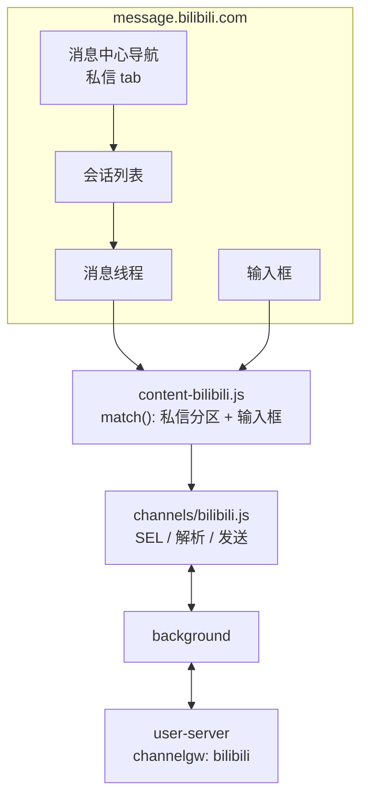

# B站（哔哩哔哩）渠道接入方案（2026-11，新增）

> 目标：把 B站网页私信（`message.bilibili.com`）接入 hivemtk 统一接待。
> 路线：蜂桥网页私信桥接。状态：**选择器已实证**（2026-11-06 从 ChatGPT-On-CS v1.4.5 官方安装包
> 内嵌 sourcemap 还原的 `platforms/bilibili/index.ts` 取得全套选择器，实现已落地
> `user-web/bridge/src/channels/bilibili.js`），仍标 Experimental（待真机登录回归）。
> 2026-11-12 收口：注入面扩展（manifest/injector/popup 5 处主机正则补 `www.bilibili.com`，
> 新私信中心路径与 `#/whisper` 等 hash 入口不再永不注入；广注入 + adapter match() 严格门激活，
> 与 douyin/weibo 同款规范）；account_id 占位口径（`bilibili-unknown`）按服务端 account_id
> 非空契约注释钉死；新增 BaseAdapter.sendOutbound 下行流测试（send_verified 回查 +
> 自报 agent 帧 extra.send_verified + 错会话 notFound 拒发）。
> 证据链见 [真实驱动还原报告](../../research/CHATGPT-ON-CS-REAL-DRIVER-2026-11.md)。

---

## 1. 入口与页面

| 项 | 值 |
|---|---|
| 私信入口 | `https://message.bilibili.com/`（消息中心，私信是其中一个分区） |
| 页面形态 | Vue SPA，路由 hash/query 切换 |
| 登录态 | B站 Cookie（`SESSDATA` 等），未登录跳 `passport.bilibili.com` |
| 账号 ID | 当前登录 UID；页面 `window.__INITIAL_STATE__`/`uid` 或 `/u/<uid>` 链接 |
| 会话 ID | 对方 UID（私信对象），列表项 `data-*` 或 URL 参数；兜底昵称派生 |
| 消息 | 文本/图片/分享卡片/系统通知；文本为主 |
| 发送 | 输入框 + "发表评论"按钮；Enter 兜底 |

---

## 2. 页面结构证据（实证，来源：ChatGPT-On-CS v1.4.5 `platforms/bilibili/index.ts`）

| 用途 | 实证选择器（已落地 `bilibili.js`） |
|---|---|
| 入口 URL | `https://message.bilibili.com/#/whisper` |
| 会话列表 | `div[class*='list-container'] > div[class='list-item']` |
| 未读徽标 | `.notify.notify-number`（点击即进会话） |
| 未关注人消息 tab | `[title='未关注人消息']`，处理后回 `[title='我的消息']` |
| 每轮会话数上限 | 5（`Math.min(count, 5)`） |
| 会话面板 | `.dialog`；用户名 `div[class='title'] > span` |
| 消息列表 | `.message-list` 下 `.msg-item` |
| 方向 | `.msg-item` class 含 `not-me` = 对方；`.message-content` class 含 `is-me` = 自己 |
| 图片 | `.message-content img` 的 `src` |
| 输入框 | `#editor`（contenteditable） |
| 发送按钮 | `[class*='btn-box send-btn']`（无则 Enter） |
| 图片回复 | `.image-upload-btn` |
| 发送策略 | 按 `truncateWordKey`/`truncateWordCount` 分段，逐段 fill + 点击 |

> ChatGPT-On-CS 用 JSDOM 解析 `.message-list` 的 innerHTML 快照再判定方向；
> hivemtk 蜂桥用 MutationObserver 增量采集，选择器同源但采集方式不同（更实时）。

---

## 3. 架构



---

## 4. 适配器设计

```js
export const SEL = {
  CHAT_LIST: '.message-sidebar__item, [class*="session-item" i], [class*="conversation-item" i]',
  MSG_LIST: '.message-content__inner, .message-section__body, [class*="message-list" i]',
  MSG_ITEM: '.interaction-item__content, [class*="message-item" i], [class*="msg-item" i]',
  TEXT: '.message-text-nodes, [class*="message-text" i], [class*="msg-content" i]',
  INPUT: '.message-reply-box__input, textarea[class*="reply" i], textarea[placeholder*="回复"]',
  SEND: '.message-reply-box__pub, button[class*="send" i], [aria-label*="发送"]',
  PEER_NAME: '.message-header__title, [class*="header"] [class*="title" i]',
  UNREAD: '.message-sidebar__item-dot, .message-sidebar__item-num, [class*="unread" i]',
};
```

**match()**

1. host 是 `message.bilibili.com`；
2. 页面上存在 `#editor`（实证输入框）或 `.message-list` 会话线程；
3. 若只有侧边栏导航、没有输入框 → 返回 false（还没进私信会话）。

**getAccountId()**

1. `window.__INITIAL_STATE__?.userInfo?.mid`（若存在）；
2. 页面中 `/u/<digits>` 的个人链接（排除当前会话对象）；
3. `localStorage` 缓存 `hivebridge:account:bilibili`；
4. 兜底 `bilibili-unknown`（非空，避免 400）。

**getConversationId()**

1. 会话面板 `.dialog` 的用户名（实证路径：ChatGPT-On-CS 从 `.title > span` 取名）→ `conv:<name>` 派生；
2. 活动会话项 `data-uid`/`data-mid`/`data-id`；
3. URL query `uid`/`mid`/`talker_id`；
4. 昵称派生 `conv:<name>`。

**sendText()**

- `textarea` → `setValue`；`contenteditable` → `fillContentEditableHumanized({clearBefore:true})`；
- 优先点 `.message-reply-box__pub`；找不到按 Enter；
- 发送前 `assertConvOrAbort`；
- 发送后清空输入框。

---

## 5. 后端改动

| 文件 | 改动 |
|---|---|
| `model/message_event.go` | `ChannelBilibili = "bilibili"` |
| `model/ai_agent.go` | `ChannelTypeBilibili` |
| `channelgw/registry.go` | 注册 `bilibili`，HTTP+WS，Experimental，Label "B站" |
| `bridge/channel.go` | `ChannelBilibiliWeb = "bilibili"`；别名 `bili/bilibili_web/b站 → bilibili` |
| `bridge/reach_adapter.go` | `SendBilibili` |
| `app/integration_reach_adapter.go` | `SendBilibili` fail-closed |
| `tooluse/reach_tools.go` | `case "bilibili","bili"` |
| `service/message_hub.go` | 词表加 `bilibili` |
| `capregistry/channels.go` | DMReceive/DMSend |
| `capability_runtime.go` / `assignment.go` / `proactive_reach.go` | 平台列表 |

---

## 6. 数据库

无 DDL。`extra` 建议：

```json
{"ctx": {"bili_uid": "…", "video_id": "…", "dynamic_id": "…"}}
```

（B站私信常从视频/动态进入，能拿到就带，拿不到不编造。）

---

## 7. API

`channel=bilibili` 走同一套 bridge ingest/outbox/ack；能力矩阵新增两行。

---

## 8. 前端

- `CHANNEL_OPTIONS` 新增 `{ value:'bilibili', label:'B站', group: SOCIAL, icon:'VideoCamera' }`。
- 扩展 popup 新增"打开B站"（`https://message.bilibili.com/`）、账号顺序、选择器 tab。
- 实验标记展示。

---

## 9. 测试

| 层 | 用例 |
|---|---|
| 扩展 | jsdom fixture：私信会话列表（过滤导航项）、消息解析、会话 ID、发送（按钮/Enter）；sendOutbound 下行流（send_verified 回查/自报帧/错会话 notFound 拒发）；注入面路由（www.bilibili.com/message 入口，2026-11-12 补） |
| Go | registry/别名/reach 分派/message_hub 词表 |
| curl | `channel=bilibili` ingest → 查库 → outbox → ack |
| 前端 | 标签/分组 |
| 真机 | 登录 B站 → 进入私信 → 自检 → 收/发（外部腿） |

---

## 10. 风险

| 风险 | 降级 |
|---|---|
| 导航项误判为会话 | `NAV_TEXT` 黑名单过滤（回复我的/@我/收到的赞）+ 实证 `.list-item` 优先 |
| SPA 路由切换不重载 | MutationObserver + `pushState`/`hashchange` 监听（沿用 common.js） |
| 登录态失效 | 自检失败告警，不自动重登 |
| 风控 | 拟人限速；B站非电商，默认 20/min 更保守 |
| 选择器改版 | 多候选 + popup 覆盖 + selector-health |

## 11. 验收

本机全绿 + 真机校准前，UI 与文档必须标"实验"。
