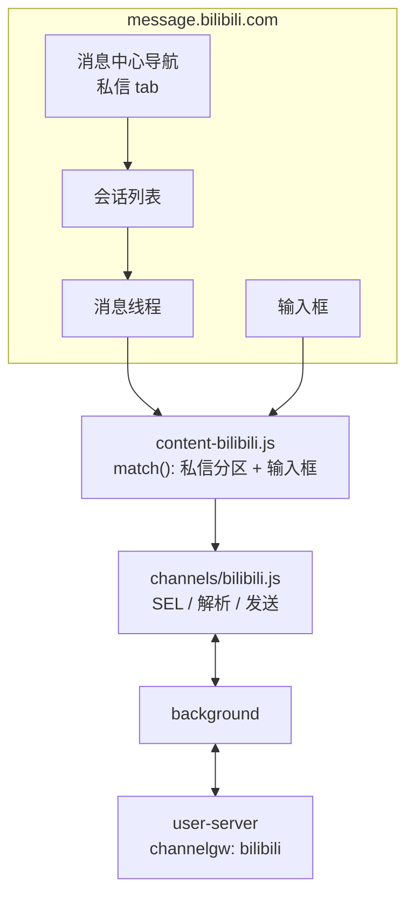

# B站（哔哩哔哩）渠道接入方案（2026-11，新增）

> 目标：把 B站网页私信（`message.bilibili.com`）接入 hivemtk 统一接待。
> 路线：蜂桥网页私信桥接。状态：**选择器部分实证、会话列表待真机，标 Experimental**。
> 总方案见 [六渠道缺口评估](../CHANNEL-GAP-ANALYSIS-2026-11.md)。

---

## 1. 入口与页面

| 项 | 值 |
|---|---|
| 私信入口 | `https://message.bilibili.com/`（消息中心，私信是其中一个分区） |
| 页面形态 | Vue SPA，路由 hash/query 切换 |
| 登录态 | B站 Cookie（`SESSDATA` 等），未登录跳 `passport.bilibili.com` |
| 账号 ID | 当前登录 UID；页面 `window.__INITIAL_STATE__`/`uid` 或 `/u/<uid>` 链接 |
| 会话 ID | 对方 UID（私信对象），列表项 `data-*` 或 URL 参数；兜底昵称派生 |
| 消息 | 文本/图片/分享卡片/系统通知；文本为主 |
| 发送 | 输入框 + "发表评论"按钮；Enter 兜底 |

---

## 2. 页面结构证据（2026-11-05 公开 bundle）

从 `s1.hdslb.com/bfs/static/2233-monorepo/message-pc/static/js/index.*.js` 与
`.../css/index.*.css` 提取到（`实证`，但未在登录态确认可见性）：

| 用途 | 候选选择器 |
|---|---|
| 会话列表项 | `.message-sidebar__item`（注意：该 sidebar 同时含"回复我的/@我/收到的赞"导航，需按文本/私信 tab 过滤） |
| 消息容器 | `.message-content__inner`、`.message-section__body` |
| 消息文本 | `.message-text-nodes` |
| 消息项 | `.interaction-item__content`、`.message-section__body > *`（待真机） |
| 输入框 | `.message-reply-box__input`（textarea） |
| 发送按钮 | `.message-reply-box__pub` |
| 会话标题 | `.message-header__title` |
| 未读 | `.message-sidebar__item-dot`、`.message-sidebar__item-num` |

> **重要**：B站消息中心是"多分区"页面，`.message-sidebar__item` 首先是左侧导航，不是会话列表。
> 适配器必须先确认当前在"私信"分区，再定位会话列表；否则会把"回复我的"当成会话。
> 该确认逻辑待真机，本轮用 URL/文本双重判定并允许用户覆盖。

---

## 3. 架构



---

## 4. 适配器设计

```js
export const SEL = {
  CHAT_LIST: '.message-sidebar__item, [class*="session-item" i], [class*="conversation-item" i]',
  MSG_LIST: '.message-content__inner, .message-section__body, [class*="message-list" i]',
  MSG_ITEM: '.interaction-item__content, [class*="message-item" i], [class*="msg-item" i]',
  TEXT: '.message-text-nodes, [class*="message-text" i], [class*="msg-content" i]',
  INPUT: '.message-reply-box__input, textarea[class*="reply" i], textarea[placeholder*="回复"]',
  SEND: '.message-reply-box__pub, button[class*="send" i], [aria-label*="发送"]',
  PEER_NAME: '.message-header__title, [class*="header"] [class*="title" i]',
  UNREAD: '.message-sidebar__item-dot, .message-sidebar__item-num, [class*="unread" i]',
};
```

**match()**

1. host 是 `message.bilibili.com`；
2. 页面上存在 `.message-reply-box__input` 或聊天线程容器；
3. 若只有侧边栏导航、没有输入框 → 返回 false（还没进私信会话）。

**getAccountId()**

1. `window.__INITIAL_STATE__?.userInfo?.mid`（若存在）；
2. 页面中 `/u/<digits>` 的个人链接（排除当前会话对象）；
3. `localStorage` 缓存 `hivebridge:account:bilibili`；
4. 兜底 `bilibili-unknown`（非空，避免 400）。

**getConversationId()**

1. 活动会话项 `data-uid`/`data-mid`/`data-id`；
2. URL query `uid`/`mid`/`talker_id`；
3. 会话标题链接 `/u/<id>`；
4. 昵称派生 `conv:<name>`。

**sendText()**

- `textarea` → `setValue`；`contenteditable` → `fillContentEditableHumanized({clearBefore:true})`；
- 优先点 `.message-reply-box__pub`；找不到按 Enter；
- 发送前 `assertConvOrAbort`；
- 发送后清空输入框。

---

## 5. 后端改动

| 文件 | 改动 |
|---|---|
| `model/message_event.go` | `ChannelBilibili = "bilibili"` |
| `model/ai_agent.go` | `ChannelTypeBilibili` |
| `channelgw/registry.go` | 注册 `bilibili`，HTTP+WS，Experimental，Label "B站" |
| `bridge/channel.go` | `ChannelBilibiliWeb = "bilibili"`；别名 `bili/bilibili_web/b站 → bilibili` |
| `bridge/reach_adapter.go` | `SendBilibili` |
| `app/integration_reach_adapter.go` | `SendBilibili` fail-closed |
| `tooluse/reach_tools.go` | `case "bilibili","bili"` |
| `service/message_hub.go` | 词表加 `bilibili` |
| `capregistry/channels.go` | DMReceive/DMSend |
| `capability_runtime.go` / `assignment.go` / `proactive_reach.go` | 平台列表 |

---

## 6. 数据库

无 DDL。`extra` 建议：

```json
{"ctx": {"bili_uid": "…", "video_id": "…", "dynamic_id": "…"}}
```

（B站私信常从视频/动态进入，能拿到就带，拿不到不编造。）

---

## 7. API

`channel=bilibili` 走同一套 bridge ingest/outbox/ack；能力矩阵新增两行。

---

## 8. 前端

- `CHANNEL_OPTIONS` 新增 `{ value:'bilibili', label:'B站', group: SOCIAL, icon:'VideoCamera' }`。
- 扩展 popup 新增"打开B站"（`https://message.bilibili.com/`）、账号顺序、选择器 tab。
- 实验标记展示。

---

## 9. 测试

| 层 | 用例 |
|---|---|
| 扩展 | jsdom fixture：私信会话列表（过滤导航项）、消息解析、会话 ID、发送（按钮/Enter） |
| Go | registry/别名/reach 分派/message_hub 词表 |
| curl | `channel=bilibili` ingest → 查库 → outbox → ack |
| 前端 | 标签/分组 |
| 真机 | 登录 B站 → 进入私信 → 自检 → 收/发（外部腿） |

---

## 10. 风险

| 风险 | 降级 |
|---|---|
| `.message-sidebar__item` 是导航不是会话 | match() 要求输入框存在；会话列表定位二次过滤 |
| SPA 路由切换不重载 | MutationObserver + `pushState`/`hashchange` 监听（沿用 common.js） |
| 登录态失效 | 自检失败告警，不自动重登 |
| 风控 | 拟人限速；B站非电商，默认 20/min 更保守 |
| 选择器改版 | 多候选 + popup 覆盖 + selector-health |

## 11. 验收

本机全绿 + 真机校准前，UI 与文档必须标"实验"。
