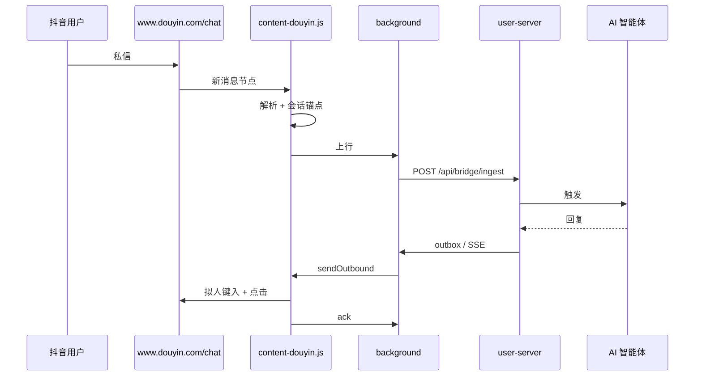

# 抖音渠道接入方案（2026-11）

> 现状：**已接入且可用**（抖音网页私信）。抖店飞鸽未单独覆盖。
> 本文固化现状、对照 ChatGPT-On-CS、列出本轮增量。总方案见
> [六渠道缺口评估](../CHANNEL-GAP-ANALYSIS-2026-11.md)。

---

## 1. 现状

| 层 | 实现 |
|---|---|
| 扩展 content | `user-web/bridge/src/content/douyin.js` |
| 扩展 adapter | `user-web/bridge/src/channels/douyin.js` |
| 后端注册 | `channelgw`：`douyin`，HTTP + WS |
| 别名 | `douyin_web → douyin` |
| 入站 | `/api/bridge/ingest` → `InboxIngressService` |
| 出站 | outbox → `div.messageEditorinputArea` → 发送按钮/红色路径 |
| 卡片 | `douyin_cards` + `/api/douyin-card/*` |
| 评论自动化 | `internal/browser_automation/platform/douyin` |

---

## 2. 数据流

---

## 3. 覆盖边界

| 入口 | 是否覆盖 | 说明 |
|---|---|---|
| `www.douyin.com/chat` 抖音私信 | ✅ | 现有适配器 |
| 抖店飞鸽 `im.jinritemai.com` | ❌ | 商家客服工作台，独立页面；后续项 |
| 抖音企业号后台 | ❌ | 与私信页不同；后续按需 |

**为什么本轮不扩飞鸽**：需要商家账号真机校准；贸然加 host 会把"未验证"包装成"已支持"。
先在文档与任务清单登记，拿到账号后按同一 BaseAdapter 模式新增 `channels/feige.js`。

---

## 4. 与 ChatGPT-On-CS 对照

| 维度 | ChatGPT-On-CS（推断） | hivemtk |
|---|---|---|
| 抖音私信 | DOM 驱动 | ✅ 同路线，选择器更多候选 + 红色路径兜底 |
| 抖店飞鸽 | 独立"抖店"应用 | ❌ 未接 |
| 风控 | 延迟/随机 | 拟人键入 + 令牌桶 + 会话冷却 + 内容去重 |
| 上下文 | 商品/订单/粉丝标签 | 未约定 `ctx.*`，建议补 |

---

## 5. 本轮增量

1. **上下文接口位**：在 `parseMessageItem` 旁预留 `extractContext()`，能拿到商品卡/粉丝牌时写
   `extra["ctx.goods_id"]` / `ctx.fan_tag`；拿不到不编造。
2. **测试**：补一条 jsdom 用例覆盖 `getConversationId` + `parseMessageItem`（现有 `chat-page-convid`
   只覆盖会话 ID）。
3. **文档**：本文件 + README 渠道表。
4. **不新增 host**，不把抖店飞鸽写进 manifest。

---

## 6. 数据库/API/前端

无 DDL、无 API 变更、无前端变更（已有"抖音"标签）。

---

## 7. 验收

- `go test ./internal/channelgw ./internal/bridge` 绿；
- `cd user-web/bridge && npm run test` 绿；
- curl：`channel=douyin` ingest → 查库 → outbox → ack；
- 真机：`https://www.douyin.com/chat` 自检 + 收发一条。
