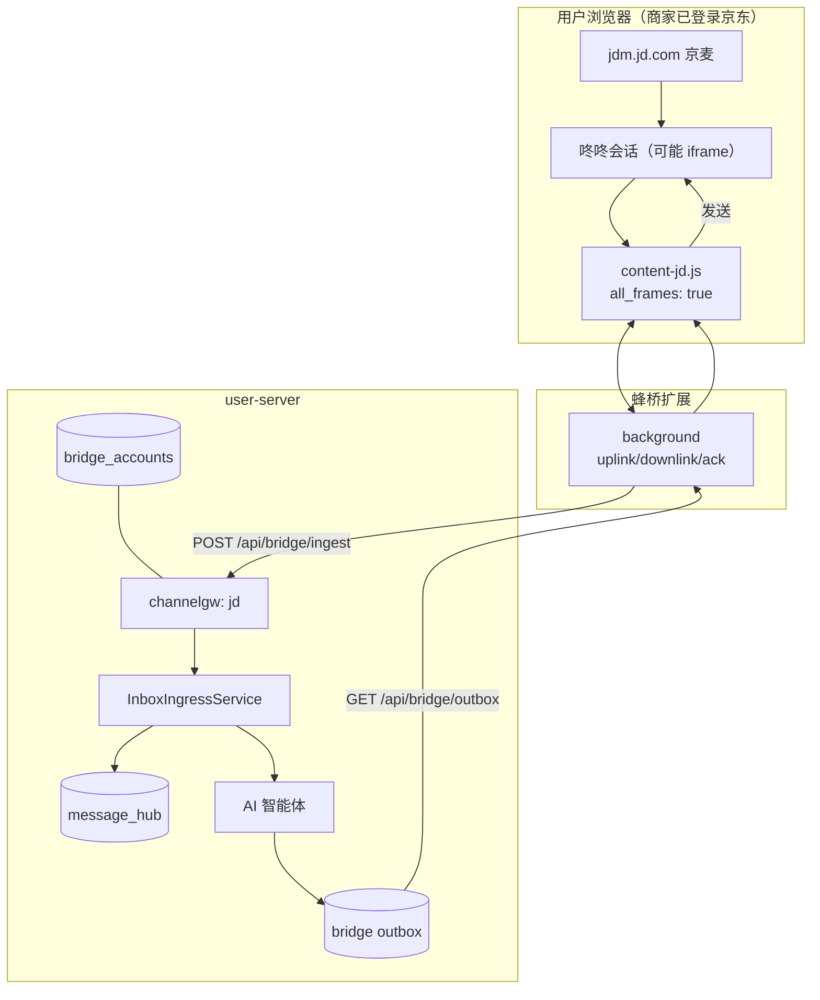

# 京东渠道接入方案（2026-11，新增）

> 目标：把**京东商家侧客服会话**接入 hivemtk 统一接待。
> 路线修订（2026-11-06，依据真实驱动还原报告）：
> - **ChatGPT-On-CS 的"京东"没有网页驱动**——其京东能力 = **京麦桌面客户端驱动**
>   （`win_jinmai`，Python 侧车 Airtest 模板 `airtest/jinmai/chat_message_input.png` + win32）
>   叠加抖店飞鸽网页驱动（`jinritemai`，抖音系电商）。
> - hivemtk 的网页桥（jdm/dongdong）**无任何实证选择器**，降级为"待验证方案"；
>   新增与 ChatGPT-On-CS 同构的**京麦桌面伴生**为实证路线 B。
> 总方案见 [六渠道缺口评估](../CHANNEL-GAP-ANALYSIS-2026-11.md) 与
> [真实驱动还原报告](../../research/CHATGPT-ON-CS-REAL-DRIVER-2026-11.md)。

---

## 1. 渠道范围

| 面 | 入口（候选） | 说明 |
|---|---|---|
| 京麦工作台 | `https://jdm.jd.com/` | 商家后台，客服/订单/商品 |
| 咚咚 Web | `https://dongdong.jd.com/` | 京东 IM，可能嵌在京麦 iframe |
| 京东客服开放平台 | `https://dongdong.jd.com/open` | 官方 API（本轮不用） |

**不做**：京东消费者端网页（买家侧）、京东联盟/广告、订单履约。

**实证事实**：ChatGPT-On-CS v1.4.5 京东相关驱动只有两处——
1. `app.asar` 内 `platforms/jinmai/index.ts`（125 行，仅转发 `strategyService-run` 给 Python 侧车，`id='win_jinmai'`）；
2. Python 侧车 `app.platforms.jinmai.task`（Nuitka 编译，Airtest 模板 `chat_message_input.png` 输入框定位）。
3. 抖店飞鸽网页驱动 `platforms/jinritemai/index.ts`（696 行，含转人工 `qa-transfer-customer`、
   商品卡上下文抓取、登录态丢失自动跳 `fxg.jinritemai.com/login`）——属抖音电商域。

---

## 2. 为什么走蜂桥而不是官方 API

- 京东开放平台客服 API 需要商家资质、应用审核、回调域名备案；本机无法验证。
- 蜂桥的目标是"用户自己已登录的网页"，零资质、可私域部署。
- 先跑通网页链路，后续若拿到开放平台资质，再把 `jd` 的出站切到官方 API（协议不变，
  只换 `IntegrationReachAdapter` 的实现）。

---

## 3. 架构



### 3.1 iframe 处理

京麦是典型"壳 + 多 iframe"后台。策略：

1. `manifest.content_scripts` 对 `jdm.jd.com` / `dongdong.jd.com` 设 `all_frames: true`；
2. content script 在每个 frame 独立运行，`match()` 只在该 frame 真的找到聊天 DOM 时返回 true；
3. `getAccountId()` 优先从当前 frame 的登录信息取；取不到时向 background 请求顶层 frame 的账号缓存
   （`chrome.storage` 键 `hivebridge:account:jd`）；
4. 同一 tab 多个 frame 都匹配时，background 以"最先完成 register 且 conversationId 非空"的 frame 为准，
   其余 frame 进入 standby（避免重复上行）。**本轮先实现 1-3，4 作为真机校准项。**

---

## 4. 选择器现状（网页路线无实证，桌面路线不需要选择器）

> 京东聊天页有登录墙，且 ChatGPT-On-CS 证明京东客服的可行载体是**桌面客户端**而非网页。
> 网页桥保留"多候选 + 通用兜底"骨架，但明确标注**零实证**；用户可在 popup 覆盖。

```js
export const SEL = {
  CHAT_LIST: '[class*="session-list" i], [class*="conversation-list" i], [class*="chat-list" i], .J_sessionList',
  MSG_LIST: '[class*="message-list" i], [class*="msg-list" i], [class*="chat-content" i], [class*="messageContent" i]',
  MSG_ITEM: '[class*="message-item" i], [class*="msg-item" i], [class*="chat-item" i], [class*="bubble" i]',
  TEXT: '[class*="message-text" i], [class*="msg-text" i], [class*="text-content" i], [class*="bubble" i]',
  INPUT: 'textarea[class*="input" i], div[contenteditable="true"], [class*="editor" i][contenteditable="true"]',
  SEND: 'button[class*="send" i], [class*="send-btn" i], [aria-label*="发送"]',
  PEER_NAME: '[class*="chat-title" i], [class*="session-title" i], [class*="header" i] [class*="name" i]',
  UNREAD: '[class*="unread" i], [class*="red-dot" i], [data-unread="1"]',
};
```

**账号/会话 ID**

- 账号：页面可见的商家账号/店铺 ID；取不到时用 `localStorage` 缓存；最终兜底 `jd-unknown`
  （注意：空串会导致后端 400，宁可稳定占位）。
- 会话：优先 `data-*`（`data-session-id`/`data-uid`/`data-pin`），其次 URL query，最后昵称派生
  `conv:<name>`。

**发送**

- 优先 `textarea` → `setValue`；`contenteditable` → `fillContentEditableHumanized`；
- 点击发送按钮；找不到则 Enter；
- 发送前 `assertConvOrAbort`（沿用 BaseAdapter 的会话锚点机制）；
- 发送后清空输入框，避免残留。

---

## 5. 后端改动

| 文件 | 改动 |
|---|---|
| `internal/model/message_event.go` | `ChannelJD = "jd"` |
| `internal/model/ai_agent.go` | `ChannelTypeJD` |
| `internal/channelgw/registry.go` | 注册 `jd`，HTTP+WS，`Experimental: true`，Label "京东" |
| `internal/bridge/channel.go` | `ChannelJDWeb = "jd"`；别名 `jd_web/jingdong/jd_chat → jd` |
| `internal/bridge/reach_adapter.go` | `SendJD` → `deliverToOutbox("jd", …)` |
| `internal/app/integration_reach_adapter.go` | `SendJD` fail-closed（桥接层覆盖） |
| `internal/aiagent/agent/tooluse/reach_tools.go` | `case "jd","jd_web"` |
| `internal/service/message_hub.go` | 词表加 `jd` |
| `internal/capregistry/channels.go` | `CapDMReceive/CapDMSend` |
| `internal/service/capability_runtime.go` | bridge 平台列表加 `jd` |
| `internal/service/assignment.go` / `proactive_reach.go` | `social_media` / `sendBridge` 分支加 `jd` |

---

## 6. 数据库

无 DDL。`message_hub.platform='jd'`、`bridge_accounts.channel='jd'`、
`channel_agent_bindings.channel_type='jd'`、`customer_sessions.platform='jd'`。
`extra` 可放：

```json
{
  "ctx": {
    "shop_id": "…",
    "order_id": "…",
    "goods_id": "…",
    "order_status": "…",
    "logistics_status": "…"
  }
}
```

---

## 7. API

| 端点 | 变化 |
|---|---|
| `POST /api/bridge/ingest` | `channel=jd` 可用 |
| `GET /api/bridge/outbox` | 可拉 `jd` |
| `POST /api/bridge/outbox/ack` | 可 ack |
| `POST /api/bridge/send` | 人工代发 |
| `GET /api/capabilities` | 新增 jd 两行 |

---

## 8. 前端

- `user-web/src/constants/channel.js`：新增 `{ value:'jd', label:'京东', group: SOCIAL, icon:'ShoppingCart' }`。
- 扩展 popup：新增"打开京东"按钮（`https://jdm.jd.com/`）、账号启停顺序、选择器 tab。
- 桥接扩展包页文案更新。

---

## 9. 测试

| 层 | 用例 |
|---|---|
| Go | registry 注册/双传输/Experimental；`NormalizeBridgeChannel("jd_web")=="jd"`；reach 分派到 `SendJD`；message_hub 接受 `jd` |
| 扩展 | jsdom fixture：会话列表/消息解析/会话 ID/发送（输入框+发送按钮/Enter） |
| curl | `channel=jd` ingest → 查 `message_hub` → outbox → ack |
| 前端 | 渠道标签存在且分组正确 |
| 真机 | 京麦登录 → popup 自检 → 收一条/发一条（外部腿） |

---

## 10. 风险与降级（修订）

| 风险 | 降级 |
|---|---|
| 网页选择器零实证 | 文档/代码均标"待验证"；真机校准前不得宣称京东已支持 |
| 京麦客户端路线（实证路线 B） | 需 Windows + 京麦客户端 + 桌面伴生（与个人微信伴生同一工程载体）；可复用 Airtest 模板法（ChatGPT-On-CS 用 1 张输入框模板 + win32 句柄） |
| iframe 跨域 | `all_frames: true` + 账号缓存；仍失败则提示"请在咚咚独立窗口打开" |
| 登录失效 | 自检失败告警，不自动重登（ChatGPT-On-CS 抖店驱动有自动跳登录页的对偶做法） |
| 风控 | 沿用拟人限速/会话冷却；京东侧更保守（默认 20/min） |

---

## 11. 验收判定

- 本机：Go 测试 + 扩展测试 + curl 全链路绿；
- 真机：未完成前，文档与 UI 必须标"实验"；
- 不得在真机未验证时写"京东已支持生产"。
