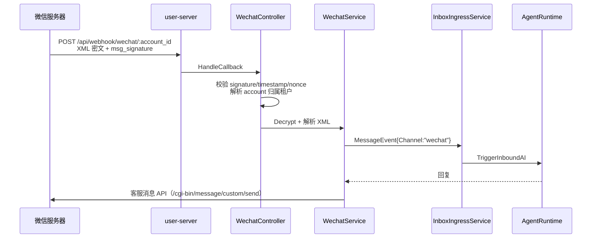
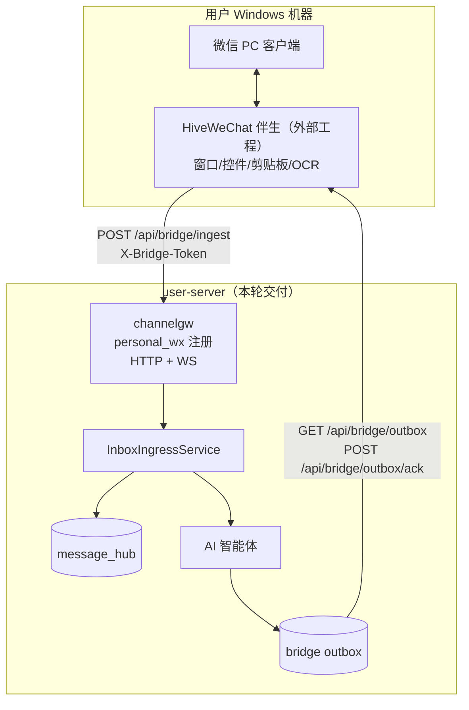

# 微信渠道接入方案（2026-11）

> 现状：公众号/企业微信已接；个人微信只有词表。本轮把个人微信的服务端协议补齐，
> 桌面伴生列为外部工程。公众号/企微不迁移，只做标签归一与审计。
> 总方案见 [六渠道缺口评估](../CHANNEL-GAP-ANALYSIS-2026-11.md)。

---

## 1. 三个"微信"必须分开

| 子渠道 | 渠道码 | 接入方式 | 现状 | 本轮动作 |
|---|---|---|---|---|
| 微信公众号 | `wechat`（入站）/ `weixin`（出站） | 官方 API + 回调 | ✅ | 标签归一 + 词表补齐 |
| 企业微信 | `wecom` | 官方 API + 回调 | ✅ | 无 |
| 个人微信 | `personal_wx` | 桌面伴生 + bridge 协议 | ❌ | 注册 bridge 渠道 + 协议文档 |

**不要混用**：三者凭证、消息结构、发送 API 完全不同；统一展示层可以并排，但服务端必须分渠道码。

---

## 2. 公众号（`wechat` / `weixin`）现状与审计

### 2.1 入站链路



关键文件：

| 环节 | 文件 |
|---|---|
| 路由/验签 | `internal/controller/wechat.go`、`internal/router/*` |
| 加解密 | `internal/service/wechat.go`、`wechat_inbound_media.go` |
| 出站 | `internal/app/integration_reach_adapter.go::SendWeixin` |
| 渠道常量 | `model.ChannelWeCom`（`wechat` 为入站字符串，`weixin` 为触达名） |

### 2.2 已发现的两个口径问题

1. **`wechat` 不在前端 `CHANNEL_OPTIONS`**：前端只配了 `weixin`（微信公众号）。入站行 `channel=wechat`
   在会话列表会显示裸码 `wechat`，而不是"微信公众号"。
   - 修复：`CHANNEL_OPTIONS` 的 `weixin` 项增加别名 `wechat`，并在 `CHANNEL_LEGACY_WEB_TO_CANONICAL`
     或 `getChannelLabel` 中归一。
2. **`message_hub` 平台词表有 `wechat` 但没有 `weixin`**：出站轨迹若用 `weixin` 会被拒。
   - 修复：词表补 `weixin`（与 `wechat` 并存），或在写入前归一。**本轮选择补词表**，
     因为两条链路都真实存在，贸然归一可能改历史口径。

### 2.3 不改的部分

- 验签、加解密、客服消息 API、媒体上传、租户归属：保持现状。
- 不把公众号迁到 bridge：官方 API 更稳、合规、可审计。

---

## 3. 个人微信（`personal_wx`）方案

### 3.1 为什么不做网页版

- 微信网页版对多数账号已关闭登录，不能作为产品能力。
- Hook/协议库违反平台协议、封号风险高、不可维护。
- 唯一可交付的路径是**桌面客户端 UI 自动化**（ChatGPT-On-CS 同路线），
  且必须运行在用户自己的 Windows 机器上。

### 3.2 分层



### 3.2.1 服务端契约（本轮）

| 项 | 值 |
|---|---|
| 渠道码 | `personal_wx` |
| 传输 | HTTP + WebSocket（与蜂桥一致） |
| 注册 | `channelgw.Default.Register(ChannelSpec{Name:"personal_wx", Experimental:true})` |
| 入站 | `POST /api/bridge/ingest`，`channel=personal_wx`，`account_id=伴生实例ID` |
| 出站 | `GET /api/bridge/outbox?channel=personal_wx` → `POST /api/bridge/outbox/ack` |
| 账号 | `bridge_accounts(channel, account_id)`；`account_id` 用微信 wxid 或伴生稳定 ID |
| 会话 | `conversation_id` 用对方 wxid/备注名派生；群聊带 `is_group/group_id` |
| 消息 | `msg_type=text/image/file/audio/video`；图片/文件先传 `media_url` |
| 风控 | 服务端每账号令牌桶（沿用 bridge 默认 60/min），伴生侧再限速 |

### 3.2.2 伴生侧接口（外部工程契约）

```text
POST /api/bridge/ingest
{
  "channel": "personal_wx",
  "account_id": "<wxid>",
  "messages": [{
    "event_id": "wx:<msgid>",
    "conversation_id": "<peer wxid>",
    "sender_id": "<peer wxid>",
    "sender_name": "<昵称/备注>",
    "msg_type": "text",
    "content": "…",
    "timestamp": 1760000000000,
    "extra": {"ctx.is_group": false}
  }]
}
```

伴生只做四件事：**枚举会话、读当前会话消息、写输入框发送、上报登录态**。
不在伴生里做 AI/关键词/转人工（全部交给服务端），避免第二套决策逻辑。

### 3.2.3 桌面伴生的风险控制（设计约束）

| 风险 | 约束 |
|---|---|
| 封号 | 串行、拟人延迟、日发送上限、可一键停用（`bridge_accounts` 启停） |
| 焦点被抢 | 发送前校验前台窗口标题/会话名，漂移即中止 |
| 客户端改版 | 控件树多候选 + OCR 兜底 + 版本探测告警 |
| 隐私 | 截图/剪贴板只在本地，不落盘、不上传；日志脱敏 |
| 合规 | 用户自有账号 + 显式授权 + 可审计；不提供群发/营销能力 |

### 3.2.4 本轮验收

- `personal_wx` 出现在 `channelgw.Default.Names()` 且 `Supports(HTTP/WS)`；
- `bridge.NormalizeBridgeChannel("wx_personal") == "personal_wx"`；
- `POST /api/bridge/ingest` 带 `channel=personal_wx` 能落库（curl）；
- outbox 能取到该渠道回复并 ack；
- `message_hub` 可查 `platform=personal_wx`；
- 前端渠道标签显示"个人微信"；
- 桌面伴生未交付，文档与任务清单显式登记为外部腿，不谎报"已支持"。

---

## 4. 数据库

无 DDL。`personal_wx` 直接写 `message_hub.platform`、`bridge_accounts.channel`、
`channel_agent_bindings.channel_type`、`customer_sessions.platform`、`inbox_conversations.platform`。
需补的是 `messageHubPlatforms` 词表（已含 `personal_wx`）与 `model` 常量。

---

## 5. API

| 端点 | 变化 |
|---|---|
| `POST /api/bridge/ingest` | 接受 `personal_wx` |
| `GET /api/bridge/outbox` | 可拉 `personal_wx` 回复 |
| `POST /api/bridge/outbox/ack` | 可 ack |
| `POST /api/bridge/send` | 人工座席可代发 |
| `GET /api/bridge/accounts` | 显示 personal_wx 账号 |
| 公众号/企微 webhook | 不变 |

---

## 6. 前端

- `CHANNEL_OPTIONS` 已有"个人微信"（`personal_wx`），补 `status: experimental` 展示（如沿用现有标记机制）。
- `weixin` 增加 `wechat` 别名，确保公众号入站显示正确。
- 桥接扩展包页文案补"个人微信需另装桌面伴生"，避免用户以为装个扩展就能接微信。

---

## 7. 测试

| 层 | 用例 |
|---|---|
| Go 单测 | `registry_test` 断言 personal_wx 注册/双传输/Experimental；`NormalizeBridgeChannel` 别名 |
| Go 单测 | `message_hub` 词表接受 personal_wx；拒绝未知渠道 |
| curl | ingest → 查库 → outbox → ack 全链路 |
| 前端 | `channel.js` 标签/别名测试 |
| 外部 | Windows 伴生联调（不在本轮） |

---

## 8. 交付判定

| 项 | 判据 |
|---|---|
| 服务端协议 | 上述 curl 全链路绿 |
| 注册表 | personal_wx 在 Names/Supports/Experimental 三处正确 |
| 文档 | 本文件 + 总方案 + 任务登记 |
| 诚实性 | 明确写"桌面伴生未实现，当前无真实个人微信收发能力" |
