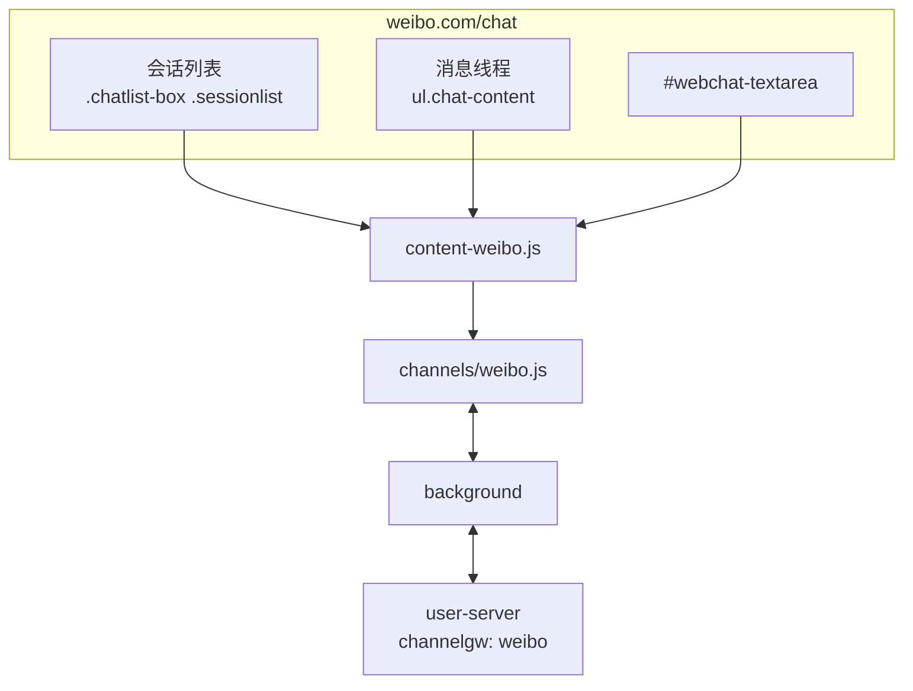

# 微博渠道接入方案（2026-11，新增）

> 目标：把微博网页聊天接入 hivemtk 统一接待。路线：蜂桥网页私信桥接。
> 状态：**选择器已实证**（2026-11-06 从 ChatGPT-On-CS v1.4.5 官方安装包内嵌 sourcemap 还原的
> `platforms/weibo/index.ts` 取得全套选择器，方向判定 left/right 系其文件尾注释原文），
> 实现已落地（`user-web/bridge/src/channels/weibo.js`），仍标 Experimental（待真机登录回归）。
> 2026-11-12 收口：补系统消息过滤（`isSystemMessage`：词表+时间分隔+居中短文案，
> 「撤回了一条消息」等不再以 customer 方向上行触发 AI 误回复）；account_id 占位口径
> （`weibo-unknown`）按服务端 account_id 非空契约钉死并注释（与 douyin 空串 fail-loud 口径
> 的取舍见 `weibo.js` getAccountId 注释）；新增 BaseAdapter.sendOutbound 下行流测试
> （send_verified 回查 + 自报 agent 帧 extra.send_verified）。
> 证据链见 [真实驱动还原报告](../../research/CHATGPT-ON-CS-REAL-DRIVER-2026-11.md)。

---

## 1. 入口与页面

| 项 | 值 |
|---|---|
| 聊天入口 | `https://api.weibo.com/chat#/chat`（ChatGPT-On-CS 实证入口；`weibo.com/chat` 同 UI） |
| 页面形态 | Vue 2 + 自研组件（`woo-*`），SPA |
| 登录态 | 微博 Cookie（`SUB` 等） |
| 账号 ID | 当前登录 UID；`window.$CONFIG?.uid` |
| 会话 ID | 对方 UID；列表项 `data-*` 或昵称派生 |
| 消息 | 文本/图片/视频；文本为主 |
| 发送 | `#webchat-textarea` 输入，**Enter 发送**（Ctrl+Enter 换行） |

---

## 2. 页面结构证据（两级来源互相印证）

**来源 A（公开 bundle，2026-11-05）**：`h5.sinaimg.cn/m/pcweibochat/js/app.*.js`、`css/app.*.css`。
**来源 B（实证，2026-11-06）**：ChatGPT-On-CS v1.4.5 安装包 sourcemap 还原源码，文件尾注释原文：

> 消息数 `[class*='num fff font']`；消息 `.message-item`；用户名 `div[class*='friendname one-line hvhd']>div>span`；
> 气泡 `div[class*='bubble_cont basi']`，**用户的消息 = bubble_cont basi left，我的消息 = right**；
> 正文 `div>p[class*='puretext']`；图片 `[class*='bubble_cont basi']>div[class*='card']>div>img`；
> 视频 `…>video`；输入框 `[id='webchat-textarea']`。

| 用途 | 选择器（已落地 `weibo.js`） |
|---|---|
| 会话列表 | `.chatlist-box .sessionlist` |
| 未读 | `[class*="num fff font" i]` |
| 消息列表 | `ul.chat-content` |
| 消息项 | `.message-item` |
| 方向 | 气泡 `.bubble_cont` class：`left`=客户 / `right`=自己 |
| 正文 | `div>p[class*="puretext" i]` |
| 图片/视频 | `[class*="card" i]>div>img` / `>video` |
| 输入框 | `#webchat-textarea` |
| 发送 | Enter（按钮 `.sendbox_bar button` 为兜底） |

---

## 3. 架构



---

## 4. 适配器设计（已按实证落地，见 `user-web/bridge/src/channels/weibo.js`）

```js
export const SEL = {
  CHAT_LIST: '.chatlist-box .sessionlist, [class*="sessionlist" i]',
  MSG_LIST: 'ul.chat-content, [class*="chat-content" i]',
  MSG_ITEM: '.message-item, [class*="message-item" i]',
  TEXT: 'div>p[class*="puretext" i], .bubble_cont .text, .message-item .text',
  INPUT: '#webchat-textarea, textarea[class*="textarea" i]',
  SEND: '.sendbox_bar button, [class*="send-btn" i], [aria-label*="发送"]',
  PEER_NAME: 'div[class*="friendname" i]>div>span, .chat-header .name, [class*="chat"] [class*="name" i]',
  UNREAD: '[class*="num fff font" i], .chatlist-box [class*="unread" i], [class*="red-dot" i]',
  BUBBLE: '[class*="bubble_cont" i]',
  CARD_IMG: '[class*="card" i]>div>img',
  CARD_VIDEO: '[class*="card" i]>div>video',
};
```

**match()**：host `weibo.com`（含 `api.weibo.com`），且存在 `#webchat-textarea` 或 `.chat-content`。

**getAccountId()**：`window.$CONFIG?.uid` → 页面 `/u/<uid>` 链接 → localStorage 缓存 → `weibo-unknown`。

**getConversationId()**：会话项 `data-uid`/`data-id` → 当前会话 `data-*` → 昵称派生。
微博的 `selectId` 是 Vue store 内部值，DOM 上不一定可见；不要依赖它，除非真机确认。

**parseMessageItem()**（实证）

- 方向：消息项内 `.bubble_cont` class 含 `left` → 客户；含 `right` → 自己；判不出回落 customer（服务端回环判定兜底）；
- 正文：`div>p[class*="puretext"]`；拿不到再取整项文本去噪；
- 媒体：`div[class*="card"]>div>img|video`，`msg_type` 置 `image/video`，`media_url` 取 `src`。

**sendText()**（已落地）

- `#webchat-textarea` 是 textarea → `setValue`（先清空）；
- 微博无独立发送按钮（实测页面提示 Enter 发送），**优先派发 Enter keydown/keyup**；
- 若页面版本提供 `.sendbox_bar button`，先点按钮；
- 发送前 `assertConvOrAbort`；
- 发送后清空。

---

## 5. 后端改动

| 文件 | 改动 |
|---|---|
| `model/message_event.go` | `ChannelWeibo = "weibo"` |
| `model/ai_agent.go` | `ChannelTypeWeibo` |
| `channelgw/registry.go` | 注册 `weibo`，HTTP+WS，Experimental，Label "微博" |
| `bridge/channel.go` | `ChannelWeiboWeb = "weibo"`；别名 `weibo_web/wb → weibo` |
| `bridge/reach_adapter.go` | `SendWeibo` |
| `app/integration_reach_adapter.go` | `SendWeibo` fail-closed |
| `tooluse/reach_tools.go` | `case "weibo","wb"` |
| `service/message_hub.go` | 词表加 `weibo` |
| `capregistry/channels.go` | DMReceive/DMSend |
| `capability_runtime.go` / `assignment.go` / `proactive_reach.go` | 平台列表 |

---

## 6. 数据库

无 DDL。`extra` 建议：

```json
{"ctx": {"weibo_uid": "…", "status_id": "…", "group_id": "…", "is_group": false}}
```

群聊用 `is_group/group_id/group_name`（微博有群聊）。

---

## 7. API

`channel=weibo` 走同一套 bridge ingest/outbox/ack；能力矩阵新增两行。

---

## 8. 前端

- `CHANNEL_OPTIONS` 新增 `{ value:'weibo', label:'微博', group: SOCIAL, icon:'ChatDotRound' }`。
- 扩展 popup 新增"打开微博"（`https://weibo.com/chat`）、账号顺序、选择器 tab。
- 实验标记。

---

## 9. 测试

| 层 | 用例 |
|---|---|
| 扩展 | jsdom fixture：会话列表/消息解析（self/other）/会话 ID/Enter 发送；系统消息过滤（2026-11-12 补）；sendOutbound 下行流（send_verified 回查/自报帧）；detectUnread（M-5） |
| Go | registry/别名/reach 分派/message_hub 词表 |
| curl | `channel=weibo` ingest → 查库 → outbox → ack |
| 前端 | 标签/分组 |
| 真机 | 登录微博 → 聊天页 → 自检 → 收/发（外部腿） |

---

## 10. 风险

| 风险 | 降级 |
|---|---|
| 虚拟滚动只渲染可视区 | 以增量 MutationObserver 为主，回填只取当前可见 + 滚动触发 |
| 消息项类名改版 | 多候选 + 实证 selector + popup 覆盖 |
| Enter 发送被页面拦截 | 用原生 `KeyboardEvent` + `isComposing=false`；失败再找按钮 |
| 登录态失效 | 302 到 passport 时 match=false，不误报 |
| 风控 | 拟人限速，默认 20/min |

## 11. 验收

本机全绿 + 真机校准前，UI 与文档必须标"实验"。
