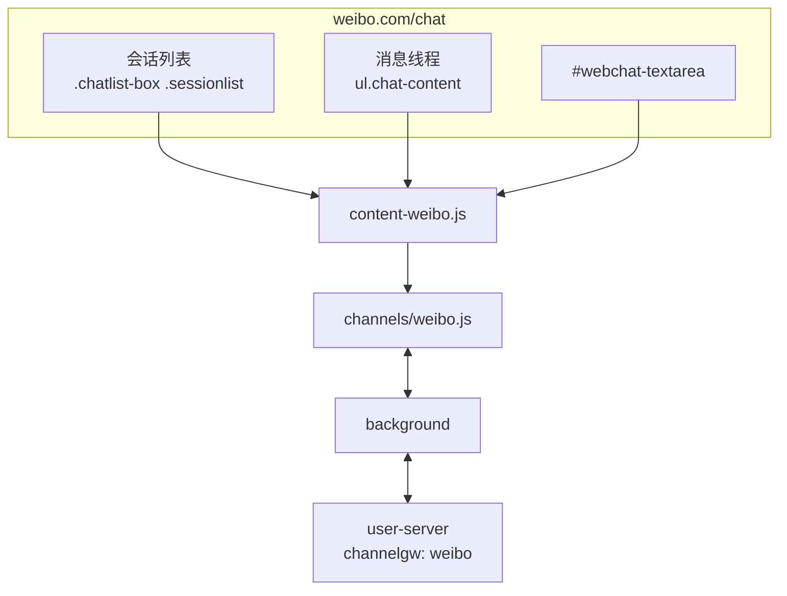

# 微博渠道接入方案（2026-11，新增）

> 目标：把微博网页聊天（`weibo.com/chat`）接入 hivemtk 统一接待。
> 路线：蜂桥网页私信桥接。状态：**选择器部分实证、消息项类名待真机，标 Experimental**。
> 总方案见 [六渠道缺口评估](../CHANNEL-GAP-ANALYSIS-2026-11.md)。

---

## 1. 入口与页面

| 项 | 值 |
|---|---|
| 聊天入口 | `https://weibo.com/chat`（未登录 302 到 `passport.weibo.com`） |
| 页面形态 | Vue 2 + 自研组件（`woo-*`），SPA |
| 登录态 | 微博 Cookie（`SUB` 等） |
| 账号 ID | 当前登录 UID；`$CONFIG.uid` / `window.$CONFIG` / 页面个人链接 |
| 会话 ID | 对方 UID（`selectId`）；列表项 `data-*` 或昵称派生 |
| 消息 | 文本/图片/表情/卡片/群消息；文本为主 |
| 发送 | `#webchat-textarea` 输入，**Enter 发送**（Ctrl+Enter 换行） |

---

## 2. 页面结构证据（2026-11-05 公开 bundle）

从 `h5.sinaimg.cn/m/pcweibochat/js/app.*.js` 与 `css/app.*.css` 提取（`实证`）：

| 用途 | 选择器 |
|---|---|
| 会话列表容器 | `.chatlist-box` |
| 会话项 | `.sessionlist`（`li.sessionlist`） |
| 会话名 | `.list-right .name` |
| 消息列表 | `ul.chat-content` |
| 消息项 | `.message-item`（方向类：`.other` / `.self`，待真机确认） |
| 消息文本 | `.message-item .text`、`.bubble_cont .text`（待真机） |
| 输入框 | `#webchat-textarea` |
| 发送提示/按钮区 | `.sendbox_bar`、`.sendbox_prompt` |
| 发送方式 | Enter（页面文案："按下Enter发送内容/ Command+Enter换行"） |

---

## 3. 架构



---

## 4. 适配器设计

```js
export const SEL = {
  CHAT_LIST: '.chatlist-box .sessionlist, [class*="sessionlist" i]',
  MSG_LIST: 'ul.chat-content, [class*="chat-content" i]',
  MSG_ITEM: '.message-item, [class*="message-item" i]',
  TEXT: '.message-item .text, .bubble_cont .text, [class*="bubble_cont" i] .text',
  INPUT: '#webchat-textarea, textarea[class*="textarea" i]',
  SEND: '.sendbox_bar button, [class*="send-btn" i], [aria-label*="发送"]',
  PEER_NAME: '.chat-header .name, [class*="chat"] [class*="name" i]',
  UNREAD: '.chatlist-box [class*="unread" i], [class*="red-dot" i]',
  SELF: '.message-item.self, [class*="message-item" i].self',
  OTHER: '.message-item.other, [class*="message-item" i].other',
};
```

**match()**：host `weibo.com` 或 `api.weibo.com`，且存在 `#webchat-textarea` 或 `.chat-content`。

**getAccountId()**：`window.$CONFIG?.uid` → 页面 `/u/<uid>` 链接 → localStorage 缓存 → `weibo-unknown`。

**getConversationId()**：会话项 `data-uid`/`data-id` → 当前会话 `data-*` → 昵称派生。
微博的 `selectId` 是 Vue store 内部值，DOM 上不一定可见；不要依赖它，除非真机确认。

**parseMessageItem()**

- 方向：`.message-item.self` → 自己；`.other` → 对方；
- 文本：`TEXT` 选择器；拿不到则用 `innerText` 去掉时间/状态噪声；
- 时间：消息项内时间元素/`data-time`；拿不到用 `Date.now()`；
- 卡片/图片：`msg_type` 置 `image/card`，`media_url` 尽力取 ``。

**sendText()**

- `#webchat-textarea` 是 textarea → `setValue`（先清空）；
- 微博无独立发送按钮（实测页面提示 Enter 发送），**优先派发 Enter keydown/keyup**；
- 若页面版本提供 `.sendbox_bar button`，先点按钮；
- 发送前 `assertConvOrAbort`；
- 发送后清空。

---

## 5. 后端改动

| 文件 | 改动 |
|---|---|
| `model/message_event.go` | `ChannelWeibo = "weibo"` |
| `model/ai_agent.go` | `ChannelTypeWeibo` |
| `channelgw/registry.go` | 注册 `weibo`，HTTP+WS，Experimental，Label "微博" |
| `bridge/channel.go` | `ChannelWeiboWeb = "weibo"`；别名 `weibo_web/wb → weibo` |
| `bridge/reach_adapter.go` | `SendWeibo` |
| `app/integration_reach_adapter.go` | `SendWeibo` fail-closed |
| `tooluse/reach_tools.go` | `case "weibo","wb"` |
| `service/message_hub.go` | 词表加 `weibo` |
| `capregistry/channels.go` | DMReceive/DMSend |
| `capability_runtime.go` / `assignment.go` / `proactive_reach.go` | 平台列表 |

---

## 6. 数据库

无 DDL。`extra` 建议：

```json
{"ctx": {"weibo_uid": "…", "status_id": "…", "group_id": "…", "is_group": false}}
```

群聊用 `is_group/group_id/group_name`（微博有群聊）。

---

## 7. API

`channel=weibo` 走同一套 bridge ingest/outbox/ack；能力矩阵新增两行。

---

## 8. 前端

- `CHANNEL_OPTIONS` 新增 `{ value:'weibo', label:'微博', group: SOCIAL, icon:'ChatDotRound' }`。
- 扩展 popup 新增"打开微博"（`https://weibo.com/chat`）、账号顺序、选择器 tab。
- 实验标记。

---

## 9. 测试

| 层 | 用例 |
|---|---|
| 扩展 | jsdom fixture：会话列表/消息解析（self/other）/会话 ID/Enter 发送 |
| Go | registry/别名/reach 分派/message_hub 词表 |
| curl | `channel=weibo` ingest → 查库 → outbox → ack |
| 前端 | 标签/分组 |
| 真机 | 登录微博 → 聊天页 → 自检 → 收/发（外部腿） |

---

## 10. 风险

| 风险 | 降级 |
|---|---|
| 虚拟滚动只渲染可视区 | 以增量 MutationObserver 为主，回填只取当前可见 + 滚动触发 |
| 消息项类名改版 | 多候选 + `innerText` 兜底 + popup 覆盖 |
| Enter 发送被页面拦截 | 用原生 `KeyboardEvent` + `isComposing=false`；失败再找按钮 |
| 登录态失效 | 302 到 passport 时 match=false，不误报 |
| 风控 | 拟人限速，默认 20/min |

## 11. 验收

本机全绿 + 真机校准前，UI 与文档必须标"实验"。
