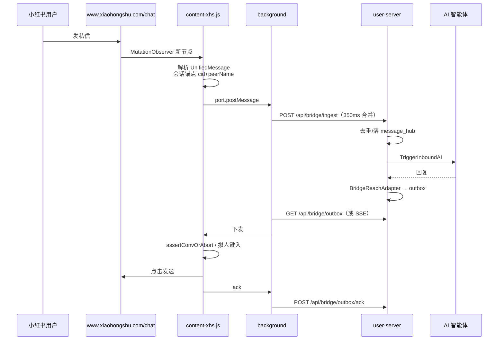

# 小红书渠道接入方案（2026-11）

> 现状：**已接入且可用**。本文不重复实现，只做现状固化、与 ChatGPT-On-CS 的对照、
> 以及本轮需要补的测试/观测。总方案见 [六渠道缺口评估](../CHANNEL-GAP-ANALYSIS-2026-11.md)。

---

## 1. 现状

| 层 | 实现 |
|---|---|
| 扩展 content | `user-web/bridge/src/content/xhs.js` |
| 扩展 adapter | `user-web/bridge/src/channels/xhs.js` |
| 后端注册 | `channelgw`：`xiaohongshu`，HTTP + WS |
| 后端别名 | `bridge.NormalizeBridgeChannel`：`xhs/xhs_web/xiaohongshu_web → xiaohongshu` |
| 入站 | `POST /api/bridge/ingest` → `InboxIngressService` |
| 出站 | outbox → 扩展填 `div.xhs-im-input-bar-editor` → 点发送 / Enter |
| 卡片 | `xiaohongshu_cards` 表 + `/api/xiaohongshu-card/*` |
| 评论自动化 | `internal/browser_automation/platform/xiaohongshu`（CapSearch/OpenDetail/PostComment/ReadComment） |

---

## 2. 数据流

---

## 3. 与 ChatGPT-On-CS 的对照

| 维度 | ChatGPT-On-CS（推断） | hivemtk 现状 | 结论 |
|---|---|---|---|
| 会话 ID | URL/data 属性/昵称派生 | 同样多层兜底（`data-conv-id` → `/chat/{id}` → header 链接 → 昵称） | 保持 |
| 消息解析 | DOM 气泡 | `parseMessageItem` + 方向判定交服务端 | 保持 |
| 发送 | 填 contenteditable + 点发送 | 拟人键入 + `assertConvOrAbort` + 发送后清理 | 更稳，保持 |
| 回环去重 | 无 | 服务端内容回显 + 客户端 sentCache | 更稳，保持 |
| 多账号 | 实例级 | `(channel, account_id)` + `bridge_accounts` | 保持 |
| 上下文 | 商品/订单/会员标签 | 目前主要靠消息文本，`extra` 未约定 `ctx.*` | **补**：卡片/商品上下文进 `extra` |

---

## 4. 本轮要补的（不重写主链路）

1. **测试**：为 `xhs` 适配器补一条 jsdom 回归（会话 ID/解析/发送），确保后续改动不破坏。
   - 现有 `test/chat-page-convid.test.js` 已覆盖会话 ID；补 `parseMessageItem` + `sendText` 的
     最小 fixture。
2. **实验标记**：小红书不是实验渠道，保持 `Experimental: false`。
3. **上下文**：如果页面能拿到商品卡/笔记卡，写入 `extra["ctx.goods_id"]` 等；本轮只做接口位，
   不强行解析（避免误抓）。
4. **文档**：本文件 + README 渠道表更新。

---

## 5. 数据库

无 DDL。`xiaohongshu_cards` 已有；新上下文统一进 `message_hub.extra`（JSONB）。

---

## 6. API

不变。`channel=xiaohongshu` / `xhs` / `xhs_web` 均归一。

---

## 7. 前端

`CHANNEL_OPTIONS` 已有"小红书"；无需新增。

---

## 8. 验收

- `go test ./internal/channelgw ./internal/bridge` 绿；
- `cd user-web/bridge && npm run test` 绿（含 xhs 用例）；
- curl：`channel=xiaohongshu` ingest → 查库 → outbox → ack；
- 真机：打开 `https://www.xiaohongshu.com/chat`，popup 自检匹配、收发一条。
