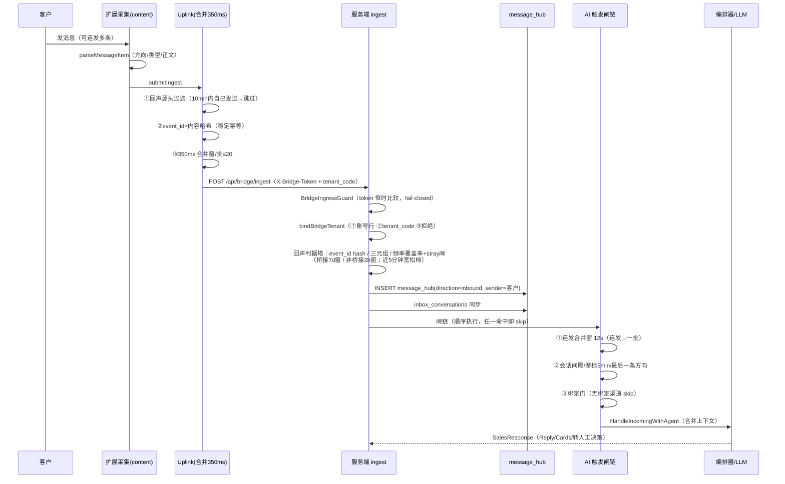
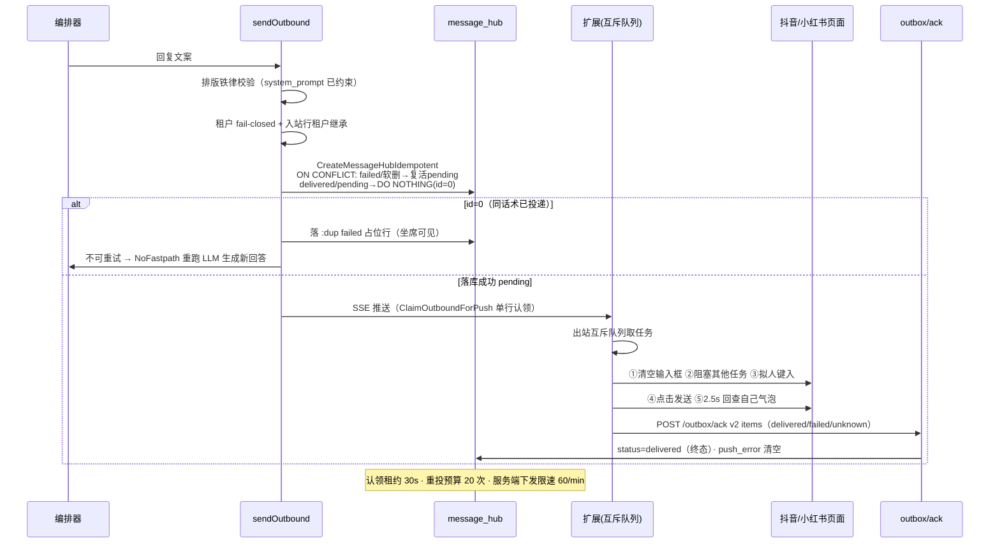
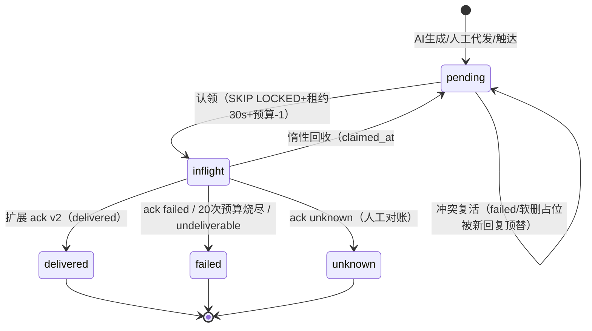

# 蜂桥模块多层级架构图与数据图（2026-11-15 定稿版）

> 依据：2026-11-14/15 全链路审计（见 AUDIT-BRIDGE-FULLCHAIN-2026-11-14.md）+ 生产实测数据。
> 所有字段名、端点、参数、状态机均为线上运行实值（非设计稿）。

---

## 一、系统分层总图

```mermaid
graph TB
    subgraph EXT["扩展端 Chrome MV3（hivebridge）"]
        CA["channels/*.js 渠道适配器 ×9<br/>douyin/xhs/weibo/bilibili/xianyu/tiktok/kuaishou/jd/pdd"]
        CORE["core/ 共享能力<br/>channel-adapter(互斥队列·巡检·排版采集)<br/>uplink(合并350ms·三态落账) · downlink(认领·ack·sentCache)<br/>rate-limiter(三层) · circuit-breaker · http-ingest(重试) · sse-fetch-client"]
        CS["content scripts<br/>per-channel tab（DOM 采集/键入/点击）"]
    end

    subgraph SRV["服务端 user-server（Go :8204）"]
        RT["router<br/>/api/bridge/* + CORS + BridgeIngressGuard(实例token)"]
        BR["internal/bridge<br/>handler_http(ingest/outbox/ack/SSE)<br/>tenant_binding(三级自证) · account_repo · sse"]
        GW["internal/channelgw<br/>registry(十渠道单源) · pipeline · ws"]
        SVC["internal/service<br/>inbox_ingress(回声判据·触发闸) · webhook_outbound(落库·重放)<br/>sales_engine(FAQ fastpath·LLM链) · smart_orchestrator<br/>ai_debounce(连发合并) · bridge_offline_replay"]
        REPO["internal/repository<br/>message_hub_* (认领/ack/回声查询)<br/>delayed_outbound(幂等写·复活upsert)"]
    end

    subgraph DATA["数据层"]
        PG[("PostgreSQL + pgvector<br/>message_hub · bridge_accounts · inbox_conversations<br/>channel_agent_bindings · reach_delayed_outbound<br/>faq_entries · config_params(+tenant覆盖) · message_trace")]
        RD[("Redis<br/>debounce gate/pending · AI锁 · 人工锁 · 预算计数")]
    end

    subgraph LLM["AI 层"]
        ORCH["smart_orchestrator<br/>(意图→RAG→fastpath→LLM→转人工决策)"]
        LLM["LLM Dispatcher<br/>DeepSeek/Qwen/GPT-4o/GLM/Kimi + llama.cpp"]
    end

    CS --> CA --> CORE
    CORE -->|"上行 POST /api/bridge/ingest"| RT
    CORE -->|"下行 GET /outbox + POST /outbox/ack + SSE"| RT
    RT --> BR --> REPO
    BR -->|"AI 触发闸链"| SVC
    SVC --> REPO
    SVC --> ORCH --> LLM
    REPO --> PG
    SVC --> RD
    CORE -.->|"redis 语义由服务端承载"| RD
```

## 二、上行数据流（客户消息 → 入库 → AI 触发）



## 三、下行数据流（AI 回复 → 客户收到 → ACK 终态）



## 四、核心数据模型（message_hub 为中心）

```mermaid
erDiagram
    message_hub ||--o{ message_trace : "trace_id 全链路轨迹"
    message_hub }o--|| bridge_accounts : "(platform, account_id) 归属"
    bridge_accounts }o--|| tenants : "tenant_id"
    channel_agent_bindings }o--|| ai_agents : "agent_id"
    inbox_conversations ||--o{ message_hub : "(platform, conversation_id)"
    reach_delayed_outbound }o--|| message_hub : "SendRetry/quiet_hours 重放"

    message_hub {
        bigint id PK
        uint tenant_id UK5 "隔离轴（default 1 事故源，已 fail-closed）"
        varchar platform "douyin/xhs/weibo/bilibili/xianyu/tiktok…"
        varchar msg_id "内容哈希或幂等键 UK5"
        varchar direction "inbound/outbound"
        varchar status "pending→inflight→delivered | failed | send_failed | unknown"
        varchar account_id "桥接账号（DOM 采集）"
        varchar conversation_id "conv:昵称 或 平台uid"
        varchar sender_id "发送者平台id"
        varchar sender_name "昵称（回声污染检测点）"
        varchar sender_avatar "头像（M-2 链路）"
        text content "正文（fastpath=FAQ原文）"
        bool is_ai_reply "智能体管线标记"
        varchar ai_agent "sales_engine/人工"
        datetime claimed_at "认领租约（限速计数口径）"
        int push_attempts "重投预算（≤20）"
        varchar push_error "终态原因"
        datetime deleted_at "软删（回声/过期清理）"
        json extra "bridge/sender_type/duplicate_of/citations…"
    }

    bridge_accounts {
        int id PK
        uint tenant_id "归属租户（绑定门反查权威源）"
        varchar channel "规范渠道名"
        varchar account_id "DOM 采集的账号标识"
        varchar status "online（last_sync 判活 30s 窗）"
        datetime last_sync_at "心跳（巡检/认领/SSE 共同刷新）"
    }

    channel_agent_bindings {
        int id PK
        uint tenant_id
        varchar channel_type "douyin/xiaohongshu/bilibili/xianyu…"
        varchar account_id "账号级绑定"
        varchar chat_id "会话级绑定（可空）"
        uint agent_id "→ ai_agents"
        bool enabled "AI 开关面板（绑定门数据源）"
        bool is_primary
    }

    reach_delayed_outbound {
        int id PK
        uint tenant_id "入队时抄写（重放反查校验）"
        varchar platform
        varchar account_id
        varchar kind "send_retry/quiet_hours"
        int attempts "重试次数"
        varchar status "pending/sent/failed/superseded"
        datetime send_at "到期触发"
    }

    config_params ||--o{ tenant_config_params : "租户覆盖行"
```

## 五、状态机（message_hub.outbound）



## 六、防线终态（七层，全部经生产实证）

| 层 | 闸 | 参数/数据源 | 拦什么 |
|---|---|---|---|
| 上行·源头 | 回声源头过滤 | recentSentTexts 10min TTL | 巡检重采自家气泡 |
| 上行·服务端 | 回声判据塔 | 桥接7d窗/非桥接2h；近5min 70%、远窗85%+stray=0 | DOM 变形假入站 |
| 触发·准入 | 连发合并窗 | bridge/ai_debounce_seconds=12s | 逐条轰炸 |
| 触发·绑定门 | ai_trigger_binding_required | tenant 18=true | 无绑定渠道自动回 |
| 生成·幂等 | 冲突复活 upsert | failed/软删复活；delivered 不动 | 重复话术静默丢失 |
| 落库·租户 | fail-closed 三级 | 账号反查权威化 | tenant=1 孤儿 |
| 下发·节奏 | 互斥队列+限速 | 60/min + 12s 合并 + sentCache 24h | 并发键入互断/重发 |

## 七、参数清单（bridge 组，config_params 实值）

| 参数 | 默认 | 说明 |
|---|---|---|
| ai_debounce_seconds | 12 | 连发合并窗（0=关，≤30） |
| ai_trigger_binding_required | false（租户18=true） | 无绑定渠道不触发 AI |
| deliver_rate_limit_per_min | 60 | 服务端下发限速兜底 |
| online_grace_window | 30s | 在线判定窗 |
| ai_reply…（已并） | — | — |
| patrol_unread_first_channels | ["douyin","tiktok","xianyu","kuaishou"] | 未读优先巡检 |
| sse_heartbeat_interval | 15s | SSE 心跳 |
| outbound_orphan_dry_run | true | 孤儿结算只报数 |
| follow_user_enabled | false | 自动关注总开关 |

## 八、渠道矩阵终态（2026-11-15）

| 渠道 | 绑定 | 心跳 | 备注 |
|---|---|---|---|
| douyin | agent 18 | 23:00 全鲜 | 稳定运行 |
| xiaohongshu | agent 18 | 全鲜 | 平台限 1 条/24h（未互关） |
| bilibili | agent 18 | 全鲜 | 实验渠道（时间戳噪音待校准） |
| xianyu | agent 18 | ✅ 已恢复 | goofish.com/im |
| weibo | ⏸ 暂缓 | 全鲜 | 官方推送洪泛，待过滤能力 |
| web_embed | agent 18 | — | 官网客服（2h 回声窗） |

## 九、遗留清单

1. 抖音字符级交错乱码（真机校准轮）
2. weibo 官方推送过滤（接入前置）
3. B站采集器时间戳噪音（真机校准轮）
4. selector_health 联动认领闸（立项）
5. 绑定门平台默认翻转（soak 后）
