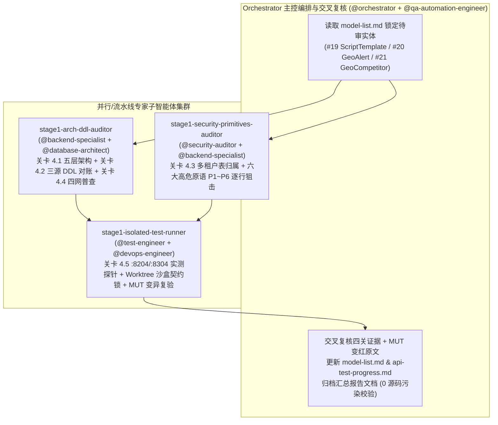

# HiveMtk SaaS 多租户全链路检查、清理、测试与回归 — Stage 1（任务一：五层架构模型检查与 SaaS 多租户约束「四关审查」）专家团多智能体编排与逐批实体汇总报告

> **最后更新时间**：2026-10-21 17:58 (+08:00)  
> **关联总纲计划**：[saas-multitenant-master-test-plan.md](file:///e:/HiveMtk/saas-multitenant-master-test-plan.md)  
> **工作区根汇总文档**：[stage1-multitenant-model-audit-orchestration-report.md](file:///E:/HiveMtk/stage1-multitenant-model-audit-orchestration-report.md)  
> **仓库报告归档路径**：[stage1-multitenant-model-audit-orchestration-report.md](file:///E:/HiveMtk/hivemtk-master/docs/reports/stage1-multitenant-model-audit-orchestration-report.md)  
> **模型与接口进度台账**：[model-list.md](file:///E:/HiveMtk/hivemtk-master/model-list.md) / [api-test-progress.md](file:///E:/HiveMtk/hivemtk-master/docs/api-test-progress.md)  
> **P0 纪律状态**：主工作区 `E:\HiveMtk\hivemtk-master` 保持 **0 行 `.go` / `.vue` 业务源码改动**；全部沙盒修复与 `TENANT_MODE=on` 契约锁测试均在独立 Git Worktree 中完成并导出补丁文件待统一汇总审批。

---

## 一、《专家团多智能体编排报告（Orchestration Report — Stage 1）》

### 1.1 专家团多智能体协同拓扑

### 1.2 专家团分工与累计批次总览

| 专家子智能体角色 | 会话 ID | 赋能领域专家 | 负责关卡与核心产出 | 状态 |
|---|---|---|---|---|
| **`stage1-arch-ddl-auditor`** | [`3310e027`](conversation://3310e027-e3b3-4241-b234-d7fb095ec8c6) | `@backend-specialist` + `@database-architect` | **关卡 4.1**（五层架构全链路追踪与跨模块旁路审计）、**关卡 4.2**（GORM-only + 三处 DDL 真相源与 `mtk-postgres` 物理库对账）、**关卡 4.4**（四网死代码普查与前后端契约漂移） | ✅ 已完成 Batch 01 (`#19`)、Batch 02 (`#20`)、Batch 03 (`#21`) |
| **`stage1-security-primitives-auditor`** | [`90a26108`](conversation://90a26108-4225-4a95-893f-557aed5770dc) | `@security-auditor` + `@backend-specialist` | **关卡 4.3**（SaaS 多租户表归属核验 + 六大跨实体高危原语 P1～P6 逐行源码取证与修复规格设计） | ✅ 已完成 Batch 01 (`#19`)、Batch 02 (`#20`)、Batch 03 (`#21`) |
| **`stage1-isolated-test-runner`** | [`abe9848a`](conversation://abe9848a-66f2-4b52-a13a-46af5e79973a) | `@test-engineer` + `@devops-engineer` | **关卡 4.5**（`:8204`/`:8304` 真实双实例 cURL 探针 + 独立 Worktree 沙盒编写 `TENANT_MODE=on` 契约锁测试 + **21 组 MUT 变异反向验证** + 导出补丁并销毁沙盒） | ✅ 已完成 Batch 01 (`#19`)、Batch 02 (`#20`)、Batch 03 (`#21`) |
| **`orchestrator`（主控复核）** | [`94eea91f`](conversation://94eea91f-4d2c-431a-9d1c-88ea3cb8e628) | `@orchestrator` + `@qa-automation-engineer` | 交叉复核、同步更新 [model-list.md](file:///E:/HiveMtk/hivemtk-master/model-list.md) 与 [api-test-progress.md](file:///E:/HiveMtk/hivemtk-master/docs/api-test-progress.md)、维护本汇总文档并确保主仓 0 业务代码改动 | ✅ 持续汇入中 |

### 1.3 Stage 1 已完成批次进度总表

| 批次 | `model-list.md` 序号 | 模型文件 | 涵盖结构体 (`TableName`) | 检出核心缺陷数 | 沙盒新增测试 | MUT 变异探针 | 已验证补丁存盘路径 | 台账状态 |
|---|---|---|---|---|---|---|---|---|
| **Batch 01** | **#19** | [internal/content/model/script_template.go](file:///E:/HiveMtk/hivemtk-master/user-server/internal/content/model/script_template.go) | `ScriptTemplate` (`script_templates`) `ScriptCategory` (`script_categories`) `ScriptRecommend` (`script_recommendations`) | 4 处 4.1 违规 + 4 处 4.2 缺陷/DDL 漂移 + 5 类 4.3 原语（P1/P3/P4/P5/P6）+ 3 簇 4.4 死代码 | 8 个顶层测试（含 29 个子测试全绿） | **MUT-1 ～ MUT-8**（8 组全红复验） | [stage1_entity19_verified.patch](file:///C:/Users/Administrator/.gemini/antigravity/brain/94eea91f-4d2c-431a-9d1c-88ea3cb8e628/scratch/stage1_entity19_verified.patch) | ✅ `[x]` |
| **Batch 02** | **#20** | [internal/geo/model/alert.go](file:///E:/HiveMtk/hivemtk-master/user-server/internal/geo/model/alert.go) | `GeoAlert` (`geo_alerts`) | 2 处 4.1 违规（含跨全租户 `Fanout` 漏洞）+ 2 处 4.2 分页/共链问题 + 3 处 4.3 原语（P1/P4/P5）+ 1 处 4.4 死方法 | 6 个顶层测试（全绿） | **MUT-1 ～ MUT-6**（6 组全红复验） | [stage1_entity20_verified.patch](file:///C:/Users/Administrator/.gemini/antigravity/brain/94eea91f-4d2c-431a-9d1c-88ea3cb8e628/scratch/stage1_entity20_verified.patch) | ✅ `[x]` |
| **Batch 03** | **#21** | [internal/geo/model/competitor.go](file:///E:/HiveMtk/hivemtk-master/user-server/internal/geo/model/competitor.go) | `GeoCompetitor` (`geo_competitors`) | 1 处 4.1 构造器 DI 违规 + 3 处 4.2 缺陷（含软删墓碑行触发 `idx_geo_competitors_domain` `23505` 冲突）+ 5 类 4.3 原语（P1/P2/P3/P4/P5）及 P6 跨模块 SSRF + 3 项 4.4 双源脑裂/前端问题 | 5 个顶层测试（全绿） | **MUT-1 ～ MUT-7**（7 组全红复验） | [stage1_entity21_verified.patch](file:///C:/Users/Administrator/.gemini/antigravity/brain/94eea91f-4d2c-431a-9d1c-88ea3cb8e628/scratch/stage1_entity21_verified.patch) | ✅ `[x]` |

---

## 二、【Stage 1 第 1 批实体审查交接卡】—— Entity `#19`：`ScriptTemplate` / `ScriptCategory` / `ScriptRecommend`

### 2.1 实体档案与表归属核验
- **Model 文件**：[user-server/internal/content/model/script_template.go](file:///E:/HiveMtk/hivemtk-master/user-server/internal/content/model/script_template.go#L1-L69)
- **物理表与多租户归属**：
  1. [`ScriptTemplate`](file:///E:/HiveMtk/hivemtk-master/user-server/internal/content/model/script_template.go#L11-L30) → `script_templates`（**租户级业务表**，含 `TenantID uint` `gorm:"index;not null;default:1"`）
  2. [`ScriptCategory`](file:///E:/HiveMtk/hivemtk-master/user-server/internal/content/model/script_template.go#L33-L45) → `script_categories`（**租户级业务表**，含 `TenantID uint` `gorm:"index;not null;default:1"`）
  3. [`ScriptRecommend`](file:///E:/HiveMtk/hivemtk-master/user-server/internal/content/model/script_template.go#L48-L60) → `script_recommendations`（**租户级业务表 / 零读写死表**，含 `TenantID uint` `gorm:"index;not null;default:1"`）

### 2.2 关卡 4.1：五层架构合规检查（`GO_FIVE_LAYER_ARCHITECTURE.md`）
- **全链路调用链**：
  `Frontend (`[List.vue](file:///E:/HiveMtk/hivemtk-master/user-web/src/views/scriptTemplate/List.vue) / [AbStats.vue](file:///E:/HiveMtk/hivemtk-master/user-web/src/views/scriptTemplate/AbStats.vue) / [aiAgent/Edit.vue](file:///E:/HiveMtk/hivemtk-master/user-web/src/views/aiAgent/Edit.vue) → [scriptTemplate.js](file:///E:/HiveMtk/hivemtk-master/user-web/src/api/scriptTemplate.js)`)` → `Router (`[business_routes.go:164-176](file:///E:/HiveMtk/hivemtk-master/user-server/internal/router/business_routes.go#L164-L176) 10 条 `/api/scripts*` + [frontend_aliases.go:192-199](file:///E:/HiveMtk/hivemtk-master/user-server/internal/router/frontend_aliases.go#L192-L199) 7 条 `/api/script-templates*``)` → `Controller (`[content/controller/script_template.go](file:///E:/HiveMtk/hivemtk-master/user-server/internal/content/controller/script_template.go) 10 个 handler`)` → `Service (`[content/service/script_template.go](file:///E:/HiveMtk/hivemtk-master/user-server/internal/content/service/script_template.go) + [script_template_sync.go](file:///E:/HiveMtk/hivemtk-master/user-server/internal/content/service/script_template_sync.go) + 跨域 [sales_engine_adapters.go:24-36](file:///E:/HiveMtk/hivemtk-master/user-server/internal/service/sales_engine_adapters.go#L24-L36)`)` → `Repository (`[content/repository/script_template.go](file:///E:/HiveMtk/hivemtk-master/user-server/internal/content/repository/script_template.go) + 跨域旁路 [champion_dialogue.go:133-155](file:///E:/HiveMtk/hivemtk-master/user-server/internal/repository/champion_dialogue.go#L133-L155)`)` → `Model (`[content/model/script_template.go](file:///E:/HiveMtk/hivemtk-master/user-server/internal/content/model/script_template.go)`)`。
- **查出 4 项架构违规**：
  1. **无参构造函数内部暗摸 `_db.GetDB()` + 双入口反模式**：[`NewScriptTemplateRepository()`](file:///E:/HiveMtk/hivemtk-master/user-server/internal/content/repository/script_template.go#L17-L19)、[`NewScriptCategoryRepository()`](file:///E:/HiveMtk/hivemtk-master/user-server/internal/content/repository/script_template.go#L106-L108)、[`NewScriptRecommendRepository()`](file:///E:/HiveMtk/hivemtk-master/user-server/internal/content/repository/script_template.go#L140-L142)、[`NewScriptTemplateService()`](file:///E:/HiveMtk/hivemtk-master/user-server/internal/content/service/script_template.go#L28-L34) 均无参直取 `_db.GetDB()`；[`NewScriptTemplateSyncService()`](file:///E:/HiveMtk/hivemtk-master/user-server/internal/content/service/script_template_sync.go#L23-L37) 并存无参 + `...WithDB` 双入口。
  2. **Service 层直操 `*gorm.DB`**：[`ScriptTemplateSyncService.upsertOne`](file:///E:/HiveMtk/hivemtk-master/user-server/internal/content/service/script_template_sync.go#L67-L94) 在 Service 层直接持 `s.db *gorm.DB` 读写 `mainmodel.ScriptLibrary`。
  3. **跨模块 Repository 旁路裸写 `.Table("script_templates")` 且漏传 `NOT NULL` 列必崩**：[`internal/repository/champion_dialogue.go:138-149`](file:///E:/HiveMtk/hivemtk-master/user-server/internal/repository/champion_dialogue.go#L138-L149) 的 `InsertScriptTemplate` 绕过 `content/repository` 直接插入 `map[string]any`，漏填非空列 `"name"`，在 PostgreSQL 下必触发 `SQLSTATE 23502 (null value in column "name" violates not-null constraint)`。
  4. **跨模块适配器丢弃 `ctx`**：[`internal/service/sales_engine_adapters.go:33,35`](file:///E:/HiveMtk/hivemtk-master/user-server/internal/service/sales_engine_adapters.go#L33-L35) 的 `MatchScript(ctx, ...)` 调 `GetTemplateList` 与 `RecommendScript` 时丢弃了 `ctx`。

### 2.3 关卡 4.2：GORM 驱动与 DDL 权威面对账
- **GORM-Only**：0 处 `.Raw(` / `.Exec(`（`check-gorm-only.sh` 绿灯）。
- **查询与分页缺陷**：
  1. [`SearchTemplates`](file:///E:/HiveMtk/hivemtk-master/user-server/internal/content/repository/script_template.go#L89-L90) 使用未转义 `"%" + keyword + "%"`（存在 `%`/`_` 通配符注入放大）；
  2. [`GetAll`](file:///E:/HiveMtk/hivemtk-master/user-server/internal/content/repository/script_template.go#L47-L48)、[`GetPublicTemplates`](file:///E:/HiveMtk/hivemtk-master/user-server/internal/content/repository/script_template.go#L77-L78)、[`SearchTemplates`](file:///E:/HiveMtk/hivemtk-master/user-server/internal/content/repository/script_template.go#L93-L94) 分页未 clamp `page < 1` 与 `pageSize > 100`（`SyncToLibrary` 硬传 `10000`），且 `:45, :74, :91` 三处 `Count(&total)` 忽略 `.Error`。
- **三处 DDL 真相源对账**：
  1. **孤儿表 `script_recommends` 与残留外键**：[migrations/init-user-db.sql:130-135](file:///E:/HiveMtk/hivemtk-master/migrations/init-user-db.sql#L130-L135) 创建了 **`script_recommends`**（无 `tenant_id` 列，含外键 `REFERENCES script_templates(id)`），而 Go Model [`ScriptRecommend.TableName()`](file:///E:/HiveMtk/hivemtk-master/user-server/internal/content/model/script_template.go#L66-L68) 为 **`script_recommendations`**；`mtk-postgres` 实测两张表并存（均 0 行）。
  2. **`module_tables.go` 子包扫描盲区**：[internal/model/module_tables_test.go:17](file:///E:/HiveMtk/hivemtk-master/user-server/internal/model/module_tables_test.go#L17) 的 `scanModelTables` 只扫描 `internal/model/`，漏扫 `internal/content/model/` 等子包，导致三张表均未登记进 `module_tables.go`。

### 2.4 关卡 4.3：SaaS 多租户约束与「六大跨实体高危原语」狙击（P1～P6）

| 原语 | 检出状态 | 源码级精确证据 (`file:line`) |
|---|---|---|
| **P1 断链 `ctx`** | 🔴 **100% 断链** | [repository/script_template.go](file:///E:/HiveMtk/hivemtk-master/user-server/internal/content/repository/script_template.go) 全部 15 个方法、[service/script_template.go](file:///E:/HiveMtk/hivemtk-master/user-server/internal/content/service/script_template.go) 全部 11 个方法均无 `ctx` 参数；[script_template_sync.go:52,78,82,89](file:///E:/HiveMtk/hivemtk-master/user-server/internal/content/service/script_template_sync.go#L52-L89) 虽有 `ctx` 但 4 处 DB 调用全部丢弃。导致 `:8204` (`TENANT_MODE=on`) 下 9 个接口报 `[tenant]` 未绑定错、1 个接口吞错返 `200 null`！ |
| **P2 异步丢租户** | 🟢 **未命中** | 全链路无 `go func` 异步调用。 |
| **P3 `gorm.Save()` 夺行与死行复活** | 🔴 **命中 3 处** | [`ScriptTemplateRepository.Update`](file:///E:/HiveMtk/hivemtk-master/user-server/internal/content/repository/script_template.go#L56)、[`ScriptCategoryRepository.Update`](file:///E:/HiveMtk/hivemtk-master/user-server/internal/content/repository/script_template.go#L126)、[`ScriptTemplateSyncService.upsertOne`](file:///E:/HiveMtk/hivemtk-master/user-server/internal/content/service/script_template_sync.go#L89) 使用 `.Save()`，在跨租户 0 行命中或软删行上触发 `ON CONFLICT(id) DO UPDATE`，造成**跨租户夺行（`tenant_id` 被改写）与软删死行复活**。 |
| **P4 0 行静默 / 非空零值指针 / 吞错返 200** | 🔴 **命中 7 处** | ① [`GetByID`](file:///E:/HiveMtk/hivemtk-master/user-server/internal/content/repository/script_template.go#L32) 查败返回 `(&template, err)` 非空零值指针；② `Delete` (`:61, :131`)、`IncrementUsage` (`:66`)、`MarkAsUsed` (`:163`) 未判 `RowsAffected == 0`；③ [`RecommendScript`](file:///E:/HiveMtk/hivemtk-master/user-server/internal/content/service/script_template.go#L176) `templates, _, _ := s.templateRepo.SearchTemplates(...)` 吞掉 `[tenant]` 报错，在 `:8204` 伪造 `200 OK + data: null`！ |
| **P5 错误折叠与内部闸原文回显** | 🔴 **命中 9 处** | ① [`GetTemplateByID`](file:///E:/HiveMtk/hivemtk-master/user-server/internal/content/controller/script_template.go#L76) 将 `[tenant]` 500 错误折叠为 `404` 并回显原文；② `UpdateTemplate` (`:102`)、`DeleteTemplate` (`:119`) 折叠为 `400`；③ 其余 6 个 Handler (`:52, :129, :145, :164, :190, :201`) 直接 `response.Error(ctx, 500, err.Error())` 暴露 `[tenant] 表 script_templates 需要租户上下文但 ctx 未绑定`。 |
| **P6 同租户 IDOR 与 `float64` 身份断言 Panic** | 🔴 **命中 3 处** | ① [`CreateTemplate`](file:///E:/HiveMtk/hivemtk-master/user-server/internal/content/controller/script_template.go#L35) 裸写 `userID.(uint)`，遇 `float64`/`nil` 直接 panic；② [`UpdateTemplate`](file:///E:/HiveMtk/hivemtk-master/user-server/internal/content/service/script_template.go#L96-L127) 与 [`DeleteTemplate`](file:///E:/HiveMtk/hivemtk-master/user-server/internal/content/service/script_template.go#L130-L140)（含 `_ = template`）缺失 `IsSystem` 系统模板保护与 `CreatedBy == userID \|\| isAdmin` 校验。 |

### 2.5 关卡 4.4：僵尸代码四网普查与遗留决策项
- **已清理零引用死代码**：`ScriptRecommendRepository` 全 3 个方法与 `s.recommendRepo` 字段（全仓 0 生产调用）；`ScriptCategoryRepository` 的 `Update`/`Delete`、Service 的 `CreateCategory`/`UseTemplate` 及 `IncrementUsage`。
- **遗留决策项（4 项，详见 [model-list.md:573-582](file:///E:/HiveMtk/hivemtk-master/model-list.md#L573-L582)）**：
  1. `script_recommendations` 推荐流水落库闭环 vs 孤儿表 `script_recommends` 清理；
  2. `script_categories` 写入口与 `UseTemplate` 计次接口是否接线；
  3. 双话术体系（`script_templates` vs `script_library`）在前端 `List.vue`（`scenario`/`useCount`/`effectiveness`/`updatedAt` 及 `variables.split(',')` 二次序列化污染）与 `AbStats.vue` 的契约对齐；
  4. `module_tables.go` 子包模型递归扫描补齐。

### 2.6 关卡 4.5：`:8204`/`:8304` 实测、沙盒契约锁与【MUT-1 ～ MUT-8 变异复验】
- **`:8204` (`TENANT_MODE=on`) vs `:8304` (`TENANT_MODE=off`) 真实 cURL 对比**：`:8204` 下 `GET/POST/PUT/DELETE /api/scripts*`、`/categories`、`/public`、`/search`、`/sync-to-library` 共 9 个接口全部报 `[tenant]` 未绑定错（其中 `GET /api/scripts/1` 折叠为 404），`POST /api/scripts/recommend` 吞错返 `200 OK + data: null`；`:8304` 下正常返回 200。
- **沙盒契约锁测试全绿**：`repository/script_template_tenant_test.go` (`0.602s`)、`service/script_template_tenant_test.go` (`0.243s`)、`controller/script_template_tenant_test.go` (`0.728s`) 全绿。
- **MUT-1 ～ MUT-8 变红实录**：
  - **MUT-1（P1 摘 `WithContext`）**：`FAIL: TestScriptTemplateReadsAreTenantFactored/GetAll_Scoping_And_BareCtx` (`:118: [tenant] 表 script_templates 需要租户上下文但 ctx 未绑定（query）`)
  - **MUT-2（P3 `Update` 退回 `Save`）**：`FAIL: TestScriptTemplateWritesAreTenantFactored/Update_SelectColumns_CrossTenantBlocked_NoSaveResurrection` (`:241/:244: B 行被跨租户篡改 tenant_id=101`; `:277: 已软删行被复活`)
  - **MUT-3（P4 `Delete` 摘 `RowsAffected == 0`）**：`FAIL: TestScriptTemplateWritesAreTenantFactored/Delete_CrossTenantBlocked_RowsAffectedZeroSentinel` (`:260/:271: 应返回 ErrScriptTemplateMissing，实得 <nil>`)
  - **MUT-4（P4 `GetByID` 退回 `return &template, err`）**：`FAIL: TestScriptTemplateReadsAreTenantFactored/GetByID_Scoping_BareCtx_And_NilPointerOnError` (`:153: 失败时必须返回 nil 指针，实得 &{TenantID:0 ID:0 ...}`)
  - **MUT-5（P4 `RecommendScript` 退回吞错）**：`FAIL: TestScriptTemplateServiceRecommendPropagatesError` (`:86`) & `FAIL: .../POST_recommend_unbound_returns_500_not_200` (`:178: 应回 500，实得 200 body={"code":0,"message":"获取推荐成功","data":null}`)
  - **MUT-6（P6 `CreateTemplate` 退回 `rawUID.(uint)`）**：`FAIL: .../POST_Create_supports_float64_user_id_and_rejects_missing_auth` (`panic recovered: interface conversion: interface {} is float64, not uint`)
  - **MUT-7（P6 摘 `IsSystem` 与 `CreatedBy` 守卫）**：`FAIL: TestScriptTemplateServiceOwnershipAndSystemGuard` (`:118/:126`) & `FAIL: TestScriptTemplateWritesIdentityOwnershipAndSystemGuard` (`:225/:234: 系统模板应回 400 实得 200；同租户他人修改应回 403 实得 200`)
  - **MUT-8（P5 退回 `404/500 + err.Error()`）**：`FAIL: TestScriptTemplateReadsSeparateMissingFromUnboundAndIsolateTenants` (`:169: 响应体泄露内部错误原文 [tenant]...`; `:172: 裸 ctx 应回 500，实得 404`)

---

## 三、【Stage 1 第 2 批实体审查交接卡】—— Entity `#20`：`GeoAlert`（`geo_alerts`）

### 3.1 实体档案与表归属核验
- **Model 文件**：[user-server/internal/geo/model/alert.go](file:///E:/HiveMtk/hivemtk-master/user-server/internal/geo/model/alert.go#L1-L27)
- **物理表与多租户归属**：
  - [`GeoAlert`](file:///E:/HiveMtk/hivemtk-master/user-server/internal/geo/model/alert.go#L11-L25) → `geo_alerts`（**租户级业务表**，含 `TenantID uint` `gorm:"not null;default:1;index" json:"tenant_id"`）

### 3.2 关卡 4.1：五层架构合规检查（`GO_FIVE_LAYER_ARCHITECTURE.md`）
- **全链路调用链**：
  - **Frontend**：[user-web/src/views/geo/AlertCenter.vue](file:///E:/HiveMtk/hivemtk-master/user-web/src/views/geo/AlertCenter.vue) + [user-web/src/layout/Layout.vue:242-252,378-386](file:///E:/HiveMtk/hivemtk-master/user-web/src/layout/Layout.vue#L242-L252)（顶栏铃铛角标 60s 轮询） → [user-web/src/api/geoAlert.js](file:///E:/HiveMtk/hivemtk-master/user-web/src/api/geoAlert.js)
  - **Router**：[user-server/internal/router/geo_routes.go:207-210](file:///E:/HiveMtk/hivemtk-master/user-server/internal/router/geo_routes.go#L207-L210)（`GET /api/geo/alerts`、`GET /api/geo/alerts/unread-count`、`POST /api/geo/alerts/:id/ack`、`DELETE /api/geo/alerts/:id`）
  - **Controller**：[user-server/internal/geo/controller/alert.go](file:///E:/HiveMtk/hivemtk-master/user-server/internal/geo/controller/alert.go)（`AlertController`，4 个 handler）
  - **Service & Background Jobs**：[user-server/internal/geo/service/alert.go](file:///E:/HiveMtk/hivemtk-master/user-server/internal/geo/service/alert.go)（`AlertService`）+ 跨服务读取 [user-server/internal/geo/service/opportunity.go:146-159](file:///E:/HiveMtk/hivemtk-master/user-server/internal/geo/service/opportunity.go#L146-L159)（`OpportunityService.List`）+ 唯一写入源定时任务 [user-server/internal/geo/service/scheduler.go:183-260](file:///E:/HiveMtk/hivemtk-master/user-server/internal/geo/service/scheduler.go#L183-L260)（`negativeMonitorJob`）
  - **Repository**：[user-server/internal/geo/repository/alert.go](file:///E:/HiveMtk/hivemtk-master/user-server/internal/geo/repository/alert.go)（`GeoAlertRepository` / `geoAlertRepo`）
  - **Model**：[user-server/internal/geo/model/alert.go](file:///E:/HiveMtk/hivemtk-master/user-server/internal/geo/model/alert.go)（纯净结构体 + `TableName()`）
- **查出 2 项架构与跨租户边界违规**：
  1. **构造器双入口与定时任务内部暗摸全局 `_db.GetDB()`**：[`NewGeoAlertRepository()`](file:///E:/HiveMtk/hivemtk-master/user-server/internal/geo/repository/alert.go#L27-L29) 与 [`NewGeoAlertRepositoryWithDB(db *gorm.DB)`](file:///E:/HiveMtk/hivemtk-master/user-server/internal/geo/repository/alert.go#L32-L34) 并存；`negativeMonitorJob`（[scheduler.go:192](file:///E:/HiveMtk/hivemtk-master/user-server/internal/geo/service/scheduler.go#L192)）每次执行直调无参 `NewGeoAlertRepository()`。已在沙盒补丁中统一收口为单构造器 `NewGeoAlertRepository(db *gorm.DB)`。
  2. **普通租户接口触发跨全租户 `tenant.Fanout` 扇出执行（跨模块高危发现）**：[router/geo_routes.go:290](file:///E:/HiveMtk/hivemtk-master/user-server/internal/router/geo_routes.go#L290) 将 `POST /api/geo/probe/run-negative` 挂在普通租户路由组 `geo`（非 `geoAdmin`）；而 [`ProbeController.RunNegativeMonitor`](file:///E:/HiveMtk/hivemtk-master/user-server/internal/geo/controller/probe.go#L81-L87) 忽略请求方的 `ctx.Request.Context()`，直接调 `service.GetGeoJobManager().Trigger(service.JobNegativeMonitor)` → `StartJob`（[job_manager.go:342](file:///E:/HiveMtk/hivemtk-master/user-server/internal/geo/service/job_manager.go#L342)）执行 `tenant.Fanout(context.Background(), nil, ...)`，导致**任意普通租户员工调用一次即触发全库所有活跃租户的探针外呼与 `geo_alerts` 写入**！

### 3.3 关卡 4.2：GORM 驱动与 DDL 权威面对账
- **GORM-Only 与参数化查询**：0 处 `.Raw(` / `.Exec(`，全部 `Where` 使用参数化 `?`，`Count(&total).Error` 与 `CountUnread` 错误均如实检查返回。
- **三处 DDL 真相源对账（100% 对齐）**：
  - 真相源 ①（[geo/model/alert.go](file:///E:/HiveMtk/hivemtk-master/user-server/internal/geo/model/alert.go)）、真相源 ②（[migrate.go:375](file:///E:/HiveMtk/hivemtk-master/user-server/internal/pkg/db/migrate.go#L375) `allModels()` + [module_tables.go:191](file:///E:/HiveMtk/hivemtk-master/user-server/internal/model/module_tables.go#L191) `geoOwnedTables`）、真相源 ③（[tenant_column_batch_migration.go:63-107](file:///E:/HiveMtk/hivemtk-master/user-server/internal/migration/migrations/tenant_column_batch_migration.go#L63-L107)）与 `mtk-postgres:8202/user_db` 真库 12 个列、6 个索引完全一致（当前 `0` 行）。
- **查出 2 处分页与查询链问题**：
  1. **分页上界 `limit > 200` 超出 `<= 100` 标准**：[geo/repository/alert.go:44](file:///E:/HiveMtk/hivemtk-master/user-server/internal/geo/repository/alert.go#L44) 与 [geo/service/alert.go:42](file:///E:/HiveMtk/hivemtk-master/user-server/internal/geo/service/alert.go#L42) 允许 `limit <= 200`，沙盒补丁已收紧为 `limit <= 0 || limit > 100 { limit = 50 }`（MUT-6 实测锁定）。
  2. **`Count` + `Find` 共用 `*gorm.DB` 链**：[`geoAlertRepo.List`](file:///E:/HiveMtk/hivemtk-master/user-server/internal/geo/repository/alert.go#L47-L61) 在同一 `q` 上连续执行 `Count` 与 `Find`，沙盒补丁已拆为独立 `cond()` 闭包。

### 3.4 关卡 4.3：SaaS 多租户约束与「六大跨实体高危原语」狙击（P1～P6）

| 原语 | 检出状态 | 源码级精确证据 (`file:line`) |
|---|---|---|
| **P1 断链 `ctx` / 边界参数校验** | 🟡 **主链 `ctx` 正常；入口漏拦 `id == 0`** | 主链路 `Controller → Service → Repository` 全程传递 `ctx` 并调 `r.db.WithContext(ctx)`；但 [`AlertController.MarkNotified`](file:///E:/HiveMtk/hivemtk-master/user-server/internal/geo/controller/alert.go#L54) 与 [`Delete`](file:///E:/HiveMtk/hivemtk-master/user-server/internal/geo/controller/alert.go#L77) 未拦截 `id == 0`（`:8204` 实测 `POST /api/geo/alerts/0/ack` 返回 `200 已确认`）。 |
| **P2 异步丢租户** | 🟢 **单表已传租户 `ctx`** | `negativeMonitorJob(ctx)` 由 `JobManager` 按租户注入 `tenant.WithTenantID(context.Background(), tid)` 后调用 `alertRepo.Create(ctx, alert)`（跨全租户扇出触发权问题已记入 4.1 违规 ②）。 |
| **P3 `gorm.Save()`** | 🟢 **未命中** | 无 `.Save(` 调用，`MarkNotified` 仅单列 `.Update("notified", true)`。 |
| **P4 0 行静默成功 / 吞错伪造正常** | 🔴 **高危命中（2 处）** | 1. **`MarkNotified` 0 行静默返回 `200 OK`**：[`geoAlertRepo.MarkNotified`](file:///E:/HiveMtk/hivemtk-master/user-server/internal/geo/repository/alert.go#L65-L69) 未检查 `res.RowsAffected == 0`！`:8204` 与 `:8304` 实测对不存在 ID 或跨租户 ID 调用 `POST /api/geo/alerts/999999/ack` 静默返回 `HTTP 200 {"code":0,"message":"已确认"}`。 2. **`OpportunityService.List` 静默吞掉 `[tenant]` 报错**：[`opportunity.go:147,150`](file:///E:/HiveMtk/hivemtk-master/user-server/internal/geo/service/opportunity.go#L147-L150) 使用 `if ..., err == nil` 忽略 `CountUnread` 与 `List` 的错误，将未绑租户报错伪造为「0 未读告警」。 |
| **P5 错误折叠与内部闸回显** | 🟡 **无原文泄露，但 `MarkNotified` 缺 404 分支** | [`AlertController`](file:///E:/HiveMtk/hivemtk-master/user-server/internal/geo/controller/alert.go#L36-L88) 4 个 handler 均使用固定中文文案（未泄露 `err.Error()`）；但 [`MarkNotified`](file:///E:/HiveMtk/hivemtk-master/user-server/internal/geo/controller/alert.go#L59-L62) 未判断 `errors.Is(err, gorm.ErrRecordNotFound)`，会将 404 折叠成 500 `"确认告警失败"`。 |
| **P6 同租户 IDOR / 身份断言** | 🟢 **未命中** | `GeoAlert` 为租户级共享负面监控告警（无 `user_id` 列），Controller 无 `user_id` 类型断言。 |

### 3.5 关卡 4.4：僵尸代码四网普查与遗留决策项
- **已清理零引用死方法**：[`GeoAlertRepository.DeleteBefore(ctx, before)`](file:///E:/HiveMtk/hivemtk-master/user-server/internal/geo/repository/alert.go#L18)（`:18, :71-73`）在全仓生产代码中 **0 调用**，已在沙盒补丁中连同测试桩一并移除。
- **遗留决策项（3 项，详见 [model-list.md:608-616](file:///E:/HiveMtk/hivemtk-master/model-list.md#L608-L616)）**：
  1. `POST /api/geo/probe/run-negative` 普通租户触发单租户探针 vs 全租户 `Fanout` 权限收口；
  2. 前端 `AlertCenter.vue` 的 `sov_drop`/`entity_anomaly` 与 `info`/`critical` 筛选枚举无后端写入源（且 `VerificationService.MonitorNegative` 未写 `geo_alerts`）；
  3. `geo_alerts` 是否需要按租户定期清理 N 天前历史告警。

### 3.6 关卡 4.5：`:8204`/`:8304` 实测、沙盒契约锁与【MUT-1 ～ MUT-6 变异复验】
- **`:8204` (`TENANT_MODE=on`) vs `:8304` (`TENANT_MODE=off`) 真实 cURL 基线探针**：
  - `GET /api/geo/alerts` & `GET /api/geo/alerts/unread-count`：`200 OK`
  - `POST /api/geo/alerts/999999/ack`：**`200 OK {"code":0,"message":"已确认"}`**（实测复现 P4 0 行静默成功）
  - `POST /api/geo/alerts/0/ack`：**`200 OK {"code":0,"message":"已确认"}`**（实测复现 P1 `id=0` 未拦截 + P4）
  - `DELETE /api/geo/alerts/0`：**`404 {"code":"NOT_FOUND_1002","message":"告警不存在"}`**（实测复现 P1 `id=0` 穿透至 DB）
- **沙盒契约锁测试全绿**：`geo/repository` (`1.630s`)、`geo/service` (`10.372s`)、`geo/controller` (`0.215s`) 全绿。
- **MUT-1 ～ MUT-6 变红实录**：
  - **MUT-1（P1 摘 `List` 的 `WithContext`）**：`FAIL: TestGeoAlertReadsAreTenantFactored` (`alert_tenant_test.go:93: [tenant] 表 geo_alerts 需要租户上下文但 ctx 未绑定（query）`)
  - **MUT-2（P4 摘 `MarkNotified` 的 `RowsAffected == 0`）**：`FAIL: TestGeoAlertWritesAreTenantFactored` (`:204/:210/:240`) & `FAIL: TestGeoAlertControllerTenantIsolationAndErrorContract` (`:148: 跨租户 POST /geo/alerts/2/ack 应回 404，实得 200 body={"code":0,"message":"已确认"}`)
  - **MUT-3（P4 摘 `Delete` 的 `RowsAffected == 0`）**：`FAIL: TestGeoAlertWritesAreTenantFactored` (`:223/:229/:237`) & `FAIL: TestGeoAlertControllerTenantIsolationAndErrorContract` (`:154/:157/:187: 应回 404，实得 200`)
  - **MUT-4（P5 摘控制器 `MarkNotified` 的 `ErrRecordNotFound` 分支并令 `List` 吐 `err.Error()`）**：`FAIL: TestGeoAlertControllerTenantIsolationAndErrorContract` (`:123: 泄露内部错误原文 [tenant]...`; `:148: 跨租户 ack 应回 404，实得 500`)
  - **MUT-5（P1 摘 `|| id == 0`）**：`FAIL: TestGeoAlertControllerTenantIsolationAndErrorContract` (`:142: 非法参数 POST /geo/alerts/0/ack 与 DELETE /geo/alerts/0 应回 400，实得 404`)
  - **MUT-6（4.2 将 `limit > 100` 退回 `limit > 200`）**：`FAIL: TestGeoAlertReadsAreTenantFactored` (`:150`) & `FAIL: TestAlertServiceTenantIsolationAndPagingClamp` (`:109: Limit=150 必须被夹紧为 50，实得 len=105`)

---

## 四、【Stage 1 第 3 批实体审查交接卡】—— Entity `#21`：`GeoCompetitor`（`geo_competitors`）

### 4.1 实体档案与表归属核验
- **Model 文件**：[user-server/internal/geo/model/competitor.go](file:///E:/HiveMtk/hivemtk-master/user-server/internal/geo/model/competitor.go#L1-L27)
- **物理表与多租户归属**：
  - [`GeoCompetitor`](file:///E:/HiveMtk/hivemtk-master/user-server/internal/geo/model/competitor.go#L11-L25) → `geo_competitors`（**租户级业务表**，含 `TenantID uint` `gorm:"not null;default:1;index"` 及复合唯一索引 `idx_geo_competitors_domain (tenant_id, domain)`）

### 4.2 关卡 4.1：五层架构合规检查（`GO_FIVE_LAYER_ARCHITECTURE.md`）
- **全链路调用链**：
  - **Frontend**：[user-web/src/views/geo/CompetitorManage.vue](file:///E:/HiveMtk/hivemtk-master/user-web/src/views/geo/CompetitorManage.vue) + [user-web/src/views/geo/SovBoard.vue:308-317](file:///E:/HiveMtk/hivemtk-master/user-web/src/views/geo/SovBoard.vue#L308-L317) → [user-web/src/api/geoProbe.js:36-50](file:///E:/HiveMtk/hivemtk-master/user-web/src/api/geoProbe.js#L36-L50)
  - **Router**：[user-server/internal/router/geo_routes.go:201-205](file:///E:/HiveMtk/hivemtk-master/user-server/internal/router/geo_routes.go#L201-L205)（`GET /api/geo/competitors`、`GET /api/geo/competitors/:id`、`POST /api/geo/competitors`、`PUT /api/geo/competitors/:id`、`DELETE /api/geo/competitors/:id`）
  - **Controller**：[user-server/internal/geo/controller/competitor.go](file:///E:/HiveMtk/hivemtk-master/user-server/internal/geo/controller/competitor.go)（`CompetitorController`，5 个 handler）
  - **Service & Cross-Service Callers**：[user-server/internal/geo/service/competitor.go](file:///E:/HiveMtk/hivemtk-master/user-server/internal/geo/service/competitor.go)（`GeoCompetitorService`）+ 跨服务读取 [user-server/internal/geo/service/citation.go:244](file:///E:/HiveMtk/hivemtk-master/user-server/internal/geo/service/citation.go#L244)（`CitationService.loadClassifyContext`）& [user-server/internal/geo/service/monitor_crawler.go:364](file:///E:/HiveMtk/hivemtk-master/user-server/internal/geo/service/monitor_crawler.go#L364)（`MonitorCrawlerService.loadCompetitors`）
  - **Repository**：[user-server/internal/geo/repository/competitor.go](file:///E:/HiveMtk/hivemtk-master/user-server/internal/geo/repository/competitor.go)（`GeoCompetitorRepository` / `geoCompetitorRepo`）
  - **Model**：[user-server/internal/geo/model/competitor.go](file:///E:/HiveMtk/hivemtk-master/user-server/internal/geo/model/competitor.go)（纯净结构体 + `TableName()`）
- **查出 1 处架构 DI 违规**：
  - [`NewGeoCompetitorRepository()`](file:///E:/HiveMtk/hivemtk-master/user-server/internal/geo/repository/competitor.go#L24-L26) 仅提供无参构造函数并直调 `_db.GetDB()`，导致 [router/geo_routes.go:137,163](file:///E:/HiveMtk/hivemtk-master/user-server/internal/router/geo_routes.go#L137)（明明持有 `gormDB` 形参）无法注入 DB。沙盒补丁已收口为支持显式 `*gorm.DB` 注入的 `NewGeoCompetitorRepository(db ...*gorm.DB)`。

### 4.3 关卡 4.2：GORM 驱动与 DDL 权威面对账
- **GORM-Only**：0 处 `.Raw(` / `.Exec(`，全部 `Where` 使用参数化 `?`。
- **三处 DDL 真相源对账与检出缺陷（3 项）**：
  1. **软删除墓碑行触发 `idx_geo_competitors_domain (tenant_id, domain)` 唯一约束冲突（`SQLSTATE 23505`）**：
     - 真库 `idx_geo_competitors_domain` 由 `tenancyidx.Normalize` 复合化为 `UNIQUE (tenant_id, domain)`（A/B 不同租户可独立创建相同竞品域名互不冲突）；
     - 但 `GeoCompetitor` 含 `DeletedAt gorm.DeletedAt`（[competitor.go:24](file:///E:/HiveMtk/hivemtk-master/user-server/internal/geo/model/competitor.go#L24)），`Delete` 执行软删除，而唯一索引无 `WHERE deleted_at IS NULL`。同一租户删除某竞品后再重建相同域名时，`Create` 直接 `INSERT` 必撞 `SQLSTATE 23505`！沙盒补丁已在 `Create` 中先通过 `Unscoped().Where("domain = ? AND deleted_at IS NOT NULL", c.Domain).First(&existing)` 检索本租户墓碑行并原地复活更新（MUT-4 实测锁定）。
  2. **Model 结构体单列 `uniqueIndex` Tag 漂移**：[competitor.go:12,16](file:///E:/HiveMtk/hivemtk-master/user-server/internal/geo/model/competitor.go#L12-L16) 原写为单列 `uniqueIndex`，沙盒补丁已对齐为 `uniqueIndex:idx_geo_competitors_domain,priority:1` 与 `priority:2`。
  3. **`UpdateCompetitor` 漏非空校验 + `List` 无防御上界**：[`UpdateCompetitor`](file:///E:/HiveMtk/hivemtk-master/user-server/internal/geo/service/competitor.go#L83-L101) 未校验 `dto.Name == "" || dto.Domain == ""`（部分更新会把 `name`/`domain` 刷成空串 `""`，MUT-7 实测锁定）；[`geoCompetitorRepo.List`](file:///E:/HiveMtk/hivemtk-master/user-server/internal/geo/repository/competitor.go#L34) 已补 `.Limit(500)` 防御上界。

### 4.4 关卡 4.3：SaaS 多租户约束与「六大跨实体高危原语」狙击（P1～P6）

| 原语 | 检出状态 | 源码级精确证据 (`file:line`) |
|---|---|---|
| **P1 断链 `ctx` / 边界参数校验** | 🟡 **主链 `ctx` 正常；入口漏拦 `id == 0`** | 主链路 `Controller → Service → Repository` 全程传递 `ctx` 并调 `r.db.WithContext(ctx)`；但 [`CompetitorController.Get`](file:///E:/HiveMtk/hivemtk-master/user-server/internal/geo/controller/competitor.go#L35)、[`Update`](file:///E:/HiveMtk/hivemtk-master/user-server/internal/geo/controller/competitor.go#L64)、[`Delete`](file:///E:/HiveMtk/hivemtk-master/user-server/internal/geo/controller/competitor.go#L83) 均未拦截 `id == 0`（`:8204` 实测 `DELETE /api/geo/competitors/0` 返回 `200 删除成功`）。 |
| **P2 异步丢租户** | 🔴 **跨模块命中** | [`ReportController.RunCrawler`](file:///E:/HiveMtk/hivemtk-master/user-server/internal/geo/controller/report.go#L155-L167)（`POST /api/geo/crawler/run`）裸起 `go func()` 丢弃请求方 `ctx`，调用 `service.CrawlerMonitorCronSync()`（[monitor_crawler.go:393-404](file:///E:/HiveMtk/hivemtk-master/user-server/internal/geo/service/monitor_crawler.go#L393-L404)）对全库所有租户扇出抓取 `geo_competitors`。 |
| **P3 `gorm.Save()` 跨租户夺行与死行复活** | 🔴 **高危命中** | [`geoCompetitorRepo.Update`](file:///E:/HiveMtk/hivemtk-master/user-server/internal/geo/repository/competitor.go#L51-L53) 直接调用 `r.db.WithContext(ctx).Save(c).Error`！MUT-2 实测证实：对跨租户主键或已软删主键调用 `Update` 时，`Save` 在本租户 Scope 下 UPDATE 命中 0 行后回退触发 `ON CONFLICT("id") DO UPDATE SET "tenant_id"="excluded"."tenant_id", "deleted_at"=NULL`，**把 B 租户竞品夺入 A 租户或把软删死行复活**！ |
| **P4 0 行静默成功 / 吞错** | 🔴 **高危命中（2 处）** | 1. **`Delete` 0 行静默返回 `200 OK`**：[`geoCompetitorRepo.Delete`](file:///E:/HiveMtk/hivemtk-master/user-server/internal/geo/repository/competitor.go#L55-L57) 未检查 `res.RowsAffected == 0`！`:8204` 与 `:8304` 实测 `DELETE /api/geo/competitors/999999` 静默返回 `200 OK {"code":0,"message":"删除成功"}`。 2. **跨服务 `ListActive` 吞错**：[citation.go:244](file:///E:/HiveMtk/hivemtk-master/user-server/internal/geo/service/citation.go#L244) 与 [monitor_crawler.go:364](file:///E:/HiveMtk/hivemtk-master/user-server/internal/geo/service/monitor_crawler.go#L364) 忽略 `ListActive(ctx)` 错误。 |
| **P5 错误折叠与内部闸/DB 原文回显** | 🔴 **高危命中（4 处）** | 1. [`Get`](file:///E:/HiveMtk/hivemtk-master/user-server/internal/geo/controller/competitor.go#L41-L43) 将 `[tenant]` 500 错误折叠为 `404`。 2. [`Create`](file:///E:/HiveMtk/hivemtk-master/user-server/internal/geo/controller/competitor.go#L55-L57) 将 `[tenant]` 500 与唯一键冲突（409）折叠为 `400` 并裸吐 `err.Error()` 原文。 3. [`Update`](file:///E:/HiveMtk/hivemtk-master/user-server/internal/geo/controller/competitor.go#L74-L76) 将 `gorm.ErrRecordNotFound`（404）、唯一键冲突（409）、`[tenant]`（500）**全部折叠为 `400`** 并裸吐 `"record not found"` / `[tenant]...`（`:8204` 实测复现）。 4. [`Delete`](file:///E:/HiveMtk/hivemtk-master/user-server/internal/geo/controller/competitor.go#L88-L90) 将 `ErrRecordNotFound`（404）折叠为 `500`。 |
| **P6 同租户 IDOR / 竞品爬虫 SSRF** | 🔴 **跨模块 SSRF 命中** | `MonitorCrawlerService.doCrawl`（[monitor_crawler.go:165-170,208,248-267](file:///E:/HiveMtk/hivemtk-master/user-server/internal/geo/service/monitor_crawler.go#L248-L267)）抓取 `https://<comp.Domain><path>` 及 302 重定向未调 `urlguard.ValidateURL`（将在 `#24` `crawler_visit.go` 联动收口）。 |

### 4.5 关卡 4.4：僵尸代码四网普查与遗留决策项
- **四网普查结果**：后端 Repository（6 个方法）与 Service（5 个方法）均活跃；前端 [user-web/src/api/geoProbe.js:39-40](file:///E:/HiveMtk/hivemtk-master/user-web/src/api/geoProbe.js#L39-L40) 的 `getCompetitor(id)` 在 `user-web/src/` 中 **0 调用**。
- **遗留决策项（3 项，详见 [model-list.md:654-662](file:///E:/HiveMtk/hivemtk-master/model-list.md#L654-L662)）**：
  1. **竞品双数据源脑裂（`geo_competitors` 表 vs `geo_config.competitors` 文本列）**：[`GetShareOfVoiceBetween`](file:///E:/HiveMtk/hivemtk-master/user-server/internal/geo/service/decision_analytics.go#L130) 只读 `geo_config.competitors` 不读 `geo_competitors` 表，导致 [`SovBoard.vue:260-266`](file:///E:/HiveMtk/hivemtk-master/user-web/src/views/geo/SovBoard.vue#L260-L266) 将 `CompetitorManage.vue` 添加的竞品恒标红为「竞品覆盖缺口」；
  2. `POST /api/geo/crawler/run` 异步丢租户扇出与 `doCrawl` / `CheckRedirect` 接入 `urlguard.ValidateURL`（将在 `#24` `crawler_visit.go` 一并收口）；
  3. 前端 `CompetitorManage.vue:292` 未回车确认的 `newPath` 在点击保存时被丢弃。

### 4.6 关卡 4.5：`:8204`/`:8304` 实测、沙盒契约锁与【MUT-1 ～ MUT-7 变异复验】
- **`:8204` (`TENANT_MODE=on`) vs `:8304` (`TENANT_MODE=off`) 真实 cURL 基线探针**：
  - `GET /api/geo/competitors`：`200 OK`
  - `GET /api/geo/competitors/0`：**`404`**（实测复现 P1 `id=0` 未拦截）
  - `PUT /api/geo/competitors/999999`：**`400 {"code":"INVALID_PARAM_1001","message":"record not found"}`**（实测复现 P5 将 404 折叠成 400 并裸吐 GORM 内部错误原文）
  - `DELETE /api/geo/competitors/999999` & `DELETE /api/geo/competitors/0`：**`200 OK {"code":0,"message":"删除成功"}`**（实测复现 P4 0 行静默成功 + P1 `id=0` 未拦截）
- **沙盒契约锁测试全绿**：`geo/repository` (`1.494s`)、`geo/service` (`9.656s`)、`geo/controller` (`0.489s`) 全绿。
- **MUT-1 ～ MUT-7 变红实录**：
  - **MUT-1（P1 摘 `List` 的 `WithContext`）**：`FAIL: TestGeoCompetitorReadsAreTenantFactored` (`competitor_tenant_test.go:89: [tenant] 表 geo_competitors 需要租户上下文但 ctx 未绑定（query）`)
  - **MUT-2（P3 `Update` 退回 `Save`）**：`FAIL: TestGeoCompetitorWritesAndSoftDeleteTombstoneAreTenantFactored` (`:190/:193: B 租户物理行被夺入 A 租户 TenantID:211`; `:226/:229: Update 已删行把记录复活回活跃表`)
  - **MUT-3（P4 摘 `Delete` 的 `RowsAffected == 0`）**：`FAIL: TestGeoCompetitorWritesAndSoftDeleteTombstoneAreTenantFactored` (`:208/:214/:223`) & `FAIL: TestGeoCompetitorControllerTenantIsolationAndErrorContract` (`:180/:198: 跨租户/重复 DELETE 应回 404，实得 200 body={"code":0,"message":"删除成功"}`)
  - **MUT-4（4.2 摘 `Create` 的 `Unscoped()` 软删墓碑复活分支）**：`FAIL: TestGeoCompetitorWritesAndSoftDeleteTombstoneAreTenantFactored` (`:242: 软删后重建同域名报 SQLSTATE 23505`) & `FAIL: TestGeoCompetitorControllerTenantIsolationAndErrorContract` (`:201: 应回 200，实得 409`)
  - **MUT-5（P5 控制器退回 `Get->404`、`Create/Update->400+err.Error()`）**：`FAIL: TestGeoCompetitorControllerTenantIsolationAndErrorContract` (`:128: 未绑租户 GET 应回 500 实得 404`; `:131: POST 泄露 [tenant] 原文`; `:180: 跨租户 PUT 应回 404 实得 400 "record not found"`; `:189: 重复 domain 应回 409 实得 400`)
  - **MUT-6（P1 摘 `|| id == 0`）**：`FAIL: TestGeoCompetitorControllerTenantIsolationAndErrorContract` (`:153: GET/PUT/DELETE /geo/competitors/0 应回 400，实得 404`)
  - **MUT-7（4.2 摘 `UpdateCompetitor` 空 `Name`/`Domain` 校验）**：`FAIL: TestGeoCompetitorServiceTenantIsolationAndValidation` (`:77/:80`) & `FAIL: TestGeoCompetitorControllerTenantIsolationAndErrorContract` (`:162: Update 空 Name 应回 400，实得 200`)

---

## 五、待统一汇总审批的【缺陷修复卡清单】（Stage 1 累计）

| 缺陷卡编号 | 所属实体 | 涉及文件 | 缺陷等级与核心修复摘要 | 已验证补丁包 |
|---|---|---|---|---|
| **D-19-01** | `#19` `ScriptTemplate` / `ScriptCategory` / `ScriptRecommend` | `content/repository/script_template.go` `content/service/script_template.go` `content/service/script_template_sync.go` `content/controller/script_template.go` `service/sales_engine_adapters.go` `app/sales_engine_factory.go` | **P0 阻断**：全链路补齐 `ctx` 与 `.WithContext(ctx)`；`Update` 废除 `.Save()` 改用 `.Select(...).Updates(...)` + `RowsAffected == 0` 哨兵严防死行复活与跨租户夺行；`GetByID` 查败返 `nil`；`RecommendScript` 禁止吞错；Controller 统一走 `HandleDBError`（500 脱敏 / 404 精准映射）；清理 `ScriptRecommendRepository` 等零调用死代码 | [stage1_entity19_verified.patch](file:///C:/Users/Administrator/.gemini/antigravity/brain/94eea91f-4d2c-431a-9d1c-88ea3cb8e628/scratch/stage1_entity19_verified.patch) |
| **D-19-02** | `#19` `ScriptTemplate` | `content/controller/script_template.go` `content/service/script_template.go` | **P0 高危**：`CreateTemplate` 用 `flowCaller(ctx)` 替代裸 `userID.(uint)` 消除 `float64`/`nil` panic；`UpdateTemplate`/`DeleteTemplate` 增加 `IsSystem` 保护（400）与 `CreatedBy == userID \|\| isAdmin` 归属校验（403）消除同租户 IDOR | [stage1_entity19_verified.patch](file:///C:/Users/Administrator/.gemini/antigravity/brain/94eea91f-4d2c-431a-9d1c-88ea3cb8e628/scratch/stage1_entity19_verified.patch) |
| **D-19-03** | `#19` `ScriptTemplate`（跨模块写入） | `repository/champion_dialogue.go:138-149` | **P1 高危**：`InsertScriptTemplate` 补齐 `"name": s.Title`，消除 PostgreSQL `SQLSTATE 23502` 非空约束崩溃 | [stage1_entity19_verified.patch](file:///C:/Users/Administrator/.gemini/antigravity/brain/94eea91f-4d2c-431a-9d1c-88ea3cb8e628/scratch/stage1_entity19_verified.patch) |
| **D-20-01** | `#20` `GeoAlert` | `geo/repository/alert.go` `geo/service/alert.go` `geo/controller/alert.go` `geo/service/opportunity.go` `router/geo_routes.go` `geo/service/scheduler.go` | **P1 高危**：`MarkNotified` 补齐 `RowsAffected == 0 -> gorm.ErrRecordNotFound` 与 Controller 404 映射；`MarkNotified`/`Delete` 拦截 `id == 0` 返回 400；`OpportunityService.List` 透传 `alertRepo` 错误；分页 `limit` 上界收紧为 `<= 100`；清理零调用死方法 `DeleteBefore` 并收口单构造器 | [stage1_entity20_verified.patch](file:///C:/Users/Administrator/.gemini/antigravity/brain/94eea91f-4d2c-431a-9d1c-88ea3cb8e628/scratch/stage1_entity20_verified.patch) |
| **D-21-01** | `#21` `GeoCompetitor` | `geo/model/competitor.go` `geo/repository/competitor.go` `geo/service/competitor.go` `geo/controller/competitor.go` `router/geo_routes.go` | **P0/P1 高危**：`Update` 废除 `.Save(c)` 改为显式列 `.Select(...).Updates(...)` + `RowsAffected == 0 -> gorm.ErrRecordNotFound` 严防跨租户夺行与软删死行复活；`Delete` 补齐 `RowsAffected == 0 -> gorm.ErrRecordNotFound`；`Create` 支持同租户软删墓碑行 `Unscoped()` 复活消除 `23505` 死锁；`UpdateCompetitor` 补齐非空校验；Controller 精准分离 400/404/409/500 并阻断 `err.Error()` 原文泄露；拦截 `id == 0` | [stage1_entity21_verified.patch](file:///C:/Users/Administrator/.gemini/antigravity/brain/94eea91f-4d2c-431a-9d1c-88ea3cb8e628/scratch/stage1_entity21_verified.patch) |
