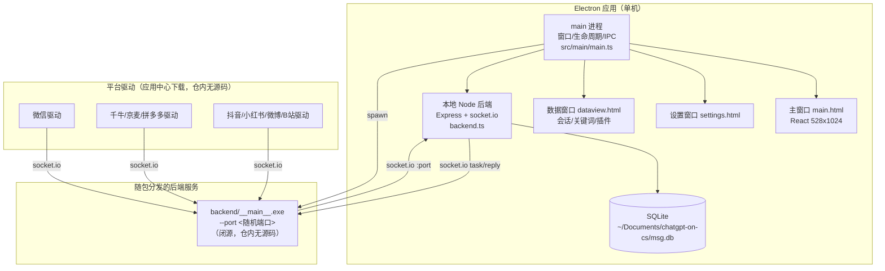
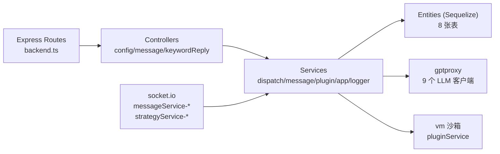
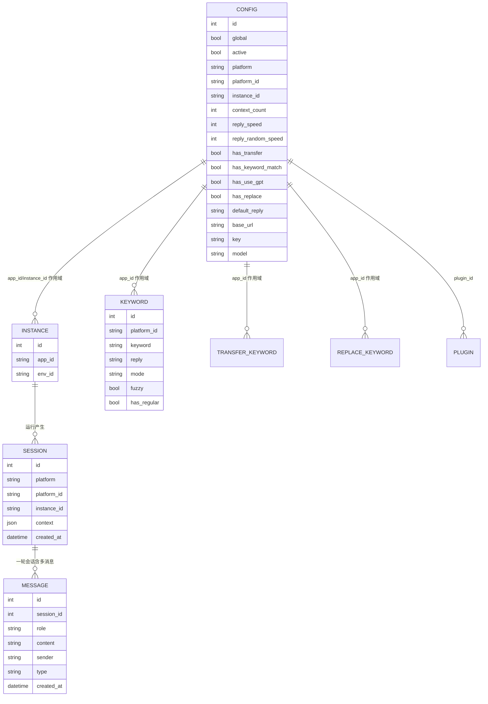
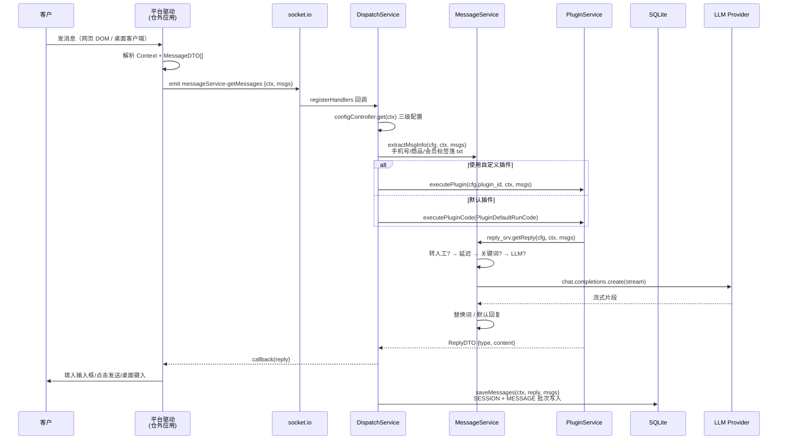
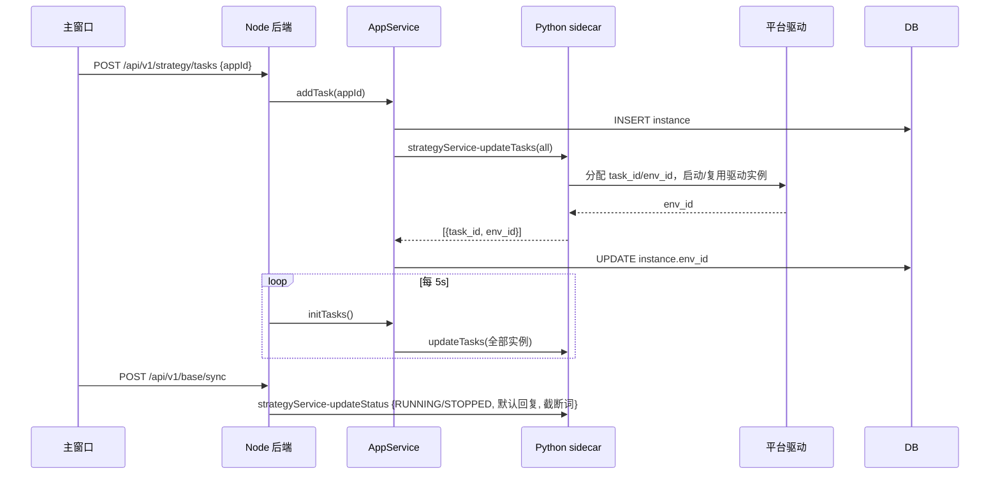
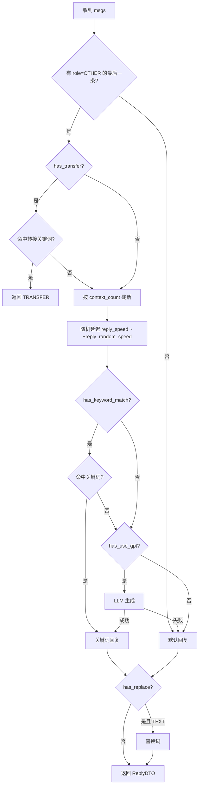
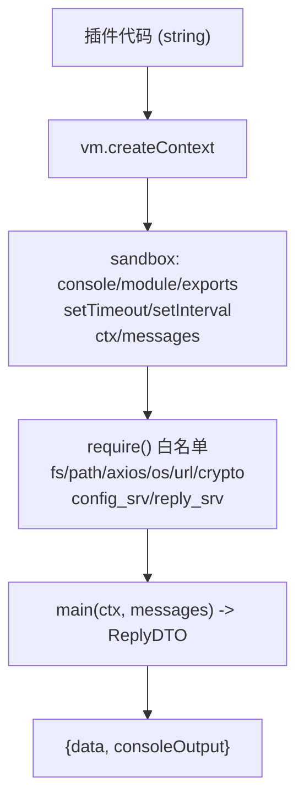

# ChatGPT-On-CS 架构、原理与数据流分析（2026-11）

> **2026-11-06 实证修订**：本文 §2"仓库存量事实"中"平台驱动不在仓内"的结论仍然成立（指 git 源码），
> 但官方 **GitHub Releases 安装包内含全部闭源驱动**，且 Electron 侧带 sourcemap 可完整还原——
> 已还原 109 个主进程源文件（含 14 个平台驱动）+ Python 侧车模块结构。全部推断已升级为实证，
> 以 [CHATGPT-ON-CS-REAL-DRIVER-2026-11.md](./CHATGPT-ON-CS-REAL-DRIVER-2026-11.md) 为准；本文保留作开源仓壳层分析。
> **借鉴对象**：<https://github.com/cs-lazy-tools/ChatGPT-On-CS>
> **分析基线**：`2af901b00f42ce871ea07b3ab1f9919c2b2f33a2`（2026-10-10，v1.4.5）
> **许可**：AGPL-3.0（**只借鉴架构与协议思想，不复制源码**；复制即传染，法务边界见 §12）
> **方法**：全仓静态阅读（195 个 ts/tsx，约 2.2 万行）+ 公开页面/资源探测；未运行其 Electron 客户端，
> 未下载其应用商店驱动。凡属推断的结论在文中标 `推断`，代码可证的标 `实证`。
> **配套文档**：[CHATGPT-ON-CS-UNIFIED-RECEPTION-2026-11](./CHATGPT-ON-CS-UNIFIED-RECEPTION-2026-11.md)
> · [六渠道接入方案](../integration/CHANNEL-GAP-ANALYSIS-2026-11.md)

---

## 1. 结论摘要

1. **它不是"一个聊天机器人"，而是"桌面壳 + 本地消息总线 + 可下载平台驱动"的三段式产品**。开源仓只含前两段，
   真正按平台做页面自动化的驱动（微信/千牛/京麦/拼多多/抖音/小红书/微博/B站…）不在仓内，由应用中心下发。
2. **统一接待的核心不是统一页面，而是统一"任务 + 上下文 + 回复"三件套**：每个平台实例注册成一条 task
   （`task_id/app_id/env_id`），所有消息都归一到 `Context(Map) + MessageDTO[] + ReplyDTO`，AI 决策与平台无关。
3. **平台无关的决策链在本地 Node 进程完成**：转人工关键词 → 上下文裁剪 → 拟人延迟 → 关键词回复 → LLM →
   替换词 → 默认回复；平台驱动只负责"取消息/发消息"。
4. **驱动与主进程用 socket.io 解耦**：驱动通过 `messageService-getMessages` 请求回复，主进程回填 `callback(reply)`；
   主进程用 `strategyService-updateTasks` 下发实例任务，用 `strategyService-updateStatus` 下发全局开关。
5. **上下文是电商化的**：`CTX_CURRENT_GOODS/ORDER_STATUS/ORDER_ID/LOGISTICS_STATUS/MEMBER_TAG/FAN_TAG`
   等键把"当前商品、订单、物流、会员标签"直接喂给模型，这是通用 IM 客服没有的。
6. **插件是 `vm` 沙箱里的异步函数**：预置 `config_srv`、`reply_srv` 与 fs/path/axios/os/url/crypto，
   可替换整条回复策略；但这是**同进程 vm，不是安全沙箱**（见 §8）。
7. **存储极简**：本地 SQLite，8 张表（配置/实例/会话/消息/关键词/转接词/替换词/插件），没有多租户、
   没有消息幂等键、没有投递状态机——这正是 hivemtk 不能照搬的部分。
8. **LLM 层是"多供应商 OpenAI 兼容客户端"集合**：OpenAI/通义/文心/混元/MiniMax/讯飞星火/Gemini/Dify/VYro，
   统一 `chat.completions.create(stream:true)`，失败回落默认回复。
9. **它的"统一接待"是单机、单运营者、弱一致性的**；hivemtk 是服务端、多租户、强一致消息中台。
   可借鉴的是**渠道驱动协议与电商上下文模型**，不是它的进程内状态管理。
10. **最大工程启示**：把"平台差异"压缩到一个极窄的驱动接口（登录态/会话枚举/取消息/发消息/上下文提取），
    其余（AI、风控、转人工、统计、插件）全部平台无关。hivemtk 的蜂桥扩展已经走了同一条路，
    但缺少"电商上下文"和"驱动任务生命周期"这两块。

---

## 2. 仓库存量事实（先破一个常见误解）

| 能力 | 仓内是否有实现 | 证据 |
|---|---|---|
| Electron 主进程 / 多窗口 | ✅ | `src/main/main.ts`、`src/main/windows/*` |
| 本地 HTTP API + socket.io | ✅ | `src/main/backend/backend.ts` |
| 配置/消息/关键词/插件 CRUD | ✅ | `src/main/backend/controllers/*`、`entities/*` |
| 回复决策链（关键词/转人工/替换/LLM） | ✅ | `src/main/backend/services/messageService.ts` |
| 插件 VM 执行 | ✅ | `src/main/backend/services/pluginService.ts` |
| 多 LLM 供应商代理 | ✅ | `src/main/gptproxy/*` |
| 平台驱动（微信/抖音/小红书/京东/B站/微博…） | ❌ **不在仓内** | 全仓 grep 平台名只命中 UI 文案与种子数据；驱动由 `strategyService-*` 连接的外部应用提供 |
| 应用商店/驱动下载 | ❌ 仓内只有"任务注册"和"平台列表"接口 | `AppService` 只写 `instance` 表；`getAllPlatforms` 向外部服务要列表 |
| Python 后端可执行文件 | ❌ 只有启动器 | `src/main/system/backend.ts` 启动 `./backend/__main__.exe`，二进制不在仓 |

> **结论**：把该仓当成"平台接入源码"来抄会抄空。它真正开源的是**调度骨架 + AI 决策链 + 插件体系**；
> 平台 DOM/客户端自动化是其商业应用资产。本文后续对"每渠道实现"的分析因此分两层：
> **协议层（可证）** 与 **驱动层（按产品能力与平台页面结构推断）**。

---

## 3. 运行形态与进程架构

**进程职责**

| 进程 | 职责 | 关键代码 |
|---|---|---|
| Electron main | 单实例锁、窗口、IPC、启动/守护 sidecar、崩溃重启 | `src/main/main.ts:1-190`、`src/main/system/backend.ts` |
| 主窗口 renderer | 应用/实例管理、状态、设置入口 | `src/renderer/main-window/*` |
| 数据窗口 renderer | 聚合会话、关键词/转接词/替换词、插件 | `src/renderer/dataview-window/*` |
| 设置窗口 renderer | LLM/回复/通用/账号/插件配置 | `src/renderer/settings-window/*` |
| Node 后端 | 本地 API、socket.io 总线、SQLite、AI 决策 | `src/main/backend/backend.ts` |
| Python sidecar | 驱动生命周期、应用列表、任务下发（闭源） | `src/main/system/backend.ts` |
| 平台驱动 | 登录态、会话枚举、DOM/客户端取发消息 | 仓外 |

**启动时序（实证）**

1. `app.whenReady()` → `createWindow()`；
2. `BackendServiceManager.start()` 选空闲端口、`spawn(__main__.exe --port N)`，退出自动重启；
3. 主进程内 `new Server(port, mainWindow)` 起 Express + socket.io；
4. 主窗口加载后，渲染进程经 `get-port` IPC 拿到同一端口；
5. 每 5s：刷新配置、健康检查；每 20s：`POST /api/v1/base/sync` 把配置/任务同步给 sidecar；
6. sidecar 把任务分发给各驱动，驱动连 socket.io 请求回复。

---

## 4. 后端分层（Node 侧）

| 层 | 文件 | 说明 |
|---|---|---|
| 路由 | `src/main/backend/backend.ts` | 约 40 个 REST 端点：消息、平台、设置、关键词、转接、替换、插件、任务、健康 |
| 控制器 | `controllers/configController.ts`、`messageController.ts`、`keywordReplyController.ts` | 配置读写/激活、会话与消息查询、Excel 导入导出、关键词匹配 |
| 服务 | `services/dispatchService.ts` | socket.io 事件、任务同步、平台列表、配置同步 |
| 服务 | `services/messageService.ts` | **AI 决策链核心** |
| 服务 | `services/pluginService.ts` | 插件 VM、默认插件代码 |
| 服务 | `services/appService.ts` | 实例任务增删、调用 sidecar 更新 |
| 实体 | `entities/*.ts` | `n_config`、`instance`、`n_sessions`、`n_messages`、`n_keywords`、`n_transfer_keywords`、`n_replace_keywords`、`n_plugins` |

**分层评价**：它是"Electron 单体里的轻量 MVC"，不是五层架构；控制器直接摸 Sequelize 实体，
没有 Repository 层。这点与 hivemtk 的 Router→Handler→Service→Repository→Model 铁律冲突，
**不可照搬目录结构**。

---

## 5. 数据模型（SQLite）

**关键设计**

- `CONFIG` 是"全局 + 应用 + 实例"三级覆盖：查询时按 `appId/instanceId` 由具体到全局回落
  （`configController.get`）。
- `SESSION.context` 存 `Array.from(ctx.entries())`，把本次接待的商品/订单/会员标签原样留痕；
  hivemtk 的 `message_hub.extra` 已有同类能力，但缺"会话级快照"。
- `MESSAGE` 没有 `msg_id`、没有方向、没有投递状态；`SESSION` 没有 `conversation_id`。
  **这意味着它无法做幂等、无法做回环判定、无法做投递追踪**——hivemtk 的
  `message_hub` 四元组唯一键 + outbox 状态机必须保留。

---

## 6. 统一接待数据流

### 6.1 入站（客户消息 → AI 回复 → 驱动发送）

**顺序上的两个硬点**

1. **先回调、后落库**（`callback(reply)` 在 `saveMessages` 之前）。驱动拿到回复即可发送，
   落库失败不影响客户收到消息——单机可接受，服务端不可接受（会丢审计）。
2. **回复类型只有 5 种**：`TEXT / IMAGE / VIDEO / FILE / NO_REPLY`；`TRANSFER` 是 `getReply`
   的内部返回值，最终也会走回调。没有"卡片/表情/语音"结构，图片/文件靠驱动自己解释。

### 6.2 配置同步与任务生命周期

**可借鉴点**：任务不是"账号密码"，而是 `(app_id, env_id)`；同一 app 可多实例（多店铺/多账号）。
**不可照搬点**：每 5s 全量重下发、无版本号/无幂等、无租约；驱动掉线只能靠健康检查发现。

### 6.3 出站回复的驱动契约（仓内可证的部分）

| 方向 | 事件 | 载荷 | 语义 |
|---|---|---|---|
| 驱动 → 主 | `messageService-getMessages` | `{ctx: Record<string,string>, msgs: MessageDTO[]}` | 请求一次回复；`callback(ReplyDTO)` 同步返回 |
| 驱动 → 主 | `messageService-broadcast` | `{event, data}` | 驱动广播：`key_esc` 暂停、`has_paused` 状态 |
| 主 → 驱动 | `strategyService-updateTasks` | `{tasks:[{task_id,app_id,env_id}]}` | 全量任务 |
| 主 → 驱动 | `strategyService-updateStatus` | `{status, jdr, twkey, twcount}` | 全局启停/默认回复/截断 |
| 主 → 驱动 | `strategyService-getAppsInfo` | 无 | 取平台列表（应用中心元数据） |

> 驱动侧的"取消息/发消息"协议**不在仓内**；上表只覆盖"驱动向主进程要回复"这一段。
> 因此不能据此断言其 DOM 选择器或登录方式，详见配套文档 §3。

---

## 7. 回复决策链（`messageService.getReply`）

**细节（实证）**

- 关键词支持 `|` 多候选、`[and]` 同时包含、正则、模糊；回复支持 `[or]` 随机选一、`[~]` 随机符、
  `[@]文件路径[/@]` 发文件（`messageService.matchKeyword`、`keywordReplyController`）。
- 转接关键词命中直接返回 `TRANSFER`，**不调用 LLM**；这是"人工优先"的最短路径。
- 延迟是 `min + random*(max-min)` 秒，默认值来自 `n_config`；这是最朴素的拟人化。
- `truncate_word_count/truncate_word_key` 是抖店特有的"超长截断"（默认 4000 字/截断词），
  说明不同平台的字数限制被做成了全局配置，而不是驱动能力——hivemtk 应放在渠道能力表里。
- 失败一律回落 `default_reply`，没有重试/降级模型链；可用性靠"默认回复"兜底。

---

## 8. 插件沙箱（`pluginService.ts`）

**事实**

- `vm.runInContext` 执行用户代码，`module.exports = main`；支持 async 函数。
- `require` 只放行 7 个模块；`config_srv` = `ConfigController`，`reply_srv` = `MessageService`。
- 返回值必须是 `{type, content}`，否则抛错并回落默认回复。
- `console` 被替换为收集器，前端可看到插件日志（`/api/v1/base/plugin/check` 试跑）。
- 有超时吗？**没有**。`vm.runInContext` 同步执行，异步 `main` 也没有 `Promise.race` 超时；
  插件里的 `while(true)` 或永不 resolve 的 Promise 会挂住该次请求（同进程，不隔离事件循环）。
- 安全边界：**不是安全沙箱**。`vm` 只做上下文隔离，逃逸面（constructor/prototype）存在；
  `fs`/`axios` 直接暴露意味着插件可读写本机文件、发任意网络请求。

**对 hivemtk 的启示**：如果要做"渠道插件/回复策略插件"，必须用**独立进程 + 超时 + 能力白名单**，
不能把 `vm` 当沙箱；hivemtk 现有 `modulekit`/`plugin` 包应作为落点，而不是照搬 `vm`。

---

## 9. LLM 代理层

| 供应商 | 适配方式 | 备注 |
|---|---|---|
| OpenAI 兼容 | `openai` SDK，自定义 `baseURL` | 默认路径，覆盖 DeepSeek/vLLM 等 |
| 通义千问 | DashScope 兼容层 | `gptproxy/qwen` |
| 文心一言 | 百度 SDK/协议 | `gptproxy/ernie` |
| 混元 | 腾讯协议 | `gptproxy/hunyuan` |
| MiniMax | 自有协议（含音频） | `gptproxy/minimax` |
| 讯飞星火 | WebSocket 协议 | `gptproxy/spark` |
| Gemini | Google 协议 | `gptproxy/gemini` |
| Dify | 应用 API | `gptproxy/dify` |
| VYro | 兼容层 | `gptproxy/vyro` |

统一调用面是 `chat.completions.create({model, messages, stream:true})`，逐个 chunk 拼字符串。
**没有** token 计量、没有成本核算、没有超时/重试/熔断、没有多模型路由——这是它作为单机工具的合理取舍，
但与 hivemtk 的 `llm_providers`/`llm_routing_rules`/计费链路相比是明显短板，**不借鉴**。

---

## 10. 前端结构

| 窗口 | 入口 | 主要页面 | 作用 |
|---|---|---|---|
| 主窗口 | `renderer/main-window` | 应用列表、实例列表、搜索、设置入口 | 选应用/加实例/看状态 |
| 设置窗口 | `renderer/settings-window` | 通用、回复、LLM、账号、插件、关于 | 三级配置 |
| 数据窗口 | `renderer/dataview-window` | 会话历史、关键词、转接词、替换词、插件 | 运营与审计 |

技术栈：React + TanStack Query + Chakra UI（推断，按依赖与组件用法）+ electron-store。
状态管理是每窗口一个 store，不共享；跨窗口靠 IPC (`refresh-config`) 与轮询。

---

## 11. 架构评价

### 11.1 优点（值得借鉴）

1. **驱动接口极窄**：平台驱动只需要"给我 ctx/msgs，我还你 reply"，AI 侧完全不感知平台。
2. **上下文是一等公民**：`CTX_*` 常量把商品/订单/物流/会员标签标准化，模型能直接消费。
3. **三级配置覆盖**：全局 → 应用 → 实例，运营可以为单个店铺覆盖回复策略。
4. **关键词/转接/替换三件套**：便宜、可控、可运营，是 LLM 之外的必要兜底。
5. **插件可试跑**：配置页能直接跑一段插件代码看输出与日志，降低运营门槛。
6. **任务化实例**：`task_id/app_id/env_id` 把"账号"抽象成"可调度的实例"，为多开做准备。

### 11.2 缺点（不能照搬）

| 问题 | 后果 | hivemtk 的对策 |
|---|---|---|
| 驱动闭源、协议只覆盖半段 | 无法审计平台行为，无法保证合规 | 蜂桥扩展全开源、选择器可覆盖、实验渠道显式降级 |
| 单机 SQLite、无幂等/无投递状态 | 重复消息、丢消息、无法追踪 | `message_hub` 四元组唯一键 + outbox 状态机 + ack |
| 配置每 5s 全量重下发 | 驱动多时抖动、无版本 | 任务/配置带版本号 + 租约（hivemtk 现有 WS register 可扩展） |
| 插件同进程 vm、无超时 | 卡死/逃逸 | 独立进程 + 超时 + 能力白名单 |
| 无多租户/无权限 | 无法 SaaS 化 | hivemtk 已有 tenant/merchant 隔离 |
| 无媒体理解（只透传 URL/文件） | 图片/语音客服能力弱 | hivemtk 有 contentguard/多模态链路，按渠道能力表声明 |
| 无观测（只有日志窗口） | 线上问题难定位 | 复用 hivemtk metrics/trace/selector-health |

### 11.3 合规边界

- 该项目是 **AGPL-3.0**。直接复制其源码到 hivemtk（AGPL-3.0）虽许可兼容，但会引入
  "网络使用即分发"义务与商业闭源风险；本轮**只借鉴架构、协议字段与运营模型，不复制代码**。
- 其平台驱动涉及"模拟人工操作"，可能违反平台 ToS；hivemtk 的蜂桥同样有该风险，
  已在 `docs/architecture/CHANNEL_INTEGRATION_AUDIT_2026-09.md` 与 J-1 中登记。
  新增渠道必须沿用"用户自有账号 + 显式授权 + 限速 + 可停用"的边界。

---

## 12. 对 hivemtk 的借鉴清单

### 12.1 直接借鉴（本轮落地）

| # | 借鉴点 | hivemtk 落点 |
|---|---|---|
| B1 | 驱动任务 = `(channel, account_id, env_id)`，可多实例 | 蜂桥已有 `(channel, account_id)`，补 `env_id` 语义（扩展实例 ID） |
| B2 | 统一 `Context` 键（商品/订单/物流/会员标签） | `channelgw.IngestMessage.Extra` + `message_hub.extra` 约定 `ctx.*` 键 |
| B3 | 回复决策链顺序（转人工 → 关键词 → LLM → 替换 → 默认） | hivemtk 已有部分；补"替换词"与"默认回复"的渠道级配置 |
| B4 | 关键词 `|`/`[and]`/`[or]`/`[~]` 语法 | 可在 `service/cards` 或新 `replypolicy` 域实现；本轮先文档化 |
| B5 | 插件试跑（输入 ctx/msgs 看输出+日志） | 复用 hivemtk `modulekit` 的沙箱试跑能力，不新建 |
| B6 | 三级配置覆盖（全局/渠道/账号） | `config_params` 已有 group/key；补 channel/account scope |
| B7 | 平台成熟度显式声明（Experimental） | 已有 `ChannelSpec.Experimental`，新渠道沿用 |

### 12.2 明确不借鉴

- Electron 多窗口与 IPC 架构（hivemtk 是 Web 管理台）。
- SQLite 单机存储与无幂等消息模型。
- 同进程 `vm` 插件沙箱。
- 每 5s 全量任务/配置重下发。
- 把平台字数限制做成全局配置（应做成渠道能力）。

---

## 13. 证据索引

| 主题 | 文件 |
|---|---|
| 进程/窗口/单实例 | `src/main/main.ts` |
| sidecar 启动与重启 | `src/main/system/backend.ts` |
| Express + socket.io + 全部路由 | `src/main/backend/backend.ts` |
| 任务注册/删除 | `src/main/backend/services/appService.ts` |
| socket 事件与任务同步 | `src/main/backend/services/dispatchService.ts` |
| 回复决策链 | `src/main/backend/services/messageService.ts` |
| 插件 VM | `src/main/backend/services/pluginService.ts` |
| 上下文键 | `src/main/backend/constants/index.ts` |
| 配置三级查询 | `src/main/backend/controllers/configController.ts` |
| SQLite 模型 | `src/main/backend/ormconfig.ts`、`entities/*.ts` |
| 数据类型 | `src/main/backend/types/index.ts` |
| 前端窗口 | `src/renderer/{main-window,settings-window,dataview-window}/*` |
