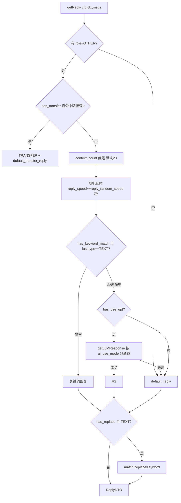

# ChatGPT-On-CS v1.4.5 完整实现细节参考手册（穷尽版）

> **性质**：对官方安装包还原源码（109 文件，见
> [CHATGPT-ON-CS-REAL-DRIVER-2026-11.md](./CHATGPT-ON-CS-REAL-DRIVER-2026-11.md) 证据链）的
> **逐模块穷尽精读成果**。此前三轮只覆盖了框架与六渠道主干；本手册补齐全部细节——
> REST 端点全集、数据模型全字段、配置全字段、回复链四 AI 通道、调度内核全貌、
> humancursor 曲线算法、CDP DOMUtils、五类消息卡片抽取、转接链、防重回复、
> 备注/非 BMP 清洗等风控细节、14 平台选择器与方向判定全集。
> **用途**：hivemtk 借鉴的最终依据；文中所有选择器/常量/字段名可直接照抄核对。
> 证据标记：全部 `实证`（还原源码），个别标注"有 bug 风险"的是原作写法本身的问题。

---

## 1. 进程与装配总览

```
Electron main (main.ts)
 ├─ BackendServiceManager.start()   spawn backend/__main__.exe --port N（Nuitka Python 侧车）
 ├─ new Server(port, mainWindow)    Express + socket.io（Node 侧，同端口）
 │   ├─ routes/index.ts → 8 组路由挂 /api/v1/{base,message,plugin,replace,reply,strategy,transfer}
 │   └─ io.on('connection') → dispatchService.registerHandlers(socket)
 ├─ strategyService = new StrategyService(...)   // 调度内核
 ├─ setupCron()                     5s 刷新配置/健康检查；20s POST /api/v1/strategy/config/sync
 └─ 窗口族：main(528x1024) / settings / dataview / listen(400x800 左上角常驻置顶，扫码监听用)
```

- **bus**（mitt 事件总线）：唯一事件 `systeam:has_paused`——ESC 键暂停 → configService.pausedKeyDowHandler → 主窗口广播 `has_paused`。
- **Container.ts**：极简 DI（Map register/get），路由内 `container.get<StrategyService>('StrategyService')`。
- **窗口 listen**：400×800 常驻置顶小窗，渲染 `listen.html`——给"扫码登录"场景当取景框（桌面平台二维码轮询展示）。

## 2. REST API 全集（41 端点，实证）

| 组 | 端点 | 说明 |
|---|---|---|
| base | GET /health, /login, /logout, /setting；POST /pause, /setting, /gpt/health, /chrome/check | 健康/登录/LLM 试跑/Chrome 路径校验 |
| message | POST /session, /list；GET /excel | 会话查询/消息查询/Excel 导出 |
| reply | GET /list；POST /create,/update,/delete；GET+POST /excel | 关键词回复（`[or]`/`[~]`/正则） |
| transfer | GET /list；POST /create,/update,/delete；GET+POST /excel | 转人工关键词 |
| replace | GET /list；POST /create,/update,/delete；GET+POST /excel | 替换词（违禁词规避） |
| plugin | GET /list,/detail；POST /create,/update,/delete,/check | 插件 CRUD+试跑（返回 consoleOutput） |
| strategy | GET /tasks；POST /task/add,/task/remove,**/task/pause**；GET /platform/all；GET /config/active-list；POST /config/active,**/config/sync** | 任务/平台/配置激活/同步；platform/all 返回 `impl`（VIP）+ `is_paused` + `taskCount` |

对比开源 HEAD 的差异：HEAD 只有 20 端点且无 `/task/pause`、`/config/active-list`；v1.4.5 二进制多出的正是这些运营能力。

## 3. 数据模型（SQLite 8 表，全字段语义）

| 表 | 关键字段（v1.4.5 全量） |
|---|---|
| `n_config`（555 行实体） | global/active/platform/platform_id/instance_id；use_plugin/plugin_id；extract_phone/extract_product/save_path；**chrome_path**（指定本机 Chrome）；**xiaohongshu_eva_path**（千帆客户端路径）；reply_speed/reply_random_speed（拟人延时）；context_count；wait_humans_time；default_reply；base_url/key/llm_type/model；activation_code；version；has_paused/has_keyword_match/has_use_gpt/**has_use_chatid**/**has_open_ocr**/**has_extract_qt_code**(提取二维码)/**has_use_goods_append**(商品上下文注入)/has_mouse_close/has_esc_close；truncate_word_count(默认4000)/truncate_word_key；has_transfer/has_replace；jinritemai_default_reply_match；**ai_use_mode(lazy,coze,normal)**；**coze_bot_id/coze_bot_key**；**lazy_use_app_id/lazy_use_open_id/lazy_token**；**has_transfer_reply/default_transfer_reply/transfer_reply_match**（转接回复语）；auto_follow（小红书自动回关） |
| `instance` | id/app_id/created_at/**trigger_count**(触发次数)/**is_paused**(暂停) |
| `n_sessions` | id/platform/platform_id/instance_id/context(JSON)/created_at |
| `n_messages` | id/session_id/role/content/sender/type/created_at |
| `n_keywords` | id/platform_id/keyword/reply/mode/fuzzy/has_regular |
| `n_transfer_keywords` | id/app_id/keyword/has_regular/fuzzy |
| `n_replace_keywords` | id/app_id/keyword/replace/has_regular/fuzzy |
| `n_plugins` | id/code/title/author/description/icon/type/tags/source/version |

种子数据（ormconfig）：8 组电商关键词（发货/你好/谢谢/快递/退款…带 `[or]` 随机回复池）、8 组转人工词（人工客服/转人工/价格/退款/顺丰包邮…）、6 组替换词（微信→V兴、电话→Call、到付→V付…）。

## 4. 回复链（messageService.ts，965 行，v1.4.5 全量）



### 4.1 五条 AI 通道（`ai_use_mode` 分派，实证）

| mode | 实现 | 输入加工 | 返回 |
|---|---|---|---|
| normal | `getNormalLLMResponse`：9 家 SDK（openai/qwen/ernie/hunyuan/minimax/spark/gemini/vyro/dify），stream 拼接 | `toLLMMessages`：SELF→assistant / OTHER→user | TEXT |
| coze | `fetchCozeCompletions(bot_id, bot_key, messages)`，SSE `event: conversation.message.completed` 解析 | `toCozeMessages` | TEXT |
| **lazy**（懒人百宝箱 SaaS） | `fetchLazyAIResponse(open_id, {chatId, messages, stream:false, variables:ctx对象})`；响应头 `lazy-reply-type` 决定回复类型（TEXT/IMAGE/…） | `toLazyMessages`（含知识库上下文）+ **`has_use_goods_append` 时 unshift 一条 system：`当前的上下文信息：* 当前咨询的商品为：…\n* 商品 ID：…`**；`has_use_chatid` 时从 ctx 取 chatId 做会话记忆 | 头决定的 type |
| fastgpt | `fetchFastAIResponse(base_url, key, 同 lazy 形状)`（`{url}/chat/completions`） | 同 lazy（chatId/variables） | 头决定 type |
| dify | `fetchDifyCompletions` | `toCozeMessages` | TEXT |

**关键细节**：`variables: ctx对象` —— 全部 CTX_* 键以变量形式传给知识库编排；这是对方"电商上下文"发挥作用的第二通道（第一条是 goods_append 的 system 注入）。

### 4.2 关键词/转接/替换匹配语义

- 关键词 `keyword` 用 `|` 分多候选；`[and]` 连接=同时包含；`fuzzy`/`has_regular` 两开关；回复 `[or]` 随机选一、`[~]` 随机符、`[@]路径[/@]` 发文件。
- 转接命中 → `TRANSFER`；驱动侧（拼多多）还有 `has_transfer_reply`：转接前先给客户发一句 `default_transfer_reply`。
- 替换词：出站 TEXT 全文替换（含正则/模糊），种子见 §3。

### 4.3 extractMsgInfo（线索提取）

`extract_phone`：正则 `\b1[3-9]\d{9}\b`；`extract_product`：读 ctx 的 goods/goods_id/member_tag/fan_tag/new_customer_tag；追加写 `save_path/<日期>.txt`。

## 5. 调度内核（strategyService.ts，709 行）

- `setup()`：`while(true) { for (s of strategies) { s.action(); s.saveStorageState(); } sleep(2s) }` —— **全平台串行、2s 一拍**；`isPageClosedError(e)` → `reset()`（全 stop + browser.close + 清空三张 Map）。
- `action()` 状态机：`START`→newPage+goto+waitForTimeout(1500)；`INIT`→等登录（`waitUrls` 匹配 passport 域；`initPageCounter>=3` 自杀 stop）；`RUN`→stepRun；`DESTROY`→stop+initParams。
- `addTask(type, instance_id)`：同 id 去重 → `getContextForType`（**同 type 不共用 context**：遍历 contextToTypeMap 找不含该 type 的 context 复用，否则 `browser.newContext`）→ loadStorageState → start。
- `getContextForType` 建上下文：UA 固定 `Chrome/88.0.4324.150`、viewport:null、strictSelectors:false、acceptDownloads；`--no-sandbox --ignore-certificate-errors --start-maximized --disable-blink-features=AutomationControlled --disable-infobars`；下载事件存 `~/Downloads`。
- `updateTasks(instances)`：Mutex 内对账——删除不在表的、暂停 `is_paused` 的（removeTask(taskId,false) 保留 session）、新增的（addTask）。
- `syncConfig()`：读 driver/generic 配置 → emit `strategyService-updateStatus {status,jdr,twkey,twcount}` + updateTasks。
- `getAppInfos()`：VIP 门控（`lazyToken → getUserInfo → membership.vipLevel!=='Free' 且未过期` 才 `impl:true`）；`lazyConfig.vipPlans.enable=false` 时全放开；win_wechat/bilibili/zhihu/weibo 恒 true。
- `listenKeyboard()`：bus `systeam:has_paused` → pausedKeyDowHandler + 广播。

## 6. 通用工具（utils/，实证）

### 6.1 humancursor（人类鼠标轨迹）

- `HumanizeMouseTrajectory(from,to,opts)`：边界（默认 ±80px）内随机 **2 个 knots** → 样条插值（`calculatePointsInCurve`，中点数=max(|dx|,|dy|,2)）→ **Box-Muller 正态失真**（mean=1,std=1,frequency=0.5，只加在 y 上）→ `tweenPoints`（tween.js `Easing.Quadratic.Out`）重采样 **100 点**。
- `WebCursor.click()`：按下→随机停 170–280ms→抬起→再随机 170–280ms。
- API：`moveTo/clickOn/moveByOffset/dragAndDrop/controlScrollBar`（Page.mouse 驱动）。

### 6.2 playwright utils

- `getChromePath()`：`where chrome/chromium/google-chrome*` → HKCU/HKLM 注册表 `App Paths\chrome.exe`；`getChromeVersion()`：PowerShell 读 VersionInfo/BLBeacon/Uninstall 三级兜底。
- `uploadFile(page, selector, filePath|URL)`：URL 先 downloadFile 到临时目录再 `setInputFiles`；本地校验存在。
- `copyHttpImageToClipboard / copyImageToClipboard`：axios 拉 → Jimp 转 **BMP** → `nativeImage.createFromBuffer` → `clipboard.writeImage`（千牛发图 HTTP 通道的对偶）。
- `matcheTargetUrl(pattern, current)`：glob 星号匹配登录页。

### 6.3 cdp DOMUtils（千帆驱动用）

`getRootNodeId/querySelector/querySelectorFromParent/elementExists*/NodeToElement/NodesToElements/uploadFile(Runtime,DOM,selector,path)`——纯 CDP 协议操作 DOM（Runtime.evaluate 注入 jsPath），不依赖 Playwright。

### 6.4 其他

- `qrcode/AdvancedQRCodeReader`：Jimp 解码 + jsQR，多码合并（`has_extract_qt_code` 开关；微信收款码提取）。
- `utils/index`：`emitAndWait(io,event,data,timeout)`（socket.io emitWithAck 包装）、`downloadImage/fsExists/isValidImageFile`。
- `strings.ts`：`rangeMatch`（关键词匹配内核）、`specialTokenReplace`（`[~]` 随机符/时间宏）、`replaceKeyword`。

## 7. 十四平台驱动细节全集

> 通用骨架（StrategyLifecycle）见 §5；下表补各平台独有细节。`方向` 列是 checkRole 判据；`防重/特技` 是该平台特有逻辑。

| 平台 | URL | 未读枚举 | 方向判据 | 内容抽取 | 输入/发送 | 防重/特技 |
|---|---|---|---|---|---|---|
| douyin | creator.douyin.com/creator-micro/data/following/chat | 用户列表逐个点 | `.msg` class 含 `is-me`=SELF、`tip--`/`time--`=SYSTEM，否则 OTHER | `div[class*='box-container']` innerHTML→JSDOM→`div[class*='box-item--TSTUb']` | `div[class*='chat-input']` fill 分段+Enter | 帮助按钮 `.semi-modal` 关闭 |
| douyin_mp | e.douyin.com/site/douyin-mp/…/imchat/workspace | 同上族 | class 含 `me--`/`self--`=SELF（`oo-block>div` 枚举） | `div[class*='bubble--'] img` / `div[class*='plain--']>span` | `div[class*='semi-input-textarea']` | — |
| jinritemai | im.jinritemai.com/pc_seller_v2/main/workspace | 通知列表点父级 | `chat.getAttribute('style')` 含 `row-reverse`→SELF（**原作写法 `indexOf('row-reverse') <= 0` 对 -1 误判为 OTHER，复刻时注意**） | `pre>span` 文本；`auxo-dropdown-trigger`：img→图片；订单卡 `qa-ordercard-view-order-number`、商品卡 `chatd-card-main` | `[data-qa-id='qa-send-message-textarea']` fill 分段+Enter；图 `qa-send-img`+`qa-send-img-popup-submit` | **jinritemaiDefaultReplyMatch**：最后一条是自己发的且内容≠配置的默认回复 → 跳过（防默认回复回环）；订单面板 `.ecom-collapse-item-active` 抓商品名/单号/订单状态（7 态枚举）/物流状态→CTX_*；转接 `qa-transfer-conversation`+`qa-transfer-customer`；掉登录 goto fxg.jinritemai.com/login |
| pinduoduo | 商家工作台 | `.chat-portrait > i` 可见过滤，每轮**最多 3 个** | `.onemsg` 内 `.buyer-item`=OTHER / `.cs-item`=SELF / 其余 SYSTEM | `.msg-content` class 五类卡片：`image-msg`(img src)、`good-card`、`order-card`、`lego-card`(售后)、`msg-content-group`(模板 `msg-c-withimg-title`+`template-list .right`)；无内容→`extractSystemCard` | `#replyTextarea` fill 分段+`.reply-footer .send-btn`/Enter；图 `input[type=file]`+`.modal-box .btn-ok` | **备注随机化**（`.base-info .remark-row` 填随机串防风控）；发送前 **`replace(/[^\u0000-\uFFFF]/g,'')` 移除非 BMP 字符**+去 `\n`；转接链 `.transfer-chat-wrap`→填 `transferReplyMatch`→`.el-table__row`→`.item-btn-transfer`→确认 |
| weibo | api.weibo.com/chat#/chat | `[class*='num fff font']` 逐个点 | 气泡 `[class*="bubble_cont basi"]` class 含 **left=OTHER / right=SELF** | `p[class*='puretext']`；图/视频 `div[class*='card']>div>img|video` | `#webchat-textarea` fill 分段+**Enter**；图 `i.icon.icon-msg.tp`+file | `_split_text`：splitKey 段后接回关键字再按 maxLength 打包 |
| xiaohongshu(评论) | xiaohongshu.com/notification | tab `[class*='reds-tab-item'] .badge-container` 找"评论和@" | 单条评论无方向 | `div.container>div.main` 前 3 条；用户 `div.user-info>a`、内容 `div.interaction-content` | `.action-text` hover+click → `.comment-input` fill → `button.submit` | **checkHasReply**：点开评论树 `.comments-container`→`.parent-comment` 按(用户名,内容)定位→查子评论里是否有作者名→已回复跳过；`removeNonBmpCharacters` |
| xiaohongshu_pro | pro.xiaohongshu.com/enterprise/message/reply | `.contact-meta` | `.message-detail` class 含 **is-self=SELF** | `.image-content>img` / 文本 | `[class='input-area']` | 绑定操作 `bind-action`（tab1/tab2 `button[type='link']` 确认弹窗） |
| zhihu | zhihu.com/messages | `.ChatListGroup-Section:first-child` 未读 | 双参 `checkRole(message, classStr, isReceiver)`：图片消息反向判定（**isReceiver 时找到选择器=SELF，否则=OTHER**） | `.MessagesBox` 枚举 | `.InputBox-input>.Input` fill `${sentence}\n`+Enter | 加载态 `.BounceLoading.MessagesBox-loading` 等待 |
| bilibili | message.bilibili.com/#/whisper | `.list-container .list-item` + `.notify.notify-number`；**未关注人 tab `[title='未关注人消息']`，处理完回 `[title='我的消息']`**；每轮≤5 会话 | `.msg-item` class 含 `not-me`=OTHER；`.message-content` class 含 `is-me`=SELF | `.message-content`（img→图片） | `#editor` fill 分段+`[class*='btn-box send-btn']`/Enter；图 `.image-upload-btn` | — |
| win_wechat | 微信 PC 客户端 | 侧车窗口扫描 | OCR+坐标 | 侧车截图 OCR | 剪贴板→`wechat_send_to_editor`+Enter | 帮助文档：输入框区域**不可遮挡**；微信发送快捷键必须设 Enter |
| win_qianniu | 千牛 | `qianniu_get_message_box_handle` | — | — | `qianniu_send_to_editor`；**发图走 HTTP**（`send_http_image`） | — |
| wecom | 企微客户端 | 侧车 | `WeWorkWindow` 窗口类 | `app.platforms.wecom.cv`+`check` 模块 | 同族 | 41 张模板（加好友全流程/群管理/消息管理）；v1.4.5 appClasses 中**被注释停用** |
| win_jinmai | 京麦客户端 | 侧车 `app.platforms.jinmai.task` | — | — | `airtest/jinmai/chat_message_input.png` 模板 | 即京东商家客服 |
| win_xiaohongshu_eva | 千帆客户端 | CDP：`.msg-list-box` 存在性→`.farmer-chat-window .vue-recycle-scroller__item-view` **reverse**（最新在最下）→含 `.im-sender` 的为人类消息 | `.im-sender-left`=OTHER / `.im-sender-right`=SELF | `data-msg-type` 属性（text/image…）分发；选择器 `[id*='jarvis-msg-']` | CDP `typeTextIntoElement('.farmer-chat__center .reply-box textarea')` + evaluate 点 `.send-btn`；图 CDP uploadFile+`.modal-beer-box .btn-content:nth-child(2)` | 启动：先探端口→spawn `--remote-debugging-port=N`→`connectWithTimeout`；冲突时 tasklist+taskkill 强杀；`ensureClientConnection/refreshDOM`（`DOM.getDocument({depth:-1})`）；`Page.frameNavigated/loadEventFired/DOM.documentUpdated` 事件保鲜 |

## 8. 风控细节清单（可直接搬的"小而硬"项）

1. **非 BMP 字符剥离**：发送前 `content.replace(/[^\u0000-\uFFFF]/g, '')`（emoji 补对面在某些网页输入框触发崩溃/静默丢弃）+ 去 `\n`（分段发送时避免提前提交）。
2. **备注随机化**（拼多多）：`.base-info .remark-row` 写随机串，把"机器人痕迹"转嫁到客户备注字段。
3. **分段发送**：`splitKey` 优先（段后保留关键字），否则按 `truncateWordCount`（默认 210，抖店 4000）切块；逐段 fill→1s→Enter。
4. **默认回复回环防护**（抖店）：最后一条是 SELF 且内容 == 配置的默认回复 → 跳过本轮。
5. **评论防重回复**（小红书评论）：点开评论树按 (用户名, 内容) 定位原评论，检查子评论里是否已有作者名。
6. **UA 固化**：全 context 统一 `Chrome/88.0.4324.150`（配合 `--disable-blink-features=AutomationControlled`）。
7. **每轮限额**：拼多多 3 会话/轮、B站 5 会话/轮、小红书评论 3 条/轮；全局 2s 节拍。
8. **图片回复**：五平台支持 IMAGE 回复（uploadFile→平台确认弹窗），失败回落 default_reply。

## 9. 对 hivemtk 的落地映射（本轮已执行）

| 对方细节 | hivemtk 现状 | 本轮动作 |
|---|---|---|
| 非 BMP 字符剥离 | 扩展 sanitizeForDisplay 只去 C0 控制字符 | ✅ 已落地：`sanitize.js` 导出 `stripNonBmpChars`（**复刻校正：原作正则缺 u 标志实际失效**，加 `gu` 才生效）+ 2 条 vitest；不默认挂出站链（剥 emoji 是内容损失，现有渠道无实证需求），供渠道面板按需启用 |
| 电商上下文 CTX_* | `extra` 自由字段，无约定 | ✅ 已落地：`channelgw/protocol.go` 增 `IngestCtxKeys` 常量集（ctx.goods/goods_id/goods_spec/order_id/order_status/order_amount/logistics_status/member_tag/fan_tag/new_customer_tag/sender_name，含原作语义注释）+ `protocol_ctx_test.go`（前缀/snake_case/电商核心键齐全三重断言） |
| truncateWord 分段 | 服务端 4KB 截断 + 拟人键入 | 📋 登记不搬（扩展键入速度即风控节拍，分段会拖长下发临界区） |
| 转接回复语（转接前先安抚） | 人工接管即时生效，无转接语 | 📋 登记借鉴 |
| humancursor 曲线 | 拟人键入已有人类节拍 | 📋 登记借鉴（click 170–280ms 参数可先抄） |
| 五类消息卡片抽取 | 蜂桥 TEXT 为主 | 📋 登记借鉴（卡片→文本化拼装） |
| jinritemaiDefaultReplyMatch 回环防护 | 服务端回声拦截已覆盖同类问题 | ✅ 复核无需改 |
| 每轮会话限额 | 巡检 PATROL_DEFAULTS 已有 | ✅ 复核无需改 |

**读数**：bridge vitest 78 文件 **931 通过**/7 skipped（新增 2）；`go test ./internal/channelgw` 绿（含新用例）；`go build ./...` 绿；sanitize/protocol 文件 eslint 0 问题。

---

## 附：文件→章节对照（还原源码 109 文件的覆盖声明）

| 源文件 | 手册章节 |
|---|---|
| main.ts / system/* / cron.ts / ipcHandlers / menu | §1 |
| backend/routes/*（8 组 41 端点）、Container | §2 |
| backend/entities/*（8 表）、ormconfig（种子） | §3 |
| backend/services/messageService（965 行，5 通道） | §4 |
| backend/services/strategyService（709 行内核） | §5 |
| backend/services/configService / appService / pluginService / loggerService | §2/§4/§5 |
| utils/humancursor/*（4 文件） | §6.1 |
| utils/playwright / utils/index | §6.2 |
| utils/cdp / utils/qrcode / utils/bus / utils/strings | §6.3/§6.4 |
| platforms/*（14 驱动） | §7 |
| 风控细节汇总 | §8 |
| hivemtk 落地 | §9 |
