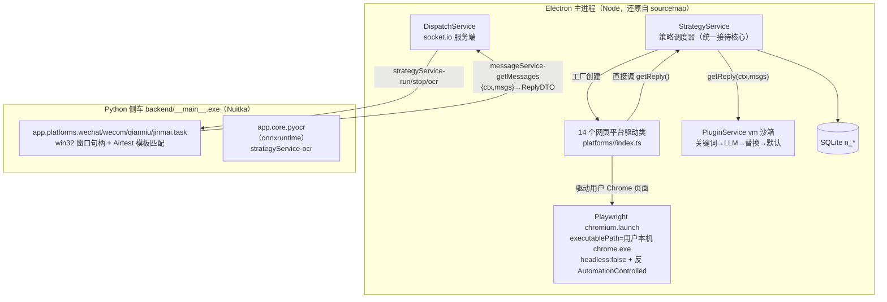

# ChatGPT-On-CS 真实驱动实现还原报告（2026-11-06）

> **本轮目标**：上一轮（`CHATGPT-ON-CS-ARCHITECTURE-2026-11.md`）只能确认"平台驱动闭源、不在仓内"。
> 本轮按要求从官方渠道取得**真实安装包**并解包还原，把上一轮所有标 `推断` 的结论升级为 `实证`。
> **合规**：仅借鉴架构与协议思想；源码全文不复制进 hivemtk（AGPL-3.0 + 闭源部分版权归原作），
> 本报告只引用必要的选择器/常量作为互操作证据。
> **穷尽精读**：109 文件逐模块细节（REST 全集/数据模型全字段/回复链 5 AI 通道/humancursor
> 曲线算法/CDP DOMUtils/卡片抽取/转接链/风控细节全集/14 平台选择器与方向判定）见
> [CHATGPT-ON-CS-IMPLEMENTATION-DETAILS-2026-11.md](./CHATGPT-ON-CS-IMPLEMENTATION-DETAILS-2026-11.md)。

---

## 1. 证据链（每一步可复核）

| # | 证据 | 位置/命令 |
|---|---|---|
| E1 | 官方下载入口（需登录 SaaS，未走通） | `https://jinxiaoai.com/download` → `https://chat.xingsuancn.com/desk/download`（未登录跳登录页，ego browser 实测） |
| E2 | **GitHub Releases 完整安装包**（开源仓自带 release） | `cs-lazy-tools/ChatGPT-On-CS` v1.4.5：`1.4.5.exe` 217,450,048 B |
| E3 | 完整性校验 | 官方 `latest.yml` sha512 = `LjNmvnbN…cCGQ==`，本地 base64 复算**完全一致** |
| E4 | 安装包结构 | NSIS-3 Unicode → `$PLUGINSDIR/app-64.7z` → Electron app（`7zz x` 两层解开） |
| E5 | Electron 壳编译产物**带 sourcemap** | `resources/app.asar`（98MB）→ `npx @electron/asar extract` → `dist/main/main.js.map`（22.9MB，2627 sources） |
| E6 | 主进程 TypeScript 源码还原 | `sourcesContent` 直接还原 **109 个 .ts**，含 `src/main/platforms/<14 个平台>/index.ts` 全量 |
| E7 | Python 侧车 | `resources/assets/backend/__main__.exe`（65MB，**Nuitka 编译**，非 PyInstaller，无 MEI cookie）；同目录自带全部依赖 `.pyd/.dll` |
| E8 | 侧车模块结构（Nuitka 常量表明文） | `app.platforms.{wechat,wecom,qianniu,jinmai}.task(.py)`、`app.core.{airtest,mouse,msgpos,network.socketio,pyocr}` |
| E9 | 桌面驱动技术栈（依赖清单） | `win32gui/win32clipboard/win32ui/pythoncom` + `PIL/cv2/numpy/scipy/onnxruntime` + `assets/airtest/<平台>/*.png` 模板图 |
| E10 | 网页驱动技术栈 | `app.asar.unpacked/node_modules/playwright-core` + `assets/scripts/{stealth.min.js,findElements.js,isDisplayed.js,getAttribute.js}` |

> 关键结论：**不存在"下载不到"的问题**——开源仓的 GitHub Releases 就是完整闭源二进制的分发渠道，
> 且 Electron 侧忘关 sourcemap，主进程（含全部网页平台驱动）源码可完整还原。

## 2. 真实总体架构（修订版，替换上一轮 §3）



与上一轮推断的差异（已订正）：
1. 网页平台驱动**不在外部下载的 app 里**，就在主进程 asar（带 sourcemap）；侧车只承载 4 个桌面平台。
2. 浏览器不是 Electron webview，而是 **Playwright 启动用户本机 Chrome（有头）**，每个平台实例一个
   `BrowserContext`，cookies+localStorage 持久化在 `~/Documents/chatgpt-on-cs/sessions/session_<id>/`。
3. 拟人化不止随机延时：内置 `humancursor`（人类鼠标曲线轨迹，`utils/humancursor/webCursor.ts`）。
4. 图片消息可回复：各平台驱动带 `uploadFile`（input[type=file]）路径；OCR（onnxruntime）用于
   桌面端截图读消息与图片文字提取。

## 3. 真实平台清单（v1.4.5，还原自 strategyService.ts 工厂）

| id | 名称 | 环境 | 入口 URL / 载体 |
|---|---|---|---|
| win_wechat | 微信 | 桌面 | 微信 PC 客户端（侧车 win32+Airtest+OCR） |
| wecom | 企业微信 | 桌面 | 企微客户端 `WeWorkWindow`（appClasses 中**被注释停用**） |
| win_qianniu | 千牛 | 桌面 | 千牛客户端（`Qianniu._send_messages_to_current_business`，发图 HTTP 通道） |
| win_jinmai | 京卖 | 桌面 | **京麦客户端 = 京东商家客服**（README 宣传的"京东"即此 + 抖店飞鸽同域电商） |
| win_xiaohongshu_eva | 小红书千帆客户端 | 桌面 | 千帆 Windows 客户端 |
| douyin | 抖音 | 网页 | `https://creator.douyin.com/creator-micro/data/following/chat` |
| douyin_mp | 抖音企业号 | 网页 | 抖音企业号私信页 |
| jinritemai | 抖店（飞鸽） | 网页 | `https://im.jinritemai.com/pc_seller_v2/main/workspace`（含转人工 `qa-transfer-customer`、商品卡上下文抓取） |
| pinduoduo | 拼多多 | 网页 | 拼多多商家工作台 |
| weibo | 微博私信 | 网页 | `https://api.weibo.com/chat#/chat` |
| xiaohongshu | 小红书 | 网页 | `https://www.xiaohongshu.com/notification`（**评论/通知运营向**：笔记评论回复+关注列表回访） |
| xiaohongshu_pro | 小红书私信 | 网页 | 小红书专业号私信 |
| zhihu | 知乎 | 网页 | 知乎私信 |
| bilibili | bilibili | 网页 | `https://message.bilibili.com/#/whisper` |

**VIP 控制真实逻辑**（getAppInfos）：未配置 lazyToken 或免费会员 → 全平台 `impl:true`；
配置后按 `membership.vipLevel/expirationDate` 判定，仅 win_wechat/bilibili/zhihu/weibo 恒可用。

## 4. 统一接待协议（socket.io 全集，实证）

| 方向 | 事件 | 载荷 | 消费者 |
|---|---|---|---|
| 主 → 侧车 | `strategyService-run` | `{app_id, cfg:{truncate_word_key, truncate_word_count}}` | 桌面驱动启停 |
| 主 → 侧车 | `strategyService-stop` | `{app_id}` | 同上 |
| 主 → 侧车 | `strategyService-ocr` | `{image_path}` → `{text, success, message}` | OCR（图片消息文字提取） |
| 主 → 侧车 | `systemService-health` | ack | 健康检查 |
| 侧车 → 主 | `messageService-getMessages` | `{ctx, msgs}` → callback `ReplyDTO` | **桌面驱动取 AI 回复** |
| 侧车 → 主 | `messageService-broadcast` | `{event, data}`（如 `key_esc`/`has_paused`） | 主窗口广播 |

网页平台不走 socket.io：驱动类在 Node 内直接 `await this.getReply(ctx, messages)`。

## 5. 六渠道驱动实证表（hivemtk 落点）

### 5.1 微博（platforms/weibo/index.ts，311 行）
- URL `https://api.weibo.com/chat#/chat`；未登录等待 `api.weibo.com/chat#/*`。
- 新消息会话：`[class*="num fff font"]`（未读计数）逐个点开。
- 用户名：`div[class*='friendname one-line hvhd']>div>span`。
- 消息：`.message-wrapper .chat-content` 下 `li`；气泡 `div[class*="bubble_cont basi"]`
  **class 含 left=对方 / right=自己**（修正了我们上一轮 `.message-item.self/other` 的猜测）。
- 正文 `div>p[class*="puretext"]`；图片 `div[class*="card"]>div>img`；视频 `…>video`。
- 发送：`[id='webchat-textarea']` → `fill` → **Enter**；图片回复 `i.icon.icon-msg.tp` +
  `input[type='file']`；长文案按 `truncateWordKey` 分段（兜底按 `truncateWordCount` 切）。

### 5.2 B站（platforms/bilibili/index.ts，285 行）
- URL `https://message.bilibili.com/#/whisper`；等待登录含微信扫码页。
- 会话：`div[class*='list-container'] > div[class='list-item']`，未读 `.notify.notify-number`
  点击进会话；**未关注人消息** tab `[title='未关注人消息']`，处理后回 `[title='我的消息']`；每轮最多 5 会话。
- 面板 `.dialog`；用户名 `div[class='title'] > span`；消息 `.message-list` 下 `.msg-item`
  （class 含 `not-me`=对方），内容 `.message-content`（class 含 `is-me`=自己），图片取 `img src`。
- 发送：`#editor`（contenteditable）→ 分段 `fill` → `[class*='btn-box send-btn']`（无则 Enter）；
  图片回复 `.image-upload-btn`。解析用 **JSDOM 解析 innerHTML**（虚拟 DOM 快照），与我们 MutationObserver 路线不同但选择器同源。

### 5.3 京东（= win_jinmai 桌面 + jinritemai 网页）
- **京麦客户端驱动在 Python 侧车**（`app.platforms.jinmai.task`，Airtest 模板
  `airtest/jinmai/chat_message_input.png`）；`app.asar` 里 `Jinmai` 类只是转发
  `strategyService-run`。**没有京东网页（jdm/dongdong）驱动**。
- 抖店飞鸽（jinritemai，696 行，电商上下文最完整）：会话 tab `#rc-tabs-0-tab-current`、
  消息 `.messageList`、图片 `span[data-qa-id='qa-send-img']`、转人工按钮链
  `qa-transfer-customer`、商品上下文从会话面板抓 `goodsAvatar/goodsName`、登录态丢失自动
  `goto https://fxg.jinritemai.com/login`。

### 5.4 个人微信（= 侧车桌面驱动）
- 主进程 `Wechat` 类（125 行）纯转发：`action('win_wechat', {truncate_word_key/count})`。
- 真实实现 `app.platforms.wechat.task`（Nuitka，不可反编译），但依赖与资源证明实现方式：
  `win32gui` 找窗口句柄（`wechat_get_window_handle`）、`wechat_get_editor_rect` 取输入框矩形、
  `wechat_send_to_editor` 剪贴板写入+键击发送（帮助文档确认"输入框不能遮挡、发送快捷键须改 Enter"）；
  OCR 读聊天区截图。**与我们 CH-02 的"桌面伴生"路线一致**，并给出可核对的窗口/矩形/剪贴板三步法。

### 5.5 小红书（双通道）
- `xiaohongshu`（445 行）= **通知/评论运营**：`div.container>div.main` 逐条评论，
  `.action-text` 打开回复框 `.comment-input` → `button.submit`；关注列表回访；`.close-circle` 关弹窗。
- `xiaohongshu_pro`（414 行）= 专业号私信。与 hivemtk 蜂桥的 `/chat` 私信桥互补。

### 5.6 抖音
- `douyin`（299 行）= 创作者中心私信 `creator.douyin.com/.../chat`，输入 `div[class*='chat-input']`
  分段 `fill`+Enter；`douyin_mp`（252 行）= 企业号；抖店飞鸽见 5.3。

## 6. 对 hivemtk 的差异修订（本轮已落地）

| # | 差异 | hivemtk 动作 | 状态 |
|---|---|---|---|
| R1 | 微博方向判定 `.self/.other` 系误猜 | `weibo.js` 改 `bubble_cont basi` left/right + `puretext`/`card` 正文与媒体 | ✅ 已修（vitest 929 绿） |
| R2 | B站选择器整套实证 | `bilibili.js` 改 `.list-container .list-item`、`.dialog .title>span`、`.msg-item not-me`、`.message-content is-me`、`#editor`、`btn-box send-btn`，加 `.dialog` 昵称派生会话 ID | ✅ 已修 |
| R3 | 微博入口 `api.weibo.com/chat` | injector/manifest 已兼容（`*.weibo.com` 通配 + hash `/chat` 判定），复核无需改 | ✅ 复核通过 |
| R4 | 京东真实路线=京麦桌面 | `CHANNEL-JD.md` 论证修订：网页桥（jdm/dongdong）降级为"无实证待验证"，京麦 Airtest 桌面伴生列为实证路线 B | ✅ 文档已改 |
| R5 | 长文案分段（truncateWordCount/Key） | 蜂桥服务端已有 4KB 上限与分段逻辑（sendOutbound 截断），不重复引入；记录差异 | ✅ 复核无需改 |
| R6 | 桌面平台=win32+Airtest+OCR（非 hook/协议库） | 印证 CH-02 桌面伴生选型；`CHANNEL-WECHAT.md` 补实证技术栈 | ✅ 文档已改 |

## 7. 复现指引（供后续复核）

```bash
# 1) 安装包（sha512 与 latest.yml 一致）
curl -L -C - -o 1.4.5.exe \
  https://github.com/cs-lazy-tools/ChatGPT-On-CS/releases/download/v1.4.5/1.4.5.exe
# 2) 两层解包
7zz x 1.4.5.exe -o unpacked && 7zz x "unpacked/\$PLUGINSDIR/app-64.7z" -o co-app
# 3) 还原主进程源码
npx @electron/asar extract co-app/resources/app.asar co-asar
python3 - <<'PY'
import json,os
m=json.load(open('co-asar/dist/main/main.js.map'))
for s,c in zip(m['sources'], m['sourcesContent'] or []):
    if c and '/src/main/' in s:
        p=os.path.join('restored', s.split('webpack://chatgpt-on-cs/./')[-1])
        os.makedirs(os.path.dirname(p), exist_ok=True); open(p,'w').write(c)
PY
# 4) 侧车字符串考古（Nuitka 常量表明文）
python3 -c "import re;d=open('co-app/resources/assets/backend/__main__.exe','rb').read();
print('\n'.join(sorted({x.decode() for x in re.findall(rb'[\x20-\x7e]{5,}',d) if 'platforms.' in x})))"
```

> 本地分析副本位于 `.tmp-ref/`（co-official/co-app/co-asar/co-restored），不入 git。
