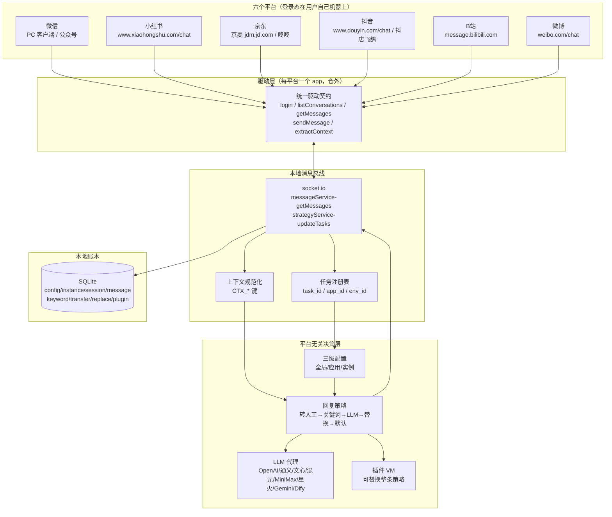
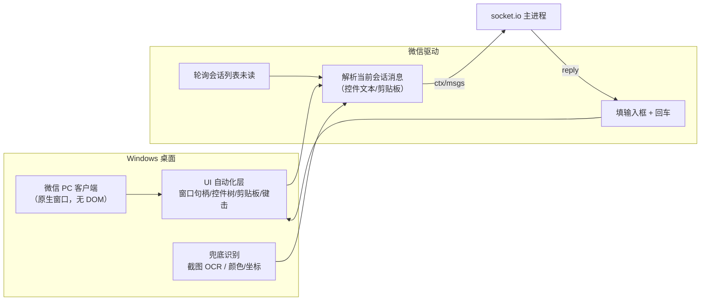
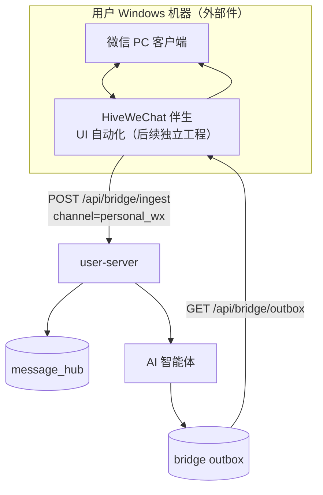
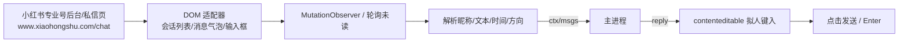
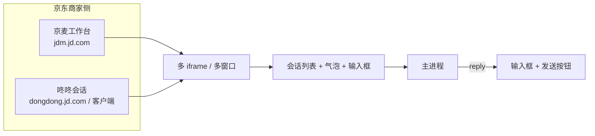
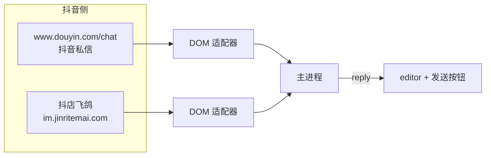
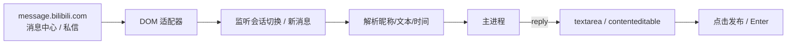
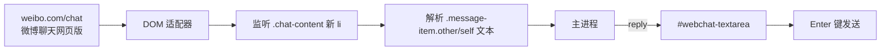

# ChatGPT-On-CS 多平台统一接待原理与六渠道架构（2026-11）

> 配套：[CHATGPT-ON-CS-ARCHITECTURE-2026-11](./CHATGPT-ON-CS-ARCHITECTURE-2026-11.md)
> **2026-11-06 实证修订**：本文六渠道"推断"部分已由真实安装包解包还原订正（微博方向=气泡
> left/right、B站=`#editor`+`btn-box send-btn`、京东=京麦桌面客户端而非网页、个人微信=win32+Airtest+OCR），
> 以 [CHATGPT-ON-CS-REAL-DRIVER-2026-11.md](./CHATGPT-ON-CS-REAL-DRIVER-2026-11.md) 为准。
> **证据分级**：
> - `实证`：公开仓代码或公开静态资源可直接验证；
> - `推断`：公开仓未含驱动源码，按产品文档、统一协议、平台公开页面结构反推；
> - `待真机`：选择器/登录态需真实账号校准，当前只作为候选。
>
> 本文的六渠道指：**微信、小红书、京东、抖音、B站、微博**。其中小红书/抖音为 hivemtk 已有渠道，
> 微信（公众号/企微）已有官方 API 链路，京东/B站/微博与个人微信为缺口。

---

## 1. 一句话原理

ChatGPT-On-CS 的"统一接待"不是把六个平台做成一个页面，而是把六个平台的差异压缩成**一个驱动契约**：

```text
驱动：我登录好了，当前上下文是 ctx，新消息是 msgs[]，请给我一条回复
主进程：好，回复是 {type, content}（或 NO_REPLY / TRANSFER）
驱动：我把这条回复写回平台（DOM 输入框 / 桌面客户端）
```

其余能力——AI 决策、关键词、转人工、替换词、插件、统计、配置——**全部在平台之外**。
这就是"统一接待"的本质：**统一的是决策与账本，不是页面**。

---

## 2. 总体接待架构



### 2.1 五个统一

| 统一项 | 结构 | 作用 |
|---|---|---|
| 统一任务 | `task_id/app_id/env_id` | 一个平台账号 = 一个可调度实例，支持多开 |
| 统一上下文 | `Context = Map<string,string>`，键为 `CTX_*` | 把商品/订单/物流/会员标签喂给模型 |
| 统一消息 | `MessageDTO {sender, content, role, type}` | `role = SELF/OTHER/SYSTEM` |
| 统一回复 | `ReplyDTO {type, content}` | `TEXT/IMAGE/VIDEO/FILE/NO_REPLY` |
| 统一策略 | 转人工 → 上下文裁剪 → 延迟 → 关键词 → LLM → 替换 → 默认 | 平台驱动完全不参与决策 |

### 2.2 两个不统一（有意保留）

1. **登录态不统一**：每个驱动自己管 Cookie/客户端登录/扫码，主进程不碰凭证。
2. **发送方式不统一**：网页走 DOM 填充+点击，桌面客户端走 UI 自动化/剪贴板/键击；
   主进程只收到"发送成功/失败"的结果。

---

## 3. 逐渠道架构

> 说明：ChatGPT-On-CS 的驱动代码不在公开仓。以下"实现原理"以 `推断` 为主，
> 但**平台页面结构**一栏是 2026-11-05 对公开静态资源的实测（`实证`），可直接用于 hivemtk 蜂桥选择器草案。

### 3.1 微信（个人微信 / 公众号 / 企业微信）

#### 3.1.1 ChatGPT-On-CS 的原理（推断）



- **入口**：微信 PC 客户端（不是网页版；微信网页版对多数账号已不可用）。
- **会话标识**：窗口标题/会话列表项文本/备注名；没有稳定 ID，只能做"名称派生 ID"。
- **取消息**：控件树文本 + 剪贴板复制；复杂气泡（图片/语音/文件）需 OCR/占位。
- **发消息**：聚焦输入框 → 剪贴板粘贴/键入 → Enter。
- **风险**：窗口焦点被抢、分辨率/缩放、客户端改版、封号；必须串行、限速、可一键停。

> 微信公众号/企业微信则是另一条路：官方 API + webhook，不需要 UI 自动化。ChatGPT-On-CS 的
> "微信"更多指个人微信；其产品文档没有把公众号单列。

#### 3.1.2 hivemtk 现状

| 子渠道 | 现状 | 证据 |
|---|---|---|
| 微信公众号 | ✅ 已有：`GET/POST /api/webhook/wechat/:account_id` 验签 + 客服消息发送 | `internal/controller/wechat.go`、`internal/service/wechat.go`、`internal/router/*` |
| 企业微信 | ✅ 已有：webhook XML 验签 + 应用消息/外部联系人 | `internal/service/webhook_channel_wecom.go`、`internal/service/wecom.go` |
| 个人微信 | ❌ 只有 `personal_wx` 平台词与前端标签，无入站/出站实现 | `service/message_hub.go:41`、`user-web/src/constants/channel.js` |

#### 3.1.3 建议架构（本轮落地服务端协议，桌面伴生外部）



- 服务端把 `personal_wx` 注册为 **bridge 类渠道**（HTTP/WS 双传输），复用蜂桥协议与 outbox 状态机。
- 桌面伴生是独立工程（Windows UI 自动化），**本轮不实现**，但协议、账号、路由、限流、文档全部就绪。
- 公众号/企微保持官方 API 链路，不做迁移。统一展示层把 `wechat`（公众号入站）与 `weixin`（发送渠道）
  归一为同一个标签，避免前端出现裸 `wechat`。

### 3.2 小红书

#### 3.2.1 ChatGPT-On-CS 的原理（推断）



- 会话 ID：URL `/chat/{id}` 或列表项 `data-conv-id`；没有稳定 ID 时用昵称派生。
- 输入框：`div.xhs-im-input-bar-editor[contenteditable]` / `#jarvis-reply-textarea`。
- 发送：`.send_btn` / `[aria-label*="发送"]`。
- 风险：SPA 虚拟列表、切会话竞态、风控验证码。

#### 3.2.2 hivemtk 现状

✅ 已有蜂桥扩展 `src/channels/xhs.js` + `src/content/xhs.js`；已有商家卡片、browser_automation 评论能力。
成熟度：选择器有真机注释，属可用档。

#### 3.2.3 可借鉴点

- 会话锚点（`cid + peerName`）防跨会话错归——hivemtk 已实现，保留。
- 发送前 `assertConvOrAbort` 防串台——hivemtk 已实现，保留。
- ChatGPT-On-CS 的"发送后回查气泡"可作为 `send_verified` 的补充；hivemtk 已有 B24 回查。

### 3.3 京东（京麦 / 咚咚）

#### 3.3.1 ChatGPT-On-CS 的原理（推断）



- 京东客服有两个面：**京麦商家工作台**（订单/商品/客服）与**咚咚**（IM）。两者可能跨域 iframe，
  驱动通常需要 `all_frames` 注入或直接操作独立窗口。
- 会话 ID：买家 pin/咚咚 UID；订单上下文（订单号、商品、物流）是京东场景的关键。
- 风险：登录态、iframe 跨域、工作台改版、客服分配规则。

#### 3.3.2 hivemtk 现状

❌ 无京东渠道（无 model 常量、无 bridge 注册、无前端标签、无扩展适配器）。

#### 3.3.3 建议架构

- 新增 `jd` 渠道（蜂桥网页私信桥接）。
- 入口域名：`jdm.jd.com`、`dongdong.jd.com`、`chat.jd.com`（候选，待真机）。
- 因京麦可能跨域 iframe，manifest 对该渠道使用 `all_frames: true`，content script 在聊天 iframe 内运行；
  账号 ID 从顶层/当前 frame 的登录信息兜底。
- 选择器先按"通用文本/输入框/发送按钮"宽匹配 + 用户可覆盖，标 `Experimental`，待真机校准。

### 3.4 抖音（抖音私信 / 抖店飞鸽）

#### 3.4.1 ChatGPT-On-CS 的原理（推断）



- 抖音私信页与抖店飞鸽是两套页面，但消息模型一致；ChatGPT-On-CS 分别有"抖音""抖音企业号""抖店"应用。
- 会话 ID：`conversation_id` / 用户 sec_uid / 列表 data 属性。
- 上下文：商品卡、订单、粉丝标签是重点。
- 风险：虚拟列表、验证码、频控。

#### 3.4.2 hivemtk 现状

✅ 已有蜂桥 `douyin`（`src/channels/douyin.js` + `content/douyin.js`）；已有抖音卡片与 browser_automation。
抖店飞鸽未单独接入（当前只覆盖 `www.douyin.com/chat`）。

#### 3.4.3 可借鉴点

- 把"抖音私信"与"抖店飞鸽"拆成同一渠道的两个 host/adapter 变体，而不是两个渠道码；
  会话上下文里带 `shop_id`/`goods_id`。
- 本轮不新增抖店入口，登记为后续项（需商家账号真机）。

### 3.5 B站（bilibili 私信）

#### 3.5.1 ChatGPT-On-CS 的原理（推断）



- B站私信入口是 `https://message.bilibili.com/`（消息中心），私信是其中一个 tab。
- 页面是 Vue SPA，消息列表/输入框类名可从公开 bundle 提取（见 §4）。
- 会话 ID：私信对象的 UID（`/message.bilibili.com/#/whisper?uid=` 或列表 data 属性）。
- 风险：登录态、SPA 路由、风控。

#### 3.5.2 hivemtk 现状

❌ 无 B站渠道。

#### 3.5.3 建议架构

- 新增 `bilibili` 渠道，host `message.bilibili.com`。
- 选择器草案（公开 bundle 实证，待真机）：
  - 会话列表：`.message-sidebar__item`（注意：该 sidebar 也含"回复我的/@我/赞"导航，需用文本/链接过滤私信 tab；
    真正的会话列表容器待真机确认）
  - 消息容器：`.message-content__inner` / `.message-section__body`
  - 消息文本：`.message-text-nodes`
  - 输入框：`.message-reply-box__input`（textarea）
  - 发送：`.message-reply-box__pub`
- 标 `Experimental`：会话列表选择器未真机校准。

### 3.6 微博（微博聊天）

#### 3.6.1 ChatGPT-On-CS 的原理（推断）



- 入口 `https://weibo.com/chat`（未登录会 302 到 passport）。
- 会话列表：`.chatlist-box` 下的 `.sessionlist`。
- 消息列表：`ul.chat-content > li`；消息项 `.message-item`，方向类 `.other/.self`（待真机确认 self 类名）。
- 输入框：`#webchat-textarea`（textarea）。
- 发送：Enter（页面提示"按下 Enter 发送内容 / Ctrl+Enter 换行"），无独立发送按钮。
- 风险：登录态、Vue 虚拟滚动、表情/图片消息。

#### 3.6.2 hivemtk 现状

❌ 无微博渠道。

#### 3.6.3 建议架构

- 新增 `weibo` 渠道，host `weibo.com`、`api.weibo.com`（聊天页可能跳转）。
- 选择器草案（公开 bundle 实证，待真机）：
  - 会话列表：`.chatlist-box .sessionlist`
  - 消息容器：`ul.chat-content`
  - 消息项：`.message-item`
  - 文本：`.message-item .text, .bubble_cont .text`（待真机）
  - 输入框：`#webchat-textarea`
  - 发送：`keydown Enter`（兜底找 `.sendbox_prompt` 同级的发送按钮，若页面提供）
- 标 `Experimental`。

---

## 4. 平台页面结构证据（2026-11-05 公开静态资源）

| 平台 | 资源 | 可证类名/ID |
|---|---|---|
| B站 | `s1.hdslb.com/.../message-pc/static/js/index.*.js` + `index.*.css` | `.message-sidebar__item`、`.message-content__inner`、`.message-text-nodes`、`.message-reply-box__input`、`.message-reply-box__pub`、`.message-header__title` |
| 微博 | `h5.sinaimg.cn/m/pcweibochat/js/app.*.js` + `app.*.css` | `#webchat-textarea`、`ul.chat-content`、`.message-item`、`.chatlist-box`、`.sessionlist`、`.sendbox_prompt` |
| 小红书 | 现有仓内实测 | `.xhs-im-conv-item`、`.xhs-im-input-bar-editor`、`.send_btn` |
| 抖音 | 现有仓内实测 | `[data-e2e="conversation-list"]`、`.messageEditorinputArea`、`[class*="e2e-send-msg-btn"]` |
| 京东 | 登录墙，未取到聊天页 | 待真机；先用通用选择器 + 用户覆盖 |
| 微信 | 原生客户端，无 DOM | 桌面 UI 自动化，非网页 |

> 这些类名只证明"页面里存在"，不证明"当前登录态下可见/唯一"。上线前必须真机校准，
> 并按 `Experimental` 降级声明，不得默认宣称生产可用。

---

## 5. 统一驱动契约（建议 hivemtk 采用的形状）

```ts
// 平台驱动（扩展 content script / 桌面伴生）对服务端暴露的能力
interface ChannelDriver {
  channel: string;                 // douyin / xiaohongshu / jd / bilibili / weibo / personal_wx
  accountId(): string;             // 登录账号
  conversationId(): string | null; // 当前会话
  listConversations(): Conversation[];
  getMessages(conversationId: string): UnifiedMessage[];
  sendText(text: string, opts: { assertConv?: string }): Promise<void>;
  extractContext(): Record<string, string>; // CTX_* 键
}
```

服务端只认 `channel + account_id + conversation_id + msg_id + direction + content`；
驱动可以在 `extra` 里带 `ctx.*`，但**不得**让服务端依赖平台 DOM 细节。

---

## 6. 六渠道对比总表

| 维度 | 微信（个人） | 微信（公众号/企微） | 小红书 | 京东 | 抖音 | B站 | 微博 |
|---|---|---|---|---|---|---|---|
| 接入方式（ChatGPT-On-CS） | 桌面 UI 自动化 | 官方 API | 网页 DOM | 网页/京麦 DOM | 网页 DOM | 网页 DOM | 网页 DOM |
| 官方 API | 无 | 有 | 无 | 部分（京麦开放平台） | 部分（抖店开放平台） | 无 | 无 |
| hivemtk 现状 | ❌ 仅词表 | ✅ 已接 | ✅ 蜂桥 | ❌ | ✅ 蜂桥（仅抖音私信） | ❌ | ❌ |
| 本轮动作 | 注册 bridge 协议 + 设计文档 | 标签归一/审计 | 保持 + 文档 | 新增蜂桥适配器 | 保持 + 文档 | 新增蜂桥适配器 | 新增蜂桥适配器 |
| 成熟度 | 外部件未实现 | 生产可用 | 可用 | 实验 | 可用 | 实验 | 实验 |
| 主要风险 | 封号/焦点/改版 | 无 | 改版/风控 | iframe/登录 | 改版/风控 | 登录/SPA | 登录/虚拟列表 |

---

## 7. 对 hivemtk 的落地建议（摘要）

1. **不要复制 ChatGPT-On-CS 的驱动**：它不在仓内，且 AGPL；沿用 hivemtk 蜂桥的
   `content script + BaseAdapter + 选择器覆盖 + 实验降级`。
2. **补齐渠道词表的三处单源**：`model` 常量、`channelgw` 注册表、前端 `CHANNEL_OPTIONS`。
   三者必须由测试锁死，否则会出现"能入库不能下发"或"能下发不显示"。
3. **电商上下文字段化**：在 `IngestMessage.Extra` 约定 `ctx.goods_id/order_id/order_status/
   logistics_status/member_tag/fan_tag`，写入 `message_hub.extra`，AI 侧按需读取。
4. **成熟度显式化**：京东/B站/微博选择器未真机校准，注册表 `Experimental: true`，
   前端展示"实验"标记，日志/诊断不谎报。
5. **先跑通协议再谈全量**：用 curl 打通 `ingest → AI → outbox → ack`，
   再用 ego browser 在本地 fixture 页面上验证扩展 DOM 适配，最后才谈真实账号。
