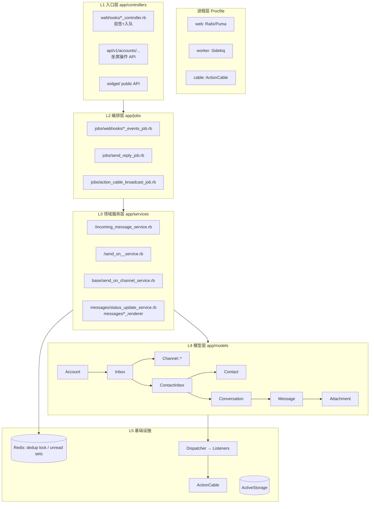
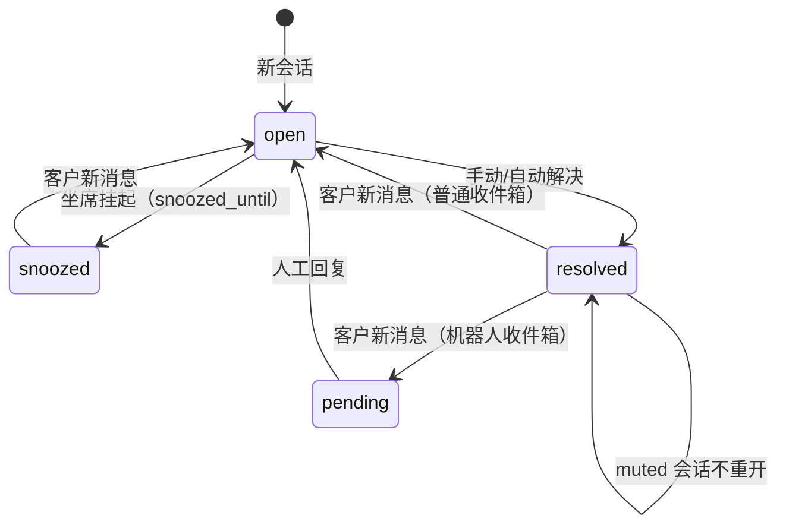

# Chatwoot 统一收件箱深度剖析：分层、状态机与端到端案例

> **文档性质**：本仓库内部技术调研，非对外文档。
> **调研基线**：`chatwoot/chatwoot` @ `73abc1d`（2026-11-17），`VERSION_CW=4.19.1`，depth=1 克隆于 `/Users/xiaofang/Documents/www/refs/chatwoot`。
> **证据标记**：`实证` = 可在源码中逐行核对；`复现` = 本轮实际读取的文件/执行的命令；`推论` = 结构判断，未运行验证。
> **配套文档**：优化清单出处 `CHATWOOT-MESSAGE-AGGREGATION-VS-HIVEMTK-2026-11.md`；本文补齐"层级怎么分、一次入站/出站如何逐跳执行、状态机与幂等如何保证"。

---

## 0. 一句话结论

Chatwoot 的统一收件箱不是"一个万能 webhook"，而是**五段可替换接缝 + 一套数据库约束**：

1. **入口接缝**：每个渠道一个 `Webhooks::XController`，只做验签/过滤/入队，**不做业务**；
2. **编排接缝**：`ActiveJob` 负责异步、重试、削峰，job 内只做"找 channel → 找 inbox → 选 Service"；
3. **渠道服务接缝**：`<Channel>::IncomingMessageService` / `SendOn<Channel>Service`，统一初始化签名 `inbox:, params:` 或 `message:`；
4. **领域模型接缝**：`Message` 的 `after_create_commit` 回调链把"重开会话 / 待回复计时 / 首响标记 / 事件广播 / 出站投递 / 模板钩子"集中在**一处**；
5. **基础设施接缝**：`source_id` 唯一性 + Redis 原子锁保证幂等，`Dispatcher → Listener → ActionCable` 承担实时，Redis 集合承担未读计数。

它的"渠道无关"是靠**身份三元组 `ContactInbox(inbox_id, source_id)` 唯一索引**钉住的——这是整个统一收件箱的地基。

---

## 1. 分层总览



| 层 | 目录 | 规模（`实证`） |
|---|---|---|
| 入口 | `app/controllers/webhooks/` | 8 个渠道控制器（instagram/line/shopify/sms/stripe_app/telegram/tiktok/whatsapp） |
| 编排 | `app/jobs/webhooks/`、`app/jobs/send_reply_job.rb` | 10 个 webhook job + 出站 job |
| 服务 | `app/services/` | 60+ 子目录，按渠道与领域分组（`whatsapp/`、`telegram/`、`conversations/`、`messages/`…） |
| 模型 | `app/models/` + `app/models/channel/` | 11 个渠道模型 |
| 实时 | `app/listeners/action_cable_listener.rb`、`app/dispatchers/` | 20+ 事件回调 |

---

## 2. 数据模型族与不变量

### 2.1 关系骨架（`实证`）

```
Account 1─* Inbox 1─1 Channel::<Type>（polymorphic: channel_type + channel_id）
                │
                ├─* ContactInbox（inbox_id + source_id 唯一）
                │        └─* Conversation ─* Message ─* Attachment
                └─* Contact（through ContactInbox，一人可多渠道）
```

### 2.2 关键约束（`实证`，`db/schema.rb`）

| 约束 | 位置 | 作用 |
|---|---|---|
| `index_contact_inboxes_on_inbox_id_and_source_id` **unique** | `contact_inboxes` | 同一收件箱内一个外部身份只对应一个 ContactInbox——**幂等的地基** |
| `index_contact_inboxes_on_pubsub_token` unique | 同上 | 实时订阅路由 |
| `Message.source_id` | `messages` | 外部消息 id，用于查重与回声判定（非唯一索引，因为出站写入前为空） |
| `Conversation` 索引：`waiting_since`、`first_reply_created_at`、`last_activity_at` | `conversations` | 支撑"待回复""首响时长""自动解决"三类查询 |

### 2.3 Inbox 是"策略容器"，不只是配置

`app/models/inbox.rb` 的字段决定行为：

| 字段 | 行为影响 |
|---|---|
| `lock_to_single_conversation` | 同一 ContactInbox 永远复用最后一个会话，否则 resolved 后新建 |
| `enable_auto_assignment` + `assignment_policy` | 新会话自动分配坐席 |
| `working_hours_enabled` / `out_of_office_message` | 非工作时间自动回复 |
| `greeting_enabled` / `greeting_message` | 首次进入的欢迎语 |
| `csat_config` / `csat_survey_enabled` | 满意度问卷触发 |
| `sender_name_type`（friendly/professional） | 出站显示名口径 |

以及一组谓词方法（`telegram?` / `whatsapp?` / `email?` / `api?` / `instagram_direct?` …）——**这是它"渠道感知"的唯一入口**，也是我们 criticise 的硬编码点（应改为 manifest，见 §9）。

### 2.4 渠道模型负责"传输细节"

`app/models/channel/telegram.rb`（`实证`）：

- `encrypts :bot_token, deterministic: true`；
- `before_save :setup_telegram_webhook`：先 `deleteWebhook` 再 `setWebhook(FRONTEND_URL/webhooks/telegram/<bot_token>)`——**用 token 作为 URL 段**完成"webhook 到 channel 的寻址"，无需额外映射表；
- `send_message_on_telegram(message)`：文本 + `SendAttachmentsService`；
- `process_error`：把错误写进 `message.external_error` 并把状态置 `failed`（出站失败可见）。

WhatsApp 同理用 `phone_number` 寻址，LINE 用 `channel_id`。**共同模式：渠道表自带"入站寻址键"和"出站凭据"，Job 一次查询即可闭环。**

---

## 3. 入站链路逐跳（以 WhatsApp 为例）

### 3.1 控制器：只做三件事（`实证`，`app/controllers/webhooks/whatsapp_controller.rb`）

```ruby
class Webhooks::WhatsappController < ActionController::API
  include MetaTokenVerifyConcern
  before_action :verify_meta_signature!, only: :process_payload
  before_action :verify_webhook_token!,   only: :process_payload

  def process_payload
    return render_error if inactive_whatsapp_number?     # 账号停用直接 422，不落库
    return head :ok if tracking_events_only?             # 无关事件快速返回
    Webhooks::WhatsappEventsJob.perform_later(params.to_unsafe_hash.except(:webhook_token))
    head :ok                                             # 立刻 200，绝不在请求线程里做业务
  end
end
```

Telegram 控制器更薄（`实证`）：入队后**只在 callback_query 场景返回** `{"method":"answerCallbackQuery"}` 让平台关掉按钮转圈，其余 `head :ok`。

**设计要点**：验签 → 有效性 → 入队 → 立即 200。处理慢/失败与平台解耦，重试由 Sidekiq 负责。

### 3.2 Job：寻址 + 选服务（`实证`，`jobs/webhooks/telegram_events_job.rb`）

```ruby
channel = Channel::Telegram.find_by(bot_token: params[:bot_token])
return log_inactive_channel(channel, params) if channel_is_inactive?(channel)

if params.dig(:telegram, :edited_message).present? || params.dig(:telegram, :edited_business_message).present?
  Telegram::UpdateMessageService.new(inbox: channel.inbox, params: ...).perform
else
  Telegram::IncomingMessageService.new(inbox: channel.inbox, params: ...).perform
end
```

注意两件事：**① 先判账号是否 active（多租户停用后事件直接丢弃）；② 编辑事件走独立 Service**，不是"入站消息服务加个 if"。

### 3.3 IncomingMessageService：幂等 → 身份 → 会话 → 落库（`实证`，`app/services/whatsapp/incoming_message_base_service.rb`）

```ruby
def perform
  processed_params
  return process_statuses if processed_params.try(:[], :statuses).present?   # 回执分支
  process_identity_change_messages
  return process_messages if messages_data.present?
end

def process_messages
  return if unprocessable_message_type?(message_type)          # reaction/ephemeral 跳过
  return if find_message_by_source_id(messages_data.first[:id]) # ① 应用层查重
  return unless lock_message_source_id!                         # ② Redis SET NX 原子锁
  set_contact                                                   # ③ 身份解析/创建
  return unless @contact
  return if @contact.blocked? && !outgoing_echo                 # ④ 黑名单闸
  ActiveRecord::Base.transaction do
    set_conversation                                            # ⑤ 会话归属
    create_messages                                             # ⑥ 消息+附件落库
  end
end
```

**三重幂等**：应用层 `source_id` 查重 → Redis 原子锁（防并发重复）→ 事务内落库。数据库唯一索引是最后兜底。

### 3.4 身份解析（`实证`，`app/builders/contact_inbox_with_contact_builder.rb`）

```ruby
def find_or_create_contact_and_contact_inbox
  @contact_inbox = inbox.contact_inboxes.find_by(source_id: source_id) if source_id.present?
  return @contact_inbox if @contact_inbox                      # 命中即返回，零写

  ActiveRecord::Base.transaction(requires_new: true) { build_contact_with_contact_inbox }
  update_contact_avatar(@contact) unless @contact.avatar.attached?
  @contact_inbox
rescue ActiveRecord::RecordNotUnique
  find_or_create_contact_and_contact_inbox                     # 并发竞争 → 重试
end
```

`find_contact` 的归并优先级（顺序即优先级）：

1. `identifier`（业务主键）→ 2. `email` → 3. `phone_number` 及其候选（`phone_number_candidates`，处理国家码差异）→ 4. Instagram source_id 反查 FacebookPage 收件箱（跨渠道同人）→ 5. 都没有则 `create_contact`，名字用 `Haikunator` 随机生成并截断到列宽。

**要点**：归并发生在**建 ContactInbox 之前**，且事务 `requires_new: true`（嵌套事务独立回滚，不污染外层）。头像异步拉取，不阻塞入站。

### 3.5 会话归属（`实证`，同文件 `set_conversation`）

```ruby
conversations = addressable_identifiers? ? @contact_inbox.conversations
                                         : @contact.conversations.where(inbox_id: @inbox.id)
@conversation = if @inbox.lock_to_single_conversation
                  conversations.last
                else
                  conversations.where.not(status: :resolved).last
                end
@conversation ||= ::Conversation.create!(conversation_params)
```

代码注释道出一个真实陷阱：**复用必须限定在 ContactInbox 维度，不能按 Contact 维度**——同一 Contact 在同一 Inbox 下可能持有多个 WhatsApp 身份（共存设备/后台合并），按 Contact 复用会"用 A 身份的 source_id 回到 B 身份的会话"，导致坐席回复打到错误的号码。只有当渠道无法按身份寻址（如 360Dialog 只能发到 `to`）时才退回 Contact 维度。

这段是**多身份聚合场景的最佳实践**，直接对应 HiveMTK 的 `CustomerChannel(one_id, channel)` 设计缺陷（见 §9）。

### 3.6 落库与附件

`create_regular_message`：`create_message(...)` → `attach_files` → `attach_location`（location 类型）→ `save!`。不支持的 WhatsApp 消息（`type: unsupported`）仍落一条占位消息并标 `content_attributes.is_unsupported`——**宁可留痕，不制造"无头联系人"**。

---

## 4. 会话生命周期：消息回调驱动的状态机

### 4.1 after_create_commit 的七步顺序（`实证`，`app/models/message.rb` L346）

```ruby
def execute_after_create_commit_callbacks
  reopen_conversation                                  # 1 会话重开
  mark_pending_conversation_as_open_for_human_response # 2 bot 待接管 → 人工回复时置 open
  set_conversation_activity                            # 3 last_activity_at = created_at
  dispatch_create_events                               # 4 MESSAGE_CREATED / FIRST_REPLY_CREATED + 待回复计时
  send_reply                                           # 5 出站投递
  execute_message_template_hooks                       # 6 模板钩子（欢迎/离线/CSAT…）
  update_contact_activity                              # 7 联系人活跃时间
end
```

**顺序有意义**：先让会话进入正确状态，再广播/计时，最后才出站——这样出站服务读到的 `conversation` 已是最终状态。

### 4.2 状态转移（`实证`，`reopen_conversation` / `reopen_resolved_conversation`）



要点：

- `return if conversation.muted?` —— **静音会话的入站不重开**；
- 机器人收件箱（`inbox.active_bot?`）的 resolved 会话被客户消息唤回时置 `pending`（等 bot 处理），不是直接 `open`；
- resolved 时 `waiting_since` 用 `update_column(:waiting_since, nil)` 清空（**绕开回调**，避免再次触发事件）。

### 4.3 waiting_since / first_reply_created_at（`实证`）

```ruby
def dispatch_create_events
  dispatcher.dispatch(MESSAGE_CREATED, ...)
  if valid_first_reply?
    dispatcher.dispatch(FIRST_REPLY_CREATED, ...)
    conversation.update(first_reply_created_at: created_at, waiting_since: nil)
  else
    update_waiting_since
  end
end

def update_waiting_since
  clear_waiting_since_on_outgoing_response if conversation.waiting_since.present? && !private
  set_waiting_since_on_incoming_message
end
```

规则汇总：

| 场景 | 结果 |
|---|---|
| 客户消息且 `waiting_since` 为空 | 置为消息时间（**只写一次，连发不刷新**） |
| 人工回复（`human_response?`）且有待回复 | 发 `REPLY_CREATED` 事件并清空 |
| 机器人回复（`bot_response?`） | 也清空（注释：比等客户下条消息再判更简单） |
| 私有备注（private） | 不动 `waiting_since` |
| 首条有效回复 | 写 `first_reply_created_at`，同时清空 `waiting_since` |

`human_response?` 的判定（`实证`）：`outgoing && !forwarded && 无 automation_rule_id && 无 campaign_id && (sender 是 User || content_attributes['external_echo'])`。
`bot_response?`：`outgoing && sender_type ∈ {AgentBot, Captain::Assistant}`。

**为什么值得学**：它把"等待时长/首响时长/SLA"变成两条可直接查询的时间列，而不是事后扫消息表算。HiveMTK 本轮已按此落地三列（见 §9）。

### 4.4 其它模型级护栏

| 护栏 | 实现 |
|---|---|
| 附件上限 | `NUMBER_OF_PERMITTED_ATTACHMENTS = 15`，`before_add` 校验 |
| 洪水防护 | `before_validation :prevent_message_flooding` |
| 内容归一 | `ensure_processed_message_content`（去硬换行反斜杠、去尾空行） |
| 回复锚点 | `ensure_in_reply_to` + `Messages::InReplyToMessageBuilder` |
| 搜索索引 | `after_commit :reindex_for_search` |
| 更新广播 | `after_update_commit :dispatch_update_event`，`previous_changes.blank?` 时跳过 |

---

## 5. 出站链路：映射表 + 模板方法

### 5.1 触发与延迟（`实证`，`send_reply`）

```ruby
attachments.blank? ? SendReplyJob.perform_later(id)
                   : SendReplyJob.set(wait: 2.seconds).perform_later(id)   # 等 ActiveStorage 落盘
```

### 5.2 映射表（`实证`，`app/jobs/send_reply_job.rb`）

```ruby
CHANNEL_SERVICES = {
  'Channel::Telegram' => ::Telegram::SendOnTelegramService,
  'Channel::Whatsapp' => ::Whatsapp::SendOnWhatsappService,
  'Channel::Line'     => ::Line::SendOnLineService,
  ...
}.freeze

def perform(message_id)
  message = Message.find(message_id)
  Captain::...TranslationService.new(message:).perform if message.content_attributes['translation_pending']
  return send_on_facebook_page(message) if channel_name == 'Channel::FacebookPage'   # 特例
  CHANNEL_SERVICES[channel_name]&.new(message:).perform
end
```

**新渠道 = 加一个类 + 表里加一行**。唯一的特例（FacebookPage 里再分 Instagram DM）用显式方法隔离，不污染映射表。

### 5.3 模板方法（`实证`，`app/services/base/send_on_channel_service.rb`）

```ruby
def perform
  validate_target_channel        # inbox.channel.class 必须等于子类声明
  return unless outgoing_message? # outgoing? || template?
  return if invalid_message?      # private? || 渠道回声 || voice_call
  perform_reply                   # 子类实现
end

def outgoing_message_originated_from_channel?
  message.source_id.present?      # 有 source_id = 这条是从渠道同步回来的，别再发出去
end
```

`invalid_message?` 三条护栏各防一类事故：

| 条件 | 防什么 |
|---|---|
| `message.private?` | 内部备注外泄给客户 |
| `source_id.present?` | **回声循环**（渠道把自己发的消息回传，再次触发发送） |
| `content_type == 'voice_call'` | 通话状态气泡被当消息发出 |

### 5.4 渠道服务示例（Telegram）

`Telegram::SendOnTelegramService#perform_reply` → `channel.send_message_on_telegram(message)` → 成功后 `message.update!(source_id: message_id)`。

**回写 `source_id` 是所有渠道服务的隐含契约**：它既让后续回执能匹配到消息，也让回声判定生效（见上表）。HiveMTK 对应物是 `MessageHub.PlatformMsgID` + `bridge outbox ack`。

### 5.5 回执与状态机（`实证`，`messages/status_update_service.rb`）

```ruby
def perform
  message.with_lock do                       # 行锁
    next false unless valid_status_transition?   # 只允许前进（sent→delivered→read）
    update_message_status
  end
end
```

并发回执（乱序到达）被"行锁 + 前向-only"挡住；失败时写 `external_error`（WhatsApp 用 `"#{code}: #{title}"`）。

### 5.6 实时推送

`Message` 回调 → `Rails.configuration.dispatcher.dispatch(MESSAGE_CREATED, ...)` → `ActionCableListener` → `ActionCableBroadcastJob` → 按 pubsub token 广播给坐席/联系人。事件清单（`实证`）：message_created/updated、first_reply_created、conversation_created/status_changed/read/unread_count_changed/typing_on/off/assignee_changed/team_changed/contact_changed、notification_*、conversation_mentioned 等 20+。

**关键：业务代码不直接调 ActionCable**，只发领域事件；推送通道可替换（这也是企业版能挂不同 transport 的原因）。

---

## 6. 横切能力

| 能力 | 实现 | 借鉴价值 |
|---|---|---|
| 未读计数 | `Conversations::UnreadCounts::Store`：Redis 集合，key 维度 `account::inbox::label::team`，`base` + `assignment` 两套成员关系，`READY_TTL` 标记预热 | 高并发下避免 `COUNT(*)`；我们目前 DB 聚合，量大成热点 |
| 分渠道渲染 | `Messages::MarkdownRendererService` + `MarkdownRenderers::{base, telegram, line, instagram, whats_app, plain_text}` | 一条 AI 回复按渠道能力裁剪，避免"Markdown 原样发到纯文本渠道" |
| 内容归一 | `Messages::WebhookContentNormalizer`：去 CommonMark 硬换行反斜杠、代码块外转义 delimiter、去尾空行 | 防止"AI 输出 → 平台显示"格式漂移 |
| 翻译 | `Captain::Conversation::AgentMessageTranslationService`，`content_attributes['translation_pending']` 驱动 | 跨境客服场景 |
| 邮件线程归并 | `Mailbox::ConversationFinderStrategies::{InReplyTo, References, ReceiverUuid, NewConversation}` | 邮件渠道必须按 header 归并，不能按人 |
| 删除跟踪 | `Imap::DeletedMessageTracker` | 邮件撤回同步 |
| 分配策略 | `Conversations::AssignmentService` + `inbox.assignment_policy` | 轮询/负载/技能路由 |

---

## 7. 端到端案例

### 案例 1：WhatsApp 图片消息（含回执竞争）

1. Meta POST → 控制器验签（`MetaTokenVerifyConcern`）→ `head :ok` → Job 入队；
2. Job 查到 `Channel::Whatsapp`，检查 `account.active?`；
3. `IncomingMessageBaseService#perform`：有 `statuses` 则走回执分支，否则 `process_messages`；
4. `find_message_by_source_id` 未命中 → `lock_message_source_id!`（Redis SET NX）成功；
5. `ContactInboxWithContactBuilder` 用 `wa_id` 找/建 ContactInbox；
6. `set_conversation`：未 resolved 的最后一个会话（或新建）；
7. `create_regular_message`：`source_id = message.id`，`attach_files` 下载媒体到 ActiveStorage；
8. `save!` → 回调链：`set_conversation_activity`、`MESSAGE_CREATED` 广播、`waiting_since` 置位、`send_reply`（有附件 → 延迟 2s）；
9. 稍后 Meta 推 `statuses: delivered` → 同一 Service 的 `process_statuses` → `StatusUpdateService`（行锁 + 前向校验）→ 广播 `message_updated`。

### 案例 2：Telegram 编辑消息

`TelegramEventsJob` 检测 `edited_message` → `Telegram::UpdateMessageService`（不是 Incoming）→ 按 `source_id` 找原消息 → 更新内容/`content_attributes` → `after_update_commit` → `dispatch_update_event` → 坐席端实时刷新。**编辑不是新消息，不能触发 `MESSAGE_CREATED`/出站**。

### 案例 3：邮件线程归并

`Channel::Email` 不走 `set_conversation` 的"最后一个未解决会话"，而是 `Mailbox::ConversationFinderStrategies`：先按 `In-Reply-To` header 找原消息所属会话，再退回 `References` 链，再退回 `receiver_uuid`（同一收件地址），最后新建。**渠道间"会话归属算法"必须可插拔**——这是 Chatwoot 把 `ConversationBuilder` 与渠道服务分开的原因。

### 案例 4：Instagram DM 复用 Facebook 收件箱

`SendReplyJob` 对 `Channel::FacebookPage` 特判：`conversation.additional_attributes['type'] == 'instagram_direct_message'` → 用 `Instagram::Messenger::SendOnInstagramService`，否则 `Facebook::SendOnFacebookService`；入站侧 `ContactInboxWithContactBuilder#find_contact_by_instagram_source_id` 会跨到同账号的 FacebookPage 收件箱找人。**同一物理账号承载两种私信类型**时，用 `additional_attributes` 做二级路由。

---

## 8. 新增一个渠道需要交付什么

| # | 产物 | 说明 |
|---|---|---|
| 1 | `app/models/channel/<x>.rb` | 入站寻址字段 + 出站凭据 + `send_message_on_<x>` |
| 2 | `app/controllers/webhooks/<x>_controller.rb` | 验签 + 过滤 + 入队，≤30 行 |
| 3 | `app/jobs/webhooks/<x>_events_job.rb` | 找 channel → 判 active → 选 Service |
| 4 | `app/services/<x>/incoming_message_service.rb` | `inbox:, params:`；幂等→身份→会话→落库 |
| 5 | `app/services/<x>/send_on_<x>_service.rb` | `< Base::SendOnChannelService`，实现 `channel_class` + `perform_reply` |
| 6 | `SendReplyJob::CHANNEL_SERVICES` 一行 | 出站注册 |
| 7 | （可选）`<x>/update_message_service.rb` | 编辑/撤回等非消息事件 |
| 8 | 路由 + `inbox.telegram?` 之类谓词 | 管理台展示与能力判断 |

验收口径：重复 webhook 只落一条；并发 webhook 不双写；编辑不重发；私有备注不外发；回声不循环；失败写 `external_error`；状态只前进。

---

## 9. 映射到 HiveMTK：已交付与待立项

### 9.1 本轮已交付（`实证`，commit `2f658e7b`）

| Chatwoot 机制 | HiveMTK 落地物 | 说明 |
|---|---|---|
| `waiting_since` / `first_reply_created_at` / `last_activity_at` | `InboxConversation.WaitingSince / FirstReplyAt / LastActivityAt` + `migrations/064` | 客户首发开等待、连发不刷新；我方回复清等待；首响只写一次；`first_reply_at` 不回填 |
| 渠道能力感知（谓词方法） | `internal/channelcaps`（21 条 manifest + 自动生成 `docs/channel-capabilities.md` + 漂移测试） | 用 LangBot 的声明式方案替代 Chatwoot 的硬编码谓词 |
| 消息模型回调集中处理 | `repository.UpsertFromMessageTx` 内按方向收口 | Go 侧不搞隐式回调，显式写在仓储事务里 |

### 9.2 待立项（按优先级）

| 优先级 | 项 | Chatwoot 对应 | HiveMTK 改造点（`推论`） |
|---|---|---|---|
| **P0-3** | 出站发送器注册表 | `SendReplyJob::CHANNEL_SERVICES` + `Base::SendOnChannelService` | 定义 `channelSender` 接口（`Validate(ctx, req) error` / `Send(ctx, req) (SendResult, error)`），`registerChannelSender(channel, impl)` 于 `init()`；`sendOutbound` 收敛为"取 sender → 校验 → 发 → 回写 msg_id"，目标 <150 行 |
| P1-1 | 分渠道渲染层 | `MarkdownRenderers::*` | `internal/channelcaps` 增加 `Format(chain) string`，按渠道能力裁剪 Markdown/超长拆条 |
| P1-2 | 身份唯一键补 `account_id` | `ContactInbox(inbox_id, source_id)` | `CustomerChannel` 唯一索引改 `(tenant_id, account_id, one_id, channel)`，先加列回填再换索引 |
| P1-3 | 显式回声判定 | `source_id.present?` | `MessageHub` 增加 `EchoOf` / `OriginChannel` 字段，替代现有启发式去重 |
| P1-4 | 消息模板 | `MessageTemplates::{Greeting, OutOfOffice, Csat, AutoResolve}` | 走统一发送器，模板内容入配置表 |
| P1-5 | 未读计数外置 | Redis `UnreadCounts::Store` | 高并发后再做，先用现有 SQL 聚合 |
| P2-1 | 多消息聚合窗口 | LangBot `aggregator` 阶段 | 客户连发 N 条合并成一次 AI 调用 |
| P2-2 | 事件路由表 | LangBot 事件绑定 | `event_type + filter → pipeline/agent/ignore`，未匹配记录原因 |
| P2-4 | 输入中状态 | `ConversationTypingStatusManager` | WS 推送 typing |

### 9.3 不建议照搬的部分

| Chatwoot 做法 | 原因 |
|---|---|
| 隐式 `after_create_commit` 七步链 | Go 无回调机制；隐式副作用难测。我们显式写在 `UpsertFromMessageTx` / service 编排里，测试可直接断言顺序 |
| 进程内 `Current.executed_by` / `Current.user` 线程变量 | 我们在调用链上传 `ctx`，避免隐式上下文（多租户下更危险） |
| polymorphic `channel` 关联 | GORM 无原生 polymorphic；我们用 `ChannelType` 字符串 + 各渠道配置表，语义等价 |
| Redis 去重锁作为主幂等 | 我们有 `msg_id` 唯一索引 + `DedupHash`，DB 层更强；Redis 只作为削峰 |

---

## 10. 给 HiveMTK 的三条硬结论

1. **统一收件箱的地基是唯一键，不是 webhook 数量**。`(inbox, source_id)` 唯一 + 身份归并顺序，决定了"同一个人多渠道"能不能不串号。我们的 `CustomerChannel(one_id, channel)` 缺 `account_id`，是当前最该修的数据缺陷。
2. **会话状态必须由消息驱动、在一处收口**。Chatwoot 把"重开/待回复/首响/活动时间"全放在 `Message` 回调链；我们放在仓储事务里同样成立，关键是**只此一处**，否则 SLA 数据必然漂移。
3. **出站必须是注册表 + 模板方法**。Chatwoot 新增渠道只改 2 个文件（Service + 映射表一行），我们目前要改 800 行 switch 的 3 个分支。P0-3 的收益不是"代码好看"，而是**接入新平台从"改核心"降为"加插件"**。
