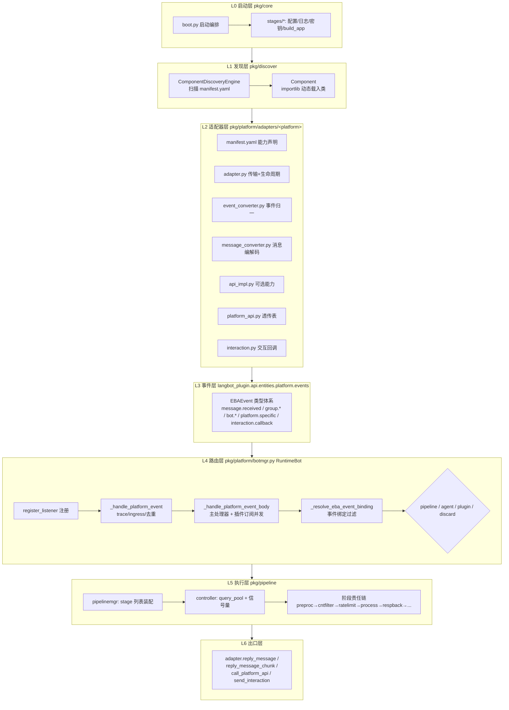

# LangBot 架构深度剖析：分层、细节与端到端案例

> **文档性质**：本仓库内部技术调研，非对外文档。
> **调研基线**：`langbot-app/LangBot` @ `83b6b06`（2026-11-17，depth=1 克隆于 `/Users/xiaofang/Documents/www/refs/langbot`）。
> **证据标记**：`实证` = 可在上述 commit 的源码中逐行核对；`复现` = 本轮实际执行的命令/读取路径；`推论` = 基于代码结构的判断，未经运行验证。
> **配套文档**：平台差集与接入配方见 `LANGBOT-VS-HIVEMTK-PLATFORM-ARCH-2026-11.md`；本文只解决"架构怎么分层、一条消息怎么走完全程、新平台怎么塞进去"。

---

## 0. 一句话结论

LangBot 的可扩展性不来自"适配器很多"，而来自**四段接缝**：

1. **声明接缝**——一个平台 = 一个目录 + 一份 `manifest.yaml`（能力、配置项、入口类），发现引擎扫描目录即可加载，核心代码零改动；
2. **归一接缝**——`AbstractEventConverter.target2yiri()` 把任意平台原生事件压成统一 `EBAEvent`，无法映射的降级为 `PlatformSpecificEvent` 而不是丢弃；
3. **路由接缝**——`botmgr` 按事件类型 + 过滤器匹配"事件绑定"，把事件投给 pipeline / agent / plugin / discard，路由过程有 trace 记录；
4. **执行与出口接缝**——pipeline 是"阶段名列表 + 责任链"，出口只有 `reply_message` / `reply_message_chunk` / `call_platform_api` 三个动词。

HiveMTK 的对应物在 §7 逐条映射；真正的缺口是 **②③**（我们目前是 `switch channel` 硬分派，既没有事件归一类型系统，也没有事件级路由）。

---

## 1. 分层总览



各层文件位置（`实证`）：

| 层 | 关键文件 | 职责 |
|---|---|---|
| L0 | `src/langbot/pkg/core/boot.py`、`pkg/core/stages/build_app.py` | 启动编排；`build_app.py:312` 装配 `ap.platform_mgr` |
| L1 | `pkg/discover/engine.py`（`Component` L117、`ComponentDiscoveryEngine` L206） | 扫描 YAML、校验 kind、`importlib` 载入入口类 |
| L2 | `pkg/platform/adapters/<platform>/`（13 个）、`pkg/platform/sources/*.py`（遗留） | 单平台全部实现 |
| L3 | `langbot_plugin/api/entities/builtin/platform/events.py`、`entities.py`、`message.py` | 跨平台统一实体与事件 |
| L4 | `pkg/platform/botmgr.py`（2515 行） | 运行时、监听注册、事件绑定路由、监控入库 |
| L5 | `pkg/pipeline/`（stage.py、pipelinemgr.py、controller.py、各阶段目录） | 阶段责任链、并发与会话调度 |
| L6 | 各 adapter 的 `reply_message*`、`api_impl.py`、`platform_api.py` | 出站与平台 API |

---

## 2. L1 发现层：manifest 即契约

### 2.1 目录约定（`实证`）

```
src/langbot/pkg/platform/adapters/telegram/
├── manifest.yaml        # 声明：元数据/配置项/支持事件/支持 API/平台专属 API/入口
├── adapter.py           # class TelegramAdapter(TelegramAPIMixin, AbstractPlatformAdapter)
├── event_converter.py   # class TelegramEventConverter(AbstractEventConverter)
├── message_converter.py # MessageChain ⇄ 原生格式
├── api_impl.py          # mixin：edit/delete/forward/get_group_info...
├── platform_api.py      # PLATFORM_API_MAP: action → handler
├── interaction.py       # 内联按钮/表单的投递与回调解析
├── types.py
└── telegram.svg
```

### 2.2 发现与装载（`实证`）

`ComponentDiscoveryEngine.load_component_manifests_in_dir()` 递归（默认 depth=1）读取 `.yaml/.yml`，用 `Component.is_component_manifest()` 校验后缓存；`botmgr.initialize()` 里：

```python
self.adapter_components = self.ap.discover.get_components_by_kind('MessagePlatformAdapter')
```

实例化时按需 import（`botmgr.py` L2464 `_get_adapter_class`）：

```python
component = self.get_available_adapter_manifest_by_name(name)   # 找不到 → AdapterNotFoundError
self.adapter_dict[name] = component.get_python_component_class()  # importlib 载入 manifest.execution.python
```

**关键设计**：未启用的平台 SDK 不会被 import（注释原文："Keep unused platform SDKs out of the process until a Bot needs them."）。这就是为什么 13 个平台依赖（python-telegram-bot、discord.py、slack_sdk…）能共存而不互相拖累启动。

### 2.3 manifest 字段语义（`实证`，以 telegram 为例）

| 字段 | 作用 | 运行期消费者 |
|---|---|---|
| `metadata.name` | 适配器唯一名（`telegram-omni`） | 组件查找、事件里的 `adapter_name` |
| `metadata.label/description` | 多语言展示 | 管理台 |
| `spec.categories` | 归类（popular/global/china/protocol） | 管理台筛选 |
| `spec.config[]` | 认证与行为配置（`token` 必填、`markdown_card`、`enable-stream-reply`） | 前端表单 + adapter 构造函数 |
| `spec.supported_events[]` | 入站事件能力 | `botmgr.initialize()` 决定是否注册 legacy 监听、路由匹配 |
| `spec.supported_apis.required/optional` | 出站能力 | `_get_adapter_supported_apis()`、agent/plugin 能力探测 |
| `spec.platform_specific_apis[]` | 透传动作清单 | `call_platform_api` 白名单（agent 调用） |
| `execution.python.path/attr` | 入口类 | 动态装载 |

`adapter.py` 里还有一层"代码声明"：`get_supported_events()` / `get_supported_apis()` 显式返回列表。两者关系是**代码优先、manifest 兜底**（基类默认读 manifest）。

---

## 3. L2 适配器层：一个平台要写什么

### 3.1 基类契约（`实证`，`langbot_plugin/api/definition/abstract/platform/adapter.py`）

```python
class AbstractPlatformAdapter(pydantic.BaseModel, abc.ABCMeta):
    bot_account_id: str
    config: dict
    logger: AbstractEventLogger

    # 能力声明
    def get_supported_events(self) -> list[str]      # 默认读 manifest
    def get_supported_apis(self) -> list[str]

    # 必须实现
    async def send_message(target_type, target_id, message) -> MessageResult
    async def reply_message(message_source, message, quote_origin=False)
    async def run_async()      # 建立连接/启动轮询
    async def kill() -> bool
    def register_listener(event_type, callback)
    def unregister_listener(event_type, callback)

    # 可选实现（未实现抛 NotSupportedError）
    async def edit_message / delete_message / forward_message
    async def get_group_info / get_group_member_list / get_group_member_info / get_user_info / get_file_url
    async def mute_member / unmute_member / kick_member / leave_group
    async def call_platform_api(action, params)
    async def send_interaction / update_interaction / get_interaction_capabilities
    async def reply_message_chunk(...); async def is_stream_output_supported()
    async def create_message_card(...)
```

**语义要点**：

- 可选能力"未实现"不是空实现，而是 `NotSupportedError`（`call_platform_api` 里 `PLATFORM_API_MAP.get(action)` 为空即抛）。上层据此决定降级路径，不会静默假成功。
- `run_async()` 里做"登录 + 设置 `bot_account_id`"（Telegram 用 `get_me().username`），这是后续多账号路由的身份锚。
- 入站全走 `register_listener` 回调，出站全走 `send_message/reply_message`——**入站与出站解耦**，pipeline 不知道平台存在。

### 3.2 Telegram 适配器拆解（`实证`，`adapters/telegram/adapter.py` 全 658 行）

构造函数即完成 SDK 装配与事件注册：

```python
application = ApplicationBuilder().token(config['token']).build()
application.add_handler(MessageHandler(filters.TEXT|COMMAND|PHOTO|VOICE|Document.ALL, telegram_callback))
application.add_handler(MessageHandler(filters.UpdateType.EDITED_MESSAGE, telegram_callback))
application.add_handler(ChatMemberHandler(telegram_callback, ChatMemberHandler.CHAT_MEMBER))       # 成员变动
application.add_handler(ChatMemberHandler(telegram_callback, ChatMemberHandler.MY_CHAT_MEMBER))    # bot 自身被拉/踢/禁言
application.add_handler(CallbackQueryHandler(telegram_callback))                                  # 内联按钮
application.add_handler(MessageReactionHandler(telegram_callback))                                # 表情回应
```

统一回调里做三件事，顺序有讲究：

1. **过滤**：无有效字段直接 return；`from_user.is_bot` 直接 return（防自环第一道）。
2. **交互优先**：`callback_query` → `parse_interaction_callback()`，解析失败 `answer(text='Invalid or expired action')` 并记 warning——**不把畸形回调当普通事件**。
3. **双轨归一**：先尝试 legacy（`legacy_event_converter` → `FriendMessage/GroupMessage`，仅为兼容老 botmgr 监听器），再 `event_converter.target2yiri()` → `_dispatch_eba_event()`。

`_dispatch_eba_event()` 的"最具体监听器优先"：

```python
for event_type in (type(event), platform_events.EBAEvent, platform_events.Event):
    callback = self.listeners.get(event_type)
    if callback: await callback(event, self); return
```

出站实现三个动词：

| 方法 | 语义 | Telegram 落地 |
|---|---|---|
| `send_message(target_type, target_id, chain)` | 主动推送 | `_send_to_target`，`target_id` 支持 `chat_id#thread_id`（论坛话题） |
| `reply_message(event, chain, quote_origin)` | 回复某条消息 | 取 `effective_chat.id` + `message_thread_id`，可选 `reply_to_message_id` |
| `reply_message_chunk(..., is_final)` | 流式增量 | 私聊用 `send_message_draft`（草稿预览），群聊用 `edit_message_text` 编辑同一条；每 8 个 chunk 刷一次；`is_final` 时发真实消息并清理草稿 |

流式实现里的细节值得抄：**附件不能"编辑"进文本流**，所以终态若含 `Image/File/Voice`，走常规 `reply_message` 单独发；超长（`Message_too_long`）截断到 4000 字加省略号重试一次；群聊流式消息在无可见内容时删除占位消息。

`platform_api.py` 是纯函数表：

```python
PLATFORM_API_MAP = {'pin_message': pin_message, 'unpin_message': ..., 'set_chat_title': ..., ...}
```

`call_platform_api('pin_message', {...})` 直接查表调用；不在表里 → `NotSupportedError`。**平台专属能力不进主接口**，避免基类无限膨胀。

---

## 4. L3 事件层：把 N 种原生事件压成 1 套类型

`AbstractEventConverter` 只有两个方向（`实证`）：

```python
async def yiri2target(event: Event, ...)            # 统一 → 原生（基本不用）
async def target2yiri(raw_event, ...) -> Optional[EBAEvent]   # 原生 → 统一（核心）
```

### 4.1 事件类型体系

| 事件 `type` | 统一类 | 承载字段 | Telegram 映射来源 |
|---|---|---|---|
| `message.received` | `MessageReceivedEvent` | sender、message_chain、source_platform_object | `update.message`（文本/图片/语音/文件） |
| `message.edited` | 编辑事件 | message_id、新内容 | `update.edited_message` |
| `message.deleted` | 删除事件 | message_id | 部分平台 |
| `message.reaction` | 表情回应 | message_id、emoji、操作者 | `update.message_reaction` |
| `group.member_joined/left/banned` | 成员变动 | 群、成员、操作者、时长 | `chat_member` |
| `bot.invited_to_group/removed_from_group/muted/unmuted` | bot 自身状态 | 群、时长 | `my_chat_member` |
| `platform.specific` | `PlatformSpecificEvent` | `adapter_name`、`action`、`data` | 未覆盖的 update（兜底） |
| `interaction.callback` | `InteractionCallbackEvent` | 交互句柄、选项、操作者 | 内联按钮 |
| `feedback.received` | `FeedbackEvent` | 消息 id、评分、原因 | 平台反馈能力 |

**兜底原则**（`实证`，`event_converter.py` 末尾）：任何无法映射的 update 都包成 `PlatformSpecificEvent` 而不是 `None`。这让"新平台新事件"能先被记录/插件消费，再逐步升级为一等事件。

### 4.2 转换器内部结构

`_make_user()` / `_make_user_group()` / `_chat_type()` 这类小函数把平台实体映射到统一 `User`/`UserGroup`/`ChatType`；`_convert_message` 再组装 `MessageChain`（`Plain`/`Image`/`Voice`/`File` + `Source`）。`source_platform_object` 保留**原生对象引用**，出站时用于取 thread_id / reply target——这是"归一但不失信息"的关键手法。

---

## 5. L4 路由层：RuntimeBot 如何决定这条事件给谁

### 5.1 注册阶段（`实证`，`botmgr.RuntimeBot.initialize`）

```python
supported_events = self.adapter.get_supported_events()

if 'message.received' not in supported_events:       # legacy 适配器兼容
    self.adapter.register_listener(FriendMessage, on_friend_message)
    self.adapter.register_listener(GroupMessage, on_group_message)

self.adapter.register_listener(FeedbackEvent, tenant_scoped_listener(on_feedback))
self.adapter.register_listener(EBAEvent, tenant_scoped_listener(on_eba_event))
```

注释点明了一个真实坑：**EBA 适配器同时暴露 legacy 转换用于兼容消费者，若两条入口都注册，同一条消息会被处理两次**。所以用 `supported_events` 做互斥开关。所有监听器包一层 `tenant_scoped_listener`：云模式下进入 `persistence_mgr.tenant_scope(workspace_uuid)`，SaaS 多租户隔离在这里收口。

### 5.2 入口阶段（`实证`，`_handle_platform_event`）

```python
await self.assert_execution_active()          # workspace 代际校验
event.bot_uuid = self.bot_entity.uuid
execution_id = self._platform_event_execution_id(event)

if getattr(event, 'adapter_name', None) == 'wecomcs-omni':
    store = EventLogStore(...)                # 企业微信客服同步 API 重启后会重放历史
    if await store.get_event(execution_id): return
    await self._persist_monitoring_ingress(...)

with ingress(...) as binding:                 # 一次入站 = 一条执行 trace
    await self._handle_platform_event_body(event, adapter, execution_id, node)
```

三个横切能力在这里落地：**workspace 代际校验**（防止旧实例处理新租户事件）、**按事件 id 的持久化去重**、**全链路 trace 绑定**。

### 5.3 分发阶段（`实证`，`_handle_platform_event_body`）

```python
primary_handler = (self._handle_interaction_submission
                   if isinstance(event, InteractionCallbackEvent)
                   else self._dispatch_eba_event_to_processor)

tasks = [self._run_event_delivery(primary_handler, event, adapter, ...)]
for subscription in plugin_subscriptions:      # bot_entity.plugin_processors
    tasks.append(self._run_event_delivery(self._dispatch_plugin_subscription, ...))

results = await asyncio.gather(*tasks, return_exceptions=True)   # 慢订阅者不阻塞主路由
```

每个投递任务独立 DB 租户作用域（`_run_event_delivery` 里重新 `tenant_scope`，因为 `asyncio.gather` 创建子任务不继承 ContextVar 的任务归属）。失败被汇总为 `success/failed/cancelled` 并写入监控入站记录，不抛出污染其他订阅者。

### 5.4 路由决策（`实证`，`_dispatch_eba_event_to_processor`）

```python
event_binding = self._resolve_eba_event_binding(event, event_type)
if event_binding is None:
    return 记录 'not_matched' / 'route_not_found'     # 明确记录"没匹配"，不是静默丢弃

target_type = event_binding['target_type']
# discard  → 走 PIPELINE_DISCARD，仍记录 trace
# pipeline → 仅 message 事件；目标 pipeline 必须存在，否则 'processor_not_found' 可见失败
# agent    → 交给 agent 事件绑定（run_orchestrator）
# plugin   → 插件订阅
```

事件绑定的匹配能力（`_match_event_filter` / `_match_event_filters` / `_match_event_pattern`）：

- **事件类型模式**：`message.*`、`group.member_*` 这类通配；
- **字段过滤**：`_get_nested_value(data, 'sender.id')` 取嵌套路径做等值/包含匹配；
- **上下文增强**：`_augment_event_data()` 注入 actor/subject/reply target；
- **路由追踪**：每次匹配写 `route_ref` + `_record_event_route_trace`，监控台能看到"为什么这条没回"。

还有一层"交互抢先"（`_dispatch_eba_event_to_processor` 开头）：如果是普通文本消息，先尝试 `interaction_manager.consume_text_message()`——如果用户正在填交互表单，这条文本被表单吃掉，不再触发新对话。

### 5.5 上下文推断（`实证`）

| 方法 | 作用 |
|---|---|
| `_infer_actor_context` | 谁触发的（用户/管理员/系统） |
| `_infer_subject_context` | 事件作用对象（群/成员/消息） |
| `_infer_reply_target` | 回哪里（`target_type`、`target_id`），`_session_to_reply_target` 从 session_id 反解 |
| `_build_agent_input` / `_eba_event_to_agent_envelope` | 转成 agent 输入信封 |
| `_get_adapter_supported_apis` / `_get_adapter_interaction_capabilities` | 供 agent 判断"这个平台能不能置顶/发按钮" |

---

## 6. L5 执行层：pipeline 阶段责任链

### 6.1 装配（`实证`，`pipelinemgr.py` L1010）

```python
stage_containers = []
for stage_name in pipeline_entity.stages:                 # 阶段顺序来自 Pipeline 配置实体
    if stage_name not in self.stage_dict:
        logger.warning(f'Pipeline stage {stage_name} is not registered; skipping')
        continue
    stage_containers.append(StageInstContainer(stage_name, self.stage_dict[stage_name](self.ap)))
for c in stage_containers: await c.inst.initialize(pipeline_entity.config)
```

阶段类用装饰器注册（`stage.py`）：

```python
@stage.stage_class('SendResponseBackStage')
class SendResponseBackStage(PipelineStage):
    async def process(self, query, stage_inst_name) -> StageProcessResult | AsyncGenerator[...]
```

`preregistered_stages` 是全局字典，`stage_dict` 是它的拷贝——**新增阶段 = 新文件 + 装饰器，无需改 pipelinemgr**。

### 6.2 阶段目录与职责

| 阶段 | 目录 | 职责 |
|---|---|---|
| 预处理 | `preproc/` | 消息清洗、变量注入 |
| 内容过滤 | `cntfilter/` | 敏感词（`banwords`）、百度审核（`baiduexamine`） |
| 限流 | `ratelimit/` | 多种算法（`algos/`） |
| 处理 | `process/` | `MessageProcessor`（调 LLM/agent）、`CommandHandler`、`stream_results`（流式聚合） |
| 回复规则 | `resprule/` | 群聊是否该回（@、随机、白名单） |
| 回写 | `respback/` | 真正调用 adapter 发送 |
| 长文本 | `longtext/` | 拆条/合并/转发策略（`strategies/`） |
| 会话封禁 | `bansess/` | 封禁判定 |
| 聚合 | `aggregator.py`、`pool.py` | 多消息合并、查询池 |

### 6.3 责任链执行语义（`实证`，`_execute_from_stage`）

文档注释写得很清楚（原文 Q1–Q3）：

- 每个 stage 返回 `StageProcessResult` 或 `AsyncGenerator[StageProcessResult]`；
- 生成器逐个产出 result，`CONTINUE` 才进入下一阶段；
- **多个阶段都返回生成器时**，当前生成器每产出一个 result 就推进后续阶段（而不是等生成器耗尽）——这就是流式回复能"边生成边下发"的原因；
- `INTERRUPT` 标记中断并记录到监控（`_mark_stage_interrupt`，只对 `FILTER_STAGES` 生效）。

### 6.4 并发与调度（`实证`，`controller.py`）

三层节流：

1. 全局：`asyncio.Semaphore(instance_config['concurrency']['pipeline'])`；
2. 会话级：`session._semaphore`（同一会话串行，避免上下文错乱）；
3. 查询池：`ap.query_pool` + `condition`，消费者循环挑"会话未占用"的 query。

另有 **steering**：当会话槽被占用且有新消息进来，`_try_claim_steering_from_query` 尝试把新输入并入正在运行的 run（而不是排队）；`stop` 命令例外，必须先取消活动 run。

---

## 7. L6 出口层：只有三个动词

`respback/respback.py`（`实证`）：

```python
# 强制延迟（拟人）
await asyncio.sleep(random.uniform(*force_delay_range))

# 群聊 @ 发送者
if output.misc['at-sender'] and isinstance(query.message_event, GroupMessage):
    query.resp_message_chain[-1].insert(0, At(target=sender.id))

is_streaming = await query.adapter.is_stream_output_supported() and has_chunks
if is_streaming:
    await query.adapter.reply_message_chunk(..., is_final=...)
else:
    await query.adapter.reply_message(..., quote_origin=...)
```

失败处理有讲究：流式投递失败 → 记录 + 继续消费 runner 事件；若 `is_final` 再尝试一次**非流式** `reply_message` 兜底。这避免了"流式半截 + 用户永远收不到完整答案"。

出站能力全景：

| 出口 | 用于 | 失败语义 |
|---|---|---|
| `send_message` | 主动推送（定时、告警、插件主动发） | 抛异常，由调用方决定重试 |
| `reply_message` | 常规回复 | 抛异常 → respback 记录并兜底 |
| `reply_message_chunk` | 流式增量 | 非终态失败容忍，终态回落 `reply_message` |
| `create_message_card` | 卡片占位（"Thinking..."） | 平台不支持则不调用 |
| `edit_message` / `delete_message` | 修正/撤回 | `NotSupportedError` |
| `call_platform_api` | 平台专属（置顶、改群名） | 未注册 action → `NotSupportedError` |
| `send_interaction` / `update_interaction` | 按钮/表单 | 能力探测先行 |

---

## 8. 端到端案例

### 案例 1：Telegram 群消息 @bot → 流式回复（完整 14 步）

| # | 位置 | 动作 |
|---|---|---|
| 1 | `telegram/adapter.py` 构造函数 | `ApplicationBuilder().token(...)` + 6 类 handler 注册 |
| 2 | `telegram_callback` | 过滤无关 update；`from_user.is_bot` 直接返回 |
| 3 | `EventConverter.target2yiri(update)` | `_convert_message` → `MessageReceivedEvent`（sender/group/message_chain/source_platform_object） |
| 4 | `_dispatch_eba_event` | 找最具体监听器（`EBAEvent`） |
| 5 | `botmgr.on_eba_event` | 包了 `tenant_scoped_listener`（云模式进入租户作用域） |
| 6 | `_handle_platform_event` | `assert_execution_active` → `execution_id` → trace 开启 |
| 7 | `_handle_platform_event_body` | `_record_adapter_event` + 监控 ingress 入库 |
| 8 | `_dispatch_eba_event_to_processor` | 先试交互消费文本（无命中）→ `_resolve_eba_event_binding` |
| 9 | 绑定匹配 | `message.received` 命中 `pipeline` 目标；写 `route_ref` |
| 10 | `_dispatch_eba_message_to_pipeline` | `MessageReceivedEvent.to_legacy_event()` → `_handle_legacy_message_event` → 构造 query 入池 |
| 11 | `controller.consumer` | 选 query → 会话/全局信号量 → `pipeline.run(query)` |
| 12 | `pipelinemgr._execute_from_stage` | preproc → cntfilter → ratelimit → process（生成器）→ resprule → respback |
| 13 | `respback` | 判断 `is_stream_output_supported()`（`enable-stream-reply`）→ `reply_message_chunk` |
| 14 | `telegram.reply_message_chunk` | 私聊走 `send_message_draft`，群聊 `edit_message_text` 编辑同一条；每 8 chunk 刷一次；`is_final` 发正式消息 |

补充：论坛话题由 `get_launcher_id()` 返回 `f'{group.id}#{message_thread_id}'`，出站 `_send_to_target` 用 `partition('#')` 拆回 `chat_id` + `message_thread_id`。**这就是"平台特有寻址"在统一接口里的表达方式**——不新增字段，编码进 target_id 约定。

### 案例 2：内联按钮回调（interaction.callback）

1. `CallbackQueryHandler` → `parse_interaction_callback(data)`；
2. 解析失败：`answer(text='Invalid or expired action')` + warning，结束（不落 pipeline）；
3. 成功：`answer()` 先应答平台（否则按钮一直转圈）→ `interaction_event_from_update()` → `_dispatch_eba_event`；
4. `_handle_platform_event_body` 选 `_handle_interaction_submission` 作为主处理器（不是 pipeline 分派）；
5. 消费后 `edit_message_reply_markup(reply_markup=None)` 清掉按钮，防重复点击；
6. `update_interaction` 把消息文案改成 `Submitted/Expired/Cancelled`。

### 案例 3：wecomcs 重放去重（幂等设计样本）

`_handle_platform_event` 里对 `adapter_name == 'wecomcs-omni'` 特殊处理：企业微信客服"同步消息"接口在适配器重启后会重放历史，所以先用 `EventLogStore.get_event(execution_id)` 查持久化日志，命中直接 return。注意它**不只看内存**——跨重启有效。

### 案例 4：通用 HTTP Bot（"自带平台"接入范式）

`pkg/platform/sources/http_bot.py`（685 行）把"任意后端"接成平台：

**入站**：`POST /bots/<bot_uuid>`，走统一 webhook dispatcher（`pkg/api/http/controller/groups/webhooks.py` 调 `handle_unified_webhook`）：

```python
async def handle_unified_webhook(self, bot_uuid, path, request):
    if path == 'reset': ...        # 重置会话
    if path == 'sync':  ...        # 同步等最终回复（把 1→M 折叠成一次 HTTP 响应）
    return await self._handle_inbound(request, sync=False)   # 默认 202 立即返回
```

`_read_and_verify`：体积上限 1 MiB → 签名校验（`signing.verify(secret, body, timestamp, signature)`）→ JSON 解析。`_handle_inbound` 再做 **idempotency header** 预留（重复 → 409 duplicate；容量满 → 503 overloaded），然后 `_build_event()`：

```python
session_id = data['session_id']               # 调用方自定义会话 id → 直接当 launcher id
chain = MessageChain.model_validate(data['message'])
chain.insert(0, Source(id=message_id, time=now))
# session_type == 'group' → GroupMessage(GroupMember)，否则 FriendMessage(Friend)
```

**出站**：`_emit_reply` → 每会话一个 `asyncio.Queue`（上限 100）+ worker，`sequence` 递增、`is_final` 标记回合结束 → 签名 POST 到配置里的 `callback_url`（注释明确：**callback URL 只来自配置，绝不取入站消息里的字段，防 SSRF**）。

**这套设计的可迁移点**：统一入口 + 签名 + 幂等键 + 会话 id + 有序回调 + 终态标记，正好是 HiveMTK `channelgw` 已有的形状；差别在 LangBot 把它做成了"平台适配器"从而自动获得 pipeline/路由/监控全部能力。

---

## 9. 平台接入检查清单（照此实现一个 LangBot 新平台）

| 步骤 | 产物 | 验收 |
|---|---|---|
| 1 | `adapters/<name>/manifest.yaml` | `metadata.name` 唯一；`spec.config` 覆盖认证；`supported_events/apis` 如实声明 |
| 2 | `adapter.py` 继承 `AbstractPlatformAdapter` | `run_async` 设置 `bot_account_id`；`kill` 可重复调用 |
| 3 | `event_converter.py` 实现 `target2yiri` | 至少覆盖 `message.received`；未知事件降级 `PlatformSpecificEvent` |
| 4 | `message_converter.py` | 文本/图片/文件/语音双向；超长与转义处理 |
| 5 | `api_impl.py` | 只实现真支持的；其余留空继承（自动 `NotSupportedError`） |
| 6 | `platform_api.py` + manifest `platform_specific_apis` | action 名与表 key 一致 |
| 7 | （可选）`interaction.py` | 回调 token 防伪、过期处理、点击后清按钮 |
| 8 | 注册监听 | 不要同时注册 legacy 与 EBA 入口 |
| 9 | 路由默认值 | 未配置事件绑定时至少 `message.received → pipeline` |
| 10 | 自测 | 私聊/群聊、@、图片、编辑、撤回、重启后不重复处理 |

---

## 10. 映射到 HiveMTK（差距与借鉴点）

| LangBot 层 | HiveMTK 现有物 | 成熟度 | 结论 |
|---|---|---|---|
| manifest 能力声明 | `internal/channelcaps`（本轮新增，21 条 manifest + 文档生成 + 漂移测试） | ✅ 已对齐 | 后续把 `webhook.go` / `sendOutbound` 的分支判定改为读能力表 |
| 单平台一目录 | `internal/channelbot/<platform>/` + `service/webhook_channel_<x>.go` | 🟡 已成形 | 缺"可选能力"约定：我们每个渠道都要在核心 switch 里加分支 |
| `target2yiri` 事件归一 | `channelbot.X.ToInbound()` → `service.NormalizeEvent()` → `model.MessageEvent` | 🟡 部分 | 我们只归一"消息"，没有 `message.edited/reaction/group.member_*/bot.*` 一等事件 |
| 事件绑定路由 | 无（固定 `channel → account → AI 触发`） | ❌ 缺 | 建议加"事件路由表"：`event_type + filter → pipeline/agent/ignore`，并记录未匹配原因 |
| 阶段责任链 | `inbox_ingress` 内隐式串联（去重→锁→持久化→AI 触发） | 🟡 隐式 | 不必照搬责任链 DSL；但建议把"过滤/去重/锁/触发"显式化为可测函数序列 |
| 三个出站动词 | `sendOutbound` 大 switch（渠道分支 7 个 + bridge） | ❌ 待重构 | P0：发送器注册表（见 Chatwoot 文档 §6 的 Go 版设计） |
| `call_platform_api` | 无统一透传 | ❌ 缺 | 低优先级；先做"每渠道可选能力接口" |
| 通用 HTTP/WS 入口 | `channelgw`（协议 v2）+ `custom` webhook | 🟡 已具备 | 可借鉴其"幂等键 + 会话 id + 顺序回调 + is_final"四件套补齐 |

**一句话**：HiveMTK 已有 LangBot 的"入口 + 归一消息"，缺的是"**事件类型系统 + 事件路由 + 出站注册表**"这三块。补上之后，新增平台从"改 5 个核心文件"变成"加 1 个目录 + 注册 1 行"。
