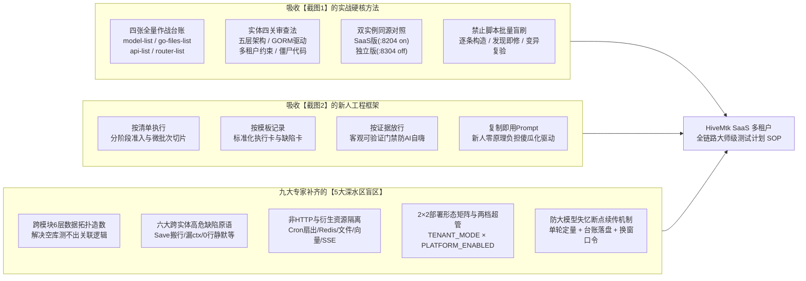
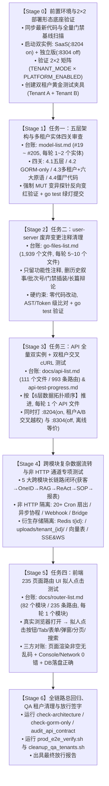

# HiveMtk 系统 SaaS 多租户改造后全链路检查、清理、测试与回归大师级测试计划（新人/非测试人员驱动大模型 Agent 标准作业手册 SOP）

> **编制与交叉审查专家团**：`@orchestrator` · `@project-planner` · `@product-manager` · `@test-engineer` · `@backend-specialist` · `@database-architect` · `@security-auditor` · `@explorer-agent` · `@frontend-specialist` · `@devops-engineer`  
> **适用系统与代码基线**：[`E:/HiveMtk/hivemtk-master`](file:///E:/HiveMtk/hivemtk-master)（基于官方上游 `07a7c025` / `537d1398` 多租户落地基线）  
> **核心理念**：**不要求执行人理解底层 Go/Vue/数据库原理；执行人只需扮演“调度官（Dispatcher）与审计官（Gatekeeper）”，通过复制粘贴标准化提示词驱动大模型 Agent，严格做到「按清单执行、按模板记录、按证据放行」。**

---

## 第一部分：九大专家交叉审查总览与截图案例「取长补短」深度对账

### 1.1 九大专家对 HiveMtk 多租户改造现状的交叉审查结论

在制定本测试计划前，九位领域专家对 [`E:/HiveMtk/hivemtk-master`](file:///E:/HiveMtk/hivemtk-master) 代码库及现有的多租户改造产物进行了全方位扫描与交叉核验，核心基线事实如下：

| 专家角色 | 审查维度 | 代码库真实基线数据（Code Facts） | 审查发现的核心风险与测试重点 |
| :--- | :--- | :--- | :--- |
| **`@explorer-agent`**<br>代码探查专家 | 清单资产与工程规模盘点 | 1. 实体清单 [`model-list.md`](file:///E:/HiveMtk/hivemtk-master/model-list.md)：共 **205 个 Model 文件 / 346 张表声明**（目前仅完成 `#1～#18`，剩余 **`#19～#205` 共 187 个模型文件待审**）。<br>2. 注释清理清单 [`go-files-list.md`](file:///E:/HiveMtk/hivemtk-master/go-files-list.md)：共 **1,939 个非测试 Go 源文件 / 19,347 个注释块 / 47,560 行注释**。<br>3. API 清单 [`docs/api-list.md`](file:///E:/HiveMtk/hivemtk-master/docs/api-list.md)：**111 个前端 API 文件 / 1,028 个调用点 / 993 条唯一路由**。<br>4. 页面路由清单 [`docs/router-list.md`](file:///E:/HiveMtk/hivemtk-master/docs/router-list.md)：**82 个模块文件 / 235 条前端页面路由**。 | 四份核心作战清单已在仓库中建好索引，但完成度处于起步阶段（实体完成 8.7%，API 与 UI 接近 0%）。测试计划必须直接锚定这 4 份真实台账，实现**断点续传**。 |
| **`@database-architect`**<br>数据库架构师 | 346 张表租户化、唯一索引与迁移双轨制 | 1. 租户隔离唯一判据是**数据库表是否含 `tenant_id` 列**（[`pkg/tenancyidx/tenancyidx.go`](file:///E:/HiveMtk/hivemtk-master/user-server/internal/pkg/tenancyidx/tenancyidx.go) 内省登记表）。<br>2. 唯一索引通过 `tenancyidx.Normalize` 原位复合为 `(tenant_id, 原列...)`（`global_uniq_` 前缀豁免，如邮箱全局唯一）。<br>3. 存在 `migrations/*.sql`（手写 SQL）、`internal/migration/migrations/`（90+ 版本化 Go 迁移）与 `db.AutoMigrate` 三轨并存。 | 前 18 个实体审查已发现 **`MarketingFlow` 等表在手写迁移 v1.3.0 中缺 `tenant_id` 列，仅靠 `AutoMigrate` 补列**的漂移隐患；且 `rag_products` 等表存在第二租户维度 `emb_tenant_id`，必须做 Schema 与迁移一致性对账。 |
| **`@backend-specialist`**<br>后端与架构专家 | Go 五层架构、GORMCallback 与前 18 实体共性缺陷 | 1. 强制遵守 `Router → Controller → Service → Repository → Model` 五层单向依赖（[`scripts/check-architecture.sh`](file:///E:/HiveMtk/hivemtk-master/scripts/check-architecture.sh) 10 项门禁）。<br>2. 业务代码禁 `.Raw(` / `.Exec(`（[`user-server/scripts/check-gorm-only.sh`](file:///E:/HiveMtk/hivemtk-master/user-server/scripts/check-gorm-only.sh) 门禁）。<br>3. 从 `#1～#18` 实体审查中已归纳出 **6 大跨实体高频致命缺陷原语**（详见 §1.3）。 | 大量历史 Service/Repository 方法未传 `ctx` 或内部调 `context.Background()` / `db.GetDB()`，在 `TENANT_MODE=off` 下全绿隐形，一开 `TENANT_MODE=on` 立即触发 `[tenant] ctx 未绑定` 全链路 500 崩溃！ |
| **`@security-auditor`**<br>安全与越权专家 | 跨租户越权、水平越权 (IDOR) 与能力耦合 | 1. 全仓生产代码存在 **82 处 `tenant.WithSystemScope(ctx)`** 调用，分布在 service/repository/router/controller。<br>2. 全仓生产代码仍有 **170+ 处 `.Save(`** 调用，而 `gorm.Save()` 命中 0 行时触发 `ON CONFLICT(id) DO UPDATE SET tenant_id = excluded.tenant_id`，已被实证为**跨租户搬行与复活已删行的致命越权原语**！<br>3. 平台运营方守卫 [`PlatformOperatorMiddleware`](file:///E:/HiveMtk/hivemtk-master/user-server/internal/middleware/platform_operator.go) 与租户管理员 `tenantAdmin` 刚完成分档（Commit `537d1398`）。 | 必须同时验证两层隔离：<br>① **跨租户隔离**（租户 B 绝不能读/改/删/搬移租户 A 的数据，连报错文案都不能泄露内部闸信息）；<br>② **同租户内水平隔离 (IDOR)**（普通员工 A2 不能篡改员工 A1 的私有记录）；<br>③ **平台超管 vs 租户超管边界**。 |
| **`@frontend-specialist`**<br>前端与插件专家 | 235 个 Vue 页面、契约错位与实时流 | 1. [`scripts/audit_api_contract.py`](file:///E:/HiveMtk/hivemtk-master/scripts/audit_api_contract.py) 双向扫描 `user-web/src`、`bridge/src`、`browser_automation/src`。<br>2. 前期审查已发现多处**前后端字段/路径契约错位**（如 `batchOperation` 前端绑 camelCase 后端返 snake_case、`marketingFlow` 前端绑 `row.enabled` 后端只有 `status`、`MaterialSelectDialog` 的 store 恒为空）。 | UI 拟人测试绝不能只看“页面打开不白屏”，必须验证**表格字段真实渲染、开关/按钮触发真实 API、表单提交真实落库、SSE/WS 实时流按租户分桶不串流**。 |
| **`@product-manager`**<br>产品与业务流专家 | 2×2 部署形态矩阵与跨模块业务闭环 | 1. 系统实际由 `TENANT_MODE` (`off`/`on`) × `PLATFORM_ENABLED` (`false`/`true`) 构成 **2×2 四种部署形态**（见 [`DEPLOYMENT_MODES_EVALUATION_2026-10.md`](file:///E:/HiveMtk/hivemtk-master/docs/architecture/DEPLOYMENT_MODES_EVALUATION_2026-10.md)）。<br>2. 菜单受 **Gate 1（商业模块激活）+ Gate 2（RBAC 菜单权限）** 双重控制。 | 若按字母顺序孤立测页面/API，下游模块（如收件箱、SOP、营销流程、成交漏斗）因缺少上游数据（渠道、客户、线索、知识库）将全部呈现空状态，无法测出深层逻辑 Bug。 |
| **`@devops-engineer`**<br>运维与环境专家 | 双实例并跑、容器数据库与本地安全红线 | 1. 线上开发版平台端 `https://manageapi.xapptool.cn`，线上用户端 `https://workapi.xapptool.cn`。<br>2. 本地需并跑 **SaaS 实例（`:8204`，`TENANT_MODE=on`）** 与 **独立部署实例（`:8304`，`TENANT_MODE=off`）**。<br>3. 本机 Windows + Docker 环境下，`.env` 中的 `POSTGRES_PASSWORD` 为占位符，真实密码须从 `mtk-postgres` 容器提取。 | 必须将双实例启动、Token 自动续签、Windows PowerShell UTF-8 编码防乱码（禁裸中文管道）、QA 租户自动清理（[`scripts/cleanup_qa_tenants.sh`](file:///E:/HiveMtk/hivemtk-master/scripts/cleanup_qa_tenants.sh)）封装为新人一键可用的标准指令。 |
| **`@test-engineer`**<br>测试工程专家 | 变异测试、对抗性探针与三方证据门禁 | 1. 常规正向单测极易产生“假绿”（如 `monitor` 包吞掉全部 error 返回 `200 + 全 0`，看着正常实则全废）。<br>2. 必须引入 **MUT 变异复现法** 与 **`WithSystemScope` 物理回读核验法**。 | 为新人定制**「三方证据链放行标准」**：没有 HTTP 响应 + 控制台/日志 + 数据库物理行回读三合一证据，大模型一律不准勾选 `[x]` 或 `✅`。 |
| **`@project-planner`**<br>总规划师 | 防上下文爆炸与工业化 SOP 编排 | 205 个模型 + 1,939 个 Go 文件 + 993 条 API + 235 个页面 = **超过 3,400 个检查单元**。任何大模型单次对话超过 15～20 个检查单元就会发生上下文压缩失忆、跳项或偷懒写批量脚本。 | 采用**「7 阶段流水线 + 微批次（Micro-Batch）循环指令 + 台账文件唯一状态源 + 换窗断点续传指令」**，让新人像开动数控机床一样稳步推进。 |

---

### 1.2 借鉴附件截图1与截图2的「取长补短」设计说明

我们将**截图1（实战任务拆解流）**与**截图2（结构化测试框架流）**进行了深度融合，吸收各自精华并补齐双方盲区：



#### 🔍 重点吸收与升级的「六大跨实体高危缺陷原语」（大模型审查时必须逐条狙击）
在前 18 个实体的实战审查中，已经反复命中以下 **6 类在单机模式下完全隐形、但在 SaaS 模式下致命的共性 Bug**。本计划将其固化进大模型的每一轮审查 Prompt 中，无需新人懂原理，大模型会自动按图索骥：
1. **原语 P1（断链 ctx）**：Controller 拿到了带租户的 `c.Request.Context()`，但 Service 或 Repository 方法签名没有 `ctx context.Context`，或者中途换成了 `context.Background()` / 无参 `db.GetDB()`，导致 `TENANT_MODE=on` 下直接报 `[tenant] 表 xxx 需要租户上下文但 ctx 未绑定`（500 崩溃）。
2. **原语 P2（异步丢租户）**：业务在触发异步操作（如 `go s.executeFlow(...)`、上传文件、延时任务）时传了 `context.Background()`，导致后台协程丢失租户归属，写库被拒或状态永远无法回写。必须改用 `tenant.BackgroundWithTenant(ctx)` 或 `tenant.Fanout`。
3. **原语 P3（`gorm.Save()` 复活已删行与跨租户搬行）**：GORM 的 `.Save(&obj)` 在按主键 UPDATE 命中 0 行（例如该 ID 属于别的租户被谓词遮挡，或该行已被软删/硬删）时，会自动回退执行 `INSERT ... ON CONFLICT (id) DO UPDATE SET tenant_id = excluded.tenant_id`，**把已删除的行复活，甚至把别的租户的数据强行搬到当前租户名下**！仓储写操作必须改用显式 `.Updates(...)` 并检查 `RowsAffected == 0`。
4. **原语 P4（0 行更新/删除静默成功）**：跨租户或越权执行 `Update` / `Delete` / `Increment` 时，GORM 因租户谓词挡住而影响 0 行（`RowsAffected == 0, Error == nil`），接口却返回 `200 操作成功`。必须对 `RowsAffected == 0` 显式返回「不存在」哨兵错误（映射 HTTP 404）。
5. **原语 P5（错误折叠与内部闸信息泄露）**：Controller 把所有 DB 错误粗暴写成 `response.Error(ctx, 404, err.Error())` 或 `500 + err.Error()`，导致未绑定租户的配置级故障（本应 500）被伪装成 404，且把 `[tenant] 表 xxx 需要租户上下文...` 内部架构细节直接暴露给外部调用方。另有像 `monitor` 模块那样吞掉所有 error 返回 `200 + 全 0 数据` 的“假健康”。
6. **原语 P6（同租户内 IDOR 水平越权 & `float64` 身份断言 Panic）**：团队 JWT 中 `user_id` 可能是 `float64`/`string`，裸写 `userID.(uint)` 会直接触发 `panicdottypeE` 空响应 500，或 `uid, _ := userID.(uint)` 静默变成 `0`；且带 `user_id`/`created_by` 的个人资产表若按主键读写不带归属谓词，同租户内的员工 B 可随意偷看/篡改员工 A 的数据。

---

## 第二部分：全链路测试总体作战图（7 大阶段流水线）

为了解决「模块多、页面多、逻辑复杂、数据相互引用」的问题，我们将全部工作划分为 **Stage 0 ～ Stage 6 七个标准阶段**。**为什么按这个顺序？**
- **先静后动、先底后表**：先通过 Stage 1（模型四关审查）把底层数据访问、ctx 透传、多租户隔离闸修扎实，再跑 Stage 3（API 测试）和 Stage 5（UI 测试），能减少 80% 以上的表层报错返工！
- **先造黄金数据基座，再测 API 与页面**：Stage 0 与 Stage 3 采用**6 层业务依赖拓扑造数**，彻底消灭“因为空库导致列表全空、详情全 404”的无效测试。



### 七大阶段全局导航表（新人作战地图）

| 阶段 | 对应任务 | 核心台账文件（唯一进度源） | 总规模 | 推荐单轮对话批次大小 | 放行核心证据 |
| :--- | :--- | :--- | :--- | :--- | :--- |
| **Stage 0** | 前置任务 1/2/3 + 黄金造数 | [`docs/api-test-progress.md`](file:///E:/HiveMtk/hivemtk-master/docs/api-test-progress.md) | 2×2 矩阵 + 双实例 + 3 租户夹具 | 1 轮完成 | `:8204`(`on`) 与 `:8304`(`off`) 均 `/health` 200；拿到 `TOKEN_A1`、`TOKEN_A2`、`TOKEN_B1`、`TOKEN_OFF` |
| **Stage 1** | 任务一：实体四关审查 | [`model-list.md`](file:///E:/HiveMtk/hivemtk-master/model-list.md) | 205 个模型文件（剩 `#19～#205`） | **每轮 1～2 个实体**（严禁贪多） | 四关读数记录 + MUT 变异先红后绿日志 + `go test` 通过 + `[x]` 落盘 |
| **Stage 2** | 任务二：废弃注释清理 | [`go-files-list.md`](file:///E:/HiveMtk/hivemtk-master/go-files-list.md) | 1,939 个 Go 文件 | **每轮 5～10 个同目录文件** | `git diff` 仅含注释行变动（无任何代码 token 变化）+ `go build ./...` 通过 + `[x]` 落盘 |
| **Stage 3** | 任务三：API cURL 测试 | [`docs/api-list.md`](file:///E:/HiveMtk/hivemtk-master/docs/api-list.md) + [`docs/api-test-progress.md`](file:///E:/HiveMtk/hivemtk-master/docs/api-test-progress.md) | 111 个 API 文件 / 993 条路由 | **每轮 1 个 API 文件**（约 5～15 条路由） | `:8204`(租户A正测 + 租户B越权404) + `:8304`(单机正测) 真实 cURL 响应码与数据库核验 |
| **Stage 4** | 跨模块长链路与非HTTP专项 | 本手册第五部分专项表 | 5 条跨模块长链路 + 6 类非 HTTP 资源 | **每轮 1 条长链路或 1 类资源** | 上游写入 → 下游模块查出且 `tenant_id` 一致；租户 B 0 串流/0 串键 |
| **Stage 5** | 任务四：UI 拟人点击测试 | [`docs/router-list.md`](file:///E:/HiveMtk/hivemtk-master/docs/router-list.md) | 82 个路由模块 / 235 个页面 | **每轮 1 个路由模块**（约 1～6 个页面） | 浏览器逐页打开点击 + Console 0 Error + Network 0 5xx/4xx + 页面字段契约对齐 + `✅` 落盘 |
| **Stage 6** | 总回归与数据清理放行 | 全量门禁脚本输出 | 6 大门禁 + E2E 闭环 | 1 轮完成 | 全部门禁 `exit 0` + 测试脏租户清理完毕 |

---

## 第三部分：应对「页面多、内容多、逻辑复杂、跨模块引用」的四大核心法则

新人不需要懂代码，但必须明白**怎么指挥大模型才不会乱、不会漏、不会糊弄你**。请熟记以下 4 条指挥铁律：

### 法则一：6 层业务拓扑造数法（解决“数据相互引用、空库测不出 Bug”的难题）
HiveMtk 的 82 个模块之间有严格的数据上下游依赖关系。如果直接去测“成交漏斗”或“SOP 执行记录”，因为库里没有客户、没有渠道、没有话术，页面和接口返回的都是空列表 `[]`，大模型就会草率判定“200 通过”，漏掉大量字段映射错误和跨租户串号 Bug！

因此，在 **Stage 0（黄金夹具初始化）**、**Stage 3（API 测试）** 和 **Stage 5（UI 测试）** 中，必须严格按照以下 **L1 → L6 金字塔顺序** 推进，上一层造出的真实数据自动成为下一层的测试输入：

| 拓扑层级 | 业务域名称 | 涵盖的核心模块（对应 `api-list.md` / `router-list.md`） | 向下游提供的关键引用数据（外键/关联键） |
| :--- | :--- | :--- | :--- |
| **L1 底座层** | **租户、身份、权限与系统配置** | `auth`、`tenant`、`systemUser`、`role`、`permission`、`system`、`moduleMarket`、`subscription`、`mcpCredential`、`bridgeToken`、`llmRouting` | `tenant_id`（租户A/B）、`user_id`（管理员A1/普通员工A2/租户B管理员B1）、`role_id`、已激活模块列表、LLM 模型路由配置 |
| **L2 供给层** | **全渠道账号、知识库、素材与模板** | `chatChannel`、`wecomAccount`、`telegram`、`whatsapp`、`whatsappCloud`、`dingtalkApp`、`feishu`、`qq`、`email`、`sms`、`platformAccount`、`knowledgeBase`、`knowledge`、`kbConnector`、`faq`、`glossary`、`ragProductConfig`、`material`、`scriptTemplate`、`sopTemplateKb`、`objection`、`douyinCard`、`kuaishouCard`、`xiaohongshuCard`、`xianyuCard`、`tiktok`、`shortLink`、`livecode`、`domainPool` | `channel_id`、`bridge_account_id`、`kb_id`、`rag_product_id`（含 1024 维向量切片）、`material_id`、`script_id`、`card_id` |
| **L3 智能体层** | **AI 智能体、工具绑定与拟人策略** | `aiAgent`、`agentKBBinding`、`aiTool`、`persona`、`intentRecognition`、`confidence`、`tuning` | `agent_id`、Agent↔知识库绑定关系、Agent↔渠道绑定关系、45 个原子工具开关 |
| **L4 客户与入站层** | **线索、客户 CDP、OneID 与消息收件箱** | `clue`、`leadMining`、`customer`、`customer360`、`oneid`、`customerTag`、`tagSegmentation`、`userSegment`、`customerEvent`、`customerJourney`、`messageHub`、`unifiedMessage`、`inbox`、`customerSession`、`customerService`、`community` | `clue_id`、`customer_id`、`one_id`（跨渠道统一身份）、`conversation_id`、`session_id`、`message_id`、`tag_id`、`segment_id` |
| **L5 触达与自动化层** | **SOP、营销流程、触达管道、浏览器 RPA 与审批** | `sopAgent`、`reachPipeline`、`marketingFlow`、`workflowOrchestrator`、`browserAutomation`、`batchOperation`、`approvalTask`、`orderDraft`、`followups`、`salesWorkbench`、`abExperiment`、`geoTools` | `flow_id`、`execution_id`、`pipeline_id`、`browser_session_id`、`browser_task_id`、`approval_id`、`order_draft_id` |
| **L6 洞察与治理层** | **转化漏斗、AI 评测、监控大盘与安全审计** | `analytics`、`conversionFunnel`、`churnPrediction`、`aiProductivity`、`customReport`、`dashboardScreen`、`badCase`、`dialogueMemory`、`ops`、`operationLog`、`securityAudit`、`backup`、`i18nStats` | 汇总消费 L1～L5 产生的全部流水、Trace、评分与审计日志，验证聚合统计不跨租户串数 |

---

### 法则二：微批次循环 + 台账落盘 + 换窗续传法（解决“大模型上下文爆炸、偷懒跳项”的难题）
1. **单轮定量铁律**：
   - Stage 1（实体审查）：每次只让大模型处理 **`model-list.md` 中紧挨着的 1～2 个未勾选 `[ ]` 实体**。
   - Stage 2（注释清理）：每次只让大模型处理 **`go-files-list.md` 中紧挨着的 5～10 个未勾选 `[ ]` 文件**。
   - Stage 3（API 测试）：每次只让大模型处理 **`docs/api-list.md` 中的 1 个 `.js` 文件（约 5～15 条接口）**。
   - Stage 5（UI 测试）：每次只让大模型处理 **`docs/router-list.md` 中的 1 个模块分组（约 1～6 个页面）**。
2. **禁止脚本批量勾选铁律**：若发现大模型写 Python/Shell 脚本一次性把几十行 `[ ]` 改成 `[x]` 或把 `⬜` 改成 `✅`，**立即判定违规并让其 `git checkout` 回退台账**！
3. **换窗断点续传机制**：当一个对话窗口进行了 **8～10 轮**，或者感觉大模型开始变慢、输出变简略时，**直接新建一个对话窗口**，粘贴第四部分的**【通用换窗断点续传提示词】**——因为所有进度都已实时写进仓库的 Markdown 台账里，新窗口的大模型只需读台账就能从下一个 `[ ]` / `⬜` 无缝继续，永远不会丢进度！

---

### 法则三：三方证据链放行法则（新人如何一眼识别大模型有没有糊弄你？）
新人不需要看懂 Go 或 Vue 源码，只需要像海关查验一样，检查大模型回复的**【执行记录卡】**里是否齐备以下 **3 项铁证（缺一不可，缺任何一项直接回复：“证据不全，补充实测证据后再勾选台账”）**：

| 证据维度 | 针对 Stage 1（实体审查） | 针对 Stage 3（API 测试） | 针对 Stage 5（UI 拟人测试） |
| :--- | :--- | :--- | :--- |
| **铁证 1：正向与双形态证据** | 给出 `Router→Controller→Service→Repo→Model` 真实文件行号 + `check-gorm-only.sh` 0 违规输出 | 同时贴出 **`:8204`（SaaS 租户A）** 与 **`:8304`（独立版）** 的真实 `curl` 命令、HTTP 状态码（200）及响应 JSON 摘要 | 贴出浏览器打开该路由后的**真实渲染快照/元素清单**，证明列表/卡片/图表有数据、无 `undefined`/`NaN`/乱码问号 `???` |
| **铁证 2：多租户隔离与越权拦截证据** | 给出 **MUT 变异探针**（故意删掉 `WithContext` 或改回 `Save`）跑 `go test` **变红报错原文**，以及还原后 **变绿通过** 的终端输出 | 贴出用 **租户 B 的 `TOKEN_B1`** 访问/修改/删除租户 A 刚创建的资源 ID 时，`:8204` 返回 **404 / 空列表**（绝不能是 200 篡改成功，也绝不能是 500 暴露 `[tenant]` 原文） | 切换租户 B 账号登录同一页面，验证看不到租户 A 刚才新增的记录；点击页面所有新增/编辑/开关/删除按钮，Network 面板无 500/404 断链 |
| **铁证 3：底层物理落盘与零副作用证据** | `go build ./...` 零报错 + 该包 `go test` PASS 耗时记录 | 用 `psql`（或 `WithSystemScope`）直查数据库表，证明写入行的 `tenant_id` 确实等于租户 A 的 ID（而非默认落到 1 或 0），且租户 A 的原行未被租户 B 的越权写改动 | 浏览器 DevTools **Console 面板 `0 error`** + 后端日志无 `panic` / 无 `[tenant] ctx 未绑定` 报错 |

---

## 第四部分：分阶段保姆级操作步骤与「大模型指令提示词库」（复制即用）

> [!IMPORTANT]
> **新人使用说明**：请从 **Stage 0** 开始，按顺序将下方灰底代码块中的**【提示词】**直接复制发送给大模型 Agent。每一轮大模型执行完毕后，对照该阶段的**【新人放行检查点】**核对，合格则发送下一轮循环提示词，不合格则发送驳回提示词。

---

### 🟢 Stage 0：环境底座初始化、2×2 部署形态核验与「双租户黄金夹具」造数

#### 【阶段目标】
1. 确认工作区代码与最新多租户基线一致，跑通基础静态门禁。
2. 在本地同时拉起两套后端服务：**SaaS 多租户实例（端口 `:8204`，`TENANT_MODE=on`）** 与 **本地独立部署实例（端口 `:8304`，`TENANT_MODE=off`）**，以及前端服务（`:8211` / `:8205`）。
3. 核验 `TENANT_MODE` (`off`/`on`) × `PLATFORM_ENABLED` (`false`/`true`) **2×2 部署形态矩阵**的核心判据。
4. 在数据库中创建贯穿全局测试的**「双租户三账号黄金测试夹具」**：
   - **租户 A（主力测试租户）**：管理员 `qa_tenant_a_admin`（`TOKEN_A1`）+ 普通员工 `qa_tenant_a_user`（`TOKEN_A2`，用于测同租户内水平越权 IDOR 与管理员守卫）。
   - **租户 B（交叉越权攻击租户）**：管理员 `qa_tenant_b_admin`（`TOKEN_B1`，专门用于拿租户 B 的 Token 去读/改/删租户 A 的资源 ID，验证 100% 隔离）。
   - **独立部署实例账号**：`uit_admin`（`TOKEN_OFF`，用于 `:8304` 离线单机模式对照）。

#### 📋 【Prompt 0-1：复制发送给大模型 —— 启动 Stage 0 环境与黄金夹具初始化】

```markdown
你现在是 HiveMtk 项目的全栈测试与运维编排专家（联合应用 @devops-engineer、@backend-specialist、@database-architect、@security-auditor、@test-engineer 的专业规范）。
请严格遵守本工作站 P0 安全红线（严禁触碰或停止 8000/443/8188/3333 等非本项目进程；严禁使用包含通配符的递归删除命令；Windows PowerShell 下严禁使用裸中文管道以防 0x3F 问号乱码）。

当前任务：执行【Stage 0：环境底座初始化、2×2 部署形态快速核验与双租户黄金测试夹具造数】。

请一步一步完成以下操作，并向我汇报完整证据：

### 第一步：代码与门禁基线体检
1. 检查 `E:\HiveMtk\hivemtk-master` 的 `git status` 与最新 5 条 `git log --oneline`。
2. 从正在运行的 `mtk-postgres` 容器（端口 8202）中读取真实的 `POSTGRES_PASSWORD`（注意：不要轻信 `.env` 里的占位符密码）。
3. 运行以下三个静态架构与契约门禁脚本，记录当前基线输出：
   - `bash scripts/check-architecture.sh`
   - `bash user-server/scripts/check-gorm-only.sh`
   - `python scripts/audit_api_contract.py`

### 第二步：双实例并跑启动（SaaS 模式 :8204 vs 独立部署模式 :8304）
1. 检查 `:8204`（SaaS 实例，`TENANT_MODE=on`）与 `:8304`（独立部署实例，`TENANT_MODE=off`）及前端 `:8211` 的运行状态。
2. 如未同时运行，请使用编译好的最新二进制（或通过容器/本地环境，确保 `APP_ENV=development`、真实 DB 密码）分别在 `:8204`（`TENANT_MODE=on`）和 `:8304`（`TENANT_MODE=off`）启动 `user-server`，并确认：
   - `GET http://127.0.0.1:8204/health` 返回 200 `status: ok`
   - `GET http://127.0.0.1:8204/api/public/config` 返回 `tenant_mode: true, edition: "saas"`
   - `GET http://127.0.0.1:8304/health` 返回 200 `status: ok`
   - `GET http://127.0.0.1:8304/api/public/config` 返回 `tenant_mode: false, edition: "opensource"`
   - 在 `:8304` 调用 `POST /api/tenant/register` 必须返回业务码 `4104`（注册未开放）。

### 第三步：创建「双租户三角色黄金测试夹具」并缓存 Token
1. 在 `:8204`（`TENANT_MODE=on`）下准备两个测试租户（均遵守 QA 命名签名规范：`license_no` 以 `QA-` 开头，邮箱以 `@qa.example` 结尾，以便后续用 `cleanup_qa_tenants.sh` 清理）：
   - **租户 A（主测租户）**：确保拥有管理员账号 `qa_a_admin`（role=admin）和普通成员账号 `qa_a_user`（role=user），并为租户 A 激活全部商业模块（含 `browser-automation`）以便测试所有页面路由。
   - **租户 B（越权对照明哨租户）**：通过 `POST /api/tenant/register` 自助注册创建租户 B（管理员 `qa_b_admin`），验证开户事务、默认赠送模块（starter-kit）及租户隔离生效。
2. 分别登录获取并保存 4 个长效测试 Token（写入临时文件并在回复中列出对应的 `user_id`、`tenant_id`、`tenant_code`）：
   - `TOKEN_A1`（:8204 租户 A 管理员）
   - `TOKEN_A2`（:8204 租户 A 普通员工）
   - `TOKEN_B1`（:8204 租户 B 管理员）
   - `TOKEN_OFF`（:8304 独立部署版管理员，默认 `tenant_id=1`）
3. 验证平台运营方守卫边界：
   - 用首个租户（`tenant_id=1`）的 admin Token 访问 `GET /api/manage/tenants` 应返回 200；
   - 用新建租户 B 的管理员 `TOKEN_B1` 访问 `GET /api/manage/tenants` 必须被 `PlatformOperatorMiddleware` 拦截返回 403；
   - 用 `TOKEN_B1` 访问租户内管理配置 `GET /api/system/config` 应正常返回 200（验证 Commit `537d1398` 的分档守卫正常）。

### 第四步：输出【Stage 0 底座验收报告卡】
请按表格输出：各端口状态、三个门禁脚本结果、四个测试账号的 `(账号名 / user_id / tenant_id / Token存盘路径)`、以及平台超管 vs 租户超管边界实测结果。
```

#### ✅ 【Stage 0 新人放行检查点】
- [ ] `:8204` (`tenant_mode: true`) 和 `:8304` (`tenant_mode: false`) 两个后端实例都活着且 `/health` 绿灯。
- [ ] 拿到了 `TOKEN_A1`（租户A超管）、`TOKEN_A2`（租户A普通员工）、`TOKEN_B1`（租户B超管）、`TOKEN_OFF`（独立版超管）四个 Token，且 `tenant_id` 清晰区分。
- [ ] 租户 B 管理员调 `/api/manage/tenants` 返回 `403`，调 `/api/system/config` 返回 `200`。

---

### 🔵 Stage 1：任务一 —— 五层架构模型检查与 SaaS 多租户约束「四关审查」（逐实体推进）

#### 【阶段目标】
基于 [`E:/HiveMtk/hivemtk-master/model-list.md`](file:///E:/HiveMtk/hivemtk-master/model-list.md) 清单（共 205 个 Model 文件，目前已完结 `#1～#18`，待审 `#19～#205`），按顺序每次取 **1～2 个实体**，严格过 **4.1 五层架构、4.2 GORM 驱动、4.3 多租户约束与六大原语、4.4 僵尸代码** 四关，并用 **MUT 变异探针** 证明新增的回归测试真能抓到 Bug，最后更新 `model-list.md` 勾选 `[x]`。

#### 📋 【Prompt 1-1：复制发送给大模型 —— 执行单批次（1～2 个实体）四关深度审查】

```markdown
你现在是 HiveMtk 后端架构与多租户安全审计专家团（联合应用 @backend-specialist、@database-architect、@security-auditor、@test-engineer）。
请读取 `E:\HiveMtk\hivemtk-master\model-list.md`，找到清单中**排在最前面的 1 个（若同属一个极小子域最多 2 个）状态为 `[ ]` 的待审 Model 实体**，严格参照 `#14～#18` 已完成的司法级审查标准，对该实体全链路执行【四关审查 + 六大缺陷原语排查 + MUT 变异探针复验】。

⚠️ 硬性纪律（违反任一条即视为任务失败）：
1. **绝对禁止脚本批量勾选**：本阶段每次只准审查 1～2 个实体，严禁编写脚本批量扫描修改或批量勾选 `model-list.md`。
2. **必须逐关给出源码级证据与修复**：

### 关卡 4.1：五层架构合规检查（`GO_FIVE_LAYER_ARCHITECTURE.md`）
- 追踪该 Model 的完整调用链：`Frontend (user-web/src) → Router → Controller → Service → Repository → Model`。
- 检查 Model 是否位于 `internal/model/` 或 `internal/<域>/model/`，且仅含字段、GORM Tag、Hook 与 `TableName()`（无业务方法）。
- 检查是否存在 Controller 直连 Repository/DB、Service 直调 `*gorm.DB`、或 Repository 反向调用 Service / 跨错业务域放置。
- 检查 Repository 与 Service 构造函数：收口“无参内部摸 `db.GetDB()` + `...WithDB` 双入口”反模式，确保 DB 句柄显式注入、上下文链路不断裂。

### 关卡 4.2：GORM 驱动与 DDL 权威面对账（`check-gorm-only.sh`）
- 检查该实体全链路是否存在 `.Raw(`、`.Exec(` 或手拼 SQL 字符串（`Where("..."+var)`、未转义的 `LIKE "%"+search+"%"`、裸算分页未 clamp `page<1` / `pageSize>100`）。
- 对账三处 DDL 真相源：① Model 结构体 Tag；② `internal/pkg/db/migrate.go` 的 `allModels()` 登记；③ `migrations/*.sql` 与 `internal/migration/migrations/` 中的建表/补列迁移。确认是否存在手写迁移漏 `tenant_id` 列或唯一索引未被 `tenancyidx.Normalize` 复合化的问题。

### 关卡 4.3：SaaS 多租户约束与「六大跨实体高危原语」狙击（核心！）
1. **表归属核验**：确认该表是否应含 `tenant_id` 列（业务表必须有；平台全局表必须无且在 `SaaS_MULTI_TENANT.md` §三.5 与 `TestTenantRegistry_ModelDeclarations` 豁免表对账）。
2. **逐条排查六大高危缺陷原语（发现即修）**：
   - **P1 断链 ctx**：Repository 和 Service 的所有读写方法是否都以 `ctx context.Context` 为首参并调用 `.WithContext(ctx)`？有没有把 ctx 丢弃换成 `context.Background()`？
   - **P2 异步丢租户**：全链路是否有 `go func` 或后台触发？若有，是否用 `tenant.BackgroundWithTenant(ctx)` 续上了租户归属？
   - **P3 `gorm.Save()` 跨租户搬行与死行复活**：Repository 写操作是否使用了 `.Save(`？若有，必须改为显式 `.Updates(...)`（或 `Select/Omit`）+ `RowsAffected == 0` 哨兵报错，严防 `Save` 0 行回退触发 `ON CONFLICT(id) DO UPDATE` 复活已删行或跨租户篡改归属！
   - **P4 0 行静默成功**：按主键/条件的 `Update`、`Delete`、计次操作，在 `RowsAffected == 0` 时是否如实返回缺失哨兵错误（映射 404），而非静默返回 `nil`？查詢失败时 `GetByID` 是否返回 `(nil, err)` 而非非空零值结构体指针？
   - **P5 错误折叠与内部闸回显**：Controller 是否将未绑定租户的 `[tenant]` 配置级错误（应为 500 且脱敏固定文案）错误折叠成了 404，或通过 `err.Error()` 将内部错误原文回显给前端？是否存在吞掉 error 返回 `200 + 空/零数据` 的假正常？
   - **P6 同租户 IDOR 水平越权与 `float64` 身份断言**：若表含 `user_id`/`created_by`/`operator_id`，用户级读写口是否校验了本人归属？Controller 提取 `user_id` 时是否兼容了 `float64`/`uint`/`string`（禁裸写 `userID.(uint)` 导致 panic 或静默降为 0）？

### 关卡 4.4：僵尸代码四网普查（Census Before Delete）
- 用 grep 在全仓拉四张网：① 仓储方法调用点；② 服务方法调用点；③ 路由挂载点；④ 前端 `user-web/src` / `bridge` / `browser_automation` 调用点。
- **确定零引用且非未接线产品特性的死方法/死常量**：果断清理，并同步清理死测试。
- **属于“有读无写”、“有后端无前端”或“业务功能半成品”的**：严禁盲目删除，保留并作为「遗留决策项」记入 `model-list.md` 文末。

### 关卡 4.5：编写 `TENANT_MODE=on` 契约锁与【MUT 变异探针反向验证】
1. 为该实体的 Repository / Service / Controller 补齐 `TENANT_MODE=on` 下的多租户隔离测试（验证：写侧自动填 `tenant_id` 并用 `tenant.WithSystemScope` 物理回读核实；读/改/删双向遮挡；裸 ctx 必报 `[tenant]` 而非 `ErrRecordNotFound`；0 行修改必报错；`off` 模式直通无回归）。
2. **执行 MUT 变异复验**：临时在生产代码中制造 2～5 组典型变异（如摘掉 `WithContext`、改回 `Save`、去掉 `RowsAffected` 检查、去掉 `user_id` 归属条件），运行 `go test` **亲眼确认新写的测试精准变红**，记录变红原文后**立即机械回退变异代码**（确保 `git diff` 中无任何 `MUT-` 残留）。
3. 运行该领域包及关联包的 `go test`、`go vet`、`go build ./...` 及 `bash user-server/scripts/check-gorm-only.sh`，确保 100% 绿灯。
4. 更新 `model-list.md`：将该实体状态从 `[ ]` 改为 `[x]`，在表格行及文末追加详细的四关读数、MUT 变异实测记录与遗留决策项（与 `#14～#18` 格式完全对齐）。

完成后，请向我输出【Stage 1 单批实体审查交接卡】。
```

#### 📋 【Prompt 1-2：新人审核通过后，继续下一批实体的简短口令】

```markdown
上一批实体四关审查与 MUT 变异证据核验通过！
请继续读取 `E:\HiveMtk\hivemtk-master\model-list.md`，按顺序取**下一个状态为 `[ ]` 的实体**，严格执行同样的【4.1 五层架构 + 4.2 GORM驱动 + 4.3 多租户与六大原语 + 4.4 僵尸代码 + 4.5 MUT 变异探针与测试锁】全流程，完成后更新 `model-list.md` 并输出交接卡。
```

#### ✅ 【Stage 1 新人放行检查点（每轮必看 4 点）】
1. **看清单进度**：`model-list.md` 中本轮对应的 `#序号` 是否已从 `[ ]` 变为 `[x]`，且附带了 4.1 / 4.2 / 4.3 / 4.4 四段详细审查记录？
2. **看 MUT 变异红灯证据**：大模型是否贴出了“故意改坏代码时 `go test` 报 FAIL 的原文”以及“回退变异后 `go test` 报 PASS”的对比？
3. **看变异无残留**：`grep -rn "MUT-" user-server/internal/` 是否为 0 命中？
4. **看门禁绿灯**：`go build ./...`、`go test`、`check-gorm-only.sh` 是否全部通过？

---

### 🟡 Stage 2：任务二 —— `user-server` 模块废弃变更注释清理（零代码变动安全清洗）

#### 【阶段目标】
基于 [`E:/HiveMtk/hivemtk-master/go-files-list.md`](file:///E:/HiveMtk/hivemtk-master/go-files-list.md)（共 1,939 个非测试 Go 源文件，其中 100 个文件本身无注释可直接核验勾选，其余 1,839 个文件含注释），按目录每次取 **5～10 个文件**，清除历次 AI 迭代留下的无效历史变更叙事、批次号（如 `R5`/`T012`/`#14`/`AC②`）、门禁插装解释、长篇取舍辩论、元叙述与翻译式废话注释，**只保留真正解释“代码本身讲不清的契约/不变量/边界”的功能性注释**，并用 Token 级代码比对证明**一个字的生产代码都没动**。

#### 📋 【Prompt 2-1：复制发送给大模型 —— 执行单批次（5～10 个 Go 文件）注释清理】

```markdown
你现在是 HiveMtk 代码考古与洁净代码专家（联合应用 @code-archaeologist、@backend-specialist、@test-engineer 及 @[skills/clean-code] 规范）。
请读取 `E:\HiveMtk\hivemtk-master\go-files-list.md`，找到清单中**排在最前面的 5～10 个未完成（`[ ]`）的 Go 源码文件**，执行【任务二：废弃变更注释清理】。

⚠️ 绝对红线（违反任一条立即回滚）：
1. **严禁使用正则或脚本批量增删注释**：必须逐个文件完整读取理解上下文后，由你在编辑器中精细清理。
2. **严禁修改哪怕一个字符的生产代码**：只准修改或删除注释（`//...` 或 `/*...*/`），包声明、import、类型、函数签名、语句、字符串字面量一个字节都不准动！

### 注释去留唯一口径（参照 `go-files-list.md` 头部规范）：
- ❌ **必须删除的 6 类噪音注释**：
  1. **历史变更叙事**：讲“以前是…后来改成…”、“2026-10-xx 修复”、“原实现…”而非当前行为的；
  2. **变更批次/任务编号**：含 `R5`、`R22`、`R38`、`T001`～`T043`、`T-P3-03`、`B-2`、`#14`、`AC②`、`TOOL-05`、`I26` 等轮次/工单代号的；
  3. **门禁/插装注释**：解释“CI 门怎么查”、“谁在巡检”、“豁免在哪登记”、“为了让某某测试通过”的；
  4. **长篇推理辩论**：5 行以上展开争论“为什么选 A 不选 B”，而结论早已体现在代码结构中的；
  5. **元叙述/给下个人的信**：讲“这一格/这一卡立此判据时…”、“本轮顺带修…”的；
  6. **重复代码语义的废话**：如在 `for _, v := range list` 上面写 `// 遍历列表`。
- ✅ **必须保留的 5 类核心功能性注释**：
  1. **契约与不变量**：长度/单位/取值范围、必须成对调用、并发锁顺序约束；
  2. **不可从代码直接推出的事实**：为何必须走此表、某键在本仓无写入方、第三方协议怪癖；
  3. **导出符号的对外语义**：公开 API/函数错误码含义（400/404/409）、幂等保证；
  4. **相近概念的确切分界**：如两个相似服务/通道的职责边界；
  5. **编译与工具指令（绝对禁止误删！）**：`//go:build`、`//go:generate`、`//go:embed`、`//nolint`、`// Deprecated:`、`// 五层架构归属`（`check-architecture.sh` 依赖它识别测试文件）。

### 执行与自证步骤：
1. 逐文件读取并清理注释。
2. **执行 AST/Token 级零代码改动核验**：对本批修改的每个 `.go` 文件，使用 `git diff -U0 <file>` 检查所有变更行，证明 **`+` 与 `-` 行 100% 仅为注释行或空行**（或用 Go `go/scanner` 剥离注释后比对 token 流完全一致）。
3. 运行 `cd user-server && go build ./... && go vet ./...` 确认编译与静态检查 100% 通过。
4. 在 `go-files-list.md` 中将本批已完成的 5～10 个文件标记为 `[x]`，并输出【Stage 2 注释清理批次交接卡】（列出文件名、清理前/后注释行数、保留的核心功能注释摘要、Token 零改动核验结果）。
```

#### 📋 【Prompt 2-2：新人审核通过后，继续下一批注释清理的简短口令】

```markdown
上一批 Go 文件注释清理与零代码改动验证通过！
请继续读取 `E:\HiveMtk\hivemtk-master\go-files-list.md`，按顺序取**接下来的 8～10 个未完成（`[ ]`）文件**，严格按相同标准清理废弃变更注释，执行 `git diff` 零代码变动核验与 `go build ./...`，更新 `go-files-list.md` 并输出交接卡。
```

#### ✅ 【Stage 2 新人放行检查点】
- [ ] 大模型输出的 `git diff` 核验结果确认：**除 `//` 或 `/* */` 注释及空行外，生产代码 Token 变动数为 `0`**。
- [ ] 没有误删 `//go:build`、`//nolint`、`// 五层架构归属` 等工具指令注释。
- [ ] `go build ./...` 绿灯，`go-files-list.md` 中本批 5～10 个文件已打上 `[x]`。

---

### 🟠 Stage 3：任务三 —— SaaS 多租户改造后全量 API `curl` 检查测试（双实例 × 双租户 × 6层拓扑推进）

#### 【阶段目标】
基于 [`E:/HiveMtk/hivemtk-master/docs/api-list.md`](file:///E:/HiveMtk/hivemtk-master/docs/api-list.md)（111 个前端 API 模块文件 / 1,028 个调用点 / 993 条唯一路由）与进度表 [`docs/api-test-progress.md`](file:///E:/HiveMtk/hivemtk-master/docs/api-test-progress.md)，按照**第三部分「法则一：6 层业务拓扑顺序（L1→L6）」**，每次取 **1 个 `.js` API 文件**，对里面的每一条路由同时在 **SaaS 实例（`:8204`，`TENANT_MODE=on`）** 和 **独立部署实例（`:8304`，`TENANT_MODE=off`）** 上手工构造参数发起真实 `curl` 请求，全面检验：
1. **调用连通与契约正确性**（无 404 未注册、无 400 参数名错位、无 500 `[tenant] ctx 未绑定` 或类型断言 panic）；
2. **SaaS 多租户双向隔离性**（租户 A 创建/修改的数据，租户 B 用 `TOKEN_B1` 查列表看不到、按 `:id` 直查/修改/删除必返 404/拒绝，且数据库物理行未变）；
3. **双形态行为一致性**（`:8304` 独立部署版同一接口正常返回 200，数据归默认租户 1）。
**发现任何调用错误或业务逻辑/隔离错误，当场定位后端/前端源码并修复，回归通过后再记入 [`docs/api-test-progress.md`](file:///E:/HiveMtk/hivemtk-master/docs/api-test-progress.md)！**

#### 📋 【Prompt 3-1：复制发送给大模型 —— 按拓扑顺序执行单模块 API 全量 `curl` 测试与即时修复】

```markdown
你现在是 HiveMtk API 契约与多租户安全测试专家（联合应用 @test-engineer、@backend-specialist、@security-auditor、@frontend-specialist）。
请读取 `E:\HiveMtk\hivemtk-master\docs\api-test-progress.md` 与 `E:\HiveMtk\hivemtk-master\docs\api-list.md`。

我们要按照【L1 底座层 → L2 供给层 → L3 智能体层 → L4 客户与入站层 → L5 触达与自动化层 → L6 洞察与治理层】的拓扑依赖顺序（若同层内则按 `api-list.md` 顺序），选取**下一个尚未完成测试的 1 个前端 API 模块文件（`xxx.js`）**，对该文件下的**全部 API 路由**逐条执行真实 `curl` 活体测试！

⚠️ 严格遵守以下测试铁律：
1. **严禁编写循环脚本批量空跑 API**：必须针对每条路由阅读前端 `user-web/src/api/xxx.js` 与后端对应 Controller/DTO 源码，构造真实、合法的业务参数（如 POST 创建的数据 ID，直接作为后续 GET 详情 / PUT 更新 / POST 状态切换 / DELETE 删除的路径参数 `${id}`）。
2. **每条路由必须完成「四维活体矩阵」验证**：
   - **维度 ①【SaaS 正向（:8204 + `TOKEN_A1`）】**：租户 A 管理员正常调用，验证 HTTP 200、响应 `code: 0`（或成功信封）、返回字段结构与前端 `.vue` 消费方期望一致；若是写接口，用 `psql` 核对落库行的 `tenant_id` 等于租户 A。
   - **维度 ②【SaaS 跨租户越权攻击（:8204 + `TOKEN_B1`）】**：拿租户 B 管理员 Token 去读取/修改/删除/触发租户 A 刚才创建的资源 `${id}`，必须验证：
     - 列表接口：绝不包含租户 A 的数据；
     - 详情/修改/删除/动作接口：必须返回 `404`（或明确拒绝），且核对数据库确认**租户 A 的物理行毫发无损**（未发生 `Save` 跨租户搬行或 0 行假成功）；
   - **维度 ③【SaaS 同租户权限与水平边界（:8204 + `TOKEN_A2`）】**：若该接口挂载在 `systemAdmin`（平台运营方）或 `tenantAdmin`（租户管理员）或含个人 `user_id` 归属，验证普通员工 `TOKEN_A2` 访问时的权限拦截（403/404）及 `float64` 身份断言不 panic。
   - **维度 ④【独立部署对照（:8304 + `TOKEN_OFF`）】**：在 `TENANT_MODE=off` 实例上调用同一路由，验证功能等价通过（除租户注册恒 4104 外），数据落 `tenant_id=1`。
3. **发现问题立即修复并回归**：
   - 若测出 ① 调用错误（404 路由漏挂/别名错位、400 前后端字段名不匹配、500 `[tenant] ctx 未绑定` 或 panic）或 ② 业务逻辑错误（跨租户串号、0 行静默成功、错误原文回显、恒返回空数据），**必须当场定位源码并修复**，补上单测锁，重新编译重启 `:8204` / `:8304` 后再次 `curl` 复验直到全绿！
4. **台账实时落盘**：
   - 测试（及修复回归）完成后，立即更新 `E:\HiveMtk\hivemtk-master\docs\api-test-progress.md` 的「已完成」表与「已发现问题」表。

现在，请开始测试下一个未完成的 API 模块文件，并向我输出【Stage 3 API 模块实测与修复报告卡】（包含每条路由的 4 维测试结果表、发现并修复的 Bug 详情、数据库核验结果）。
```

#### 📋 【Prompt 3-2：新人审核通过后，继续下一个 API 模块文件的简短口令】

```markdown
上一个 API 模块文件的四维 curl 实测与隔离验证通过！
请继续读取 `docs/api-test-progress.md` 与 `docs/api-list.md`，选取**下一个未完成的 `.js` API 模块文件**，严格按【SaaS正向(:8204 A1) + 跨租户越权(:8204 B1) + 角色边界(:8204 A2) + 独立部署(:8304 OFF)】四维标准逐条手工构造参数并 curl 测试，发现问题立即修复并更新 `docs/api-test-progress.md`。
```

#### ✅ 【Stage 3 新人放行检查点】
- [ ] 本轮 `.js` 文件中的所有 API 序号（如 `#12～#16`）每一条都有真实的 `curl` 状态码记录，没有漏测任何一条。
- [ ] 凡涉及 `:id` 的接口，都有 **租户 B (`TOKEN_B1`) 访问租户 A 资源 ID 被拒（404）且数据库原行未变** 的实证。
- [ ] 凡遇到 `500 [tenant] ctx 未绑定` 或前后端字段不匹配，大模型已在当轮修改源码、重编二进制并复测转绿，且已登记到 `docs/api-test-progress.md` 的「已发现问题」表中。

---

### 🟣 Stage 4：跨模块复杂数据流转（5 大黄金长链路）与非 HTTP/衍生存储隔离专项测试

#### 【阶段目标】
单接口 `curl` 通过，不代表跨模块数据流转没问题！HiveMtk 最核心的商业价值在于**跨模块自动化流转**（如：收到抖音/企微消息 → 自动建客户 OneID → 检索 pgvector 知识库 → ReAct 智能体调工具回复 → 触发 SOP 延时跟进 → 计入转化漏斗与监控大盘）以及**非 HTTP 入口/衍生存储隔离**。本阶段专门针对这 **5 条跨模块长链路 + 6 类非 HTTP 衍生通道** 进行端到端穿刺测试。

#### 📋 【Prompt 4-1：复制发送给大模型 —— 执行「非 HTTP 入口与衍生存储隔离」六合一专项审计】

```markdown
你现在是 HiveMtk 分布式系统与安全架构审计专家（联合应用 @security-auditor、@database-architect、@backend-specialist、@devops-engineer）。
在单接口 API 测试基础上，请针对 SaaS 多租户最容易漏防的【6 类非 HTTP 入口与衍生资源隔离】执行专项活体实测，并逐项交出证据：

### 专项 1：后台周期任务 `tenant.Fanout` 与分布式锁租户分域
- 检查 `cmd/api/main.go` 及 `internal/app/` 中挂载的 20+ 个后台 Cron / Worker（如 `sop_outbox`、`reach_dispatcher`、RFM/Churn 评分、会话超时自动关单、知识库巡检、GEO 定时任务等）。
- 实测在 `:8204` (`TENANT_MODE=on`) 运行期间，观察后端日志 `/tmp/hv-on.log`（或当前实例日志）是否有任何后台协程报 `[tenant] 表 xxx 需要租户上下文但 ctx 未绑定`！
- 验证当租户 B 被停用（`status=2`）时，`tenant.Fanout` 自动跳过租户 B，且单租户任务报错不阻断其他活跃租户（恢复租户 B 为 `status=1` 后继续）。

### 专项 2：外部无 JWT 入口的租户解析链（Fail-Closed 验证）
- **Webhook 入口**（`POST /api/webhook/:channel/:account_id`）：
  1. 用绑定在租户 A 名下的 `account_id` 发送模拟入站消息，验证生成的 `message_hub`、`customers`、`inbox_conversations` 记录 `tenant_id` 均为租户 A；
  2. 用不存在或伪造的 `account_id` 发送请求，验证在 `on` 模式下立即被拒（404 + 安全日志），**绝不落入默认租户 1**！
- **HiveBridge 蜂桥入口**（`POST /api/bridge/ingest` + `GET /api/bridge/outbox/sse`）：
  1. 验证 Bridge 上报消息按账号归属租户落库；
  2. 验证租户 A 的 Bridge SSE 通道绝不会收到租户 B 的出站指令。
- **访客嵌入客服入口**（`X-Chat-App-Key` / `/api/chat/ws/:channelId`）：
  1. 验证访客发起的 WebSocket 会话精准归属对应租户，伪造 `App-Key` 被拒。

### 专项 3：Redis 键空间双形态分域核验
- 在 `:8204` (`TENANT_MODE=on`) 与 `:8304` (`TENANT_MODE=off`) 下分别触发登录、限流、缓存读写；
- 连接 Redis（`:8203`）执行 `KEYS *` 抽样核验：确认 `on` 模式下租户相关键均带 `t{tenant}:` 前缀（如 `t1:...`、`t2:...`），而 `off` 模式下保持无前缀兼容历史键形。

### 专项 4：文件上传物理路径隔离与防目录穿越
- 在 `:8204` 下分别用 `TOKEN_A1`（租户 A）和 `TOKEN_B1`（租户 B）调用文件/素材上传接口（`/api/upload`、`/api/material/upload`）；
- 检查磁盘落盘路径与数据库 `storage_path` 字段，确认严格落入 `uploads/tenant_{A}/...` 与 `uploads/tenant_{B}/...`；
- 尝试用租户 B 的身份通过静态资源路径或参数构造 `../tenant_{A}/xxx` 跨目录读取，验证被拦截拒绝。

### 专项 5：7 张 `pgvector(1024)` 向量表与 RAG 混合检索跨租户零串召回
- 在租户 A 的知识库中录入一条含独特暗号（如 `TENANT_A_SECRET_CODE_9981`）的知识文档并完成向量化（`:8208` `bge-m3`）；
- 在租户 B 的知识库中录入另一条含 `TENANT_B_SECRET_CODE_7762` 的文档；
- 用租户 B 的智能体/RAG 检索接口查询 `TENANT_A_SECRET_CODE_9981`（覆盖向量 HNSW 召回 + `zh_rag` 全文召回 + `:8209` Rerank + `rag_answer_cache` 语义缓存），验证**召回结果 100% 为 0 条租户 A 文档**，且数据库 `emb_tenant_id` 与 `tenant_id` 完全一致！

### 专项 6：SSE 与 WebSocket 实时推送流租户分桶隔离
- 同时打开租户 A（`TOKEN_A1`）与租户 B（`TOKEN_B1`）的 `/api/notifications/stream` 和 `/api/message-hub/stream` 连接；
- 向租户 A 注入一条新入站消息与系统通知，验证只有租户 A 的 SSE 流收到事件，租户 B 的流静默无串扰。

若在以上 6 个专项中发现任何一处未绑 ctx、跨租户串流/串键/串召回，请立即修复源码并复测，最后输出【Stage 4-1 非 HTTP 与衍生资源隔离审计报告卡】。
```

#### 📋 【Prompt 4-2：复制发送给大模型 —— 执行「5 大跨模块核心业务长链路」端到端闭环测试】

```markdown
你现在是 HiveMtk 业务架构与端到端集成测试专家（联合应用 @product-manager、@test-engineer、@backend-specialist、@frontend-specialist）。
请参照本手册第五部分的【5 大跨模块核心业务长链路测试矩阵】，在 `:8204` (`TENANT_MODE=on`) 环境下，使用租户 A（`TOKEN_A1`）与租户 B（`TOKEN_B1`）依次跑通以下 5 条跨模块长链路，验证数据从上游模块产生后，能自动、准确流转到中游与下游所有关联模块，且全程 `tenant_id` 强一致、无乱码、无跨租户污染：

1. **长链路 L-Flow 1【开户→商业模块授权→双门禁菜单→子账号 RBAC 闭环】**
2. **长链路 L-Flow 2【全渠道消息入站→消息中台 MQ→OneID 客户归并→统一收件箱→客户 360 画布闭环】**
3. **长链路 L-Flow 3【知识库文档上传→向量切片(:8208)→智能体绑定→ReAct 对话调工具→BadCase/Trace 审计闭环】**
4. **长链路 L-Flow 4【线索挖掘/导入→客户分群与打标→SOP/营销流程异步触发→主动触达队列→转化漏斗与大盘统计闭环】**
5. **长链路 L-Flow 5【浏览器自动化 RPA 任务编排→WriteClaim 并发占坑闸→执行步回写→审计裁剪闭环】**

每跑通一条链路，请输出：
- 链路各节点的 API 调用序列与生成的真实主键 ID；
- 下游模块查询到的关联数据实证（确认上游变动已实时反映在下游）；
- 租户 B 在下游各个节点（包括统计报表、漏斗计数、大盘总数）零混入的对比证据；
- 如发现任何跨模块断链（如上游写了表 X，下游却去读表 Y，或异步事件丢了 `TenantID`），立即定位修复并回归。
```

---

### 🔴 Stage 5：任务四 —— 前端 235 个页面路由 UI 拟人点击测试（逐模块浏览器实测）

#### 【阶段目标】
基于 [`E:/HiveMtk/hivemtk-master/docs/router-list.md`](file:///E:/HiveMtk/hivemtk-master/docs/router-list.md)（82 个路由模块文件 / 235 条前端页面路由），每次按模块取 **1 个路由模块（约 1～6 个页面）**，启动真实浏览器访问前端（分别在连接 SaaS 后端 `:8204` 与独立部署后端 `:8304` 下验证），**模拟真实人工操作点击页面上的每一个元素、Tab、搜索框、分页器、新增/编辑/删除弹窗、开关按钮**，同时监控浏览器 **Console 控制台报错**、**Network API 请求响应** 与 **页面 DOM 实际渲染内容**，彻底消灭“接口 200 但页面白屏/按钮点了没反应/字段名错位显示空/中文乱码”的 UI 缺陷！

#### 📋 【Prompt 5-1：复制发送给大模型 —— 执行单个路由模块（1～6 个页面）UI 拟人点击测试】

```markdown
你现在是 HiveMtk 前端 UI/UX 与 E2E 自动化测试专家（联合应用 @frontend-specialist、@test-engineer、@product-manager 及 @[skills/webapp-testing]）。
请读取 `E:\HiveMtk\hivemtk-master\docs\router-list.md`，找到清单中**下一个状态为 `⬜`（未测）的路由模块（每次只测 1 个模块分组下的全部页面路由，通常 1～6 个页面）**，执行【任务四：SaaS 多租户改造后 UI 拟人点击测试】。

⚠️ 硬性纪律（严禁违背）：
1. **绝对禁止用脚本批量把 `⬜` 刷成 `✅`**：必须通过浏览器工具（Playwright / Chrome DevTools MCP）真实打开每一个路由页面，逐个元素执行拟人点击交互！
2. **每个页面必须完成以下「六步拟人交互动作」**：
   - **动作 ①【首屏加载与菜单可达性】**：从左侧导航栏点击进入（或路由跳转）该页面，检查是否被 `permission.js` 或 `module.js` 误拦截死锁（若像 `/kb/connectors` 等漏挂 `menu.go`，当场修复）；检查页面标题、面包屑、i18n 多语言文案（不得出现裸 i18n key 如 `common.submit` 或乱码 `???`）。
   - **动作 ②【列表/卡片/图表数据渲染对账】**：核对 Network 面板中页面初始化发出的 GET 请求响应 JSON 字段（如 snake_case `created_at` / `status`），与页面 `.vue` 模板绑定的属性名（如是否误绑成 camelCase `createdAt` 或 `enabled`）逐一比对，确保 Stage 3/4 造出的测试数据在页面上**真实显示出来**，无空白列、无 `NaN`/`undefined`。
   - **动作 ③【筛选、搜索、Tab 切换与分页点击】**：在搜索框输入关键词（含特殊字符 `%`/`_` 测试转义）点击查询/重置；切换所有状态 Tab；点击分页器切换页码与每页条数，观察 Network 请求参数与表格刷新是否正常。
   - **动作 ④【新增 / 编辑 / 状态开关 / 详情弹窗全表单交互】**：
     - 点击「新增/创建」按钮，打开弹窗或跳转创建页；测试必填项空提交校验提示；填入合法数据点击「保存/确定」，验证弹窗关闭、Toast 成功提示、列表立即刷新出现新数据；
     - 点击该行的「编辑」、「启用/停用开关」、「查看详情」，验证回显数据完整、修改保存后真实落库（刷新页面后修改仍保持，绝非仅修改前端本地内存数组！）。
   - **动作 ⑤【删除 / 批量操作与二次确认】**：点击删除或取消按钮，确认弹出二次确认框，点击确认后列表移除该项且后端返回 200。
   - **动作 ⑥【双租户 UI 隔离与双部署模式切换】**：
     - 检验页面在 SaaS 模式（`:8204`）与独立部署模式（`:8304`）下的专属 UI 差异（如注册入口、租户信息展示、未开通商业模块引导）；
     - 确认在整個点击过程中，浏览器 **Console 面板 `0 Vue runtime error / 0 uncaught exception`**，**Network 面板 `0 5xx / 0 非预期 4xx`**。
3. **发现前后端 Bug 当场修复**：
   - 凡发现 `.vue` 组件绑定字段名错误、按钮 `@click` 空函数/假实现、调用了未挂载 API、或后端接口报错，**当场修改 `.vue` / `.js` / `.go` 源码**，重新构建验证通过后，才允许将该路由状态从 `⬜` 更新为 `✅`（若有已知需产品决策的非阻塞观察项，标为 `⚠️` 并在备注列写清原因）。

现在，请对下一个未测路由模块执行上述六步拟人点击测试，更新 `docs/router-list.md`，并向我输出【Stage 5 UI 拟人测试模块交接卡】。
```

#### 📋 【Prompt 5-2：新人审核通过后，继续下一个 UI 路由模块的简短口令】

```markdown
上一模块 UI 拟人点击测试与三方证据核验通过！
请继续读取 `E:\HiveMtk\hivemtk-master\docs\router-list.md`，选取**下一个状态为 `⬜` 的路由模块**，使用浏览器工具逐页打开并执行完整的【六步拟人点击交互 + Console/Network 零错核验 + 前后端字段对账】，发现问题立即修复，完成后更新 `docs/router-list.md` 并输出交接卡。
```

#### ✅ 【Stage 5 新人放行检查点】
- [ ] `docs/router-list.md` 中本轮模块的页面已更新为 `✅`，且备注列记录了真实测过的交互动作。
- [ ] 大模型明确报告了该页面加载时触发的 **Network API 列表**、**Console 错误数（必须为 0）**，以及**新增/编辑表单提交后刷新页面数据依然存在**的证据。
- [ ] 凡在测试中发现的前端字段错位（如 camelCase vs snake_case）或空绑按钮，均已当轮修好并复测通过。

---

### ⚫ Stage 6：全链路自动化门禁总回归、QA 租户清理与上线放行签字

#### 【阶段目标】
当 Stage 1～Stage 5 全部（或按目标模块范围）完成后，执行一次**全仓无死角自动化门禁大联考**，确保所有修复没有引入任何架构违规、裸 SQL、前端断链或并发竞态，并清理测试期间产生的 QA 临时租户数据，出具最终放行报告。

#### 📋 【Prompt 6-1：复制发送给大模型 —— 执行最终门禁总回归与放行审计】

```markdown
你现在是 HiveMtk 质量保障总监与发布放行官（联合应用 @orchestrator、@test-engineer、@security-auditor、@devops-engineer）。
请对 `E:\HiveMtk\hivemtk-master` 执行【Stage 6：全链路自动化门禁总回归与放行审计】，依次运行以下全部检查并汇总真实输出：

1. **四大台账完成度对账**：
   - 统计 `model-list.md`、`go-files-list.md`、`docs/api-test-progress.md`、`docs/router-list.md` 的完成计数与剩余未完成项（必须为 0 或列出经用户批准延后的明确清单）。
2. **后端架构与安全门禁全套执行**：
   - 五层架构门禁：`bash scripts/check-architecture.sh`（必须 0 错误）
   - GORM-only 裸 SQL 门禁：`bash user-server/scripts/check-gorm-only.sh`（必须 0 违规）
   - 裸 goroutine 门禁：`bash user-server/scripts/check_naked_goroutine.sh`
   - 环境变量与部署声明门禁：`python scripts/check-env-coverage.py` & `python scripts/check-deploy-claims.py`
   - 平台运营方与租户管理路由分档门禁：`cd user-server && go test ./internal/router/... -run TestPlatformOperatorScope`
   - 多租户 Callback 对抗性与隔离回归套件：`cd user-server && go test ./internal/pkg/db/... -run 'TestTenantCallback|TestTenantRegistry'`
   - 后端全量编译与静态检查：`cd user-server && go build ./... && go vet ./...`
3. **前后端契约与多语言门禁执行**：
   - API 契约双向审计（strict 模式）：`python scripts/audit_api_contract.py --strict`（确认 `UNMATCHED=0` 且无通配 key）
   - i18n 9 语种覆盖率门禁：`python scripts/check-i18n-coverage.py`
   - 前端构建与单元测试：`cd user-web && npm run build` & `cd embed-sdk && npm run build`
4. **测试脏数据安全清理**：
   - 使用 `scripts/cleanup_qa_tenants.sh`（先不带 `--commit` 跑 dry-run 核对三道护栏与待删表计数，确认仅命中 `QA-` / `@qa.example` 测试租户且绝不触碰保留租户 `id=1` 后，再执行清理）。
5. **输出《HiveMtk SaaS 多租户全链路测试与回归最终放行报告》**，归档至 `docs/reports/`。
```

---

### 🔄 附：通用「换窗断点续传」与「驳回重做」提示词模板（新人随时备用）

#### 📋 【备用 Prompt A：当对话变长/变慢时，新建聊天窗口直接粘贴此段即可无缝续传】

```markdown
我们正在严格按照《HiveMtk 系统 SaaS 多租户改造后全链路检查、清理、测试与回归大师级测试计划》（位于 `E:\HiveMtk\saas-multitenant-master-test-plan.md`）推进测试与修复任务。
本项目的全部进度状态均持久化在以下台账文件中，不依赖过往聊天记录：
1. 任务一（Model 实体四关审查）：`E:\HiveMtk\hivemtk-master\model-list.md`
2. 任务二（Go 废弃注释清理）：`E:\HiveMtk\hivemtk-master\go-files-list.md`
3. 任务三（API 双实例与跨租户 curl 测试）：`E:\HiveMtk\hivemtk-master\docs\api-list.md` 与 `E:\HiveMtk\hivemtk-master\docs\api-test-progress.md`
4. 任务四（前端路由 UI 拟人点击测试）：`E:\HiveMtk\hivemtk-master\docs\router-list.md`

请先读取 `E:\HiveMtk\saas-multitenant-master-test-plan.md` 了解当前阶段纪律，然后读取上述对应台账，报告当前已完成到第几项、下一批待执行的是哪一项，并立即按当前阶段的标准 Prompt 执行下一批次任务！
```

#### 📋 【备用 Prompt B：当发现大模型偷懒、跳项、用脚本批量勾选或未给够证据时，直接粘贴驳回】

```markdown
🛑 驳回本轮交付！经核对，你本轮的执行违反了《测试计划》中的放行门禁：
1. 你没有提供完整的【三方证据链】（正向响应 + 租户B跨租户越权拦截404/MUT变异变红原文 + 数据库物理行回读核验）；或
2. 你试图使用脚本批量处理/跳过逐条检查。

请立即回退未提供实证的台账勾选标记，严格按单批次粒度重新实测，逐条补齐真实终端/浏览器证据后再向我汇报！
```

---

## 第五部分：复杂跨模块数据流转专项测试矩阵（5 大黄金业务闭环详表）

针对用户特别强调的**“模块页面多、页面内容多、逻辑复杂、数据相互引用、跨模块数据流转”**，九大专家将 HiveMtk 全系统 82 个模块梳理浓缩为以下 **5 条核心跨模块数据流转闭环**。在 Stage 4 与 Stage 5 测试时，新人只需让大模型按此表逐条核对上下游数据一致性：

### 5.1 五大跨模块数据流转全景对账表

| 链路编号与名称 | 上游数据生产模块（起点） | 中游处理与核心计算引擎（流转中枢） | 下游数据消费与展示模块（终点） | 跨模块涉及的核心数据库表（均须验证 `tenant_id` 一致） | 跨租户与跨模块必测验收点（Pass Criteria） |
| :--- | :--- | :--- | :--- | :--- | :--- |
| **L-Flow 1**<br>租户生命周期与双门禁权限流 | 1. 租户自助注册 `/register` (`POST /api/tenant/register`)<br>2. 模块市场 `/moduleMarket` (`POST /api/module-market/order` & `/api/modules/sync`) | 1. 开户赠送器 `provisionTenantStarterKit`<br>2. 模块门禁 Gate 1 (`RequireModuleEnabled`)<br>3. 菜单门禁 Gate 2 (`SystemMenuTree` + `RequireMenuRouteAccess`)<br>4. 平台超管守卫 `PlatformOperatorMiddleware` | 1. 左侧动态导航栏 `Layout.vue` (`GET /api/menus`)<br>2. 租户内成员管理 `/systemUser` & `/role`<br>3. 订阅墙 `/subscription-wall` | `tenants`（全局）、`system_users`、`roles`、`role_menus`、`tenant_modules`、`module_orders`、`module_sync_logs`、`system_config` | 1. 新租户注册后自动拥有基础模块菜单與默认智能体/资产包，且归属本租户 ID（非租户 1）；<br>2. 未激活商业模块时访问对应 API 返 402/4301，前端跳订阅墙；激活后菜单与 API 即时放行；<br>3. 租户 A 创建的角色与子账号，租户 B 在用户/角色列表中 0 可见。 |
| **L-Flow 2**<br>全渠道入站、OneID 归并与统一收件箱流 | 1. 外部 Webhook (`/api/webhook/:channel/:account_id`)<br>2. HiveBridge 蜂桥 (`/api/bridge/ingest`)<br>3. 网页客服挂件 (`embed-sdk` WS `/api/chat/ws/:channelId`) | 1. 消息中台 MQ (`MessageHub` 幂等指纹 `mh:<fnv1a32>`)<br>2. OneID 跨渠道身份归并引擎 (`/oneid`)<br>3. 会话分配与路由引擎 (`InboxAssignment` / SLA 计时) | 1. 消息中台列表 `/messageHub`<br>2. 统一收件箱 `/inbox` & 客服工作台 `/customerService`<br>3. 客户 360 画布 `/customer360` & 客户旅程 `/customerJourney` | `bridge_accounts`、`chat_channels`、`message_hub`、`message_trace`、`customers`、`customer_channels`、`inbox_conversations`、`inbox_assignments`、`customer_events` | 1. 同一条入站消息在 `message_hub` → `customers` → `inbox_conversations` 三处生成的记录 `tenant_id` 100% 相同；<br>2. 中文内容全程 UTF-8 无 `???` 乱码；<br>3. 同一 `conversation_id` 的多条消息在收件箱正确聚合；<br>4. 租户 B 的收件箱、消息中台与监控大盘看不到租户 A 的任何会话与 Trace。 |
| **L-Flow 3**<br>RAG 知识库、ReAct 智能体与自进化反馈流 | 1. 知识库管理 `/knowledge` & `/knowledgeBase`<br>2. 常见问题 `/faq`、术语表 `/glossary`、异议话术 `/objection`<br>3. 渠道与知识库绑定 `/agentKBBinding` | 1. 向量切片引擎（调 `:8208` `bge-m3` 写 1024 维向量 + `zh_rag` GIN 索引）<br>2. 四级 RAG 混合检索 + `:8209` Reranker 精排 + 语义缓存<br>3. `SalesEngine.runAgentLoop`（ReAct 调 45 个原子工具） | 1. 智能体测试台 `/aiAgent` (`POST /api/ai-agents/:id/chat-stream`)<br>2. 对话长期记忆 `/dialogueMemory`<br>3. 置信度与人机交接 `/confidence`<br>4. 坏例回流 `/badCase` & 生产力报表 `/aiProductivity` | `knowledge_documents`、`knowledge_chunks`（含 `vector(1024)`）、`rag_products`（含 `emb_tenant_id`）、`rag_answer_cache`、`ai_agents`、`agent_kb_bindings`、`trace_events`、`bad_cases`、`dialogue_memories` | 1. 租户 A 上传文档切片后，智能体流式对话能精准引用该文档回答；<br>2. 租户 B 的智能体提问绝不会命中租户 A 的向量切片或 `rag_answer_cache` 缓存；<br>3. ReAct 触发的工具调用（如查订单、建工单、打标签）只操作调用方所属租户的数据；<br>4. 标记 BadCase 后只出现在本租户的 `/badCase` 列表中。 |
| **L-Flow 4**<br>获客线索、客户分群、SOP/营销自动化与主动触达流 | 1. 线索管理 `/clue` & 线索挖掘 `/leadMining`<br>2. 批量导入 `/batchOperation`<br>3. 客户标签 `/tagSegmentation` & 分群 `/userSegment`<br>4. 素材库 `/system/material` & 话术 `/scriptTemplate` | 1. 营销自动化引擎 `/marketingFlow`（含异步节点执行器 `tenant.BackgroundWithTenant`）<br>2. SOP 智能体 `/sopAgent` & `sop_outbox_dispatcher`（行自证 `TenantID`）<br>3. 触达管道 `/reachPipeline`（含频控、22:00-08:00 静默期门禁） | 1. 邮件/短信/企微/Bridge 待发队列与发送回执<br>2. 营销流程执行统计 `/marketing-flows/:id/executions`<br>3. 转化漏斗 `/conversionFunnel`、流失预警 `/churnPrediction`、数据大屏 `/dashboardScreen` | `clues`、`clue_scores`、`customer_tags`、`customer_tag_assignments`、`customer_segments`、`marketing_flows`、`flow_executions`、`sop_agents`、`sop_executions`、`reach_pipelines`、`reach_jobs`、`email_jobs`、`sms_records`、`conversion_funnels` | 1. 批量更新线索/导出 CSV 只影响和导出本租户数据，`updated_count` 等于真实写入行数；<br>2. 触发营销流程或 SOP 后，异步 goroutine 带租户上下文把执行状态回写为 `completed`；<br>3. 下游大屏与漏斗报表聚合统计数值与本租户真实行数一致，不混入其他租户数据。 |
| **L-Flow 5**<br>浏览器自动化 RPA、并发占坑闸与高危审批流 | 1. 浏览器会话与账号健康 `/browserAutomation`<br>2. RPA 任务创建与 Cron 触发器 (`browser_cron_triggers`)<br>3. 营销卡片 `/douyinCard`、`/xianyuCard` 等 | 1. `BrainService.GeneratePlanReflect`（DOM `@e1..@eN` 规划反思）<br>2. `BrowserWriteClaim` 双发并发占坑闸（复合唯一索引 `(tenant_id, task_id, text_hash)`）<br>3. 高危动作人工审批门禁 `/approvalTask` | 1. Native Messaging 宿主通道 `/api/browser/host-ws`<br>2. 执行步详情与导出包 (`browser_steps`、`browser_outreach_receipts`)<br>3. 浏览器审计摘要与定期裁剪 (`browser_audit_digests`) | `browser_sessions`、`browser_tasks`、`browser_steps`、`browser_write_claims`、`browser_cron_triggers`、`browser_outreach_receipts`、`browser_command_log`、`approval_requests` | 1. 两个租户同时对相同 `(task_id, text_hash)` 占坑互不冲突（各自独立成行）；<br>2. Host 掉线收口、Cron 触发、失败重试三条执行腿均携带正确租户上下文；<br>3. 编辑任务或更新步状态不会覆盖执行侧列，命中 0 行必报错。 |

---

## 第六部分：标准化记录模板与注意事项（防坑红线与急救手册）

### 6.1 大模型每轮必须输出的两张标准卡片模板

为了方便新人存档与复盘，大模型在完成每一小批任务后，必须按以下 Markdown 模板输出（已内置在第四部分的 Prompt 中）：

#### 模板 A：《单批次执行交接卡》（每轮必交）
```markdown
### 📋 批次执行交接卡 — [阶段名称，如 Stage 1 / Stage 3 / Stage 5]
- **本批范围**：[如 `model-list.md` #19 `script_template.go` / `api-list.md` `abExperiment.js` (#1~#11)]
- **台账更新状态**：已更新 `[x]` / `✅`（共 X 项，当前阶段总进度：已完 Y / 总计 Z）
- **三方铁证摘要**：
  1. **正向与双形态结果**：`:8204 (on)` [状态码/表现] ｜ `:8304 (off)` [状态码/表现]
  2. **多租户隔离/越权/MUT变异结果**：[贴出租户B越权404实测 或 MUT变异变红再变绿的终端关键行]
  3. **物理落库与零报错核验**：[DB `tenant_id` 核验结果 + Console/日志 0 Error 证明]
- **本批发现并修复的缺陷（共 N 处）**：
  - [缺陷 1 简述 + 修改文件行号 + 回归结果]
- **本批遗留需产品决策项（共 M 项）**：
  - [如有，说明原因并已登记台账文末]
```

#### 模板 B：《缺陷溯源与修复记录卡》（发现 Bug 时必交）
```markdown
### 🐛 缺陷修复卡 — [缺陷编号，如 BUG-S3-001]
- **触发入口**：[API 路径 或 页面路由 或 Model 名称]
- **故障现象**：[如 `TENANT_MODE=on` 下返回 500 `[tenant] 表 xxx 需要租户上下文但 ctx 未绑定`]
- **命中缺陷原语**：[P1 断链ctx / P2 异步丢租户 / P3 Save跨租户搬行 / P4 0行静默 / P5 错误折叠回显 / P6 IDOR或类型断言Panic / 前后端契约错位]
- **根因定位**：[`文件路径:行号` — 具体代码原因]
- **修复方案**：[修改了哪些文件，如何修复]
- **回归与防复发锁**：[新增单测函数名 / MUT 变异复验结果 / 双实例 curl 复验结果]
```

---

### 6.2 新人调度大模型的「十条绝对注意事项（防坑红线）」

1. 🛑 **红线 1（禁脚本刷表）**：在 Stage 1（实体）、Stage 2（注释）、Stage 3（API）、Stage 5（UI）四个阶段，**绝对不允许大模型写脚本批量循环跑完整个文件清单或批量勾选 `[x]`/`✅`**。一旦批量跑，大模型遇到报错会跳过或只测 GET 不测写操作，测试质量直接归零。
2. 🛑 **红线 2（禁单次贪多）**：新人不要为了图快，改提示词让大模型“一次测完 20 个实体”或“一次测完 100 个 API”。大模型的注意力在单轮 **1～2 个实体 / 5～10 个注释文件 / 1 个 API 文件 / 1 个 UI 模块** 时是巅峰状态；贪多必漏！
3. 🛑 **红线 3（禁忘重编重启）**：在 Stage 3（API 测试）和 Stage 5（UI 测试）中，只要大模型修改了任何 `.go` 后端源码，**必须督促它重新编译并重启 `:8204` 和 `:8304` 两个实例进程**，否则你测的还是内存里的旧二进制代码！
4. 🛑 **红线 4（禁信 `.env` 占位密码）**：仓库 `.env` 里的 `POSTGRES_PASSWORD=ChangeMe_To_Strong_Password_123!` 是占位符，与本地 `mtk-postgres` 容器的真实密码不一致。跑 `go test` 或 `psql` 前必须导出容器真实密码，否则全量报 `SQLSTATE 28P01` 假红。
5. 🛑 **红线 5（禁并行跑重型测试包抢库）**：`user-server` 的集成测试共用 `:8202` 测试库，如果让大模型同时并发跑 5 个大包，会因为锁竞争触发 600s 超时。跑测试时应按包跑（如 `go test ./internal/content/...`）或加 `-p 1`。
6. 🛑 **红线 6（禁租户作用域自证清白）**：验证“写入的数据有没有落错租户”或“租户 B 越权更新有没有篡改租户 A 的行”时，**必须用系统最高权限（`tenant.WithSystemScope` 或直接 `psql` 查库）回读物理行**！如果用租户自己的上下文去回读，行落到别的租户时也会返回 `record not found`，会把重大跨租户污染 Bug 误判成“正常拦截”。
7. 🛑 **红线 7（禁漏测 `off` 独立部署模式）**：SaaS 多租户改造的核心底线是“一套代码，双形态零回归”。不能只测 `:8204` (`TENANT_MODE=on`)，每一个修过的接口和实体都必须在 `:8304` (`TENANT_MODE=off`) 下同样绿灯通过。
8. 🛑 **红线 8（禁在 Windows PowerShell 下裸传中文管道）**：在 Windows 宿主机执行 SQL 或 curl 时，严禁通过 PowerShell 管道 `|` 直接传递含中文字符的文本给 `docker exec psql`（会被转码为 `0x3F` 问号 `?` 污染数据库），必须使用 UTF-8 临时文件或纯 Unicode 转义。
9. 🛑 **红线 9（禁越界触碰生产进程）**：本机同时运行着公司生产基础设施（如 `:8000`、`:443`、`:8188`、`:3333`），大模型在重启 HiveMtk 服务时只准操作 `:8204`、`:8304`、`:8211`/`8205`，严禁执行全局 `killall` 或跨目录修改。
10. 🛑 **红线 10（及时换窗保智商）**：每完成 **8～10 轮** 对话，主动新建聊天窗口并发送 **【备用 Prompt A（换窗断点续传提示词）】**，始终让大模型保持满血状态！

---

### 6.3 常见异常急救速查表（遇到卡壳时新人怎么发指令？）

| 序号 | 测试中遇到的卡壳现象 | 真实原因说明 | 新人直接复制发给大模型的急救指令 |
| :--- | :--- | :--- | :--- |
| **1** | `:8204` 接口报 `500` 且日志含 `[tenant] 表 xxx 需要租户上下文但 ctx 未绑定` | 命中 **原语 P1/P2**：该接口的 Controller/Service/Repository 某处漏传了 `ctx`，或用了 `context.Background()` / 无参 `db.GetDB()` | `这是典型的 P1/P2 断链 ctx 缺陷！请顺着该路由的 Controller → Service → Repository 追踪 ctx 传递链，将所有 context.Background() 或裸 db.GetDB() 改为接收 ctx 并调用 db.WithContext(ctx)，补上 on 模式测试锁后重编重启复测。` |
| **2** | 页面打不开，自动跳到 `/subscription-wall` 或接口报 `402 / 4301 MODULE_DISABLED` | 当前测试租户尚未激活该商业模块（如 `browser-automation` 等付费模块） | `当前测试租户触发了 Gate 1 商业模块门禁。请为测试租户 A 在 tenant_modules 表中激活全部 24 个商业模块（status='active'），并刷新前端模块缓存后继续测试该页面。` |
| **3** | 页面路由明明在 `router-list.md` 里，但连 `admin` 访问都被重定向回首页或 403 | 该路由漏挂在后端的 `internal/model/menu.go` (`SystemMenuTree`) 中，被前端 `permission.js` 的 `hasRouteAccess` 死锁拦截 | `该路由触发了 Gate 2 动态菜单守卫死锁。请检查 user-server/internal/model/menu.go 的 SystemMenuTree 是否漏挂了该路由前缀，补齐挂载并重编重启后端后再测。` |
| **4** | `go test` 突然全量报 `SQLSTATE 28P01 (password authentication failed)` 或连接拒绝 | 环境变量 `POSTGRES_TEST_PASSWORD` 没设或用了 `.env` 里的假密码，或 `8208` embedding 服务未开 | `这是测试环境变量问题而非代码 Bug。请从 mtk-postgres 容器提取真实密码并导出 POSTGRES_TEST_HOST=127.0.0.1 POSTGRES_TEST_PORT=8202 POSTGRES_TEST_USER=admin POSTGRES_TEST_PASSWORD=<真实密码> 后重跑。` |
| **5** | 前端列表页接口返回 200 且 `data.list` 有数据，但页面表格里某几列空白或开关永远是“关” | 前后端字段命名契约错位（如前端绑了 camelCase `totalCount`/`enabled`，后端返回了 snake_case `total_count`/`status`） | `这是前后端字段契约错位！请对比 Network 面板该接口返回的真实 JSON 字段名与当前 .vue 组件模板绑定的字段名，修正组件或 DTO 使其对齐，并确认表格正常渲染。` |
