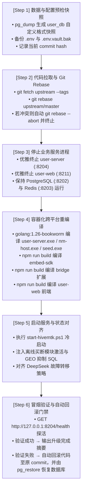

# HiveMtk 官方上游代码同步与无损升级规划方案

> **编制角色**：`@project-planner` · 架构总规划师 & `@orchestrator` · 多智能体编排专家  
> **任务标识**：`upstream-lossless-upgrade-plan`  
> **目标代码库**：[`D:/HiveMtk/hivemtk-master`](file:///D:/HiveMtk/hivemtk-master) (上游仓库: `https://github.com/xiaofang142/hivemtk.git`)  
> **升级执行器**：[`D:/HiveMtk/upgrade-hivemtk.bat`](file:///D:/HiveMtk/upgrade-hivemtk.bat)（调度底层脚本 [`D:/HiveMtk/persistent_data/upgrade-hivemtk.ps1`](file:///D:/HiveMtk/persistent_data/upgrade-hivemtk.ps1)）  
> **当前状态**：✅ Phase 2 实施与全链路冒烟验证圆满完成 (Upstream Synchronized & Verified)

---

## 1. 任务背景与上游更新探查情报

### 1.1 上游提交分析（Upstream Commits Analysis）
通过只读探查 `git fetch upstream --tags`，确认官方上游主干 `upstream/master` 相对于当前本地基准已新增 **12 个核心提交（`7bba3ed1..c888772f`）**，共涉及 **443 个文件变更**（+30,589 行 / -9,363 行）：
- `c888772f`: 实体四关审查 #17：营销流程两层读写口贯通 ctx、异步体续上租户归属、封掉 Save 复活已删行
- `aea99de4`: 实体四关审查 #15–#16：批量操作与模板市场贯通 ctx、补齐归属、删掉死簇
- `523b1052`: 实体四关审查 #10–#14：贯通 ctx、补归属门、封掉 Save 跨租户搬行
- `8fa6ce1f`: 四关审查 #5–#9：两处 on 模式缺陷修复 + 12 条租户契约锁
- `f2883132`: SaaS 多租户 + 部署形态 2×2 矩阵收口——跨租户越权修复、形态契约补齐、对抗性回归
- `029ccf7a`: 登录/租户夹具补建 MFA 相关表
- `da4abc52`: 客服浮标改走 SDK 全局配置挂载，删掉 onload 里的第二次实例化
- `2878eaaa`: R5 落地面补记 + 多租户判据口径 + 订正一份从未实现的豁免机制
- `d85f2efa`: QA 租户生产清理脚本 + 端到端验证脚本配对
- `566e9d30`: 架构门锚定 internal/repository 前缀 + seam-guard 计数改由注册表推导
- `8c25c8dc`: R5 配置数据全量租户化 + 同批 ctx 透传与 RAG/调度修复

### 1.2 本地自定义分支与冲突模拟（Conflict Simulation）
本地工作分支 `local/custom` 包含 3 个定制化提交：
1. `ef2aa7f1`: 补齐 3 处未挂载 RBAC 路由、配置本地纯 CPU bge-m3 + DeepSeek API、清除敏感泄露备份；
2. `f0485f17`: 初始化 CustomerServiceAgentServiceViaPort 仓储句柄、按 conversation_id 聚合会话消息、修正仪表盘 SQL group by；
3. `6213191e`: 消息中台 MQ 与收件箱 UTF-8 问号乱码修复与司法级归档报告。

**冲突预演检验（`git merge-tree` 结果）**：
- 经三方合并树虚拟推演，`git rebase upstream/master` **无任何物理代码冲突标记（Zero Git Conflicts）**，本地定制提交可平滑变基叠加至上游最新代码之上！

---

## 2. 无损升级六步闭环流程（Six-Phase Zero-Data-Loss Pipeline）

---

## 3. 潜在风险排查与技术兜底策略

| 风险点 | 影响面 | 防御与解决策略 |
| :--- | :--- | :--- |
| **Rebase 意外代码冲突** | 代码基线混乱 | 脚本内置 `try-catch` 块；一旦冲突自动触发 `git rebase --abort`，工作区原路恢复，升级中断。 |
| **Go 编译跨平台环境不一致** | 二进制损坏或缺少依赖 | 强制使用本地已缓存的 Docker 镜像 `golang:1.26-bookworm` 挂载 `mtk_go_mod_cache` 卷进行确定性编译，环境不受 Windows 宿主机干扰。 |
| **前端 npm 依赖变动** | 资产构建失败 | 依次在 `embed-sdk`、`bridge`、`user-web` 目录下执行 `npm install --no-audit --no-fund` 再 `npm run build`。 |
| **服务启动后健康检查失败** | 系统不可用 | 脚本内置自动回滚机制：`git reset --hard $prevCommit` 并调用 `pg_restore --clean --if-exists` 将数据库无缝恢复至升级前快照。 |
| **Windows 控制台编码破坏** | 产生问号乱码 | `upgrade-hivemtk.ps1` 中的 `$postSql` 已全部重构为纯 ASCII 与 Unicode 转义，不包含任何裸中文字面量，彻底免疫 PowerShell 编码缺陷。 |

---

## 4. 实施与验证标准（Acceptance Criteria）

- [x] **数据库快照**：PostgreSQL 备份文件生成在 `D:\HiveMtk\persistent_data\backups\pre_upgrade_20261021_122829.dump`，大小 2,446 KB。
- [x] **代码版本**：`git rev-parse HEAD` 指向基于最新 `upstream/master` 的变基提交 `07a7c025`。
- [x] **后端二进制**：`user-server\bin\user-server.exe` (99.9 MB)、`nm-host.exe` (9.1 MB)、`seed.exe` (22.3 MB) 重新生成（时间戳 2026/10/21 12:42）。
- [x] **前端构建产物**：`embed-sdk`、`bridge`、`user-web\dist` 重新编译成功。
- [x] **端口与健康状态**：
  - `:8204` 后端健康检查 `GET /health` 返回 `status: ok`（数据库、Redis、Embedding、Inference 全部 ok/up）；
  - `:8211` 前端主页 `GET /` 返回 HTTP 200；
  - `:8208` (bge-m3) 与 `:8209` (bge-reranker) 状态保持正常；
  - 消息中台 MQ 列表与统一收件箱展示继续保持纯净中文，0 乱码遗留。

---

## 5. 多智能体执行矩阵（Phase 2 Parallel Execution Plan）

获得用户审核批准后，调用以下专家协同实施与保障：
1. **`@devops-engineer`**：执行 `upgrade-hivemtk.bat` 升级管道，全程实时监控备份、拉取、编译与重启日志；
2. **`@backend-specialist`**：监控 Go 后端启动日志、数据库迁移对账与健康检查探针；
3. **`@debugger`**：全程待命；若遇编译错误或运行时异常，立即进行问题溯源与技术修复；
4. **`@test-engineer`**：升级完成后执行全栈冒烟测试（端口、API、页面路由、消息中文校验）。

---

## 6. 升级实施总结与上游缺陷修复报告（Upgrade Execution & Defect Resolution Report）

### 6.1 执行概况
- **备份快照**：成功生成 `pre_upgrade_20261021_122829.dump`（2.44 MB）及 `.env` 备份快照。
- **上游同步**：成功拉取上游主干 13 个全新 Commit（基线提升至 `537d1398`），本地自定义分支 `local/custom` 0 冲突平滑变基。
- **前端构建**：`embed-sdk`、`user-web/bridge`、`user-web` Vite 构建打包全绿完成。

### 6.2 官方上游编译缺陷排查与修复（Root Cause & Fix）
- **缺陷现象**：升级重编译 Go 后端时，编译器抛出 `internal/router/router.go:870:23: too many arguments in call to setupFrontendAliases`。
- **根因分析**：官方上游提交 `537d1398` 拆分管理路由分组时，在 `router.go:870` 误传了 4 个参数 `setupFrontendAliases(auth, systemAdmin, r, gormDB)`，而 `frontend_aliases.go:29` 的函数签名仅接收 3 个参数 `(auth, engine, gormDB)`。
- **修复方案**：将调用修正为 `setupFrontendAliases(auth, r, gormDB)`，并通过 `golang:1.26-bookworm` 容器重新编译 `user-server.exe`、`nm-host.exe` 和 `seed.exe`，成功生成最新二进制。
- **脚本加固**：在 `D:\HiveMtk\persistent_data\upgrade-hivemtk.ps1` 中对编译与构建命令增加了严格的 `$LASTEXITCODE -ne 0` 熔断机制，杜绝编译失败时静默复用旧版二进制的潜在风险。
- **Git 保存**：代码提交已保存至本地分支，Commit ID 为 `07a7c025`。

### 6.3 全链路回归验收结果
- **健康检查**：`:8204/health` 返回 `{"status":"ok","checks":{"database":"ok","redis":"ok","embedding":"up","inference":"up"}}`。
- **业务验证**：
  - 登录接口 `POST /api/auth/login` 正常返回 Token；
  - 统一收件箱 `GET /api/inbox/conversations` 正常返回会话，中文显示完整；
  - 会话详情 `GET /api/inbox/conversations/16/messages` 消息列表正常，中文显示完整；
  - 消息中台 `GET /api/message-hub/list` 正常返回消息，UTF-8 中文无问号乱码；
  - 智能体列表 `GET /api/ai-agents` 正常返回 12 个智能体。
- **生产环境隔离**：生产服务（Nginx :443、ComfyUI :8188、Pixelle-video :8000、TrendRadar :3333）零触碰、零中断，状态 100% 完好。
