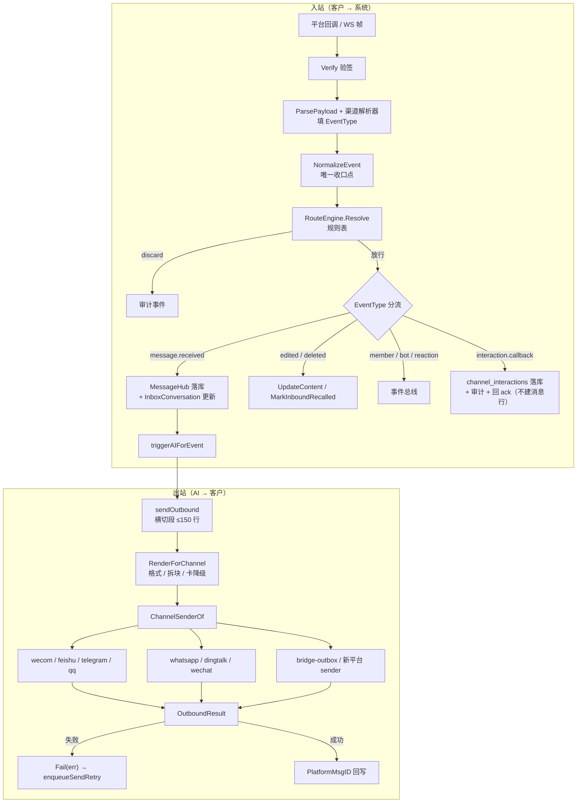

# Tasks: 024-im-seam-alignment（IM 接入接缝对齐）

**Input**: Design documents from `/specs/024-im-seam-alignment/`
**Prerequisites**: 既有交付 `2f658e7b`（`internal/channelcaps` + 会话生命周期三列）；调研文档 4 篇（见 `spec.md` 来源）
**Scope**: 仅接缝（B1–B6）。平台接入（wecomcs / OneBot / Slack / wecombot / custom）见 `/specs/025-im-platforms/`，
交接面 = 本 spec 的 B1（出站注册表）+ B2（事件类型）
**Constraint**: 每任务独立可回滚；所有 Go 命令在 `user-server/` 下执行

图例：P0 阻塞后续 / P1 本轮内 / P2 可延后至下一 spec｜🟡 纯本地可验收｜🔵 需真实账号验收（代码与 fixture 测试仍本地完成）

**任务块字段约定**（每个任务都按这七项写，缺项视为任务未定义）：

| 字段 | 含义 | 判据 |
|---|---|---|
| 规格 | 要交付什么、边界在哪、不做什么 | 能据此判定「做完」与「越界」 |
| 上下文 | 现状代码锚点（`文件:行`）与为什么现在做 | 每条锚点可 `git grep` 命中 |
| 数据结构 | 新增/改动的 Go 类型、表结构、JSON 契约 | 字段名与类型可直接抄进代码 |
| 架构 | 所在层（Router/Controller/Service/Repository/Model）与依赖方向 | 不出现跨层依赖 |
| 数据流向 | 一次调用从入口到落库/发出的完整链条 | 链上每一跳都有函数名 |
| 逻辑图 | 分支/状态/时序的可视化 | 与「数据流向」一致，可直接对照代码 |
| 验收 | 测试名或命令 + 期望结果 | 命令可复制执行 |

---

## 全局数据流向（本 spec 结束后的目标形态）



---

## Phase 1 出站接缝（P0，平台接入的前置）

- [ ] **T101 出站发送器注册表**（P0｜依赖 —｜S｜🟡）
  - **规格**：新增进程级注册表，把「按渠道 switch」换成「按渠道查 sender」。新增平台 = 新增一个 sender 文件 + 一行 `RegisterChannelSender`，主函数不再改动。本任务零行为变更，只交付骨架与生命周期（后续 T102–T109 逐个搬入）。
  - **上下文**：`internal/service/webhook_outbound.go:607` 的 `sendOutbound` 663 行，内含 7 个 `case`（L685/709/748/792/818/870/951）+ 1 个 `default`（桥接族，L967 起）；平台越多，这个函数回滚面积越大（spec §1 原则 1）。
  - **架构**：Service 层内部组件，只依赖 `model` 与 `WebhookChannel` 类型；被 `sendOutbound` 调用，不被 Controller/Repository 感知。
  - **数据结构**：
    ```go
    type channelSender interface {
        Channel() WebhookChannel
        Send(ctx context.Context, req *OutboundRequest) *OutboundResult
    }
    type OutboundRequest struct {
        Channel     WebhookChannel
        AccountID   string
        Payload     *ParsedPayload
        Content     string
        Cards       []model.RichCard
        Hub         *model.MessageHub
        CardsFallbackCount int
        Fail        func(error) // 已跟踪消息：写 sendErr + outboundSendFailed
        FailUntracked func(error) // 无 hubMsg：只写日志与重试
    }
    type OutboundResult struct{ Sent bool; PlatformMsgID string }
    ```
    注册表分两层：**静态工厂表** `senderFactories map[WebhookChannel]func(*WebhookService) channelSender`（编译期可枚举，供 parity 与文档生成）与**实例注册表** `map[WebhookChannel]channelSender` + `sync.RWMutex`（`NewWebhookService` 遍历工厂表构建）。`RegisterChannelSender` 对空 Channel / 重复注册 `panic`（与 `capregistry.Register`、`channelcaps.Register` 同风格）。
  - **数据流向**：`sendOutbound` → `ChannelSenderOf(ch)` → `sender.Send(ctx, req)` → `*OutboundResult`；失败不返回 error，走 `req.Fail(err)`，保证 `sendErr` 只有一个写入点。
  - **不变量（二次审核补）**：`Send` 返回后校验 `!res.Sent && sendErr == nil` → 用 `req.Fail(&ChannelError{Category: CategoryUnknown, Retryable: true, Raw: "sender reported neither success nor failure"})` 兜底；`Fail` 约定在 `Send` 返回前同步调用。
  - **逻辑图**：
    ```mermaid
    flowchart LR
      A["sendOutbound"] --> B{"ChannelSenderOf"}
      B -->|命中| C["sender.Send"]
      B -->|未注册| D["ErrOutboundChannelUnsupported"]
      C -->|成功| E["OutboundResult{Sent:true}"]
      C -->|失败| F["req.Fail(err) → sendErr"]
    ```
  - **验收**：`go test ./internal/service/ -run TestOutboundRegistry` 绿，覆盖：重复注册 panic、未知渠道返回 `ErrOutboundChannelUnsupported`、注册后取回同一实例、`RegisteredSenders()` 按 channel 字典序稳定、`Fail` 被调用后 `sendErr` 非空、**静态工厂表键集 == 实例注册表键集**、`TestSenderOutcomeMustBeExplicit`（空实现 sender 不报错也不成功 → 被兜成 `CategoryUnknown` 可重试失败）。并发面加 `-race`。
  - **不做**：不搬任何 case 的函数体（T102–T109），不改 `sendOutbound` 主体的 defer 逻辑（T110）。

- [ ] **T102 wecom sender 搬迁**（P0｜依赖 T101｜S｜🟡）
  - **规格**：把 `case ChannelWeCom` 原样搬成 sender，payload 字段与调用参数一字不改。
  - **上下文**：`webhook_outbound.go:685`——`s.integrations.wecom().SendMessage(ctx, WeComSendRequest{AccountID, ExternalUserID, MsgType:"text", ...})`。
  - **架构**：`service/outbound_sender_wecom.go`，`type wecomSender struct{ svc *WebhookService }`；经 `svc.integrations` 取 integration，不直接持有 client。
  - **数据结构**：
    ```go
    type WeComSendRequest struct {
        AccountID      string
        ExternalUserID string
        MsgType        string // "text"
        Content        string
    }
    ```
  - **数据流向**：`sendOutbound` → `wecomSender.Send` → `svc.integrations.wecom().SendMessage` → 错误时 `req.Fail(err)`。
  - **逻辑图**：
    ```mermaid
    flowchart LR
      A["wecomSender.Send"] --> B["integrations.wecom()"]
      B --> C["SendMessage(req)"]
      C -->|err| D["req.Fail(err)"]
      C -->|ok| E["Sent=true"]
    ```
  - **验收**：`go test ./internal/service/ -run 'TestWecomSender|TestCardDelivery'` 绿；`TestWecomSender_DelegatesToIntegration` 用 fake integration 断言 `(AccountID, ExternalUserID, MsgType, Content)` 与搬迁前一致。

- [ ] **T103 feishu sender 搬迁**（P0｜依赖 T101｜S｜🟡）
  - **规格**：搬 `case ChannelFeishu`，**保持「正文失败仍继续发卡片」的顺序**；卡片转 interactive JSON 暂留原样（T404 才统一走渲染层）。
  - **上下文**：`webhook_outbound.go:709`——目标为 `p.Sender`（单聊 open_id）或 `hubMsg.GroupID` + `Extra["open_chat_id"]`（群聊）；文本失败先 `markSendFailed`，随后仍逐卡 `SendInteractiveCard`，因此最终可能 `sent=true` 且 `sendErr!=nil`。
  - **架构**：`service/outbound_sender_feishu.go`；sender 只报错不短路，顺序敏感逻辑集中在 `Send` 内。
  - **数据结构**：
    ```go
    type feishuTarget struct { openID string; chatID string } // 群聊用 chatID，单聊用 openID
    ```
  - **数据流向**：`Send` → `feishuCardToInteractiveJSON(card)` → `SendInteractiveCard`；文本步骤错误先 `req.Fail(err)`，卡片步骤继续，任一卡片成功则 `Sent=true`。
  - **逻辑图**：
    ```mermaid
    flowchart TD
      A["Send"] --> B["解析目标 open_id / chat_id"]
      B --> C["发送文本"]
      C -->|失败| D["req.Fail(err)"]
      C -->|成功| E{"有卡片?"}
      D --> E
      E -->|是| F["逐卡 SendInteractiveCard"]
      E -->|否| G["结束"]
      F -->|任一成功| H["Sent=true"]
    ```
  - **验收**：`TestFeishuSender_RichCardPayload`（interactive JSON 快照一致）、`TestFeishuSender_TextFailStillSendsCards`（文本失败后卡片仍被调用）。

- [ ] **T104 telegram sender 搬迁**（P0｜依赖 T101｜M｜🟡）
  - **规格**：搬 `case ChannelTelegram`，含群回复增强；`buildTelegramGroupReply` 留在 `webhook_outbound.go` 供 sender 调用（不一起搬，减少 diff）。
  - **上下文**：`webhook_outbound.go:748`——`ParseUint(accountID)`、`chatID ← hubMsg.ConversationID`、`extractTelegramReplyMetaFromCtx(ctx)` 且 `TriggerReason != "start"` 时 `buildTelegramGroupReply`、`SendMessageEx` 后逐卡 `SendCard`。
  - **架构**：`service/outbound_sender_telegram.go`，依赖 `integrations.tg()`（懒加载）。
  - **数据结构**：
    ```go
    type TelegramReplyMeta struct { TriggerReason string; /* 其余字段沿用既有定义 */ }
    // sendOpts 保留 reply_parameters / parse_mode
    ```
  - **数据流向**：`Send` → 取 meta → 需要时包装正文（@发送者）→ `SendMessageEx(ctx, accID, chatID, content, opts)` → 逐卡 `SendCard`。
  - **逻辑图**：
    ```mermaid
    flowchart TD
      A["Send"] --> B["ParseUint(accountID)"]
      B --> C["chatID = Hub.ConversationID"]
      C --> D{"meta != nil 且 TriggerReason != start"}
      D -->|是| E["buildTelegramGroupReply"]
      D -->|否| F["原文"]
      E --> G["SendMessageEx"]
      F --> G
      G --> H["逐卡 SendCard"]
    ```
  - **验收**：`TestTelegramSender_GroupMention`、`TestTelegramSender_Cards` 绿；行为冻结断言含 `reply_parameters.message_id` 与 `parse_mode`。

- [ ] **T105 qq sender 搬迁**（P0｜依赖 T101｜M｜🟡）
  - **规格**：搬 `case ChannelQQ`，被动回复窗口注释一并迁移（注释即行为契约）；sender 必须复用进程级 `s.qqIntegration` 单例。
  - **上下文**：`webhook_outbound.go:792`——`SendMessage(ctx, accID, convID, QQOutboundMsgID(hubMsg), content)`；被动窗口 5 分钟 / 5 条，`msg_seq` 自增。
  - **架构**：`service/outbound_sender_qq.go`，只经 `svc.qqIntegration` 访问（不可 `new`，否则 `msg_seq` 归零被平台判重）。
  - **数据结构**：
    ```go
    // 关键：sender 持有 svc，qqIntegration 为懒加载单例
    type qqSender struct{ svc *WebhookService }
    ```
  - **数据流向**：`Send` → `QQOutboundMsgID(hubMsg)`（被动回复锚点）→ `SendMessage` → 平台错误码 → `req.Fail`。
  - **逻辑图**：
    ```mermaid
    sequenceDiagram
      participant SO as sendOutbound
      participant QS as qqSender
      participant QI as qqIntegration(单例)
      SO->>QS: Send(req)
      QS->>QI: SendMessage(acc, conv, msgID, content)
      QI->>QI: msg_seq++
      QI-->>QS: 结果
      QS-->>SO: Sent / Fail
    ```
  - **验收**：`TestQQSender_PassiveWindowMsgSeq`（连续 6 条：前 5 条被动、第 6 条降级或失败，与原实现一致）、`TestQQSender_SingletonSeqMonotonic`。

- [ ] **T106 whatsapp sender 搬迁**（P0｜依赖 T101｜M｜🟡）
  - **规格**：搬 `case ChannelWhatsapp`，含 24h 窗口判定与模板降级；不改查询语义。
  - **上下文**：`webhook_outbound.go:818`——`ensureReposFromDB` → `GetLastInboundByConversation` → `time.Since(last.SentAt) > 24h` → 取参数 `channelbot.whatsapp_fallback_template` / `_lang` → 有模板 `SendTemplateMessage` 并 return；无模板 `CategoryWindowExpired` 失败；否则 `SendMessage`。
  - **架构**：`service/outbound_sender_whatsapp.go`，需持 `svc`（取 repo 与参数中心）。
  - **数据结构**：
    ```go
    type WhatsAppTemplatePayload struct { TemplateName, Language string }
    // 失败：&ChannelError{Channel: ch, Category: CategoryWindowExpired, Retryable: false}
    ```
  - **数据流向**：`Send` → 查最后入站 → 窗口内 `SendMessage`；超窗 → 查模板 → `SendTemplateMessage` / `Fail(window_expired)`。
  - **逻辑图**：
    ```mermaid
    flowchart TD
      A["Send"] --> B["ensureReposFromDB"]
      B --> C["GetLastInboundByConversation"]
      C --> D{"距最后入站 > 24h?"}
      D -->|否| E["SendMessage"]
      D -->|是| F{"fallback_template 非空?"}
      F -->|是| G["SendTemplateMessage"]
      F -->|否| H["Fail(CategoryWindowExpired)"]
    ```
  - **验收**：`TestWhatsappSender_PayloadShape`、`TestWhatsappSender_WindowExpired`、`TestWhatsappSender_WindowExpiredWithTemplate`。

- [ ] **T107 dingtalk sender 搬迁**（P0｜依赖 T101｜M｜🟡）
  - **规格**：搬 `case ChannelDingTalk`。该渠道**不走 integration**：读会话 webhook 直发；域名白名单校验留在 sender 内（属渠道安全边界，不下沉为通用逻辑）。
  - **上下文**：`webhook_outbound.go:870`——`hubMsg.Extra["session_webhook"]`、`session_webhook_expired_at`（秒/毫秒兼容：`>1e12` 视为毫秒）、`loadDingtalkWebhookHostAllowed()`（L1304，仅 `*.dingtalk.com`）、裸 `http.DefaultClient.Do`、按 `errcode` 判成败。
  - **架构**：`service/outbound_sender_dingtalk.go`；不依赖 integration，但依赖 Service 层的白名单加载器。
  - **数据结构**：
    ```go
    // 请求体
    type dingtalkTextMsg struct {
        MsgType string            `json:"msgtype"` // "text"
        Text    map[string]string `json:"text"`    // {"content": ...}
    }
    // 响应体
    type dingtalkResp struct { ErrCode int `json:"errcode"`; ErrMsg string `json:"errmsg"` }
    // Extra 键：session_webhook / session_webhook_expired_at
    ```
  - **数据流向**：`Send` → 校验 Extra → 校验过期 → `url.Parse` + 白名单 → POST → 解析 `errcode` → `Fail`/`Sent`。
  - **逻辑图**：
    ```mermaid
    flowchart TD
      A["Send"] --> B{"session_webhook 存在?"}
      B -->|否| C["Fail(CategoryWindowExpired)"]
      B -->|是| D{"已过期?"}
      D -->|是| C
      D -->|否| E{"host 在白名单?"}
      E -->|否| F["Fail(CategoryBadRequest)，不发请求"]
      E -->|是| G["POST + 解析 errcode"]
      G -->|errcode != 0| H["Fail"]
      G -->|0| I["Sent=true"]
    ```
  - **验收**：`TestDingtalkSender_RejectsNonAllowlistedHost`（断言**零请求**）、`TestDingtalkSender_ExpiredWebhook`、`TestDingtalkSender_ErrcodeNonZero`。

- [ ] **T108 wechat sender 搬迁**（P0｜依赖 T101｜S｜🟡）
  - **规格**：搬 `case ChannelWechat`；保留「`ParseUint` 失败只置 `accID=0`、不早退」的既有宽容行为。
  - **上下文**：`webhook_outbound.go:951`——`wechatIntegration.SendCustomMessage`。
  - **架构**：`service/outbound_sender_wechat.go`。
  - **数据结构**：
    ```go
    // 沿用 integration 既有入参：账号（uint） + openid + content
    ```
  - **数据流向**：`Send` → `integrations.wechat()` → `SendCustomMessage(accID, openID, content)`。
  - **逻辑图**：
    ```mermaid
    flowchart LR
      A["wechatSender.Send"] --> B["ParseUint(accountID)"]
      B -->|err| C["accID = 0（不早退）"]
      B -->|ok| D["SendCustomMessage"]
      C --> D
    ```
  - **验收**：`TestWechatSender_CustomerServiceMessage`；`TestWechatSender_BadAccountIDDoesNotShortCircuit`。

- [ ] **T109 bridge-outbox sender 搬迁**（P0｜依赖 T101｜M｜🟡）
  - **规格**：搬 `default` 分支（桥接族约 300 行）。**Markdown 清洗不在本任务搬**——它上移到横切段（T110），否则 `enqueueSendRetry` 捕获的 `content` 与今天不一致。
  - **上下文**：`webhook_outbound.go:967` 起——`bridgeOutboxCapable` 守卫、构造 pending `MessageHub`、`isBridgeChannelUndeliverableLocal`、`CreateMessageHubIdempotent`（失败带 `":"+convID` 重试）、`UpsertFromMessage`、SSE 唤醒、`persisted.ID==0 / Status=="failed" / default` 三段口径。
  - **架构**：`service/outbound_sender_bridge.go`，依赖 `messageHubRepo`、`inboxConvRepo`、`GlobalSSEPublisher`（均经 `svc`）。
  - **数据结构**：
    ```go
    // 落库 Extra 键（必须全保留）
    // dm_target, scenario, auto_reply, triggered_by, agent_id, confidence,
    // intent, handler_type, degraded, cards_fallback_count, turn_id, answer_attempt
    // 失败附加：undeliverable_reason, scenario
    ```
  - **数据流向**：`Send` → 守卫 → 建行（幂等）→ `ID==0` 分支 → `UpsertFromMessage` → SSE → `Sent`/`Fail`。
  - **逻辑图**：
    ```mermaid
    flowchart TD
      A["Send"] --> B{"bridgeOutboxCapable?"}
      B -->|否| C["FailUntracked(漂移告警)"]
      B -->|是| D["构造 pending MessageHub"]
      D --> E{"本地不可投递?"}
      E -->|是| F["status=failed + undeliverable_reason"]
      E -->|否| G["CreateMessageHubIdempotent"]
      F --> G
      G --> H{"persisted.ID == 0?"}
      H -->|dup| I["写 :dup 行 + Fail(不可重试)"]
      H -->|其它| J["Fail(可重试)"]
      H -->|有 ID| K{"status == failed?"}
      K -->|是| L["FailUntracked"]
      K -->|否| M["UpsertFromMessage + SSE + Sent"]
    ```
  - **验收**：`go test ./internal/service/ -run 'BridgeOutbox|Outbound'` 全绿；新增 `TestBridgeSender_DuplicateOccupied`、`TestBridgeSender_UndeliverableReason`、`TestBridgeSender_RetryCarriesStrippedContent`。

- [ ] **T110 `sendOutbound` 收口 ≤150 行**（P0｜依赖 T102–T109｜M｜🟡）
  - **规格**：主体只留横切逻辑，顺序固定为：静默时段延迟入队 → `ClaimReply` 去重 → `WithTimeout(utils.MediumTimeout)` → **富卡降级成文本 + `cardsFallbackCount`** → **桥接 Markdown 清洗** → `ChannelSenderOf` 分发 → defer 收尾。未知渠道返回 `ErrOutboundChannelUnsupported`。
  - **上下文**：`webhook_outbound.go:607-1269`；两个 defer 是隐式契约——① **仅当 `!sent`** 时 `ReleaseReply` + cancel；② 仅当 `sendErr != nil && !sent && !isDelayedReplay` 时 `enqueueSendRetry(..., content, ...)`；另有 `ReleaseAIProcessingFlag` 与 `SafeGo(RecheckUnrepliedAndTrigger)`（要求 `ConversationID != ""` 且非重放）。
  - **架构**：Service 层编排函数；不含任何渠道知识。
  - **数据结构**：
    ```go
    // 主体伪代码（顺序即契约）
    if quietHours { return enqueueDelayedOutbound(...) }
    if !claimReply(...) { return false, nil }
    ctx, cancel := context.WithTimeout(ctx, utils.MediumTimeout)
    defer func(){ if !sent { ReleaseReply; cancel() } }()
    content, cardsFallbackCount := renderCardsFallback(channel, content, cards)
    if bridgeOutboxCapable(channel) { content = stripIfNeeded(channel, content) }
    res := ChannelSenderOf(channel).Send(ctx, req)
    defer func(){ if res.Err != nil && !res.Sent && !isDelayedReplay(ctx) { enqueueSendRetry(...) } }()
    ```
  - **数据流向**：入参 → 守卫链 → 渲染/清洗 → sender → defer 收尾（重试/释放/补触发）。
  - **逻辑图**：
    ```mermaid
    flowchart TD
      A["sendOutbound"] --> B["静默时段? → 延迟入队"]
      B --> C["ClaimReply 去重"]
      C --> D["WithTimeout"]
      D --> E["富卡降级 + cardsFallbackCount"]
      E --> F["桥接 Markdown 清洗"]
      F --> G["ChannelSenderOf → Send"]
      G --> H["defer: 重试入队 / ReleaseReply / 释放 AI 标记 / 补触发"]
    ```
  - **验收**：`awk` 统计函数体 ≤150 行；`grep -c 'switch channel' internal/service/webhook_outbound.go` = 0；`go build ./...` 绿；`TestSendOutbound_Bridge_MarkdownAlignedWithManualPath`、`TestSendOutbound_DelayedReplayNoRetry`、`TestSendOutbound_ReleasesClaimOnFailure` 绿。

- [ ] **T111 渠道覆盖门禁测试**（P0｜依赖 T110｜S｜🟡）
  - **规格**：把三方集合钉死：注册表已注册 sender ↔ `webhookInboundCapable` 的 7 个渠道 ↔ `channelgw.Default.Names()`（桥接族）。**扩写既有测试，不另建重复门禁**。
  - **上下文**：`TestBridgeOutboxParityWithWebhookOutbound` 已存在（钉住 registry `OutboundPath=bridge_outbox` 与出站分支，默认分支注释 CH-37b刀3）。
  - **架构**：仅测试文件 `outbound_registry_parity_test.go`（新增断言放这里）。
  - **数据结构**：
    ```go
    // 断言结构：map[channel]bool 三份，逐 keys 比对
    ```
  - **数据流向**：测试直接调用 `RegisteredSenders()`、`webhookInboundCapable`、`channelgw.Default.Names()`，不经 HTTP。
  - **逻辑图**：
    ```mermaid
    flowchart LR
      A["RegisteredSenders"] --> D{"三向差集为空?"}
      B["webhookInboundCapable(7)"] --> D
      C["channelgw.Default.Names()"] --> D
      D -->|否| E["失败并打印渠道名"]
    ```
  - **验收**：故意注释掉一行注册 → 失败信息含渠道名；恢复 → 绿；`go test ./internal/service/ -run 'Parity'` 通过。

- [ ] **T112 行为冻结对照测试**（P0｜依赖 T110｜M｜🟡）
  - **规格**：搬迁前用旧实现生成 golden，搬迁后逐渠道比对 `(method, args)` 序列；差异必须人工确认后才会重写 golden。
  - **上下文**：T102–T109 期间旧实现仍在（`git show <搬迁前 sha>:internal/service/webhook_outbound.go`），这是最后一次能低成本生成基线。
  - **架构**：测试内在 `service` 包，用 fake integrations 替身；golden 存 `internal/service/testdata/outbound_golden.json`。
  - **数据结构**：
    ```go
    type goldenEntry struct {
        Channel  string            `json:"channel"`
        Payload  map[string]any    `json:"payload"`
        Cards    int               `json:"cards"`
        Calls    []struct{ Method string; Args map[string]any } `json:"calls"`
        Sent     bool              `json:"sent"`
    }
    ```
  - **数据流向**：表驱动用例 → fake 记录调用 → 与 golden 比对 → 不一致输出 diff。
  - **逻辑图**：
    ```mermaid
    flowchart LR
      A["用例表"] --> B["fake integrations 记录调用"]
      B --> C{"与 golden 相等?"}
      C -->|是| D["通过"]
      C -->|否| E["输出 diff，人工确认后重写 golden"]
    ```
  - **验收**：8 渠道 × 3 组样例全绿；`UPDATE_GOLDEN=1` 仅在人工确认后使用。

---

## Phase 2 事件类型体系（P0）

- [x] **T201 `EventType` 常量与字段**（P0｜依赖 —｜S｜🟡）
  - **规格**：给 `MessageEvent` 增加一等公民事件类型，并规定空值语义 = `message.received`（存量构建路径零改动即保持旧行为）。
  - **上下文**：`model/message_event.go`（93 行）无该字段；`ParsedPayload.EventType`（`webhook.go:1006`）把 `event_type/event/type/msg_type` 一锅 coalesce，语义混杂，**不能作为类型来源**；`NormalizeEvent`（`inbox_ingress.go:480`）是 `channelbot.ToMessageEvent` 与各 `webhook_channel_*.go` 两条构建路径的唯一收口点。
  - **架构**：Model 层定义类型；`NormalizeEvent`（Service 层）负责归一；解析器（Service）只负责填值。
  - **数据结构**：
    ```go
    const (
        EventTypeMessageReceived      = "message.received"
        EventTypeMessageEdited        = "message.edited"
        EventTypeMessageDeleted       = "message.deleted"
        EventTypeMessageReaction      = "message.reaction"
        EventTypeGroupMemberJoined    = "group.member_joined"
        EventTypeGroupMemberLeft      = "group.member_left"
        EventTypeGroupMemberBanned    = "group.member_banned"
        EventTypeBotInvitedToGroup    = "bot.invited_to_group"
        EventTypeBotRemovedFromGroup  = "bot.removed_from_group"
        EventTypeInteractionCallback  = "interaction.callback"
    )
    // MessageEvent 新增：
    EventType string `json:"event_type"`
    ```
  - **数据流向**：渠道解析器 / `channelbot.ToMessageEvent` → `NormalizeEvent`（空值补 `message.received`）→ 下游分流（T203）。
  - **逻辑图**：
    ```mermaid
    flowchart LR
      A["channelbot.ToMessageEvent"] --> C["NormalizeEvent"]
      B["webhook_channel_*.go"] --> C
      C -->|空 EventType| D["填 message.received"]
      C -->|显式 EventType| E["保留原值"]
    ```
  - **验收**：`TestNormalizeEvent_DefaultsToReceived`、`TestNormalizeEvent_PreservesExplicitType`；`channelbot/core` 既有测试仍绿。

- [x] **T202 消息编辑/撤回仓储能力**（P0｜依赖 T201｜M｜🟡）
  - **规格**：补齐「客户编辑消息」与「客户撤回消息」两个窄方法；不改动出站撤回语义。
  - **上下文**：`MessageHub` 已有 `RecalledAt *time.Time` + `RecallError string`（`model/ai_sales_champion.go:71-72`）；`MarkRecalled(ctx, id, at)`（`message_hub_recall.go:25`）**WHERE 带 `direction='outbound'`**，只用于撤我发出的消息；编辑方向的窄方法不存在。
  - **架构**：Repository 层新增两个方法，沿用现有 `GetByMsgID` 的租户/方向约定。
  - **数据结构**：
    ```go
    func (r *MessageHubRepository) UpdateContentByChannelMsgID(
        ctx context.Context, channel, accountID, msgID, content string) (bool, error)
    func (r *MessageHubRepository) MarkInboundRecalledByChannelMsgID(
        ctx context.Context, channel, accountID, msgID string, at time.Time, reason string) (bool, error)
    // MarkInboundRecalled 额外写 Extra.recall_source="platform"；RecallError 复用为原因列
    ```
  - **数据流向**：入站分流（T203）→ 对应仓储方法 → `message_hub` 行更新 → 返回是否命中。
  - **逻辑图**：
    ```mermaid
    flowchart TD
      A["message.edited"] --> B["UpdateContentByChannelMsgID"]
      C["message.deleted"] --> D["MarkInboundRecalledByChannelMsgID"]
      B --> E{"direction 任意，命中即更新"}
      D --> F{"direction='inbound'?"}
      F -->|否| G["不命中，返回 false"]
      F -->|是| H["写 recalled_at / recall_error / recall_source"]
    ```
  - **验收**：`TestMessageHub_UpdateContentByChannelMsgID`、`TestMessageHub_MarkInboundRecalled_RejectsOutboundRow`、`TestMessageHub_MarkInboundRecalled_NotFound`。

- [x] **T203 入站按事件类型分流**（P0｜依赖 T201/T202｜M｜🟡）
  - **规格**：归一之后先分流，只有 `message.received` 走原「落库 + 触发 AI」路径；其余事件不得污染未读计数与 AI 触发。
  - **上下文**：`HandleIngressMessage`（`inbox_ingress.go:546`）目前无类型分支；`InboxIngressResult`（L129）字段为 `Accepted/HumanLocked/QueuedForAI/SessionID/Reason`。
  - **架构**：Service 层单一分流点；下游分别调用 T202 仓储、事件总线（T204）、交互 ack（T207）。
  - **数据结构**：
    ```go
    // 分流表
    // message.received      → 原路径
    // message.edited        → UpdateContentByChannelMsgID，不触发 AI
    // message.deleted       → MarkInboundRecalledByChannelMsgID，不触发 AI
    // message.reaction      → 只发事件总线
    // group.member_* / bot.*→ 只发事件总线，不建消息
    // interaction.callback  → T207 ack，不建消息
    ```
  - **数据流向**：`HandleIngressMessage` → `NormalizeEvent` → 分流 switch → {仓储 / 总线 / ack / 原路径}。
  - **逻辑图**：
    ```mermaid
    flowchart TD
      A["HandleIngressMessage"] --> B["NormalizeEvent"]
      B --> C{"EventType"}
      C -->|received| D["去重 → 人锁 → 落库 → triggerAI"]
      C -->|edited| E["UpdateContent"]
      C -->|deleted| F["MarkInboundRecalled"]
      C -->|reaction / member / bot| G["事件总线"]
      C -->|interaction.callback| H["ack"]
    ```
  - **验收**：`TestIngress_EditedUpdatesContent`、`TestIngress_DeletedMarksRecall`、`TestIngress_MemberEventDoesNotCreateMessage`、`TestIngress_NonReceivedDoesNotTouchUnread`。

- [x] **T204 事件总线扩展**（P0｜依赖 T203｜S｜🟡）
  - **规格**：非消息类事件走既有事件总线，新增 4 个 topic；订阅方缺位时不得阻塞入站。
  - **上下文**：`internal/event/types.go` 现有 8 个 topic（`operation.log`、`customer.message.received`、`knowledge.document.changed`、`dialogue.started/ended`、`asset.degraded`、`asset.degrade.warning`、`rag.corpus.updated`）；`Bus` 提供 `Publish/PublishCtx/PublishEventCtx` 与 `StampTenantFromCtx`。
  - **架构**：`internal/event` 扩展；Service 层只调 `PublishEventCtx`。
  - **数据结构**：
    ```go
    const (
        TopicCustomerMessageEdited     = "customer.message.edited"
        TopicCustomerMessageDeleted    = "customer.message.deleted"
        TopicCustomerGroupMemberChange = "customer.group.member.changed"
        TopicCustomerInteractionCallback = "customer.interaction.callback"
    )
    type MessageLifecycleEvent struct {
        TenantID  string
        EventID   string
        Channel   string
        AccountID string
        MsgID     string
        EventType string
        OccurredAt time.Time
        Extra     map[string]any
    }
    ```
  - **数据流向**：分流点 → `PublishEventCtx(ctx, topic, payload)` → 订阅者（审计/统计）。
  - **逻辑图**：
    ```mermaid
    flowchart LR
      A["分流点"] --> B["PublishEventCtx"]
      B --> C["Bus 队列"]
      C --> D["订阅者（审计/统计）"]
      C -.->|无订阅者| E["丢弃，不阻塞"]
    ```
  - **验收**：`TestEvent_AuditTopicDelivery`（订阅收到且租户正确）、`TestEvent_NoSubscriberDoesNotBlock`。

- [x] **T205 各渠道解析器填 `EventType`**（P0｜依赖 T201｜M｜🟡）
  - **规格**：把各渠道原生事件映射成统一类型；映射不了的一律落到 `platform.specific` 语义（当前记录为 `message.received` 之外的显式值），**不得静默丢弃**。
  - **上下文**：`webhook_channel_{wecom,feishu,telegram,qq,whatsapp,douyin}.go` 只产出消息；feishu 在 `Event.Message == nil` 时返回 `nil,nil`（`webhook_channel_feishu.go:196`），撤回/成员事件被静默丢弃；telegram 仅 `EditedMessage` 分支（`webhook_channel_telegram.go:268`）。
  - **架构**：各渠道解析器（Service）内映射，只填 `EventType`，不改落库逻辑。
  - **数据结构**：
    ```go
    // 映射表（节选）
    // telegram: edited_message → message.edited; deleted_business_message → message.deleted
    //           message_reaction → message.reaction; new_chat_members → group.member_joined
    // feishu:   im.message.recalled_v1 → message.deleted; im.chat.member.* → group.member_*
    // qq:       GROUP_ADD_ROBOT → bot.invited_to_group; GROUP_DEL_ROBOT → bot.removed_from_group
    // whatsapp: statuses → 不产消息（走 StatusUpdate）
    ```
  - **数据流向**：平台原始 payload → 解析器 → `MessageEvent{EventType}` → `NormalizeEvent`。
  - **逻辑图**：
    ```mermaid
    flowchart LR
      A["平台 payload"] --> B{"解析器映射"}
      B -->|已知| C["显式 EventType"]
      B -->|未知| D["platform.specific 语义，不丢弃"]
      C --> E["NormalizeEvent"]
      D --> E
    ```
  - **验收**：每渠道一条 fixture 断言 `EventType` 与「不产消息行」；`TestChannelParsers_EventTypeMatrix` 覆盖全表。

- [x] **T206 `channelcaps.Manifest.Events`**（P0｜依赖 T205｜S｜🟡）
  - **规格**：能力表从「消息类型」升级到「事件类型」，并让「解析器能产出的事件」必须先在 manifest 声明。
  - **上下文**：`internal/channelcaps/channelcaps.go` 的 `Manifest{Channel,Label,Via,Inbound,Outbound,Features,Note}` 无事件字段；文档由 `Markdown()` 生成、`TestCapabilityDocFreshness` 钉漂移。
  - **架构**：`channelcaps` 为纯声明包（无 service 依赖）；解析器通过测试反向校验声明。
  - **数据结构**：
    ```go
    type Manifest struct {
        // 既有字段...
        Events []string `json:"events"` // 事件类型集合，须取自 T201 常量
    }
    ```
  - **数据流向**：Go 声明 → `Markdown()` → `docs/channel-capabilities.md`（`UPDATE_GOLDEN=1` 刷新）。
  - **逻辑图**：
    ```mermaid
    flowchart LR
      A["manifests.go"] --> B["Markdown()"]
      B --> C["docs/channel-capabilities.md"]
      B --> D["TestCapabilityDocFreshness"]
      E["解析器事件字符串"] --> F["TestDeclaredEventsCoverParser"]
      A --> F
    ```
  - **验收**：`go test ./internal/channelcaps/` 绿；`UPDATE_GOLDEN=1` 后文档 diff 仅新增事件列。

- [x] **T207 交互回调最小闭环**（P1｜依赖 T203｜M｜🟡）
  - **规格**：按钮点击类回调必须回 ack（否则客户端转圈/提示失败），但不创建消息、不触发 AI；其余复杂交互留后续 spec。
  - **上下文**：BotMgr 侧 Telegram 用 `answerCallbackQuery`，失效时回文本提示（LangBot 深度剖析 §case2）；HiveMTK 当前无 `interaction.callback` 处理。
  - **架构**：Service 层新增回调处理分支；渠道差异封装在 `channelbot/<x>` 的 `AnswerCallback`。
  - **数据结构**：
    ```go
    type InteractionCallback struct {
        CallbackID string
        AccountID  string
        UserID     string
        Data       string
        Channel    string
    }
    ```
  - **数据流向**：`interaction.callback` → 渠道 `AnswerCallback` → 事件总线（审计）→ 返回 ack 结果。
  - **逻辑图**：
    ```mermaid
    sequenceDiagram
      participant P as 平台
      participant I as Ingress
      participant C as channelbot
      P->>I: callback_query
      I->>C: AnswerCallback(callbackID)
      C-->>P: ack
      I->>I: 发审计事件，不建消息
    ```
  - **验收**：`TestInteractionCallback_AcksAndDoesNotReply`（断言 ack 被调用、消息表零新增、无 AI 触发）。

---

---

- [x] **T208 交互上下文表与仓储**（P0｜依赖 T201｜M｜🟡）
  - **规格**：新建 `channel_interactions`，承载「我们发出去的可交互卡片 / 平台侧点击」的一次映射。只解决「这次点击对应哪条卡片、哪个动作、答复过没有」，**不做**表单状态机、不做多步会话流（那是 025 之后独立 spec）。重复 `interaction_id` 视为平台重投，幂等忽略。
  - **上下文**：今天按钮回调没有落点——Telegram `callback_query` 解析后只当作一条文本（`webhook_channel_telegram.go` callback 分支），`MessageEvent` 里没有 `callback_id`/`action` 字段，`MessageHub` 也不该背这个语义（它是消息表）。飞书/钉钉的卡片回调同样无处可查「这张卡的哪颗按钮被点」。
  - **数据结构**：
    ```go
    type ChannelInteraction struct {
        TenantID     string     `gorm:"column:tenant_id;size:64;not null;uniqueIndex:idx_interaction_identity,priority:1"`
        Channel      string     `gorm:"column:channel;size:32;not null;uniqueIndex:idx_interaction_identity,priority:2"`
        AccountID    string     `gorm:"column:account_id;size:64;not null;default:''"`
        InteractionID string    `gorm:"column:interaction_id;size:128;not null;uniqueIndex:idx_interaction_identity,priority:3"`
        ConversationID string   `gorm:"column:conversation_id;size:128"`
        PlatformMsgID  string   `gorm:"column:platform_msg_id;size:128;index"`
        SenderID     string     `gorm:"column:sender_id;size:128"`
        Action       string     `gorm:"column:action;size:128"`
        Payload      datatypes.JSON `gorm:"column:payload"`
        Status       string     `gorm:"column:status;size:16;not null;default:'pending'"` // pending|answered|expired
        AnsweredAt   *time.Time `gorm:"column:answered_at"`
        ExpiresAt    *time.Time `gorm:"column:expires_at;index"`
    }
    ```
    `ExpiresAt` 按平台窗口给默认值（Telegram 回调有效期短，取 7 天保守值；平台文档更短时以平台为准）。迁移号 `068_channel_interactions.sql`（065 身份、066 路由、067 snooze 之后；平台表随 025 从 069 起）。
  - **架构**：Model + Repository 两层。Service 只调仓储方法，不直接拼 SQL；模型必须登记 `internal/pkg/db/migrate.go` 的 `allModels()`。
  - **数据流向**：`HandleIngressMessage`（T209）→ `interactionRepo.Create`（`ON CONFLICT (tenant_id, channel, interaction_id) DO NOTHING`）→ 返回 `RowsAffected` 判断是否首次；`MarkAnswered` 在 ack 成功后回写。
  - **逻辑图**：
    ```mermaid
    stateDiagram-v2
      [*] --> pending: 发出卡片 / 收到首次回调
      pending --> answered: ack 成功
      pending --> expired: 到期清理 worker
      answered --> [*]
      expired --> [*]
      note right of pending
        同一 interaction_id 重投
        不建新行（DO NOTHING）
      end note
    ```
  - **验收**：`TestChannelInteraction_CreateIdempotent`（同键两次 → 1 行）、`TestChannelInteraction_MarkAnsweredOnlyOnce`、`TestChannelInteraction_ExpiredNotAnswerable`。

- [x] **T209 入站交互回调：记录 + 幂等 + 审计 + 路由留痕**（P0｜依赖 T201、T208｜M｜🟡）
  - **规格**：`EventType == interaction.callback` 时**不落 `message_hub`、不计未读、不触发 AI**，改为：写 `channel_interactions`（若尚无对应卡片行则建 pending 行）→ 写审计（`operation_log` / `security_audit` 现有 sink，按租户）→ 记录 `RouteRuleID`（若命中规则）→ 交给 T210 ack。`discard` 规则命中时仍写审计，只是不 ack。
  - **上下文**：分流收口点在 `HandleIngressMessage`（`inbox_ingress.go:546`），`NormalizeEvent`（L480）是唯一归一入口；今天没有 `interaction.callback` 分支，回调会被当成普通文本落到消息表。
  - **数据结构**：`InboxIngressResult` 增 `InteractionID string`（与 T305 的 `RouteRuleID` 同批加字段）；审计体 `{tenant_id, channel, account_id, interaction_id, action, sender_id, route_rule_id, decision}`。
  - **架构**：Service 层分流，调用 Repository（消息/交互/审计），不触碰 Controller。
  - **数据流向**：`dispatchToChannel` → `HandleIngressMessage` → `NormalizeEvent`(EventType=interaction.callback) → `interactionRepo.Create` → `auditRepo.Record` → `routeEngine.Resolve` → `answerInteraction`(T210) → `MarkAnswered`。
  - **逻辑图**：
    ```mermaid
    flowchart TD
      A["interaction.callback 事件"] --> B{"interaction_id 已存在?"}
      B -->|是| C["幂等：不建行、不重复审计<br/>仍回 ack"]
      B -->|否| D["Create pending 行"]
      D --> E["审计 operation_log"]
      E --> F{"路由规则命中 discard?"}
      F -->|是| G["只留审计，不 ack"]
      F -->|否| H["answerInteraction（T210）"]
      C --> H
      H --> I["MarkAnswered"]
    ```
  - **验收**：`TestIngress_InteractionCallback_NoMessageRow`、`TestIngress_InteractionCallback_DuplicateIsNoop`、`TestIngress_InteractionCallback_AuditWritten`。

- [x] **T210 交互答复能力接口 + Telegram 实现**（P1｜依赖 T208｜M｜🟡）
  - **规格**：`channelbot/core` 增 `InteractionAnswerer` 接口（`AnswerInteraction(ctx, accountID, interactionID, text string) error`）；Telegram 客户端实现 `answerCallbackQuery`（含 `show_alert` 透传）；对未实现该接口的渠道，退化为「空 ack + 审计」，并在 `channelcaps` 的 capabilities 里标注（`FeatureInteraction`）。
  - **上下文**：Telegram 现在的 callback 分支只把回调当文本，客户点了按钮看不到任何反馈（客户端一直转圈）；`channelbot/telegram` 已具备 `BaseClient.DoJSON`，加一个方法即可。
  - **数据结构**：接口定义在 `internal/channelbot/core/core.go`；Telegram 实现 `AnswerInteraction` 走 `POST /answerCallbackQuery`。
  - **架构**：纯协议层（channelbot）提供能力，Service 层按接口断言调用；Service 不认识 Telegram 类型。
  - **数据流向**：`answerInteraction(ctx, channel, accountID, interactionID, text)` → `ChannelAnswererOf(channel)` → `tg.AnswerInteraction` → 平台返回 ok → `MarkAnswered`；失败 → 记 `RecallError` 同列语义的 `payload.error`，不改行状态（可重试）。
  - **逻辑图**：
    ```mermaid
    flowchart TD
      A["interaction.callback 事件"] --> B{"channel 实现 InteractionAnswerer?"}
      B -->|是| C["AnswerInteraction → 平台 ok"]
      B -->|否| D["空 ack + 审计（降级）"]
      C --> E["MarkAnswered"]
      D --> F["审计留痕"]
      C -->|平台报错| G["payload.error + 允许重试"]
    ```
  - **验收**：`TestTelegram_AnswerInteraction_OK`、`TestTelegram_AnswerInteraction_PlatformError`（httptest 回放）、`TestIngress_InteractionFallbackAckWhenUnsupported`。

- [x] **T211 卡片发送登记交互上下文 + 到期清理**（P2｜依赖 T208、T101｜M｜🟡）
  - **规格**：出站发可交互卡片时登记 `platform_msg_id` + 动作集合（pending 行），让后续点击能定位到卡片；新增到期清理 worker（`expires_at < now → status=expired`），沿用 `retention_cleanup_cron.go` 的 Ticker + `utils.SafeGo` + 成对 start/stop 形态（须过 `check-naked-goroutine.sh`）。**不做**卡片内容回改（edit card），那是后续能力。
  - **上下文**：Telegram `SendCard`、飞书 `SendInteractiveCard` 今天发完就丢，没有「这条卡片消息 ↔ 哪次发送」的映射；`MessageHub.PlatformMsgID` 只覆盖文本回复。
  - **数据结构**：卡片内按钮的 `callback_data` 约定 `interaction_id:action`（或平台原生 payload），登记时写入 `Payload`；清理 worker 配置项 `channel_interaction_ttl_days`（默认 7）。
  - **架构**：出站 sender（`outbound_sender_telegram.go` / feishu）调 Repository 登记；worker 在 `internal/service` 启动序列里注册。
  - **数据流向**：`SendCard` → 平台返回 msg_id → `interactionRepo.Create(pending, platform_msg_id)`；点击回调 → T209 按 `interaction_id` 命中 → `MarkAnswered`；每日 worker → `MarkExpired`。
  - **逻辑图**：
    ```mermaid
    sequenceDiagram
      participant S as sender
      participant P as 平台
      participant R as channel_interactions
      S->>P: 发送卡片（buttons: interaction_id:action）
      P-->>S: msg_id
      S->>R: Create(pending, platform_msg_id, expires_at)
      P-->>R: 客户点击（callback）
      R->>R: MarkAnswered
      Note over R: 每日 worker: expires_at<now → expired
    ```
  - **验收**：`TestCardSend_RegistersInteractionContext`、`TestInteractionExpiryWorker_MarksExpired`、`TestInteractionExpiryWorker_StopIsIdempotent`。

## Phase 3 事件路由（P0）

- [x] **T301 规则模型 + 迁移 066**（P0｜依赖 T201｜M｜🟡）
  - **规格**：用一张规则表表达「什么事件、命中什么条件、交给谁」；无规则时行为与今天完全一致。
  - **上下文**：现状是硬编码「入站即触发 AI」（`webhook_ai.go:63` `shouldTriggerAI`，无账号级开关的渠道 default 返回 true）。
  - **架构**：Model 层新增实体，必须登记 `internal/pkg/db/migrate.go` 的 `allModels()`，否则 `check_model_migration.py` 红。
  - **数据结构**：
    ```go
    type ChannelRouteRule struct {
        TenantID  string
        ID        uint
        Channel   string // 空 = 全渠道
        AccountID string // 空 = 全账号
        EventType string // 支持通配：* / message.*
        Match     string // JSON：{"extra.x":"v","extra.y":{"$in":["a","b"]}}
        Target    string // discard | pipeline | agent | plugin
        TargetRef string
        Priority  int    // 升序，首个命中生效
        Enabled   bool
        Note      string
    }
    ```
    迁移 `066_channel_route_rules.sql`：`CREATE TABLE IF NOT EXISTS` + 索引 `(tenant_id, channel, enabled, priority)`。
  - **数据流向**：管理 API（T305）→ 表；引擎（T303）读表 → 决策（T304）。
  - **逻辑图**：
    ```mermaid
    flowchart LR
      A["管理 API"] --> B["channel_route_rules"]
      B --> C["RouteEngine.Resolve"]
      C --> D["RouteDecision"]
    ```
  - **验收**：`python3 scripts/check_model_migration.py` 绿；迁移在空库/有库各跑一次无错。

- [x] **T302 仓储**（P0｜依赖 T301｜S｜🟡）
  - **规格**：规则读写全部以 tenantID 为第一参，fail-closed；不提供跨租户批量接口。
  - **上下文**：项目惯例见 `repository/message_hub_inbox_conversation.go` 等（租户参数前置、无 ctx 泄漏）。
  - **架构**：Repository 层；不得被 Controller 直接调用。
  - **数据结构**：
    ```go
    func (r *ChannelRouteRuleRepository) ListByTenant(ctx, tenantID string) ([]model.ChannelRouteRule, error)
    func (r *ChannelRouteRuleRepository) ListEnabled(ctx, tenantID, channel, accountID string) ([]model.ChannelRouteRule, error)
    func (r *ChannelRouteRuleRepository) Upsert(ctx, rule *model.ChannelRouteRule) error
    func (r *ChannelRouteRuleRepository) Delete(ctx, tenantID string, id uint) error
    ```
  - **数据流向**：Service → Repository → 表；所有查询带 `tenant_id = ?`。
  - **逻辑图**：
    ```mermaid
    flowchart LR
      A["Service"] --> B["Repository(tenantID 前置)"]
      B --> C[("channel_route_rules")]
    ```
  - **验收**：`TestChannelRouteRule_TenantIsolation`（A 租户读不到 B 租户规则）。

- [x] **T303 匹配引擎**（P0｜依赖 T302｜M｜🟡）
  - **规格**：纯函数式决策：事件类型通配 + `Extra` 嵌套路径匹配 + 优先级排序；无命中返回 `(nil, nil)` 表示放行。
  - **上下文**：可参照 LangBot 的 `_match_event_pattern` / `_match_event_filter`（深度剖析 §L3）——通配与嵌套取值分离，非法规则跳过而不报错。
  - **架构**：Service 层纯逻辑（可单测，无 IO）；规则由调用方注入。
  - **数据结构**：
    ```go
    type RouteDecision struct { RuleID uint; Target string; TargetRef string }
    // Match JSON 语法：等值 "extra.a":"v"；集合 {"$in":[...]}；缺省字段 = 不约束
    ```
  - **数据流向**：`Resolve(ctx, tenantID, evt)` → 取规则 → 逐条匹配 → 首个命中 → `RouteDecision`。
  - **逻辑图**：
    ```mermaid
    flowchart TD
      A["Resolve"] --> B["ListEnabled(channel, account)"]
      B --> C["按 Priority 升序遍历"]
      C --> D{"EventType 通配匹配?"}
      D -->|否| C
      D -->|是| E{"Match 全部满足?"}
      E -->|否| C
      E -->|是| F["返回 RouteDecision"]
      C -->|遍历完| G["返回 nil, nil（放行）"]
    ```
  - **验收**：`TestRouteEngine_Wildcard`、`TestRouteEngine_NestedMatch`、`TestRouteEngine_PriorityOrder`、`TestRouteEngine_NoMatchReturnsNil`、`TestRouteEngine_InvalidJSONRuleSkipped`。

- [x] **T304 接线 + 可观测**（P0｜依赖 T303/T203｜S｜🟡）
  - **规格**：在归一后、`triggerAIForEvent` 前决策；`discard` 不入库不回复但必须留审计；`IngressResult` 记录命中规则。
  - **上下文**：`HandleIngressMessage`（`inbox_ingress.go:546`）→ `triggerAIForEvent`（L709）；`InboxIngressResult`（L129）需加字段。
  - **架构**：Service 层单点接线；审计走 `operation.log`。
  - **数据结构**：
    ```go
    type InboxIngressResult struct {
        // 既有：Accepted / HumanLocked / QueuedForAI / SessionID / Reason
        RouteRuleID uint
    }
    ```
  - **数据流向**：`NormalizeEvent` → `Resolve` → {discard: 审计并返回 / 放行: 原路径}。
  - **逻辑图**：
    ```mermaid
    flowchart TD
      A["NormalizeEvent"] --> B["Resolve"]
      B -->|nil| C["原路径"]
      B -->|discard| D["写 operation.log，返回 Accepted=false"]
      B -->|pipeline/agent/plugin| E["按 TargetRef 分发"]
    ```
  - **验收**：`TestIngress_DiscardRuleStopsPipeline`、`TestIngress_RouteRuleIDRecorded`、`TestIngress_NoRuleKeepsLegacyBehavior`。

- [x] **T305 规则管理 API**（P1｜依赖 T302｜M｜🟡）
  - **规格**：租户内 CRUD；所有路由必须过权限与租户扫描门禁。
  - **上下文**：路由按域拆分 `internal/router/setup<X>Routes`，在 `router.go` 的 `auth` 组注册；`route_policy_gate_test.go` 与 `cross_tenant_scan_test.go` 会强制检查。
  - **架构**：Router → Controller → Service → Repository，严格五层。
  - **数据结构**：
    ```go
    // GET    /api/channel-route-rules        -> []ChannelRouteRule
    // POST   /api/channel-route-rules
    // PUT    /api/channel-route-rules/:id
    // DELETE /api/channel-route-rules/:id
    // 权限：channel_routes.read / channel_routes.write
    ```
  - **数据流向**：HTTP → Controller（取 tenant）→ Service 校验 → Repository → 审计。
  - **逻辑图**：
    ```mermaid
    flowchart LR
      A["HTTP"] --> B["RequirePermission"]
      B --> C["Controller"]
      C --> D["Service(校验 + 审计)"]
      D --> E["Repository"]
    ```
  - **验收**：`go test ./internal/controller/ -run TestChannelRouteRuleAPI`（含跨租户 404）；`go test ./internal/router/ -run 'RoutePolicy|CrossTenant'` 绿。

---

## Phase 4 渠道渲染层（P1）

- [x] **T401 能力表补渲染字段**（P1｜依赖 —｜S｜🟡）
  - **规格**：把「该渠道要什么格式、能吞多长」变成声明式数据，消灭散落的 `if channel == ...`。
  - **上下文**：现状渲染规则散在三处——`channel_card_delivery.go`（`outboundSupportsRichCards` L16 / `cardTextDelivery` L29，**在制品未提交**）、`bridge_outbound_markdown.go`（L58/L93）、`webhook_outbound.go`（`htmlEscape*` L1432/1446）。
  - **架构**：`channelcaps` 纯声明包；不引入 service 依赖。
  - **数据结构**：
    ```go
    type Manifest struct {
        // ...
        OutboundFormat string // plain | markdown | html
        MaxTextLen     int
    }
    ```
  - **数据流向**：声明 → `RenderForChannel`（T402）→ sender。
  - **逻辑图**：
    ```mermaid
    flowchart LR
      A["manifests.go 声明"] --> B["RenderForChannel"]
      B --> C["sender 拿到已渲染内容"]
    ```
  - **验收**：`TestManifestRenderFieldsNonEmpty` + `TestManifestRenderFormatHasEvidence`（每条 manifest 的 `OutboundFormat` 必须附代码锚点字符串，空锚点即红）；文档 diff 仅新增两列。

- [x] **T402 `RenderForChannel`**（P1｜依赖 T401｜M｜🟡）
  - **规格**：一次调用完成「格式转换 + 富卡能力判定 + 超长打点」；未知渠道返回错误而非静默透传。**不切块**（二次审核修正：QQ 客户端已有 `splitQQMessage` + 可注入 `QQMessageMaxLenEffective()`，`channelbot/qq/qq.go:38-66,195`；渲染层再切会造成双重切分，且违反 FR006 行为冻结）。
  - **上下文**：`MaxTextLen` 只用于判定是否打点 `outbound_text_overflow{channel}`；卡片降级文本能力来自 `cardTextDelivery`；格式取值必须附 sender 代码取证锚点。
  - **架构**：Service 层纯函数（可单测）；不读写 DB。
  - **数据结构**：
    ```go
    type RenderedOutbound struct { Text string; Cards []model.RichCard; Overflow int }
    func RenderForChannel(ch string, msgType string, content string, cards []model.RichCard) (RenderedOutbound, error)
    ```
  - **数据流向**：`sendOutbound` → `RenderForChannel` → `OutboundRequest{Content, Cards}`；`Overflow>0` 时打点，原文照发。
  - **逻辑图**：
    ```mermaid
    flowchart TD
      A["输入 content + cards"] --> B{"格式=plain?"}
      B -->|是| C["去 Markdown"]
      B -->|否| D["保留"]
      C --> E{"支持富卡?"}
      D --> E
      E -->|否| F["卡片降级为文本"]
      E -->|是| G["保留卡片"]
      F --> H{"len > MaxTextLen?"}
      G --> H
      H -->|是| I["打点 outbound_text_overflow，文本原样"]
      H -->|否| J["原样"]
    ```
  - **验收**：`TestRender_PlainStripsMarkdown`、`TestRender_CardFoldedWhenUnsupported`、`TestRender_OverflowCountsWithoutSplitting`（断言输出与输入等长、未产生 Chunks）、`TestRender_UnknownChannelErrors`。

- [x] **T403 旧函数薄包装**（P1｜依赖 T402｜S｜🟡）
  - **规格**：保留旧签名避免大面积改动，内部改调渲染层；`channel_card_delivery.go` 文件本身不动（在制品）。
  - **上下文**：调用点分布在 `webhook_outbound.go` 与测试中。
  - **架构**：Service 层适配器。
  - **数据结构**：
    ```go
    // 签名不变：
    // outboundSupportsRichCards(ch WebhookChannel) bool
    // cardTextDelivery(content string, cards []model.RichCard) (string, error)
    // stripMarkdownForBridgeChannel(ch, msgType) bool
    ```
  - **数据流向**：旧调用点 → 包装函数 → `RenderForChannel`。
  - **逻辑图**：
    ```mermaid
    flowchart LR
      A["旧调用点"] --> B["薄包装"]
      B --> C["RenderForChannel"]
    ```
  - **验收**：`go test ./internal/service/ -run 'Markdown|CardDelivery'` 全绿。

- [x] **T404 sender 统一走渲染**（P1｜依赖 T402/T403/T101｜M｜🟡）
  - **规格**：渲染只在 `sendOutbound` 做一次，sender 内不再清洗/转义；各 sender 删除内联转换。
  - **上下文**：T109 已把桥接清洗上移；本任务收掉 telegram `htmlEscape*` 等残留。
  - **架构**：横切段统一；sender 只做协议载荷。
  - **数据结构**：
    ```go
    // OutboundRequest.Content 语义变更：已是目标渠道格式（不可再二次转义）
    ```
  - **数据流向**：`sendOutbound` → 渲染 → sender → 平台。
  - **逻辑图**：
    ```mermaid
    flowchart LR
      A["sendOutbound"] --> B["RenderForChannel（唯一一次）"]
      B --> C["sender：只拼协议载荷"]
      C --> D["平台"]
    ```
  - **验收**：T112 golden 更新为「渲染后内容」并逐渠道人工确认；`TestTelegramSender_GroupMention` 仍绿。

---

## Phase 5 身份键（P1）

- [x] **T501 双层唯一键迁移 065（身份锚 + 业务键）**（P1｜依赖 —｜L｜🟡）
  - **规格**：给 `customer_channels` 建**两条**唯一键（决策方案 B，2026-11-17 确认）：
    | 键 | 列 | 名称 |
    |---|---|---|
    | 身份锚 | `(tenant_id, channel, account_id, channel_user_id)`，`WHERE deleted_at IS NULL AND channel_user_id <> ''` | `idx_channel_identity` |
    | 业务键 | `(tenant_id, one_id, channel, account_id)`，`WHERE deleted_at IS NULL` | `idx_oneid_channel`（沿用原名） |
    两条索引都带 `WHERE deleted_at IS NULL`：**软删行不再占键**，否则「删了再插同一身份」永远失败，且 `DoUpdates` 必须靠复活才不写进隐形行。去重按两条键**各跑一轮**（先身份锚、后业务键），重复行按 `last_seen_at DESC` 保留最新、其余软删（不复活：复活会重新制造冲突）。
  - **上下文**：`model/customer_channel.go:25-27` 的 tag 产物 `idx_oneid_channel(one_id, channel)` 被 `tenancyidx.Normalize` 启动时原位复合化为 `(tenant_id, one_id, channel)`（`internal/pkg/tenancyidx/tenancyidx.go:1-26,212,253`，保留 `WHERE` 谓词）；SQL 侧从没建过它，故 `DROP` 必须判存在。单键只能表达一种唯一——补了 `account_id` 仍无法阻止「同一平台账号落到两个 OneID」，故建两条。
  - **架构**：迁移脚本（离线 SQL 部署路径）+ Model tag（T502）。索引名固定，`Normalize` 复查幂等（已带 `tenant_id`）。
  - **数据结构**：
    ```sql
    -- 065_customer_channel_identity_keys.sql
    -- 0) account_id NULL → ''，channel_user_id NULL → ''
    -- 1) 身份锚去重（先）：窗口函数 OVER (PARTITION BY tenant_id, channel, account_id, channel_user_id)
    --    保留 last_seen_at DESC 第一行，其余 deleted_at = now()；channel_user_id = '' 的行跳过
    -- 2) 业务键去重（后）：OVER (PARTITION BY tenant_id, one_id, channel, account_id)
    -- 3) 事务外（CONCURRENTLY 不能进事务）：
    --    CREATE UNIQUE INDEX CONCURRENTLY idx_channel_identity
    --      ON customer_channels (tenant_id, channel, account_id, channel_user_id)
    --      WHERE deleted_at IS NULL AND channel_user_id <> '';
    --    CREATE UNIQUE INDEX CONCURRENTLY idx_oneid_channel_v2
    --      ON customer_channels (tenant_id, one_id, channel, account_id)
    --      WHERE deleted_at IS NULL;
    --    DROP INDEX CONCURRENTLY IF EXISTS idx_oneid_channel;
    --    ALTER INDEX idx_oneid_channel_v2 RENAME TO idx_oneid_channel;
    ```
    迁移必须输出被软删行数与两个冲突组的示例（写 `delivery.md`），人工可核。
  - **数据流向**：迁移 → 表结构；写入路径按「身份锚 → 业务键 → 插入」顺序（T502）。
  - **逻辑图**：
    ```mermaid
    flowchart TD
      A["身份锚去重<br/>channel_user_id<>''"] --> B["软删多余行"]
      B --> C["业务键去重<br/>(one_id, channel, account_id)"]
      C --> D["软删多余行"]
      D --> E["建 idx_channel_identity（部分索引）"]
      E --> F["建 idx_oneid_channel_v2 → 换名"]
      F --> G["统计输出：软删行数 + 冲突组样例"]
    ```
  - **验收**：含重复数据的库连跑两次无错；两轮去重后各自 `GROUP BY` 组数 = 活行数；`pg_indexes` 断言两条索引的列序与 `WHERE` 谓词；`check_model_migration.py` 绿。

- [x] **T502 模型与写入路径（两段式 upsert）**（P1｜依赖 T501｜M｜🟡）
  - **规格**：gorm tag 与 T501 一致；`UpsertCustomerChannel` 改为：① unscoped（含软删）按身份锚查 → 命中则**沿用其 one_id**（新 one_id 不覆盖，只记 `operation_log`）、刷新 `last_seen_at`、若已软删则复活；② 未命中按业务键查 → 命中则更新（同样不覆盖 one_id 冲突）；③ 都没有才插入；④ 并发插入冲突 → 重查一次。`ON CONFLICT` 只作兜底，目标键为业务键 + `WHERE deleted_at IS NULL`。
  - **上下文**：`repository/channel_overview.go:158-169` 写死 `ON CONFLICT (tenant_id, one_id, channel)`，不改直接报 `no unique or exclusion constraint matching the ON CONFLICT specification`；调用点 `service/channel_overview.go:268`。今天同一 `channel_user_id` 若先后落到两个 OneID 会写出两行、指向两个客户（Chatwoot 的做法是先按 `(inbox_id, source_id)` 找绑定）。
  - **架构**：Model + Repository；Service 只调方法，不拼 SQL。
  - **数据结构**：
    ```go
    ChannelUserID string `gorm:"column:channel_user_id;size:128;not null;default:'';uniqueIndex:idx_channel_identity;priority:4"`
    AccountID     string `gorm:"column:account_id;size:64;not null;default:'';uniqueIndex:idx_channel_identity;priority:3;uniqueIndex:idx_oneid_channel;priority:4"`
    // 索引谓词：WHERE deleted_at IS NULL（身份锚另加 channel_user_id <> ''）
    ```
  - **数据流向**：入站身份识别 → `UpsertCustomerChannel` → 身份锚 unscoped 查 → 业务键查 → 插入/更新/复活。
  - **逻辑图**：
    ```mermaid
    flowchart TD
      A["入站事件"] --> B["查身份锚（含软删）"]
      B -->|命中| C{"one_id 相同?"}
      C -->|是| D["复活 + 刷新 last_seen_at"]
      C -->|否| E["沿用旧 one_id<br/>记 operation_log<br/>（不覆盖）"]
      B -->|未命中| F["查业务键"]
      F -->|命中| G["更新绑定字段"]
      F -->|未命中| H["INSERT"]
      H -->|唯一键冲突| I["重查一次后收敛"]
    ```
  - **验收**：`TestCustomerChannel_SameOneIDTwoAccounts`（两账号并存）、`TestCustomerChannel_UpsertIdempotent`、`TestCustomerChannel_EmptyAccountNormalized`、`TestCustomerChannel_IdentityAnchorWinsOverNewOneID`、`TestCustomerChannel_UpsertRevivesSoftDeleted`。

---

## Phase 6 生命周期读侧（P1）

- [x] **T601 `snoozed` 状态 + 迁移 067**（P1｜依赖 —｜M｜🟡）
  - **规格**：补齐「稍后处理」状态与到期字段；不改现有 `unread/open/assigned/closed` 语义。
  - **上下文**：状态是 `varchar`（非 pg enum，无需改 047），但查询层 `CASE` 映射与 `closed` 过滤在 `repository/message_hub_inbox_conversation_query.go`，必须同步。
  - **架构**：Model + 迁移 + 查询层。
  - **数据结构**：
    ```go
    const InboxStatusSnoozed = "snoozed"
    SnoozedUntil *time.Time `gorm:"index"`
    ReopenCount  int        `gorm:"not null;default:0"`
    ```
    迁移 `067_inbox_conversation_snooze.sql`：`ADD COLUMN IF NOT EXISTS` × 2 + `CREATE INDEX IF NOT EXISTS (tenant_id, snoozed_until)`。
  - **数据流向**：会话操作 → 置 `snoozed` + 到期时间 → 到期 worker（T602）→ 回到 `open`。
  - **逻辑图**：
    ```mermaid
    stateDiagram-v2
      [*] --> unread
      unread --> open
      open --> assigned
      open --> snoozed
      assigned --> snoozed
      snoozed --> open: 到期
      open --> closed
      assigned --> closed
      closed --> open: 新入站重开
    ```
  - **验收**：迁移幂等（跑两次无错）；`TestInboxConversation_SnoozeSetsUntil`；`TestInboxQuery_SnoozedNotInUnreadCount`。

- [x] **T602 到期重置 worker**（P1｜依赖 T601｜S｜🟡）
  - **规格**：定时把到期 `snoozed` 会话改回 `open`，并发安全（条件更新），可启停。
  - **上下文**：无通用调度器，但存在 `*_cron.go` 形态（`retention_cleanup_cron.go`、`message_trace_cleanup_cron.go`：Ticker + `utils.SafeGo` + 成对启停）；`check-naked-goroutine.sh` 强制 SafeGo。
  - **架构**：Service 层后台任务。
  - **数据结构**：
    ```go
    type inboxSnoozeCron struct { repo *repository.InboxConversationRepository; interval time.Duration }
    ```
  - **数据流向**：Ticker → 条件 UPDATE → 返回受影响行数 → 日志。
  - **逻辑图**：
    ```mermaid
    flowchart LR
      A["Ticker"] --> B["UPDATE ... WHERE status='snoozed' AND snoozed_until<=now()"]
      B --> C{"rows>0?"}
      C -->|是| D["记日志"]
      C -->|否| E["空转"]
    ```
  - **验收**：`TestSnoozeExpiry_ReopensOnce`（并发两次只重置一次）；`check-naked-goroutine.sh` 绿。

- [x] **T603 重开计数**（P1｜依赖 T601｜S｜🟡）
  - **规格**：每次「已关闭 → 因新入站重开」计数 +1，用于识别反复回来的客户。
  - **上下文**：`repository/message_hub_inbox_conversation.go` 已有重开分支（closed→unread，L332-336）。
  - **架构**：Repository。
  - **数据结构**：
    ```go
    reopen_count = reopen_count + 1 // gorm.Expr
    ```
  - **数据流向**：`UpsertFromMessage` → 命中 closed 分支 → `reopen_count+1`。
  - **逻辑图**：
    ```mermaid
    flowchart LR
      A["UpsertFromMessage"] --> B{"原状态=closed?"}
      B -->|是| C["status=unread; reopen_count+1"]
      B -->|否| D["原逻辑"]
    ```
  - **验收**：`TestInboxConversation_ReopenIncrementsCount`。

- [x] **T604 待首响查询 + API**（P1｜依赖 T601｜M｜🟡）
  - **规格**：提供「客户在等、我们还没回」的筛选，按等待时长升序；已首响或已关闭不计入。
  - **上下文**：`waiting_since` / `first_reply_at` 已在 `2f658e7b` 写入（`UpsertFromMessage` 方向收口）；查询层缺 filter。
  - **架构**：Repository 查询 + Controller 透传。
  - **数据结构**：
    ```sql
    WHERE waiting_since IS NOT NULL AND first_reply_at IS NULL AND closed_at IS NULL
    ORDER BY waiting_since ASC
    ```
  - **数据流向**：HTTP `filter=awaiting_first_reply` → Controller → Repository → 列表。
  - **逻辑图**：
    ```mermaid
    flowchart LR
      A["GET /inbox?filter=awaiting_first_reply"] --> B["Controller"]
      B --> C["Repository 条件查询"]
      C --> D["按 waiting_since 升序"]
    ```
  - **验收**：`TestInboxQuery_AwaitingFirstReply`（已首响/已关闭样本不计入）、`TestInboxAPI_FilterAwaitingFirstReply`。

- [x] **T605 首响时长指标**（P2｜依赖 T604｜M｜🟡）
  - **规格**：只读聚合首响时长（p50/p95），按渠道/租户/时间窗；无首响样本排除。
  - **上下文**：Chatwoot 用 `first_reply_created_at` 与 `waiting_since` 计算并广播，本项目只做读侧聚合，不上实时看板。
  - **架构**：Repository 聚合查询 + Controller。
  - **数据结构**：
    ```sql
    percentile_cont(0.5) WITHIN GROUP (ORDER BY EXTRACT(EPOCH FROM (first_reply_at - waiting_since)))
    ```
  - **数据流向**：HTTP 查询 → 聚合 → JSON。
  - **逻辑图**：
    ```mermaid
    flowchart LR
      A["查询请求"] --> B["按渠道/时间窗过滤"]
      B --> C["计算 p50/p95"]
      C --> D["返回"]
    ```
  - **验收**：`TestFirstReplyMetrics_ExcludesUnanswered`。

- [ ] **T606 前端筛选与展示**（P2｜依赖 T604｜M｜🟡）
  - **规格**：收件箱列表新增「待首响」筛选与等待时长徽标。
  - **上下文**：`user-web` 收件箱页；规则 -1 要求逐元素人工点验并留证据。
  - **架构**：前端页面 + API 调用；不改后端契约。
  - **数据结构**：
    ```ts
    type InboxFilter = 'all' | 'unread' | 'awaiting_first_reply'
    // 徽标：now - waiting_since
    ```
  - **数据流向**：筛选状态 → 请求参数 → 列表渲染。
  - **逻辑图**：
    ```mermaid
    flowchart LR
      A["筛选器"] --> B["query param"]
      B --> C["列表接口"]
      C --> D["行内徽标"]
    ```
  - **验收**：`npm run build` 绿；页面逐元素点验（截图/快照留证）。

---

## Phase 7 门禁与文档收口

- [ ] **T1201 接入触点自动化校验**（P1｜依赖 Phase 7–11｜M｜🟡）
  - **规格**：把「接一个平台要改哪几处」变成可执行检查，漏一处即失败。
  - **上下文**：已有 `check-*.sh` 家族（layer-boundary/model-migration/enum-consistency/naked-goroutine/tenant-ctx-writes），新脚本按同方式接入 CI。
  - **架构**：Python 脚本 + CI 步骤。
  - **数据结构**：
    ```python
    # 触点矩阵：channel × [model 常量, channelcaps manifest, accountTable 行,
    #                       inboundCapable 分支, sender 注册, client 包]
    ```
  - **数据流向**：读源码 → 提取符号 → 逐渠道比对 → 输出缺失清单 → 非零退出。
  - **逻辑图**：
    ```mermaid
    flowchart TD
      A["channelcaps.All()"] --> B["逐渠道查 6 触点"]
      B --> C{"缺失?"}
      C -->|是| D["打印渠道+缺失项，exit 1"]
      C -->|否| E["exit 0"]
    ```
  - **验收**：删任一触点 → 失败并列出具体渠道+缺失项；全量 → 通过。

- [ ] **T1202 `capregistry` ↔ `channelcaps` 一致性测试**（P1｜依赖 T1201｜S｜🟡）
  - **规格**：粗粒度能力矩阵（capregistry）声明的平台必须在细粒度 manifest 中存在；反向不要求（channelcaps 更细）。
  - **上下文**：两套注册表并存是历史现实，短期不合并，先用测试钉住不自相矛盾。
  - **架构**：测试文件，无运行时代码改动。
  - **数据结构**：
    ```go
    // for each capregistry.Entry: channelcaps.Known(entry.Platform) 必须为 true
    ```
  - **数据流向**：测试直接读两包导出 API。
  - **逻辑图**：
    ```mermaid
    flowchart LR
      A["capregistry.All()"] --> C{"channelcaps.Known?"}
      B["channelcaps.All()"] --> C
      C -->|否| D["失败"]
    ```
  - **验收**：`go test ./internal/capregistry/` 绿。

- [ ] **T1203 文档与索引**（P1｜依赖 T1201｜S｜🟡）
  - **规格**：能力表与接入文档定稿并登记索引。
  - **上下文**：`docs/channel-capabilities.md` 生成式、`docs/channel-onboarding.md` 手写、`docs/INDEX.md` 总索引、`specs/README.md` spec 列表。
  - **架构**：文档层，无代码。
  - **数据结构**：
    ```text
    docs/channel-capabilities.md  ← UPDATE_GOLDEN=1 生成
    docs/channel-onboarding.md    ← 触点清单 + curl 示例
    ```
  - **数据流向**：代码 → 生成 → 提交。
  - **逻辑图**：
    ```mermaid
    flowchart LR
      A["channelcaps"] --> B["生成能力表"]
      C["触点清单"] --> D["接入文档"]
      B --> E["docs/INDEX.md"]
      D --> E
    ```
  - **验收**：文档生成测试绿；索引表行存在。

- [ ] **T1204 全量门禁**（P1｜依赖全部｜S｜🟡）
  - **规格**：一次跑完所有强制门禁，结果写入 `delivery.md`。
  - **上下文**：命令集合见下方；`check-enum-consistency.sh` 有 2 条既有 warning（`system` 枚举、`intent_major`），新增渠道不得新增 warning。
  - **架构**：CI/本地脚本。
  - **数据结构**：
    ```bash
    cd user-server && go build ./... && go vet ./... \
      && go test ./internal/service/ ./internal/channelbot/... ./internal/channelcaps/ \
                ./internal/channelgw/... ./internal/router/ ./internal/capregistry/ \
      && go test -race ./internal/service/ ./internal/channelbot/... \
      && cd .. && python3 scripts/check-layer-boundary.py \
      && python3 scripts/check_model_migration.py \
      && bash scripts/check-enum-consistency.sh \
      && bash scripts/check-naked-goroutine.sh
    ```
  - **数据流向**：命令 → 输出 → 记录。
  - **说明（二次审核补）**：`-race` 是本轮新增的硬门禁——三类新并发面（sender 注册表读写、snooze 到期 worker、OneBot WS 连接表）在现有 CI 里没有覆盖，不加等于把竞态留给线上。
  - **逻辑图**：
    ```mermaid
    flowchart LR
      A["go build/vet/test"] --> B["python 门禁"]
      B --> C["bash 门禁"]
      C --> D["delivery.md 记录"]
    ```
  - **验收**：全绿；warning 数量不增。

- [ ] **T1205 出站可观测打点**（P1｜依赖 T101｜S｜🟡）
  - **规格**：把「哪个渠道、哪类错误在涨」变成指标，而不是靠翻审计行；只加计数，不改投递路径。
  - **上下文**：`ChannelError` 已有 7 个 `Category`（`service/channel_error.go`：rate_limited/auth/network/bad_request/quota_exhausted/window_expired/unknown），但目前只有审计行，无计数；`markSendFailed` 是唯一的失败汇聚点。
  - **架构**：Service 内部指标打点，挂在 `markSendFailed` / `markSendFailedLogged` 与 `RenderForChannel` 的溢出分支上；不新增层。
  - **数据结构**：
    ```go
    // 语义打点（按现有指标设施实现，沿用仓库命名）
    outbound_send_failed_total{channel, category}
    outbound_text_overflow_total{channel}
    route_rule_hit_total{tenant, target}   // T305 命中时
    ```
  - **数据流向**：`markSendFailed(err)` → 从 `*ChannelError` 取 `Category` → 计数 → 原有审计照旧。
  - **逻辑图**：
    ```mermaid
    flowchart LR
      A["sender 失败"] --> B["req.Fail(err)"]
      B --> C["markSendFailed"]
      C --> D["审计行（原有）"]
      C --> E["outbound_send_failed_total{channel,category}"]
    ```
  - **验收**：`TestOutboundFailureMetricDimensions`（同一 channel 两种 Category 分别计数）、`TestRenderOverflowMetric`；指标注册不 panic（重名）。

---

---

## 交付顺序（批次）

| 批次 | 任务 | 目的 | 可独立发布 |
|---|---|---|---|
| B1 | T101–T112 | 出站接缝，零行为变更 | 是 |
| B2 | T201–T211 | 事件类型 + 交互回调上下文，编辑/撤回/点击不再伪装文本 | 是 |
| B3 | T301–T305 | 路由规则，默认行为不变 | 是 |
| B4 | T401–T404、T501–T502 | 渲染统一 + 身份双层键 | 是（T501 需人工确认去重结果） |
| B5 | T601–T606 | 生命周期读侧 | 是 |
| B6 | T1201–T1205 | 门禁与文档收口 | 是 |

平台接入（wecomcs / OneBot / Slack / wecombot / custom）已拆到 **`/specs/025-im-platforms/`**，依赖本 spec 的 B1（出站注册表）与 B2（事件类型）。本 spec 只交付「接缝」，不以任何平台上线为完工判据。
