# Tasks: 025-im-platforms（新平台接入）

**Input**: Design documents from `/specs/025-im-platforms/`
**Prerequisites**:
- `024-im-seam-alignment` 的 B1（出站注册表）与 B2（事件类型）已交付——平台接入依赖这两处接缝，未交付则本 spec 不开工
- 调研依据：`docs/research/LANGBOT-VS-HIVEMTK-PLATFORM-ARCH-2026-11.md`（平台差集 + 接入配方）、`LANGBOT-ARCH-DEEPDIVE-2026-11.md`（manifest 契约与 10 步清单）
**Constraint**: 每个平台以「触点齐全」为完工定义（见文末触点矩阵）；所有 Go 命令在 `user-server/` 下执行

图例：P0 阻塞后续 / P1 本轮内 / P2 可延后｜🟡 纯本地可验收｜🔵 需真实账号验收（代码与 fixture 测试仍本地完成）

任务块字段约定与 024 一致（规格 / 上下文 / 数据结构 / 架构 / 数据流向 / 逻辑图 / 验收），缺项视为任务未定义。

任务编号沿用 024 时期的批次编号（T7xx wecomcs、T8xx OneBot、T9xx Slack、T10xx wecombot、T11xx custom），避免与 024 的 T1xx–T6xx 混淆；Phase 序号在本 spec 内重排。

---

## 全局数据流向（单个平台从零到可收发）

```mermaid
flowchart LR
  A["平台后台配置回调 URL"] --> B["channelbot/&lt;x&gt; 验签 + 报文解析"]
  B --> C["webhook_channel_&lt;x&gt;.go<br/>填 EventType"]
  C --> D["webhookAccountTableByChannel<br/>租户反查"]
  D --> E["HandleIngressMessage<br/>归一分流（024 B2）"]
  E --> F["MessageHub / 审计 / 总线"]
  F --> G["triggerAIForEvent"]
  G --> H["sendOutbound → ChannelSenderOf"]
  H --> I["outbound_sender_&lt;x&gt;.go<br/>channelbot/&lt;x&gt; 发送"]
  I --> J["PlatformMsgID 回写 / Fail → 重试"]
```



---

## Phase 1 企业微信客服 wecomcs（P0，首个新平台：验证接缝可用）

- [ ] **T701 `channelbot/wecomcs` 协议客户端**（P0｜依赖 T101｜L｜🟡）
  - **规格**：纯协议层：取 token（带缓存）、增量拉消息、发消息、验签。不依赖 service/repository。
  - **上下文**：现有 `channelbot/{telegram,whatsapp,qq}` 都是「构造 + `core.BaseClient` + 错误分类」的形态；`core.SecureEqual` 提供常量时间比较。
  - **架构**：`internal/channelbot/wecomcs`，仅依赖 `channelbot/core`；错误统一 `*wecomcs.Error`（含 retcode/errmsg）。
  - **数据结构**：
    ```go
    type Client struct{ *core.BaseClient }
    type TokenResp struct{ ErrCode int; ErrMsg string; AccessToken string; ExpiresIn int }
    type SyncMsgReq struct{ Cursor, Token, OpenKfID string; Limit int }
    type SyncMsgResp struct{ ErrCode int; NextCursor string; HasMore int; MsgList []SyncMsg }
    type SyncMsg struct{ MsgID, OpenKfID, ExternalUserID, SendTime, Origin int; MsgType string; Text *TextBody }
    func (c *Client) GetToken(ctx context.Context, corpID, secret string) (string, error)
    func (c *Client) SyncMsg(ctx context.Context, req SyncMsgReq) (*SyncMsgResp, error)
    func (c *Client) SendMsg(ctx context.Context, token string, req SendMsgReq) (string, error)
    func VerifySignature(signature, timestamp, nonce, echostr string) bool
    ```
  - **数据流向**：调用方 → Client → 企微 API → 解析 → 返回结构体或 `*Error`。
  - **逻辑图**：
    ```mermaid
    flowchart LR
      A["调用方"] --> B["Client.GetToken（缓存 5min 余量）"]
      B --> C["SyncMsg（cursor 透传）"]
      C --> D["SendMsg"]
      C --> E["VerifySignature"]
    ```
  - **验收**：`channelbot/wecomcs/wecomcs_test.go` 用 `httptest` 回放：token 二次调用只请求一次、`SyncMsg` 游标原样透传、验签失败返回 false、`retcode != 0` 返回可判定错误。

- [ ] **T702 入站 handler**（P0｜依赖 T701｜L｜🟡）
  - **规格**：回调验签解密 → 拉增量 → 转 `MessageEvent` → 交 `Ingress`；非消息事件**写审计表**（`sync_cursor` 之外的 `event_type` 一律落审计，幂等键 `(tenant_id, channel, channel_msg_id)`），总线只做旁路通知；同 `msgid` 二次投递不重复入库。游标**必须落库续拉**：回包 `next_cursor` 写入 `wecom_cs_accounts.sync_cursor`，拉取 worker 重启后从这里继续。
  - **上下文**：仿 `service/webhook_channel_qq.go`（153 行，Op13 challenge 短路 + `ToInbound` + `Ingress` 模板）；`model/wecom.go:8` 的 `WeComAccount` 没有 `kf_*` 字段，故游标列落在新表 `wecom_cs_accounts`。
  - **架构**：`service/webhook_channel_wecomcs.go`（`dispatch<X>` + `Verify<X>`）+ `wecomcs_puller.go`（Ticker + `utils.SafeGo` + 成对 start/stop，过 `check-naked-goroutine.sh`）；单账号串行拉取、失败退避。
  - **数据结构**：
    ```go
    // 解密后关键字段：Token / OpenKfId / msgtype / msgid / send_time
    // 事件映射：enter_session / msg_send_fail / session_status_change / reject_customer_msg_switch_change → 审计表
    // wecom_cs_accounts: sync_cursor varchar(512), cursor_updated_at timestamptz
    ```
  - **数据流向**：回调 → 验签 → 解密 → `SyncMsg(cursor)` → 逐条 `ToInbound` → `Ingress.HandleIngressMessage` → 回写 `next_cursor`。
  - **逻辑图**：
    ```mermaid
    flowchart TD
      A["企微回调"] --> B["VerifySignature"]
      B -->|失败| C["4xx，不落库"]
      B -->|成功| D["解密取 Token/OpenKfId"]
      D --> E["读 sync_cursor → SyncMsg 增量"]
      E --> F{"msgtype"}
      F -->|text/image| G["ToInbound → Ingress"]
      F -->|event| H["审计表（幂等键去重）"]
      G --> I["回写 next_cursor"]
      H --> I
    ```
  - **验收**：fixture 回放（文本/图片/事件）；`TestWecomcs_DuplicateCallbackIdempotent`、`TestWecomcs_CursorPersistedAndResumed`（重启后从库里续拉）、`TestWecomcs_EventWrittenToAudit`（总线无订阅者也不丢）。

- [ ] **T703 五处登记 + 账号表**（P0｜依赖 T702｜M｜🟡）
  - **规格**：让 webhook 通用链路认得这个渠道：能力判定、拒绝提示、分发、验签、租户解析表；账号表独立（不复用企微应用表）。
  - **上下文**：`webhook.go`：`webhookInboundCapable`(L349)、`webhookInboundRejectHints`(L358-372)、`Verify`(L663)、`dispatchToChannel`(L1130)、`webhookAccountTableByChannel`(L393)；`model/wecom.go:8` 的 `WeComAccount` 无 `kf_token/kf_aes_key/open_kfid`。
  - **架构**：Service 登记 + Model + 迁移 068。
  - **数据结构**：
    ```go
    type WeComCSAccount struct {
        TenantID string
        ID uint
        CorpID, Secret, OpenKfID string
        Token, AESKey string
        AIAgentEnabled bool
        Status int
    } // 表 wecom_cs_accounts（迁移 068_wecom_cs_accounts.sql）
    ```
  - **数据流向**：回调 URL `account_id` → `ResolveTenantByChannelAccount`（查 `wecom_cs_accounts`）→ 失败 404 fail-closed。
  - **逻辑图**：
    ```mermaid
    flowchart LR
      A["/api/webhook/wecomcs/:id"] --> B["webhookInboundCapable"]
      B --> C["ResolveTenantByChannelAccount → wecom_cs_accounts"]
      C --> D{"命中?"}
      D -->|否| E["404 fail-closed"]
      D -->|是| F["dispatchToChannel"]
    ```
  - **验收**：`TestWebhookCapability_WecomcsAccepted`、`TestWebhookDispatch_Wecomcs`、租户解析失败 4xx 且不落库、`bash scripts/check-enum-consistency.sh` 绿（含 047 + 063 式增量）。

- [ ] **T704 出站 sender**（P0｜依赖 T701/T703｜M｜🟡）
  - **规格**：支持 text/image/link/miniprogram；被动窗口过期返回可判定错误，不静默重试。
  - **上下文**：企微客服被动回复有 48h 限制（超出需主动消息额度），与本项目 `ChannelError` 体系对齐。
  - **架构**：`service/outbound_sender_wecomcs.go`，注册进 T101 注册表。
  - **数据结构**：
    ```go
    type SendMsgReq struct {
        Touser, OpenKfID, MsgType string
        Text *struct{ Content string } `json:"text,omitempty"`
        Image *struct{ MediaID string } `json:"image,omitempty"`
        Link  *struct{ Title, Desc, URL, PicURL string } `json:"link,omitempty"`
    }
    ```
  - **数据流向**：`sendOutbound` → `wecomcsSender.Send` → `Client.SendMsg` → 成功回 `PlatformMsgID`。
  - **逻辑图**：
    ```mermaid
    flowchart TD
      A["Send"] --> B{"窗口内?"}
      B -->|是| C["SendMsg（被动）"]
      B -->|否| D["返回 ChannelError{window_expired}"]
      C --> E{"retcode == 0?"}
      E -->|是| F["Sent + PlatformMsgID"]
      E -->|否| G["Fail(ChannelError)"]
    ```
  - **验收**：`TestWecomcsSender_PassiveVsActive`、`TestWecomcsSender_OutOfWindowReturnsChannelError`。

- [ ] **T705 能力表登记**（P0｜依赖 T704｜S｜🟡）
  - **规格**：新渠道在四处声明齐全：`WebhookChannel` 常量、`model.Channel` 常量、`channelcaps` manifest、`capregistry` 条目。
  - **上下文**：`ChannelType*` 常量与 `047` 枚举由 `check-enum-consistency.sh` 对齐；`channelcaps` 文档由测试生成。
  - **架构**：Model + 声明包。
  - **数据结构**：
    ```go
    channelcaps.Manifest{
      Channel: "wecomcs", Label: "企业微信客服", Via: "webhook",
      Events: []string{EventTypeMessageReceived, EventTypeMessageDeleted, /* 客服专属事件 */},
      Features: []channelcaps.Feature{FeatureGroup},
    }
    ```
  - **数据流向**：声明 → `Markdown()` → `docs/channel-capabilities.md`。
  - **逻辑图**：
    ```mermaid
    flowchart LR
      A["channelcaps.Register"] --> B["Markdown()"]
      B --> C["docs/channel-capabilities.md"]
    ```
  - **验收**：`TestEveryChannelConstantHasManifest` 绿；能力表新行 `via=webhook`。

- [ ] **T706 全链路测试**（P0｜依赖 T701–T705｜M｜🟡）
  - **规格**：端到端钉住五条不变量：验签失败不落库、同 msgid 幂等、单聊/群聊各一条、未授权租户 403/404、出站窗口错误分类。
  - **上下文**：参照 `internal/controller/webhook_batchc_d03_http_test.go` 的 HTTP 层测试形态。
  - **架构**：测试覆盖 Controller → Service → Repository（真实 PG，DB-gated）。
  - **数据结构**：
    ```go
    // fixture: testdata/wecomcs/{text.json,image.json,event.json}
    ```
  - **数据流向**：HTTP 请求 → 回调 → 落库 → 断言表行数与回复调用。
  - **逻辑图**：
    ```mermaid
    sequenceDiagram
      participant T as 测试
      participant C as Controller
      participant S as Service
      participant R as Repository
      T->>C: POST 回调（签名）
      C->>S: dispatch
      S->>R: 写 message_hub
      S-->>T: 202
      T->>R: 断言行数=1（重投仍 1）
    ```
  - **验收**：`go test ./internal/service/ -run Wecomcs`、`go test ./internal/controller/ -run Wecomcs` 全绿。

- [ ] **T707 真实账号验收**（P0｜依赖 T706｜S｜🔵）
  - **规格**：真实企微客服账号跑通「客户发消息 → 收件箱可见 → AI 回复送达」。
  - **上下文**：需要企业微信后台创建客服账号、配置可信回调域名（外网可达）。
  - **架构**：不涉及代码改动，只验收与记录。
  - **数据结构**：
    ```text
    记录：account_id / open_kfid / 客户 external_userid / 消息 id / 回复 id / 时间戳
    ```
  - **数据流向**：企微 → 回调 → 入库 → AI → 出站 → 企微。
  - **逻辑图**：
    ```mermaid
    sequenceDiagram
      participant U as 客户
      participant W as 企微
      participant H as HiveMTK
      U->>W: 发消息
      W->>H: 回调
      H->>H: 入库 + AI
      H->>W: SendMsg
      W->>U: 收到回复
    ```
  - **验收**：收件箱出现会话；回复在企微客户端可见；记录消息 id 备查。

---

## Phase 2 OneBot v11（P0，QQ 私域最大缺口）

- [ ] **T801 `channelbot/onebot` 客户端**（P0｜依赖 T101｜L｜🟡）
  - **规格**：支持 HTTP 上报/调用 + token 校验，覆盖四类 `post_type`；只做协议，不含业务。
  - **上下文**：`qq` 包是 QQ 官方机器人（`bot.q.qq.com`，app access token + Ed25519），与 OneBot（NapCat/Lagrange）字段语义完全不同，不能复用；需独立账号表。
  - **架构**：`internal/channelbot/onebot`，仅依赖 `core.BaseClient`。
  - **数据结构**：
    ```go
    type Event struct {
        PostType string `json:"post_type"` // message | notice | request | meta_event
        MessageType string `json:"message_type"` // private | group
        SubType, Time int64
        SelfID, UserID, GroupID int64
        MessageID int64
        RawMessage string
        Message []Segment
        NoticeType, RequestType, MetaEventType string
    }
    type apiResp struct{ Status string; RetCode int; Data json.RawMessage; Echo string }
    func (c *Client) SendPrivateMsg(ctx, selfID, userID int64, msg string) (int64, error)
    func (c *Client) SendGroupMsg(ctx, selfID, groupID int64, msg string) (int64, error)
    ```
  - **数据流向**：入站：上报 JSON → `ParseEvent` → Event；出站：调用 API → `echo` 关联 → 取 `data.message_id`。
  - **逻辑图**：
    ```mermaid
    flowchart LR
      A["NapCat 上报"] --> B["ParseEvent"]
      B --> C["MessageEvent"]
      D["SendGroupMsg"] --> E["echo 匹配"]
      E --> F["message_id"]
    ```
  - **验收**：`httptest` 回放四种 `post_type`；`echo` 匹配到请求；token 缺失/错误返回可判定错误；`TestOnebot_ParseEventMatrix`。

- [ ] **T802 反向 WS 接入**（P0｜依赖 T801｜L｜🟡）
  - **规格**：提供 `/ws/onebot/:account_id` 让 NapCat 反连；维护连接表；发送优先走 WS，无连接回落 HTTP。升级时校验 `Authorization: Bearer <access_token>`（同账号表内 token），失败 401 且不登记；连接空闲超时与 ping/pong 保活；同一 `self_id` 重连**顶掉旧连接**（旧连接关闭 + 新连接接管）；连接表挂在 app start/stop 生命周期（过 `check-naked-goroutine.sh`），并发访问走 `RWMutex` 并跑 `-race`。
  - **上下文**：`internal/channelgw` 已有 WS 升级与 ping/pong 机制，可复用其帧与连接管理形态；`self_id` 用于把「谁连上来的」映射到 `account_id`（多账号并存时避免互相顶替），从 `meta_event.lifecycle` 首帧读取并校验与配置一致。
  - **架构**：Router 入口 + Service 连接管理；不跨层访问 repository。
  - **数据结构**：
    ```go
    type onebotConn struct{ accountID, selfID string; conn *websocket.Conn; sendCh chan []byte; lastPong time.Time }
    // 全局：map[string]*onebotConn（key=accountID）+ RWMutex；升级器独立 http.Server 或 gin 路由二选一并写死
    ```
  - **数据流向**：WS 帧 → 鉴权 → 首帧定 self_id → 解析 → 入站；出站 API 调用 → 若连接在则写 WS，否则 HTTP。
  - **逻辑图**：
    ```mermaid
    flowchart TD
      A["NapCat 反连 /ws/onebot/:id"] --> A2{"Bearer token 对?"}
      A2 -->|否| A3["401，不登记"]
      A2 -->|是| B["登记连接（同 self_id 顶掉旧连接）"]
      B --> C["收帧 → ParseEvent → 入站"]
      D["出站请求"] --> E{"连接存在?"}
      E -->|是| F["写 WS"]
      E -->|否| G["HTTP 调用"]
      B --> H["心跳超时/断线 → 移除连接"]
    ```
  - **验收**：`TestOnebotWS_ConnectSendReceive`、`TestOnebotWS_ReconnectReplacesConn`、`TestOnebotWS_RejectsBadToken`（401 且未登记）、`TestOnebotWS_HeartbeatTimeoutDrops`；`go test -race` 跑连接表用例。

- [ ] **T803 入站 handler + 登记**（P0｜依赖 T801/T802｜L｜🟡）
  - **规格**：message 入站；notice 映射撤回与成员变动；request 只发事件不自动同意。
  - **上下文**：`service/webhook_channel_qq.go` 是渠道模板（`ToInbound` + `Ingress` + 媒体异步持久化）。
  - **架构**：`service/webhook_channel_onebot.go` + 五处登记（能力/提示/分发/验签/账号表）。
  - **数据结构**：
    ```go
    // post_type 映射
    // message(private/group) → message.received
    // notice(group_recall)  → message.deleted
    // notice(group_increase/decrease) → group.member_joined/left
    // request(friend/group) → 事件总线（不自动同意）
    ```
  - **数据流向**：WS/HTTP 上报 → 映射 → `Ingress` 或事件总线。
  - **逻辑图**：
    ```mermaid
    flowchart TD
      A["上报事件"] --> B{"post_type"}
      B -->|message| C["Ingress(EventType=received)"]
      B -->|notice.group_recall| D["Ingress(EventType=deleted)"]
      B -->|notice.member| E["事件总线"]
      B -->|request| F["事件总线，不自动同意"]
    ```
  - **验收**：`TestOnebot_InboundPrivateAndGroup`、`TestOnebot_RecallMapsToMessageDeleted`、`TestOnebot_RequestDoesNotCreateMessage`。

- [ ] **T804 出站 sender**（P0｜依赖 T803｜M｜🟡）
  - **规格**：私聊/群聊选择正确；CQ 码转义防注入；长文切块复用渲染层。
  - **上下文**：OneBot 消息支持 CQ 码，正文里出现 `[CQ:` 会被解析为控制指令，必须转义。
  - **架构**：`service/outbound_sender_onebot.go`，注册进 T101。
  - **数据结构**：
    ```go
    // 转义：'[' → '&#91;'，']' → '&#93;'，'&' → '&amp;'
    ```
  - **数据流向**：`sendOutbound` → 渲染（切块）→ sender → `SendGroupMsg/SendPrivateMsg`。
  - **逻辑图**：
    ```mermaid
    flowchart LR
      A["Send"] --> B{"IsGroup?"}
      B -->|是| C["SendGroupMsg"]
      B -->|否| D["SendPrivateMsg"]
      A --> E["CQ 转义 + 切块"]
    ```
  - **验收**：`TestOnebotSender_EscapesCQCode`、`TestOnebotSender_GroupVsPrivate`、`TestOnebotSender_SplitsLongText`。

- [ ] **T805 能力表 + 文档**（P0｜依赖 T804｜S｜🟡）
  - **规格**：manifest 声明事件与特征；文档写清 NapCat 接入步骤（反连地址、token、账号配置）。
  - **上下文**：`docs/channel-capabilities.md` 由 `channelcaps.Markdown()` 生成；接入步骤写 `docs/channel-onboarding.md`。
  - **架构**：声明包 + 文档。
  - **数据结构**：
    ```go
    Manifest{Channel:"onebot", Label:"OneBot v11", Via:"webhook+ws",
      Events: []string{received, deleted, group.member_joined, group.member_left},
      Features: []Feature{FeatureGroup, FeatureMention}}
    ```
  - **数据流向**：代码 → 生成文档。
  - **逻辑图**：
    ```mermaid
    flowchart LR
      A["manifest"] --> B["Markdown()"]
      B --> C["docs/channel-capabilities.md"]
    ```
  - **验收**：`go test ./internal/channelcaps/` 绿；文档链接可达。

- [ ] **T806 真实账号验收**（P0｜依赖 T805｜S｜🔵）
  - **规格**：NapCat/Lagrange 实例 + QQ 号跑通私聊与群 @，断线重连后可继续发。
  - **上下文**：需要一台常驻机器跑协议端；QQ 号有风控风险，仅用于验收。
  - **架构**：无代码改动。
  - **数据结构**：
    ```text
    记录：self_id / group_id / 消息 id / 回复 id / 重连时间
    ```
  - **数据流向**：QQ → NapCat → WS → HiveMTK → 回复。
  - **逻辑图**：
    ```mermaid
    sequenceDiagram
      participant Q as QQ
      participant N as NapCat
      participant H as HiveMTK
      Q->>N: 消息
      N->>H: WS 帧
      H->>N: 发送 API
      N->>Q: 回复
      N--xH: 断线
      N->>H: 重连
    ```
  - **验收**：两条真实消息进收件箱；回复可见；重连后仍可发。

---

## Phase 3 Slack（P1，国外平台 + 线程形态）

- [ ] **T901 `channelbot/slack` 客户端 + 账号表**（P1｜依赖 T101｜M｜🟡）
  - **规格**：Events API 验签、`chat.postMessage`（含 thread）、`conversations.open`；账号表独立。
  - **上下文**：Slack 签名是 `v0={HMAC_SHA256(signing_secret, "v0:{ts}:{body}")}`，且有 5 分钟时间窗；LangBot 亦有 slack-omni 适配器可对照。
  - **架构**：`internal/channelbot/slack` + `model.SlackAccount`（迁移 071）+ 五处登记。
  - **数据结构**：
    ```go
    type SlackAccount struct{ TenantID, TeamID, BotToken, SigningSecret, AppID string; AIAgentEnabled bool; Status int }
    func VerifySignature(signingSecret, timestamp, body, signature string, now time.Time) bool
    func (c *Client) PostMessage(ctx, token, channel, text, threadTS string) (string, error)
    ```
  - **数据流向**：回调 → 验签 → 事件解析；出站 → `PostMessage`。
  - **逻辑图**：
    ```mermaid
    flowchart LR
      A["Slack 回调"] --> B["VerifySignature（含时间窗）"]
      B -->|失败| C["401"]
      B -->|成功| D["解析事件"]
      E["出站"] --> F["PostMessage(thread_ts)"]
    ```
  - **验收**：`TestSlack_VerifySignature`（含过期时间戳拒绝）、`TestSlack_PostMessageThread`、`check-enum-consistency.sh` 绿。

- [ ] **T902 入站 handler + 登记**（P1｜依赖 T901｜M｜🟡）
  - **规格**：`url_verification` 验签后短路；`app_mention`/`message.im` 入站；编辑/删除映射事件类型；过滤机器人自身消息。
  - **上下文**：Slack 事件带 `event_id`，可用于幂等；`bot_id`/`subtype=bot_message` 必须忽略，否则会自问自答。
  - **架构**：`service/webhook_channel_slack.go` + 五处登记。
  - **数据结构**：
    ```go
    type slackEnvelope struct{ Type, Challenge, EventID string; Event struct{ Type, Subtype, BotID, User, Text, Channel, TS, ThreadTS string } }
    ```
  - **数据流向**：HTTP → 验签 → challenge 短路 / 事件映射 → Ingress。
  - **逻辑图**：
    ```mermaid
    flowchart TD
      A["Slack 回调"] --> B["验签"]
      B --> C{"type=url_verification?"}
      C -->|是| D["回 challenge"]
      C -->|否| E{"bot_id/subtype 机器人?"}
      E -->|是| F["忽略"]
      E -->|否| G["映射事件 → Ingress"]
    ```
  - **验收**：`TestSlack_ChallengeShortCircuit`、`TestSlack_IgnoresBotMessages`、`TestSlack_ThreadReplyConversationKey`。

- [ ] **T903 出站 sender + 能力表**（P1｜依赖 T902｜M｜🟡）
  - **规格**：回复进同一 thread；manifest 声明事件（含编辑/删除/表情回应/成员变动）。
  - **上下文**：thread 键用 `channel + thread_ts`，否则会话会被拆成多条。
  - **架构**：`outbound_sender_slack.go` + manifest + capregistry。
  - **数据结构**：
    ```go
    Manifest{Channel:"slack", Via:"webhook", Events: []string{received, edited, deleted, reaction, group.member_joined, group.member_left}, Features: []Feature{FeatureGroup, FeatureMention}}
    ```
  - **数据流向**：`sendOutbound` → slackSender → `PostMessage(thread_ts=入站 ts)`。
  - **逻辑图**：
    ```mermaid
    flowchart LR
      A["Send"] --> B{"有 thread_ts?"}
      B -->|是| C["PostMessage(thread)"]
      B -->|否| D["PostMessage(新消息)"]
    ```
  - **验收**：`TestSlackSender_RepliesInThread`；能力表新行。

- [ ] **T904 真实工作区验收**（P1｜依赖 T903｜S｜🔵）
  - **规格**：Slack app（`chat:write`、`app_mentions:read`、`im:history`）+ 公网回调跑通。
  - **上下文**：需要可外网访问的回调地址；workspace 管理员安装 app。
  - **架构**：无代码改动。
  - **数据结构**：
    ```text
    记录：team_id / channel / thread_ts / 消息 id
    ```
  - **数据流向**：Slack → 回调 → 入库 → AI → PostMessage。
  - **逻辑图**：
    ```mermaid
    sequenceDiagram
      participant S as Slack
      participant H as HiveMTK
      S->>H: events API
      H->>S: chat.postMessage
    ```
  - **验收**：@bot 与私聊各一条；thread 内回复正确。

---

## Phase 4 企业微信智能机器人 wecombot（P2，事件类型最多）

- [ ] **T1001 回调解密客户端 + 账号表**（P2｜依赖 T101｜M｜🟡）
  - **规格**：AES-CBC 解密（`EncodingAESKey` 43 位 → 32 字节）、签名校验、webhook 推送；账号表独立。
  - **上下文**：与 wecom 应用消息不同，智能机器人走独立回调协议；复用 `wecom` 的签名思路但密钥来源不同。
  - **架构**：`internal/channelbot/wecombot` + `model.WeCombBotAccount`（迁移 072）。
  - **数据结构**：
    ```go
    type WeCombBotAccount struct{ TenantID, Token, AESKey, WebhookURL string; AIAgentEnabled bool; Status int }
    func Decrypt(aesKey, ciphertext string) ([]byte, error)
    ```
  - **数据流向**：回调密文 → 解密 → 明文 JSON → 入站。
  - **逻辑图**：
    ```mermaid
    flowchart LR
      A["密文回调"] --> B["签名校验"]
      B --> C["AES-CBC 解密"]
      C --> D["明文 JSON"]
    ```
  - **验收**：官方样例密文固定向量解密通过；签名错误用例；`check-enum-consistency.sh` 绿。

- [ ] **T1002 入站 + sender + 能力表**（P2｜依赖 T1001｜L｜🟡）
  - **规格**：`message`/`enter_chat`/`template_card_event`/`feedback` 四类；出站 markdown 消息体。
  - **上下文**：智能机器人支持 markdown 富文本，能力表需声明 `rich_card` 之外的消息格式。
  - **架构**：`webhook_channel_wecombot.go` + `outbound_sender_wecombot.go`。
  - **数据结构**：
    ```go
    type wecombotMsg struct{ MsgType string `json:"msgtype"`; Markdown *struct{ Content string } `json:"markdown,omitempty"` }
    ```
  - **数据流向**：解密事件 → 映射（`enter_chat` → 事件总线）→ Ingress；出站 → `PushMessage`。
  - **逻辑图**：
    ```mermaid
    flowchart TD
      A["解密事件"] --> B{"类型"}
      B -->|message| C["Ingress"]
      B -->|enter_chat| D["事件总线（可触发欢迎语）"]
      B -->|template_card_event| E["事件总线"]
      B -->|feedback| F["事件总线"]
    ```
  - **验收**：`TestWecombot_TemplateCardEvent`、`TestWecombotSender_MarkdownBody`。

---

## Phase 5 通用入口 custom（P1，不写 SDK 的第三方）

- [ ] **T1101 入站契约 + 验签 + 账号表**（P1｜依赖 T203｜M｜🟡）
  - **规格**：给自建/长尾平台一个稳定入口：固定 JSON 契约 + HMAC 签名 + 独立账号表。
  - **上下文**：`ChannelCustom` 常量已存在（`webhook_channel_telegram.go:82`），但无账号表、无验签、无入站适配器，且 `webhookInboundRejectHints` 明确写着「custom 无入站适配器」。
  - **架构**：Service handler + Model（迁移 070）+ 五处登记。
  - **数据结构**：
    ```json
    {
      "event_id": "evt_1",
      "channel_msg_id": "msg_1",
      "conversation_id": "conv_1",
      "sender": {"id": "u1", "name": "张三"},
      "msg_type": "text",
      "content": "你好",
      "media_url": "",
      "timestamp": 1730000000,
      "is_group": false,
      "group_id": ""
    }
    ```
    签名头：`X-Hive-Signature: t=<unix>,v1=<hex(hmac_sha256(secret, t + "." + body))>`，时间窗 5 分钟。
  - **数据流向**：HTTP → 验签 → 契约校验 → `Ingress`。
  - **逻辑图**：
    ```mermaid
    flowchart TD
      A["POST /api/webhook/custom/:id"] --> B["ResolveTenant(账号表)"]
      B --> C["验签 + 时间窗"]
      C -->|失败| D["401，不落库"]
      C -->|成功| E["契约校验"]
      E -->|缺字段| F["400"]
      E -->|通过| G["Ingress"]
    ```
  - **验收**：`TestCustomInbound_SignatureRejects`、`TestCustomInbound_Idempotent`、`TestCustomInbound_ContractValidation`。

- [ ] **T1102 出站回调 sender**（P1｜依赖 T1101｜M｜🟡）
  - **规格**：向账号 `callback_url` POST 回复，同款签名；5xx/超时走既有重试。
  - **上下文**：重试由 `enqueueSendRetry`（`webhook_outbound.go:315`）统一负责，sender 只需返回可重试错误。
  - **架构**：`outbound_sender_custom.go`，注册进 T101。
  - **数据结构**：
    ```json
    {"event_id":"...","conversation_id":"...","content":"...","reply_to":"...","timestamp":1730000000}
    ```
  - **数据流向**：`sendOutbound` → customSender → POST → 状态码/错误 → `Fail`/`Sent`。
  - **逻辑图**：
    ```mermaid
    flowchart LR
      A["Send"] --> B["签名并 POST callback_url"]
      B -->|2xx| C["Sent"]
      B -->|5xx/超时| D["Fail(可重试)"]
      B -->|4xx| E["Fail(不可重试)"]
    ```
  - **验收**：`TestCustomSender_SignsCallback`、`TestCustomSender_RetryOn5xx`。

- [ ] **T1103 移除拒绝提示 + 四处更新**（P1｜依赖 T1102｜S｜🟡）
  - **规格**：自定义渠道变为可用，清掉所有「不可用」断言。
  - **上下文**：四处：`webhookInboundRejectHints`（custom 行）、`webhookInboundCapable`（无分支）、`Verify`（无分支）、`controller/webhook_batchc_d03_http_test.go:75`（断言返回「无入站适配器」）。
  - **架构**：Service + Controller 测试。
  - **数据结构**：
    ```go
    // 删除：ChannelCustom: "custom 无入站适配器：消息落库后既不进收件箱也不会触发 AI"
    ```
  - **数据流向**：同上链路。
  - **逻辑图**：
    ```mermaid
    flowchart LR
      A["四处更新"] --> B["能力=可用"]
      B --> C["回调 → 入库 → AI"]
    ```
  - **验收**：`grep -c '不触发 AI' internal/service/webhook.go` = 0；`TestWebhookCapability_CustomAccepted` 绿；`go test ./internal/controller/ -run BatchC` 绿。

---

## 交付顺序（批次）

| 批次 | 任务 | 目的 | 可独立发布 |
|---|---|---|---|
| P1 | T701–T707（wecomcs） | 首个新平台，验证接缝可用 | 是 |
| P2 | T801–T806（OneBot） | QQ 私域缺口 | 是 |
| P3 | T901–T904（Slack） | 国外平台 + 线程形态 | 是 |
| P4 | T1001–T1002（wecombot） | 智能机器人 + 模板卡片 | 是 |
| P5 | T1101–T1103（custom） | 不写 SDK 的第三方自助接入 | 是 |

外部腿（🔵）汇总：T707 企微客服真实账号、T806 NapCat QQ 号、T904 Slack 工作区。代码与 fixture 测试全部本地完成，🔵 只卡「真实账号回放」这一步。

---

## 触点矩阵（接一个新平台必须全绿）

| 触点 | 代码位置 | 校验手段 | 漏掉的症状 |
|---|---|---|---|
| 渠道常量 | `model/message_event.go` + `migrations/047_pg_enums.sql`（+063 式增量） | `check-enum-consistency.sh` | 离线部署拒绝未知平台值 |
| 账号模型 | `internal/model/*.go` + `internal/pkg/db/migrate.go` | `check_model_migration.py` | 表不存在，回调 500 |
| 租户解析 | `webhookAccountTableByChannel`（`webhook.go:393`） | `TestWebhookDispatch_<X>` | 回调 404 fail-closed |
| 能力判定 | `webhookInboundCapable`（L349）+ `webhookInboundRejectHints`（L358） | `TestWebhookInbound_RejectHintsStayConsistentWithCapability` | 提示与能力自相矛盾 |
| 验签 | `Verify`（L663） | 每平台 4xx 用例 | 伪造回调可入库 |
| 分发 | `dispatchToChannel`（L1130） | `TestWebhookDispatch_<X>` | 消息静默丢弃 |
| 能力声明 | `channelcaps` manifest + `capregistry` | `TestCapabilityDocFreshness` | 能力文档漂移 |
| 出站 | `RegisterChannelSender` + sender 文件 | parity 测试（024 T111） | 能收不能回 |
| 客户端 | `internal/channelbot/<x>` | 各包 `httptest` 回放 | 协议细节无处可测 |
| 口令存放 | 新账号表 secret 列 | 脱敏读接口 + 加密沿用 `internal/secrets/aesgcm.go` | 明文泄露 / 接口回显 |
| 长连接或游标 | WS 启停 / 游标列 | 启停幂等 + 断点续拉用例 | 重启丢消息或重复拉取 |
